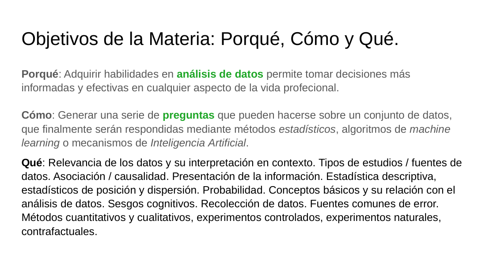
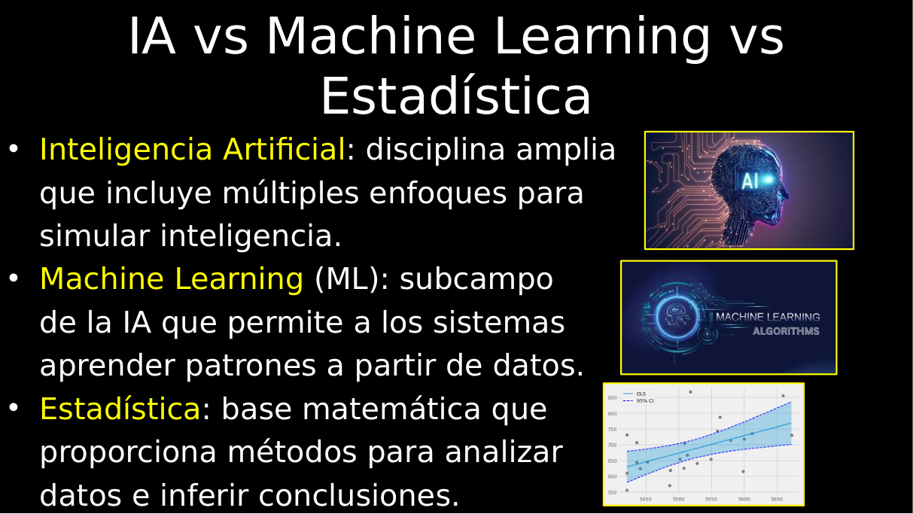
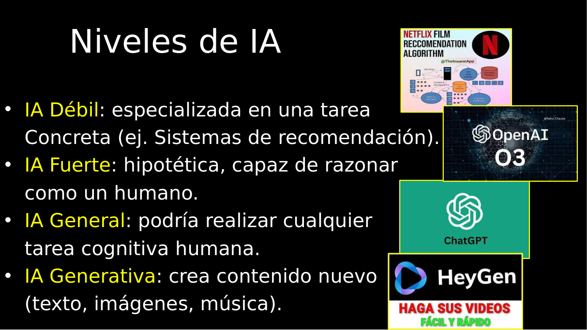
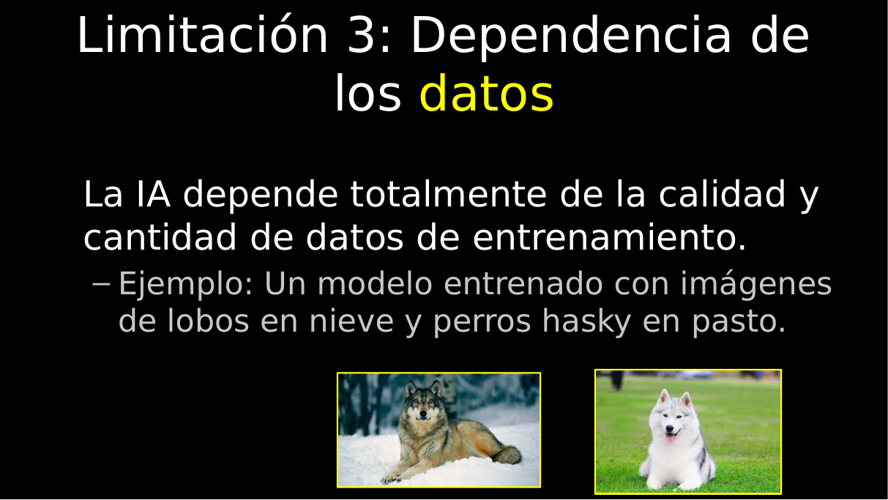
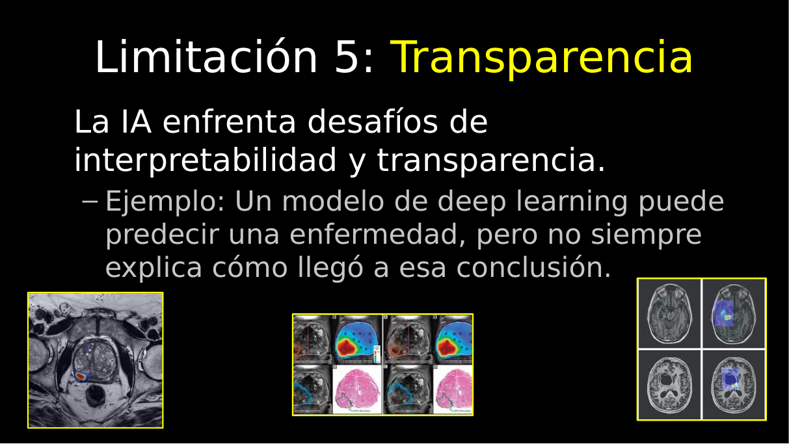

# Clase 01 · Qué es la IA y tipos de aprendizaje

> **Módulo 1 · Fundamentos de IA y Machine Learning** · Andrés Farall · martes 07-abr-2026
> **Fuentes:** transcripción `DIA_Clase_01.vtt` · láminas `Presentacion IA 1.pdf` y `Introduccion al Razonamiento con Datos 6.pdf`

## En pocas palabras

- El fundamento más básico de la IA es el **aprendizaje basado en datos**. Desde un plano ajustado a tres variables hasta ChatGPT, todo es, en el fondo, hacer estadística (más o menos compleja y flexible) sobre los datos.
- La IA no es nueva: el campo nace formalmente en 1956 y las redes neuronales existen desde los años 40-50, pero pasaron un largo **"invierno de la IA"** antes de imponerse en las últimas dos décadas.
- La **IA discriminativa** aprende patrones guiados por etiquetas (gato/perro); la **IA generativa** aprende la estructura subyacente de los datos para producir objetos nuevos que respeten esos patrones.
- La taxonomía central del aprendizaje con datos es **supervisado** (hay una variable $Y$ conocida en los datos históricos: clasificación si es categórica, regresión si es numérica) versus **no supervisado** (no hay $Y$; por ejemplo, segmentación o *clustering*).
- La IA tiene límites serios: no tiene conciencia ni empatía, reproduce los sesgos de sus datos y, sobre todo, es **poco transparente**, lo que la deja afuera de muchas aplicaciones donde hay que poder explicar la decisión.

## Conceptos clave

### Enfoque del curso: entender el motor, no aprender a manejar

El profesor aclara de entrada que estas clases no enseñan a "promptear" modelos generativos. La analogía es el auto: no se trata de aprender a manejar sino de entender la termodinámica y la mecánica (el cilindro, el cigüeñal, la caja de cambios). El objetivo es transmitir el mecanismo que está detrás de la IA para luego usarla mejor y distinguir qué problemas son propios de la IA y cuáles se resuelven mejor con otras herramientas.

Los ejes que van a atravesar las primeras clases:

- Qué es un dato y cómo se mira, se resume y se grafica (análisis exploratorio).
- **Predictivo vs. explicativo** en el aprendizaje con datos.
- **Supervisado vs. no supervisado** (y también semisupervisado y por refuerzo).
- Diferencias entre estadística, *machine learning* e IA basada en redes neuronales.
- Temas específicos: regresión y clasificación (y su evaluación), *clustering*, reducción de dimensión, detección de anomalías y aprendizaje por refuerzo.

Se subraya especialmente la **reducción de dimensionalidad**: la idea de espacios latentes (lo que hoy se llama *embeddings*) tiene unos 150 años desde el punto de vista matemático y explica buena parte de la "magia" de la IA generativa.

La lámina de objetivos resume el método: generar **preguntas** sobre un conjunto de datos que luego se responden con métodos estadísticos, algoritmos de *machine learning* o mecanismos de IA.

### Definición de inteligencia artificial

La definición preferida por el profesor es la de **Marvin Minsky** (pionero del MIT): la IA es *la ciencia de hacer que las máquinas hagan cosas que, si las hiciera un humano, uno pensaría que requieren inteligencia*.

Las láminas agregan definiciones más simples: programas que simulan comportamientos inteligentes, sistemas que aprenden de los datos y mejoran con la experiencia, y herramientas que automatizan la toma de decisiones.

### IA, machine learning y estadística

| Disciplina | Qué es según las láminas |
|---|---|
| Inteligencia Artificial | Disciplina amplia con múltiples enfoques para simular inteligencia. |
| Machine Learning | Subcampo de la IA que permite a los sistemas aprender patrones a partir de datos. |
| Estadística | Base matemática que da métodos para analizar datos e inferir conclusiones. |

La tesis del profesor va más allá de la lámina: la frontera entre "hacer estadística" y "aprender" no existe. Un modelo que ajusta un plano y un LLM hacen lo mismo en esencia: aprenden de los datos. Cambian la complejidad, la flexibilidad y la escala (50 observaciones y 3 variables frente a cientos de miles de millones de documentos), no la naturaleza del mecanismo. Cuando ChatGPT corrige "los métodos regresión" por "los métodos **de** regresión", lo hace porque tiene aprendida la estadística de qué palabra suele seguir a cuál.

### Dos líneas de tiempo: la IA y las redes neuronales

Hipótesis de trabajo del curso: lo que hoy llamamos IA está asociado casi por completo a las **redes neuronales**.

| Año | Hito de la IA |
|---|---|
| 1950 | Alan Turing propone la prueba: una máquina es inteligente si un grupo de humanos no puede distinguir su comportamiento del de un humano. |
| 1956 | Workshop de Dartmouth: se define formalmente el campo. |
| 1986 | *Backpropagation*: ordena ideas previas para entrenar redes. |
| 1997 | Deep Blue le gana a Kasparov al ajedrez, el "juego ciencia". |
| 2012 | AlexNet gana ImageNet (millones de imágenes, unas mil clases); desde ahí las redes superan a los humanos clasificando imágenes. |
| 2016 | Un algoritmo le gana al campeón mundial de Go. |
| 2018 | BERT y las primeras arquitecturas Transformer. |
| 2020 | Primeros modelos de lenguaje modernos, muy efectivos. |

En paralelo, las redes neuronales: neurona digital (1943), red de Rosenblatt para clasificar letras con reflectores, fotodetectores y cables (1958), críticas matemáticas severas hacia 1969, *backpropagation* (hacia 1986-89) y luego arquitecturas específicas: redes convolucionales (imágenes), LSTM (fenómenos temporales), AlexNet, mecanismos adversariales, BERT y Transformers.

**La lección:** la arquitectura que hoy revoluciona todo nació en los 50-60, pero no ganó en su momento. Durante 20-30 años (el **invierno de la IA**) la estadística fue la metodología que mejor aprendía de los datos. El profesor lo compara con la vida multicelular, que aparece hace unos 2.000 millones de años pero recién se destaca 1.600 millones de años después: los hitos revolucionarios a veces tardan en imponerse.

### Niveles de IA (taxonomía del "folclore")

- **IA débil:** especializada en una tarea concreta (ej. el recomendador de Netflix).
- **IA fuerte:** hipotética, capaz de razonar como un humano (se menciona o3 de OpenAI como algo que podría pensarse así).
- **IA general:** podría realizar casi cualquier tarea cognitiva humana (ChatGPT como ejemplo).
- **IA generativa:** crea contenido nuevo (texto, imágenes, música), no recupera ni resume contenido existente.

El profesor advierte que presenta estas categorías porque circulan, pero que las va a desafiar más adelante (por ejemplo, propone no llamar "IA" a un sistema de recomendación, sino algoritmo específico).

### IA discriminativa vs. IA generativa

- **Discriminativa:** aprende de información previamente etiquetada para distinguir clases. Ejemplo típico: una red que, dada una imagen, dice si es gato o perro. Es lo que en estadística se llama un **problema supervisado**: la etiqueta ("gatito", "perrito") supervisa el aprendizaje.
- **Generativa:** aprende los patrones subyacentes a cómo se estructuran los datos, sin estar guiada por etiquetas. Una vez aprendidos, puede generar elementos nuevos que respetan esos patrones.

**El argumento de la pantalla de 100 × 100.** Una pantalla en blanco y negro de 100 × 100 píxeles (cada píxel prendido o apagado) es una matriz de ceros y unos. Con $N$ píxeles hay $2^N$ imágenes posibles (1 píxel: 2; 2 píxeles: 4; 3 píxeles: 8), así que acá hay

$$2^{10\,000}$$

imágenes posibles, un número muy superior a la cantidad de partículas del universo. Pero las imágenes con sentido para un humano (una cara, una llave, un perro) ocupan un subconjunto diminuto de ese espacio. Si se generan matrices al azar, aun a mil por segundo, pueden pasar eones sin que aparezca algo reconocible. Lo que le falta a ese generador "tonto" son justamente los **patrones subyacentes** que conectan las imágenes reales. La IA generativa consiste en que las redes aprendan esos patrones; el objetivo de estas clases es entender el fundamento del aprendizaje con datos que lo hace posible.

### Limitaciones de la IA

| Limitación | Idea | Ejemplo de la clase |
|---|---|---|
| Conciencia | No tiene metaconocimiento de lo que hace. | Un chatbot habla de emociones sin sentirlas. |
| Sentido común y empatía | Puede parecer humana, pero no tiene relación empática. | Escena de *Patch Adams*: el médico que habla de amputar delante del paciente (al humano también le puede faltar empatía). |
| Dependencia de los datos | Aprende sólo lo que hay en los datos. | Huskies vs. lobos (ver abajo). |
| Sesgos | Reproduce los sesgos de los datos en sus salidas. | Etiquetado automático de Google que catalogó a una pareja afroamericana como gorilas; selección laboral que discrimina minorías. |
| Transparencia | Predice muy bien pero no explica cómo. | Diagnóstico por imágenes. |

**Dependencia de los datos.** Una red entrenada para distinguir huskies de lobos funcionaba bien hasta que empezó a errar: en realidad había aprendido a distinguir **pasto de nieve**, porque en los datos de entrenamiento los huskies aparecían siempre en pasto y los lobos en nieve. Si los datos obedecen a un patrón particular, el algoritmo aprende ese patrón (que es más fácil) y no el que uno quería.

**Transparencia: predecir vs. explicar.** En diagnóstico por imágenes (por ejemplo, cáncer de mama), los algoritmos ya superan a los hiperespecialistas. Pero los humanos no sólo queremos buena predicción: queremos saber qué patrón vio el modelo, por qué eligió un tipo y no otro, cuán seguro está. La lámina lo ilustra con imágenes médicas donde el modelo resalta zonas en color, sin explicar el razonamiento. Esta falta de transparencia no nació con la IA generativa (ya pasaba con el *machine learning* predictivo), pero los modelos generativos son "la quintaesencia de lo no transparente".

## Ejemplos y casos de la clase

- **Seguros y créditos (transparencia obligatoria).** Las primas de seguros se fijan con tablas y modelos transparentes, no con redes neuronales, aunque la industria mueve una parte enorme del PIB mundial. Un alumno aportó que en el otorgamiento de créditos ningún *scoring* se aprueba si no puede explicar por qué se le negó el crédito a alguien; el regulador tiene que poder verificar que no se discrimina por religión, raza, etc.
- **Piloto automático.** En vuelos largos el piloto automático no es IA: es un sistema de reglas de decisión transparentes que ingenieros y pilotos estudian. Moraleja: la transparencia importa según lo que está en juego (no importa para que ChatGPT mejore un párrafo; sí para un crédito, una prima o 400 pasajeros).
- **IA en la industria alimentaria** (láminas: producción, distribución, calidad, marketing, consumidores):
  - Drones con visión artificial que detectan plagas en tiempo real e indican el tratamiento, reemplazando el muestreo manual y el envío a un especialista.
  - Logística de perecederos (lácteos, quesos) según vencimientos y lugares de consumo, para minimizar pérdidas.
  - **Narices electrónicas** (ej. Cyranose): detectan con mucha anticipación la putrefacción, por ejemplo en pescado; se usan hace unos 25 años.
  - Tiendas tipo Amazon Fresh que aprenden los hábitos de compra y sugieren productos y combos.
  - Apps que sugieren recetas según lo que hay en la heladera.
- **Anteojos para personas no videntes** que traducen en tiempo real lo que la persona tiene adelante.
- **Scoring crediticio (supervisado, clasificación).** Base histórica con atributos (edad, ocupación, sexo, años de estudio) y una columna clave: si la persona hizo *default* o no. El algoritmo busca qué patrones comparten las filas con default y las sin default. (El ejemplo "hombres jóvenes defaultean más" es explícitamente ficticio.)
- **Salario en una agencia de empleo (supervisado, regresión).** Si la ley prohíbe preguntar cuánto ganaba alguien, se entrena un modelo con una base de atributos y salarios para predecirlo.
- **Compra de una cerveza IPA (supervisado).** Un alumno de retail de bebidas planteó predecir la propensión de compra de un producto. Como la base histórica dice quién compró y quién no, es supervisado, igual que el default del banco.
- **Segmentos de Coto (no supervisado).** Segmentar clientes en "premium" y "popular": nadie llega a la caja diciendo a qué segmento pertenece. Hay atributos (zona, ticket, medio de pago, edad), pero no la etiqueta; la segmentación la construye uno a partir de las X.
- **Prototipos de usuarios de Google.** Resumir miles de millones de usuarios en unos pocos prototipos (ej. "buscador de noticias") para ofrecer a cada uno herramientas o publicidad. A priori no se sabe cómo van a salir los segmentos.
- **Jóvenes porteños y el dinero (caso real del profesor).** Una encuesta a miles de jóvenes de 20 a 35 años sobre ahorro, salidas y consumo, sin preguntarles "¿sos ahorrador?". Se armaron segmentos, se caracterizaron por sus prototipos y se los nombró con animales (la "hormiguita ahorradora"). Salió en la tapa de un diario y la información se vendió a bares.
- **Sistema de recomendación tipo Netflix (caso abierto).** Matriz usuarios × películas con notas (o una nota inducida por cuánto de la película se vio). El objetivo es completar las celdas no observadas y recomendar las de nota predicha alta. Quedó como reflexión si es supervisado o no; una solución intuitiva es agrupar usuarios que puntúan parecido las películas que vieron en común y predecir con la nota promedio del segmento.

## Para recordar

- "El fundamento más básico de la IA es el aprendizaje basado en datos."
- La revolución de los últimos 20 años no es una tecnología aislada: es cómo aprendemos de los datos.
- Supervisado no significa que el modelo conozca la $Y$ de los casos nuevos, sino que **los datos históricos con los que se entrena** traen la $Y$ explícita. Luego el modelo se usa para predecir $Y$ donde no se la conoce.
- Una vez entrenado (calibrado) y puesto en producción, el modelo queda fijo; se lo puede reentrenar con datos nuevos que traigan las tres variables.
- **¿Cuántos datos hacen falta?** Depende de la cantidad de variables, de la complejidad de las relaciones y de la flexibilidad del algoritmo: con 3 variables y un modelo estadístico sencillo alcanzan decenas de observaciones; con cientos de variables y una red neuronal, decenas de miles. Se diagnostica validando: si el modelo comete muchos errores, faltan datos o el algoritmo no es el adecuado.
- La ciencia de datos es saber qué modelo, cuánta flexibilidad, cuántos datos y qué validación requiere cada dominio. El costo de los distintos tipos de error depende del dominio (no es lo mismo clasificar manzanas que pacientes).
- Una buena segmentación tiene elementos **cercanos dentro** de cada grupo y **lejanos entre** grupos. El algoritmo agrupa según los atributos que se le pasan: si son todos de poder adquisitivo, los segmentos van a reflejar poder adquisitivo.
- Muchas veces hay que **transformar los datos antes de aprender** (por ejemplo, compensar usuarios que siempre ponen notas bajas o películas que todos puntúan alto).
- Algo que parece inteligente, como un buen recomendador, es "hacer estadística" con una lógica ingeniosa para aprender del dato.

## Preguntas de repaso

1. ¿Por qué el profesor sostiene que no hay una diferencia de fondo entre "hacer estadística" y lo que hace ChatGPT?

Porque ambos aprenden patrones a partir de datos. ChatGPT aprendió la estadística de qué token sigue a otro en enormes volúmenes de texto, igual que un plano ajustado aprende cómo varía $Y$ con $X_1$ y $X_2$. Cambian la escala, la complejidad y la flexibilidad del modelo, no el mecanismo.

2. ¿Qué enseña el ejemplo de la pantalla de 100 × 100 sobre la IA generativa?

Que el espacio de imágenes posibles ($2^{10\,000}$) es astronómico, pero las imágenes con sentido ocupan una parte ínfima. Generar al azar no sirve: hay que aprender los patrones subyacentes que definen ese subconjunto, y eso es lo que hacen las redes generativas.

3. Un banco tiene edad, ocupación y años de estudio de clientes pasados, y si pagaron o no el crédito. ¿Qué tipo de problema es y por qué?

Supervisado de clasificación: existe en los datos históricos una variable $Y$ explícita (default / no default) y es categórica. Si la $Y$ fuera numérica (por ejemplo, el salario) sería regresión.

4. ¿Por qué segmentar clientes de un supermercado en "premium" y "popular" es no supervisado si uno "sabe" que esa diferencia existe?

Porque esa etiqueta no está explícita en los datos: ningún cliente la declara. Sólo hay atributos (zona, ticket, medio de pago). El algoritmo arma grupos de clientes parecidos y la etiqueta se construye después, interpretando los prototipos.

5. ¿Qué aprendió realmente la red de huskies y lobos, y qué limitación ilustra?

Aprendió a distinguir pasto de nieve, porque en los datos de entrenamiento cada especie aparecía siempre en un mismo fondo. Ilustra la dependencia de los datos y los sesgos: el modelo reproduce cualquier patrón espurio presente en el entrenamiento.

6. Si un algoritmo de diagnóstico por imágenes supera a los especialistas, ¿por qué podría no alcanzar? Relacionalo con seguros y créditos.

Porque además de predecir, muchas decisiones exigen explicar: qué patrón se vio, por qué esa clase, con qué seguridad. En seguros y créditos los reguladores exigen modelos transparentes para verificar que no se discrimina, por eso no se usan redes neuronales aunque predigan bien.

7. ¿Por qué una segmentación con grupos compactos y separados se considera mejor que otra que corta los puntos arbitrariamente?

Porque cumple el criterio natural de validez: elementos del mismo segmento están cerca entre sí y elementos de segmentos distintos están lejos. Una partición que no respeta esa estructura es arbitraria.

8. ¿Qué enseña el "invierno de la IA" sobre las redes neuronales?

Que una arquitectura revolucionaria puede nacer mucho antes de imponerse: las redes existían desde los 50, pero durante décadas la estadística aprendía mejor de los datos. Recién con el *backpropagation*, nuevas arquitecturas y, desde 2012, resultados como AlexNet, pasaron a dominar.

## Conexiones

- **Clases siguientes del módulo:** la lámina "Las preguntas a los datos y sus respuestas en gráficos" (y su ejercicio para después de la 2.ª clase) abre el análisis exploratorio. Más adelante vienen regresión y clasificación con su evaluación, *clustering*, reducción de dimensión (espacios latentes / *embeddings*), detección de anomalías y aprendizaje por refuerzo.
- **Resto de la diplomatura:** redes convolucionales, LSTM, Transformers y modelos de lenguaje, mencionados acá sólo en las líneas de tiempo, se ven en módulos posteriores.
- **TFI:** la idea de que los espacios latentes (*embeddings*) son una forma de reducción de dimensión es la base del retrieval semántico que se usa para normalizar nombres comerciales en Benefix.
