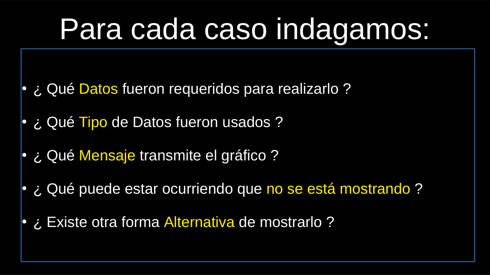
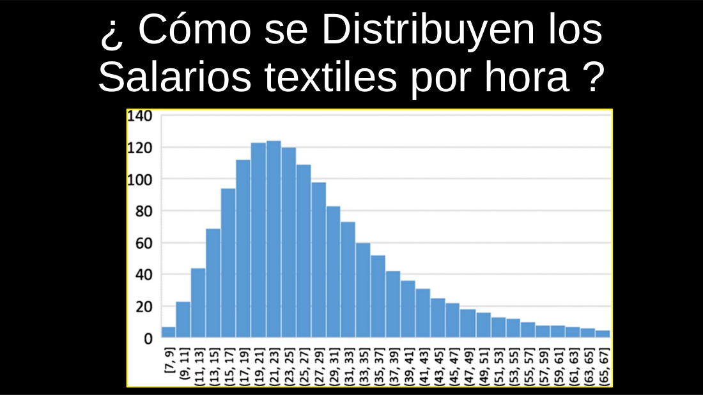
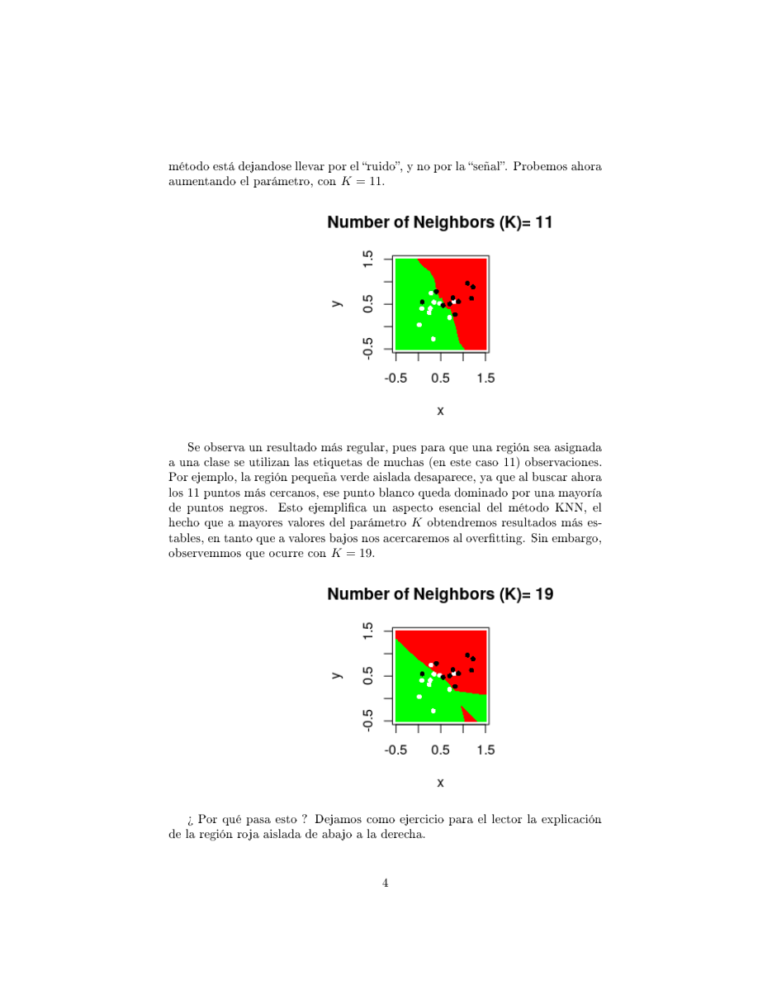
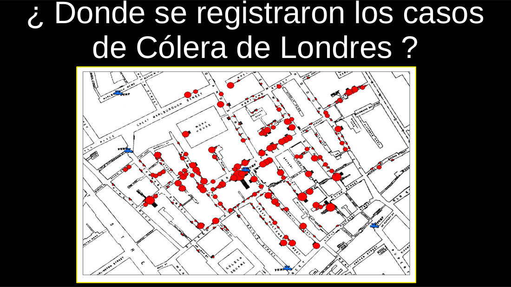
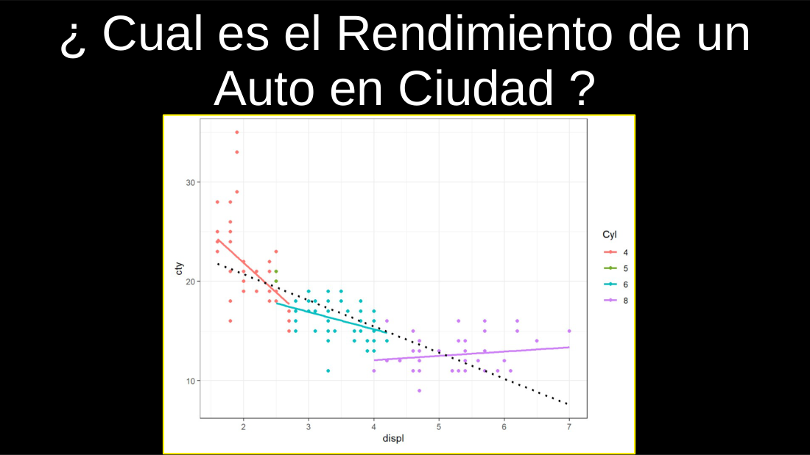
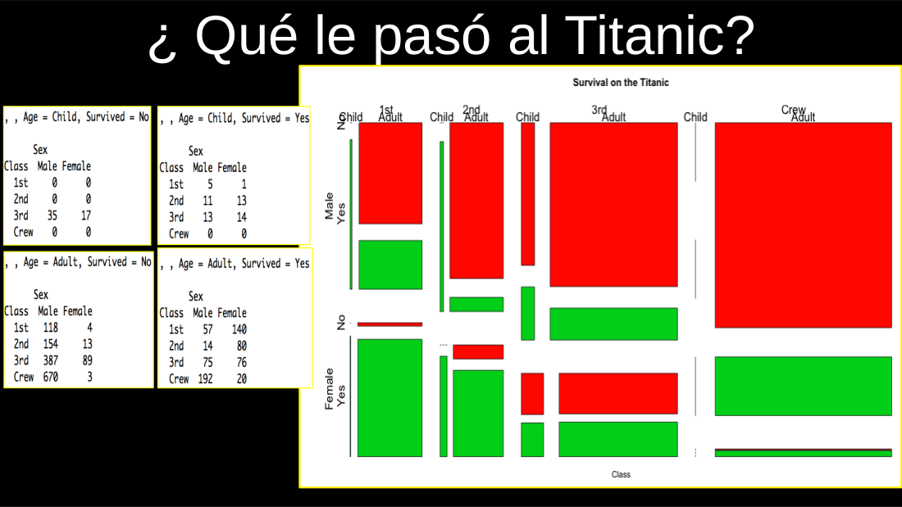

# Clase 02 · Razonar con datos, árboles de decisión y KNN

> **Módulo 1 · Fundamentos de IA y Machine Learning** · Andrés Farall · jueves 09-abr-2026
> **Fuentes:** transcripción `DIA_Clase_02.vtt` · láminas `Árboles de Decisión.pdf` y `El Problema de la Clasificación y KNN.pdf` · presentación mostrada en clase "Introducción al razonamiento con datos"

## En pocas palabras

- Aprender de datos empieza por leerlos con sentido crítico: qué datos se usaron, de qué tipo, qué mensaje transmiten, qué dejan afuera y si hay otra forma de mostrarlos. Un aprendizaje basado en pocos datos es parcial y no se puede extrapolar a lo que esos datos no miden.
- Un **árbol de decisión** aprende reglas dicotómicas (variable + punto de corte) que separan lo más abruptamente posible la variable *target*. Es supervisado, transparente (caja blanca) y sirve tanto para **predecir** como para **explicar**.
- **Vecinos más cercanos (KNN)** predice la clase de un dato nuevo por mayoría entre sus K vecinos más parecidos en el espacio de atributos. Predice bien, pero explica poco: su "aprendizaje" es toda la base de datos más el hiperparámetro K.
- K regula el equilibrio entre **overfitting** (K chico: copia el ruido) y **underfitting** (K grande: pierde estructura). Además, cualquier clasificador que minimiza la tasa de error se ve afectado por el **desbalance de clases**.
- Predecir no es explicar: los mejores métodos predictivos tienden a explicar mal y viceversa (trade-off sesgo-varianza). Y "explicar" en estos métodos significa encontrar **asociaciones**, no causas.

## Conceptos clave

### Razonar con datos: cinco preguntas ante cada gráfico

Antes de entrar en los métodos, la clase repasó una serie de gráficos con una misma guía. El foco no está en el gráfico en sí sino en **qué aprendemos de esos datos y qué no**.

1. ¿Qué **datos** se usaron?
2. ¿De qué **tipo** son (numéricos, enteros, categóricos, espaciales…)?
3. ¿Qué **mensaje** transmiten?
4. ¿Qué puede estar ocurriendo que **no se muestra**?
5. ¿Hay una forma **alternativa** de mostrarlo?

La cuarta pregunta es la central: todo análisis es acotado, y hay que ser consciente de qué cosas pueden estar cambiando sin que ese razonamiento lo refleje.

### Repaso estadístico: distribución, moda, media y mediana

- Un **histograma** agrupa una variable numérica en intervalos (*bins*) y cuenta cuántas observaciones caen en cada uno. Muestra la **distribución** de la variable.
- **Moda**: el valor (o intervalo) más frecuente.
- **Mediana**: el valor que, con los datos **ordenados**, deja el 50 % de las observaciones a cada lado. No es el punto medio del rango.
- **Media**: suma de valores dividida por la cantidad.
- La mediana es **robusta**: si se altera un valor extremo (por ejemplo, el salario más alto pasa de mil a un millón), la media cambia y la mediana no.
- En distribuciones **asimétricas a derecha** (típicas de ingresos: muchos con poco, pocos con mucho), la media queda por encima de la mediana. La diferencia entre ambas es una medida natural de asimetría. Para caracterizar una población así conviene confiar más en la mediana.

### Agregado vs. desagregado: las relaciones pueden cambiar

Una relación observada en el conjunto (por ejemplo, "a más riqueza, más vacunación") describe el **comportamiento promedio**, no a cada individuo. Que no sea perfecta se nota cuando, para un mismo valor en un eje, hay valores muy distintos en el otro.

Al **condicionar** por una tercera variable, la relación puede moderarse, cambiar o hasta invertirse (ver el ejemplo de los autos más abajo). El aprendizaje que se saca del agregado puede cambiar "violentamente" al filtrar por grupos.

### Predecir vs. explicar

| | Predecir | Explicar |
|---|---|---|
| Pregunta | ¿Qué va a pasar con este caso nuevo? | ¿De qué depende el fenómeno? |
| Uso | Tomar una acción puntual (qué descuento ofrecerle a un cliente que amenaza con irse) | Cambiar la lógica del negocio (a qué segmento apuntar) |
| Quién lo usa | El operador que atiende la llamada | El analista que piensa el negocio |

Explicar, en este contexto, es **asociar** la variable de interés con las características. No implica causalidad.

### Árboles de decisión (CART)

**Qué es.** Una técnica **supervisada** (Classification and Regression Trees, Breiman et al., 1984) que sirve para clasificación y regresión. Matemáticamente, genera una **partición del espacio de atributos** en zonas donde el *target* es lo más homogéneo posible.

**Contexto histórico.** En los 70 y 80 los sistemas de IA más potentes, los **sistemas expertos**, se basaban en árboles de decisión: diagnóstico médico en clínicas de EE. UU., los primeros programas de ajedrez. Antes esas reglas las armaban expertos a mano; la gracia en machine learning es que **surgen automáticamente de los datos**. Hoy siguen siendo la base de los métodos predictivos más potentes (**random forest** y **boosting**/XGBoost).

**Cómo crece.** De forma iterativa y **greedy** (ambiciosa):

1. En la raíz están todos los datos.
2. Se prueban **todas las variables y todos los puntos de corte posibles**, y se elige la regla dicotómica que más reduce la **impureza** (que mejor separa el target).
3. Se repite recursivamente dentro de cada subconjunto, **condicional** a las decisiones anteriores. No prueba muchos árboles alternativos: una vez elegido el primer corte, todo lo de abajo depende de él.
4. Se detiene al cumplirse algún criterio de parada.

En cada paso se busca la variable $j$ y el corte $u$ que minimizan la impureza promedio ponderada de los dos hijos:

$$\min_{j,u} \; P(S_L)\,I(S_L) + P(S_R)\,I(S_R)$$

Para variables categóricas con $p$ etiquetas, el "corte" es una partición de las etiquetas en dos grupos ($2^{p-1}-1$ posibilidades).

**Medidas de impureza (láminas).**

- Clasificación: la **entropía** de la distribución de clases en el nodo, $H(P) = -\sum_i p_i \ln p_i$. Es máxima con clases equiproporcionales (máxima incertidumbre) y mínima si hay una sola clase. Las láminas la derivan a partir de la divergencia de Kullback-Leibler respecto de la distribución uniforme.
- Regresión: la variabilidad dentro del nodo, $I(S) = \sum_{i \in S}(y_i - \bar y)^2$.

**Criterios de parada** (operan juntos; alcanza con que se cumpla uno):

| Criterio | Qué controla |
|---|---|
| `minbucket` | Mínimo de observaciones en cada hoja |
| `minsplit` | Mínimo de observaciones para intentar partir un nodo |
| `maxdepth` | Profundidad máxima (decisiones desde la raíz a una hoja) |
| `CP` | No partir si la mejora relativa de impureza no supera un umbral |

La **profundidad** determina la complejidad del modelo.

**Poda.** El enfoque original crece árboles sobreajustados y después los **poda**, buscando el mejor compromiso entre impureza y complejidad con la función costo-complejidad:

$$C_\lambda(T) = \sum_{s\ \text{terminal}} P(S)\,I(S) + \lambda\,|T|$$

Con $\lambda = 0$ queda el árbol completo; con $\lambda \to \infty$ queda solo la raíz.

**Cómo predice.** Se "baja" la observación nueva por el árbol aplicando las reglas desde la raíz hasta una hoja. En clasificación se predice la clase mayoritaria (o la proporción) de esa hoja; en regresión, el promedio de $y$ en la hoja.

**Dónde queda el aprendizaje.** En la **estructura del árbol**: la secuencia jerárquica de variables y puntos de corte. Eso se puede guardar en una lista, una planilla o una base de datos, y es el **modelo entrenado**. No hace falta guardar los datos originales. Mientras no se reentrene, esos parámetros no cambian.

**Ventajas frente a KNN (según las láminas):** no necesita una métrica de distancia sobre todo el espacio, predice más rápido, no requiere almacenar el dataset, explica el efecto de los atributos y maneja datos faltantes de forma natural.

**Limitaciones.** Rara vez modela bien el proceso que genera los datos. Como método explicativo es muy bueno, pero en clase se lo presentó como de menor capacidad predictiva que otros métodos. Las reglas no deben confundirse con un flujo de control de programación: son condiciones que definen subconjuntos de la población.

### El problema de la clasificación

Clasificar es predecir un target **categórico** (por ejemplo, sobrevive / no sobrevive). Todo clasificador define una **partición del espacio de atributos** en regiones, una por clase.

Las láminas formalizan el clasificador óptimo. Con costos de mala clasificación iguales, conviene asignar cada $x$ a la clase con mayor probabilidad a posteriori, el **clasificador de Bayes**:

$$P(Y=j \mid X=x) = \frac{\pi_j f_j(x)}{\sum_i \pi_i f_i(x)} \;\propto\; \pi_j f_j(x)$$

donde $\pi_j$ es la probabilidad a priori de la clase y $f_j(x)$ la densidad de los atributos en esa clase. La consecuencia clave es que **el clasificador mezcla dos cosas distintas**: cómo se comportan los atributos en cada clase ($f_j$) y qué tan frecuente es cada clase ($\pi_j$).

- **Discriminativos**: aproximan $P(Y=j \mid X)$ directamente (KNN, regresión logística).
- **Generativos**: modelan las densidades $f_j(x)$ (por ejemplo, los clasificadores lineales y cuadráticos de Fisher).

### Vecinos más cercanos (KNN)

**Cómo funciona.** Para un dato nuevo:

1. Se buscan las **K observaciones más cercanas** en el espacio de atributos (por ejemplo, distancia euclídea).
2. Se predice la **clase mayoritaria** entre esos K vecinos.

Con dos clases se suele usar **K impar** para evitar empates (si los hay, se suele sortear). Es un método no paramétrico: no supone ningún modelo para los datos.

**Dónde queda el aprendizaje.** Para que otra persona haga exactamente las mismas predicciones, hay que pasarle **toda la base de datos y el valor de K**. Es el contraste directo con el árbol, donde alcanza con las reglas.

**El hiperparámetro K.** Es la perilla principal y regula cuánto se acerca el método al overfitting:

- **K chico** (K = 1): fronteras muy irregulares, islas alrededor de puntos aislados (celdas de Voronoi). El método sigue el **ruido**, no la señal.
- **K más grande** (K = 11): fronteras más suaves y estables; las islas desaparecen.
- **K demasiado grande**: puede aparecer comportamiento raro (con K = 19 en el ejemplo surge una región roja aislada abajo a la derecha) y se pierde estructura local.

**Cuidados.**

- La elección de la distancia es fundamental. Si las variables están en unidades distintas, conviene **estandarizarlas** (restar la media y dividir por el desvío).
- Con muchos atributos (decenas o cientos) no se puede visualizar ni explicar en qué sentido un caso "se parece" a otros.

### Desbalance de clases

Ejemplo de las láminas: dos clases normales con 400 observaciones.

| Escenario | K | Accuracy | Qué pasa |
|---|---|---|---|
| 50 % / 50 % | 99 | 86 % | 32 verdes y 24 rojos mal clasificados; partición razonable |
| 80 % verdes | 99 | 86 % | 52 rojos y 4 verdes mal clasificados; incluso la zona más densa de rojos se predice verde |
| 90 % verdes | 99 | 90 % | Nunca predice rojo: siempre verde |
| 90 % verdes | 9 | 95 % | La región verde sigue avanzando sobre la roja |

Con N = 10.000 y K = 49 pasa lo mismo: con 90 % de verdes se clasifica todo como verde. No es un problema de pocos datos ni exclusivo de KNN: le pasa a **cualquier clasificador que minimiza la tasa de error**, porque las $\pi_j$ pesan en la decisión.

- Si el objetivo es **predecir** minimizando errores, ese clasificador es óptimo.
- Si el objetivo es **explicar** cómo difieren las clases según sus atributos, es inútil: esconde que los rojos ocupan una zona particular.
- Soluciones: ponderar las observaciones por la inversa de $\pi_j$ o balancear la muestra.

### Árbol vs. KNN

| | Árbol de decisión | KNN |
|---|---|---|
| Etiqueta en clase | Método "estadístico" | Método de "machine learning" |
| Qué aprende | Reglas anidadas (variable + corte) | Nada resumido: usa los datos tal cual |
| Qué hay que guardar | El árbol | Toda la base de datos + K |
| Explicabilidad | Alta (caja blanca) | Baja |
| Capacidad predictiva (según el profesor) | Menor | Mayor |
| Parámetro clave | Criterios de parada / poda | K |

## Ejemplos y casos de la clase

- **Países por continente (torta).** Cinco números enteros. Muestra que Oceanía tiene pocos países y África muchos, pero nada dice de superficie, población o riqueza: no hay que extrapolar.
- **Salarios textiles (histograma).** Una fila por empleado con su salario. Sirvió para repasar distribución, moda, media, mediana, robustez y asimetría a derecha.
- **Puntos acumulados en la NBA vs. edad.** La pendiente es el rendimiento (puntos por unidad de tiempo); las mesetas son los recesos entre temporadas; con la edad las curvas se aplanan, salvo casos atípicos como Jordan o LeBron. El eje es la edad personal, no el tiempo histórico: se comparan épocas distintas.
- **Inmigración en EE. UU. (gráfico de flujo).** Proporción de nacidos en el exterior a lo largo del tiempo, por región. Muestra caídas y subidas ligadas a cambios de legislación y un cambio de composición: de mayoría europea a mayoría de América (sobre todo México) y crecimiento asiático. Un buen gráfico transmite lo que una tabla no.
- **Votos por comuna en CABA (mapa de polígonos).** Muestra proporciones pero oculta el peso de cada comuna en votos totales. Además, discretizar el espacio en unidades administrativas puede distorsionar un fenómeno que es continuo.
- **Cólera en Londres, John Snow (datos georreferenciados).** Marcó en el mapa las bombas de agua y los casos, y la densidad sugirió que el agua era el vector, cuando dominaba la teoría del "miasma". Mostrar el dato en el dominio que corresponde a su naturaleza (punto, no agregado por barrio) es lo que le da fuerza.

- **Vacunación vs. riqueza (burbujas por país).** Hay correlación positiva pero imperfecta. La pendiente promedio es una propiedad del conjunto, no de cada país. Las explicaciones que se nos ocurren (China vacuna más "porque obliga") no están en los datos: las agregamos nosotros.
- **Atributos por posición en fútbol (radar).** Útil para comparar **pocos individuos en muchas variables**. Se conectó con datos de alta dimensión como los genéticos.
- **Rendimiento de autos vs. cilindrada (`mpg`).** Globalmente, más cilindrada se asocia a menos rendimiento. Condicionando por cantidad de cilindros, la caída es muy fuerte en los de 4, más suave en los de 6 y en los de 8 la pendiente hasta se invierte.

- **Titanic.** Dataset con sexo, edad, clase (1ª, 2ª, 3ª, tripulación), cónyuges/hermanos a bordo y si sobrevivió. El árbol aprendido:
  - Raíz: sobrevive el 38 %.
  - Primer corte, **sexo**: mujeres (36 % del total) → 0,73; hombres (64 %) → 0,19.
  - Mujeres por clase: 1ª o 2ª (19 % del total) → 0,93; 3ª → 0,49.
  - Hombres por **edad** (corte en 9,5 años): menores → 0,53 (pocos); mayores → 0,17. Hombres mayores de 2ª o 3ª clase → 0,13.
  - Para predecir, se recorre el árbol: el "abuelo en tercera" cae en una hoja de baja supervivencia y la "sobrina en primera" en una de alta. Es una probabilidad **condicional a que el barco se hunda**.
  - El árbol elige el sexo primero no por el protocolo "mujeres y niños primero", sino porque es la variable que **más separa** la supervivencia en los datos.

- **Helados y ahogamientos.** Un árbol podría encontrar que comer helado se asocia a ahogarse. La causa común es el verano y la playa: asociación sin causalidad. Se mencionó también lo mucho que costó demostrar que el cigarrillo causa cáncer.
- **Superintendencia de cruceros / Banco Central.** Un regulador exige que la probabilidad informada sea entendible (con qué variables se calculó, sin usar raza ni religión). Un árbol lo permite; decir "a Lara le negué el crédito porque se parece a estas 17 personas en 58 *features*" no convence a nadie.
- **KNN en vivo.** Con una alumna (29 años, 55 kg) como punto nuevo, se predijo según sus 3 vecinos. Cambiando K de 3 a 15 en una misma posición, la predicción pasó de "sobrevive" a "no sobrevive".

## Para recordar

- "Si aprendo algo con un conjunto muy limitado de datos, cuidado con extrapolar a cosas que no están en esos datos."
- Muchas elucubraciones razonables "no están en los datos: las estamos inventando nosotros".
- Leer bien un gráfico es una de las herramientas más importantes del aprendizaje de datos.
- Un árbol explica en el sentido de **asociación**: "correlación no es causalidad".
- Todo algoritmo que predice aprendió algo de los datos y lo guarda en algún lado. Preguntarse **dónde está guardado el aprendizaje** ayuda a entender cada método.
- Un modelo entrenado no cambia hasta que se reentrena. La mayoría de los sistemas predictivos no se reentrenan todo el tiempo.
- K es un **hiperparámetro**: junto con los datos, es lo que más regula la capacidad predictiva y la cercanía al overfitting.
- Los métodos que mejor predicen tienden a explicar mal y viceversa. No es casualidad: está ligado al trade-off sesgo-varianza.

## Preguntas de repaso

1. ¿Por qué un árbol de decisión elige el sexo como primer corte en el Titanic?

Porque prueba todas las variables y puntos de corte posibles y se queda con el que más reduce la impureza, es decir, el que más separa la tasa de supervivencia (de 0,38 global a 0,73 y 0,19). No interviene ningún conocimiento previo sobre protocolos de evacuación.

2. ¿Qué hay que entregarle a otra persona para que reproduzca las predicciones de un árbol y las de un KNN?

Del árbol, solo las reglas anidadas (variables y puntos de corte); no hace falta la base. Del KNN, toda la base de entrenamiento más el valor de K, porque cada predicción se calcula comparando contra los datos.

3. ¿Qué pasa con KNN cuando K es muy chico y cuando crece?

Con K chico (por ejemplo 1) la frontera es irregular y aparecen islas alrededor de puntos aislados: el modelo copia el ruido (overfitting). Al aumentar K la frontera se suaviza y es más estable, pero si K es demasiado grande se pierde estructura local y se tiende al underfitting.

4. Si un árbol muestra que el consumo de helado está asociado a ahogarse, ¿podemos decir que el helado causa ahogamientos?

No. El árbol encuentra asociaciones. Ahí hay un factor común (verano, gente en el agua) que explica ambas cosas. Explicar, en estos métodos, no significa identificar mecanismos causales.

5. ¿Por qué un clasificador con 90 % de accuracy puede ser inútil?

Con 90 % de casos en una clase, predecir siempre esa clase da 90 % de acierto. El clasificador minimiza el error, pero no refleja que la clase minoritaria ocupa una zona particular del espacio. Sirve para predecir, pero no para explicar cómo difieren las clases.

6. ¿Por qué un regulador preferiría un árbol antes que KNN para justificar una decisión?

Porque el árbol es una caja blanca: dice qué variables usó, en qué orden y con qué cortes. KNN solo puede decir "se parece a estos K casos", sin indicar en qué atributos ni cuánto pesó cada uno, sobre todo con muchas variables.

7. En el gráfico de autos, ¿qué enseña condicionar por cantidad de cilindros?

Que la relación global (más cilindrada, menos rendimiento) es un promedio que puede cambiar mucho por grupo: es muy fuerte en motores de 4 cilindros, más débil en los de 6 y se invierte en los de 8. Lo aprendido del agregado no necesariamente vale dentro de cada subgrupo.

8. ¿Por qué la mediana caracteriza mejor los ingresos que la media?

Porque la distribución es asimétrica a derecha: pocos valores muy altos tiran la media hacia arriba, mientras que la mediana, al ser robusta, no se mueve con esos extremos y representa mejor a la mayoría.

## Conexiones

- **Clase 01:** aprendizaje supervisado y el ejemplo de puntos proyectados en el espacio de atributos, que se retomó para presentar KNN.
- **Próxima clase:** regresión lineal y perceptrón (base de las redes neuronales), con la misma pregunta de qué significa "aprender" en cada método.
- **Más adelante en el módulo:** random forest y boosting, que combinan muchos árboles y son de los métodos predictivos más potentes. También aparecen el trade-off sesgo-varianza y el escalado de variables, clave para métodos basados en distancia como KNN.
- **TFI (Benefix):** KNN se basa en buscar los ejemplos más parecidos según una distancia, la misma lógica de recuperar los vecinos más cercanos que usa el *retrieval* semántico. La elección de la métrica y el escalado de las representaciones condicionan qué candidatos aparecen en el top-k (Hit@k, MRR).
