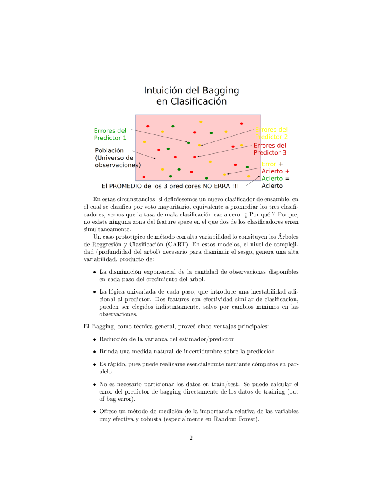
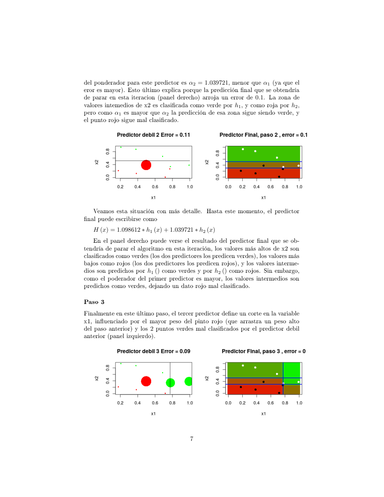
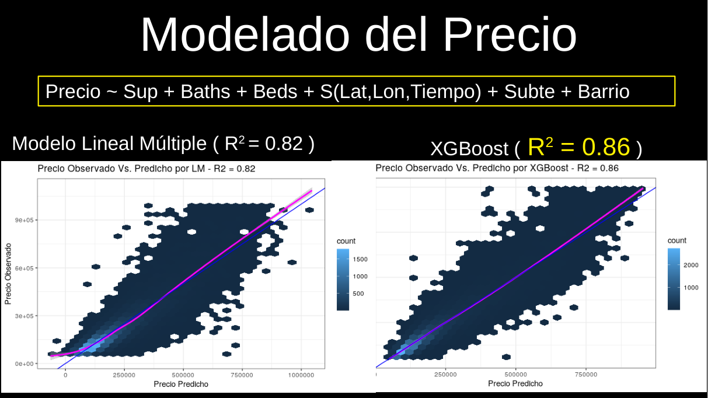
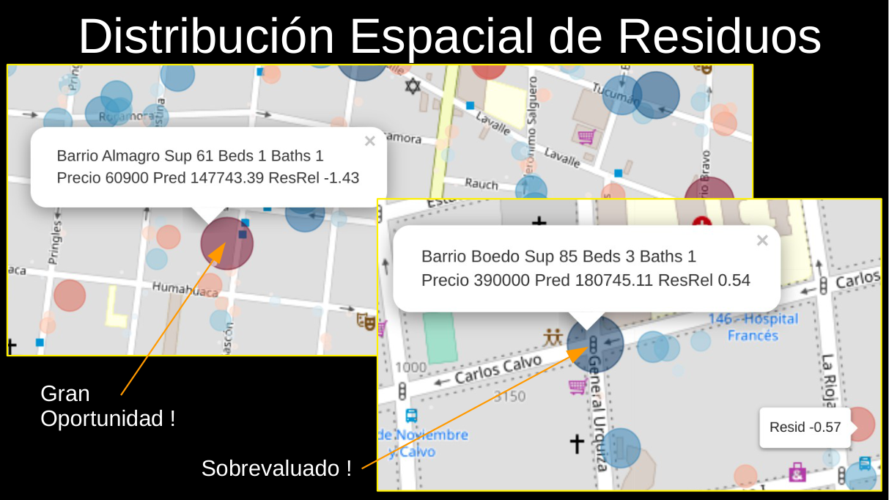
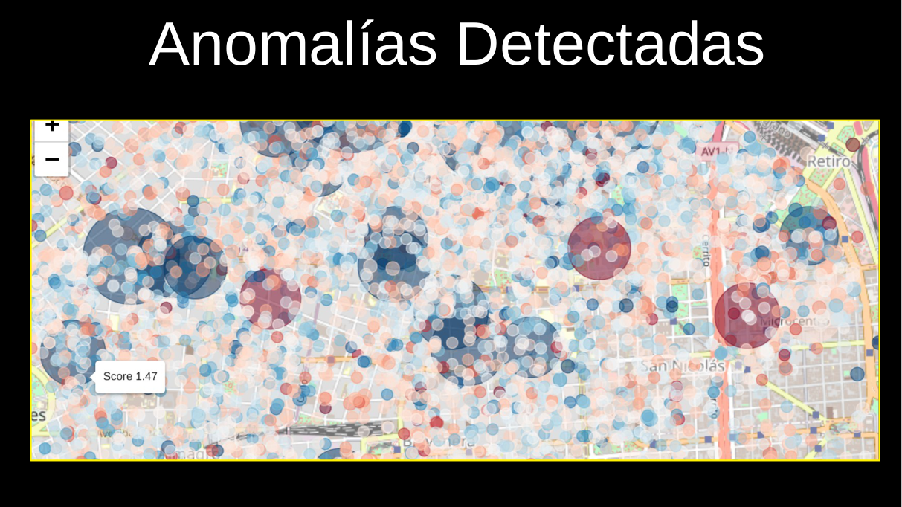

# Clase 03 · Ensambles: Random Forest y Boosting

> **Módulo 1 · Fundamentos de IA y Machine Learning** · Andrés Farall · martes 14-abr-2026
> **Fuentes:** transcripción `DIA_Clase_03.vtt` · láminas `Random_Forest.pdf` y `Boosting con Adaboost.pdf` · notebooks HTML mostrados en clase (datos bancarios y departamentos de Properati)

## En pocas palabras

- Un árbol de decisión explica muy bien, pero predice regular: si se lo deja crecer, memoriza la muestra (como *Funes el memorioso*) y pierde capacidad de generalizar. El sobreajuste depende de la relación entre la complejidad del modelo y la cantidad de datos.
- Los **ensambles** combinan muchos predictores relativamente independientes. Por el principio de la *sabiduría de la multitud* (*wisdom of the crowd*), el voto o el promedio de muchos predictores apenas mejores que el azar puede ser mucho mejor que cualquiera de ellos.
- **Random Forest** (bagging + árboles) arma muchos árboles complejos sobre muestras bootstrap y con variables sorteadas, y los promedia. Así reduce la variabilidad y además mide su propio error con el **error out of bag**, sin separar un conjunto de test.
- **Boosting** (AdaBoost, XGBoost) hace lo inverso: encadena árboles muy simples, y cada uno le da más peso a las observaciones que los anteriores clasificaron mal. Al final los combina ponderados por su acierto. Según el profesor, es el mejor método actual para predecir variables numéricas.
- El precio de ambos es la **explicabilidad**: predicen muy bien, pero no se puede contar por qué tomaron una decisión. Estadística y machine learning aprenden de los datos; cambia cuánto control y cuánta interpretación ofrecen.

## Conceptos clave

### Repaso: el árbol como modelo explicativo

Con el dataset bancario (predecir si el cliente tiene un plazo fijo), un árbol de tres hojas encuentra solo dos reglas: tener hipoteca y el saldo en la caja de ahorro. Ningún experto le dijo que eso tenía sentido financiero; la regla sale de los datos (*data driven*). Además, el orden en que el árbol elige las variables funciona como un **screening de las variables relevantes**.

La ventaja principal del árbol es que se puede explicar a una persona o a un organismo de control. La desventaja es que, si se lo deja crecer, se vuelve inestable y sobreajusta.

### Complejidad, sobreajuste y generalización

- **Complejidad** es cuánto se deja que el procedimiento aprenda de *esta* muestra en particular, es decir, cuánto toma cada dato como representante de lo general.
- Un árbol muy profundo termina en "buckets" con muy pocos casos (por ejemplo, tres clientes con 20 características en común, y todos con plazo fijo). Esa regla es casi ruido: es estadística basada en muy pocos casos, como decir "Paraguay nunca le ganó a un asiático en tercera ronda" cuando jugó una sola vez.
- **Generalizar implica olvidar** el detalle (el ruido) y quedarse con la señal. Funes no podía abstraer el concepto de silla porque recordaba todos los detalles de cada una.
- El sobreajuste es un compromiso **cantidad de datos vs. complejidad**: con muchos más datos, el mismo modelo complejo puede dejar de sobreajustar.
- **No se evalúa un modelo con los mismos datos con los que se entrenó.** Un modelo que memorizó esos datos va a acertar siempre, igual que el alumno que memorizó las respuestas de 10 preguntas y no sabe responder las otras 190.

Según las láminas, los árboles (CART) son el caso típico de un método con **alta variabilidad**, por dos motivos: la cantidad de observaciones disponibles cae exponencialmente en cada corte, y la lógica univariada de cada paso hace que dos variables con poder parecido puedan intercambiarse con un cambio mínimo en los datos.

### Bootstrap (muestreo con reposición)

Se sacan $n$ observaciones de las $n$ originales, **con reposición**. Algunas salen repetidas y otras no aparecen. El ejemplo de clase: numerar a los 30 alumnos, sacar un número de una bolsa, anotarlo, devolverlo y repetir 30 veces.

- Cada muestra bootstrap tiene el **mismo tamaño** que la original.
- Una sola muestra bootstrap está sesgada (sobrerrepresenta algunos casos y subrepresenta otros). Ese sesgo se compensa al sacar muchas.
- El objetivo no es "tener más datos". Copiar el dataset 30 veces no sirve, porque daría árboles idénticos. Lo que busca la aleatorización es que cada muestra sea algo distinta, para que los árboles resultantes sean **relativamente independientes**.
- En la práctica, esto se implementa como simulación Monte Carlo.

Proporción que queda afuera: el profesor habló de "un tercio" de las observaciones. La lámina lo precisa: en promedio, una muestra bootstrap contiene $n(1-1/e) \approx 63\%$ de observaciones distintas, así que alrededor del **37 % queda fuera**.

### Sabiduría de la multitud y ensambles

Supongamos que hay muchos individuos independientes y cada uno acierta si mañana llueve con 51 % de probabilidad, es decir, apenas mejor que el azar. El voto mayoritario del grupo puede acertar casi siempre. Ese es el principio de casi todos los **modelos de ensamble** actuales: hacer muchos modelos relativamente independientes y después promediarlos o votar.

La lámina lo cuantifica. Un "experto" acierta el 80 %, y hay 101 predictores débiles independientes que aciertan el 55 % cada uno. El voto mayoritario de los débiles acierta:

$$P(H^V(x)=y) = P(\text{Binom}(101,\,0.55) > 50) = 0.844 > 0.8$$

*Figura: tres clasificadores (verde, amarillo, rojo) que se equivocan en zonas distintas del espacio. Como nunca se equivocan dos a la vez en el mismo lugar, el voto mayoritario no tiene error.*

Se requieren dos condiciones: (1) que cada predictor sea **al menos un poco mejor que el azar** ($P \ge 0.5+\delta$), y (2) que los predictores sean **independientes** entre sí. En la realidad no hay predictores independientes ilimitados. Bagging y boosting son dos maneras de *fabricarlos* a partir de los mismos datos.

### Bagging (*Bootstrap Aggregation*)

1. Generar $B$ muestras bootstrap de los datos.
2. Entrenar un predictor con cada una.
3. Pasar una observación nueva por los $B$ predictores y **agregar** las respuestas: voto mayoritario en clasificación, promedio en regresión.

Se promedian **las predicciones**, no los árboles. Árboles con variables distintas no se pueden "promediar" entre sí.

La idea formal (lámina): si se promedian $M$ predictores independientes, la varianza cae como $\text{Var}(\hat f)/M$. Como no hay muestras independientes del proceso real, se simulan con bootstrap:

$$\hat f_{bag}(x) = \frac{1}{B}\sum_{b=1}^{B} \hat f_{X^{*b}}(x)$$

- **Reduce la varianza, no el sesgo.** Mejora métodos muy complejos (un CART profundo, un modelo lineal con muchas variables), pero no mejora un modelo lineal con pocos atributos.
- **Ventajas** (lámina): da una medida de incertidumbre, se calcula en paralelo, no necesita separar train/test (usa el error OOB) y mide la importancia de las variables.
- **Desventaja:** se pierde la interpretabilidad del predictor original.
- Bagging sirve con cualquier método (lineal, KNN…), pero donde más rinde es con árboles.

### Random Forest

Random Forest es bagging aplicado a árboles, más una segunda aleatorización (Leo Breiman):

| Aleatorización | Sobre qué | Cómo |
|---|---|---|
| Bootstrap | Filas (observaciones) | Una muestra con reposición por árbol |
| Subconjunto de variables | Columnas (atributos) | En **cada corte**, se sortean $k$ de las $d$ variables **sin reposición** y se elige la mejor de ese subconjunto |

Con las dos aleatorizaciones, los árboles quedan mucho más independientes entre sí, porque no vieron ni las mismas observaciones ni las mismas variables. Por eso el promedio mejora tanto.

**Hiperparámetros** (lámina):
- $B$, la cantidad de árboles: cuantos más, mejor.
- $k$, las variables por corte: una regla práctica es $k \approx \sqrt{d}$.
- Tamaño mínimo de nodo terminal (*nodesize*): controla el sobreajuste de cada árbol y, por lo tanto, el del bosque.

**Importancia de variables:** se suma, para cada atributo, la reducción de impureza que produjo en todos los árboles. Como está integrada sobre muchos árboles aleatorizados, es una medida robusta: no la arrastran unos pocos outliers ni la colinealidad entre variables.

El profesor sostiene que Random Forest es el método más efectivo para la **predicción categórica**. Cuando se dice que "la IA predice si alguien compra o no compra", muchas veces se trata de un Random Forest.

### Error out of bag (OOB)

Cada árbol deja afuera cerca de un tercio de las observaciones. La idea es predecir cada observación **solo con los árboles que no la usaron** y promediar ese error:

$$E_{OOB} = \frac{1}{n}\sum_{i=1}^{n}\frac{1}{\#C_i}\sum_{j\in C_i} L\big(\hat f_{X^{j*}}(x_i),\,y_i\big)$$

donde $C_i$ son los árboles que no usaron la observación $i$.

- Si se arman muchos árboles, todas las observaciones participan del entrenamiento en algún árbol. La probabilidad de que una quede siempre afuera cae como $(1/3)^B$.
- Así se obtiene una estimación casi insesgada del error de generalización **sin resignar datos de entrenamiento**.
- Con volúmenes enormes también se puede separar, por ejemplo, 70 % train, 20 % validación y 10 % test. Con pocos datos, eso desperdicia información.

### Boosting y AdaBoost

Boosting usa predictores **débiles y muy simples** (con mucho sesgo) y los combina en uno fuerte. En general son **decision stumps**: árboles de un solo corte, del tipo $h(x)=+1$ si $x^j \le u$ y $-1$ si no.

**Algoritmo AdaBoost** (Freund y Schapire, 1995), para $y_i\in\{-1,+1\}$:

1. Pesos iniciales iguales: $D_1(i) = 1/n$.
2. Para $t=1\dots T$:
   - elegir el stump $h_t$ que minimiza el error ponderado $\varepsilon_t = P_{D_t}(h_t(x)\neq y)$;
   - calcular su peso $\alpha_t = \tfrac12 \ln\!\big(\tfrac{1-\varepsilon_t}{\varepsilon_t}\big)$, que es mayor cuanto menor es el error;
   - actualizar los pesos con $D_{t+1}(i) \propto D_t(i)\,\exp(-\alpha_t\, h_t(x_i)\, y_i)$, de modo que **las observaciones mal clasificadas ganan peso**.
3. Predictor final: $H(x) = \text{signo}\big(\sum_t \alpha_t h_t(x)\big)$.

**Claves** (lámina):
- La independencia entre predictores se logra **re-ponderando las observaciones**, no remuestreando.
- Cada predictor pesa en el resultado final según su tasa de acierto ($\alpha_t$).
- Funciona con un enfoque de *low-hanging fruit*: primero resuelve lo fácil y deja lo difícil para después. Por eso el sobreajuste aparece en las **iteraciones altas**.
- El hiperparámetro principal es **$T$, la cantidad de iteraciones**. Pocas dan un modelo parsimonioso y muchas, uno sobreajustado. El $T$ óptimo se elige con los datos (validación cruzada).

*Figura: ejemplo de juguete con 10 puntos. A la izquierda, cada stump débil; el tamaño del punto indica su peso, y el punto rojo mal clasificado al principio se agranda. A la derecha, el predictor final acumulado. En el paso 2, $H = 1.0986\,h_1 + 1.0397\,h_2$ todavía falla un punto (error 0.1). En el paso 3, un corte en $x_1$ completa la clasificación (error 0).*

El resultado final no es una partición dura. Es un **degradé** de intensidades, una probabilidad de clase, que reproduce la forma de los "territorios" verde y rojo. Por eso boosting funciona bien con variables numéricas. **XGBoost** (y LightGBM) son implementaciones modernas de boosting basadas en árboles.

### Bagging vs. Boosting

| | Bagging / Random Forest | Boosting (AdaBoost, XGBoost) |
|---|---|---|
| Árbol base | Profundo, complejo (bajo sesgo, alta varianza) | Stump de un corte (alto sesgo, baja varianza) |
| Cómo logra independencia | Aleatoriza filas y columnas | Re-pondera las observaciones mal clasificadas |
| Construcción | En paralelo | Secuencial: cada árbol depende del anterior |
| Agregación | Voto o promedio simple | Promedio ponderado por $\alpha_t$ |
| Efecto sobre la complejidad | **Simplifica**: promediar cosas complejas cancela su variabilidad | **Complejiza**: suma cosas simples hasta formar fronteras complejas |
| Control del sobreajuste | Tamaño de nodo, error OOB | Cantidad de iteraciones $T$ |
| Fuerte en (según el profesor) | Clasificación | Variables numéricas |

### El trade-off predicción vs. explicación

- Un solo árbol **explica pero predice peor**. Random Forest y boosting **predicen muy bien pero no explican**. Decir "promedié 500 árboles con pesos" no es una explicación, aunque haya trazabilidad matemática.
- Para sumar puntos de predicción, los métodos de ML descartan o subponderan variables que, aunque estén causalmente relacionadas con el fenómeno, aportan más ruido que señal.
- Con variables correlacionadas (el ejemplo inventado en clase: juventud y nivel educativo alto), un modelo de ML puede usar argumentos distintos para dos casos casi iguales. Eso es muy difícil de justificar ante un regulador.
- Por eso, en *scoring* crediticio o en la tarificación de seguros, todavía predominan los modelos estadísticos. En una recomendación de Netflix, en cambio, nadie pide explicaciones.

### Regresión lineal: cómo aprende un modelo estadístico

Un modelo lineal aprende **minimizando una función de pérdida**, por ejemplo el error cuadrático entre el valor observado y el predicho (RMSE). Los coeficientes no los define un experto: son los que dan el menor error.

- **Intercepto:** el valor de $y$ cuando $x=0$. **Pendiente:** cuánto cambia $y$ por cada unidad de $x$.
- En el modelo de precios, el coeficiente de la superficie se lee como cuántos dólares suma cada m² adicional. Esa es su **capacidad explicativa**.
- El modelo estadístico permite **imponer la forma** de las relaciones; por ejemplo, el mismo efecto del m² en todos los barrios, aunque no sea del todo cierto. Eso sirve para entender y para tomar decisiones (el ejemplo del profesor: elegir qué vacuna dar a cada grupo). En un modelo de ML no se pueden controlar así las relaciones entre variables.

Cierre del profesor: estadística, machine learning y redes neuronales **aprenden todos de los datos**. Lo que cambia es cuánto control tiene uno sobre cómo aprenden: la estadística es más rígida y explicable, el ML es más automático, y las redes neuronales son "el descontrol absoluto".

## Ejemplos y casos de la clase

**Datos bancarios (plazo fijo).** Decenas de miles de clientes con edad, trabajo, estado civil, educación, historial de default, saldo, hipoteca y préstamos. El target es `deposit`.
- Las clases están **balanceadas** (~52/48). Eso facilita el problema: con clases muy desbalanceadas (por ejemplo, ELA, con 4 casos en 100.000 pacientes) es muy difícil aprender.
- En el análisis exploratorio, los gráficos de mosaico muestran que hipoteca y estado civil están asociados al target (hipoteca, más fuerte), y el boxplot muestra que el saldo también, aunque débilmente.
- Árbol simple: probabilidad base 0.47. Con hipoteca, baja a 0.37. Sin hipoteca y con saldo bajo, 0.45; sin hipoteca y con saldo alto, 0.63. Un árbol algo más grande (que suma trabajo y estado civil) llega a 0.68, casi el doble de la probabilidad más baja.
- Lección: el árbol descubre reglas con sentido económico sin conocimiento experto, y es explicable.
- `int` / `fct`: en R, los *factores* son variables categóricas (nominales). Las ordinales, como los estadios de una enfermedad o el nivel educativo, son discretas pero tienen orden.

**Departamentos en CABA (Properati).** ~28.000 avisos de venta de 2020–2021, con coordenadas, barrio, superficie, ambientes, baños, dormitorios, precio y precio por m².
- El precio tiene una distribución asimétrica a derecha. Puerto Madero es el barrio más caro; Villa Lugano y Constitución, de los más baratos.
- En los barrios caros hay más baños por dormitorio, y Puerto Madero tiene, en promedio, más baños que dormitorios.
- Un hexbin precio–superficie muestra una relación casi lineal hasta ~200 m², que después se aplana.
- Un mapa de densidad por núcleos marca las zonas de alta concentración de avisos: Belgrano, el centro y los ejes de Rivadavia y Santa Fe.
- **Modelo:** `Precio ~ Sup + Baths + Beds + S(Lat,Lon,Tiempo) + Subte + Barrio`. El modelo lineal múltiple da $R^2=0.82$; XGBoost da $R^2=0.86$.

*Figura: hexbins de precio observado contra predicho para los dos modelos. XGBoost predice algo mejor; el lineal es interpretable.*

- **Oportunidad inmobiliaria** = un departamento cuyo precio publicado está muy por debajo del predicho por sus características, es decir, con un **residuo** muy negativo. Es solo un candidato: el modelo no conoce, por ejemplo, el estado del inmueble.

*Figura: en el mapa de residuos, un departamento en Almagro (61 m², publicado a USD 60.900, predicho en ~147.700) aparece como "gran oportunidad", y uno en Boedo (85 m², USD 390.000, predicho en ~180.700) como "sobrevaluado".*

*Figura: mapa del centro de CABA con los avisos coloreados según su residuo (rojo y azul en los extremos). Los círculos grandes señalan los casos más anómalos.*

**Analogías para recordar.** Funes el memorioso (sobreajuste); *The Signal and the Noise*, de Nate Silver (separar la señal del ruido); el pronosticador de lluvia con 51 % de acierto (ensambles); *El juego del calamar* (la imagen que eligió el profesor para presentar boosting).

## Práctica

- **Notebooks HTML** (en R; en Python es equivalente a Jupyter). Mezclan texto, código, tablas, gráficos y mapas interactivos. El profesor los presentó como el "protocolo de comunicación" entre científicos de datos. Vale la pena recorrer el del banco (mosaicos, boxplots, árboles de distinta profundidad) y el de Properati (exploración, mapas, modelos, residuos).
- **App web de regresión** (interactiva y gratuita): se mueven a mano el intercepto y la pendiente y se ve cómo cambia el RMSE. Una recta mala da 1.66. Con el botón de ajuste óptimo se llega a $\hat y = 1\cdot x + 0.71$, con RMSE 0.577, y ninguna recta propuesta a mano lo mejora.
- **Ejemplos de las láminas para mirar:**
  - Random Forest sobre *iris* (dos especies, solo sépalos, $B=1600$, $k=1$). Con *nodesize* = 1 el modelo sobreajusta (OOB 41 %); al aumentarlo, el OOB baja a 28 % y la frontera queda más suave. *Sepal Length* resulta la variable más importante.
  - AdaBoost sobre datos **sin estructura**: con $T=230$ el error de entrenamiento llega a 0, lo que es puro sobreajuste.
  - AdaBoost sobre datos **con estructura**: con $T=5$ se acerca más a la estructura real que con $T=30$.

## Para recordar

- "El aprendizaje necesariamente implica descartar cosas": la inteligencia está en saber qué es señal y qué es ruido.
- Evaluar un modelo con sus propios datos de entrenamiento es "aplaudirse a uno mismo". Siempre hay que medir con datos que el modelo no vio (hold-out u OOB).
- El bootstrap no inventa información. Genera **variabilidad controlada** para que los árboles sean independientes, y su sesgo se cancela al repetirlo muchas veces.
- **Random Forest:** árboles complejos → promedio → simplifica. **Boosting:** stumps simples → suma ponderada → complejiza.
- Bagging no arregla el sesgo: no conviene aplicarlo a modelos simples y sesgados.
- En boosting, $T$ regula la complejidad: muchas iteraciones llevan al sobreajuste. Los stumps que solo resuelven casos aislados reciben un $\alpha$ chico.
- "O explica o predice": usar la información para ganar puntos de predicción cuesta explicabilidad, y viceversa.
- Predicción ≠ aprendizaje. El aprendizaje es el mecanismo que queda guardado: el dataset y el $k$ en KNN, las variables, su orden y los cortes en un árbol, los coeficientes en un modelo lineal.

## Preguntas de repaso

1. ¿Por qué entrenar 100 árboles con exactamente los mismos datos no sirve para armar un ensamble?

Porque el árbol es determinístico: con los mismos datos elige la misma variable y el mismo corte, y salen 100 árboles iguales. El promedio de cosas idénticas no reduce el error. Hace falta independencia entre los árboles, y eso se logra aleatorizando las observaciones (bootstrap) y, en Random Forest, también las variables de cada corte.

2. Si una muestra bootstrap está sesgada, ¿por qué el bagging funciona?

Porque el sesgo de cada muestra es aleatorio y se compensa al usar muchas: una observación que falta en una muestra aparece, o aparece repetida, en otras. Lo que queda es la variabilidad entre muestras, que hace que los predictores sean distintos. Promediar predictores relativamente independientes reduce la varianza.

3. ¿Qué agrega Random Forest respecto de bagging con árboles, y por qué mejora?

Agrega que, en cada corte, se sortea un subconjunto de $k$ variables (por ejemplo, $\sqrt{d}$) y se elige la mejor de ese subconjunto. Así los árboles no comparten las mismas variables dominantes y son mucho más independientes, lo que hace más efectivo el promedio.

4. ¿Cómo estima Random Forest su error de generalización sin un conjunto de test?

Con el error out of bag. Cada árbol deja afuera cerca de un tercio (~37 %) de las observaciones. Cada observación se predice solo con los árboles que no la vieron y se promedian esos errores. Como al final todas las observaciones participaron de algún árbol, no se pierde información de entrenamiento.

5. En AdaBoost, ¿qué pasa con una observación mal clasificada por un stump con poco error?

Recibe un aumento de peso grande, porque el $\alpha_t$ de ese stump es alto. Eso obliga al stump siguiente a priorizarla. Si la clasifica bien, ese nuevo stump va a tener un $\alpha$ alto en el voto final; si no, va a tener un $\alpha$ bajo.

6. Bagging parte de modelos complejos y boosting de modelos simples. ¿Qué hace cada uno con la complejidad, y qué parámetro controla el sobreajuste en cada caso?

Bagging promedia árboles complejos (bajo sesgo, alta varianza) y así baja la varianza, es decir, simplifica. Su sobreajuste se controla con el tamaño mínimo de los nodos y se vigila con el error OOB. Boosting suma stumps sesgados para construir fronteras complejas, es decir, complejiza. Su sobreajuste aparece en las iteraciones altas, así que se controla con $T$ (elegido, por ejemplo, con validación cruzada).

7. ¿Por qué un banco o una aseguradora podría preferir un modelo lineal o un árbol, aunque XGBoost tenga mayor $R^2$?

Porque tiene que poder justificar cada decisión (por qué rechazó un crédito o por qué cobra cierta prima) de forma entendible y coherente. Un modelo lineal da coeficientes interpretables, como cuánto suma cada m², y permite imponer la forma de las relaciones. Un ensamble de cientos de árboles predice mejor, pero no da una explicación, e incluso puede usar argumentos distintos para casos casi iguales.

8. En el caso Properati, ¿qué es una "oportunidad inmobiliaria" y cuál es su limitación?

Es un departamento cuyo precio publicado está muy por debajo del precio que el modelo predice según sus características, o sea, con un residuo muy negativo. Es solo un candidato: el modelo no tiene variables como el estado del inmueble, que pueden justificar un precio bajo.

## Conexiones

- **Hacia atrás:** retoma los árboles de decisión y el sobreajuste de la Clase 02 (árbol del Titanic, KNN). La idea de que "el aprendizaje es lo que queda guardado" conecta el $k$ de KNN, los cortes de un árbol y los coeficientes de una regresión.
- **Hacia adelante:** la regresión lineal que aprende minimizando una pérdida prepara la **neurona artificial** de la clase siguiente, con el mismo mecanismo de aprendizaje. La **reducción de dimensión** quedó anunciada y se trata en las clases de PCA y t-SNE. Isolation Forest (detección de anomalías con árboles) se mencionó al principio, pero no se desarrolló.
- **TFI:** el principio de no evaluar con los mismos datos con los que se ajustó aplica directamente al medir Hit@k y MRR del normalizador de nombres comerciales de Benefix: cualquier ajuste del retrieval tiene que medirse sobre casos que no se usaron para calibrarlo.
