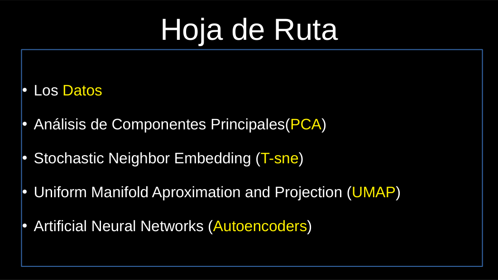
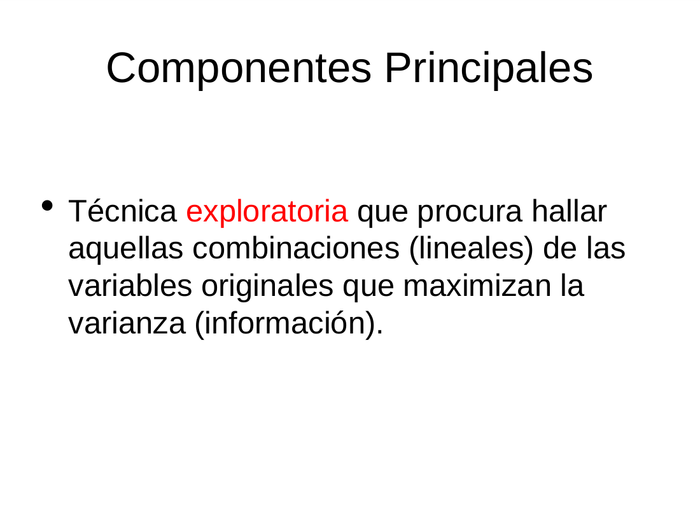
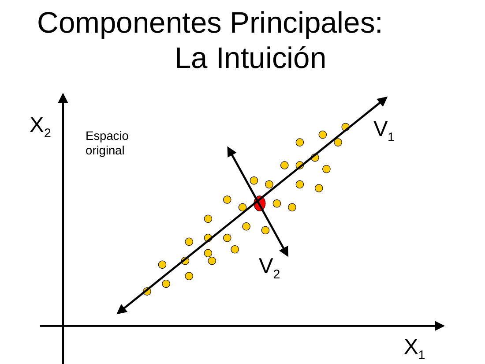
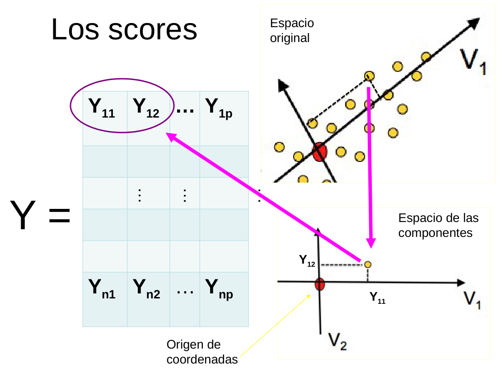
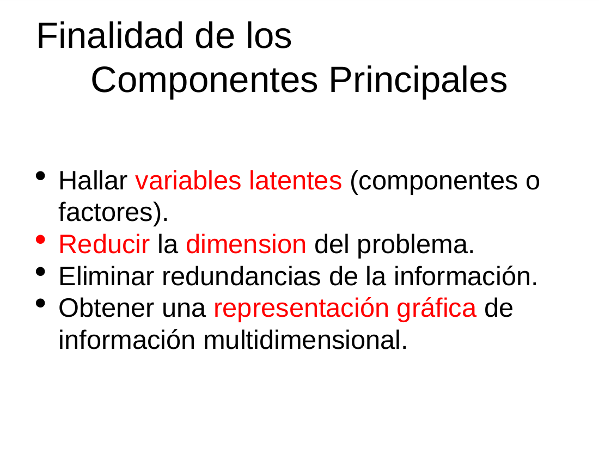
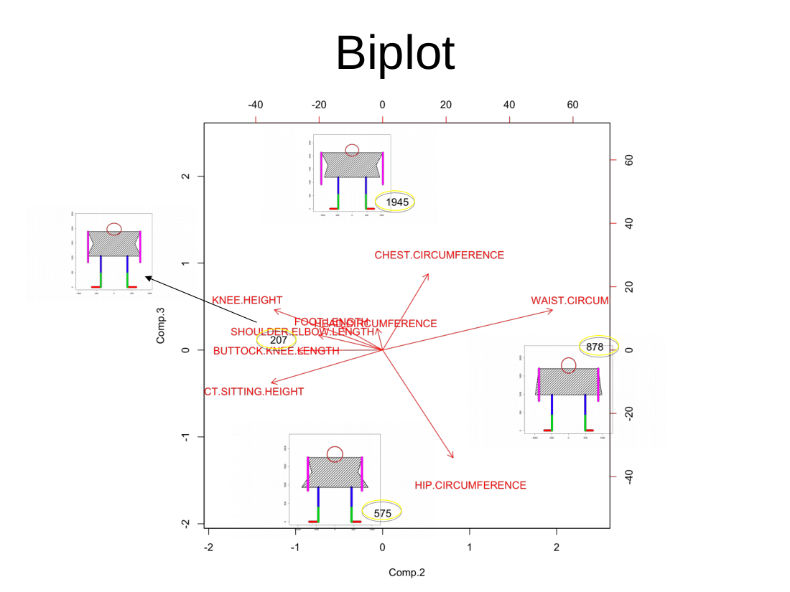

# Clase 04 · Reducción de dimensión y componentes principales (PCA)

> **Módulo 1 · Fundamentos de IA y Machine Learning** · Andrés Farall · jueves 16-abr-2026
> **Fuentes:** transcripción `DIA_Clase_04.vtt` · láminas `Reducción de Dimensión.pdf` y `Componentes Principales.pdf`

## En pocas palabras

- **Aprender de los datos es terminar de definir lo que un modelo deja libre.** Una recta deja libres la ordenada al origen y la pendiente; una neurona deja libres sus pesos. Entrenar es elegir, entre las infinitas configuraciones posibles, la que mejor se ajusta a los datos, en general iterando para achicar una función de pérdida.
- **Se pasa de lo supervisado a lo no supervisado.** En reducción de dimensión no hay una variable privilegiada a predecir: todas las variables juegan el mismo rol y se busca la estructura que hay por debajo.
- **Los datos reales no ocupan todo el espacio posible.** Como las variables están relacionadas, las observaciones viven en una zona mucho más chica (un subespacio o, en general, una variedad). Es la misma idea que explica por qué funcionan los modelos generativos.
- **PCA busca combinaciones lineales de las variables originales que maximicen la varianza**, entendida como información. La primera componente es el mejor "score" posible; las siguientes son ortogonales a las anteriores y maximizan la varianza restante.
- **Lo que tiene PCA a favor es que se puede interpretar**: los loadings y el biplot muestran cómo se arma cada componente. En el dataset de vinos, sin usar la etiqueta, la primera componente separa casi por completo tintos de blancos.

## Conceptos clave

### Repaso: qué significa entrenar un modelo

- **Modelo estadístico (regresión lineal):** se fija de antemano la forma de la relación (una recta, no un polinomio ni un logaritmo) y lo único que se aprende de los datos son los coeficientes libres. Se elige la recta que minimiza la diferencia entre lo observado y lo predicho. Los errores se elevan al cuadrado (o se toma su valor absoluto) para que no se compensen los positivos con los negativos.
- **Un modelo sin entrenar no es nada concreto**: "una recta" son infinitas rectas. Entrenarlo es quedarse con la que mejor representa los datos. Aun así, en general ninguna predice perfecto: el error nunca llega a cero.
- **Modelos de machine learning** (por ejemplo, KNN) son más libres: la frontera entre clases no está fijada por una expresión matemática.
- **Cómo se encuentra el óptimo:** muchos modelos estadísticos tienen una solución cerrada, es decir, una cuenta explícita. Los modelos de ML y las redes neuronales, que son muy grandes y generales, se resuelven **iterando**: se arranca de cualquier punto, se mueven los parámetros en la dirección que mejora la pérdida y se frena cuando deja de mejorar. Esa es la idea del **descenso por gradiente**, y la retropropagación (backpropagation, 1986) fue la forma eficiente de iterar que permitió el resurgimiento de las redes neuronales.

### La neurona artificial

Es el elemento constitutivo de las redes neuronales, y en el fondo es solo una función muy simple:

$$\text{salida} = \begin{cases} 1 & \text{si } w_1 x_1 + w_2 x_2 + w_0 \cdot 1 > 0 \\ 0 & \text{en otro caso} \end{cases}$$

- $x_1, x_2$ son las entradas (features), $w_1, w_2$ son los pesos y $w_0$ es el peso del **bias** (sesgo).
- Integra las entradas (las suma, ponderadas por los pesos) y se activa si se supera un umbral. Imita a una neurona biológica: las dendritas reciben estímulos y, si la suma es suficiente, el axón dispara.
- La función de activación puede dar salidas binarias o numéricas, según la red.
- Por sí sola es casi un caso particular de modelo estadístico. Lo potente aparece al combinar millones de neuronas.

### Reducción de dimensión: la idea de fondo

- **Las combinaciones plausibles son muchas menos que las posibles.** Es lo mismo que se vio con las imágenes de 100×100 píxeles en blanco y negro: hay una cantidad astronómica de imágenes posibles, pero solo algunas familias tienen sentido.
- Los objetos complejos **viven en espacios reducidos**. Hay zonas del espacio que no se ocupan porque romperían las relaciones entre las variables. Lo difícil es descubrir cuál es la zona ocupada.
- ¿Por qué están relacionadas las variables? Porque en general no medimos lo que queremos medir, sino **proxies**: lo que sabemos o podemos medir. Muchas veces esos proxies miden lo mismo desde ángulos distintos.
- La lámina de hoja de ruta presenta las técnicas del bloque. En esta clase se vio PCA. t-SNE, UMAP y autoencoders (la versión con redes neuronales) se ven más adelante.

### Variabilidad = información

Una columna con todos los valores iguales no aporta nada. Las variables informativas son las que **varían**. Por eso, buscar direcciones de máxima varianza equivale a buscar máxima información.

### Componentes principales (PCA)

**Intuición geométrica.** En una nube de puntos con dos variables correlacionadas, la dirección $V_1$ a lo largo de la cual los puntos están más dispersos es la **primera componente principal**. $V_2$ es perpendicular a ella.

**Cómo se construyen las componentes:**

1. **PC1:** de todas las combinaciones lineales de las variables, la que tiene mayor varianza.
2. **PC2:** entre las direcciones ortogonales a PC1, la que maximiza la varianza. En dimensión 2 hay una sola ortogonal, pero en dimensión 3 o más hay infinitas, así que hay que elegirla.
3. **PC3:** ortogonal a PC1 y PC2, de máxima varianza. Y así sucesivamente.

Hay tantas componentes como variables originales: un espacio de dimensión $p$ se puede describir con $X_1,\dots,X_p$ o con $V_1,\dots,V_p$. Salvo la última, que queda determinada por las anteriores, todas hay que descubrirlas.

**Restricción de norma.** Si los coeficientes no tuvieran límite, la varianza se podría inflar multiplicándolos por números enormes ($100X_1+200X_2$ en lugar de $10X_1+20X_2$), cuando en realidad es la misma dirección. Por eso se exige que el vector de coeficientes tenga largo 1. En la formulación de las láminas, sobre la matriz de datos centrada $X$ con matriz de covarianzas $S$:

$$\text{PC1: } \max_{v_1} \operatorname{Var}(Xv_1) \quad \text{sujeto a } v_1'v_1 = 1$$

$$\text{PC2: } \max_{v_2} \operatorname{Var}(Xv_2) \quad \text{sujeto a } v_2'v_2 = 1,\; v_2'v_1 = 0$$

- Cada $v_i$ es un **autovector** de $S$ (el *loading* $i$), y la varianza de cada componente es su **autovalor**, con $\lambda_1 \ge \lambda_2 \ge \dots \ge \lambda_p$.
- Las componentes resultan **no correlacionadas** entre sí.
- Matricialmente: $S = V\Lambda V' = \sum_{i=1}^{p} \lambda_i v_i v_i'$ (descomposición espectral). Las láminas también muestran el cálculo vía SVD de la matriz de datos.
- Las láminas agregan que hacer PCA con la **matriz de correlaciones** equivale a hacerlo con las variables estandarizadas.

En clase, el desarrollo matemático se mencionó apenas ("hay una cuentita"). Para entenderlo alcanza con pensar que se encuentra iterando: se mueve la dirección mientras la varianza aumente y se frena cuando deja de aumentar.

**Scores.** El *score* de una observación en una componente es su coordenada sobre esa dirección: la proyección del punto sobre $V_1$, $V_2$, etc. La matriz $Y$ de scores ($n \times p$) es la representación de los datos en el espacio de las componentes, con el origen en el centro de la nube.

**Componentes como variables latentes.** Las componentes, también llamadas factores o variables latentes, **siempre son combinaciones de todas las variables originales**: algunas pesan más y otras menos, pero no se crea información nueva. Son "latentes" porque representan algo que nos gustaría medir directamente y no podemos.

### El plano de las componentes principales

- PC1 y PC2 arman un plano: **la mejor representación bidimensional posible** de datos que viven en dimensión mucho mayor.
- Elegir dos de las variables originales y graficarlas es *una* proyección posible, pero en general no es la que preserva más información. Además, no hay forma de saber de antemano cuáles dos elegir.
- La información de dimensión 11 en general no entra en dimensión 2. Lo que sí existe es un "mejor plano", el que capta la mayor cantidad posible.
- Si dos componentes no alcanzan, se agrega la tercera: el espacio puede no estar todo ocupado y aun así necesitar más de 2 dimensiones.

### Biplot

Gráfico que superpone dos cosas:

- las **observaciones** (sus scores en dos componentes);
- las **variables originales** como flechas, que indican cómo contribuye cada una a las componentes.

Se lee así: las observaciones ubicadas hacia donde apunta una flecha tienen valores altos de esa variable, y las del lado opuesto tienen valores bajos. Flechas en sentidos opuestos indican variables correlacionadas negativamente. Las flechas son ilustrativas: **no hay doble conteo**, porque los ejes son solo las dos combinaciones de las variables y las flechas ayudan a interpretarlas.

### Ortogonalidad e independencia

- Ortogonalidad es un concepto geométrico. Desde el punto de vista de la información equivale a **no correlación o independencia**: lo que hay en un eje no se repite en el otro.
- **No confundir independencia entre variables con dependencia respecto del objetivo.** Dos variables pueden ser independientes entre sí y aun así ser las dos clave para predecir una tercera, por **interacción**. Por eso no conviene descartar variables solo porque son independientes del resto.
- Desde el punto de vista de los datos, la independencia es deseable. En un **diseño ortogonal** se observan todas las combinaciones de niveles (jóvenes y viejos, cada uno con ingresos altos y bajos). Si las variables están muy correlacionadas, no se puede separar el efecto de una del de la otra.

### Supervisado vs. no supervisado: PCA vs. score supervisado

| | PCA (no supervisado) | Score supervisado (clasificación, análisis discriminante) |
|---|---|---|
| Qué maximiza | Varianza (información) de la combinación | Separación entre clases de una etiqueta |
| Usa la etiqueta | No | Sí |
| Interpretación de los ejes | A posteriori, mirando los loadings | Definida por el objetivo |
| Ejemplo de clase | PC1 de los vinos | Score crediticio (pagan / no pagan) |

## Ejemplos y casos de la clase

**Neurona como "Y lógico" (AND).** Con un simulador interactivo se ajustaron a mano $w_1$ y $w_2$ (con bias $-1$) hasta que la neurona diera 1 solo cuando las dos entradas valen 1. Por ejemplo, $w_1=1$ y $w_2=0{,}5$: con ambas en 1 la suma da $1+0{,}5-1=0{,}5>0$, y con cualquier otra combinación no se supera el cero. $w_1=w_2=1$ también funciona. **Lo que enseña:** entrenar es encontrar valores de los parámetros libres que reproduzcan la salida deseada, y puede haber más de una solución.

**Recta de regresión interactiva.** Al mover la pendiente y la ordenada se ve cómo crecen o se achican los residuos. Un alumno propuso el algoritmo: arrancar de una recta cualquiera, mover un parámetro, quedarse si el error baja y volver si sube. **Lo que enseña:** es la lógica iterativa del entrenamiento.

**Dataset de vinos de Portugal.** Unos 6.500 vinos, tintos y blancos, con 11 variables químicas *activas*: acidez fija, acidez volátil, ácido cítrico, azúcar residual, cloruros (sales), dióxido de azufre libre y total, densidad, pH, sulfatos y alcohol. Hay además dos variables que **no entran en el análisis** y se usan solo para interpretar: la calidad (de 1 a 10, según un enólogo) y el tipo (tinto o blanco).

- *Azúcar residual vs. dióxido de azufre total:* los blancos tienen más dispersión en las dos variables. En ambos tipos hay una relación creciente con pendiente parecida. La explicación química es que el dióxido de azufre controla la fermentación, así que los vinos más dulces necesitan más. El intervalo de confianza muestra que la relación existe a nivel poblacional aunque los puntos estén "apelotonados". **Una relación en promedio no implica que todos los individuos la sigan.**
- *Cloruros vs. densidad:* relación creciente con pendientes distintas para tintos y blancos.
- *Matriz de correlaciones:* el dióxido de azufre libre y el total están muy correlacionados, el azúcar con la densidad (≈0,6) también, y el alcohol con la densidad tiene −0,7 (el alcohol es menos denso que el agua). Las variables claramente no son independientes.
- *Plano PC1–PC2 (biplot):* **PC1 separa casi perfecto tintos de blancos sin haber usado la etiqueta.** Hacia un lado quedan azúcar residual y dióxido de azufre (blancos); hacia el otro, acidez volátil, sulfatos y pH (tintos). PC2 se arma sobre todo con densidad (positiva) y alcohol (negativo), y **no** separa por tipo. Conclusión: "tinto o blanco" no es solo una etiqueta, porque tiene un correlato químico esencial.
- *Calidad:* con PC2 y PC3 se ve una separación más débil. Los vinos de alta calidad aparecen hacia la dirección del alcohol. El profesor bromeó con que "los datos dicen" que los enólogos premian el alcohol.
- *PC1, PC2 y PC3 en 3D:* en dimensión 3 tintos y blancos se separan todavía mejor. **Lo que enseña:** los 11 ejes no están todos ocupados, pero tampoco alcanza con 1 o 2 dimensiones.

**Scores de la vida real.** El Veraz (score crediticio) y el Apgar de los recién nacidos combinan muchas variables en un número. La diferencia es que el Veraz es **supervisado** (busca separar a los que pagan de los que no) y el Apgar lo diseñaron expertos. **La PC1 sale de los datos** y maximiza información.

**Nivel socioeconómico en el censo.** Nadie puede responder "mi nivel socioeconómico es 73". Se preguntan baños, habitaciones, años de estudio, etc., y se reconstruye un score latente. El ejemplo del profesor: su sueldo de investigador solo sugeriría un nivel bajo, pero sumando el acceso a un jardín maternal, la cobertura médica o los viajes, el score latente refleja mejor la realidad.

**Páginas de un libro (Ken Follett).** Una página se puede representar como un conteo de palabras (bolsa de palabras, que pierde el orden) o como una secuencia de índices de tokens. Con unas 50.000 palabras y 100 palabras por página hay del orden de $50.000^{100}$ páginas posibles, muchísimas más que los átomos del universo. Las páginas con sentido son una fracción ínfima: después de "era invierno, estaba en el bosque y el piso estaba lleno de…", casi seguro sigue "nieve". **Lo que enseña:** encontrar esa estructura (el espacio latente o *embedding*) es lo que permite que un modelo como ChatGPT responda de forma *admisible*, aunque eso no garantiza que sea *verdadera*.

**AnthroKids (láminas).** Medidas antropométricas de chicos (largo de pie, altura de rodilla, circunferencias de cadera, cintura, pecho y cabeza, etc.). En las láminas, la componente 1 se interpreta como "efecto talla" y las componentes 2 y 3 como contrastes entre medidas. Las láminas siguen con la distancia de Mahalanobis, ejercicios (corredores, proteínas, gorriones, riesgo coronario) y una advertencia sobre la información que usa PCA, pero esos temas no se trabajaron en esta clase.

## Para recordar

- "Aprender de los datos es hacer estadística": aun las redes neuronales más complejas hacen, en el fondo, una muy buena estadística de los datos.
- Una neurona "es una función, y es la función más simple que existe". La potencia está en combinar muchas.
- **Las componentes no se eligen, surgen de los datos.** La interpretación (qué representa cada eje) se hace *a posteriori*.
- Pintar los puntos por una etiqueta (tinto o blanco, calidad) sirve solo para mostrar: el método nunca la usó.
- Si un método no supervisado separa clases sin conocerlas, eso es un hallazgo: la clase tiene un sustento en los datos.
- La gran ventaja de los métodos estadísticos como PCA frente a las redes neuronales es que **explican**: muestran qué variables se contraponen en cada eje. Hoy se busca reunir lo mejor de los dos mundos.
- La idea de *embedding* o espacio latente no es nueva: PCA tiene unos 150 años.
- Independencia entre variables ≠ irrelevancia para predecir. Además, en la recolección de datos se busca la mayor variabilidad posible, como hacen los LLM, que no se entrenan solo con Wikipedia.

## Preguntas de repaso

1. ¿Qué tienen en común ajustar una recta de regresión y ajustar los pesos de una neurona?

En los dos casos hay un modelo con parámetros libres (ordenada y pendiente; pesos y bias), y entrenar consiste en elegir los valores que hacen que la salida se parezca lo más posible a la deseada, minimizando un error. Cambia la forma del modelo, no la lógica del aprendizaje.

2. ¿Por qué PCA maximiza la varianza y no otra cosa?

Porque la variabilidad es información: una variable constante no aporta nada. La combinación lineal de máxima varianza es la nueva variable que resume la mayor cantidad posible de la información contenida en todas las originales.

3. ¿Por qué hace falta imponer que los coeficientes de la combinación tengan norma 1?

Sin esa restricción, la varianza se podría agrandar sin límite multiplicando los coeficientes (100·X1 + 200·X2 en vez de 10·X1 + 20·X2), aunque la dirección sea la misma. La restricción hace que el problema tenga sentido y que solo importe la dirección.

4. En dimensión 2 la segunda componente es "trivial". ¿Por qué deja de serlo en dimensión 3 o más?

En el plano hay una única dirección ortogonal a V1. En dimensión 3 o más hay infinitas, y hay que elegir entre ellas la de máxima varianza. Solo la última componente queda determinada por las anteriores.

5. PC1 separa casi perfecto los vinos tintos de los blancos. ¿Es PCA un clasificador? ¿Qué significa ese resultado?

No. PCA es no supervisado y nunca usó la etiqueta: solo buscó la dirección de máxima información en las 11 variables químicas. Que igual separe por tipo indica que la diferencia tinto/blanco está muy marcada en la química del vino. Un método diseñado para separar clases sería supervisado (clasificación, análisis discriminante).

6. ¿Por qué graficar dos variables originales no es lo mismo que graficar PC1 vs. PC2?

Elegir dos variables es una proyección entre muchas, que descarta por completo las otras 9 y en general no preserva la mayor información posible. PC1 y PC2 combinan las 11 variables y arman el plano que capta la mayor varianza.

7. Dos variables son independientes entre sí. ¿Conviene eliminar una para simplificar el modelo?

No necesariamente. La independencia es una relación entre esas variables, no con el objetivo. Las dos pueden ser clave para predecir una tercera variable, por ejemplo por interacción (joven *y* con saldo bajo → más default). Además, en los datos la independencia es deseable porque permite separar efectos.

8. ¿Qué relación hay entre PCA y el funcionamiento de los modelos generativos?

Ambos se apoyan en que los datos reales ocupan una zona muy reducida del espacio de combinaciones posibles. PCA encuentra un subespacio lineal que concentra la información, y los modelos generativos aprenden ese espacio latente (más complejo) para producir salidas admisibles.

## Conexiones

- **Hacia atrás:** el ejemplo de las imágenes de 100×100 píxeles y la cantidad de combinaciones posibles frente a las plausibles. La línea histórica de la primera clase (invierno de la IA y backpropagation en 1986). KNN como ejemplo de modelo de ML "libre" y la regresión como modelo estadístico de la clase anterior.
- **Hacia adelante:** la [Clase 05](clase-05-reduccion-no-lineal-y-k-medias.md) sigue con PCA y t-SNE. El bloque sigue con UMAP y autoencoders (reducción de dimensión con redes neuronales) y con segmentación. El descenso por gradiente y la neurona vuelven cuando se vean las redes neuronales.
- **TFI (Benefix):** la idea de *embedding* o espacio latente de esta clase es la base conceptual del retrieval semántico. Representar textos como vectores densos en un espacio de menor dimensión donde los textos parecidos quedan cerca, en contraste con la representación por conteo de palabras (bolsa de palabras), que se acerca más a lo léxico.
