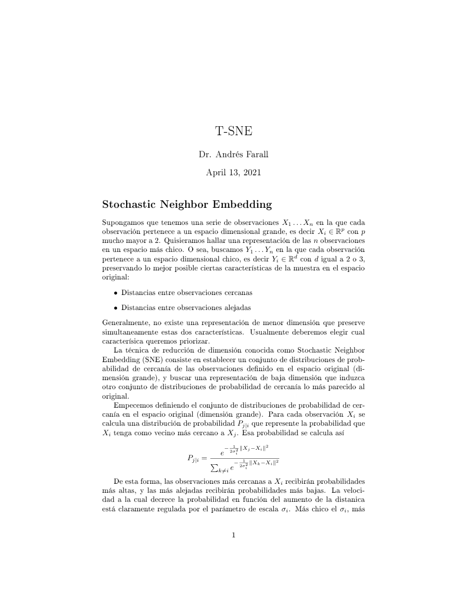
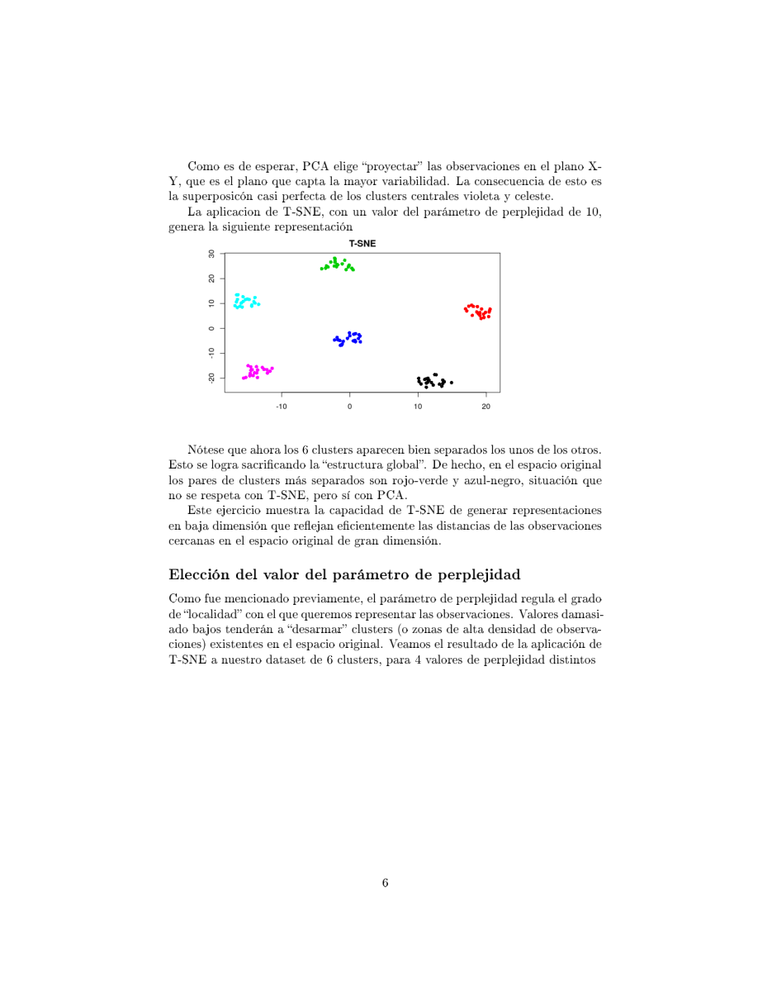

# Clase 05 · Más allá de PCA: LDA, t-SNE, UMAP, autoencoders y k-medias

> **Módulo 1 · Fundamentos de IA y Machine Learning** · Andrés Farall · martes 21-abr-2026
> **Fuentes:** transcripción `DIA_Clase_05.vtt` · láminas `Introduccion a TSNE.pdf` y `Componentes Principales.pdf`

## En pocas palabras

- **Reducir dimensión no es una sola cosa:** se puede reducir para preservar la estructura global y la varianza (PCA), para que lo parecido quede cerca (t-SNE), para equilibrar ambas cosas (UMAP) o con redes neuronales no lineales (autoencoders). Todos son **no supervisados**.
- **Si hay una etiqueta, el problema cambia:** con LDA (análisis discriminante lineal) se busca la combinación de variables que mejor *separa* dos clases. Eso ya es **supervisado**, aunque la mecánica (armar un score como combinación lineal) se parezca a la de PCA.
- **Las variables juegan en equipo:** una variable que sola no separa nada puede ser clave combinada con otras. Mirar variable por variable (las marginales) engaña cuando las variables están relacionadas.
- **Encontrar la estructura de baja dimensión de los datos sirve para visualizar, detectar anomalías y generar objetos nuevos:** esa es la base de la IA generativa.
- **Segmentar (clustering) es encontrar grupos sin etiquetas.** K-medias alterna dos pasos (asignar al centroide más cercano y recalcular centroides) hasta que la asignación deja de cambiar; sólo necesita una noción de distancia.

## Conceptos clave

### Repaso: PCA como scores no supervisados

La base de PCA (intuición, cargas, varianza explicada) está en el apunte de la [Clase 04](clase-04-reduccion-dimension-pca.md). Lo que se retomó:

- Las componentes principales son **combinaciones lineales** de las variables originales elegidas para **preservar la mayor información (varianza)** posible en pocas dimensiones. No buscan resolver ningún problema en particular (por ejemplo, separar blancos de tintos).
- Cada observación tiene sus **scores**: sus coordenadas en el nuevo espacio, que se obtienen proyectando el punto sobre cada componente.

- En los vinos, PC1 separó bastante bien tintos de blancos "sin querer", y el **biplot** (flechas = variables originales) permitió interpretar las componentes: blancos hacia más dióxido de azufre y azúcar; tintos hacia más acidez, sales, pH y densidad.
- La razón de fondo de por qué funciona: las variables están **relacionadas** (por ejemplo, más alcohol implica menos densidad). Esas relaciones hacen que los datos ocupen sólo una pequeña región "estructurada" del espacio de dimensión 11, y PCA capta esa estructura.

> **Material complementario (láminas, no desarrollado en clase):** PCA con matriz de correlaciones equivale a PCA sobre variables estandarizadas; las componentes se obtienen por descomposición espectral $S = V \Lambda V'$ o por SVD; y una advertencia: PCA, como todo método basado en la matriz de covarianzas, usa sólo medias, varianzas y correlaciones, es decir, una parte chica de la información disponible.

### LDA: reducir a un score *supervisado*

- **Qué es:** el análisis discriminante lineal (*Linear Discriminant Analysis*) busca una combinación lineal de las variables cuyo score **separe lo mejor posible dos clases** conocidas. Es un método de alrededor de 100 años.
- **Cómo funciona (intuición dada en clase):** se arranca con ponderadores cualesquiera y se van "toqueteando" los pesos de cada variable hasta que los valores del score de una clase y de la otra queden lo más separados posible. Geométricamente es encontrar una **dirección** (en dimensión 11) tal que, al proyectar los datos sobre ella, las clases quedan separadas.
- **Por qué es supervisado:** necesita la etiqueta (tinto/blanco). Sin ella no hay problema de discriminación. Es la misma lógica del **score crediticio**: el banco tiene el historial de quién pagó y quién no.
- **Uso:** con el score se elige un **punto de corte**; un vino nuevo con score por encima se clasifica como blanco y por debajo como tinto.

| | PCA | LDA |
|---|---|---|
| Tipo | No supervisado | Supervisado (usa la etiqueta) |
| Busca | Preservar la información (varianza) | Separar las clases |
| Resultado | Varias componentes | Un score discriminante (para 2 clases) |

**Proyectar = mirar los datos en una dirección.** Mirar sólo $X_1$ es proyectar cada punto sobre el eje $X_1$. Una dirección nueva (combinación de $X_1$ y $X_2$) puede separar perfecto dos grupos que ninguno de los ejes originales separa. La clave es que $X_1$ y $X_2$ están relacionadas y forman una estructura en el espacio.

**Cuidado al interpretar los coeficientes:** los pesos del discriminante muestran cómo se combinan las variables *para separar esas dos clases*, no cómo se relacionan entre sí. Ejemplo de la clase: densidad y alcohol están correlacionadas negativamente, pero en el discriminante aparecen con el mismo signo; la densidad, con un peso muy grande, puede estar compensándose con otras variables.

### Marginales vs. combinación: "los 11 juegan juntos"

- Mirando cada variable sola (curvas de densidad de tintos y blancos para cada variable), **ninguna separa perfecto**. Las sales eran la mejor individualmente.
- Combinando las 11 en el score de LDA, la separación es **casi perfecta**.
- El alcohol, que solo no separaba casi nada, resultó ser la **cuarta variable más importante** del discriminante: es mala sola, pero buena en contraste con otras (por ejemplo, con el azúcar).
- Analogía del profesor: mirar jugador por jugador no dice cómo va a jugar el equipo. Y el caso extremo es la visión: no se puede separar un gato de un perro con dos o tres *features* sueltas (los dos tienen pelo y cuatro patas). Lo que separa es la **combinación** de atributos.

### t-SNE: preservar vecindades

- **Qué es:** *t-distributed Stochastic Neighbor Embedding*. Método no lineal y no supervisado que busca un espacio de dimensión 2 o 3 donde **lo que era parecido en el espacio original quede cerca**.
- **El dilema de base (láminas):** en general no existe una representación de baja dimensión que preserve a la vez las distancias entre observaciones cercanas y entre alejadas. Hay que elegir qué priorizar; t-SNE prioriza las cercanas.

**Cómo funciona (láminas):**

1. En el espacio original, para cada $X_i$ se define la probabilidad de que $X_j$ sea su vecino, con un núcleo gaussiano:
$$P_{j|i} = \frac{e^{-\frac{1}{2\sigma_i^2}\|X_j - X_i\|^2}}{\sum_{k\neq i} e^{-\frac{1}{2\sigma_i^2}\|X_k - X_i\|^2}}$$
   Los vecinos cercanos reciben probabilidad alta y los lejanos, casi cero.
2. Cada $\sigma_i$ se ajusta a la densidad local (zonas densas, $\sigma_i$ más chico) de modo que todas las distribuciones tengan la misma entropía: $K = 2^{H(P_{\cdot|i})}$. Ese $K$ es la **perplejidad**, el único parámetro a controlar.
3. En el espacio reducido se define $Q_{j|i}$ de forma análoga. La "t" del nombre viene de usar una **t de Student con 1 grado de libertad** (Cauchy), de colas pesadas, que separa más a los puntos alejados:
$$Q_{j|i} = \frac{(1+\|Y_j - Y_i\|^2)^{-1}}{\sum_{k\neq i}(1+\|Y_k - Y_i\|^2)^{-1}}$$
4. Se buscan las posiciones $Y_1,\dots,Y_n$ que minimizan la **divergencia de Kullback-Leibler** entre ambas distribuciones:
$$L = \sum_i \sum_{j\neq i} P_{j|i}\,\log\frac{P_{j|i}}{Q_{j|i}}$$
   Como pondera por $P_{j|i}$, castiga sobre todo representar mal a los pares cercanos.
5. Se optimiza por **gradiente descendente** desde posiciones al azar: si un par está más cerca en el original que en el reducido, el gradiente acerca $Y_i$ a $Y_j$ (y al revés).

**Perplejidad:** regula cuán local es el análisis. Valores muy bajos (1 o 2 en el ejemplo de las láminas) "desarman" clusters reales; hay que balancear lo local y lo global.

**Cuándo falla o no conviene:** la estructura global se "revienta". Distancias medias y largas quedan en cualquier lado: cosas medianamente lejanas pueden aparecer ridículamente lejos, y cosas muy lejanas pueden quedar medianamente cerca. Además, no da interpretación de los ejes.

### PCA vs. t-SNE (ejemplo de las láminas)

Un dataset sintético de 60 puntos en dimensión 3 con 6 clusters: cuatro separados en el plano X-Y y dos centrales (violeta y celeste) separados sólo a lo largo de Z.

- **PCA** proyecta sobre X-Y, el plano de mayor variabilidad, y los dos clusters centrales quedan **superpuestos**. Pero respeta qué pares de clusters están más lejos.
- **t-SNE** (perplejidad 10) separa bien los **6 clusters**, pero no respeta la geometría global (los pares más lejanos del original no quedan como los más lejanos).

Según las láminas, PCA minimiza el error cuadrático entre distancias originales y reducidas, por eso privilegia las grandes distancias (lo global). Dos puntos lejanos por una variable poco representada en la proyección pueden quedar pegados; eso no le pasa a t-SNE.

### UMAP: lo local y algo de lo global

- *Uniform Manifold Approximation and Projection*. También no supervisado.
- Trata de que lo muy cercano quede muy cerca, lo medianamente lejos quede medianamente lejos y lo muy lejos, muy lejos.
- En los vinos (dimensión 3) mezcla mucho menos blancos y tintos que t-SNE: los tintos quedan en una "colita" y los blancos en otra zona.
- **No es "mejor" que t-SNE:** si lo que importa es que lo muy parecido quede muy cerca, t-SNE lo hace mejor. Ninguno de los dos da una interpretación de los ejes.

### Autoencoders: reducción no lineal con redes neuronales

- **Qué es:** una red neuronal entrenada para que **la salida reproduzca la entrada**, pero forzada a pasar por un **cuello de botella** con pocas neuronas (por ejemplo, 2).
- **Partes:** un **encoder** (de dimensión grande a chica) y un **decoder** (de la dimensión chica de vuelta a la original). La capa del medio es el **espacio latente**, el mismo concepto que el plano de PCA o de t-SNE.
- **Éxito:** se mide comparando entrada y salida. Si fueran idénticas, la reducción sería perfecta; en general no se logra, pero la red aprende lo mejor posible.
- **Ventaja frente a PCA:** PCA sólo arma combinaciones lineales; la red aprende estructuras **no lineales** y en general preserva más información con la misma dimensión.
- **Costo:** se pierde la interpretación. No se sabe qué mide cada eje, y un autoencoder en producción puede tener decenas de millones de parámetros.

### Comparación de los métodos de reducción vistos

| Método | Lineal | Qué prioriza | Interpretación de los ejes |
|---|---|---|---|
| PCA | Sí | Estructura global / varianza | Sí (cargas, biplot) |
| t-SNE | No | Vecindades cercanas | No |
| UMAP | No | Cercanas + algo de medias y lejanas | No |
| Autoencoder | No | Reconstruir la entrada | No (la menor de todas) |

Todos son no supervisados. LDA queda aparte porque usa la etiqueta.

### ¿Para qué reducir dimensión?

1. **Visualizar:** sólo se puede ver en 2 o 3 dimensiones. Ejemplo: en genética cada persona tiene más de 10.000 genes; representarlas en un plano, con lo parecido cerca y coloreadas por enfermedad, permite interpretar lo que en el espacio original es imposible.
2. **Aprender la estructura subyacente:** los objetos reales (vinos, textos, imágenes) ocupan una parte mínima del espacio posible. Quien ve sólo una proyección es un "corto de vista dimensional": ve mezclado lo que en el espacio original está separado.
3. **Generar:** si se conoce esa estructura, un punto elegido dentro de ella en el espacio latente se decodifica en un objeto nuevo pero plausible (un vino que no existe, un texto nuevo con sentido). Un punto fuera de la estructura no es un vino posible. **Esto es la IA generativa.** Si el punto cae cerca de los poemas de amor, sale un poema de amor.
4. **Detectar anomalías o fraudes:** observaciones que quedan lejos de la estructura natural de los datos.

### Segmentación (clustering) y k-medias

- **Qué es:** problema no supervisado en el que hay observaciones pero ninguna variable dice a qué grupo pertenece cada una. El método **crea** esa variable: la etiqueta de grupo.
- **Por qué importa:** si hay grupos y no se detectan, el "promedio" no representa a nadie (el chiste del ser humano promedio). Con los grupos detectados, cada uno tiene su **prototipo**. Ejemplo: los clientes no dicen "yo soy este tipo de cliente".
- **No es trivial cuántos grupos hay:** en el ejemplo de juguete se veían 4 de lejos o 9 de cerca. Además, el ojo humano usa criterios distintos (distancia en unos grupos, forma o estructura en otros), y en 6.500 vinos en dimensión 11 no se puede mirar.

**Algoritmo de k-medias (con $K$ dado):**

1. Elegir $K$ observaciones al azar como **centroides** (prototipos) iniciales.
2. **Asignar** cada observación al centroide más cercano.
3. **Recalcular** cada centroide como el centro de masa (promedio) de su grupo.
4. Repetir 2 y 3 hasta que **la asignación no cambie**.

En el ejemplo de 9 puntos, un mal arranque (un grupo de 1 y otro de 8) se corrige solo en pocas iteraciones y termina en 3 y 6.

**Distancias:** en el ejemplo se usa la euclídea, pero depende del problema. Con escalas distintas (densidad cerca de 1, alcohol entre 8 y 14) hay que homogeneizar. Con variables categóricas (por ejemplo, el aroma) hay distancias como la de **Jaccard**. Tanto la asignación como el centroide (el punto que minimiza la suma de distancias al resto del grupo) sólo requieren una **noción de distancia**, y siempre se puede construir una razonable.

**Elegir $K$:** no es un obstáculo. Se prueban varios valores (2, 3, 4, 5, 6...) y se usan **criterios cuantitativos** para ver cuál anda mejor. En los vinos, distintos índices sugirieron 3 o 4, y $K=2$ salió entre los peores.

## Ejemplos y casos de la clase

- **Vinos (6.500 vinos, 11 variables químicas activas; calidad y tipo como variables pasivas):** el hilo conductor de toda la clase.
  - *PCA:* PC1 separa bastante bien tintos de blancos, aunque no fue entrenado para eso; en 3 dimensiones parecen "dos galaxias siamesas".
  - *Marginales:* ninguna variable sola separa bien; las sales son la mejor.
  - *LDA (en R, `lda(color ~ .)`):* separación casi perfecta con un punto de corte cerca de −1. Algunos pesos: azúcar residual +1,67, densidad −2,73, acidez volátil −0,50, acidez fija −0,41.
  - *t-SNE en 2D y 3D:* parece un ovillo de lana, con tintos metidos entre los blancos a escala global, pero cada punto tiene cerca sólo vinos de su mismo tipo.
  - *UMAP en 3D:* tintos y blancos quedan en zonas distintas.
  - *Autoencoder en 2D y 3D:* blancos y tintos bastante separados sin haber entrenado para eso.
- **Ejemplo de juguete con $X_1$, $X_2$ (pagadores y defaulteadores):** ninguna variable sola separa (con $X_1$, alrededor del 80 %), pero una dirección diagonal sí separa perfecto. Muestra qué es proyectar y por qué importa la relación entre variables.
- **Score crediticio:** ejemplo típico de reducción supervisada (el banco tiene la etiqueta pagó / no pagó).
- **Siniestros de una aseguradora brasileña (decenas de miles):** el profesor entrenó un autoencoder en dimensión 3 y en 2. Los siniestros forman "ramilletes": robos, incendios y choques en distintas ramas, y la intensidad crece al alejarse del centro (robo parcial frente a robo total). La red, sin supervisión, recuperó la lógica de los seguros (tipo de siniestro, intensidad y frecuencia). Los puntos lejos de la estructura se marcaron como **sospechosos** de fraude.
- **K-medias en vinos con $K=2$:** clusters de 4.854 y 1.643 vinos. Cruzado con el tipo: blancos 4.830 en el cluster 1 y 68 en el 2; tintos 24 en el cluster 1 y 1.575 en el 2. Sin usar la etiqueta, los clusters coinciden casi con el color: blancos y tintos viven en zonas distintas del espacio químico, no en un continuo.
- **K-medias con $K=5$ frente a 6 categorías (tipo × calidad baja/media/alta):** los tintos caen sobre todo en los clusters 3 y 5. Los blancos se separan además por calidad: los de alta calidad en el cluster 2 y los de media y baja más cerca del 1 y el 4. Se interpretó con un **mapa de correspondencias**.
- **Netflix (hipotético):** si al segmentar usuarios en 2 grupos estos coincidieran con hombres/mujeres, se estaría descubriendo que sus gustos están separados. No tiene por qué pasar.
- **La función que no existía:** ChatGPT inventó una función de R y un paquete inexistentes; al pedirle el código interno, la función "alucinada" funcionó. Se usó para ilustrar que alucinar es generar algo nuevo y que **hay que validarlo**.

## Para recordar

- Hoy la IA resuelve el código; lo importante es entender **qué método aplicar y cómo interpretar** el resultado. La IA es tremendamente potente si se sabe exactamente lo que se busca. Ejemplo: pedir un autoencoder "para separar blancos de tintos" mezcla un método no supervisado con un problema de clasificación.
- Reducir dimensión puede tener **objetivos distintos**: estructura global (PCA), vecindad local (t-SNE), un equilibrio (UMAP). "Todo tiene un costo, nada es gratis."
- Una variable mala sola puede ser muy buena combinada. **No descartar variables mirando sólo las marginales.**
- Los coeficientes de un discriminante explican cómo separar *esas* clases, no cómo se relacionan las variables entre sí.
- La revolución del ML de las últimas dos décadas: aprender directamente de los datos, sin modelar las leyes del fenómeno (el debate Norvig vs. Chomsky, que según el profesor ganó Norvig).
- Las alucinaciones son el subproducto inevitable de generar cosas nuevas: "solo alucina el que entiende"; el que no entiende, repite (como Funes el memorioso). Siempre hay que validar.
- Cuanto más se avanza hacia ML y redes neuronales, **más efectivo y menos interpretable**.
- En k-medias, el número de grupos no es obvio y depende de qué se llame grupo; se elige con criterios cuantitativos.

## Preguntas de repaso

1. ¿Por qué LDA es supervisado y PCA no, si los dos arman combinaciones lineales de las variables?

Porque LDA elige los pesos para separar dos clases conocidas, así que necesita la etiqueta (tinto/blanco). PCA elige los pesos sólo para preservar la varianza, sin mirar ninguna variable objetivo.

2. El alcohol casi no separaba tintos de blancos mirado solo, pero fue la cuarta variable más importante en LDA. ¿Cómo puede ser?

Porque las variables están relacionadas y el discriminante las usa juntas: el alcohol aporta en contraste con otras variables (por ejemplo, el azúcar). La marginal no muestra esas interacciones.

3. ¿Qué gana y qué pierde t-SNE frente a PCA?

Gana en preservar vecindades: lo parecido en el espacio original queda cerca y separa clusters que PCA superpone. Pierde la estructura global (las distancias medias y largas quedan distorsionadas) y la interpretación de los ejes.

4. ¿Qué controla la perplejidad en t-SNE y qué pasa si es muy baja?

Controla cuán local es la noción de vecindad: fija la entropía de las distribuciones $P_{\cdot|i}$ y, con eso, el $\sigma_i$ de cada punto. Si es muy baja, el análisis se vuelve demasiado local y desarma clusters que existen en el espacio original.

5. Si un autoencoder sólo tiene que copiar la entrada en la salida, ¿por qué aprende algo útil?

Porque el cuello de botella de pocas neuronas le impide copiar trivialmente: tiene que comprimir la información en pocas dimensiones y reconstruirla. Para lograrlo debe captar la estructura subyacente de los datos, y esa capa es el espacio latente.

6. ¿Cómo se usa un espacio latente para detectar fraudes y para generar datos nuevos?

Fraudes: las observaciones que quedan lejos de la estructura natural (como los siniestros "sospechosos") son anomalías. Generación: se elige un punto dentro de la estructura y se decodifica en un objeto plausible que no existía (un vino, un siniestro de incendio grave, un texto).

7. En k-medias, ¿qué pasa si los centroides iniciales están mal elegidos?

El algoritmo los corrige iterando: al recalcular los centroides como promedios de los grupos y reasignar, la partición mejora hasta que deja de cambiar. En el ejemplo, un arranque de 1 y 8 puntos terminó en los grupos naturales de 3 y 6.

8. ¿Por qué la distancia euclídea no siempre sirve para segmentar los vinos y qué alternativas hay?

Porque las variables tienen escalas distintas (la densidad ronda 1 y el alcohol va de 8 a 14), así que hay que homogeneizarlas. Con variables categóricas se necesitan otras distancias, como la de Jaccard. K-medias funciona con cualquier noción de distancia razonable.

## Conexiones

- **Clase 04:** introducción a la reducción de dimensión y PCA (varianza, componentes, biplot) con el mismo dataset de vinos; esta clase la extiende con métodos no lineales y la contrasta con LDA.
- **Clases anteriores sobre aprendizaje supervisado:** la regresión (buscar la recta que mejor acompaña los puntos) y la neurona sintética con pesos $W_1$, $W_2$ se retoman para explicar LDA y los autoencoders.
- **Más adelante en la diplomatura:** redes neuronales e IA generativa. El espacio latente y la generación a partir de la estructura aprendida son la base conceptual de esos temas.
- **TFI (Benefix):** la idea de representar objetos en un espacio donde lo parecido queda cerca es la misma que sostiene el retrieval semántico por similitud (embeddings). t-SNE o UMAP pueden servir para visualizar si los nombres comerciales de un mismo producto quedan agrupados.
