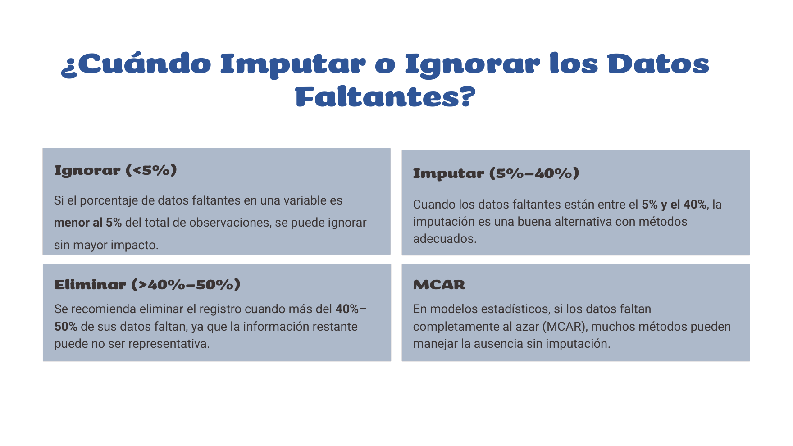
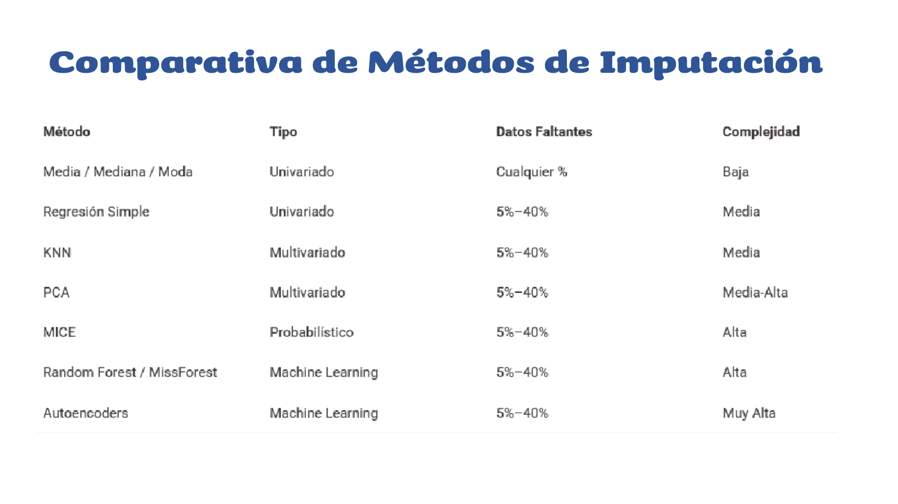
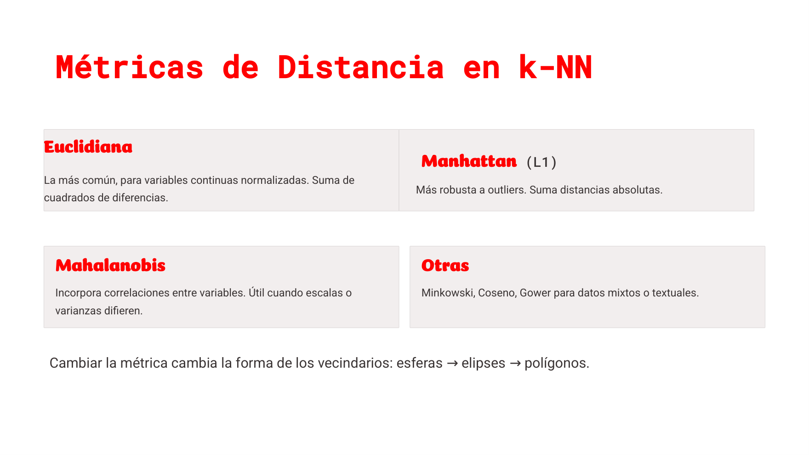
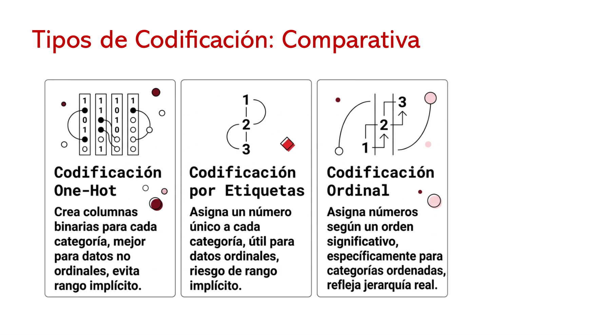
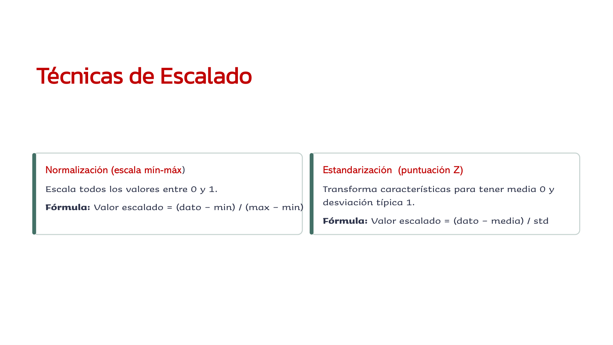

# Clase 06 · Datos faltantes, imputación e ingeniería de atributos

> **Módulo 1 · Fundamentos de IA y Machine Learning** · Débora Chan · jueves 23-abr-2026
> **Fuentes:** transcripción `DIA_Clase_06.vtt` · láminas `Clase_cinco_Extraccion-y-Seleccion-de-Atributos.pptx` · notebook `Clase 5/clase_5_modulo1.ipynb` (California Housing y `publicidad.xlsx`)

## En pocas palabras

- Antes de imputar hay que preguntarse **por qué faltan los datos** (MCAR, MAR, MNAR, estructural, censura…): el mecanismo decide qué método sirve y cuál puede "romper la pared", como usar un rotopercutor para ajustar un tornillo.
- La imputación va de lo simple (media/mediana/moda) a lo multivariado (KNN, MICE) y a lo basado en ML (MissForest, autoencoders). En la práctica, el imputador iterativo (MICE) le ganó a media, mediana y KNN en los dos escenarios.
- Ningún imputador sobrevive a una variable con colas extremas: **mirá la distribución antes de imputar**. MissForest imputó muy mal `AveRooms` hasta que se recortó al percentil 99.
- La **ingeniería de atributos** (crear, transformar, extraer, seleccionar y escalar variables) suele ser lo que destraba un modelo, y es mitad ciencia y mitad arte: las mejores variables (IMC, un cociente químico, la tortuosidad) salieron de "sumergirse en los datos" y hablar con el experto del dominio.
- Escalar y codificar bien no es opcional para los métodos basados en distancias (KNN, PCA, regresión, redes): si no, la variable con unidades más grandes domina todo.

## Conceptos clave

### Datos faltantes: qué son y por qué importan

Son valores que **deberían haberse registrado y no se registraron** (o se perdieron). Generan tres problemas:

- **Limitación operativa:** impiden tareas básicas (convertir tipos, visualizar: "un dibujo con píxeles en blanco").
- **Validez estadística:** bajan la precisión y aumentan la probabilidad de error de tipo II.
- **Distorsión de conclusiones:** sobre todo cuando no faltan al azar sino "en una esquina" de los datos; un modelo ajustado con el resto funciona mal al extrapolar a esa esquina.

### Mecanismos de ausencia

| Categoría | Qué significa | Ejemplo | Qué suele hacerse |
|---|---|---|---|
| **MCAR** (*Missing Completely At Random*) | La falta no depende de ninguna variable | Se pierde una encuesta por un problema técnico | Eliminar casos o imputación simple (poco sesgo) |
| **MAR** (*Missing At Random*) | Depende de otras variables observadas, no del valor faltante | Faltan pesos de los muy altos porque la máquina medía hasta cierto punto | Imputación múltiple, máxima verosimilitud, métodos con variables auxiliares |
| **MNAR / NMAR** | Depende del propio valor faltante o de factores no observados | Personas de ingresos altos que no los declaran | El caso más difícil: modelar el mecanismo o análisis de sensibilidad |
| **Estructural** | No corresponde que exista | Meses hasta volver a trabajar tras un infarto, en quien no tuvo infarto | No se imputa: se trata como "no aplica" |
| **No respuesta** | Podía responder y no quiso | No decir a quién va a votar | Depende: puede ser MAR o MNAR |
| **Abandono** (*attrition*) | En estudios longitudinales, alguien deja de responder | Paciente que se muda o fallece | Modelos longitudinales, imputación múltiple |
| **Censura** | Solo se sabe que el valor supera (o no) un límite | "Más de dos años" sin romperse la tablet regalada | Modelos para datos censurados, no imputación estándar |

### ¿Ignorar, imputar o eliminar?



Regla orientativa **por variable**:

- **< 5 %** de faltantes: se puede ignorar o borrar esas filas sin mayor impacto (salvo que el método exija datos completos).
- **5 % – 40 %**: imputar, con el método adecuado.
- **40 % – 50 %**: la imputación es riesgosa; muchas veces conviene omitir la variable. Si es imprescindible, imputar con métodos que usen información de varias variables, sabiendo que hay riesgo.

La imputación es más confiable cuando el mecanismo es MCAR.

### Familias de métodos de imputación

Imputar es **completar el dato con un valor que se supone cercano al que se perdió**. Las cuatro familias:

1. **Univariados** (miran solo esa variable): media (continuas), mediana (si hay asimetría u outliers), moda (categóricas), valor constante (999, "desconocido"), regresión simple contra otra variable.
2. **Multivariados:** regresión múltiple (lineal o logística), KNN, PCA.
3. **Probabilísticos:** máxima verosimilitud (asumir una distribución y elegir el valor más verosímil), MICE.
4. **Machine learning:** árboles de decisión (la variable con faltantes es el objetivo y las demás son predictoras), random forest, XGBoost, autoencoders.



La diferencia que remarcó la profesora entre "probabilístico" y "machine learning": MICE se podría hacer a mano y se pueden inspeccionar sus modelos intermedios; en un random forest no ves los 500 árboles ni cómo se promediaron. Los autoencoders (redes que comprimen y reconstruyen los datos, también usadas para detectar anomalías) quedan para datos más complejos, como longitudinales o censurados; no se vieron en detalle.

### Imputación por KNN

Idea: "dime con quién andas y te diré quién eres" (Fix y Hodges, 1951). Para imputar el peso de una persona, se buscan los *k* individuos más parecidos **en las variables que sí están completas** (estatura, presión, IMC…) y se promedia su peso (uniforme o ponderado por distancia).

- **Dos hiperparámetros clave:** cuántos vecinos (*k*) y qué distancia.
- **Los vecinos cambian según la variable que se imputa:** para el peso importan unas variables; para el saldo bancario, otras, y aparecen otros vecinos.
- **Muy dependiente del conjunto:** si sale una persona y entra otra, cambia la imputación. No aprende un patrón explícito, aprende de los vecinos.
- **Sensible a la escala:** si una variable va de 10.000 a 100.000 y otra de 100 a 200, la primera domina la distancia. Hay que normalizar antes.
- Si no hay vecinos con distancia definida, se usa el promedio de la variable.

**Elección de *k*** (mismo razonamiento que en clasificación):

| *k* chico (1, 3, 5) | *k* grande |
|---|---|
| Frontera muy flexible | Frontera suave |
| Bajo sesgo, alta varianza → *overfitting* | Menor varianza, más sesgo, generaliza mejor |

Se suele usar *k* impar (para evitar empates al votar) y elegirlo por validación cruzada. Un punto cerca de la frontera puede cambiar de clase entre *k* = 3 y *k* = 7. Como es **no paramétrico** (no asume forma para la frontera), es flexible pero depende de la densidad local de datos.

### Métricas de distancia



| Métrica | Idea | Cuándo | Forma del "círculo de radio 1" |
|---|---|---|---|
| **Euclidiana** | Raíz de la suma de cuadrados de diferencias | La más común, variables numéricas normalizadas | Círculo / esfera |
| **Manhattan (L1)** | Suma de diferencias absolutas ("cuántas cuadras") | Más robusta a outliers | Rombo |
| **Mahalanobis** | Incorpora correlaciones y varianzas distintas | Datos multivariados con escalas o varianzas diferentes | Elipse |
| **Máximo** | La mayor diferencia entre las coordenadas | Según contexto | Cuadrado |
| **Coseno, Gower, otras** | — | Texto, palabras, datos mixtos | — |

Cambiar la métrica cambia la forma de los vecindarios y, por lo tanto, la imputación o la clasificación. Para texto (por ejemplo, en los LLM) la euclidiana no tiene sentido: "¿cómo mido la distancia entre la J y la K?".

### MICE: imputación múltiple por ecuaciones encadenadas

*Multivariate Imputation by Chained Equations*. Cada variable con faltantes se modela en función de las demás, en ciclo:

1. **Relleno provisorio** con algo simple (media o mediana).
2. Tomar una variable con faltantes (por ejemplo, `Ingreso`), ajustar un modelo con las otras (`Edad`, `IMC`) **solo en las filas donde el ingreso está observado**, y reemplazar el valor provisorio por la predicción.
3. Repetir con la siguiente variable, usando ya los valores actualizados.
4. Dar vueltas al ciclo hasta que los valores dejan de cambiar o se llega al máximo de iteraciones.

Modelo según tipo de variable: **regresión lineal** para numéricas y **logística** para categóricas (por eso es un poco más complejo con categóricas).

Parámetros de `mice()` (R): `m` = cantidad de *datasets* imputados (5 por defecto), `maxit` = máximo de iteraciones, `seed` = semilla (reproducibilidad), `method` = método por variable.

> **Iteraciones vs. datasets** (pregunta de clase): las iteraciones son las vueltas del ciclo **dentro** de una imputación hasta converger; cada imputación completa produce **un** dataset. `m` indica cuántas veces se repite el proceso entero (cada una puede arrancar distinto); al final se combinan los resultados, lo que refleja la incertidumbre de imputar.

### MissForest

Misma lógica iterativa que MICE, pero **el modelo de cada paso es un random forest** en lugar de una regresión lineal (Stekhoven y Bühlmann, 2011). Pasos: imputación inicial → marcar faltantes → entrenar RF → iterar hasta que las imputaciones casi no cambien.

- **Ventajas:** capta relaciones no lineales y no monótonas (el ejemplo de la clase: llamar a alguien 3 veces aumenta su interés, de 3 a 5 da lo mismo, y después de 5 ya no te quiere escuchar), encuentra interacciones por sí solo y anda bien con datos tabulares.
- **Desventajas:** más costo computacional (la notebook "se colgó" un rato) y menos interpretabilidad.
- **Limitación vista en la práctica:** sufre con variables **muy asimétricas o con outliers extremos**.

Es el que la profesora dice usar habitualmente, porque en general supera a MICE salvo problemas en la variable.

### Ingeniería de atributos (*feature engineering*)

Proceso de **seleccionar, crear o modificar variables** para que el modelo aprenda mejor. Las redes neuronales hacen algo parecido internamente, pero sin contarnos qué hicieron. Beneficios: más precisión, menos sobreajuste, mejor interpretabilidad y más eficiencia.


| Proceso | Qué es | Ejemplos de la clase |
|---|---|---|
| **Creación** | Nuevas variables por dominio, por patrones en los datos o sintéticas (combinaciones automáticas) | IMC = peso / estatura²; precio por m²; área = largo × ancho |
| **Transformación** | Cambiar la forma de variables existentes | Escalar, codificar categóricas, logaritmo de la población para simetrizar |
| **Extracción** | Reducir dimensión o agregar | PCA (variables latentes); gasto promedio por salida (cine + teatro) |
| **Selección** | Quedarse con un subconjunto relevante | Filtrado, envoltura, integrados; o el criterio del experto |
| **Escalado** | Llevar las variables a rangos comparables | Min-máx, z-score |

Pasos generales: **limpieza** (por ejemplo, una edad de 315 años: corregir o pasarla a NA e imputar) → **transformación** → **extracción** → **selección** → **iteración** según el rendimiento. Ejemplo de las láminas: en datos meteorológicos, la fecha completa no suma si ya está el mes (o la estación).

La creación sintética automática (polinomios: $x_1^2$, $x_1 x_2$, …) puede encontrar combinaciones útiles, pero después hay que **encontrarles sentido**.

### Selección de atributos

- **Filtrado:** propiedades estadísticas respecto del objetivo (correlación, chi-cuadrado, ANOVA, ganancia de información).
- **Envoltura (*wrapper*):** probar subconjuntos según el rendimiento del modelo. Los clásicos:
  - ***Forward*:** entra la variable que más explica la respuesta; luego, la que mejor explica los **residuos** que quedaron, y así hasta que ninguna aporta.
  - ***Backward*:** arranca con todas y saca la que no cambia significativamente la explicación, hasta que no sale ninguna.
  - ***Stepwise*:** combina ambos, entra una y sale otra hasta estabilizarse.
- **Integrados:** la selección ocurre dentro del entrenamiento del modelo.
- **Selección manual:** el especialista indica qué variables "sí o sí" tienen que estar.

### Interacción vs. variable nueva

- **Interacción:** el efecto de una variable depende de otra. Por ejemplo, el insomnio aumenta con la edad, pero quizá no con la misma pendiente en hombres y en mujeres: se agrega el término `sexo × edad`. Una señal: dos variables son significativas por separado y dejan de serlo juntas (como tabaquismo y trabajo de parto prematuro para predecir bajo peso al nacer).
- **Colinealidad:** si dos variables compiten por explicar lo mismo, en lugar de agregar la interacción conviene quedarse con una sola.
- **Variable nueva:** algo que no estaba en la base y que no es un simple producto de dos columnas (tortuosidad, el cociente químico, el IMC).
- **Elegí el modelo antes:** los lineales, SVM y KNN se benefician de normalizar; en árboles la normalización no ayuda, y random forest o las redes ya hacen buena parte de la ingeniería solas. El esfuerzo manual rinde más cuando se busca un modelo **explicativo**.

### Codificación de variables categóricas



- **One-hot:** una columna 0/1 por categoría (John: Hombre = 1, Mujer = 0). Sirve para categorías sin orden y evita un rango implícito. Ante la duda de si "agrega dimensiones": la profesora lo plantea como una forma interna de codificar una única variable (en un modelo lineal, cada nivel se interpreta respecto de una categoría base; por ejemplo, el m² de Belgrano o Almagro respecto de Palermo).
- **Por etiquetas:** un número por categoría (Buenos Aires = 1, Mendoza = 2, Misiones = 3). El riesgo es que el modelo lea un orden o proporción falsos ("Misiones vale el triple que Buenos Aires").
- **Ordinal:** números que respetan un orden real (Licenciatura = 1, Posgrado = 2, PhD = 3).
- **Alternativa con sentido:** reemplazar la categoría por un atributo numérico relevante, como la distancia a La Plata o la distancia de un hotel al mar.

### Escalado



¿Por qué? Con edades de 20 a 60 e ingresos de 30.000 a 150.000, en PCA o KNN los ingresos dominan **solo por sus unidades**. Afecta sobre todo a la regresión lineal, a KNN y a las redes neuronales.

$$x_{\text{minmax}} = \frac{x - \min}{\max - \min} \in [0,1] \qquad\qquad z = \frac{x - \bar{x}}{s}\ \ (\text{media } 0,\ \text{desvío } 1)$$

Ojo con los nombres: en clase se llamó "normalización" a dividir por el máximo para llevar a [0, 1] (de 0 a 12 hijos → dividir por 12), y "estandarización" a restar la media y dividir por el desvío.

### Tipos de características

- **Numéricas:** edad, peso; tiene sentido aplicarles t-SNE o UMAP.
- **Categóricas:** binarias o no binarias; ahí esas técnicas no tienen sentido.
- **Textuales:** cada palabra se conecta con las anteriores y no todas pesan igual ("desastre" sí, "el" o "como" no).
- **Series temporales:** cada observación depende de las anteriores (y se vincula con las siguientes); los métodos tienen que tenerlo en cuenta.

### Outliers, anomalías y contaminación

- **Outlier:** una observación muy alejada (el cliente que más capital aporta, el paciente con más efectos adversos). **No conviene eliminarlo**, porque tiene información; se usan **métodos robustos**, que le dan menos peso. Los modelos de árboles (random forest, XGBoost) son poco sensibles a los outliers.
- **Anomalía:** un conjunto de observaciones con **otra estructura** (por ejemplo, otra correlación), no simplemente lejana.
- **Contaminación:** mezcla de distribuciones (normal + gamma; un recuadro de una imagen satelital que es 30 % campo y 70 % mar).
- **Estrategias:** sustituir por máximo o mínimo (solo si se sabe que es un error de carga), transformar (logaritmo, raíz) o usar modelos robustos.
- **Ingeniería del objetivo:** transformar la respuesta (por ejemplo, con un logaritmo) puede ayudar a los modelos paramétricos cuando el objetivo tiene colas pesadas.

## Ejemplos y casos de la clase

- **Arqueología (cuenca del Salado):** con la composición química de restos en vasijas de unos 400 años, la variable decisiva fue **el cociente entre dos compuestos**. Discriminaba si los grupos comían más carne o más vegetales y, por lo tanto, si eran nómades o sedentarios. Salió de "pelear con los datos", no de un software.
- **Trasplante hepático pediátrico (Garrahan):** las oscilaciones del tacrolimus en sangre anticipaban el rechazo, pero la varianza de los últimos 4 u 8 días no lo predecía. Un cardiólogo sugirió la **tortuosidad** (largo de la curva estirada dividido por la recta entre el primer y el último punto), y con eso "salió el modelo". El aprendizaje: la observación del experto existe; nuestro trabajo es **cuantificarla**.
- **IMC:** el ejemplo canónico de variable creada; además, sus cortes (< 18,5 bajo peso; 18,5–24,9 normopeso; 25–29 sobrepeso; 30–35 obesidad 1; más de 35 obesidad 2) muestran cómo discretizar con criterio de dominio.
- **Inmobiliario:** precio por m², antigüedad, precio promedio por barrio; preguntarse si el piso (por encima o debajo del cuarto) o los colegios cercanos realmente mueven el precio.
- **Leo Breiman:** "Viva con sus datos antes de sumergirse en el modelado". Árboles de clasificación, *bagging* sobre muestras *bootstrap* y random forest. Es la frase de cabecera de la profesora.

## Práctica

Notebook `clase_5_modulo1.ipynb` (`SimpleImputer`, `KNNImputer`, `IterativeImputer` de scikit-learn).

**1. Competencia de imputadores en California Housing.** La base está completa (20.640 filas), así que se **generan faltantes artificiales** y se compara contra el valor real, solo en esas celdas, con MAE y RMSE. Variables usadas: `MedInc`, `HouseAge`, `AveRooms`, `AveOccup`. La exploración ya muestra algo raro: `AveRooms` llega a 141.

- **Escenario MCAR:** 15 % de NaN al azar en `MedInc` y `AveRooms`.
- **Escenario "MAR-like":** `AveRooms` falta con probabilidad 30 % si `MedInc` ≥ p75 y 5 % si no (≈ 11 % de faltantes).

```python
imp_iter = IterativeImputer(random_state=123, max_iter=10)   # "MICE-like"
imp_knn  = KNNImputer(n_neighbors=5)
```

| `AveRooms`, MAE | Media | Mediana | KNN | Iterativo |
|---|---|---|---|---|
| MCAR | ≈1,1 | — | 1,07 | **0,86** |
| MAR-like | 1,18 | 1,26 | 0,83 | **0,73** |

En `MedInc` (MCAR), el MAE fue 1,40 con la media y 1,38 con la mediana; KNN mejoró y el iterativo "los mató". En el gráfico real vs. imputado, la media es una línea constante; KNN se acerca y el iterativo **sigue la forma de la curva real**, aunque sin llegar a captar toda su amplitud. En esta corrida, los errores (RMSE) fueron menores en el escenario MAR-like que en el MCAR.

**2. MissForest y la variable asimétrica.** `IterativeImputer(estimator=RandomForestRegressor(...))`. Sobre `AveRooms` crudo dio un MSE de **4,47**, horrible para una variable cuyo 75 % está por debajo de 6. El histograma explica por qué: casi todo se concentra en valores bajos y unos pocos extremos (141) lo dominan todo. Después de **recortar al p99** (`clip(upper=p99)`) y con 20 % de faltantes:

| Método | MSE | MAE | R² |
|---|---|---|---|
| Mediana | 1,73 | 0,99 | negativo |
| MissForest | **0,98** | **0,69** | **0,43** |

**3. Interacción artesanal (`publicidad.xlsx`, 200 filas).** Ventas en función de la inversión en TV y radio (Instagram casi no se relaciona con las ventas; son datos de ejemplo). Al agregar `tv_radio = tv * radio` (la misma persona escucha dos veces, pero no compra el doble), el R² sube de **0,89 a 0,96** y el RMSE baja de **1,66 a 0,93**. En 3D se ve el efecto: el plano pasa a ser una **superficie con curvatura**.

**4. Variables derivadas en California Housing.** Regresión lineal de `MedHouseVal`: base R² ≈ 0,60 y RMSE ≈ 0,72; al agregar `rooms_per_household = AveRooms/AveOccup` y `bedrooms_per_room = AveBedrms/AveRooms`, R² ≈ 0,65 y RMSE ≈ 0,67.

**Ejercicios propuestos:** variar `n_neighbors` (3, 7, 9, 11); cambiar el porcentaje de faltantes (5 %, 20 %, 30 %); crear un escenario no aleatorio con faltantes en `HouseAge` cuando `AveOccup` es alto. Preguntas guía: ¿el ranking de métodos cambia según el escenario? ¿Vale la pena siempre el método complejo?

## Para recordar

- "No todas las herramientas son adecuadas en cualquier contexto": un buen algoritmo aplicado al tipo de faltante equivocado puede andar mal.
- Diagnosticá el mecanismo (¿al azar o "de una esquina"?) antes de elegir el método.
- **Antes de imputar, mirá la distribución:** con colas o outliers extremos, la imputación se vuelve inestable y difícil de evaluar. Recortá (por ejemplo, al p99) o tratá aparte esos valores.
- Para evaluar un imputador: quitá datos que conocés y medí qué tan cerca los recupera (MAE, RMSE).
- La media se dispara con outliers; la mediana es robusta.
- KNN: elegí *k* y la distancia, y **escalá antes**.
- "Si les va bien, no vienen a consultarme": cuando las 38 variables no predicen nada, la ingeniería de atributos es lo que hace la diferencia, y no la hace ningún software.
- Hablá con el especialista: casi siempre tiene una observación que no sabe cuantificar.
- Los outliers no se borran por reflejo: tienen información; usá métodos robustos.
- Codificación por etiquetas en categorías sin orden = relaciones numéricas inventadas.

## Preguntas de repaso

<details><summary>1. ¿Por qué no da lo mismo que los faltantes sean MCAR o MAR/MNAR?</summary>

Si son MCAR, lo observado es representativo del total y hasta la eliminación o la imputación simple introducen poco sesgo. Si dependen de otras variables (MAR) o del propio valor (MNAR), faltan "en una esquina": un método ajustado con el resto extrapola mal, y hay que usar métodos multivariados o modelar el mecanismo.

</details>

<details><summary>2. Un dato de "meses hasta volver a trabajar tras un infarto" está vacío para quien no tuvo infarto. ¿Lo imputás?</summary>

No. Es un faltante estructural: no corresponde que exista. Se trata como "no aplica", no como un valor perdido.

</details>

<details><summary>3. ¿Qué diferencia hay entre las iteraciones (`maxit`) y la cantidad de datasets (`m`) en MICE?</summary>

Las iteraciones son las vueltas del ciclo de ecuaciones encadenadas dentro de una imputación, hasta que los valores se estabilizan. `m` es cuántas imputaciones completas e independientes se generan (5 por defecto); después se combinan, lo que refleja la incertidumbre de la imputación.

</details>

<details><summary>4. ¿Por qué en general el imputador iterativo supera a KNN, y KNN a la media?</summary>

La media usa un único valor para todos e ignora las otras variables. KNN usa información local de los individuos más parecidos. El iterativo modela cada variable en función de todas las demás y refina esas estimaciones en sucesivas vueltas, por eso sigue la forma de los datos reales.

</details>

<details><summary>5. MissForest debería ganarle a MICE. ¿Por qué en la práctica dio un MSE de 4,47 en `AveRooms`, y qué se hizo?</summary>

La variable es muy asimétrica, con unos pocos valores extremos (hasta 141) que dominan el ajuste y la evaluación. Se recortó al percentil 99 y, con eso, MissForest superó claramente a la mediana (MSE 0,98 contra 1,73).

</details>

<details><summary>6. ¿Por qué hay que escalar antes de KNN o PCA, y por qué no hace falta en un random forest?</summary>

Porque las distancias (y las varianzas) quedan dominadas por la variable de unidades más grandes, no por la más relevante. Los árboles cortan cada variable por umbrales de a una, así que la escala no cambia sus particiones: normalizar no los ayuda.

</details>

<details><summary>7. ¿Cuándo usarías codificación ordinal, por etiquetas o one-hot para la variable "provincia"?</summary>

Para "provincia" corresponde one-hot, porque no tiene orden y las etiquetas inventarían relaciones numéricas. Otra opción es reemplazarla por un atributo con sentido (por ejemplo, la distancia a un punto relevante). La ordinal se reserva para categorías con jerarquía real, como el nivel de estudios.

</details>

<details><summary>8. ¿En qué se diferencia agregar la interacción `tv*radio` de crear una variable como la tortuosidad?</summary>

La interacción combina dos variables existentes para que el efecto de una dependa de la otra (le da curvatura al plano de regresión). La tortuosidad es una variable nueva que no estaba en la base ni es un producto de columnas: surge de entender el fenómeno (las oscilaciones) y cuantificarlo.

</details>

## Conexiones

- **Hacia atrás:** KNN como clasificador, árboles, random forest, boosting y PCA/t-SNE se vieron en clases anteriores del módulo; acá reaparecen como herramientas de imputación y de extracción de atributos.
- **Hacia adelante:** los autoencoders y las redes neuronales (que "hacen su propia ingeniería de atributos") se ven en las materias siguientes de la diplomatura.
- **TFI (Benefix):** la elección de métrica de distancia según el tipo de objeto (euclidiana para numéricos, coseno y similares para texto) es la misma decisión de fondo que separa el *retrieval* léxico del semántico al comparar nombres comerciales. La idea de crear variables a partir del dominio aplica al diseñar señales para el *retrieval* híbrido.
