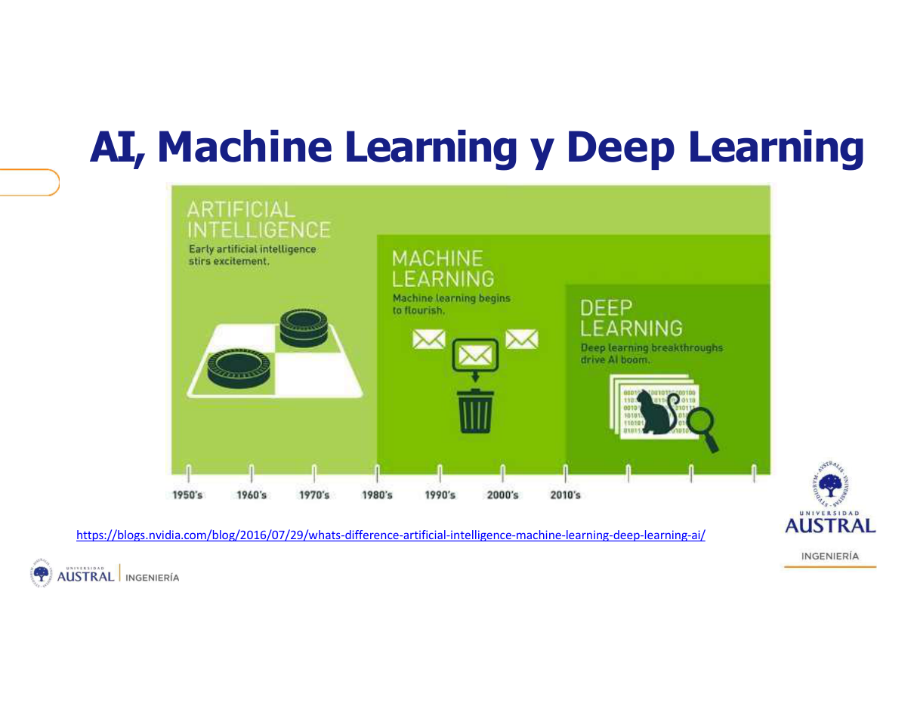
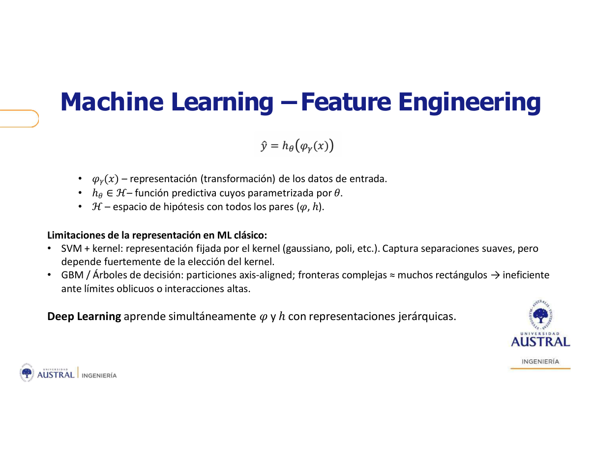
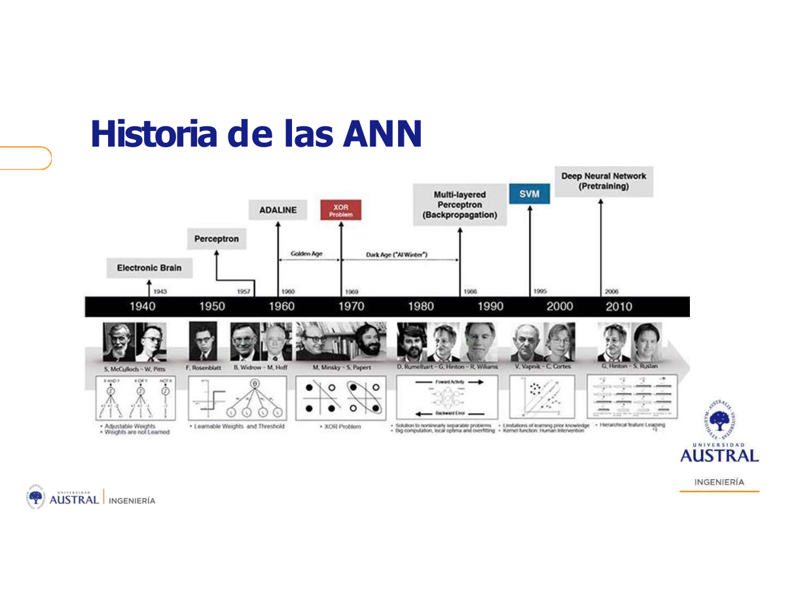
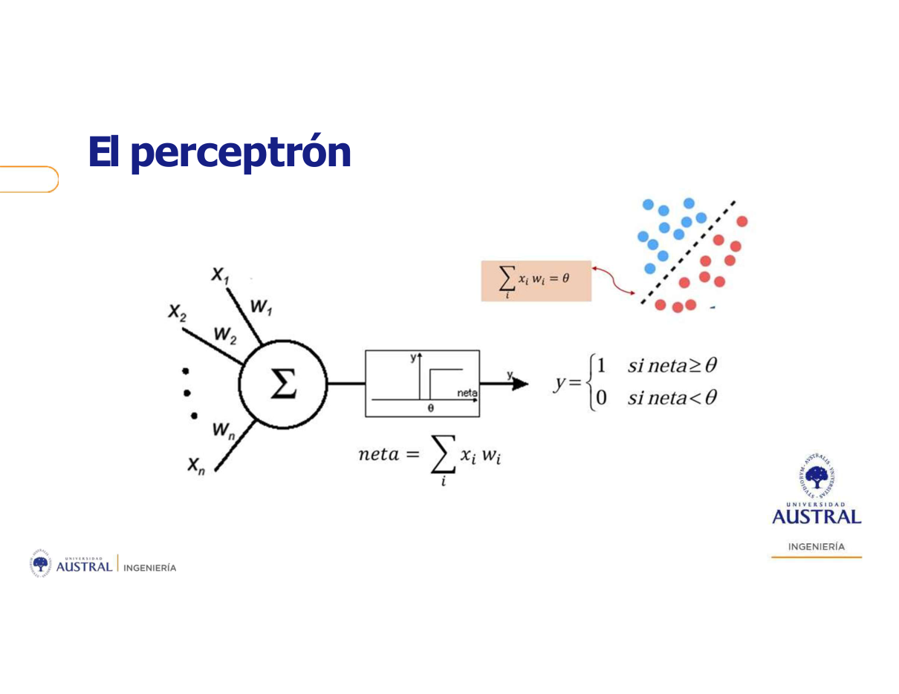
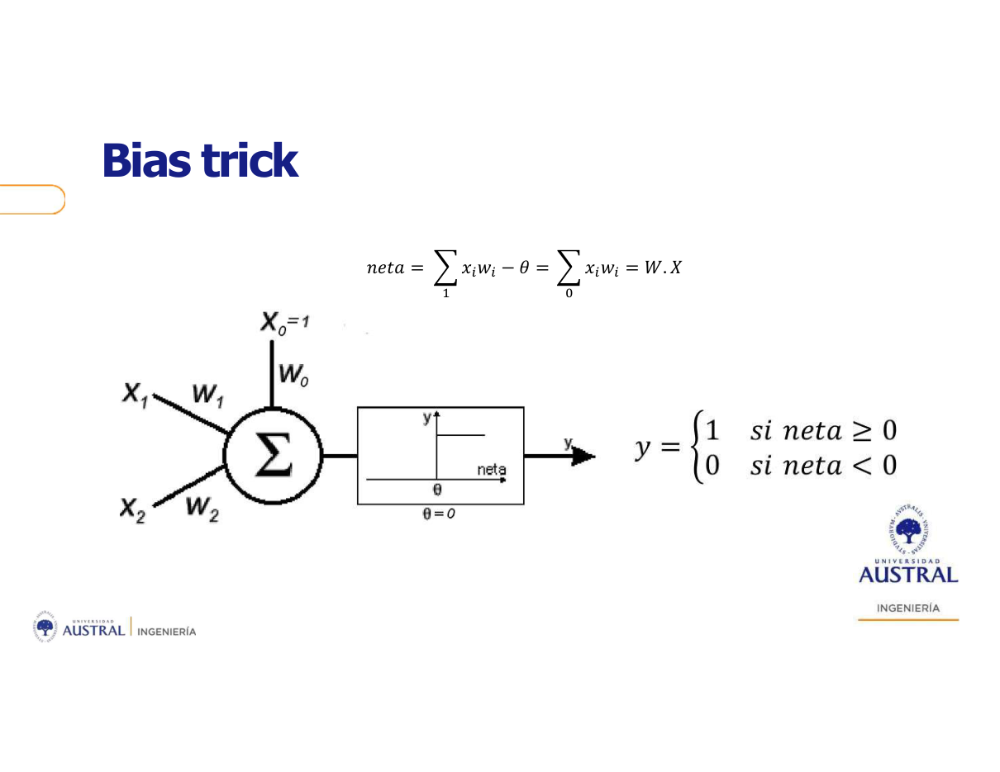
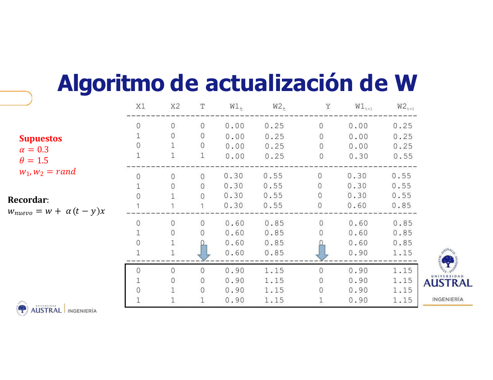

# Clase 07 · Introducción al Deep Learning y el perceptrón simple

> **Módulo 2 · Deep Learning y Aplicaciones Avanzadas** · Sebastián González · martes 28-abr-2026
> **Fuentes:** transcripción `DIA_Clase_07.vtt` · láminas `Intro_DL_clase1_SG_v2.pdf` · notebooks `PERCEPTRON_AND.ipynb` (mostrado en clase) y `Perceptron_Drogas.ipynb` con `ClassPerceptron.py` (de la carpeta, no se recorrió en clase)

## En pocas palabras

- La IA simbólica (desde los 50) escribía reglas a mano. El machine learning (desde los 80) da vuelta el flujo: le da al algoritmo **datos y respuestas** y obtiene las reglas. El deep learning (desde ~2010) es un subconjunto del ML; ninguno reemplazó al anterior.
- La diferencia central entre ML clásico y deep learning es **quién arma la representación** de los datos. En ML la hace la persona con *feature engineering*; en deep learning la red aprende a la vez la transformación $\varphi$ y el modelo $h$ (*representation learning*). En palabras de un alumno: "en ML le decís qué mirar; en DL el modelo descubre qué mirar".
- Un **algoritmo** es la receta (una serie de pasos). El **modelo** es el resultado: un conjunto de parámetros e hiperparámetros, donde queda guardado lo aprendido. Por el teorema *No Free Lunch*, ningún algoritmo gana en todos los datasets, así que siempre hay que comparar modelos sobre datos no vistos.
- El **perceptrón** (Rosenblatt, 1957) es una sola neurona: hace una suma ponderada de las entradas y la compara con un umbral. Aprende **corrigiendo los pesos con cada error**, $w_{nuevo} = w + \alpha\,(t-y)\,x$, y solo resuelve problemas **linealmente separables** (resuelve AND, no resuelve XOR).
- El *learning rate* $\alpha$ es un hiperparámetro: si es muy grande, la frontera salta y puede no converger; si es muy chico, converge lento. Como los pesos arrancan al azar, distintas corridas llegan a **distintas soluciones válidas**.

## Conceptos clave

### IA, machine learning y deep learning



*Figura: el gráfico marca desde cuándo cada término estuvo "en boca de todos". No es una sucesión que reemplaza a la anterior: DL ⊂ ML ⊂ IA.*

- **IA simbólica (1950–1980).** Nace formalmente en el taller de Dartmouth (1956). La inteligencia eran **reglas explícitas** escritas por programadores. Funcionó en problemas lógicos y acotados (ajedrez, demostración de teoremas, sistemas expertos de los 80), pero no escala. Las reglas explotan en cantidad y es inviable escribirlas para tareas "borrosas" como reconocer imágenes, voz o traducir. El profesor lo describió como "una cadena de *if* infinita".
- **Machine learning (1980–2010).** Se invierte el flujo. En la programación clásica entraban *reglas + datos* y salían respuestas. En ML (aprendizaje supervisado) entran *datos + respuestas* y salen las reglas, es decir, una función aprendida.
- **Deep learning (2010 en adelante).** El salto vino con la competencia de clasificación de imágenes **ImageNet**. Se juntaron tres cosas: redes neuronales, placas de video (GPU) y un dataset muy bueno. En pocos años las máquinas igualaron el reconocimiento humano de imágenes.

### El esquema de aprendizaje: función objetivo, hipótesis y error

El profesor usó el diagrama del libro *Learning from Data* (Abu-Mostafa, Caltech) con el ejemplo de aprobar o no un crédito hipotecario:

- Existe una **función objetivo** $f$ desconocida: la regla "perfecta" para dar o no el crédito.
- El **dataset** son ejemplos $(x_1, y_1), \dots, (x_n, y_n)$. Cada $x_i$ es un vector de atributos de una persona (edad, si trabaja, etc.) y $y_i$ es la decisión que se tomó.
- El **algoritmo de aprendizaje** elige una función $g$ dentro de un **conjunto de hipótesis**. Ese conjunto es más grande cuanto más **capacidad** (flexibilidad) tiene el algoritmo. Una regresión lineal tiene tantos parámetros como atributos. Una red neuronal grande tiene millones de parámetros y capas no lineales, así que su capacidad es mucho mayor.
- El resultado es $g \approx f$: aproximada, no igual. Nada garantiza llegar a la regla perfecta.
- **Medir el error es clave** y se mide dos veces con fines distintos: durante el aprendizaje (para saber hacia dónde ajustar) y al final, sobre datos no vistos (para evaluar y comparar modelos).

Las redes neuronales suelen tener *demasiada* capacidad. Si no se las limita, aprenden el dataset de memoria (sobreajuste), y el dataset es una "verdad parcial" del fenómeno.

### Algoritmo vs. modelo

| | Algoritmo | Modelo |
|---|---|---|
| Qué es | Una receta: serie finita y ordenada de pasos | El resultado de aplicar el algoritmo a un conjunto de datos |
| Contenido | Pasos (árbol de decisión, red neuronal, etc.) | **Parámetros + hiperparámetros** |
| Rol | *Cómo* se aprende | *Dónde persiste* lo aprendido |

- Los **parámetros** se aprenden (por ejemplo, los pesos $w$).
- Los **hiperparámetros** los elige la persona y condicionan el aprendizaje: la profundidad o los cortes de un árbol, el $k$ de KNN, la cantidad de capas de una red, el *learning rate*.
- Dos modelos distintos pueden salir **del mismo algoritmo** con distintos hiperparámetros (KNN con $k=3$ vs. $k=5$, una red de 3 capas vs. una de 5). A priori nadie sabe cuál anda mejor: hay que probar.

Decirle "modelo" a XGBoost o a "la red neuronal" es, según el profesor, incorrecto: esos son algoritmos.

### Teorema *No Free Lunch*

Si se promedia el rendimiento de todos los algoritmos sobre todos los datasets posibles, los resultados son casi iguales. Por lo tanto, **no hay un algoritmo que funcione mejor para todos los datasets**. Las redes neuronales no siempre le ganan a los árboles, y a veces conviene una SVM. Lo que más influye es el **tipo de datos**. Para el profesor, ahí está el rol del científico de datos: entender cómo funciona todo esto y saber qué probar y qué no.

### Feature engineering vs. representation learning



Forma general de un modelo, leída de adentro hacia afuera:

$$\hat y = h_\theta\big(\varphi_\gamma(x)\big)$$

- $x$: los datos de entrada.
- $\varphi_\gamma(x)$: una **representación o transformación** de esos datos. Puede ser la identidad (no transformar nada).
- $h_\theta$: la función predictiva, con parámetros $\theta$.
- $\mathcal H$: el espacio de hipótesis, con todos los pares $(\varphi, h)$.

| | ML clásico | Deep learning |
|---|---|---|
| Transformación $\varphi$ | La elige y construye la persona (*feature engineering*) | **La aprende la red** |
| Parámetros $\theta$ | Se aprenden | Se aprenden |
| Flujo | Extraer características a mano → clasificador | *End-to-end*: entra la representación numérica cruda, sale la predicción |

Ejemplos de clase:

- **Crédito:** a partir del dataset crudo se crean variables nuevas, como el ratio ingreso/deuda usando el dato de la Central de Deudores. Según la experiencia del profesor, el mismo algoritmo con los mismos hiperparámetros rinde mucho peor sin feature engineering.
- **Reconocer una cara** ("¿es Mark?"): en ML hay que medir redondez de la cara, distancia entre los ojos, ancho de la nariz, etc., y pasárselo a un clasificador. En DL se pasa la imagen (como números) y la red aprende esas características sola, mediante combinaciones no lineales.
- **Bicicleta:** en ML se extraen bordes o tonalidades a mano. En DL las capas aprenden por sí mismas bordes, luego formas, luego partes (representación jerárquica).
- **Datos no linealmente separables:** con dos variables no hay recta que separe las clases. Si se agrega una tercera dimensión $z$ que relacione $x$ e $y$, un plano las separa. Esa transformación es $\varphi$.

**Por qué los árboles necesitan ayuda:** hacen cortes **paralelos a los ejes**. Una frontera oblicua les cuesta muchos rectángulos. Si se crean interacciones entre variables (o se "rota" el problema), el árbol puede cortar cómodo. La lámina agrega que en una SVM la representación queda fijada por el kernel elegido.

¿El deep learning funciona mejor? "No lo sé, hay que probarlo." Lo que ofrece es **escapar del feature engineering**, no una garantía de mejor rendimiento.

### Las redes solo comen números

Una red neuronal solo hace cuentas. No se le da una foto, sino una representación numérica de la foto. De ahí salen varias exigencias de preprocesamiento (lámina "Numerización y normalización"):

- **Numerizar:** las variables nominales pasan a representación binaria; las categóricas con orden, a enteros con orden. Un árbol puede aceptar texto; una red, no.
- **Sin *missing values*** y con control de outliers.
- **Normalizar.** Si una variable es mucho más "grande" que otra, su peso recibe ajustes enormes en cada iteración y el de la chica apenas cambia. El aprendizaje se vuelve inestable y necesita muchas más iteraciones o un *learning rate* muy bajo.

### Historia de las redes neuronales



- 1943: neurona de McCulloch y Pitts.
- 1957: **perceptrón** (Rosenblatt). 1960: **ADALINE** (Widrow y Hoff). Se desarrollaron casi en paralelo.
- 1969: el **problema XOR** (Minsky y Papert) muestra su límite y empieza la "era oscura" (*AI winter*).
- 1986: el **perceptrón multicapa con backpropagation** (Rumelhart, Hinton, Williams) resuelve XOR. Pasaron casi dos décadas "para darse cuenta de que había que meter una neuronita más".
- Después, el crecimiento estuvo limitado por el hardware hasta que hubo datos masivos y GPU accesibles. Hacia 2010 se igualó al humano en imágenes.

### El perceptrón simple



- Es **una sola neurona** con aprendizaje supervisado. Su regla de aprendizaje es una modificación de la de Hebb.
- Recibe un vector de entrada $x = (x_1,\dots,x_n)$, que es un ejemplo con $n$ atributos, y tiene **un peso por atributo**. El vector $W$ es el mismo para todos los ejemplos.
- Calcula la **neta**, una combinación lineal: $\text{neta} = \sum_i x_i w_i$.
- Aplica una activación **escalón** (discreta): $y = 1$ si $\text{neta} \ge \theta$, y $y = 0$ si no.
- Geométricamente, $\sum_i x_i w_i = \theta$ es una **recta (hiperplano)** que separa dos clases. Por eso solo resuelve problemas linealmente separables.
- **Lo que aprende son los pesos $W$.** Las entradas están fijas y, por ahora, el umbral $\theta$ también.

**Ejemplo AND con pesos puestos a mano** ($w_1 = w_2 = 1$, $\theta = 1.5$):

| $x_1$ | $x_2$ | neta | ¿$\ge 1.5$? | $y$ | AND esperado |
|---|---|---|---|---|---|
| 0 | 0 | 0 | no | 0 | 0 |
| 0 | 1 | 1 | no | 0 | 0 |
| 1 | 0 | 1 | no | 0 | 0 |
| 1 | 1 | 2 | sí | 1 | 1 |

Esos pesos los eligió el profesor. El punto es que el perceptrón los **aprenda**.

### Intuición geométrica: acercar o alejar $W$ de $X$

Con dos atributos, $X$ y $W$ son vectores en el plano. El producto interno se puede escribir como

$$W\cdot X = |W|\,|X|\cos\phi = \text{proy}_X(W)\,|X|$$

Es decir, la neta es la proyección de $W$ sobre $X$ multiplicada por el largo de $X$. Entonces:

- Si se esperaba $W\cdot X > \theta$ y no se logró, hay que **acercar** $W$ a $X$, sumándole un pedacito de $X$: $w' = w + \alpha x$.
- Si se esperaba $W\cdot X < \theta$ y se pasó, hay que **alejar** $W$, restándole un pedacito: $w' = w - \alpha x$.
- Si el ejemplo quedó bien clasificado, no se toca nada.

Se usa $x$ porque es el único dato disponible, y solo "un pedacito" ($\alpha$) para no dar un salto gigante. El profesor aclaró que la red no hace gráficos: solo hace la combinación lineal. El dibujo sirve para entender **por qué** se suma o se resta.

### Regla de actualización y algoritmo

Las dos ramas se unifican con un solo signo dinámico:

$$w_{nuevo} = w + \alpha\,(t - y)\,x$$

donde $t$ es la salida esperada y $y$ la obtenida.

- $t=1,\ y=0$ → $(t-y)=+1$ → se acerca.
- $t=0,\ y=1$ → $(t-y)=-1$ → se aleja.
- $t=y$ → $(t-y)=0$ → no cambia.

Algoritmo:

1. Inicializar $W$ con valores aleatorios.
2. Mientras haya ejemplos mal clasificados: tomar un ejemplo, calcular $y$ y, si falló, actualizar $W$ con la regla.

Cada ejemplo "tira los pesos para su lado". Uno puede desacomodar a otro, pero en la pasada siguiente el otro tira de vuelta. Si el problema es linealmente separable, termina convergiendo.

**Epoch:** cada pasada completa por todos los ejemplos. La cantidad máxima de epochs es un hiperparámetro. Con cuatro ejemplos se itera hasta resolver; con millones, cada epoch cuesta mucho y se pone un tope. Limitar las epochs también funciona como regularización.

### *Learning rate* $\alpha$

Es la "fuerza con la que cada ejemplo tira para su lado". Es un **hiperparámetro**: no hay un valor óptimo conocido de antemano. El profesor mencionó que se suele usar un valor bajo, del orden de 0,05.

- **Muy alto:** un solo ejemplo puede desajustar todo lo que venía bien. Los pesos van y vienen, la convergencia es más lenta o no llega.
- **Muy bajo:** pasos chiquitos y estables, pero más epochs.

En la demo, $\alpha$ más chico tardó más en converger. Un alumno lo había interpretado como "best practice: cuanto más chico, mejor", y la respuesta fue que no: hay que buscar un valor intermedio.

### Bias trick



Para no tener que fijar el umbral a mano, se lo pasa del otro lado y se lo trata como un peso más, asociado a una entrada ficticia $x_0 = 1$:

$$\text{neta} = \sum_{i=1}^{n} x_i w_i - \theta = \sum_{i=0}^{n} x_i w_i = W\cdot X$$

La activación queda centrada en cero ($y=1$ si $\text{neta}\ge 0$) y el umbral, ahora el **bias** $w_0$ o $b$, **se aprende** junto con los demás pesos. El bias por el que preguntó un alumno es justamente este umbral.

### Limitación: XOR

El XOR no es linealmente separable: ninguna recta deja los dos "1" de un lado y los dos "0" del otro. Ni el perceptrón ni el combinador lineal lo resuelven. Hace falta más de una neurona (perceptrón multicapa). La clase lo anunció y lo dejó para la Clase 09.

### Lo que quedó para la Clase 09

Las láminas siguen con temas que el profesor decidió no dar hoy: ADALINE (combinador lineal, regla delta/LMS, MSE), descenso de gradiente (batch, SGD, mini-batch), neurona no lineal con sigmoide, softmax, XOR con perceptrón multicapa y backpropagation. Adelantó que la regla del perceptrón "es exactamente la misma" que la del combinador lineal, en su versión continua, y que pasar a funciones derivables convierte el aprendizaje en un **problema de optimización**.

## Ejemplos y casos de la clase

- **Crédito hipotecario** (Abu-Mostafa): enmarca $f$, $g$, el conjunto de hipótesis y la medición del error. También sirve de ejemplo de feature engineering (ratio ingreso/deuda).
- **Robo de energía en transformadores** (experiencia del profesor): surgió por una pregunta sobre PCA. Tenía el consumo de cada cliente a lo largo del año, 8760 valores horarios. Los redujo a un *embedding* de 24 columnas por cliente y lo usó con otras variables en un algoritmo no supervisado; se agruparon los transformadores con pérdidas. Enseña que la reducción de dimensión puede usarse **como forma de feature engineering**. (Mencionó datos cada 15 minutos y luego 8760 horas; el detalle exacto es dudoso en la transcripción.)
- **AlphaGo** (aprendizaje por refuerzo + deep learning): un agente juega muchísimas veces y una función objetivo premia las jugadas que acercan a ganar y castiga las que no. Le ganó a Lee Sedol e hizo jugadas que nadie había hecho en un juego milenario. El profesor ubicó el hecho "por 2019–2020" y dio un resultado de partidas que parece mal recordado: tomar fecha y marcador como **dudosos**. Mismo esquema de premio/castigo en autos autónomos (frenar ante un peatón).
- **Pronóstico de consumo eléctrico con LSTM** (paper de Kong et al., 2019): redes recurrentes que guardan en sus parámetros información del pasado para predecir el futuro. Se mencionó, no se verá en el módulo.
- **GAN y caras sintéticas (2014–2017):** un generador y un discriminador se entrenan uno contra otro hasta que las caras generadas son indistinguibles de fotos reales. Se verá en otro módulo.
- **LLM** (ChatGPT, Claude): redes aplicadas a texto, que sí se verán en este módulo.
- **AND paso a paso** con $\alpha = 0.3$, $\theta = 1.5$ y pesos iniciales $(0;\ 0.25)$. Ver la tabla abajo.



*Figura: en cada epoch solo falla el ejemplo (1,1), que acerca los pesos sumando $0.3$ a cada uno: $(0;0.25)\to(0.30;0.55)\to(0.60;0.85)\to(0.90;1.15)$. En la cuarta epoch la neta da $2.05 > 1.5$ y todo queda bien clasificado. Converge en 4 epochs a pesos distintos de los $(1;1)$ elegidos a mano, que también resuelven el problema.*

## Práctica

**`PERCEPTRON_AND.ipynb`** (mostrado en clase; no hace falta saber programarlo todavía):

- Define `X = [[0,0],[0,1],[1,0],[1,1]]` y `T = [0,0,0,1]`.
- Inicializa `W` y `b` (bias) al azar en $[-0.5, 0.5]$, con `MAX_ITE = 100` epochs como tope y un `alfa` chico.
- En cada epoch recorre los ejemplos y, si `y != T`, aplica la regla. Corta cuando una epoch termina sin errores.
- Dibuja la recta de decisión en cada epoch y grafica la cantidad de actualizaciones por iteración.

```python
result_ejem = X[ejem][0]*W[0] + X[ejem][1]*W[1] + b
y = 1 if result_ejem >= 0 else 0          # escalón centrado en 0 (bias trick)
if y != T[ejem]:
    W[0] += alfa * (T[ejem]-y) * X[ejem][0]
    W[1] += alfa * (T[ejem]-y) * X[ejem][1]
    b    += alfa * (T[ejem]-y) * 1          # x0 = 1
```

Qué mirar: la recta arranca en cualquier lado y se va acomodando. Al cambiar $\alpha$ cambia el tamaño de los saltos. En la demo, con $\alpha = 0.15$ convergió en 7 epochs y con un valor más chico tardó 16 (el valor exacto que usó es dudoso en la transcripción); igual depende del punto de partida aleatorio. Cada corrida termina en una recta distinta, porque hay muchas rectas que separan AND.

**`Perceptron_Drogas.ipynb` + `ClassPerceptron.py`** (en la carpeta, no se recorrió en clase):

- Dataset `Drug5.csv` (200 pacientes): edad, sexo, presión, colesterol, Na, K y droga recetada.
- Mapea las ordinales a números (`BP`: HIGH=2, NORMAL=1, LOW=0) y arma un problema binario: `drugY` vs. otra.
- Separa train/test 70/30 y **normaliza** con `StandardScaler`, ajustado solo en train.
- Entrena la clase `Perceptron` (estilo scikit-learn: `fit`, `predict`, `net_input`, `errors_`).
- La salida guardada muestra 60 aciertos sobre 60 en test.

Es la aplicación directa de la lámina de numerización y normalización.

## Para recordar

- "Las redes neuronales no son magia: son cuentas que se hacen muy rápido." Y para hacer cuentas necesitan **números**, sin faltantes y normalizados.
- No llamar "modelo" a un algoritmo. El modelo es el conjunto de parámetros e hiperparámetros donde persiste el conocimiento.
- *No Free Lunch*: nunca se sabe a priori qué algoritmo (ni qué hiperparámetros) va a andar mejor, así que hay que medir el error sobre datos no vistos y comparar.
- El deep learning no elimina al científico de datos: lo libera del feature engineering, pero las decisiones de diseño y evaluación siguen siendo humanas.
- El perceptrón aprende **del error**. Esa idea, refinada con funciones derivables y optimización, es la que se sigue usando hoy.
- El resultado no es determinístico en el sentido de "siempre la misma solución": el punto de partida importa, porque es un proceso iterativo que converge.
- El perceptrón simple **no aprende representaciones**, solo parámetros. Las representaciones aparecen cuando se agregan capas y funciones de activación no lineales.

## Preguntas de repaso

<details><summary>1. ¿Qué cambia entre la programación clásica (IA simbólica) y el machine learning en cuanto a qué entra y qué sale?</summary>

En la programación clásica entran reglas escritas a mano y datos, y salen respuestas. En ML entran datos y respuestas (etiquetas), y lo que se obtiene son las reglas, como una función aprendida. Eso permite abordar problemas "borrosos" donde escribir reglas es inviable.

</details>

<details><summary>2. En la expresión ŷ = h_θ(φ_γ(x)), ¿qué parte aprende el ML clásico y qué parte agrega el deep learning?</summary>

El ML clásico aprende los parámetros $\theta$ de $h$, pero la transformación $\varphi$ la define la persona (feature engineering). El deep learning aprende las dos cosas a la vez: la representación de los datos y los parámetros del modelo (representation learning).

</details>

<details><summary>3. ¿Por qué un árbol de decisión se beneficia mucho del feature engineering ante una frontera oblicua?</summary>

Porque solo hace cortes paralelos a los ejes, y una frontera oblicua le exige muchos rectángulos. Si se crea una variable que combine las originales (o se transforma el espacio), la frontera puede quedar alineada con un eje y el árbol la resuelve con pocos cortes.

</details>

<details><summary>4. Si dos modelos se entrenaron con el mismo algoritmo, ¿pueden ser distintos? ¿Por qué hay que compararlos?</summary>

Sí: pueden diferir en los hiperparámetros (por ejemplo, $k$ en KNN o la cantidad de capas de una red) y por lo tanto en los parámetros aprendidos. Hay que compararlos con el error sobre datos no vistos porque nadie sabe a priori cuál anda mejor. Por *No Free Lunch*, tampoco hay un algoritmo que gane siempre.

</details>

<details><summary>5. En la regla w_nuevo = w + α(t − y)x, ¿qué pasa en cada combinación de t e y, y qué significa geométricamente?</summary>

Si $t=y$, el término se anula y no se actualiza. Si $t=1$ e $y=0$, se suma $\alpha x$: $W$ se acerca a $X$ y la proyección crece hasta superar el umbral. Si $t=0$ e $y=1$, se resta $\alpha x$: $W$ se aleja de $X$ y la proyección baja del umbral.

</details>

<details><summary>6. ¿Para qué sirve el bias trick?</summary>

Para no tener que fijar el umbral $\theta$ a mano. Se lo trata como el peso $w_0$ de una entrada constante $x_0=1$; así la neta queda $W\cdot X$, la activación se centra en cero y el umbral (bias) se aprende con la misma regla que los demás pesos.

</details>

<details><summary>7. ¿Qué efecto tiene un learning rate demasiado alto en el perceptrón? ¿Y uno demasiado bajo?</summary>

Demasiado alto: cada ejemplo mal clasificado mueve mucho los pesos, puede desajustar lo que ya estaba bien, y la frontera oscila; converge lento o nunca. Demasiado bajo: los pasos son estables pero muy chicos, y se necesitan más epochs. Es un hiperparámetro que hay que probar.

</details>

<details><summary>8. ¿Por qué el perceptrón simple no puede resolver XOR y qué hace falta?</summary>

Porque su frontera de decisión es una sola recta (hiperplano) y XOR no es linealmente separable: ninguna recta separa los dos "1" de los dos "0". Hace falta combinar más de una neurona en capas (perceptrón multicapa), que es lo que habilitó backpropagation en los 80.

</details>

## Conexiones

- **Hacia atrás:** el esquema datos → algoritmo → modelo → error, y la idea de sobreajuste, retoman el Módulo 1. Los cortes paralelos a los ejes de los árboles vienen de la Clase 02, los hiperparámetros de árboles y ensambles de la Clase 03, PCA como reducción de dimensión de la Clase 04 y el feature engineering de la Clase 06.
- **Hacia adelante:** la Clase 08 (frameworks y bibliotecas) pasa estas cuentas a herramientas como Keras. La Clase 09 retoma lo que quedó pendiente: combinador lineal, función de pérdida, descenso de gradiente, activaciones, XOR con perceptrón multicapa y backpropagation. Las aplicaciones a imágenes, texto y *transfer learning* (presentado en clase con el ejemplo de BERT) llegan en las clases siguientes del módulo.
- **TFI:** la idea de *representation learning* es la base del retrieval semántico: en lugar de comparar nombres comerciales por coincidencia de caracteres (léxico, una representación "hecha a mano"), se usan representaciones aprendidas por redes (embeddings). Esta clase todavía no llega a embeddings de texto.
