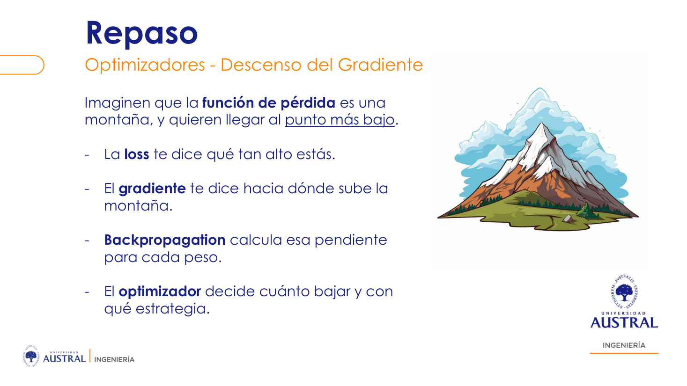
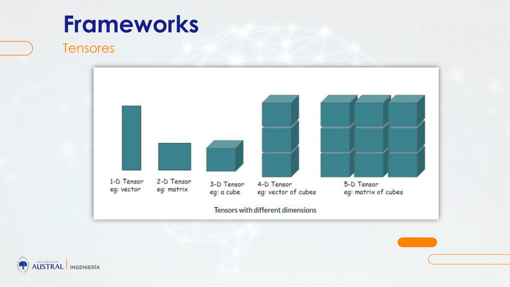
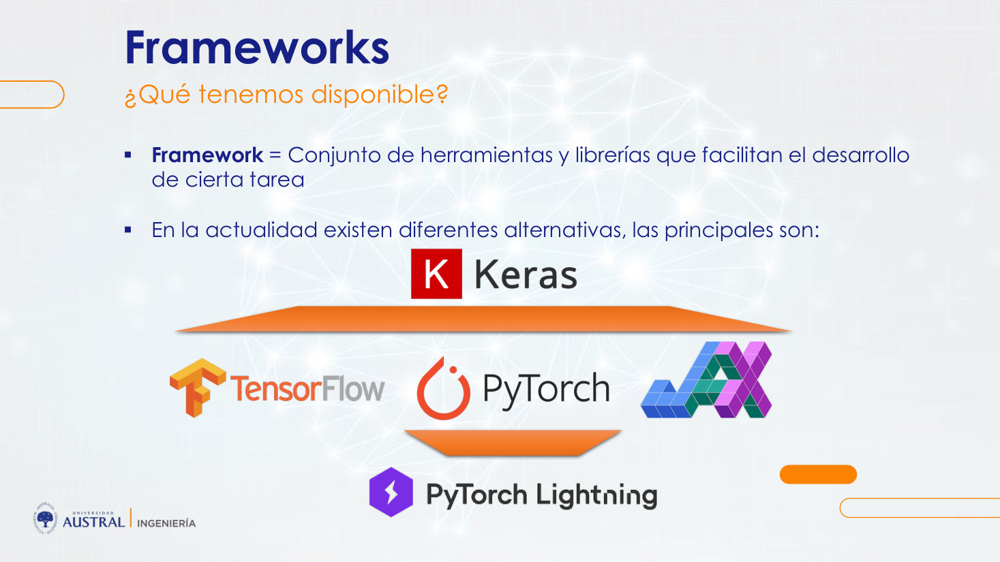
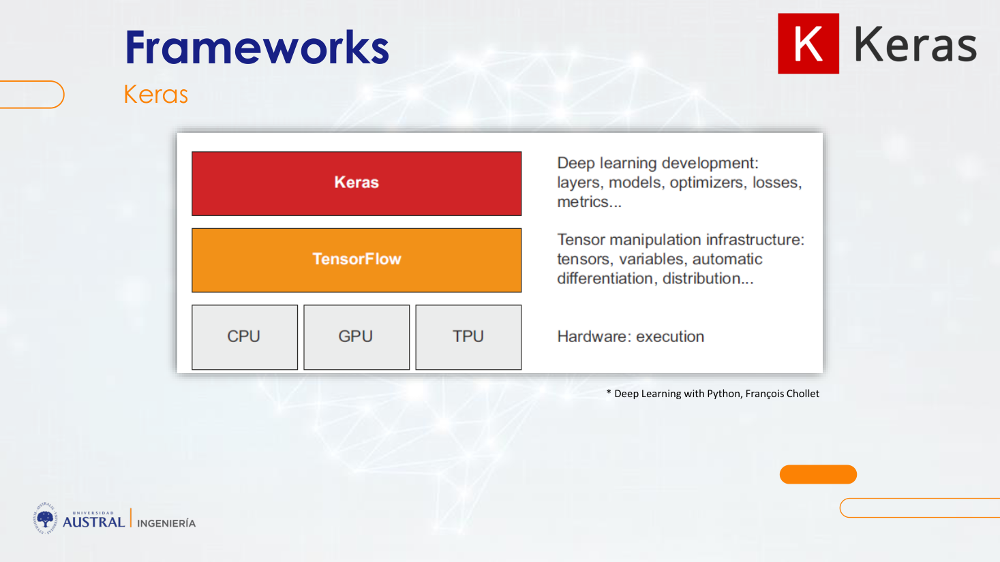
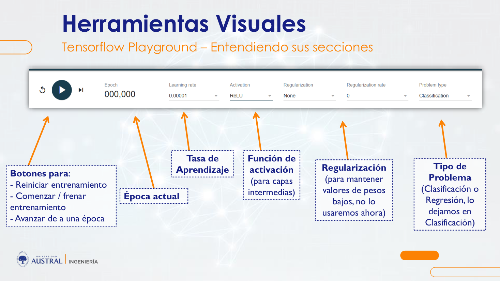

# Clase 08 · Herramientas y frameworks de deep learning

> **Módulo 2 · Deep Learning y Aplicaciones Avanzadas** · Daniel Gattari · jueves 30-abr-2026
> **Fuentes:** transcripción `DIA_Clase_08.vtt` · láminas `deep_learning_austral_clase_2.pdf` ("Herramientas, Frameworks, Entornos y Recursos en Línea", clase 2 del módulo) · notebooks `2.1-Tensorflow`, `2.2-Keras Basico` (mostrados en clase) y `2.3` a `2.6` y `2.Practica-Alumnos` (subidos al campus, no se llegaron a ver)

## En pocas palabras

- Una red neuronal es, en el fondo, muchas combinaciones lineales ($w \cdot x + b$) seguidas de una **función de activación**, repetidas en paralelo (neuronas de una capa) y en serie (capas). La activación es la que introduce la **no linealidad**; sin ella, la red solo podría modelar relaciones lineales.
- La red **aprende sola** sus **parámetros** (pesos y bias) con un ciclo iterativo: predice, mide el error con la **función de pérdida**, y vuelve hacia atrás (**backpropagation**) para corregir los pesos según lo que indique el **optimizador** (descenso del gradiente; en general, Adam). Lo que elige el que diseña la red son los **hiperparámetros**: arquitectura, activación, pérdida, optimizador, tasa de aprendizaje, épocas, tamaño de batch.
- Con TensorFlow Playground se ve que un problema linealmente separable se resuelve sin capas ocultas, pero que, a medida que los datos tienen formas más complejas (círculo, espiral), hace falta agregar neuronas y capas. Cada capa genera "representaciones de las representaciones" de la anterior.
- No se programa una red desde cero: se usan **frameworks**. Los de **bajo nivel** (TensorFlow, PyTorch, JAX) obligan a definir pesos, activaciones y bucle de entrenamiento; los de **alto nivel** (Keras, PyTorch Lightning) permiten armar la red "como un Lego" en pocas líneas. Todos trabajan con **tensores**.
- Para entrenar redes grandes hacen falta muchos datos (y datos etiquetados). Cuando no se los tiene, la salida es usar **modelos preentrenados** y transferir ese conocimiento. Los datasets y modelos públicos están en Kaggle, Hugging Face y Google Dataset Search.

## Conceptos clave

### Repaso: perceptrón y multiperceptrón

El **perceptrón** es la red neuronal más básica: una única neurona. Recibe varias entradas $x_i$, multiplica cada una por un peso $w_i$, suma un **bias** $b$ y pasa el resultado por una función de activación:

$$z = \sum_i w_i x_i + b \qquad\qquad \text{salida} = f(z)$$

Es la misma idea que la recta $a \cdot x + b$ de la secundaria: $w$ hace de pendiente y $b$ de intercepto. Su capacidad predictiva es limitada.

El **multiperceptrón** acumula neuronas en una capa y varias capas una tras otra: la capa 2 recibe lo que entrega la capa 1, la 3 lo de la 2, y así. Estas redes son **feedforward**: la información fluye en una sola dirección, de las entradas a las salidas. Combinar muchas veces los datos de entrada le da una capacidad predictiva alta, porque puede modelar relaciones no lineales complejas.

El profesor insistió en una pregunta previa a cualquier diseño: **qué es la entrada y qué es la salida**. La entrada suele estar clara (son los datos que uno tiene); la salida esperada no siempre. De esa definición depende el tipo de red.

### Funciones de activación

Es una transformación matemática que se aplica a la salida de una neurona antes de pasarla a la siguiente capa. Podría ser cualquier función, pero en la práctica se usan pocas:

| Función | Qué hace | Uso típico mencionado |
|---|---|---|
| **Escalón** | 1 si $z>0$, 0 si $z<0$ | Ejemplo didáctico |
| **Sigmoidea** | $\sigma(z) = \dfrac{1}{1+e^{-z}}$; lleva cualquier valor al rango $(0,1)$. Fuera de aproximadamente $[-5, 5]$ ya da prácticamente 0 o 1 | Clasificación binaria (capa de salida) |
| **ReLU** | 0 si $z<0$; $z$ si $z>0$ | Capas ocultas; muy usada en imágenes |
| **tanh** | Parecida a la sigmoidea, pero entre $-1$ y $1$ | Algunas aplicaciones concretas |

**Ejemplo de las láminas.** Entradas $x = (1,\ 0,\ -1)$ y pesos $w = (0.5,\ 1.2,\ -0.7)$. La suma ponderada es $z = 0.5 + 0 + 0.7 = 1.2$. Con la misma $z$, la salida cambia según la activación:

- escalón: $1$;
- sigmoidea: $\sigma(1.2) \approx 0.77$;
- ReLU: $1.2$ (igual a $z$, porque es positiva).

¿Cuál usar? La respuesta del profesor: muchas veces "porque sí", es decir, por convención. Ya hay mucho desarrollado y se sabe qué funciona para cada problema (ReLU en imágenes, sigmoidea a la salida en clasificación binaria).

### Parámetros vs. hiperparámetros

| | Parámetros | Hiperparámetros |
|---|---|---|
| Qué son | Pesos y bias de cada neurona | Valores que se eligen antes de entrenar |
| Quién los define | Los aprende el modelo | Los elige quien arma la red |
| Cuándo cambian | En cada paso de entrenamiento | Se fijan de antemano ("perillas") |
| Ejemplos | $w_i$, $b$ | Arquitectura (capas y neuronas), función de activación, función de pérdida, optimizador, tasa de aprendizaje, número de épocas, tamaño de batch, criterio de corte |

"Cuando hablo de pesos, piensen siempre en peso y bias": vienen juntos en la combinación lineal y los dos se entrenan. Esta distinción no es propia de las redes: vale para todo el machine learning.

Una pregunta de clase: ¿el error objetivo es un parámetro? No. El valor del error es un resultado; **cómo** se mide el error (qué pérdida) y **hasta cuándo** se entrena son decisiones del diseñador, o sea, hiperparámetros. El parámetro es lo que aprende el modelo.

### Backpropagation

Es "el corazón del entrenamiento". Intuitivamente:

1. La red procesa una entrada y genera una salida (**forward**).
2. Se compara esa salida con la respuesta esperada. Se la conoce porque es un problema **supervisado**: en el entrenamiento se tienen entrada y salida.
3. La diferencia indica qué tan bien o mal lo hizo la red.
4. Desde esa diferencia final se va **hacia atrás**, capa por capa, determinando cuánto contribuyó cada parámetro al error, y se lo ajusta.
5. Con los pesos corregidos se vuelve a predecir, y el ciclo se repite hasta llegar a un error aceptable.

**Analogía del pintor.** Un pintor quiere obtener violeta y solo tiene pomos de azul, rojo, amarillo, blanco y negro. Mezcla con ciertos porcentajes, mira el resultado ("le puse un montón de amarillo") y vuelve a corregir los **porcentajes**. En la red, esos porcentajes son los **pesos**. La diferencia es que la red hace el ajuste sola: "esa es la magia".

### Función de pérdida (de costo u objetivo)

Mide qué tan lejos está la salida de la red respecto de la esperada. Es el feedback que dice si hay que ajustar los parámetros y cuánto. En el ejemplo del pintor, sería una forma de cuantificar cuánta diferencia hay entre el color obtenido y el violeta. Se puede medir el error de muchas maneras; elegir cuál es un hiperparámetro.

| Tipo de problema | Pérdida | Idea |
|---|---|---|
| Regresión | MSE (error cuadrático medio) | Penaliza la diferencia entre valor real y predicho; los errores grandes pesan mucho |
| Regresión robusta | MAE (error absoluto medio) | Error promedio; menos sensible a valores extremos |
| Clasificación binaria | Binary cross-entropy | Penaliza asignar baja probabilidad a la clase correcta |
| Clasificación multiclase | Categorical cross-entropy | Compara la distribución de probabilidades predicha con la clase verdadera |
| Datos desbalanceados | Focal loss | Da más importancia a los ejemplos difíciles o mal clasificados |
| Segmentación de imágenes | Dice loss / IoU loss | Mide cuánto se superpone la máscara predicha con la real |

Sobre la binary cross-entropy, el profesor remarcó que el modelo entrega una **probabilidad**, y la pérdida no solo mira si acertó el 0 o el 1: también **penaliza la falta de confianza** en la predicción. En regresión, lo que más vio en la práctica es el MSE. Un ejemplo de clase para el MAE: si la respuesta era 10 y la predicción 6, el error absoluto es 4; el MAE promedia esos errores sobre todas las observaciones.

### Optimizador y descenso del gradiente

El **optimizador** es el algoritmo que define **cómo** ajustar los pesos y bias para que la pérdida baje lo más rápido y eficazmente posible. Tiene que indicar **en qué dirección** cambiar cada peso (subirlo o bajarlo) y **cuánto**. Cambiar los pesos al azar y probar requeriría millones de iteraciones.

Matemáticamente, el optimizador **minimiza la función de pérdida** con el **descenso del gradiente**: un método iterativo que da pequeños pasos en la dirección en la que la función disminuye más rápido en el punto actual. Esa dirección sale de las **derivadas parciales** de la pérdida respecto de cada peso.

- En 2 o 3 dimensiones se puede dibujar la pérdida como una curva o superficie con **mínimos locales** y un **mínimo global**; interesa el global, porque ahí la predicción es lo más precisa posible.
- Con millones de pesos, la "superficie" tiene millones de dimensiones; por eso hacen falta algoritmos eficientes.
- Variantes vistas en la lámina: Gradient Descent, Momentum, Adagrad, RMSProp y **Adam**. En la animación mostrada, Adam era el único que llegaba al mínimo global. Es el más usado.



*Figura: la analogía de la montaña. La loss dice qué tan alto se está; el gradiente, hacia dónde sube la montaña; backpropagation calcula esa pendiente para cada peso; el optimizador decide cuánto bajar y con qué estrategia.*

### Tasa de aprendizaje (learning rate)

Es un coeficiente que multiplica la corrección que se deriva del error, para que el modelo aprenda más rápido o más despacio. Un error grande produce ajustes grandes en los pesos; la tasa de aprendizaje atenúa o amplifica ese efecto.

- **Alta:** puede llegar antes a un mínimo, pero, al dar saltos tan grandes, corre el riesgo de pasarse el mínimo global y quedar en uno local.
- **Baja:** da pasos más chicos; tarda más, pero en el ejemplo del Playground igual llegó a la solución.

### ¿Hasta cuándo entrenar?

Una **época** es una iteración completa: ir hacia adelante, predecir y corregir hacia atrás. Estrategias de corte:

| Estrategia | Riesgo |
|---|---|
| Cantidad fija de épocas (por ejemplo, 500) | Cortar antes o después de lo conveniente |
| Hasta alcanzar un error objetivo (por ejemplo, 5 %) | Que nunca se alcance, o **underfitting**: cortar en 5 % cuando el modelo podía llegar a 1 % |
| **Early stopping**: medir el error en cada época y cortar cuando deja de mejorar (por ejemplo, 10 épocas sin mejora) | Es la más usada |

Seguir entrenando siempre cambia los pesos, y eso tiene un peligro: el **overfitting**. Se detecta cuando la pérdida de entrenamiento sigue bajando y la de validación (o testeo) se estanca o sube. La red está ajustando los pesos para clasificar perfectamente los datos de entrenamiento, "de memoria", en lugar de aprender algo generalizable a datos nuevos.

### Capas, neuronas y costo

- Cada capa produce **representaciones intermedias** de la entrada; la capa siguiente produce **representaciones de esas representaciones**. Por eso, a veces conviene tener dos capas de 10 neuronas en lugar de una de 20: se logran operaciones más complejas. Pero muchas capas de dos neuronas tampoco sirven, porque cada una genera muy pocas representaciones. Hay que buscar un equilibrio.
- Elegir cuántas capas y neuronas es mucho de **prueba y error** ("hay un poco de arte"). En la práctica, se parte de una arquitectura parecida ya probada para un problema similar y se la ajusta.
- Cada neurona agrega pesos que hay que calibrar: más arquitectura implica más **costo computacional** (GPU), y eso importa al llevar el modelo a producción.
- Con **pocos datos**, una red no siempre conviene. Una arquitectura con cientos de miles de pesos puede aprender de memoria un dataset poco complejo, y un método más simple puede rendir igual. Para entrenar "estos bichos" hacen falta muchos datos o **modelos preentrenados**.

### Tensores

Un **tensor** es un contenedor de números, una generalización de escalares, vectores y matrices. Se define por tres elementos (lámina):

- **Nivel o eje (rank):** cuántas dimensiones tiene. Escalar = nivel 0; vector = nivel 1; matriz = nivel 2.
- **Forma (shape):** una tupla con el tamaño en cada dimensión.
- **Tipo de datos.** Cada nivel debe tener elementos del mismo tamaño y tipo.

Intuición: agregar un nivel es poner en una lista varios tensores del nivel anterior. Un tensor de nivel 3 es una lista de matrices (un cubo); uno de nivel 4, una lista de cubos.



*Figura: vector (1-D), matriz (2-D), cubo (3-D), vector de cubos (4-D) y matriz de cubos (5-D).*

Ejemplos de clase:
- Una imagen en blanco y negro de 28 × 28 píxeles (dígitos escritos a mano), con valores de 0 (negro) a 255 (blanco): **tensor de nivel 2**.
- Una imagen a color en RGB (tres canales: rojo, verde y azul): **tensor de nivel 3**.

### Frameworks: bajo nivel y alto nivel

Un **framework** es un conjunto de herramientas y librerías que facilita una tarea; acá, construir, entrenar y evaluar redes. Sin ellos habría que programar operaciones matriciales, derivadas, backpropagation, optimización, manejo de GPU y carga de datos.



| Framework | Nivel | Origen | Características (clase y láminas) |
|---|---|---|---|
| **TensorFlow** | Bajo | Google (Google Brain), 2015, código abierto | El nombre viene de los tensores que fluyen por operaciones computacionales. Operaciones matriciales y derivadas muy eficientes; corre en CPU, GPU y TPU; adoptado en la industria por escalabilidad y soporte de producción. Nació con una API compleja |
| **PyTorch** | Bajo | Meta, 2016 | Menos complejo que TensorFlow; el código se parece más a Python común. Muy popular en la comunidad académica |
| **JAX** | Bajo | Google Research, 2018 | Enfocado en investigación avanzada; alta precisión y personalización. El más de nicho: el profesor dijo no haberse cruzado nunca un desarrollo en JAX |
| **Keras** | Alto | François Chollet (Google), 2015 | Se integró oficialmente a TensorFlow en 2017 como su interfaz recomendada. Con **Keras 3** volvió a ser **multibackend**: corre sobre TensorFlow, JAX o PyTorch. La preferida del profesor |
| **PyTorch Lightning** (o Lightning) | Alto | Open source, 2019 | Es a PyTorch lo que Keras a TensorFlow. No es multibackend: solo funciona sobre PyTorch. En 2023 pasó a llamarse Lightning |

- **Bajo nivel:** funciones para tareas específicas (calcular un gradiente, definir la pérdida). Se programa la red con más detalle, aunque sin llegar a hacer operaciones matriciales a mano.
- **Alto nivel:** se programa "a lo guaso": "quiero una capa con tantas neuronas, esta entrada y esta salida; usá los valores por defecto". Se puede armar una red en cinco líneas. Keras **usa TensorFlow por detrás**.



*Figura: la pila de abstracción (del libro* Deep Learning with Python*, de Chollet). Keras define modelos, capas, optimizadores, pérdidas y métricas; TensorFlow maneja tensores, variables y diferenciación automática; abajo, el hardware ejecuta.*

La combinación más usada, según el profesor, es **TensorFlow + Keras**; PyTorch también se usa bastante. Recomendó el libro de Chollet.

### Entornos: Jupyter y Colab

- **Jupyter Notebooks:** dividen un experimento largo en bloques que se ejecutan por separado, de forma interactiva, sin tener que volver a correr todo si algo falla al final. Combinan bloques de código y de texto, útil para documentar un entregable.
- **Google Colab:** Jupyter gratuito en la nube, sin instalación. Cada sesión asigna una máquina virtual; permite usar GPU o TPU por tiempo limitado. En la versión gratuita, un notebook corre hasta 12 horas y puede perderse lo ejecutado si queda inactivo. Para tareas cotidianas alcanza.
- Para abrir un `.ipynb` en Colab: subirlo a Google Drive y abrirlo con Google Colaboratory (Nuevo → Más), o desde Colab con Archivo → Subir notebook.

### Recursos en línea

- **Datasets públicos:** **Kaggle** (miles de datasets, con notebooks de la comunidad; ideal para explorar, prototipar y competir), **Hugging Face Datasets** (orientados sobre todo a NLP, también visión y audio) y **Google Dataset Search** (buscador que no aloja los datos, sino que enlaza a fuentes de gobiernos, universidades e investigadores).
- **Modelos preentrenados:** modelos ya entrenados con grandes volúmenes de datos que aprendieron representaciones útiles. Ventajas: ahorran tiempo y cómputo (se usan directamente o se afinan, *fine-tune*), rinden mejor con pocos datos y transfieren conocimiento de un dominio a tareas relacionadas. Se consiguen en "hubs" de modelos, como el Model Hub de Hugging Face.

## Ejemplos y casos de la clase

**Aplicaciones de redes neuronales.** ChatGPT (OpenAI), el reconocimiento facial de Google Photos, la detección de autos en vivo de Tesla (necesaria para la conducción autónoma), los chatbots y, para "bajarlo a tierra", la noticia de un centro de diagnóstico local que aplicó IA en resonancia magnética para mejorar la calidad y reducir los tiempos del estudio. La idea: no es tecnología exclusiva de grandes empresas. El profesor contó que en su trabajo de consultoría pasó de Random Forest a boosting (XGBoost, LightGBM) y hoy usa redes en casi todo.

**TensorFlow Playground** (`playground.tensorflow.org`). Clasificación de puntos en azul o naranja con dos variables ($x_1$ y $x_2$; en clase se las imaginó como peso y altura de pacientes).



- **Datos linealmente separables, sin ruido:** sin ninguna capa oculta, solo la combinación lineal $f(x_1,x_2) = w_1x_1 + w_2x_2 + b$, el modelo encuentra la frontera en una época. Con una tasa de aprendizaje mucho más chica, tarda más, pero también llega.
- **Datos en círculo:** sin capas ocultas, la pérdida baja un poco y se estanca, porque la frontera no es lineal. Con una neurona oculta tampoco alcanza; al agregar neuronas en la misma capa, la red empieza a combinar las variables de forma más compleja y la pérdida baja.
- **Espiral:** aun con muchas neuronas en una capa no se resolvía; con varias capas, "enganchó" recién después de unas 6.000 épocas. Mensaje de la lámina: si un problema de 2 dimensiones ya exige una arquitectura más compleja, ¿qué se puede esperar de problemas reales?
- Mientras se entrena, se ven la pérdida de entrenamiento (gris) y de testeo (negra). Si la de entrenamiento baja y la de testeo sube o se estanca, hay overfitting.

**XOR en TensorFlow puro (bajo nivel).** Datos $X = \{(0,0),(0,1),(1,0),(1,1)\}$ e $y = (0,1,1,0)$: la salida es 1 cuando exactamente una de las dos entradas es 1. Se definen a mano los pesos y bias de una capa oculta de 8 neuronas y una de salida de 1 (`W1` de 2×8, `b1` de 8, `W2` de 8×1, `b2` de 1), la sigmoidea como $1/(1+e^{-x})$, el forward pass (ReLU en la capa oculta, sigmoidea a la salida), la pérdida (binary cross-entropy), el optimizador (Adam, `learning_rate=0.1`) y el bucle de entrenamiento con `tf.GradientTape`, que calcula los gradientes y los aplica en cada época.

**El mismo XOR en Keras (alto nivel).** Lo que antes eran variables y funciones se lee casi como lenguaje natural:

```python
model = tf.keras.Sequential([
    tf.keras.Input(shape=(2,)),                     # 2 variables de entrada
    tf.keras.layers.Dense(8, activation='relu'),    # capa oculta
    tf.keras.layers.Dense(1, activation='sigmoid')  # salida binaria
])
model.compile(optimizer=tf.keras.optimizers.Adam(learning_rate=0.1),
              loss='binary_crossentropy', metrics=['accuracy'])
model.fit(X, y, epochs=500)
```

Primero se define la arquitectura de forma **secuencial**; después se **compila** (optimizador, pérdida y métrica) y se **entrena** con `fit`.

**Datos y ética (debate de clase).** ¿Quién etiqueta millones de imágenes? En casos generales, los captcha ("marcá los semáforos") hacen que los usuarios etiqueten datos a muy bajo costo. En medicina, el cuello de botella es que los especialistas etiqueten. Además, se exigen consentimiento, anonimización (datos sin nombre, edad ni demografía) y avales éticos, incluso en estudios con animales, y los centros compiten por tener los mejores datasets.

## Práctica

- **Notebooks vistos en clase:** `2.1-Tensorflow` (XOR en bajo nivel) y `2.2-Keras Basico` (el mismo XOR en Keras). Conviene compararlos lado a lado para ver qué esconde Keras: la definición de pesos, la activación y el bucle de gradientes.
- **Notebooks del material, no vistos en clase:**
  - `2.3-PyTorch` y `2.4-PyTorch Lightning`: el mismo XOR. En PyTorch se define una clase `nn.Module` con `forward` y un bucle explícito (`zero_grad`, `backward`, `step`); en Lightning, un `LightningModule` con `training_step` y `configure_optimizers`, que se entrena con `Trainer.fit`.
  - `2.5-Keras-Otro`: el dataset en espiral del Playground, generado en Python, con split 70/30, `StandardScaler`, una red de capas 8-8-4-1 (Adam, `learning_rate=0.01`, 50 épocas, batch 50) y un gráfico de la frontera de decisión. Trae comentadas alternativas de optimizador (SGD con momentum, RMSprop, Adagrad, Nadam).
  - `2.6-Preentrenado`: un modelo de Hugging Face para análisis de sentimiento en español (`pysentimiento/robertuito-sentiment-analysis`), usado con `pipeline`, sobre frases coloquiales e irónicas.
- **Ejercitación en equipo** (`2.Practica-Alumnos`): con Colab y Keras, clasificar el dataset *breast cancer* de scikit-learn. Parte de una red con una capa oculta de 5 neuronas, SGD con `learning_rate=0.001`, 10 épocas y batch 32, y propone probar otras arquitecturas, optimizadores, activaciones y épocas. Deja una pregunta abierta: ¿accuracy es la métrica adecuada?

## Para recordar

- "Son meros cálculos matemáticos": combinaciones lineales $a \cdot x + b$ repetidas en paralelo millones de veces.
- La activación es lo que vuelve **no lineal** a la red. Sin ella, cualquier cantidad de capas sigue siendo lineal.
- El modelo aprende los **parámetros**; uno elige los **hiperparámetros**. Elegir la pérdida es elegir cómo se mide el error.
- Loss = qué tan alto estás; gradiente = hacia dónde sube; backpropagation = la pendiente de cada peso; optimizador = cuánto bajar y cómo.
- Una tasa de aprendizaje alta puede saltarse el mínimo global; una baja es más lenta.
- Pérdida de entrenamiento que baja y de validación que sube = overfitting. Early stopping corta cuando la mejora se detiene.
- "¿Por qué esta arquitectura y no otra? Porque sí": hay convenciones y mucha prueba y error. Se parte de algo que ya funciona en un problema parecido.
- Las redes piden muchos datos; con pocos, o se usan preentrenados o un método más simple puede rendir igual.
- No hace falta programar en bajo nivel: el objetivo es entender por qué TensorFlow es de bajo nivel y Keras de alto nivel. Para entender código ajeno, el profesor sugiere pedirle a un chatbot que lo explique línea por línea.

## Preguntas de repaso

<details><summary>1. Con las mismas entradas y los mismos pesos, ¿por qué una neurona puede devolver 1, 0.77 o 1.2?</summary>

Porque la suma ponderada $z = 1.2$ es la misma, pero la salida depende de la función de activación: el escalón devuelve 1 (porque $z>0$), la sigmoidea devuelve $\sigma(1.2) \approx 0.77$ y ReLU devuelve el mismo $z = 1.2$. La activación es un hiperparámetro que cambia lo que la neurona entrega a la capa siguiente.

</details>

<details><summary>2. ¿Por qué hace falta una función de activación no lineal entre capas?</summary>

Porque una combinación lineal de combinaciones lineales sigue siendo lineal: sin activación, la red solo podría modelar relaciones lineales entre entradas y salida. La activación introduce la no linealidad que permite fronteras como el círculo o la espiral del Playground.

</details>

<details><summary>3. Explicá con la analogía del pintor qué hacen la función de pérdida, backpropagation y el optimizador.</summary>

La función de pérdida cuantifica cuánto se aleja el color obtenido del violeta buscado. Backpropagation recorre el proceso hacia atrás para saber cuánto contribuyó cada porcentaje (peso) a esa diferencia. El optimizador decide en qué dirección y cuánto cambiar cada porcentaje para que la diferencia baje lo más rápido posible. Se repite hasta que el error sea aceptable.

</details>

<details><summary>4. ¿El número de épocas, la función de pérdida y los pesos son parámetros o hiperparámetros?</summary>

Los pesos (y bias) son parámetros: los aprende el modelo. El número de épocas y la función de pérdida son hiperparámetros: los elige quien diseña la red antes de entrenar, y controlan cómo aprende pero no se aprenden.

</details>

<details><summary>5. ¿Qué riesgos tiene entrenar "hasta alcanzar un 5 % de error"? ¿Qué alternativa es la más usada?</summary>

Que el objetivo nunca se alcance y el entrenamiento no termine, o que se corte demasiado pronto (underfitting) cuando el modelo podía llegar a un error menor. La alternativa más usada es early stopping: se mide el error en cada época y se corta cuando deja de mejorar durante un número dado de épocas, lo que también ayuda a evitar el overfitting.

</details>

<details><summary>6. En el Playground, el problema del círculo no se resolvía sin capas ocultas. ¿Por qué, y qué cambió al agregar neuronas y capas?</summary>

Sin capas ocultas, el modelo es solo una combinación lineal de $x_1$ y $x_2$: solo puede trazar una recta, y una recta no separa un círculo de su entorno. Al agregar neuronas (con activación), la red combina las variables de forma no lineal. Al agregar capas, construye representaciones de representaciones, lo que permite fronteras más complejas, como la de la espiral, a cambio de más pesos que calibrar.

</details>

<details><summary>7. ¿Qué diferencia hay entre resolver XOR con TensorFlow puro y con Keras?</summary>

En TensorFlow puro hay que crear a mano las variables de pesos y bias de cada capa, definir la sigmoidea, escribir el forward pass y programar el bucle que calcula gradientes (`GradientTape`) y los aplica. En Keras se declara la arquitectura como una secuencia de capas (`Input`, `Dense` con su activación), se compila con optimizador, pérdida y métrica, y se entrena con `fit`. Keras usa TensorFlow por detrás: el cálculo es el mismo, pero con otro nivel de abstracción.

</details>

<details><summary>8. ¿Por qué una red con cientos de miles de pesos puede no convenir con un dataset chico, y qué alternativa hay?</summary>

Con tantos pesos, la red puede aprender de memoria los datos de entrenamiento en lugar de patrones generalizables (overfitting), y un método más simple puede rendir igual. La alternativa es usar modelos preentrenados en grandes volúmenes de datos y transferir ese conocimiento a la tarea propia, usándolos directamente o afinándolos.

</details>

## Conexiones

- **Hacia atrás:** retoma la introducción a redes y el perceptrón de la Clase 07. La idea de aprender minimizando una pérdida viene de la regresión lineal de la Clase 03, y la de no evaluar con los datos de entrenamiento (overfitting), de las primeras clases del Módulo 1. El profesor ubicó las redes como el paso siguiente a Random Forest y boosting (Clase 03).
- **Hacia adelante:** el entrenamiento del perceptrón multicapa (pérdidas, optimizadores, épocas, early stopping) se profundiza en las Clases 09 y 10. El tratamiento de texto (tokenización, Hugging Face) está en la Clase 11, y las imágenes (tensores de imágenes, MNIST) y transfer learning con modelos preentrenados, en la Clase 12.
- **TFI:** los modelos preentrenados de Hugging Face, como el de `2.6-Preentrenado`, son el mismo tipo de recurso que se usa para obtener embeddings en el retrieval semántico del normalizador de nombres comerciales de Benefix. La idea de reaprovechar un modelo entrenado con muchos datos, en lugar de entrenar uno desde cero con pocos ejemplos, es la que justifica ese enfoque.
