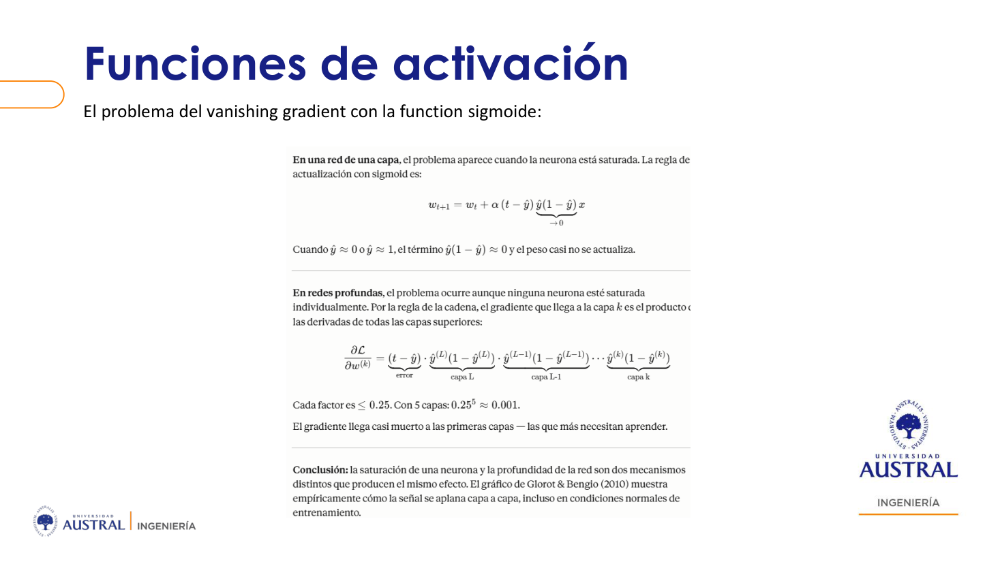
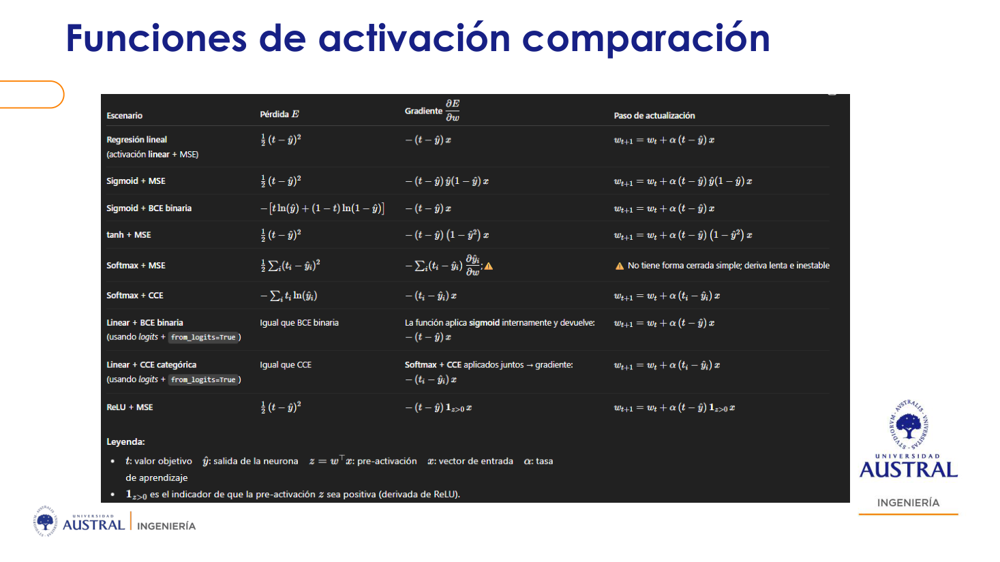
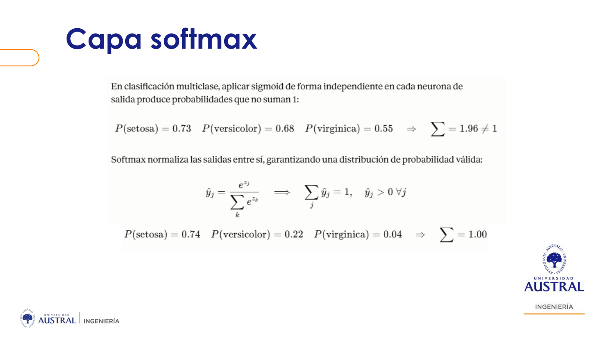
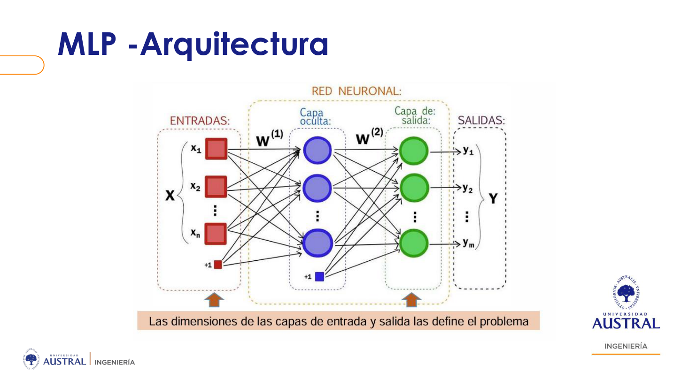
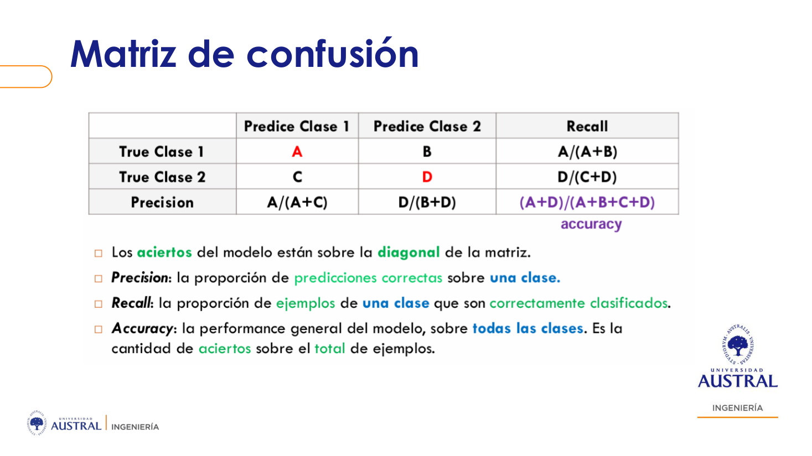

# Clase 09 · Del combinador lineal al perceptrón multicapa

> **Módulo 2 · Deep Learning y Aplicaciones Avanzadas** · Sebastián González · martes 05-may-2026
> **Fuentes:** transcripción de la clase · láminas `Intro_DL_clase1_SG_v2.pdf` (carpeta de la Clase 07, primera mitad) y `MLP_entrenamiento_clase3_SG.pdf` (segunda mitad, hasta Keras) · notebooks `Perceptron_Drogas`, `batch_sgd` y `Perceptron_Sigmoide_AND_MSE_live_v2` (carpeta de la Clase 07)

## En pocas palabras

- Antes de entrar a una red, los datos tienen que ser **numéricos** (incluida la etiqueta) y conviene **normalizarlos**. La regla de actualización multiplica por el dato de entrada, así que escalas distintas hacen que los pesos salten y no converjan. Entre los dos normalizadores, el **StandardScaler** suele funcionar mejor que el MinMax, porque los valores negativos le dan "expresividad" a la actualización.
- El **combinador lineal (ADALINE)** es la versión continua del perceptrón: el error deja de ser 0/1 y pasa a ser continuo, lo que permite minimizar el **error cuadrático medio** con **descenso de gradiente**. La versión **estocástica** (un ejemplo por vez) y la de **mini batch** son las que se usan en la práctica.
- Al agregar una **función de activación** (sigmoide, tanh, ReLU, Leaky ReLU), la regla delta suma la derivada de esa función. Con la sigmoide aparece el **desvanecimiento del gradiente**, que se evita cambiando la pérdida (entropía cruzada) o la activación. En multiclase, la salida usa **softmax**.
- Una **capa oculta** transforma el espacio y resuelve problemas no linealmente separables como el **XOR**. Para actualizar sus pesos sin tener un target, **backpropagation** reparte hacia atrás la "culpa" del error de salida mediante los **deltas**.
- La **función de pérdida** se usa para entrenar (tiene que ser derivable). Las **métricas** (accuracy, precision, recall, F1) se usan para evaluar el modelo ya entrenado. En **Keras**, todo esto se reduce a `Sequential`, `.add(Dense(...))` y `.compile(...)`.

## Conceptos clave

### Repaso: el perceptrón y su límite

El perceptrón hace una combinación lineal de las entradas con los pesos (el bias se incorpora con el *bias trick*) y devuelve 1 si el resultado es mayor que cero, o 0 si no lo es. Los datos y las etiquetas están dados; lo que hay que averiguar son **los pesos**. Se arranca con pesos aleatorios y la **regla delta** los corrige con cada ejemplo mal clasificado:

$$w_{t+1} = w_t + \alpha\,(t - y)\,x$$

Su límite es que solo resuelve problemas **binarios y linealmente separables**. Resuelve AND y OR, pero no **XOR**: no existe una recta que separe los dos puntos de una clase de los dos de la otra. Según el profesor, eso frenó el campo desde 1957 hasta que se resolvió el XOR, alrededor de 1970. La solución es una **capa oculta**, que mete no linealidades y transforma el espacio para que el problema pase a ser linealmente separable.

### Numerizar las variables

Una red hace cuentas, así que todo lo que entra tiene que ser número. Un valor faltante o un texto como "HIGH" la rompen.

| Tipo de variable | Ejemplo (dataset de drogas) | Cómo numerizar |
|---|---|---|
| Categórica **nominal** (el orden no importa) | Sexo (F/M) | 0/1 o *one-hot encoding* |
| Categórica **ordinal** (hay un orden) | Presión arterial, colesterol (LOW/NORMAL/HIGH) | Enteros que respeten el orden: LOW=0, NORMAL=1, HIGH=2 |
| Numérica | Edad, Na, K | Se deja como está (y después se normaliza) |
| Etiqueta | Droga recetada | También hay que numerizarla, si no no se puede calcular el error |

Si una ordinal se pasa a one-hot, **se pierde información**: el orden HIGH > NORMAL > LOW deja de estar en los datos. Y cada variable mantiene su propio peso: el "2" de presión y el "2" de colesterol no se mezclan.

### Normalizar: por qué y con qué

La regla delta multiplica el error por el **dato de entrada**. Si las variables tienen escalas muy distintas, la actualización de los pesos pega saltos enormes y no converge.

- **MinMaxScaler:** lleva cada variable al rango $[0, 1]$.
- **StandardScaler:** resta la media y divide por el desvío. Los valores quedan centrados en cero, con parte negativa.

Ninguno de los dos cambia la distribución de los datos; solo cambia la escala. Con el StandardScaler, el signo negativo ayuda a "direccionar" el vector de pesos, y por eso la convergencia es más rápida. El MinMax es una herramienta general de normalización; el profesor no tenía una regla de cuándo preferirlo en redes, y mencionó como posibilidad algunas aplicaciones de imágenes, texto o sonido.

Mensaje de la clase: **ante la duda, numericen y normalicen**, y elijan una normalización que le dé expresividad al vector de entrada.

### Combinador lineal (ADALINE) y error cuadrático medio

ADALINE (Widrow y Hoff, 1960, en paralelo al perceptrón de Rosenblatt) hace la misma combinación lineal, pero **no aplica la función escalón** a la salida: usa la salida continua. Así el error es continuo y se puede minimizar el **error cuadrático medio**:

$$E(w) = \frac{1}{N}\sum_{i=1}^{N}\big(t_i - (w_0 + w_1 x_{i1} + \dots)\big)^2$$

Como los datos y los targets son fijos, **las únicas variables de $E$ son los pesos**. Es una forma cuadrática, una especie de "domo", que tiene un mínimo. Se podría encontrar analíticamente igualando a cero las derivadas parciales, pero en lugar de eso se usa un algoritmo iterativo. Con una sola variable, esto equivale a ajustar una **regresión lineal**.

### Descenso de gradiente

- El **gradiente** es un **vector**, no un camino. Sus componentes son las derivadas parciales de la pérdida respecto de cada peso y apunta en la dirección de **máximo crecimiento**.
- Con un signo menos adelante, apunta en la dirección de **máximo decrecimiento**. Se arranca de un punto cualquiera (pesos aleatorios) y se avanza un paso de tamaño $\alpha$ en esa dirección.
- Las **curvas de nivel** son "fetas" de la superficie de error. Cada vector de pesos tiene asociada una pérdida, y el algoritmo va bajando de curva en curva.
- Se puede frenar antes del mínimo si la mejora no supera un umbral fijado a priori.

Al derivar el error de un ejemplo se obtiene $-2\,(t - y)\,x$. El 2 se absorbe en $\alpha$, y lo que queda es **otra vez la regla delta**: $w_{t+1} = w_t + \alpha\,(t - y)\,x$. La diferencia con el perceptrón es que ahora $(t-y)$ es continuo y da la intensidad del paso, y $x$ da la dirección.

### Batch, estocástico y mini batch

La única diferencia es **cuántos ejemplos se miran antes de actualizar**:

| Variante | Qué usa para el gradiente | Actualización | Comportamiento |
|---|---|---|---|
| Batch GD | Promedio de todos los ejemplos | $w_{t+1} = w_t + \alpha\,\frac{1}{n}\sum_i (t_i - y_i)\,x_i$ | Suave, pero caro con muchos datos |
| Estocástico (SGD) | Un solo ejemplo | $w_{t+1} = w_t + \alpha\,(t - y)\,x$ | Ruidoso (cada ejemplo "tira para su lado"), pero converge rápido |
| Mini batch | Promedio de un subconjunto de tamaño $m$ | $w_{t+1} = w_t + \alpha\,\frac{1}{m}\sum_i (t_i - y_i)\,x_i$ | Intermedio |

En la práctica se usa SGD o mini batch. Los optimizadores **Momentum, RMSProp y Adam** suavizan ese recorrido ruidoso; quedaron para la clase siguiente. Un $\alpha$ más grande da saltos más grandes (más caos); uno más chico necesita más iteraciones. Cuántas iteraciones hacen falta depende también de la **capacidad** del modelo: con pocos parámetros puede no alcanzar para resolver el problema, y con muchos aumenta el riesgo de sobreajuste.

### Neurona general y función sigmoide

El combinador lineal es un caso particular de una **neurona general** con una función de activación $f$ aplicada a la combinación lineal (en su caso, $f$ es la identidad). Para un problema binario como AND, una salida continua no acotada es incómoda. La **sigmoide** da valores entre 0 y 1, que se pueden leer como la probabilidad de la clase, y facilita el umbral (por ejemplo, 0,5).

El costo es que, al derivar el error, hay que aplicar la **regla de la cadena** y aparece la derivada de $f$. Para la sigmoide esa derivada es conocida:

$$w_{t+1} = w_t + \alpha\,(t - y)\,y\,(1 - y)\,x$$

Con la activación lineal ese factor valía 1 y por eso no se veía.

### Desvanecimiento del gradiente (vanishing gradient)



Si la neurona está saturada ($y \approx 0$ o $y \approx 1$), el término $y(1-y)$ es casi cero. Como todo es multiplicativo, la actualización también es casi cero y el peso queda igual. En redes profundas, la regla de la cadena multiplica un factor $\le 0{,}25$ por cada capa, así que el gradiente llega "casi muerto" a las primeras capas.

Hay dos salidas:

1. **Cambiar la pérdida:** con sigmoide + **entropía cruzada binaria** (BCE), el término de la derivada se cancela y la regla queda igual que la lineal.
2. **Cambiar la activación:** tanh o ReLU.

### Funciones de activación

| Función | Rango | A favor | En contra |
|---|---|---|---|
| Sigmoide | $(0, 1)$ | Interpretable como probabilidad en binaria | Satura y desvanece el gradiente |
| tanh | $(-1, 1)$ | El signo ayuda a la dirección del gradiente y converge más rápido | Mitiga el problema, pero según las láminas no lo resuelve del todo |
| ReLU | $[0, \infty)$ | Menos desvanecimiento; al dar gradiente 0 en la parte negativa "apaga" neuronas, algo parecido a dropout, y la red se vuelve más robusta | No es derivable en 0 (se toma 0); si se apagan demasiadas neuronas aparece el *dying ReLU* |
| Leaky ReLU | $(-\infty, \infty)$ | Le da una pequeña pendiente a la parte negativa: las neuronas tienen poca incidencia pero no mueren | — |
| Softmax | $(0,1)$, suma 1 | Salida multiclase con interpretación de probabilidad | Se usa en la capa de salida |

Qué activación lleva cada capa es otro **hiperparámetro**. Por convención, todas las neuronas de una misma capa llevan la misma. La lámina comparativa resume la pérdida, el gradiente y el paso de actualización para cada combinación:



Lo que conviene notar: sigmoide + MSE arrastra el factor $\hat y(1-\hat y)$; sigmoide + BCE y softmax + entropía cruzada categórica (CCE) vuelven a la forma simple $(t - \hat y)\,x$; tanh + MSE cambia el factor por $(1 - \hat y^2)$, que no se anula de la misma manera.

### Clasificación multiclase y softmax

En multiclase hay **una neurona de salida por clase** y la etiqueta se escribe como vector one-hot (por ejemplo, `1 0 0`). En una red totalmente conectada se puede contar cuántos pesos hay: (entradas + bias) × salidas. Para Iris son $(4+1)\times 3 = 15$, una matriz de pesos de $3\times 4$ más 3 bias.

Si en cada salida se aplica una sigmoide independiente, los valores **no suman 1** y la regla de decisión queda "oscura". Con entradas 5, 4 y 2, la sigmoide da 0,99, 0,98 y 0,88, valores casi indistinguibles. **Softmax** normaliza cada salida respecto de las demás:

$$\hat y_j = \frac{e^{z_j}}{\sum_k e^{z_k}}$$

Con los mismos 5, 4 y 2 da aproximadamente 0,71, 0,26 y 0,04, que suman 1 y se leen como probabilidades.



Si la regla es "le pongo 1 al máximo", sigmoide y softmax eligen la misma clase. Softmax no cambia el ganador, pero hace mucho más clara la decisión y la interpretación. En la práctica, en multiclase **siempre se usa softmax en la última capa**.

### Perceptrón multicapa (MLP) y el XOR



"Perceptrón multicapa" es un nombre confuso: en realidad es el **combinador lineal con capas ocultas**. Todo depende del error continuo, del MSE y del descenso de gradiente, cosas que el perceptrón clásico con error 0/1 no permite.

Con el XOR: una neurona oculta resuelve **OR**, otra resuelve **AND**, y la neurona de salida combina esas dos salidas. En el espacio nuevo, los cuatro puntos originales quedan en tres posiciones y ya se pueden separar con una recta. Es como trazar dos líneas que encierran los puntos de una clase.

**Lo que define el problema y lo que no:**

- Las capas de **entrada y salida** las define el problema: cantidad de variables (+ bias) y cantidad de clases.
- Cuántas capas ocultas, cuántas neuronas por capa y qué activación usar **no tienen receta**: son hiperparámetros. Se prueban configuraciones, se validan en el conjunto de **validación** y recién al final se mide en **test**. En palabras del profesor, se usan "las que necesite para resolver el problema, ni más ni menos".

### Backpropagation

Sin capas ocultas, el error se calcula en la salida contra el target y se actualizan los pesos. Con capas ocultas aparece un problema: **las neuronas ocultas no tienen target**, así que no hay error directo con el cual aplicar la regla delta.

1. **Forward pass:** con los pesos actuales (al principio aleatorios) se calculan, capa por capa, los valores de todas las neuronas hasta la salida.
2. **Delta de salida:** el error de la salida multiplicado por la derivada de la activación, $\delta = (t - y)\,f'(\text{neta})$. Es "parte del gradiente": le falta multiplicar por la entrada $x$.
3. **Deltas ocultos:** cada neurona oculta recibe un delta que pondera, a través de los pesos que la conectan con la capa siguiente, cuánta "culpa" tuvo en el error de salida. La derivada de su activación se mantiene; lo único que cambia es que el error se reemplaza por la suma de los deltas de adelante multiplicados por esos pesos. Es un **proxy del error**.
4. **Actualización:** cada peso se corrige con la regla de siempre, $w \leftarrow w + \alpha\,\delta\,x$, usando el delta de la neurona a la que llega y la entrada que lleva.

## Ejemplos y casos de la clase

- **Dataset de drogas (200 pacientes):** edad, sexo, presión arterial, colesterol, Na y K, y como objetivo la droga recetada. Sirvió para discutir la numerización (nominal vs. ordinal). La etiqueta se **binarizó** como "droga I contra el resto" porque el perceptrón solo resuelve problemas binarios. Se dividió con `train_test_split` (70 % train, 30 % test).
  - **Sin normalizar:** 650 iteraciones sin converger y alrededor de 43 % de acierto en test.
  - **Con MinMaxScaler:** convergió en 25 iteraciones y clasificó bien el test.
  - **Con StandardScaler:** convergió en 8 iteraciones.
- **Combinador lineal con tres puntos** $\{(2,3), (1,1), (-1,-3)\}$: los pesos óptimos son $w_1 = 2$ y $w_0 = -1$. Desde $(0, 0)$, con $\alpha = 0{,}1$ y 50 iteraciones de descenso de gradiente, se llegó a valores cercanos (≈1,97 y casi −1), y con 100 iteraciones a ≈1,99 y −0,99. Con SGD alcanzaron 15 iteraciones para un resultado "superrespetable", pero con un recorrido más ruidoso, que se volvió más caótico al subir $\alpha$ a 0,3.
- **AND con neurona sigmoide + MSE:** la accuracy llegó al 100 % hacia la época 54, pero el error siguió bajando. La sigmoide nunca devuelve 0 o 1 exactos, así que la red seguía **inflando los pesos** y agotaba las 400 épocas (unos 40 s). Con un **early stopping** (cortar si el error no baja más que cierto margen), se detuvo en la época 81 en unos 9 s. La versión SGD fue un poco más rápida.
- **Una pasada en Iris (ReLU en la capa oculta, sigmoide en la salida):** con pesos aleatorios la salida fue (0,38; 0,46; 0,41) frente al target (1, 0, 0). Después de una actualización por backpropagation, quedó en (0,66; 0,43; 0,30) y el error bajó desde 0,76. Muestra que un solo paso ya acerca la salida al target.
- **Paneles solares no declarados (caso real del profesor):** un clasificador sobre imágenes satelitales para detectar quién tiene panel solar sin declararlo ante la distribuidora eléctrica.
  - Si confirmar cada caso es **gratis** (se mira la curva del medidor inteligente, que de día cae casi a cero), conviene **maximizar recall**: recuperar a todos, aunque aparezcan falsos positivos.
  - Si confirmar es **caro** (mandar cuadrillas a cada casa), conviene **maximizar precision**.
  - El **F1** sirve para equilibrar ambas.

## Práctica

- `Perceptron_Drogas`: perceptrón programado a mano (con la clase propia `ClassPerceptron`), con un flag para no normalizar, normalizar con MinMax o con Standard. Lo importante es comparar las curvas de error y la cantidad de iteraciones.
- `batch_sgd` (en las láminas aparece como `gd_vs_sgd_min.ipynb`): trayectoria de los pesos hacia el óptimo $(2, -1)$ con descenso de gradiente batch y con SGD. Conviene probar distintos $\alpha$ e iteraciones.
- `Perceptron_Sigmoide_AND_MSE_live_v2`: neurona sigmoide para AND, con y sin early stopping, en versión batch y SGD.
- Todo lo anterior está programado a mano para entender qué pasa adentro. En la práctica se usa Keras:

```python
from keras.models import Sequential
from keras.layers import Dense
from keras.optimizers import SGD

model = Sequential()                                          # red feedforward
model.add(Dense(2, input_shape=[4], activation='tanh'))       # capa oculta
model.add(Dense(3, activation='sigmoid'))                     # última capa = salida (o 'softmax')
model.summary()   # 10 + 9 = 19 parámetros
model.compile(optimizer=SGD(learning_rate=0.1), loss='mse', metrics=['accuracy'])
```

- `Dense` significa todo conectado con todo. Solo la primera capa necesita `input_shape`; las siguientes lo deducen de la salida de la capa anterior. El bias nunca se declara, pero se cuenta en los parámetros: $(4+1)\times 2 = 10$ y $(2+1)\times 3 = 9$.
- La **última capa agregada es la de salida**. Ahí va la softmax si el problema es multiclase. Para multiclase, en `loss` se puede usar `categorical_crossentropy` en lugar de `mse`.
- Las etiquetas se pasan a vector one-hot con `to_categorical`, para comparar el vector de salida contra el vector target.
- El profesor pidió repasar la notebook **Keras Iris SGD** (fit y predict) antes de la clase práctica. El resto de las láminas (overfitting, optimizadores, partición train/validation/test y búsqueda de hiperparámetros) quedó para la Clase 10.

## Para recordar

- "Ante la duda, normalicen", y mejor con una normalización que permita valores negativos.
- Las ordinales se codifican con enteros que respeten el orden. El one-hot es para las nominales.
- **Pérdida ≠ métrica.** La pérdida (MSE, entropía cruzada) se optimiza para encontrar los pesos y por eso tiene que ser derivable. Las métricas (accuracy, precision, recall, F1, ROC) evalúan el modelo ya entrenado y no se usan para entrenar. En muchos papers se confunden.
- Sigmoide + MSE desvanece el gradiente. La solución típica es cambiar la pérdida a entropía cruzada, o la activación a tanh o ReLU.
- Multiclase: una neurona de salida por clase, softmax en la última capa y etiquetas one-hot.
- Entrada y salida las define el problema. Lo del medio (capas, neuronas, activaciones) son hiperparámetros que se eligen con validación, y el test se usa una sola vez al final.
- Con la matriz de confusión: accuracy = diagonal / total; precision = aciertos de una clase / todo lo que se predijo como esa clase; recall = aciertos de una clase / todo lo que realmente era de esa clase. F1 = $2PR/(P+R)$ cae si cualquiera de los dos cae.



## Preguntas de repaso

<details><summary>1. ¿Por qué no normalizar las entradas puede impedir que un perceptrón o una neurona converja?</summary>

Porque la regla de actualización multiplica el error por el dato de entrada. Si una variable está en una escala mucho mayor que otra, domina la corrección y los pesos pegan saltos grandes que nunca se estabilizan. En el ejemplo de drogas, sin normalizar se hicieron 650 iteraciones sin converger; con StandardScaler bastaron 8.

</details>

<details><summary>2. ¿Por qué codificar la presión arterial (LOW/NORMAL/HIGH) con one-hot sería peor que con 0, 1, 2?</summary>

Porque es una variable ordinal. El one-hot trata las categorías como independientes y pierde la información de orden, mientras que los enteros 0 < 1 < 2 la conservan y la red puede aprovecharla.

</details>

<details><summary>3. ¿Qué cambia entre el perceptrón y el combinador lineal, y por qué ese cambio habilita el descenso de gradiente?</summary>

El combinador lineal no pasa la salida por un escalón, así que el error es continuo. Eso permite definir el error cuadrático medio, una función derivable de los pesos, y minimizarla siguiendo el gradiente negativo. La regla de actualización resultante tiene la misma forma que la regla delta.

</details>

<details><summary>4. ¿En qué se diferencian batch, mini batch y SGD, y qué consecuencia práctica tiene?</summary>

Solo en cuántos ejemplos se usan para calcular cada actualización: todos, un subconjunto o uno solo. Batch desciende suave pero es costoso con muchos datos. SGD es ruidoso (cada ejemplo tira para su lado) pero converge rápido. Mini batch queda en el medio. En la práctica se usan SGD o mini batch.

</details>

<details><summary>5. ¿Por qué una neurona sigmoide con MSE puede dejar de aprender, y cómo se evita?</summary>

La actualización incluye el factor $y(1-y)$. Si la salida se satura cerca de 0 o de 1, ese factor es casi 0 y el peso casi no cambia (desvanecimiento del gradiente). Se evita usando entropía cruzada binaria como pérdida, que cancela ese factor, o usando otra activación como tanh o ReLU.

</details>

<details><summary>6. Si la sigmoide y la softmax eligen la misma clase ganadora, ¿para qué usar softmax en multiclase?</summary>

Porque la sigmoide aplicada a cada salida da valores que no suman 1 y pueden quedar muy parecidos (0,99; 0,98; 0,88), lo que vuelve ambigua cualquier regla de umbral. Softmax normaliza las salidas entre sí, da una distribución de probabilidad interpretable y una decisión más clara.

</details>

<details><summary>7. ¿Qué problema resuelve backpropagation y cuál es la idea del delta oculto?</summary>

Las neuronas de las capas ocultas no tienen target, así que no se puede calcular su error directamente. Backpropagation calcula el delta en la salida y lo propaga hacia atrás: cada neurona oculta recibe un delta que pondera, a través de los pesos, su contribución al error de salida, multiplicado por la derivada de su activación. Con ese delta se aplica la misma regla de actualización.

</details>

<details><summary>8. En el caso de los paneles solares, ¿cuándo conviene maximizar recall y cuándo precision?</summary>

Recall, cuando verificar cada candidato es barato (los datos del medidor inteligente confirman sin costo): se prefiere no perder ningún caso, aunque haya falsos positivos. Precision, cuando cada falso positivo cuesta caro (mandar gente a la casa). Para balancear ambas se usa F1.

</details>

## Conexiones

- **Hacia atrás:** retoma el perceptrón, el bias trick, el combinador lineal y el XOR presentados en la Clase 07, y el Playground y Keras de la Clase 08. La división train/test, el one-hot encoding y la matriz de confusión vienen del Módulo 1. La relación entre el combinador lineal y la regresión lineal conecta con cómo aprende un modelo estadístico (Clase 03).
- **Hacia adelante:** la Clase 10 retoma el ejemplo de Iris a mano y completa las láminas pendientes: overfitting y early stopping en Keras, regularización L1/L2 y dropout, optimizadores (Momentum, RMSProp, Adam), partición train/validation/test y búsqueda de hiperparámetros, con los ejercicios del dataset de autos. ReLU y softmax reaparecen en las redes convolucionales (Clase 12).
- **TFI:** la distinción entre la **pérdida** con la que se entrena y la **métrica** con la que se evalúa aplica directamente. Hit@k y MRR evalúan el normalizador de nombres comerciales de Benefix, pero no son lo que optimiza un modelo de embeddings. El trade-off precision/recall también ayuda a decidir cuántos candidatos devolver en la etapa de retrieval.
