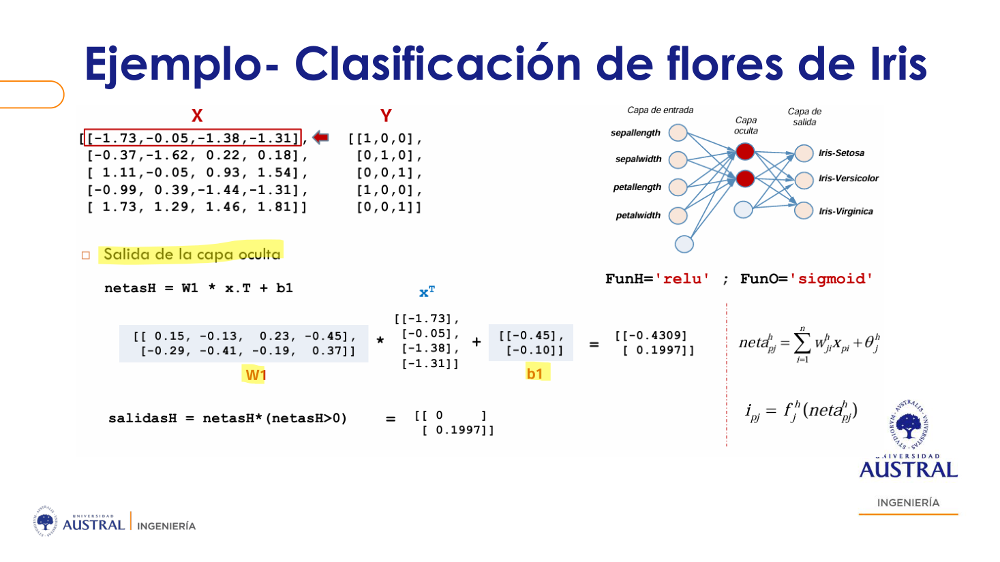
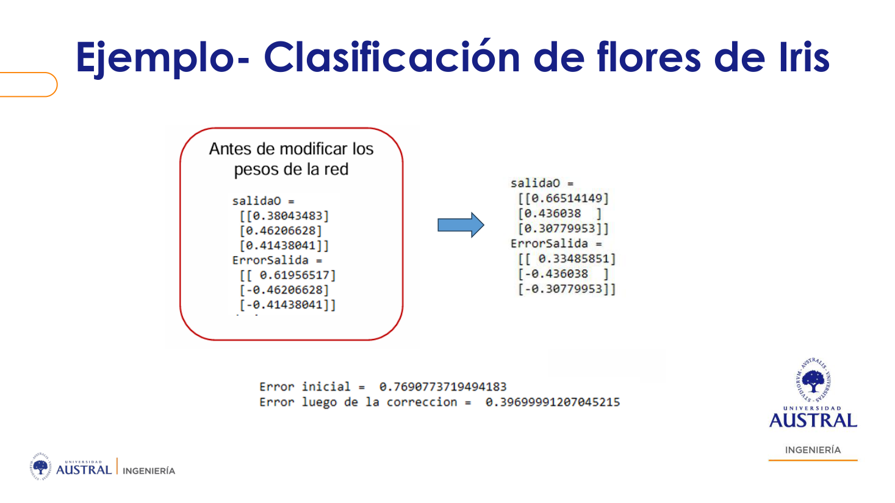
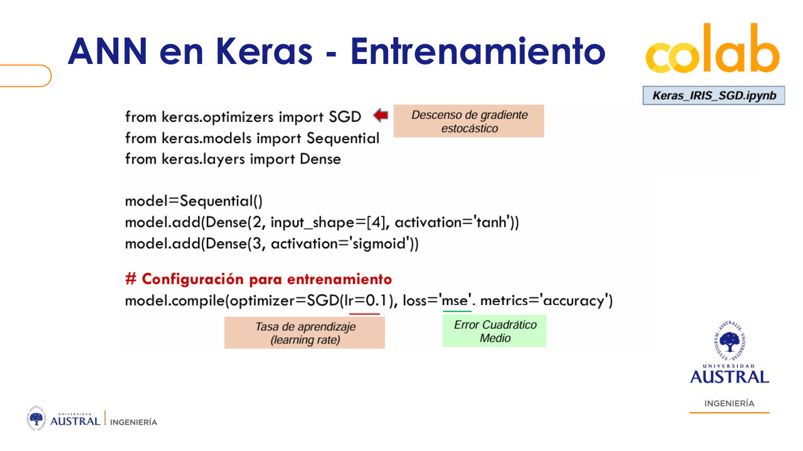
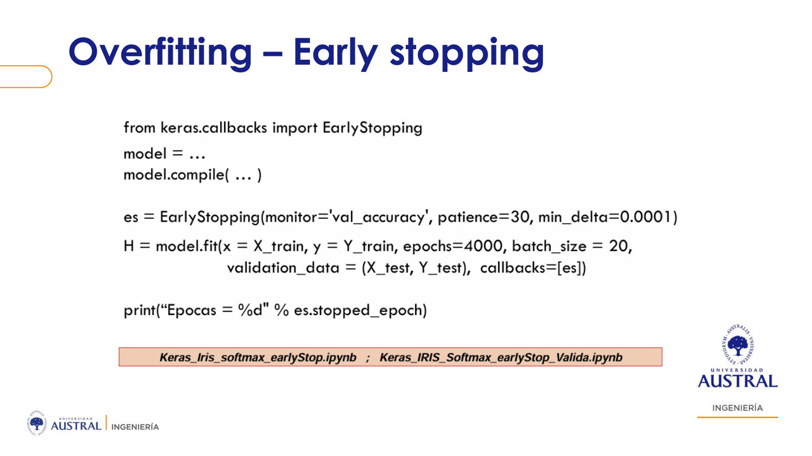
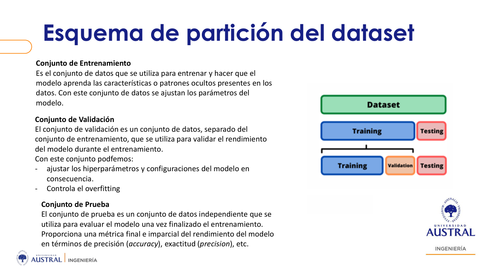

# Clase 10 · Entrenar un MLP: backpropagation a mano, Keras, regularización y elección de hiperparámetros

> **Módulo 2 · Deep Learning y Aplicaciones Avanzadas** · Sebastián González · jueves 07-may-2026
> **Fuentes:** transcripción `DIA_Clase_10.vtt` · láminas `MLP_entrenamiento_clase3_SG.pdf` (Clase 3 del módulo) · `Introduccion_Dataset_Autos.pdf` · notebooks `Ejercicio_Autos_Clasificacion.ipynb` y `Ejercicio_Autos_Regresion.ipynb` (notebooks de Iris mostrados en pantalla, no incluidos en la carpeta)

## En pocas palabras

- La función de activación de las capas ocultas no está para "normalizar": está para **introducir no linealidad**. La sigmoide hace que el gradiente se desvanezca (su derivada vale como máximo 0,25), la tanh lo atenúa pero no lo resuelve, la **ReLU** lo resuelve (derivada 1) pero puede "matar" neuronas, y la **Leaky ReLU** corrige eso. En la práctica se arranca con ReLU.
- Un paso de entrenamiento es siempre lo mismo: *forward* (combinación lineal + activación, capa por capa), error en la salida, **deltas** hacia atrás repartiendo el error con los pesos, y actualización $w \leftarrow w + \alpha\,\delta\,x$. Con el ejemplo de Iris hecho a mano se ve que la salida se acerca al target después de una sola corrección.
- En Keras todo eso queda detrás de `Sequential` → `add(Dense…)` → `compile` (optimizador, *learning rate*, *loss*, métrica) → `fit` (épocas, *batch size*). La **loss** entrena; la **métrica** solo reporta.
- Contra el **overfitting** hay varias herramientas: *early stopping* (mira validación y corta), regularización **L1/L2** (penaliza pesos grandes) y **dropout** (apaga neuronas al azar). Todas "molestan" a la red a propósito para que no memorice el entrenamiento.
- **Train / validation / test**: el test se separa primero y no se mira hasta el final; la validación sirve para comparar modelos (conjuntos de hiperparámetros). Elegido el mejor, se reentrena con todo el train y se evalúa una sola vez en test. Normalizar **después** de dividir, fiteando solo con train, evita el *data leakage*.

## Conceptos clave

### Para qué sirve entender el gradiente si después se hace `model.fit`

La clase arrancó con dos preguntas de alumnos. Una: si el gradiente marca la dirección de máximo crecimiento, ¿el negativo marca realmente la de máximo decrecimiento? Sí, pero **en ese punto**: el gradiente se evalúa donde uno está parado, y en el paso siguiente el punto cambia, así que cambian la dirección y la intensidad. Con un error cuadrático la función está "bien comportada" (forma cuadrática) y no hay sorpresas. Si se actualiza por *batch*, lo que se usa es una dirección e intensidad promedio de los ejemplos del lote.

La otra: ¿dónde encaja esto en la práctica? Una red es un conjunto de parámetros e hiperparámetros, y el **descenso de gradiente** es el algoritmo que encuentra los parámetros: es "el corazón" de la red. En Keras uno solo escribe `model.fit`, pero para elegir optimizador, *learning rate*, épocas o *batch size* hay que saber qué hacen. El profesor lo resumió así: usar `.fit` sin saber qué pasa atrás funciona, pero es trabajar a ciegas.

### Funciones de activación en las capas ocultas

Las capas ocultas permiten resolver problemas no lineales (como el XOR) porque transforman el espacio antes de llegar a la salida. Para eso necesitan una activación no lineal; sin ella, la red entera equivaldría a una regresión lineal múltiple.

| Activación | Rango de salida | Derivada máxima | Problema |
|---|---|---|---|
| Sigmoide | (0, 1) | 0,25 | *Vanishing gradient*: con varias capas el producto de derivadas chicas tiende a cero |
| Tanh | (−1, 1) | 1 | Lo atenúa, pero en redes muy profundas (por ejemplo, de imágenes) el gradiente igual se disuelve |
| ReLU | [0, ∞) | 1 (para $x>0$) | No desvanece el gradiente, pero aparece el *dying ReLU* |
| Leaky ReLU | (−∞, ∞) | 1 (para $x>0$), pendiente chica elegida para $x<0$ | Resuelve el *dying ReLU* |

- **Sigmoide.** La regla de actualización multiplica por $\hat y(1-\hat y)$. Si la salida está cerca de 1 (o de 0), ese factor es casi cero y el peso no se mueve. Con varias capas, la regla de la cadena multiplica varias veces factores $\le 0{,}25$ y las primeras capas dejan de aprender. Si los pesos no se actualizan, la red no aprende.
- **Tanh.** Además de tener derivada máxima 1, permite salidas negativas. Eso deja que el gradiente cambie de signo y no empuje siempre para el mismo lado, algo parecido a lo que se logra al estandarizar las entradas alrededor de cero.
- **ReLU.** Es lineal con derivada 1 en la parte positiva, así que el gradiente no se desvanece aunque haya muchas capas: se multiplica por 1 o por 0. Si la neta de una neurona es negativa, la derivada es 0 y sus pesos no se actualizan para ese ejemplo: eso es lo que se llama "neurona muerta" (en rigor, lo que se muere es el gradiente). Apagar algunas neuronas según el ejemplo puede incluso ayudar a generalizar, pero por la inicialización o la dinámica de la red pueden quedar muchas neuronas muertas siempre.
- **Leaky ReLU.** Le da una pequeña pendiente a la parte negativa, así que el gradiente nunca es exactamente cero.

**Regla práctica:** en las capas ocultas se usa ReLU por simplicidad. Si el entrenamiento no anda bien (por ejemplo, muchas neuronas muertas), se prueba con Leaky ReLU. La profundidad no es el problema de la ReLU; el riesgo es la dinámica o las condiciones iniciales.

### Softmax en la salida (repaso)

La softmax va en la **capa de salida** de problemas **multiclase**. En binario alcanza con una sigmoide. Sus ventajas frente a varias sigmoides:

- **Probabilidades calibradas** que suman 1. Sirven para decidir en el negocio. Con un ejemplo médico de tres tipos de cáncer con 40 %, 30 % y 30 %, la decisión sensata no es quedarse con el máximo, sino pedir más estudios.
- **Estabilidad.** Con sigmoides, salidas como 0,98 y 0,70 para clases que deberían ser 0 producen errores grandes y correcciones bruscas. Con softmax las salidas ya quedan más cerca del target y los saltos son menores.
- Combinada con **categorical cross-entropy**, el gradiente queda matemáticamente simple.

### Un paso de entrenamiento a mano (Iris)

Red: 4 entradas (+ bias), **una capa oculta de 2 neuronas** con ReLU y **3 salidas** con sigmoide. Los pesos se inicializan al azar y $\alpha = 0{,}1$. Las dimensiones de entrada y salida las fija el problema; la cantidad de capas ocultas, de neuronas, las activaciones y $\alpha$ son hiperparámetros.

- $W_1$ es de $2\times4$ más un bias $b_1$ de 2: **10 pesos**. $W_2$ es de $3\times2$ más $b_2$ de 3: **9 pesos**. En total, 19.
- El target va **como vector one-hot** (por ejemplo, `[1,0,0]`), no como 1, 2 o 3, porque hay que restarlo de un vector de salida de 3 elementos.



*Figura: el primer ejemplo (estandarizado) multiplicado por $W_1$ más $b_1$ da las netas $[-0{,}43;\ 0{,}20]$. La ReLU deja $[0;\ 0{,}20]$: la primera neurona queda "apagada" para este ejemplo.*

Los pasos:

1. **Forward oculta:** $\text{neta}_H = W_1 x^T + b_1$; $h = \text{ReLU}(\text{neta}_H)$.
2. **Forward salida:** $\text{neta}_O = W_2 h + b_2$; $\hat y = \sigma(\text{neta}_O)$.
3. **Error de salida:** $e = t - \hat y$.
4. **Delta de salida:** $\delta_O = e \cdot \hat y(1-\hat y)$. Es "parte del gradiente": le falta multiplicar por la entrada de la capa.
5. **Delta de la oculta:** como en la capa oculta no hay target, el error de la salida se **reparte ponderado por los pesos**: $\delta_H = (W_2^T \delta_O) \cdot f'_H(\text{neta}_H)$. La derivada de la ReLU es 0 o 1, así que para la primera neurona $\delta_H = 0$.
6. **Actualización:** $W_2 \leftarrow W_2 + \alpha\,\delta_O\,h^T$ y $W_1 \leftarrow W_1 + \alpha\,\delta_H\,x$. Los bias se actualizan igual. El delta aporta la **intensidad** y la entrada de la capa, la **dirección**.

Resultado: los pesos ligados a la neurona apagada **no cambian**, y por eso se dice que "la neurona murió". El bias de salida pasó de $(-0{,}29;\ -0{,}17;\ -0{,}27)$ a $(-0{,}28;\ -0{,}18;\ -0{,}28)$. Al volver a pasar el mismo ejemplo con los pesos nuevos, la salida se acerca al target `[1,0,0]`:



*Figura: la salida pasa de (0,38; 0,46; 0,41) a (0,67; 0,44; 0,31) y el error total cae de 0,77 a 0,40 con una sola actualización.*

### Una red en Keras

```python
model = Sequential()
model.add(Dense(2, input_shape=[4], activation='tanh'))   # capa oculta
model.add(Dense(3, activation='sigmoid'))                 # capa de salida
model.compile(optimizer=SGD(learning_rate=...), loss='mse', metrics=['accuracy'])
model.fit(X_train, y_train, epochs=100, batch_size=1)
```

- `Sequential()` instancia el modelo; `add(Dense(n, ...))` agrega una capa totalmente conectada con `n` neuronas.
- Solo la primera capa necesita `input_shape`. Las siguientes ya conocen su entrada, que es la salida de la anterior.
- **La última capa siempre es la de salida.** Todo `add` anterior es una capa oculta: con tres `add` hay dos ocultas. `model.summary()` muestra capas, *shapes* y parámetros.
- `compile` fija las decisiones: **optimizador** (acá, descenso de gradiente estocástico), ***learning rate*** ($\alpha$), **función de pérdida** (MSE, *binary* o *categorical cross-entropy*, según el problema) y **métricas**.
- **La loss entrena, la métrica no.** La métrica (por ejemplo, *accuracy*) solo informa cómo le va al modelo con los pesos actuales.



### Épocas y *batch size*

Una **época** se completa cuando pasaron todos los ejemplos de entrenamiento. El ***batch size*** dice cada cuántos ejemplos se actualizan los pesos:

| `batch_size` | Variante | Actualizaciones por época (105 ejemplos de train) |
|---|---|---|
| 1 | Estocástico estricto | 105 |
| 10 | Mini-batch | 11 (diez lotes de 10 y uno de 5) |
| 20 | Mini-batch | 6 (cinco lotes de 20 y uno de 5) |
| todos | Batch | 1 |

En Keras el optimizador se llama SGD, pero con el *batch size* se elige cualquiera de las tres variantes.

### Overfitting y underfitting

Un modelo puede no aprender casi nada (*underfitting*), aprender una regla razonable con algunos errores, o **memorizar** todos los datos de entrenamiento (*overfitting*). Memorizar no es malo en sí: sería ideal **si** los datos de entrenamiento representaran todo el fenómeno y no fueran a cambiar. Como eso casi nunca se puede garantizar, se busca que el modelo **generalice**. La señal típica: el error de entrenamiento sigue bajando mientras el de test o validación empieza a subir.

Cuantas más capas y neuronas, más grados de libertad y más riesgo de *overfitting*. Para controlarlo hay tres caminos: reducir capas o neuronas, conseguir más datos (casi nunca es posible) o **regularizar**. Suele ser más fácil darle capacidad de sobra y regularizar que acertar justo con la arquitectura.

### Early stopping

Durante el entrenamiento mira el desempeño en **validación** y corta cuando deja de mejorar, aunque el entrenamiento siga mejorando. Tiene dos parámetros:

- **`patience`:** cuántas épocas consecutivas sin mejora se toleran, porque la curva no baja de forma monótona.
- **`min_delta`:** la mejora mínima para que cuente como mejora. Si baja menos que eso, cuenta como época sin mejora.

Con *early stopping*, el número de épocas deja de importar: se puede poner uno enorme, porque el corte lo decide el callback.



*Figura: en este ejemplo de la lámina, `validation_data` recibe `X_test`/`Y_test`. En el esquema completo de más abajo, ese lugar lo ocupa un conjunto de validación separado del test.*

La lámina usa `min_delta=0.0001` y en clase se dijo "0.001": el valor es ilustrativo. La instancia se pasa en el `fit` dentro de una lista: `callbacks=[es]`.

### Regularización: L1, L2 y dropout

- **L2:** suma a la función de pérdida un término con los pesos al cuadrado. Si los pesos crecen, la pérdida sube, así que el entrenamiento prefiere pesos consistentemente chicos y la red no depende de unas pocas neuronas.
- **L1:** misma idea, pero tiende a llevar pesos a cero, es decir, a "apagarlos".
- **Dropout:** con una probabilidad dada (por ejemplo, 30 %), en cada ejemplo se apaga al azar cada neurona de la capa. Con 10 neuronas, unas 3 distintas quedan fuera cada vez. No toca los pesos directamente, pero los pesos de una neurona apagada no se actualizan en esa pasada, así que la red tiene que resolver el problema por otros caminos. Un alumno lo comparó con un "random forest de neuronas", y el profesor lo aceptó como intuición.

**¿Y si conviene que la red se especialice, para usar menos neuronas?** Lo planteó un alumno. Especializarse es aprender mejor **los datos de entrenamiento**, a costa de flexibilidad frente a datos nuevos. Si se quiere un modelo más chico, se reducen capas o neuronas; la regularización sirve para cuando uno se pasó de capacidad.

### Optimizadores más allá de SGD

El SGD "puro" es de los años 90 y es ruidoso: cada ejemplo tira para su lado.

- **Momentum:** agrega **inercia**. La actualización pondera con $\beta$ (típicamente 0,9) el promedio de los gradientes anteriores y con $1-\beta$ el gradiente del ejemplo actual. Un ejemplo que tira hacia otro lado solo desvía un poco la trayectoria, y suele converger mejor.
- **RMSProp:** también promedia con $\beta$, pero sobre la **intensidad** (magnitud) del gradiente, para que los pasos no sean desparejos.
- **Adam:** combina los dos, momentum para la dirección y RMSProp para la intensidad. Es el más usado hoy, pero **no siempre es el mejor**: en el ejemplo de validación de la clase ganó RMSProp.

En Keras: `SGD(learning_rate=0.01, momentum=0.9)`, `RMSprop(...)` y `optimizer='adam'`.

### Train, validation y test



- **Train:** se ajustan los **parámetros** (pesos).
- **Validation:** se comparan **modelos**, es decir, distintos conjuntos de hiperparámetros con sus parámetros entrenados. También lo usan técnicas como el *early stopping*.
- **Test:** se separa **primero** y no se mira hasta el final. Da la métrica final.

¿Por qué no alcanza con la métrica de validación? Porque el modelo ganador se eligió "a dedo" mirando esa métrica, así que su error queda **subestimado**. El profesor lo comparó con el *p-hacking*. Si se hizo todo bien, el resultado en test debería parecerse al de validación. Si después de ver el test se vuelve a ajustar, el test pasa a funcionar como validación.

**Cross-validation:** con un solo *split*, el resultado depende de cómo se dividió. Con *k-fold* (por ejemplo, 5 partes), se entrena con 4 quintos, se valida con el quinto restante, se rota y se **promedia** la métrica. Eso se hace para cada conjunto de hiperparámetros.

### Búsqueda de hiperparámetros

- **Grid search:** prueba todas las combinaciones. Explota rápido: capas, neuronas, épocas, *batch*, activaciones, optimizador, *learning rate*, *dropout*, paciencia…
- **Random search:** para hiperparámetros continuos se define un rango (por ejemplo, *learning rate* entre 0,01 y 0,1, o *batch* entre 8 y 50) y en cada prueba se sortea un valor. Es lo que más se usa.
- **Optimización bayesiana:** primero explora al azar y después estima qué cambio de hiperparámetros tiene más probabilidad de mejorar. Es mejor en teoría, pero muy pesada.

### Preprocesamiento y data leakage

- Las etiquetas de texto se numerizan con **`LabelEncoder`**. `fit` arma el mapa (setosa→0, versicolor→1, virginica→2) y `transform` reemplaza; `fit_transform` hace las dos cosas. Para entrenar en multiclase, además, **`to_categorical`** las pasa a one-hot.
- `train_test_split` devuelve **cuatro** objetos: `X_train`, `X_test`, `y_train`, `y_test`.
- **¿Normalizar antes o después de dividir?** Después. Si se estandariza antes, la media y el desvío incluyen datos de test: eso es ***data leakage***, pasarle al modelo información que no debería haber visto. Lo correcto es `scaler.fit_transform(X_train)` y solo `scaler.transform(X_val/X_test)`.
- **Valores faltantes:** las filas sin valor **en el target** se eliminan; no tiene sentido imputar lo que se quiere predecir. En las variables de entrada se puede eliminar o imputar, según cuántos falten.

## Ejemplos y casos de la clase

- **Aplicaciones de redes para predecir** (contadas por alumnos y el profesor): un modelo de *churn* que da un score por punto de venta para anticiparse con una acción comercial; un modelo, armado por una docente anterior con un médico, que predice el rechazo de un trasplante renal; los recomendadores tipo Netflix, con el premio de un millón de dólares a quien mejorara el algoritmo un 10 %, como ejemplo de *crowdsourcing*. Enseñan que una red es una herramienta más para predecir una respuesta a partir de características históricas. Al final del ejercicio se pregunta si no convendría, por ejemplo, un modelo de árboles.
- **Iris a mano:** un solo paso de *forward* y *backpropagation* con números concretos. Muestra el efecto de una neurona ReLU apagada y cómo la salida se acerca al target.
- **Iris en Keras (`Keras_IRIS_SGD`):** 150 ejemplos, 70/30 (105/45), tanh en la oculta, sigmoide en la salida, MSE y SGD. *Accuracy* de 0,98 en train y matriz de confusión sin errores en test. Para predecir, `model.predict` devuelve probabilidades y `np.argmax` las convierte en clase (0, 1, 2). El `y_test` nunca pasó por `to_categorical`, porque solo hace falta para calcular el error al entrenar. `evaluate` y `predict` hacen solo el *forward*. El profesor señaló que con softmax en la salida y *categorical cross-entropy* habría sido mejor.
- **Iris con validación y grid search:** 20 % a test; el resto (120) se divide en 96 de train y 24 de validación. Se prueban 3 optimizadores (SGD, RMSProp, Adam) × *learning rate* {0,1; 0,01; 0,001} × *batch* {8, 16, 32}, con tanh, softmax y *categorical cross-entropy*. Se ordenan los resultados por validación, se elige el mejor, **se reentrena con todo el train (120)** y recién entonces se evalúa en test.

## Práctica

Ejercicio para hacer en casa con el **dataset de autos** (UCI Automobile, 1985): 205 autos, 15 variables numéricas y 3 categóricas (`make`, `num-of-cylinders`, `drive-wheels`). Hay dos versiones del mismo problema:


| | Clasificación (`autos_clasificacion.csv`) | Regresión (`autos_regresion.csv`) |
|---|---|---|
| Target | `price_class`: precio discretizado por cuartiles en económico, medio-bajo, medio-alto y premium (texto) | `price`, continuo en USD |
| Preparación del target | `LabelEncoder` + `to_categorical` | Normalizarlo con su propio scaler (y opcionalmente con `np.log`) y desnormalizar las predicciones |
| Salida | 4 neuronas, softmax | 1 neurona, **lineal** |
| Loss | `categorical_crossentropy` | `mae` o `mse` |
| Métrica | `accuracy` | `mae`, `mse` (en regresión la *accuracy* no tiene sentido) |
| Split | 70/15/15 estratificado | 70/15/15 sin estratificar |

Los notebooks están guiados, con huecos `???` y pistas. Qué mirar:

1. **Nulos:** eliminar las filas sin target; en las *features*, decidir entre eliminar e imputar sabiendo que hay solo 205 filas.
2. **Encoding:** `num-of-cylinders` es ordinal y se mapea a número; `make` y `drive-wheels` son nominales y van con one-hot. Para pensar: ¿qué pasaría si `drive-wheels` se codificara 0/1/2?
3. **Escalado fiteado solo en train.** Comparar `StandardScaler` con `MinMaxScaler`. La pista del notebook se apoya en $\Delta w = -\alpha\,\delta\,x$: ¿qué pasa si todas las $x$ son positivas?
4. **Tres configuraciones a mano:** Adam sin *early stopping*, Adam con *early stopping* y SGD con *learning rate* más alto. Mirar las curvas de train y validación para detectar sobreajuste.
5. **Contar combinaciones** del espacio de búsqueda y estimar cuánto tardaría probarlas todas. Después, correr el grid search ya programado (scaler × optimizador × *learning rate* × *batch*, con *early stopping* sobre `val_accuracy` o `val_mae`).
6. **Modelo final:** reentrenar con **train + validación** con la mejor configuración y evaluar **una sola vez** en test.

## Para recordar

- "El único objetivo de todo el ejercicio es actualizar los pesos": sin actualización no hay aprendizaje.
- Activaciones ocultas: arrancar con ReLU y pasar a Leaky ReLU si el entrenamiento falla. La sigmoide queda para la salida binaria y la softmax para la salida multiclase.
- La métrica no entrena: entrena la *loss*.
- Primero se divide y después se normaliza. `fit` solo con train; con validación y test, solo `transform`.
- El target nunca se imputa.
- El test se separa primero y se mira una vez. Si se vuelve a ajustar después de verlo, se lo está usando como validación.
- Overfitting no es "malo" por definición: lo es porque casi nunca los datos de entrenamiento representan todo el fenómeno ni se mantienen en el tiempo.
- Regularizar es "molestar a la red a propósito" para que no memorice.
- Adam es el estándar, pero no garantiza ganar: también hay que probar.

## Preguntas de repaso

<details><summary>1. ¿Por qué una red profunda con sigmoide en todas las capas ocultas puede no aprender, y por qué la ReLU no tiene ese problema?</summary>

En backpropagation, la regla de la cadena multiplica las derivadas de cada capa. La derivada de la sigmoide vale como máximo 0,25, así que con varias capas el producto tiende a cero y los pesos de las primeras capas casi no se actualizan (*vanishing gradient*). La ReLU tiene derivada 1 en la parte positiva, así que el producto no se achica. Su problema es otro: cuando la neta es negativa, la derivada es 0 y esa neurona no actualiza sus pesos (*dying ReLU*).

</details>

<details><summary>2. En el ejemplo de Iris a mano, ¿por qué no cambiaron los pesos conectados a la primera neurona oculta?</summary>

Su neta fue negativa (−0,43), así que la ReLU dio 0 y su derivada también fue 0. El delta de esa neurona quedó en 0 y, con eso, su contribución a la actualización de $W_1$ fue nula. Como su salida era 0, tampoco cambiaron sus pesos hacia la salida. Para ese ejemplo, la neurona estaba "muerta".

</details>

<details><summary>3. ¿Cómo se calcula el "error" de una capa oculta si no tiene target?</summary>

Se usa un proxy: el delta de la salida se reparte hacia atrás ponderado por los pesos que conectan la oculta con la salida ($W_2^T\delta_O$) y se multiplica por la derivada de la activación de la oculta. Así cada neurona oculta recibe una parte del error proporcional a su influencia en la salida.

</details>

<details><summary>4. Con 105 ejemplos de entrenamiento y `batch_size=20`, ¿cuántas veces se actualizan los pesos por época? ¿Y con `batch_size=1`?</summary>

Con 20: seis veces (cinco lotes de 20 y uno de 5). Con 1: 105 veces, que es el descenso de gradiente estocástico estricto. La época termina cuando pasaron todos los ejemplos, sea cual sea el tamaño del lote.

</details>

<details><summary>5. ¿Por qué normalizar todo el dataset antes de dividirlo es un error?</summary>

Porque la media y el desvío se calcularían con datos que van a quedar en test (o validación). El entrenamiento quedaría escalado con información que el modelo no debería haber visto, y eso es *data leakage*. Hay que dividir primero, fitear el scaler solo con train y aplicar `transform` al resto.

</details>

<details><summary>6. Si elegí los hiperparámetros con el mejor resultado en validación, ¿por qué no reporto ese resultado como desempeño final?</summary>

Porque al elegir el máximo entre muchos modelos el resultado está sesgado a favor: la métrica de validación subestima el error real. Por eso se reserva un test que no participó en ninguna decisión. Además, conviene reentrenar el modelo elegido con todo el train (train + validación) antes de evaluarlo en test, para no desperdiciar datos.

</details>

<details><summary>7. ¿Qué cambia entre la versión de clasificación y la de regresión del ejercicio de autos?</summary>

En clasificación la salida tiene 4 neuronas con softmax, la pérdida es *categorical cross-entropy*, la métrica es *accuracy* y el target se pasa por `LabelEncoder` y `to_categorical`. En regresión hay una sola neurona lineal (la salida puede ser cualquier real), la pérdida y la métrica son MAE o MSE, el target se normaliza con su propio scaler y las predicciones se desnormalizan para leerlas en dólares. Además, en regresión no se estratifica el split.

</details>

<details><summary>8. ¿En qué se parecen y en qué se diferencian dropout y regularización L2?</summary>

Las dos buscan que la red no dependa de unas pocas neuronas y así reducir el sobreajuste. L2 actúa sobre la función de pérdida: penaliza pesos grandes y empuja todos los pesos a ser chicos. Dropout no toca la pérdida: en cada ejemplo apaga neuronas al azar con cierta probabilidad, así que sus pesos no se actualizan en esa pasada y la red tiene que resolver el problema por otros caminos.

</details>

## Conexiones

- **Clase 09:** introdujo el perceptrón multicapa, las funciones de activación, la softmax y las métricas de evaluación. Esta clase las retoma, termina el ejemplo de Iris y pasa a Keras. El descenso de gradiente, la regla delta y las variantes estocástico, mini-batch y batch vienen de las primeras clases del módulo.
- **Módulo 1 (Clase 03 y siguientes):** overfitting, generalización y la regla de no evaluar con los datos de entrenamiento. Acá reaparecen con herramientas propias de redes (*early stopping*, dropout, L1/L2) y con la disciplina train/validation/test y cross-validation.
- **Próximas clases del módulo:** imágenes con redes de muchas capas (con Daniel Gattari), donde el *vanishing gradient* y la elección ReLU/Leaky ReLU pesan más.
- **TFI:** la disciplina de esta clase aplica directamente. Los hiperparámetros del sistema de normalización de nombres comerciales de Benefix (por ejemplo, la constante de RRF o los pesos del híbrido léxico/semántico) se eligen en un conjunto de validación, y Hit@k y MRR se reportan sobre un test que no se usó para decidir nada. Con pocos datos etiquetados, cross-validation da una estimación menos dependiente del *split*.
