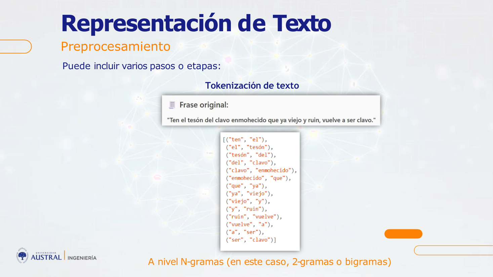
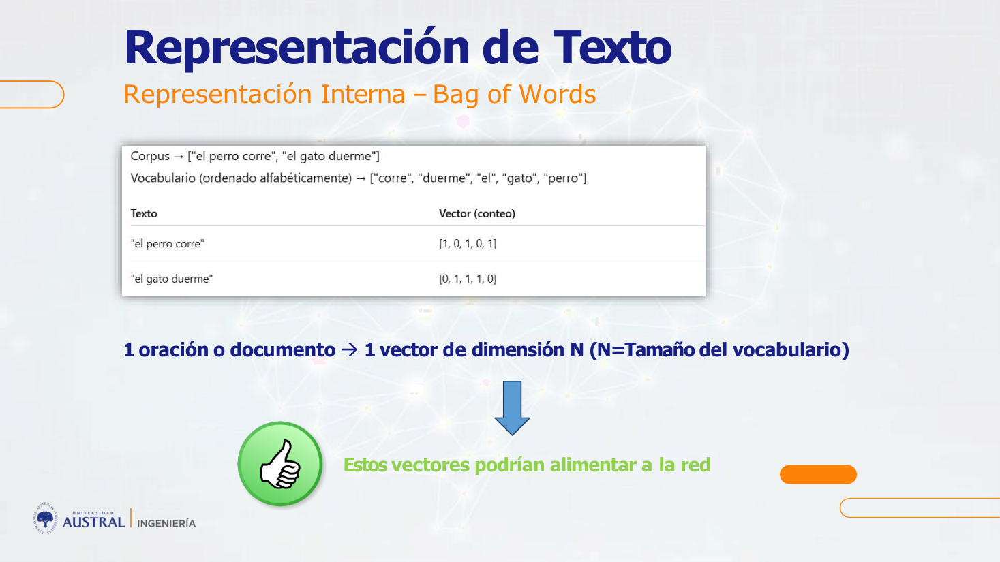
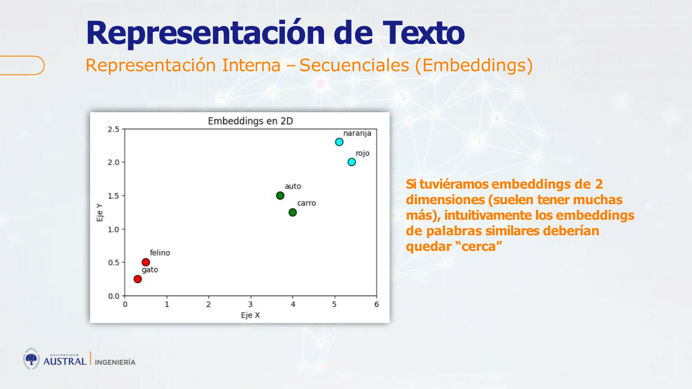
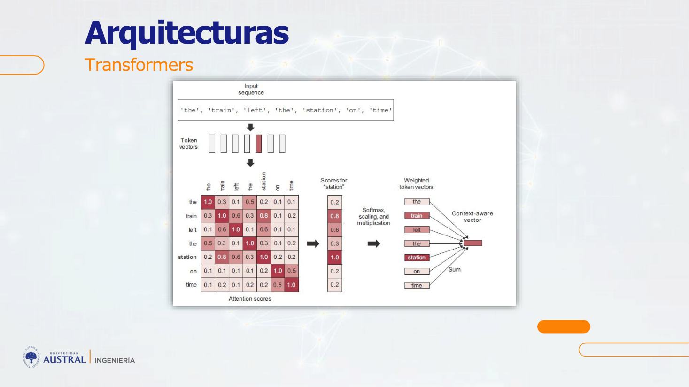
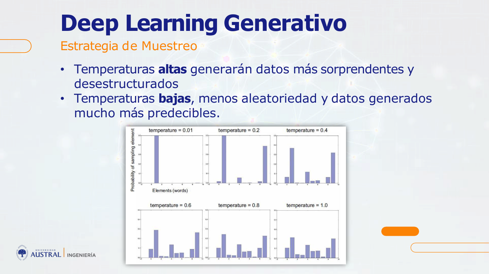

# Clase 11 · Procesamiento de texto: de Bag of Words a Transformers y generación

> **Módulo 2 · Deep Learning y Aplicaciones Avanzadas** · Sebastián González · martes 12-may-2026
> **Fuentes:** transcripción de la clase · láminas `deep_learning_austral_clase_5.pdf` (clase 5 del módulo) · notebooks `5.1-Preprocesamiento`, `5.2-Bag of Words`, `5.3-Representacion Secuencial`, `5.4-Transformers` (y su versión comentada) y `5.5-Mini GPT`

## En pocas palabras

- Una red neuronal solo hace cuentas con números. Trabajar con texto exige **vectorizarlo**, es decir, convertirlo en tensores numéricos, y que esa conversión conserve el sentido semántico, el orden y el contexto.
- La historia del NLP es una serie de capas de refinamiento: reglas fijas, **Bag of Words** (un vector de unos y ceros por texto), **embeddings** (un vector denso por palabra, con palabras parecidas cerca) y, desde 2017, **Transformers**, cuya **atención** mueve cada embedding según el contexto de la frase.
- Muchas técnicas clásicas (minúsculas, sacar tildes, stopwords, lematización, n-gramas) existían para achicar el vocabulario y ganar algo de contexto "a mano". En un Transformer casi no se usan: el modelo aprende solo el embedding y a qué prestarle atención.
- Un embedding da una **posición fija** de la palabra en el espacio del vocabulario ("banco" queda cerca de "financiero" y de "peces"). La atención agrega el **contexto de la frase** concreta y desplaza ese vector hacia el significado que corresponde.
- Un modelo generativo de texto predice el **siguiente token** a partir de los anteriores y **samplea** de una distribución de probabilidad. Por eso es estocástico: el mismo input puede dar respuestas distintas, y la **temperatura** controla cuánto se aleja de lo más probable.

## Conceptos clave

### Por qué texto es difícil: lenguaje natural vs. lenguaje de máquina

El ejemplo de entrada fue el **filtro de spam** del email, una aplicación de IA + texto muy anterior a ChatGPT. Al principio se resolvía con reglas fijas, una "ensalada de ifs" (si aparece tal palabra, mandalo a spam). Eso es poco flexible, no se adapta y no puede cubrir todos los casos.

Un compilador de un lenguaje de programación sí funciona con reglas fijas, porque ese lenguaje es **rígido**: si la sintaxis está mal, directamente no lo reconoce. Somos nosotros los que nos adaptamos a él. El **lenguaje natural** (lámina: caótico, ambiguo, irregular y en constante cambio) nunca se va a adaptar a una regla. De ahí el nombre *Natural Language Processing* (NLP): se contrapone al lenguaje de máquina (estructurado, preciso, riguroso).

**Tareas clásicas de NLP** (lámina): clasificación de texto (por tema), filtrado de contenido (lenguaje abusivo), análisis de sentimiento, modelado de lenguaje (siguiente palabra), traducción y resumen. El objetivo más ambicioso es "entender" el lenguaje, capturar toda su riqueza (qué se dice, cuándo y cómo) para generar texto nuevo: eso es lo que hacen los LLMs. Para tareas simples alcanza con mucho menos. Por ejemplo, un análisis de sentimiento podría contar palabras de un diccionario de palabras "lindas" y otro de palabras "malas".

**Historia** (láminas):

| Período | Enfoque dominante |
|---|---|
| Años 90 a ~2014 | Bag of Words con modelos clásicos (árboles de decisión, regresión logística) |
| 2014–2017 | Embeddings (Word2vec) y redes recurrentes, en particular LSTM |
| 2017 en adelante | Transformers ("Attention Is All You Need", Vaswani et al.) |
| Nov. 2022 | OpenAI lanza ChatGPT al público |

### Preprocesamiento: estandarización

Busca eliminar diferencias de codificación para que el modelo no tenga que considerarlas:
- **Pasar a minúsculas**, para que "Ten" y "ten" sean el mismo token.
- **Quitar puntuación**: en una representación de unos y ceros, el lugar del punto no cambia nada.
- **Quitar tildes** (propio del español): las librerías suelen estar pensadas para inglés, así que se hace a mano con expresiones regulares.

La idea de época era "deshacerse de la mayor cantidad posible de caracteres distintos", porque cada token extra hacía crecer los vectores. El profesor advirtió que no necesariamente es lo mejor.

### Tokenización y n-gramas

Un **token** es un pedazo de la cadena de texto. Puede ser una palabra, varias palabras, caracteres o símbolos. Los **n-gramas** definen cuántas palabras forma cada token: unigrama (una), bigrama (dos), etc.



*Figura: los bigramas se arman con una ventana deslizante: (ten, el), (el, tesón), (tesón, del)...*

¿Por qué usar n-gramas? Antes de los embeddings y la atención era la única forma de **ganar contexto**: con trigramas, "banco de peces" y "banco financiero" pasan a ser tokens distintos. Es rudimentario, porque las palabras tienen que aparecer pegadas, y el vocabulario explota (banco, banco de, banco de peces...). Según el profesor, usar más de tres gramas no tiene sentido práctico.

### Stopwords y lematización

- **Stopwords:** se eliminan artículos, preposiciones, pronombres y conjunciones, que aparecen mucho y aportan poco valor semántico. Es la lógica de cuando uno busca en Google "guerra península 1900" sin armar la oración. El objetivo era achicar vectores enormes y llenos de ceros.
- **Lematización:** lleva cada palabra a su forma base o lema ("enmohecido" → "enmohecer", "vuelve"/"volvió" → "volver"). Una técnica similar es el *stemming*.

Las láminas aclaran que hoy ambas técnicas **ya no son tan habituales, porque se pierde contexto**. En clase hubo un intercambio sobre si las stopwords "no aportan nada". La conclusión fue que aportan poco, y que en ese contexto meter más tokens no era gratis. En un Transformer no se eliminan.

### Vectores ralos (sparse)

Un vector con muchísimos ceros es un **vector ralo** (*sparse*). Es incómodo para la red y casi no aporta información por posición. Reducir el vocabulario (estandarización, stopwords, lematización, tope de vocabulario) era la forma de combatirlo.

### Bag of Words

- Se arma un **vocabulario** con todas las palabras únicas del **corpus** (conjunto grande de documentos).
- Cada texto es **un vector del tamaño del vocabulario**. Cada posición indica si la palabra está (0/1, *multi-hot*) o cuántas veces aparece (conteo).
- **Se ignora el orden**: la frase es una "bolsa" de palabras.



*Figura: con el vocabulario ["corre", "duerme", "el", "gato", "perro"], "el perro corre" → [1, 0, 1, 0, 1].*

Problemas:
- El vector tiene el tamaño del **corpus**, no del texto. Con un corpus de 100.000 palabras, "el perro corre" tiene solo tres unos: la representación es muy pobre.
- Frases con las mismas palabras en distinto orden ("uh, la batería se agotó" y "uh, se agotó la batería") dan **exactamente el mismo vector**.
- Contar repeticiones (modo *count*) mejora un poco. El ejemplo de clase: una nota deportiva donde "pelota" aparece muchas veces se distingue de otra que la menciona una sola vez de pasada. El profesor mencionó también **TF-IDF**, que pondera por frecuencia y por rareza de la palabra, pero lo presentó como algo histórico.

Con un dataset de noticias (filas = textos, columnas = palabras, target = sección), Bag of Words + un clasificador funcionaba bien para clasificar. El problema es que no sirve para nada parecido a generar lenguaje.

### Representación secuencial: indexación de tokens

Para conservar el orden, a cada token del vocabulario se le asigna un **índice entero**. Por ejemplo, si "el" = 3, "gato" = 7 y "come" = 12, la frase "el gato come" es [3, 7, 12]. Detalles (láminas y notebook):
- Se suele restringir el vocabulario a las **20.000 o 30.000** palabras más comunes, porque la mayoría de los términos aparecen una o dos veces.
- **Índice 0 = padding**: relleno para que todas las secuencias de un lote tengan la misma longitud.
- **Índice 1 = OOV / `[UNK]`**: comodín para cualquier token fuera del vocabulario. No puede haber un valor faltante.
- Si el texto es más largo que la longitud fija, **se trunca** y lo que sobra se pierde. Es una limitación de la arquitectura, que es fija mientras que el texto varía muchísimo.

**¿Por qué no pasarle los índices directamente a la red?** Porque la red interpretaría que 12 es "más" que 3. Una palabra pesaría más que otra solo por su índice, y eso afecta la actualización de pesos.

### One-hot por palabra (enfoque naive)

Como un token es una variable categórica, cada palabra puede ser un vector **one-hot** del tamaño del vocabulario (gato = 1 0 0, perro = 0 1 0), y el texto pasa a ser un vector de vectores. Así se resuelve el problema del orden de magnitud, pero cada palabra es un vector enorme y ralo: "cosa incomodísima".

### Embeddings

Un **embedding** es una representación numérica **densa y de baja dimensión**: cada token se asigna a un vector de números reales (es común usar unos 300) en un espacio donde **palabras de significado similar quedan cerca**.



- Un texto pasa a ser un **vector de vectores**, es decir, un **tensor**. Para obtener un único vector por texto se pueden **promediar** los embeddings de sus palabras. Con eso se puede clasificar, por ejemplo una noticia como un vector de 300 valores.
- Como los valores salen de pesos entrenados, quedan "calibrados" y ninguna palabra pesa más que otra por su índice.
- Con embeddings se pueden hacer cuentas. El ejemplo famoso de Word2vec es la analogía rey/reina/hombre/mujer (en la versión habitual, *rey − hombre + mujer ≈ reina*; en la transcripción la cuenta quedó enunciada de forma confusa).
- **Limitación:** cada palabra tiene **una sola posición fija**. "Naranja" está entre los colores y cerca de las frutas a la vez; "banco" no distingue entidad financiera de banco de peces.

**Cómo se entrena un embedding tipo Word2vec** (explicado en clase en respuesta a una pregunta):
1. La entrada es el vector one-hot de una palabra.
2. Pasa por una **capa oculta** con un número fijo de neuronas (por ejemplo, 300).
3. La tarea es predecir palabras del contexto: dada una palabra, predecir las vecinas (*skip-gram*), o dadas las vecinas, predecir la del medio (el otro enfoque, que el profesor no recordó; habitualmente se lo llama CBOW).
4. Terminado el entrenamiento, se hace un forward pass y se toman **los valores de la capa oculta: ese es el embedding**.

La cercanía no es casual ni se arma a mano en el índice: sale de haber visto cada palabra en muchísimos contextos. "Tu embedding va a estar tan bien como el corpus con el que lo entrenes". Por eso se suelen usar embeddings **preentrenados** por alguien con un corpus enorme.

En el notebook 5.3, la capa `Embedding` de Keras se inicializa con **pesos aleatorios**: muestra la forma (cada índice → un vector), pero sin sentido semántico hasta entrenarla o cargar pesos preentrenados.

### Redes recurrentes y LSTM

Con una representación secuencial (una secuencia de embeddings), las **redes neuronales recurrentes** (RNN) encajan naturalmente: procesan la secuencia en orden y pueden entrenarse para predecir el siguiente término, como en series de tiempo. Sufren un problema parecido al *vanishing gradient* visto con la sigmoide. Las **LSTM** (*Long Short-Term Memory*) lo mejoran: al predecir, deciden a qué partes de la historia prestar más atención. Su memoria, sin embargo, está acotada al largo de la secuencia que se les pasa, y el contexto es rígido. Lograron cierto contexto, "pero se quedaron cortas".

### Atención y Transformers

El paper **"Attention Is All You Need"** (2017, Google) mostró que un mecanismo de "atención neuronal" alcanzaba para construir modelos de secuencia potentes, **sin capas recurrentes ni convolucionales**. Hoy se usan Transformers para texto, imágenes, series de tiempo y casi todo.

**Intuición (lámina, "el lector de Infobae"):** en una nota larga uno ojea algunas partes y lee con atención otras. No toda la información de entrada es igual de importante para la tarea. La atención calcula **puntajes de importancia**, más altos para lo relevante.

**Auto-atención (self-attention):** modula la representación de cada token usando las de los tokens relacionados de la misma secuencia. El resultado son **representaciones conscientes del contexto**.



*Figura: el vector de "station" se compara con todos los tokens (puntajes de atención). Su relación más fuerte, fuera de sí mismo, es con "train" (0.8). Tras softmax y escalado, se hace una suma ponderada de los vectores y sale un vector nuevo de "station", enriquecido con el contexto.*

- **Entra un vector y sale otro vector**: mismo token, pero con otra "dirección", movida hacia el contexto. "Estación" en una frase sobre trenes queda distinta de "estación" en una frase sobre el año (o, según la lámina, una estación de radio o la Estación Espacial).
- "Banco" en "el banco aprobó mi préstamo" se acerca a tasa de interés y entidades financieras. En "nos sentamos en un banco de plaza" se acerca a aire libre, familia...
- **Embedding vs. atención** (respuesta final del profesor): con el embedding se gana el contexto de *una palabra respecto de las otras del vocabulario*, una posición fija. Con la atención se gana el contexto de *la frase en que se usó*. Por eso, con embeddings + atención, **los n-gramas pierden sentido**: ese contexto ya está embebido en el vector.

### Encoder, decoder y generación token a token

Un modelo **secuencia a secuencia** transforma una secuencia en otra: traducción, resumen, respuesta a preguntas.
- **Encoder:** codifica la secuencia fuente a una representación intermedia (espacio latente).
- **Decoder:** se entrena para predecir el siguiente token mirando los tokens anteriores y la secuencia codificada.
- **Inferencia:** se parte de un token semilla (`[start]`). Se predice un token, se lo agrega a la secuencia, se predice el siguiente, y así hasta un token de parada (`[end]`).

Según el tipo de arquitectura, un modelo puede tener encoder y decoder, solo encoder o solo decoder. El profesor aclaró que **ChatGPT es solo decoder**, con muchas capas de atención (mencionó "96, creo"; dato no verificado). Igual que cualquier LLM, devuelve la respuesta **de a un token**: cada token generado se incorpora al input para predecir el siguiente.

### Deep learning generativo y muestreo

- El lenguaje, la música y el arte tienen **estructura estadística**. Un modelo puede aprender su **espacio latente** (donde lo similar queda cerca) y **muestrear** de él. La lámina aclara que eso no es creación artística: es una operación matemática que aprende de información histórica.
- La forma universal de generar secuencias es entrenar un modelo (Transformer o RNN) para **predecir el siguiente token** dados los anteriores. Por ejemplo, para "the cat is on the" → "mat". Cualquier red que modele esa probabilidad es un **modelo de lenguaje**. Un **LLM** es uno con miles de millones de parámetros.
- Lo mismo se generaliza a cualquier secuencia: notas musicales, trazos de pintura.

**Estrategias de muestreo** (láminas):

| Estrategia | Cómo elige el siguiente token | Resultado |
|---|---|---|
| Greedy | Siempre el más probable | Texto repetitivo y predecible |
| Estocástica | Samplea de la distribución | Elecciones a veces sorprendentes, oraciones nuevas y realistas |

- **Temperatura:** con temperatura **alta**, la distribución se aplana y salen tokens más improbables: más "creatividad", más desestructurado. Con temperatura **baja**, la probabilidad se concentra en el más probable: respuestas predecibles. El profesor lo comparó con partículas que se mueven más con más calor, y recomendó buscar *simulated annealing* para entender la idea.
- **Top-k:** se queda solo con los *k* tokens más probables (por ejemplo, 40 o 50) y samplea entre ellos según la temperatura.
- Por eso el algoritmo es **estocástico**: el mismo input puede dar respuestas distintas, y la chance de obtener dos veces la misma respuesta larga es bajísima.



*Figura: con temperatura 0.01, toda la probabilidad cae en una palabra. A medida que sube, la distribución se reparte entre más palabras.*

## Ejemplos y casos de la clase

- **Filtro de spam:** muestra por qué las reglas duras no alcanzan con lenguaje natural y por qué un compilador sí puede usarlas.
- **Clasificador de noticias** (deporte, política, economía), de la maestría del profesor: el caso típico de Bag of Words + clasificador, que funcionaba bien.
- **Análisis de sentimiento de comentarios de clientes:** convertir miles de textos en una variable categórica para sacar estadísticas sin leerlos uno por uno.
- **Tiempo de adopción de animales rescatados:** el texto descriptivo de cada animal se procesaba a un valor (sentimiento, variable ordinal) y se usaba como **variable explicativa** de otro modelo. El texto como feature, no como fin.
- **"Banco"** (financiero, de peces, de plaza) y **"station"** (tren, año, radio): el hilo conductor para explicar por qué un embedding fijo no alcanza y qué agrega la atención.
- **"Naranja"** (color y fruta): una palabra con una posición fija que la atención desplaza según el contexto.
- **Google vs. OpenAI:** Google publicó los Transformers en 2017 y tuvo los mejores modelos durante años, pero fue más conservador. OpenAI lanzó ChatGPT y se llevó el crédito público. Google respondió en 2023 con Bard, luego Gemini. En 2015, Google ya había hecho **DeepDream**, que generaba imágenes alucinógenas a partir de fotos.

## Práctica

Todos los notebooks usan `TextVectorization` de Keras (TensorFlow), que pasa de texto a vector con distintos `output_mode`:

| Notebook | Qué muestra | Qué mirar |
|---|---|---|
| 5.1 Preprocesamiento | Vocabulario de "Uh, La batería se agotó" sin estandarizar, con `lower_and_strip_punctuation` y con una función custom que además quita tildes (regex). Luego, `ngrams=2` | Cómo se reduce el vocabulario: sin estandarizar, "agotó" y "agoto" son tokens distintos. Los índices 0 (vacío) y 1 (`[UNK]`) |
| 5.2 Bag of Words | `output_mode='multi_hot'` y `'count'` sobre frases con orden cambiado y repeticiones | Un vector del tamaño del vocabulario por documento. El orden se ignora y, en multi-hot, también las repeticiones |
| 5.3 Representación secuencial | `one_hot` (una matriz por frase), `int` con `output_sequence_length=10` (padding con 0 y truncado) y una capa `Embedding` de dimensión 2 | Embeddings con pesos aleatorios: muestran la forma, no el significado |
| 5.4 Transformers | Traducción inglés → español (corpus Anki, ~119.000 pares; código adaptado de Chollet) | Lo dejó comentado para verlo con tiempo; en clase casi no se recorrió |
| 5.5 Mini GPT | GPT-2 pequeño en español preentrenado (`datificate/gpt2-small-spanish`) con `model.generate(do_sample=True, ...)` | Ejercicio en equipo: variar temperatura, top-k, largos y cantidad de ejemplos |

Fragmento central del 5.5:

```python
sample_outputs = model.generate(input_ids, do_sample=True,
                                max_length=largo_maximo, min_length=largo_minimo,
                                temperature=temperatura,  # >1 más aleatorio, <1 más conservador
                                top_k=top_k,              # solo los k tokens más probables
                                num_return_sequences=cantidad_ejemplos)
```

Con `cantidad_ejemplos = 3`, el mismo texto inicial genera tres continuaciones independientes. El ejercicio consiste en ver cómo cambian al mover la temperatura y el top-k.

**Notas del notebook 5.4 comentado**, útiles para repasar:
- Se agregan `[start]` y `[end]` a cada oración en español. El decoder recibe la secuencia desplazada un paso (entra `[start] el gato duerme`, debe predecir `el gato duerme [end]`): eso es *teacher forcing*.
- Partición 70/15/15. Vocabulario de 15.000 tokens y secuencias de 20.
- **PositionalEmbedding:** como los embeddings no tienen noción de orden, se suma un embedding de posición aprendible al de la palabra.
- **Encoder:** multi-head self-attention + conexión residual + LayerNorm + feed-forward.
- **Decoder:** self-attention con **máscara causal** (no ve tokens futuros) + *cross-attention* sobre la salida del encoder.
- Pérdida `SparseCategoricalCrossentropy(ignore_class=0)` para no penalizar el padding. La accuracy es orientativa; en traducción se usa BLEU.
- La inferencia es autorregresiva con muestreo greedy (argmax).
- Al final explica por qué `summary()` muestra ~59,9 M parámetros totales con solo ~20 M entrenables: Adam guarda dos estados (*m* y *v*) por peso, y esos estados se descartan al guardar el modelo.

## Para recordar

- "¿Qué necesitamos adentro de una red? Números, solo números." Todo el NLP clásico es la búsqueda de una buena forma de pasar texto a números.
- Muchas técnicas de preprocesamiento se hacían por necesidad (reducir dimensionalidad), no porque fueran buenas: hoy se pierden contexto y casi no se usan con Transformers.
- Bag of Words: el vector mide lo que el **corpus**, no lo que mide el texto. Y no ve el orden.
- No pasar índices crudos a una red: el valor numérico del índice no significa nada, pero la red lo interpreta como magnitud.
- Embedding = posición fija en el vocabulario. Atención = contexto de la frase. "El embedding apunta para allá, pero si lo pasás por atención apunta hacia donde querés que esté": ese concepto "vale oro".
- Padding para textos cortos, `[UNK]` para palabras fuera del vocabulario, truncado para textos largos: la arquitectura es fija y el texto se adapta.
- Los modelos generativos no "crean": samplean, dentro de un conjunto de salidas probables, según cuánta libertad se les dé (temperatura, top-k).
- "Tienen que salir con más dudas de las que entraron." El objetivo de la clase era el panorama conceptual, no programar Transformers.

## Preguntas de repaso

<details><summary>1. ¿Por qué un filtro de spam basado en reglas funciona peor que uno basado en IA, si un compilador funciona perfecto con reglas fijas?</summary>

Porque un lenguaje de programación es rígido: el usuario se adapta a su sintaxis y, si no, el código no se reconoce. El lenguaje natural es ambiguo, irregular y cambia; lo mismo se puede escribir de muchas maneras y ninguna lista de reglas cubre todos los casos. La IA aprende de ejemplos y se adapta.

</details>

<details><summary>2. Las frases "uh, la batería se agotó" y "uh, se agotó la batería" dan el mismo vector en Bag of Words. ¿Por qué, y qué representación lo evita?</summary>

Porque Bag of Words solo registra qué palabras del vocabulario aparecen (o cuántas veces), no en qué posición. Una representación secuencial (índices, one-hot por palabra o una secuencia de embeddings) conserva el orden.

</details>

<details><summary>3. ¿Qué problema tiene pasarle a la red el vector de índices [3, 7, 12] tal cual?</summary>

La red interpreta los valores como magnitudes: trataría a la palabra 12 como "más" que la 3 y le daría más peso en la actualización de pesos, aunque el índice sea arbitrario. One-hot lo evita, pero con vectores enormes y ralos. El embedding lo resuelve con vectores densos y entrenados.

</details>

<details><summary>4. ¿Para qué se usaban los n-gramas y por qué pierden sentido con embeddings y atención?</summary>

Eran una forma rudimentaria de capturar contexto: "banco de peces" como un solo token se distingue de "banco financiero". Pero exigen palabras contiguas y hacen explotar el vocabulario. Con embeddings (relación entre palabras) y atención (contexto de la frase), ese contexto ya queda incorporado en el vector de cada token.

</details>

<details><summary>5. ¿Cómo se obtiene un embedding en un esquema tipo Word2vec?</summary>

Se entrena una red con una capa oculta de tamaño fijo (por ejemplo, 300) para una tarea de contexto: predecir las palabras vecinas de una palabra, o la del medio dadas las vecinas. La entrada es el one-hot de la palabra. Una vez entrenada, los valores de la capa oculta para esa palabra son su embedding. Las palabras que aparecen en contextos parecidos terminan cerca.

</details>

<details><summary>6. Si "banco" ya tiene un embedding, ¿qué agrega la capa de atención?</summary>

El embedding es una posición fija, la misma para todos los usos de "banco". La atención compara el token con los demás de la frase, pondera los más relacionados y produce un vector nuevo desplazado hacia el contexto: entidad financiera si aparece "préstamo" o "tasa de interés", plaza si aparece "sentarse" o "aire libre".

</details>

<details><summary>7. ¿Por qué ChatGPT puede dar respuestas distintas a la misma pregunta?</summary>

Porque genera token a token sampleando de una distribución de probabilidad, no tomando siempre el más probable (greedy). Con top-k y temperatura elige entre varios tokens probables, y como cada elección se incorpora para predecir la siguiente, las respuestas divergen.

</details>

<details><summary>8. ¿Qué esperarías al bajar la temperatura a casi 0 en el Mini GPT? ¿Y al subirla?</summary>

Cerca de 0, casi toda la probabilidad cae en el token más probable: el texto es predecible y tiende a repetirse, como el muestreo greedy. Con temperatura alta, la distribución se aplana y aparecen tokens improbables: el texto es más "creativo" pero también más desestructurado o incoherente.

</details>

## Conexiones

- **Clase 9:** el problema del *vanishing gradient* con la sigmoide reaparece en las redes recurrentes y motiva las LSTM. La salida softmax es la que da la distribución sobre el vocabulario de la que se samplea.
- **Clase 10:** el entrenamiento con Keras (`compile`, pérdida, partición train/validación/test) es el mismo esquema que usa el notebook 5.4.
- **Clase 12:** el profesor anticipó que con imágenes pasa lo mismo: hay que pasarlas a números, y también se usan embeddings y atención para "enfocarse". Allí se verá *transfer learning*, que según el profesor es lo que se usaría en la práctica en lugar de programar todo a mano.
- **TFI (Benefix):** la clase da la base conceptual de los enfoques del TFI.
  - El **retrieval léxico** se apoya en representaciones tipo Bag of Words/TF-IDF y en la estandarización (minúsculas, tildes, puntuación), que importa mucho al normalizar nombres comerciales.
  - El **retrieval semántico** usa **embeddings**: nombres parecidos quedan cerca en el espacio vectorial.
  - El **enfoque generativo** se basa en modelos de lenguaje que predicen token a token. Conviene recordar el efecto de la temperatura si se busca una salida estable y reproducible.
