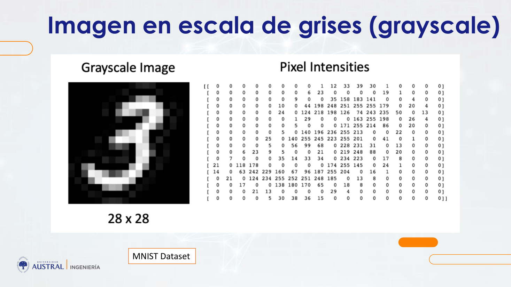
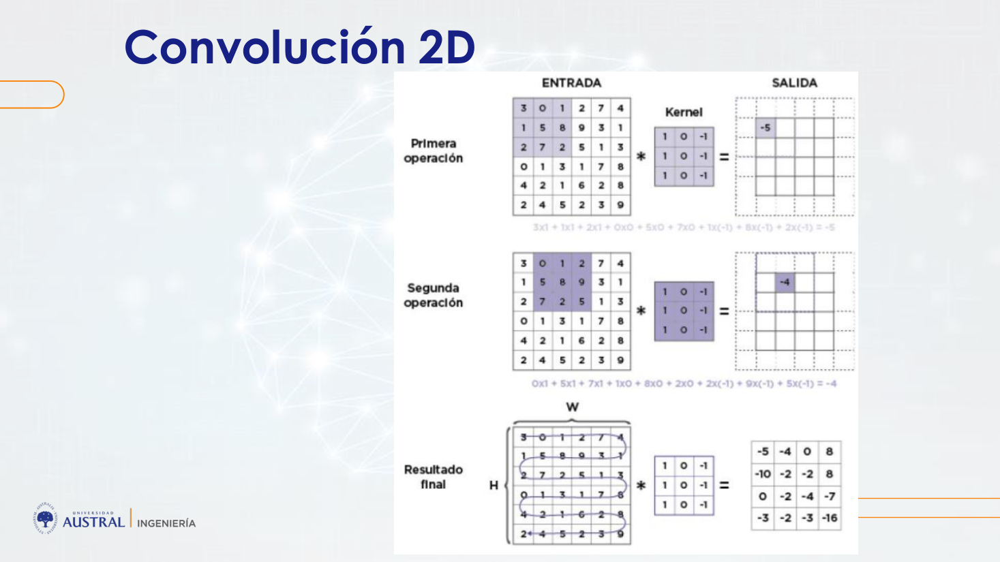
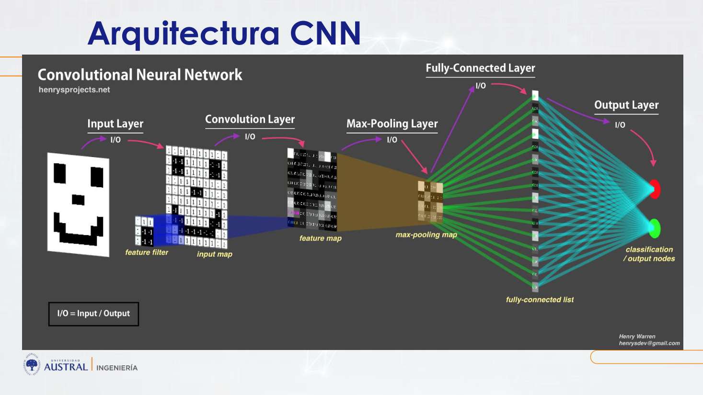
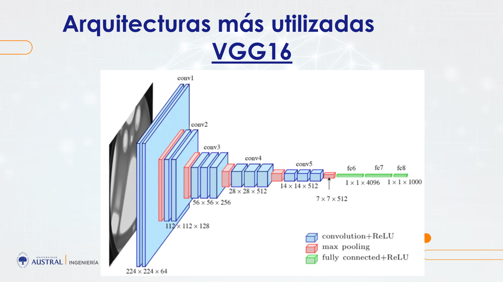
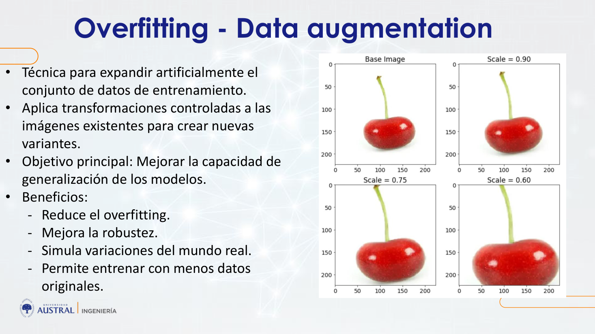
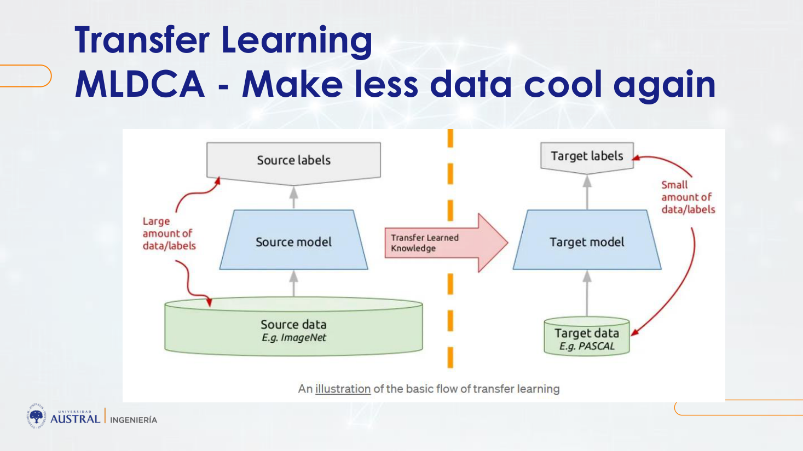

# Clase 12 · Imágenes con redes convolucionales y transfer learning

> **Módulo 2 · Deep Learning y Aplicaciones Avanzadas** · Daniel Gattari · jueves 14-may-2026
> **Fuentes:** transcripción `DIA_Clase_12.vtt` · láminas `Clase_imagenes.pdf` (incluye las láminas de "Clase 4" de imágenes y "Clase 6" de transfer learning del cronograma original) · notebooks `MNIST Dense`, `MNIST Conv`, `CNN Perros y Gatos - completo` y `CNN Perros y Gatos - transfer`

## En pocas palabras

- Para un algoritmo, una imagen es una **matriz de números**: en escala de grises, una matriz de intensidades entre 0 (negro) y 255 (blanco); a color, un tensor de tres canales (R, G, B) apilados. Todo el procesamiento de imágenes opera a nivel píxel.
- La **convolución** desliza una matriz chica (kernel o filtro) sobre la imagen, multiplica punto a punto y suma. En una red convolucional los valores del kernel no se eligen a mano: son los **pesos** que la red aprende, igual que los pesos de una neurona densa.
- Las capas convolucionales aprovechan la **espacialidad**: aprenden patrones locales que reconocen en cualquier lugar de la imagen y los combinan capa a capa en patrones cada vez más complejos ("destilación de la información"), con muchísimos menos parámetros que una red densa sobre la imagen aplanada.
- Una CNN de clasificación tiene dos etapas: **extracción de características** (bloques convolución + pooling, que achican el mapa y aumentan los canales) y **clasificación** (aplanado y capas densas). Con pocos datos, la red se aprende las imágenes de memoria: el **overfitting** se combate con validación, *data augmentation*, *dropout* y regularización.
- **Transfer learning**: reutilizar la parte de extracción de características de una red preentrenada en un dataset enorme (ImageNet) y cambiarle solo el clasificador. En el ejemplo de perros y gatos, la precisión en test pasó de alrededor de 66-73 % a 94 %.

## Conceptos clave

### La imagen como matriz

Una imagen digital es una matriz de M×N píxeles; cada píxel guarda la intensidad de luz en ese punto, típicamente entre 0 y 255 (o normalizada entre 0 y 1). En escala de grises, el 0 es negro, el 255 es blanco y en el medio están los grises.



- **MNIST**: dígitos escritos a mano del 0 al 9, imágenes de 28×28 en escala de grises. Mirando la matriz "con los ojos entrecerrados" se ve el número dibujado.
- **Color (RGB)**: en lugar de una matriz hay un tensor de tres dimensiones, o sea tres matrices apiladas que se llaman **canales** (rojo, verde, azul). Cada píxel tiene tres valores. Una pastilla roja se ve clara en el canal R y oscura en G y B.
- Pasar de color a grises es una combinación de los canales. La lámina da la fórmula que usa OpenCV:

$$\text{Gray} = 0.299\,R + 0.587\,G + 0.114\,B$$

(OpenCV lee las imágenes en orden BGR por defecto; por eso el código de la lámina primero convierte BGR a RGB.)

El profesor mostró la **ecualización** de una imagen de microscopía de tejido cardíaco como ejemplo de procesamiento clásico. Se toma el histograma de intensidades, que está apiñado en pocos valores, y se lo "expande": la imagen gana contraste y se distinguen mejor las fibras. No se usó después; servía para mostrar que todo se hace operando sobre los píxeles.

### Ingeniería de atributos versus deep learning

- **Enfoque clásico de ML**: el analista decide qué transformaciones hacerle a la imagen (detección de bordes, pasar a grises, gradientes, desenfoque) y con esas características intermedias clasifica. Es *feature engineering*.
- **Enfoque de deep learning**: la red prueba una enorme cantidad de transformaciones sin criterio humano previo y se queda con las que sirven para el objetivo. Eso no es propio de imágenes: es propio del deep learning.
- **Ventaja**: encuentra relaciones muy complejas que a mano no se encontrarían.
- **Costos**: mucho más cómputo y, sobre todo, pérdida de **interpretabilidad**. Cuando el modelo funciona bien, es muy difícil explicar por qué.

### Tareas de visión por computadora

Siempre conviene preguntarse qué entra y qué sale.

| Tarea | Entrada | Salida |
|---|---|---|
| Clasificación | imagen | una etiqueta (ej. 0 = gato, 1 = perro) |
| Clasificación + localización | imagen | etiqueta + coordenadas de dónde está el objeto (ej. fractura en una radiografía) |
| Detección de múltiples objetos | imagen | varias clases, cada una con su ubicación (gato, perro, pato) |
| Segmentación | imagen | una matriz del mismo tamaño que la imagen, con una clase por píxel (cielo, colina, gato, piso) |
| Generativas (texto→imagen, imagen→imagen) | texto o imagen | una imagen nueva |

La segmentación es una **clasificación píxel a píxel**: la salida es una sola matriz con valores como 0, 1, 2, 3 según la clase, que después se puede pintar con cualquier color. La clase se centró en las tareas discriminativas; las generativas quedaron para el módulo de IA generativa. Las láminas listan aplicaciones en medicina (tumores, mamografías), autos autónomos, imágenes satelitales (paneles solares, deforestación), microscopía, apps (Google Photos, reconocimiento facial) e industria.

### Filtrado espacial

Filtrar es aplicarle a una imagen una operación que devuelve otra imagen. Esa imagen nueva resalta algo (bordes, texturas, contornos) o pierde algo que no se quiere (ruido, distorsiones). Ejemplos de la clase:

- **Blur (desenfoque)**: una ventana que promedia los píxeles vecinos y suaviza las diferencias entre píxeles contiguos.
- **Sobel X / Sobel Y**: detectan cambios fuertes en la dirección horizontal o vertical. Sobel X marca las líneas verticales y Sobel Y, las horizontales.
- **Sharpen**: el valor central del kernel es mucho mayor que los de alrededor. Así resalta cada píxel respecto de sus vecinos y le da más definición a la imagen.

Es el mismo papel que cumplía una capa densa: transformar la entrada en otra cosa. La complejidad de la red sale de combinar muchas transformaciones en paralelo y en sucesión.

### Convolución 2D

El kernel se apoya sobre una región de la entrada, multiplica **elemento a elemento** y suma todo. El resultado es un solo número de la salida. Después se desliza a la posición siguiente y repite.



En la lámina, la primera operación da $3\cdot1 + 1\cdot1 + 2\cdot1 + 0\cdot0 + 5\cdot0 + 7\cdot0 + 1\cdot(-1) + 8\cdot(-1) + 2\cdot(-1) = -5$.

- **Tamaño de salida**: como el kernel no puede centrarse en los bordes, la salida es más chica. Una entrada de 6×6 con un kernel de 3×3 da 4×4. Por eso, en una CNN, el tamaño de las matrices suele achicarse capa a capa.
- **Padding**: agregar un borde (de ceros, o repitiendo los valores del borde) para que la salida conserve el tamaño de la entrada.

### La convolución como capa que aprende

En una red, los kernels **no son filtros conocidos** como Sobel o sharpen: arrancan con valores aleatorios y se entrenan. Es la misma lógica que en una neurona densa (suma ponderada + bias + activación). Ahora los pesos son los coeficientes del kernel.

- **Hiperparámetros (los decide uno)**: cuántos filtros aplicar (la cantidad de canales de salida, equivalente a la cantidad de neuronas de una capa densa), el tamaño del kernel (3×3 es lo estándar) y la función de activación (en convolucionales, casi siempre ReLU).
- **Parámetros (los entrena la red)**: los valores de cada kernel más **un bias por filtro**.
- Cada filtro tiene **la misma profundidad que la entrada**: si la entrada tiene 3 canales, cada filtro es de 3×3×3. La cantidad de canales de salida no depende de la entrada: es la cantidad de filtros que uno eligió.

Cuentas que se hicieron en clase:

| Entrada | Filtros | Pesos | Bias | Total | Salida |
|---|---|---|---|---|---|
| 6×6 (1 canal) | 2 de 3×3 | 2·9 = 18 | 2 | **20** | 4×4×2 |
| 6×6×3 (color) | 2 de 3×3×3 | 2·27 = 54 | 2 | **56** | 4×4×2 |

En general, por capa: $(\text{alto}\cdot\text{ancho}\cdot\text{canales de entrada} + 1)\times\text{cantidad de filtros}$. Se verifica en los notebooks: con 32 filtros 3×3 sobre MNIST (1 canal), $(9+1)\cdot32 = 320$; con 16 filtros 3×3 sobre RGB, $(27+1)\cdot16 = 448$.

### Espacialidad: por qué convoluciones y no capas densas

- **Invariancia a la traslación**: un patrón aprendido en una esquina se reconoce en cualquier otra parte. El profesor dio el ejemplo de un trabajo propio en el que se detectaban paneles solares en cualquier zona de la imagen.
- **Jerarquía espacial**: la primera capa aprende patrones locales (bordes, diagonales, puntas). Las siguientes los combinan en patrones más grandes (orejas, ojos), y así sucesivamente.
- Una capa densa aprende **patrones globales** y necesita la imagen **aplanada** en un vector. Eso tiene dos problemas: se pierde la estructura espacial y, en imágenes grandes, la cantidad de parámetros se dispara.

### Pooling y flatten

- **Pooling**: una ventana (casi siempre de 2×2) recorre el mapa y se queda con el **máximo** (*max pooling*) o con el **promedio** (*average pooling*). Reduce a la mitad el tamaño espacial, concentra la información, ayuda a encontrar patrones generales y baja el costo de cómputo. **No tiene parámetros que entrenar.**
- **Flatten**: al final de la etapa convolucional, el tensor resultante se aplana en un vector 1D y alimenta capas densas comunes, que se entrenan con backpropagation.

### Arquitectura de una CNN de clasificación



El patrón es: [convolución + ReLU → pooling] repetido varias veces → flatten → capas densas → salida. A medida que se avanza, el mapa de características **se achica en alto y ancho y gana profundidad** (más canales). Se llega a un tensor chico pero muy "denso" de información, que no es interpretable para una persona pero le sirve al algoritmo.

Dos grandes etapas:

1. **Extracción de atributos** (aprendizaje de características): la parte convolucional, que "destila" la información.
2. **Clasificación**: lo que va después del aplanado. Pueden ser capas densas, pero también un árbol, un random forest o una regresión logística. A menudo lo valioso de la CNN es ese vector de características.

**Funciones de activación según el lugar:**

| Lugar | Activación |
|---|---|
| Capas convolucionales (ocultas) | ReLU |
| Salida, clasificación binaria | sigmoide (1 neurona) |
| Salida, clasificación multiclase | softmax (1 neurona por clase) |

**VGG16** es una arquitectura clásica de clasificación. Va de una entrada de 224×224 a 7×7×512 pasando por bloques de 64, 128, 256 y 512 canales, y termina en capas densas de 4096, 4096 y 1000 salidas. Tiene unos 138 millones de parámetros, la gran mayoría en las capas densas.



Sobre cuántos filtros poner: se usan valores estándar (8, 16, 32, 64, hasta 128 o 256 como mucho; no se llega a mil). El resto es prueba y error, o partir de una arquitectura ya probada y darle el toque propio.

### Overfitting y cómo combatirlo

Las CNN hacen tantas transformaciones que pueden **memorizar** un dataset chico. Herramientas vistas:

- **Conjunto de validación**: separar parte del entrenamiento para monitorear. Cuando la pérdida de validación deja de bajar o empieza a subir mientras la de entrenamiento sigue bajando, la red está sobreajustando.
- **Data augmentation**: cada vez que una imagen entra a la red, entra modificada (rotada, volteada, escalada, trasladada, con otro contraste). Las variantes cambian en cada época. Así la red no puede memorizar y tiene que aprender patrones: "que la sandía tiene cáscara, que es roja por dentro y tiene semillas, no que siempre está horizontal". Hay deformaciones avanzadas (ruido, deformación elástica, *cutout*, *color jittering*, sesgo), pero tienen que ser **realistas**: si se distorsiona demasiado, la imagen deja de ser lo que era.



- **Dropout**: apaga neuronas al azar durante el entrenamiento para que la red no dependa de ninguna en particular.
- **Regularización L1/L2**: agrega a la pérdida un término que penaliza los pesos. L2 los achica sin anularlos y L1 lleva muchos a cero exactamente. En clase solo se mencionó; está en las láminas.
- **Batch normalization**: normaliza cada canal a media 0 y varianza 1 dentro del batch, con reescalado aprendible. Estabiliza y acelera el entrenamiento. Solo aparece en las láminas y en el notebook.

### Transfer learning

Es reutilizar pesos aprendidos sobre un volumen enorme de datos y adaptarlos a una tarea propia con pocos datos ("Make less data cool again", dice la lámina). El ejemplo del profesor: una pyme que quiere distinguir peras de manzanas en una línea de producción puede partir de una red entrenada para cosas tan distintas como distinguir autos.



- **ImageNet**: más de 14 millones de imágenes etiquetadas a mano, organizadas en más de 20.000 categorías. Desde 2010 tiene una competencia anual (ILSVRC) que usa 1000 clases (pizza, papel higiénico, flores, ambulancia, auto de policía), 1,2 millones de imágenes de entrenamiento, 50 mil de validación y 100 mil de test. Fue clave para el despegue del deep learning en imágenes.
- Los ganadores de esa competencia dejaron arquitecturas que hoy se usan **ya preentrenadas**: **VGG16** (Oxford, 2014) y **ResNet50** (ganó en 2015), entre otras.
- **Qué se cambia**: como mínimo, la capa de salida (de 1000 neuronas con softmax a 1 neurona con sigmoide para perros y gatos). En la práctica se descarta todo el clasificador original y se pone uno propio.

| | Transfer learning (extractor) | Fine-tuning |
|---|---|---|
| Base preentrenada | congelada (no entrenable) | algunas o todas sus capas se reentrenan |
| Qué se entrena | solo las capas nuevas de arriba | el clasificador y parte de la base, juntos |
| Cuándo | la tarea se parece a la original | la tarea es más lejana (ej. células) |

El fine-tuning es un tipo de transfer learning. Para perros y gatos no hizo falta tocar la base, porque ImageNet ya incluye animales. Para algo muy distinto conviene reajustar la base, pero igual partiendo de los pesos preentrenados. La lámina también muestra que una red preentrenada puede hacer de *encoder* en segmentación, al que se le agrega un *decoder*.

## Ejemplos y casos de la clase

- **MNIST con red densa vs. convolucional**: la red densa (imagen aplanada a 784 valores, 512 neuronas y salida de 10) tiene **407.050 parámetros** y llega a **98,2 %** en test. La CNN (conv 32 → pooling → conv 64 → pooling → flatten → densa de 10) tiene **34.826 parámetros**, unas 10 veces menos, y llega a **99,0 %**. Enseña que, al aprovechar la espacialidad, se obtiene más precisión con muchos menos pesos.
- **Perros y gatos** (2000 imágenes de entrenamiento, 1000 de test, reducidas a 160×160×3): la CNN simple (16-32-64 filtros, 44.321 parámetros) llega a 100 % de accuracy en entrenamiento en pocas épocas, pero a ~66 % en test. Es un overfitting claro.
- **Con validación**: la pérdida de validación casi no mejora y luego sube. Ante la pregunta de por qué no cortar antes (*early stopping*), el profesor respondió que la validación no había mejorado en ningún momento. Además, llegar tan rápido al 100 % en imágenes tan variadas es sospechoso: indica que la red memoriza, no que se entrenó de más.
- **Con data augmentation** (50 épocas): la red aprende mucho más despacio y la accuracy oscila, pero entrenamiento y validación se comportan parecido. El test da 66 %, igual que antes, pero ahora ese 66 % es **generalizable**.
- **Con todo junto** (augmentation + L2 + batch normalization + dropout): ~72-74 % en test, con entrenamiento algo inestable.
- **Transfer learning con VGG16**: se carga la base preentrenada en ImageNet sin el clasificador y congelada, y se le agregan flatten, una densa de 256 y la salida sigmoide. La accuracy es alta desde la primera época y llega a **94 %** en test. Casos que antes fallaban ahora se clasifican bien.
- **Errores típicos de la CNN simple**: acierta con gatos de orejas puntiagudas bien visibles, pero falla con perros de orejas puntiagudas o con animales de costado.

## Práctica

Cuatro notebooks de Colab (TensorFlow/Keras), listos para correr online:

- **`MNIST Dense`**: carga MNIST (60.000 de entrenamiento y 10.000 de test, de 28×28), imprime la matriz de un dígito, aplana a 784, normaliza dividiendo por 255 y entrena una red densa.
- **`MNIST Conv`**: lo mismo sin aplanar (forma 28×28×1) y con `Conv2D` + `MaxPooling2D`. Comparar el `model.summary()` de ambos.
- **`CNN Perros y Gatos`**: `ImageDataGenerator.flow_from_directory` arma batches de 32 imágenes de 160×160×3 a partir de carpetas por clase (`cats` = 0, `dogs` = 1). Conviene mirar:
  - el `summary`: 160 → 158 por la convolución sin padding, 158 → 79 por el pooling, y 0 parámetros en pooling;
  - los pesos de los dos primeros kernels antes y después de entrenar (son aleatorios al inicio y cambian con el entrenamiento);
  - las curvas de *loss* y *accuracy* de entrenamiento y validación (`validation_split=0.2`).
- La sección de transfer learning (en `CNN Perros y Gatos - transfer`) usa además `EarlyStopping` sobre `val_loss` con paciencia 10, y al final permite **probar con una foto propia** (subirla a Colab y cambiar el nombre del archivo).

```python
pretrained = VGG16(weights='imagenet', include_top=False,
                   input_shape=(160, 160, 3))
pretrained.trainable = False          # base congelada
model = Sequential([data_augmentation, pretrained, Flatten(),
                    Dense(256, activation='relu'),
                    Dense(1, activation='sigmoid')])
```

Con la base congelada, el modelo tiene ~18 millones de parámetros, pero solo ~3,3 millones entrenables.

## Para recordar

- "Hagamos fuerza y pensemos la imagen como una matriz todo el tiempo."
- Siempre preguntarse qué hay a la entrada y qué hay a la salida: eso define la tarea y la forma de la última capa.
- Los kernels de una CNN no son filtros "con sentido": son pesos que arrancan al azar y se entrenan.
- Parámetros de una capa convolucional = valores de todos los kernels + un bias por filtro. El pooling no entrena nada.
- Un modelo que llega al 100 % en entrenamiento en pocas épocas con imágenes difíciles despierta sospechas. A veces está bueno que **le cueste** aprender.
- Si entrenamiento y validación se comportan parecido, se va por buen camino aunque la métrica todavía sea baja. Para diagnosticar, es mejor mirar la pérdida que la accuracy.
- En la práctica fuerte de imágenes no se arman redes desde cero: se usan redes preentrenadas y se las ajusta.
- Para imágenes reales hace falta **GPU**: el profesor contó que algo que tardaba 7 minutos en una notebook pasó a tardar 10 segundos. Se usan placas propias o la nube (sobre todo AWS); Colab ofrece GPU con límite de uso.
- Sin etiquetas también se puede: un **autoencoder** comprime la imagen a un vector latente y aprende a reconstruirla. Otra opción, muy usada por el profesor, es pasar las imágenes por la parte de extracción de una red preentrenada y hacer clustering o t-SNE sobre esos vectores.

## Preguntas de repaso

<details><summary>1. ¿Por qué una imagen a color de 160×160 entra a la red como un tensor de 160×160×3 y no como una matriz?</summary>

Porque cada píxel tiene tres intensidades, una por canal (R, G, B). La imagen son tres matrices de 160×160 apiladas, y cada filtro de la primera capa convolucional también tiene que tener profundidad 3.

</details>

<details><summary>2. Una capa convolucional recibe una entrada de 6×6×3 y aplica 2 filtros de 3×3 sin padding. ¿Cuál es la forma de la salida y cuántos parámetros entrena?</summary>

La salida es 4×4×2: se pierde un borde de cada lado y hay un canal por filtro. Parámetros: cada filtro tiene 3·3·3 = 27 pesos más 1 bias, así que 2·28 = 56.

</details>

<details><summary>3. ¿Qué cosas decide el analista en una capa convolucional y qué cosas aprende la red?</summary>

El analista decide la cantidad de filtros (canales de salida), el tamaño del kernel y la función de activación. La red aprende los valores de cada kernel y el bias de cada filtro.

</details>

<details><summary>4. ¿Por qué la CNN de MNIST logra mejor accuracy que la red densa con unas 10 veces menos parámetros?</summary>

Porque no aplana la imagen: aprovecha que los píxeles vecinos están relacionados, comparte los mismos kernels pequeños en toda la imagen y aprende patrones locales que reconoce en cualquier posición. La red densa conecta cada píxel con cada neurona y pierde la estructura espacial.

</details>

<details><summary>5. ¿Qué hace el pooling y por qué tiene cero parámetros?</summary>

Recorre el mapa con una ventana (típicamente de 2×2) y se queda con el máximo o el promedio de cada ventana. Reduce el tamaño a la mitad y concentra la información. Es una operación fija, sin pesos que ajustar.

</details>

<details><summary>6. Con data augmentation, la accuracy en test de perros y gatos siguió en 66 %. ¿Por qué igual se consideró una mejora?</summary>

Porque antes el 66 % convivía con un 100 % en entrenamiento: la red memorizaba. Con augmentation, entrenamiento y validación se comportaron parecido, así que lo aprendido es generalizable aunque todavía sea poco.

</details>

<details><summary>7. Para adaptar VGG16 preentrenada en ImageNet a perros y gatos, ¿qué se conserva y qué se reemplaza?</summary>

Se conserva la parte de extracción de características con sus pesos de ImageNet, congelada. Se reemplaza el clasificador: en lugar de densas que terminan en 1000 salidas con softmax, se pone una densa propia y una salida de 1 neurona con sigmoide.

</details>

<details><summary>8. ¿Cuándo conviene hacer fine-tuning en lugar de usar la red preentrenada solo como extractor congelado?</summary>

Cuando la tarea propia está lejos de aquella para la que se entrenó la red (por ejemplo, clasificar células frente a las clases de ImageNet). En ese caso conviene reajustar también parte de la base, partiendo igual de los pesos preentrenados.

</details>

## Conexiones

- **Clases 7 a 10**: la convolución reusa la neurona (suma ponderada + bias + activación), las funciones ReLU, sigmoide y softmax, la distinción entre parámetros e hiperparámetros, y el entrenamiento por épocas y batches con partición en entrenamiento, validación y test y *early stopping*, todo visto con el otro docente del módulo.
- **Clase 11**: el profesor mencionó que en texto también hay transfer learning, con modelos preentrenados en un idioma que se adaptan a tareas específicas.
- **Clase 3**: la etapa de clasificación sobre el vector de características puede ser un random forest. La pérdida de explicabilidad a cambio de desempeño reaparece acá.
- **Módulo de IA generativa**: allí se retoman las tareas generativas (texto→imagen, imagen→imagen) y las arquitecturas tipo encoder-decoder.
- **TFI**: la idea de usar la parte de extracción de una red preentrenada para convertir cada dato en un vector denso, y comparar o agrupar esos vectores en lugar de los datos crudos, es la misma lógica que el retrieval semántico con embeddings preentrenados para normalizar nombres comerciales en Benefix. Acá se aplica a imágenes; allá, a texto.
