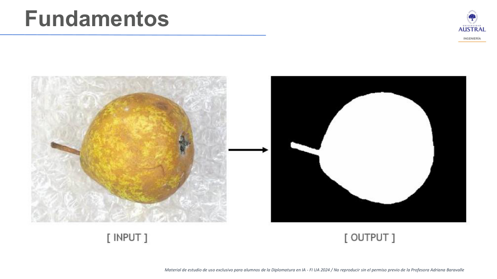
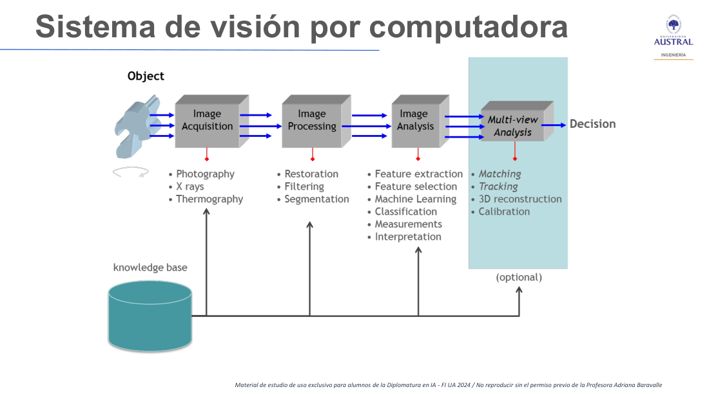
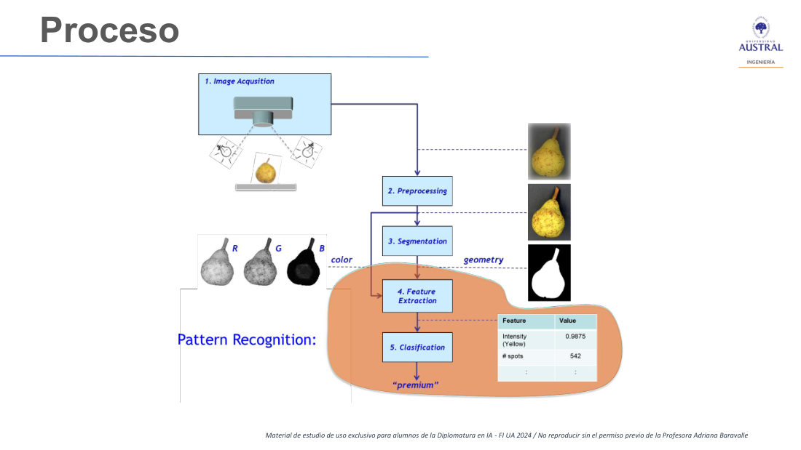
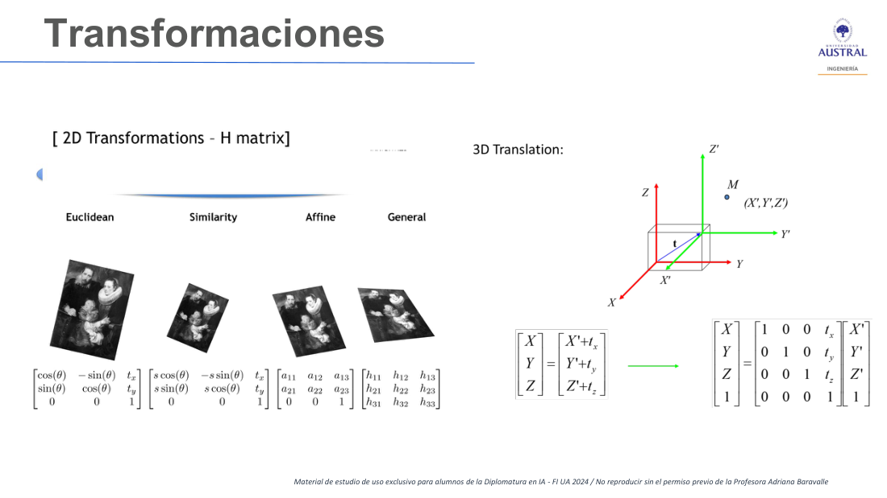
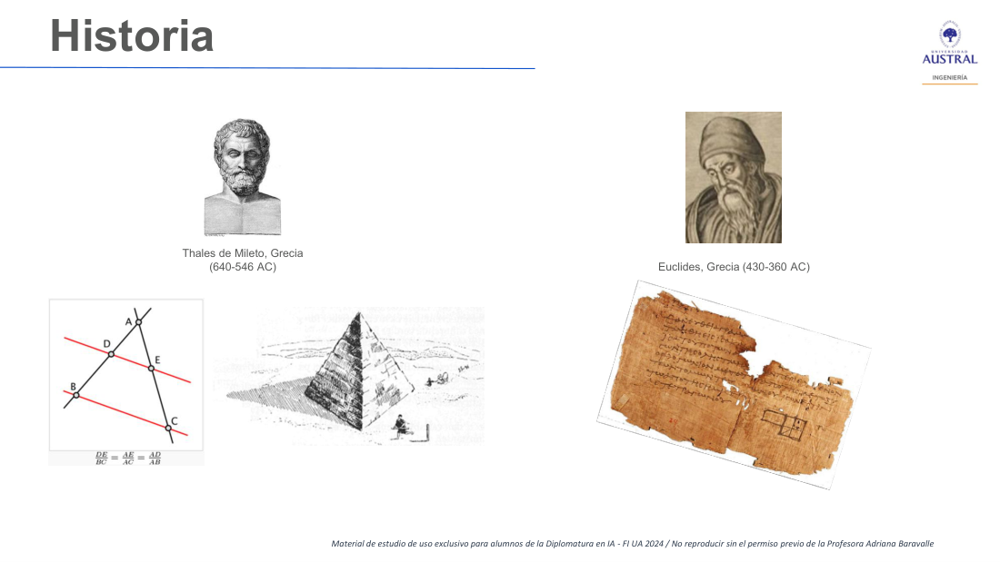

# Clase 15 · Introducción a la visión por computadora

> **Módulo 3 · Visión Artificial** · Martín Masci · martes 26-may-2026
> **Fuentes:** transcripción `DIA_Clase_15.vtt` · láminas `2026_may_jun_Computer_Vision_DipAI_Clase_1.pdf` ("Introducción y repaso amplio")

## En pocas palabras

- La visión por computadora (*computer vision*) busca, en su versión más simple, que la computadora **aprenda a ver**. El truco que la hace posible es traducir una imagen a una **matriz de números** (píxeles con valores, por ejemplo de 0 a 255). Pero el profesor insiste en que reducir la disciplina a "una imagen es un conjunto de píxeles" le baja el precio: detrás hay siglos de geometría, perspectiva y fotografía.
- Hay que distinguir tres tareas para no elegir una solución equivocada: **procesamiento de imágenes** (entra imagen, sale imagen), **análisis de imágenes** (entra imagen, sale un dato o decisión) y **reconocimiento de patrones** (entra dato, sale dato). Cada paso descarta información irrelevante y aliviana el cómputo.
- Las **transformaciones geométricas** (euclidiana, de similaridad, afín y general) son la base matemática para rotar, escalar o deformar una imagen sin perder dónde queda cada punto. El problema de fondo, que atraviesa todo el módulo, es el paso de **3D a 2D** (y, en el extremo actual, de 2D a 3D).
- Las **redes convolucionales** se prefieren a las redes densas para imágenes porque reducen la dimensión capa a capa y procesan muchos menos parámetros. El módulo parte de ahí hacia clasificación, detección, segmentación y reconocimiento.
- La visión por computadora trabaja con imagen y sonido de personas, así que la **ética, la privacidad y la trazabilidad del dato** no son un agregado: son parte del problema.

## Conceptos clave

### Qué es la visión por computadora y cómo se ubica en la IA

El profesor define la disciplina como el intento de que la computadora "aprenda a ver", y aclara que es la versión "más descafeinada" de la definición. Lo visto en los módulos anteriores (machine learning y deep learning, hasta la arquitectura VGG-16) es un insumo **necesario pero no suficiente** para entender los problemas de visión.

- El desarrollo del área se aceleró mucho desde 2010. Entre 2023 y 2026, la discusión se corrió hacia lo generativo y lo agéntico, que se trata en otro módulo.
- El foco del módulo va a estar en **clasificación, detección y segmentación**, y en las arquitecturas que las resuelven.
- Como referencia del estado del arte, recomienda seguir la **CVPR** (*Conference on Computer Vision and Pattern Recognition*, de la IEEE): mirar su alcance ayuda a ver cuáles son las fronteras actuales y a separar lo que es IA de la "venta de humo".

### De la imagen a la matriz

La pregunta inicial de la clase fue cómo es posible "darle de comer" una foto a un modelo que solo procesa números. La respuesta:

- Se divide la imagen en una grilla de **píxeles** y a cada uno se le asigna un número. En escala de grises, un valor entre 0 (negro) y 255 (blanco), o entre 0 y 1. En RGB se usan tres canales y se cubren todos los colores.
- Así la imagen pasa a ser una **matriz**, y sobre ella se puede aplicar álgebra lineal.
- El ejemplo de laboratorio es un dígito en una imagen de 40×40: la matriz tiene ceros alrededor y valores distintos de cero donde está el trazo, así que "se parece" al número. En una imagen de alta definición, en cambio, ese mismo objeto ocupa una porción mínima y la matriz es enorme.
- Un **video** es una colección de imágenes (*frames*): a 60 cuadros por segundo, el modelo procesa 60 imágenes por segundo. Por eso el costo crece muy rápido.

### Procesamiento, análisis y reconocimiento de patrones

Es la distinción central de la clase. El profesor pide manejarla "lo más taxativamente posible", aunque en la práctica los *pipelines* combinan las tres.

| Tarea | Entrada | Salida | Ejemplo de la clase |
|---|---|---|---|
| **Procesamiento de imágenes** | Imagen | Imagen | La pera segmentada en blanco sobre fondo negro; la foto con un recuadro que marca "persona, 90 %" |
| **Análisis de imágenes** | Imagen | Dato / decisión | El clasificador de perros y gatos: dice "perro" sin marcar dónde está |
| **Reconocimiento de patrones** | Dato | Dato | Extraer características (color, cantidad de manchas) y clasificar la pera como "premium" |

*Figura: el procesamiento en su versión más binaria. Todo lo que es el objeto queda en píxeles blancos y todo lo demás, en negros. Llegar a esa salida no es rápido ni evidente.*

- **Procesamiento.** Un detector que dibuja un recuadro alrededor de una persona devuelve, en realidad, **imagen más metadata**: la imagen modificada y, habitualmente en un JSON, las coordenadas de las esquinas del recuadro. Es un doble esfuerzo, porque la red tiene que descubrir la clase y además ubicarla.
- **Análisis.** Sirve cuando hay muchísimas imágenes y solo interesa tomar una decisión. El caso típico es el video: procesar diez minutos y que el sistema levante un *flag* cuando detecta algo que no debería pasar, con algo de metadata (por ejemplo, el minuto y el segundo). Después, si se quiere, se inspecciona ese recorte. El análisis no necesita producir la imagen procesada, y eso lo hace más liviano.
- **Reconocimiento de patrones.** Si la imagen ya se puede descomponer en números, lo eficiente es trabajar de dato a dato. Generar una salida con la misma densidad que la entrada produce, según el profesor, alrededor de un 80 % de información irrelevante: todos los píxeles que no son el objeto buscado.

Para que un detector funcione, alguien tuvo que **etiquetar los datos a mano**: imágenes más metadata con las esquinas de cada objeto. "No es magia, es un laburo hiperartesanal". Con eso se entrena una red convolucional que después escanea una foto nueva y encierra lo que encuentra.

### Segmentación semántica

Es el extremo del reconocimiento de patrones. En vez de un recuadro (donde buena parte del área tampoco es el objeto), marca **los límites en píxeles** del objeto, aunque tenga una forma irregular, y lo pinta de un color.

- Es muy útil en imágenes médicas: interesa ver una mancha en una radiografía o una tomografía, no que se marque el pulmón entero. O se marcan pulmón y corazón para ubicar el contexto.
- La idea general es ir "enlatando" el proceso para no gastar cómputo en lo que no interesa.
- Para segmentación se usan las **redes totalmente convolucionales**, donde la última etapa, que habitualmente es densa, también es convolucional. Las arquitecturas en forma de U (**U-Net**) son variantes de la red convolucional original. *(En la transcripción figura "FNN"; por el contexto se refiere a las redes fully convolutional, conocidas como FCN.)*

### El sistema y el proceso de visión por computadora

Las láminas organizan un sistema de visión como una cadena de etapas que terminan en una decisión, todas apoyadas en una base de conocimiento.

*Figura: adquisición (fotografía, rayos X, termografía) → procesamiento (restauración, filtrado, segmentación) → análisis (extracción y selección de características, machine learning, clasificación, mediciones, interpretación) → análisis multivista opcional (matching, tracking, reconstrucción 3D, calibración) → decisión.*

*Figura: el ejemplo de la pera. La segmentación aporta la geometría y los canales R, G y B aportan el color. Con eso se extraen características (por ejemplo, intensidad de amarillo 0.9875 y 542 manchas) y la clasificación devuelve "premium". La zona sombreada es el reconocimiento de patrones: de datos a datos.*

### Transformaciones geométricas

Si se rota o se deforma una imagen, hay que saber a dónde fue a parar cada punto: un píxel en $(x, y)$ tiene que poder reubicarse en los nuevos ejes $(x', y')$ sin perderse en el camino. Esa es la información que después entra al modelo, y es también la base de la **alteración de imágenes** (*data augmentation*) que ayuda a evitar el sobreajuste. El profesor nombra cuatro transformaciones en 2D, de la más restrictiva a la más general:

| Transformación | Qué permite | Qué conserva |
|---|---|---|
| **Euclidiana** | Rotar (ángulo $\theta$) y trasladar | Forma y tamaño |
| **Similaridad** | Lo anterior más un cambio de escala $s$ | Forma (ángulos y proporciones) |
| **Afín** | Deformar, pero sin llegar a la perspectiva | El paralelismo: lo que era paralelo sigue siéndolo |
| **General (matriz $H$)** | Cualquier deformación, incluida la perspectiva | Solo que las rectas siguen siendo rectas |

Las matrices de la lámina, en coordenadas homogéneas:

$$
\underbrace{\begin{bmatrix}\cos\theta & -\sin\theta & t_x\\ \sin\theta & \cos\theta & t_y\\ 0&0&1\end{bmatrix}}_{\text{euclidiana}}
\quad
\underbrace{\begin{bmatrix}s\cos\theta & -s\sin\theta & t_x\\ s\sin\theta & s\cos\theta & t_y\\ 0&0&1\end{bmatrix}}_{\text{similaridad}}
\quad
\underbrace{\begin{bmatrix}a_{11} & a_{12} & a_{13}\\ a_{21} & a_{22} & a_{23}\\ 0&0&1\end{bmatrix}}_{\text{afín}}
\quad
\underbrace{\begin{bmatrix}h_{11} & h_{12} & h_{13}\\ h_{21} & h_{22} & h_{23}\\ h_{31}&h_{32}&h_{33}\end{bmatrix}}_{\text{general}}
$$

*Figura: la misma pintura sometida a las cuatro transformaciones. A la derecha, una traslación en 3D: el punto $M$ se expresa en los ejes trasladados sumando el vector $t = (t_x, t_y, t_z)$, que en coordenadas homogéneas se escribe como una matriz de 4×4.*

En 3D la lógica es la misma, pero con rotaciones, escalas y traslaciones en tres dimensiones. La lámina también menciona la **geometría trifocal**, que el profesor solo anunció para clases futuras (con las líneas que en la transcripción aparecen como "bipolares", probablemente **epipolares**). Como ejemplo de uso dio los escáneres de objetos peligrosos en aeropuertos.

### Por qué redes convolucionales y no redes densas

Ningún alumno recordaba la respuesta, así que el profesor la adelantó:

- Una red densa tradicional aplicada a una imagen genera una **cantidad de parámetros muy alta**.
- La convolucional trabaja con "cubitos" de matrices que, al pasar por los *kernels* y el *pooling*, **reducen la dimensión en cada paso**. Así procesa menos parámetros con el mismo flujo.
- Según el profesor, eso ayuda a evitar el sobreajuste básico y hace que la función de pérdida baje más rápido, con una *accuracy* algo mayor en igualdad de condiciones.
- Al final de la arquitectura convolucional (después del *pooling*), un par de capas densas recombinan la información para la salida.

Dos aclaraciones de vocabulario:
- **Hiperparámetros:** todo lo que uno puede configurar. **Parámetros:** lo que la red calcula y produce al entrenar.
- **Transfer learning:** se reutiliza una red ya entrenada sobre grandes repositorios de imágenes (que "ya hizo el trabajo" de aprender qué es cada clase) y solo se adapta el último tramo, las capas densas, con el dataset propio. Así se aprovecha cerca de tres cuartos de la red sin reentrenarla.

### Herramientas: Python sobre C++

El profesor desarrolla todo en Python, aunque lo nativo en visión por computadora es **C++**. C++ es de mucho más bajo nivel y depende del hardware, pero es muchísimo más rápido para operaciones masivas sobre matrices grandes. Las bibliotecas de Python aprovechan esa velocidad detrás de una sintaxis de alto nivel. Mencionó **Keras** (sobre TensorFlow) y **PyTorch**, según él más rápido y performante, aunque con limitaciones para algunas aplicaciones. Las láminas nombran también **OpenCV** entre los objetivos del módulo.

### Historia: de Tales a la fotografía

El profesor ubica el origen del problema en el siglo VII antes de Cristo. La idea no es la erudición, sino ver que cada paso resolvió un pedazo de lo que hoy hace un modelo de visión.

| Hito | Aporte para la visión por computadora |
|---|---|
| **Tales de Mileto** (640–546 a. C., según la lámina) | Proporcionalidad de segmentos: dos rectas cortadas por paralelas dan segmentos proporcionales. Permite medir la altura de una pirámide con un palito y su sombra. Es la idea de definir una medida estándar y razonar por proporciones. |
| **Euclides** (430–360 a. C.) | La noción de **espacio euclidiano** y de distancia euclidiana, donde hoy se definen las matrices de las imágenes. Entre Tales y Euclides pasaron unos 200 años. |
| **Descartes** | Los ejes cartesianos: ubicar un punto con coordenadas. Según la anécdota de divulgación, se le ocurrió al ver una mosca volando en su cuarto. |
| **Pintura prerrenacentista** | Las figuras se dibujaban por su importancia (religiosa), no por su distancia: no había forma de llevar el 3D al 2D. |
| **Brunelleschi** (fines del siglo XIV y comienzos del XV) | El primero en pintar con **puntos de fuga**, con un artefacto de espejo y un agujero. El Renacimiento del siglo XV (Da Vinci, entre otros) desarrolló la teoría. |
| **Cámara oscura** | Un cuarto muy oscuro con un agujero proyecta la imagen invertida, como pasa en el fondo del ojo. Es el principio de la cámara réflex. |
| **Fotografía** (cámaras desde ~1820–1839 hasta la Polaroid) | Primero se "quemaba" una superficie fotosensible con exposiciones de varios minutos. Hoy esa luz se traduce a un número por píxel. |

Lo que importa de la perspectiva: si se quiere que el algoritmo entienda **objetos en contexto** (por ejemplo, que dos objetos tienen la misma altura aunque uno esté más cerca del punto de fuga), hace falta la proporcionalidad de Tales y la geometría de la perspectiva. Más adelante aparece el dataset **COCO** (*Common Objects in Context*).

### Ética, privacidad y regulación

Todo lo del curso es "de laboratorio": datasets públicos, arquitecturas abiertas y repositorios trazables. Pero quien se dedique a esto tiene que considerar el contexto geopolítico, las tecnologías emergentes, las amenazas (ciberseguridad) y el marco regulatorio. El profesor recomendó un informe anual de ciberseguridad (en la transcripción, "Global Security Outlook Report"; el nombre exacto es dudoso).

- Si la trazabilidad de los datos personales ya era difusa (cookies, bases de datos que se venden), con imagen y sonido es mucho peor: cámaras públicas y privadas, dispositivos que capturan información.
- Cita de un documento del Vaticano (el capítulo 3 de una encíclica reciente): las inteligencias artificiales modernas están **"más cultivadas que construidas"**. Todos, incluso quienes no estudian IA, son usuarios que la "cultivan" sin gobernarla.

## Ejemplos y casos de la clase

**La pera.** Recorre todo el proceso: adquisición con iluminación controlada, preprocesamiento, segmentación (máscara binaria), extracción de características de color y forma, y clasificación como "premium". Muestra la diferencia entre procesar (imagen → máscara) y reconocer patrones (características → clase).

**Detector de personas con recuadro y 90 %.** Es procesamiento: la salida es la imagen más la metadata del recuadro. Exige el doble de trabajo que solo clasificar.

**Perros y gatos.** Es análisis: entra una imagen y sale una etiqueta, sin ubicar el objeto.

**Video de vigilancia.** Analizar diez minutos y que el sistema levante una alerta con el minuto y el segundo, en lugar de devolver todos los cuadros procesados.

**Fotos de hace 15 años.** Un buen sistema reconoce la misma cara en fotos con calidades (megapíxeles) muy distintas y con el paso del tiempo. Más calidad implica más información para procesar.

**El bar que adivina tu café.** Un proyecto que el profesor abandonó: con imagen y sonido, predecir la bebida preferida de un cliente nuevo desde que entra hasta que llega a la barra. Lo dejó por falta de tiempo y porque "roza lo poco ético".

**Amazon Go.** Tiendas sin cajas: muchas cámaras registraban lo que cada cliente (previamente identificado) tomaba o devolvía a la góndola y le cobraban al salir, con un error muy bajo. Abrió dos debates: la pérdida de puestos de trabajo (Amazon respondía que se reconvertían) y el uso de esos datos para sugerir compras.

**Remeras que confunden al algoritmo.** En algunas manifestaciones en Europa, la gente usaba remeras con un dibujo que impedía que las cámaras de seguridad reconocieran las caras. Un alumno lo vinculó con las estafas bancarias que simulan rostros y con los controles de gestos en 3D que agregaron los bancos. El porqué técnico quedó para más adelante.

**Una pintura holandesa "perfecta".** Un cuadro de hace unos 300 años, con un espejo donde se refleja la pianista, que respeta tan bien tamaños y perspectivas que se pudieron construir maquetas 3D a partir de él. *(El nombre del autor aparece mal reconocido en la transcripción.)*

## Para recordar

- "Si arranco de la discusión de transformar una imagen en un conjunto de píxeles, le bajo el precio a esta disciplina". Ese es el *leitmotiv* de la clase.
- Procesamiento: imagen → imagen. Análisis: imagen → dato. Reconocimiento de patrones: dato → dato. Confundirlos lleva a una solución inadecuada.
- Producir una salida tan densa como la entrada es generar mucha información irrelevante: conviene quedarse solo con lo que el problema necesita.
- Un detector no es magia: detrás hay datos etiquetados a mano, imagen por imagen.
- Todo el curso piensa en cómo llevar tres dimensiones a dos. Hoy la frontera va al revés: de 2D a 3D.
- El profesor prefiere ir de los fundamentos hacia lo último y no al revés: si se arranca por la técnica de moda, al desandar el *pipeline* faltan fundamentos.
- Detectar objetos en fotos al azar es muy distinto de armar un *pipeline* de reconocimiento facial para tomar decisiones: cambian la complejidad y el objetivo.
- Las IA modernas están "más cultivadas que construidas".

## Preguntas de repaso

1. ¿Qué permite que una red neuronal "vea" una foto, si solo procesa números?

Que la imagen se discretiza en píxeles y a cada uno se le asigna un valor numérico: en escala de grises, de 0 (negro) a 255 (blanco); en color, tres canales RGB. La foto se convierte en una matriz (o en un "cubo" de matrices), y sobre ella se aplica álgebra lineal.

2. Un sistema recibe diez minutos de video de una cámara y debe avisar cuándo pasa algo anómalo. ¿Es procesamiento, análisis o reconocimiento de patrones? ¿Por qué conviene así?

Es análisis: entra imagen (los cuadros) y sale un dato (una alerta con el minuto y el segundo). No hace falta devolver los cuadros procesados, lo que sería muchísimo más pesado. Si después se quiere ver el evento, se inspecciona solo ese recorte.

3. ¿Por qué un detector con recuadro es "doble esfuerzo" respecto de un clasificador?

Porque además de descubrir la clase tiene que ubicarla y devolver las coordenadas de las esquinas del recuadro. Su salida es imagen más metadata (habitualmente en un JSON). Para entrenarlo, alguien tuvo que etiquetar esas esquinas a mano en cada imagen.

4. ¿Qué ventaja tiene la segmentación semántica sobre un recuadro, y dónde es especialmente útil?

Marca los límites exactos del objeto en píxeles, aunque su forma sea irregular, mientras que el recuadro incluye mucha área que no es el objeto. Es especialmente útil en imágenes médicas, como una mancha en una radiografía o una tomografía.

5. Al rotar una foto 30° para aumentar el dataset, ¿qué transformación es y qué hay que poder calcular?

Es una transformación euclidiana (rotación más eventual traslación), que conserva forma y tamaño. Hay que poder llevar cada punto $(x, y)$ a sus nuevas coordenadas $(x', y')$ con la matriz de rotación, para no perder dónde quedó cada elemento (por ejemplo, la nariz de una cara).

6. ¿Qué diferencia una transformación afín de una general (matriz $H$)?

La afín puede deformar y cambiar el tamaño, pero conserva el paralelismo. La general no conserva ni tamaño, ni ángulos, ni paralelismo: solo garantiza que las rectas sigan siendo rectas. Por eso puede representar la perspectiva.

7. ¿Por qué para imágenes se prefiere una red convolucional a una red densa?

Porque la red densa genera una cantidad enorme de parámetros si se conecta cada píxel. La convolucional, con kernels y pooling, reduce la dimensión en cada capa y procesa muchos menos parámetros. Según el profesor, eso reduce el sobreajuste y hace que la pérdida baje más rápido. Solo al final se usan un par de capas densas.

8. ¿Qué tiene que ver la perspectiva renacentista con un modelo de detección de objetos?

Para entender objetos en contexto, el modelo tiene que interpretar que dos objetos pueden tener el mismo tamaño real aunque se vean distintos por su distancia al punto de fuga. Esa relación sale de la proporcionalidad de Tales y de la geometría de la perspectiva, que permite llevar el mundo 3D a una imagen 2D.

## Conexiones

- **Hacia atrás:** retoma lo visto en el Módulo 2 sobre redes neuronales, convolucionales (hasta VGG-16), funciones de activación, hiperparámetros, transfer learning y el ejemplo de perros y gatos. El profesor da por sabidos esos temas y no los reexplica.
- **Hacia adelante:** la Clase 16 vuelve a la distinción procesamiento / análisis / reconocimiento de patrones y sigue con clasificadores (primero binarios, después multiclase). Las clases siguientes del módulo desarrollan la detección frente a la clasificación, la segmentación (redes totalmente convolucionales, U-Net), el reconocimiento facial, el ruido en imágenes y la geometría trifocal. La relación con la IA generativa (2D a 3D, realidad aumentada) se ve en el módulo de generativa y agéntica.
- **TFI:** no hay una conexión directa con la normalización de nombres comerciales de Benefix en esta clase.
