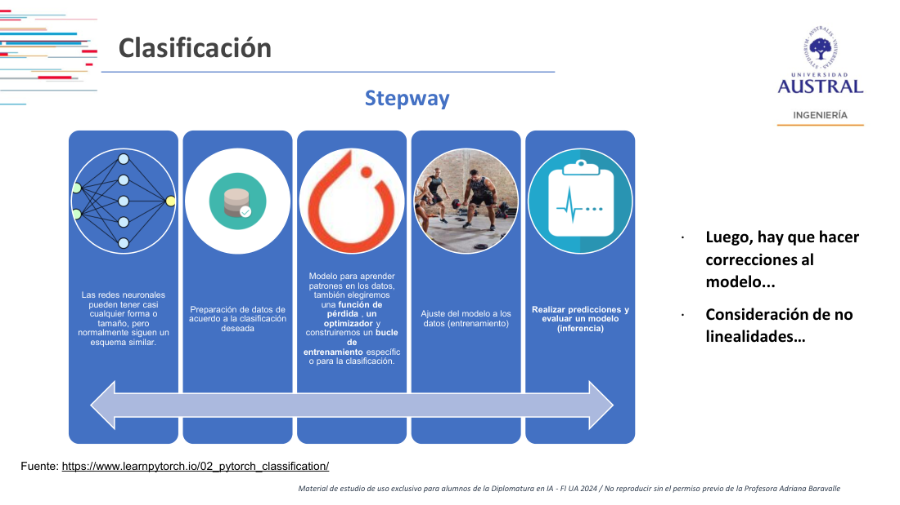
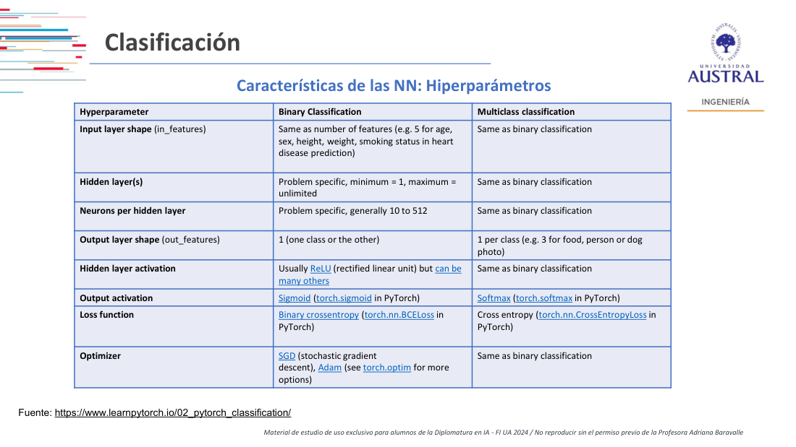
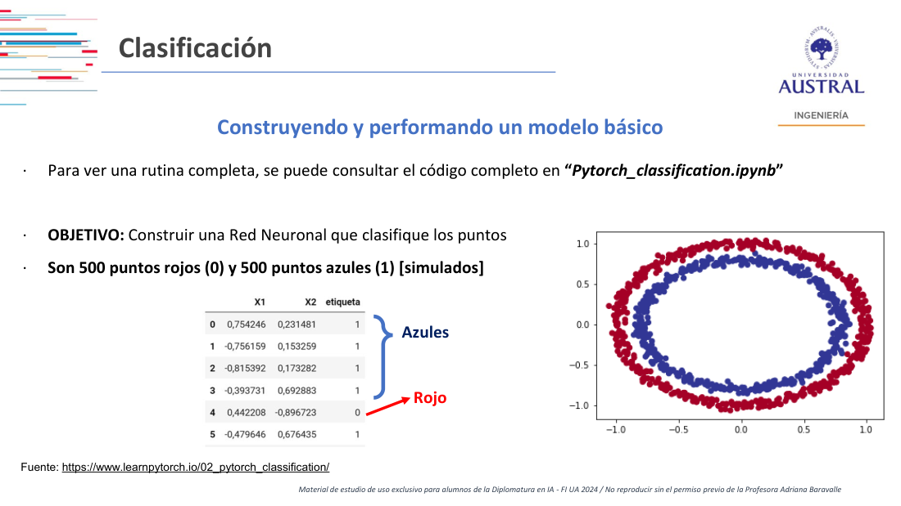
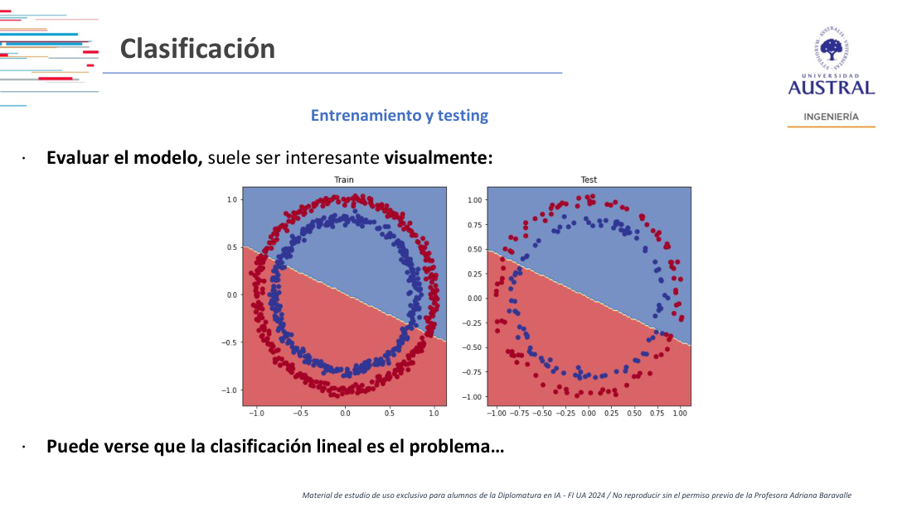
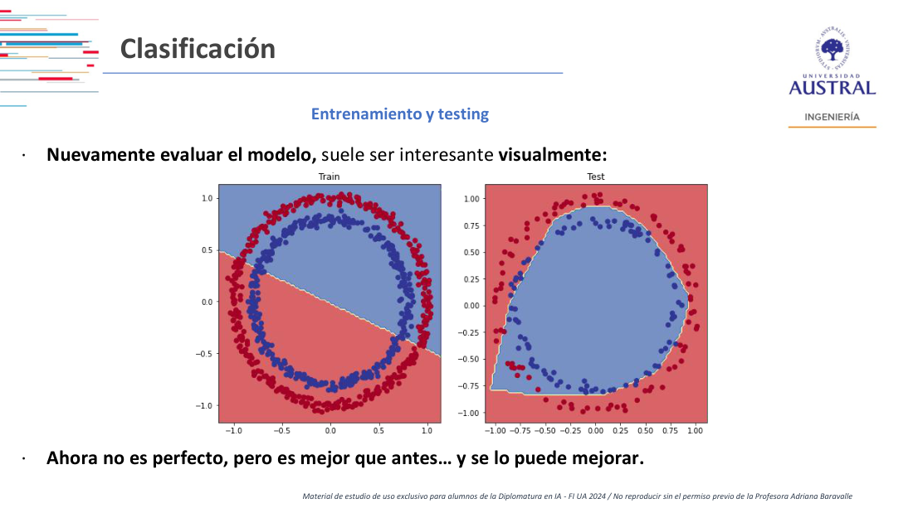
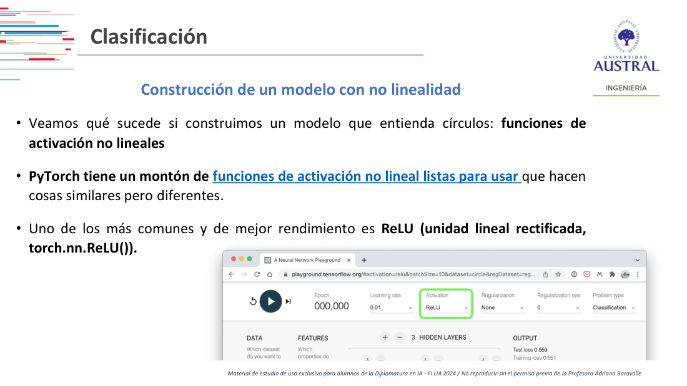

# Clase 16 · Clasificación con redes en PyTorch y puntos clave (SIFT)

> **Módulo 3 · Visión Artificial** · Martín Masci · jueves 28-may-2026
> **Fuentes:** transcripción `DIA_Clase_16.vtt` · láminas `2026_may_jun_Computer_Vision_DipAI_Clase_2.pdf` ("Clasificación", basadas en learnpytorch.io) · notebook `Pytorch_classification.ipynb` (mencionado en las láminas y mostrado en clase) · paper de Lowe (2004), *Distinctive Image Features from Scale-Invariant Keypoints*, solo en lo comentado en clase

## En pocas palabras

- Un sistema de visión artificial es un **pipeline**: adquisición, preprocesamiento, segmentación, extracción de características y clasificación. Hasta la segmentación el input sigue siendo una imagen; de la extracción de *features* en adelante el sistema lee datos y produce datos. El diseño se piensa de atrás para adelante: primero para qué, después cómo se arma el dataset.
- Las **transformaciones geométricas** (escalado, afín, general) tienen dos usos distintos: confundir a la red para que no memorice (*data augmentation*) y, al revés, encontrar los mismos **puntos clave** (*key points*) en versiones transformadas de una imagen para poder relacionarlas. Esto último es lo que resuelve **SIFT**.
- Hay tres tipos de clasificación: **binaria** (es o no es), **multiclase** (un subconjunto de clases posibles, como una multinomial frente a una binomial) y **de múltiples etiquetas** (más de una etiqueta sobre el mismo objeto, como "cuchillo" y "no peligroso").
- El ejemplo de PyTorch de los dos círculos muestra que una red con capas solo lineales no puede separar datos no lineales: queda en ~50 % de accuracy, como tirar una moneda. Agregar **funciones de activación no lineales** cambia el resultado.
- Los **hiperparámetros** son el lugar donde buscar cuando algo se rompe. El profesor pone en primer plano la **función de pérdida**: el accuracy viene después y solo tiene sentido si lo demás está bien.

## Conceptos clave

### Procesamiento, análisis y reconocimiento de patrones (repaso)

El profesor retomó las tres distinciones de la Clase 15 y pidió manejarlas "lo más taxativamente posible", aunque en la práctica los workflows las mezclen:

| Etapa | Input → Output | Ejemplo |
|---|---|---|
| Procesamiento de imagen | imagen → imagen | binarizar: objeto en blanco, resto en negro |
| Análisis de imagen | imagen → características | extraer intensidad de color o cantidad de puntitos |
| Reconocimiento de patrones | datos → datos (conclusión) | clasificar una pera como premium, exportable o no exportable |

El reconocimiento de patrones es "el núcleo duro" de la visión artificial: es lo primero que alguien del área asocia con *computer vision*.

### El pipeline y dónde está el trabajo

Cada bloque del pipeline (adquisición, preprocesamiento, segmentación, extracción de características, clasificación) tiene su propio cuerpo teórico. Según el profesor, lo que distingue a quien estudió visión artificial de quien "se da maña y baja un código" es conocer bien cada bloque. La mayoría de los códigos disponibles resuelven solo un pedazo del flujo.

- **Data collection:** la primera decisión divide el mundo en dos, **tiempo real** u **offline/batch**.
- **Storage:** las imágenes no son datos que entren naturalmente en un *warehouse* tradicional, y conviene hablarlo con quienes manejan los datos.
- **Preprocesamiento y segmentación:** limpiar el ruido "innecesario" de la imagen, aplicar transformaciones y quedarse con lo que interesa. En color, el mismo tratamiento se hace sobre las tres capas RGB: no complica el análisis, solo agranda las matrices (por ejemplo, un *kernel* por capa en la parte convolucional).
- **Extracción de características y clasificación:** es la parte numérica "tradicional", la que se trabaja con un área de datos.

### Dos usos de las transformaciones geométricas

1. **Data augmentation.** Con un dataset cerrado, el riesgo de *overfitting* es muy alto: las redes actuales pueden memorizarlo y fallar con la próxima foto. Rotar, cambiar colores o recortar genera imágenes que la red "cree distintas", y así tiene que aprender en vez de memorizar.
2. **Encontrar puntos clave.** Acá el objetivo es el contrario: no confundir a la computadora, sino que, dado un punto (un píxel, por ejemplo "la nariz de la señora"), lo pueda volver a ubicar en cualquier versión transformada de la imagen:
   - **escalado** (se mantienen las proporciones),
   - **afín** (las paralelas siguen paralelas, pero los ángulos ya no son rectos),
   - **general** (solo se garantiza que las líneas sigan siendo líneas).

Para una persona esto es obvio (cualquiera que armó un rompecabezas lo hace); para una computadora es un desafío. Relacionar puntos entre vistas lleva a la **geometría epipolar** y, dentro de ella, a la **geometría trifocal**: conectar la misma escena vista en tres planos por proyecciones. Según el profesor, el álgebra detrás es lineal y simple; lo importante es establecer coordenadas e intersecciones de planos para ubicar los mismos píxeles en distintas vistas.

**Advertencia:** cuantos más puntos clave se intentan conectar (la nariz, los dedos, la cara del nene…), más probable es cometer errores de emparejamiento. La visión artificial no es perfecta.

### 3D → 2D y 2D → 3D

- **3D → 2D:** el caso tradicional. Se toma una foto del mundo y se trabaja sobre ella.
- **2D → 3D:** reconstruir una escena tridimensional a partir de fotos. Tiene usos industriales (por ejemplo, en odontología, para implantes y correcciones que terminan en impresión 3D). En visión artificial su uso principal es interno: mejorar el dataset y la calibración del entrenamiento (análisis multivista, opcional en el esquema).

Todo esto requiere **conocimiento de base** del dominio. Sin él, "va a ser agua".

### SIFT: transformación de características invariante a la escala

**SIFT** (*Scale-Invariant Feature Transform*), de David Lowe, detecta puntos clave en una imagen, cada uno con una **orientación** (un vector), se queda con los más relevantes y los **empareja** con los de otra imagen. El paper que acompaña la clase lo resume así: las características son invariantes a la escala y a la rotación, y permiten un emparejamiento robusto ante distorsión afín, cambio de punto de vista 3D, ruido y cambios de iluminación.

Qué permite, según lo mostrado en clase:

- **Rectificar una vista inclinada.** Con puntos clave ubicados sobre un objeto visto en perspectiva, se aplica una transformación para verlo "de frente". La imagen queda algo deformada, pero la posición se recupera, y eso mejora la precisión del reconocimiento.
- **Unir dos fotos de la misma escena** tomadas desde perspectivas distintas (los mismos edificios y árboles, con luces diferentes) para armar una imagen panorámica.
- **Encontrar el mismo objeto visto desde distintos lados** o en una imagen girada.
- **Reconocer individuos:** en un dataset de vacas, emparejar imágenes por la forma de las manchas.

El algoritmo es muy preciso, aunque algunos emparejamientos fallan. Según el profesor, de esta familia de algoritmos SIFT es el mejor y se va a usar en la Clase 17.

**Por qué importa frente a una clasificación común:** un clasificador de gatos dice "es gato" o "no es gato", pero no identifica a *ese* gato. Para reconocer a un animal concreto en cualquier contexto hay que trabajar a nivel de sus píxeles (sus manchas), y eso es lo que aporta un algoritmo invariante a la escala. Es una técnica de preprocesamiento.

> Dato a revisar: en clase el profesor ubicó el paper original "en el 99" y mencionó una versión más nueva "de alrededor de 2006". El paper entregado está fechado en enero de 2004 (*International Journal of Computer Vision*).

### Tipos de clasificación

- **Binaria:** existe o no existe ("busco perros; todo lo demás es ruido"). La computadora devuelve un dataset del tipo "imagen 1 tiene perro, imagen 2 no". Es muy básica, pero también muy usada.
- **Multiclase:** el espacio muestral son todas las clases definidas; la salida es un subconjunto (incluido el vacío). Es la descomposición de una multinomial en binomiales.
- **Múltiples etiquetas:** se asigna más de una etiqueta al mismo objeto, combinando dos niveles. En el ejemplo de rayos X, una llave no es peligrosa, y un cuchillo corto puede estar permitido: el resultado es "cuchillo, no peligroso". Es la más complicada.

El profesor relativizó las imágenes llamativas con cajas que dicen "persona" o "perro": son *show-off*. Lo que interesa es el dato que sale; la visualización sirve para hacer un *testing* rápido sobre algunas imágenes al azar.

### Redes convolucionales y preentrenadas

En una CNN, la parte de *feature learning* no conviene reinventarla: hoy se suele partir de una red **preentrenada** (VGG-16, VGG-19, AlexNet, DenseNet, GoogleNet, Inception, ResNet-50). El profesor declaró su preferencia por ResNet: "cuando falla, prefiero cambiar el problema y no la red". Sobre esa base se agregan capas para la tarea (en principio, clasificación).

Usó dos metáforas: las piezas se combinan como un **Lego (o Rasti)**, y la red se construye como un **hojaldre**, donde la misma técnica de plegado da productos muy distintos. Cuanto mejor se gobierna el proceso, más fácil es entender dónde se rompe algo. Con un enlatado, en cambio, "entra pollo, sale pollo" y no se sabe qué pasó en el medio.

Entrenamiento: se repasaron el descenso por gradiente y la retropropagación como "dos caras de la misma moneda": uno busca los parámetros y el otro hace uso de ellos.

### El "stepway" de clasificación en PyTorch

1. Preparar los datos según la clasificación deseada.
2. Construir el modelo, elegir una **función de pérdida** y un **optimizador**, y armar el **bucle de entrenamiento**.
3. Ajustar el modelo a los datos (entrenamiento).
4. Predecir y evaluar (inferencia).
5. Corregir el modelo, considerando las no linealidades.

Pasos de modelización según las láminas: código agnóstico al dispositivo (CPU o GPU), un modelo que hereda de `nn.Module`, función de pérdida y optimizador, y el *training loop*.

**Bucle de entrenamiento en PyTorch:**

| Paso | Qué hace | Código |
|---|---|---|
| Forward pass | el modelo procesa los datos de entrenamiento | `model(x_train)` |
| Calcular la pérdida | compara la predicción con la verdad | `loss = loss_fn(y_pred, y_train)` |
| Poner gradientes en cero | se acumulan por defecto | `optimizer.zero_grad()` |
| Backpropagation | gradiente de la pérdida respecto de cada parámetro | `loss.backward()` |
| Paso del optimizador | actualiza los parámetros | `optimizer.step()` |

### Hiperparámetros

| Hiperparámetro | Binaria | Multiclase |
|---|---|---|
| Forma de la capa de entrada | cantidad de *features* | igual |
| Capas ocultas | según el problema, mínimo 1 | igual |
| Neuronas por capa oculta | en general entre 10 y 512 | igual |
| Forma de la salida | 1 | 1 por clase |
| Activación de capas ocultas | en general ReLU | igual |
| Activación de salida | sigmoide (`torch.sigmoid`) | softmax (`torch.softmax`) |
| Función de pérdida | entropía cruzada binaria (`nn.BCELoss`) | entropía cruzada (`nn.CrossEntropyLoss`) |
| Optimizador | SGD o Adam | igual |

Para el profesor, esta tabla es "sagrada" (bromeó con tatuársela): cuando algo falla, el problema se busca ahí. Los hiperparámetros son la **sintonía fina** (*fine tuning*).

Funciones de pérdida según las láminas: entropía cruzada binaria para clasificación binaria (`BCEWithLogitsLoss` o `BCELoss`), entropía cruzada para multiclase, MAE/L1 y MSE/L2 para regresión. La pérdida mide qué tan equivocadas están las predicciones: cuanto más alta, peor el modelo.

Preferencias del profesor:

- **Activación:** ReLU es rápida y converge antes, pero es lineal por partes. Él prefiere la sigmoide.
- **Pérdida:** para binaria recomienda entropía cruzada. La versión *with logits* (que incluye la función logística) es la que más usa; `BCELoss`, menos.
- **Optimizador:** Adam le funciona "de pelos" en casi todo. Con SGD dice no haber tenido buenos resultados. Metáfora: si la función de activación es la manguera, el optimizador es lo que se pone en la punta para regular la presión.

### Pérdida antes que accuracy

Si la red está bien armada y balanceada, la pérdida baja cuando el accuracy sube: están "espejadas". Si no está bien balanceada, o si las capas no siguen una lógica de propagación coherente (por ejemplo, con el *learning rate*), esa compensación puede no darse, y el problema está en la pérdida, no en el accuracy. Por eso recomienda ser "muy denso" ajustando la función de pérdida, y mirar el accuracy después. Según el profesor, muchos problemas se resuelven tocando solo eso.

### Mejorar el modelo

Opciones que listan las láminas: más capas (red más profunda), más unidades ocultas (más ancha), entrenar más épocas, cambiar la activación (no lineal), cambiar el *learning rate* (si es muy alto sobrecorrige, si es muy bajo no aprende), cambiar la función de pérdida (la binaria no sirve para multiclase) y **transfer learning**.

Estrategia práctica: correr pocas épocas, mirar la curva y decidir si converge. Si no, tocar **un hiperparámetro por vez** sin romper el resto. Si con pocas épocas la pérdida y el accuracy ya se estabilizan, poner muchas más no cambia nada.

## Ejemplos y casos de la clase

- **La pera:** la imagen se procesa y se analiza (intensidad de color, cantidad de puntitos o "pecas"), y una tabla de estándares la clasifica en calidades (premium, exportable, no exportable). Las empacadoras ya lo traen resuelto, pero el caso sirve para entender y extrapolar ("mutatis mutandis").
- **Rayos X en aeropuertos:** la geometría trifocal relaciona tomas de la misma valija desde varias cámaras mientras avanza por la cinta. Un arma se reconoce desde casi cualquier ángulo, pero una navaja o una maquinita de afeitar, vistas de costado, pueden parecer una goma o un palito. Los rayos X tienen una ventaja: vienen en escala de grises, lo sólido se ve oscuro y lo permeable claro (de un sacapuntas solo se ven el tornillo y el filo). La motivación es humana: mirar esas pantallas es aburridísimo y se escapan detalles. Un alumno preguntó si se podría detectar un arma a partir de piezas sueltas. El profesor respondió que eso ya es otro problema (qué hacer con los datos, no extraer *features*), y que si se entrena solo con pistolas semiautomáticas, un revólver puede pasar.
- **Falsos negativos según el contexto:** errar con una pera se resuelve pidiendo disculpas al comprador; errar en un aeropuerto es delicado. Siempre va a haber errores, así que hay que pensar para qué y cómo.
- **Chihuahua o muffin** (y otras parejas parecidas, como caniches o pollo frito): si a una persona le cuesta, la computadora también puede fallar. Combinar técnicas reduce el error "siempre y cuando no divague". Si no se entiende por qué un modelo acierta, después no se lo puede mejorar.
- **Patentes en una estación de servicio:** detectar cuándo entra un auto, tomar varios *frames*, ubicar la patente, recortarla y leerla con OCR para cargarla en una base de datos. Hizo falta un especialista en patentes (en Argentina conviven formatos viejos y nuevos), decidir entre tiempo real o batch por la mala conectividad, y prever riesgos operativos (el playero que desenchufaba el módem para cargar el celular). A diferencia de un cinemómetro, que ya trae todo embebido, acá se reutilizaba una cámara de vigilancia para no duplicar costos.
- **Panorámica y vacas (SIFT):** dos fotos de la misma calle desde perspectivas distintas, emparejadas por puntos clave, y un dataset de vacas emparejado por la forma de las manchas.

## Práctica

**Notebook `Pytorch_classification.ipynb`** (adaptado de learnpytorch.io, sección 02). Objetivo: clasificar 1000 puntos simulados en dos círculos concéntricos, 500 rojos (clase 0) y 500 azules (clase 1). El profesor aclaró que el código no es suyo y que lo usa como "excusa" para conectar el *machine learning* con la visión artificial: en el fondo, después van a ser píxeles agrupados.

1. Se generan los datos, se pasan a tensores y se separa train/test 80/20 con una función de sklearn.
2. Modelo: dos capas `nn.Linear`. `layer_1` toma 2 *features* y produce 5 (5 neuronas ocultas), y `layer_2` devuelve 1 salida. El 5 es un hiperparámetro: no hay un valor por defecto.
3. Resultado: el accuracy queda apenas por encima del 50 %, con una pérdida de alrededor de 0,69. Con clases balanceadas, eso equivale a adivinar al azar. En clase el profesor mencionó 90 épocas y un accuracy de 51 %; las láminas hablan de 100 épocas.

4. Agregar una capa, subir a 10 unidades ocultas y entrenar 1000 épocas **no alcanza**: la frontera sigue siendo una recta.
5. Agregar **activaciones no lineales** (ReLU, `torch.nn.ReLU()`) sí cambia la frontera. No es perfecta, pero es mucho mejor.

Desafío para la próxima clase: tocar los hiperparámetros (activación, pérdida, optimizador, capas) para que la frontera quede "más redondita". También se puede comparar con **TensorFlow Playground** (dataset *circle*), que ya habían usado en la otra materia.

**PyTorch frente a TensorFlow:** son los dos grandes competidores y hacen lo mismo por dentro. Según el profesor, TensorFlow se dedicó más al *show-off* y el trabajo duro de visión artificial va más por PyTorch.

**Entorno de cómputo:**

- La visión artificial corre mejor con GPU **NVIDIA**, porque PyTorch usa **CUDA**. Con una placa ATI, al profesor no le funcionó. Además, recomienda Linux (Ubuntu) por sobre Windows.
- En Colab se elige GPU (T4) en "Cambiar tipo de entorno". La versión gratuita corta la sesión tras dos o tres horas de uso intenso; la paga dura más (el profesor mencionó entre 10 y 12 horas).
- Guardar **checkpoints** en el Drive mientras se procesan muchas imágenes, para poder retomar si se cae el backend.
- Guardar el **modelo entrenado** (los pesos) y no volver a entrenarlo.

## Para recordar

- Pensar el pipeline de atrás para adelante: "para qué quiero esto" define cómo se arma el dataset.
- La mayoría de los códigos que circulan resuelven un pedazo del pipeline, no todo.
- *Data augmentation* busca confundir a la red para que no memorice; los puntos clave buscan lo contrario, que la computadora reconozca lo mismo en versiones transformadas.
- Elegir un tema de trabajo en el que haya conocimiento de dominio ("llevar agua para su molino"), y no hacer "inducción hacia atrás" a partir de un dataset que parece fascinante.
- "Cuando falla, prefiero cambiar el problema y no la red" (sobre ResNet).
- Si algo se rompe, buscar en los hiperparámetros, y primero en la función de pérdida. El accuracy viene después.
- Un 50 % de accuracy en un problema binario balanceado es tirar una moneda.
- Correr pocas épocas, mirar la curva y tocar un hiperparámetro por vez.
- Combinar técnicas reduce el error, pero si no se entiende por qué un modelo acierta, después no se lo puede mejorar.

## Preguntas de repaso

1. ¿En qué se diferencian procesamiento de imagen, análisis de imagen y reconocimiento de patrones?

En el tipo de input y output. El procesamiento transforma una imagen en otra (por ejemplo, la binariza); el análisis extrae características de la imagen; el reconocimiento de patrones toma esos datos y produce una conclusión (por ejemplo, la calidad de una pera).

2. Rotar una imagen sirve tanto para data augmentation como para trabajar con puntos clave. ¿Qué busca cada uso?

En *data augmentation*, rotar o recortar genera variantes para que la red no memorice un dataset cerrado y así evitar el overfitting. Con puntos clave, la transformación se usa para verificar que el algoritmo vuelva a encontrar el mismo píxel (la "nariz de la señora") en la imagen transformada, es decir, para relacionar vistas de la misma cosa.

3. ¿Por qué un clasificador de gatos no alcanza para saber si entró el mismo gato de siempre a una veterinaria, y qué aporta SIFT?

Porque responde "es gato" o "no es gato", pero no identifica al individuo. Para eso hay que reconocer patrones propios de ese animal (sus manchas) en cualquier escala, rotación o perspectiva. SIFT detecta puntos clave invariantes a escala y rotación y los empareja entre imágenes, como en el ejemplo de las vacas.

4. ¿Qué diferencia hay entre clasificación multiclase y de múltiples etiquetas? Dé el ejemplo de clase.

En la multiclase, la salida es el subconjunto de clases presentes, cada una decidida de forma binaria. En la de múltiples etiquetas, el mismo objeto recibe más de una etiqueta que combina dos niveles: en rayos X, un objeto es "cuchillo" y además "no peligroso", según su tamaño y su contexto.

5. El modelo de los dos círculos llega a ~50 % de accuracy. ¿Por qué no mejora agregando una capa, más neuronas y 1000 épocas?

Porque todas sus capas son lineales, y una composición de capas lineales sigue trazando una frontera recta, que no puede separar círculos concéntricos. Hacen falta activaciones no lineales (como ReLU) entre las capas.

6. ¿Qué activación de salida y qué pérdida corresponden a una clasificación binaria y cuáles a una multiclase?

En la binaria, una salida con sigmoide y entropía cruzada binaria (`BCELoss` o `BCEWithLogitsLoss`). En la multiclase, una salida por clase con softmax y entropía cruzada (`CrossEntropyLoss`). Usar la binaria en un problema multiclase no funciona.

7. ¿Por qué el profesor pone la función de pérdida antes que el accuracy al diagnosticar un modelo?

Porque en una red bien armada y balanceada las dos se mueven en espejo (la pérdida baja cuando el accuracy sube). Si eso no ocurre, el problema suele estar en la pérdida o en cómo se propaga el aprendizaje, no en el accuracy. El accuracy solo es confiable cuando todo lo demás está bien.

8. ¿Qué precauciones prácticas hay que tomar al entrenar con imágenes en Colab o localmente?

Usar GPU (NVIDIA/CUDA en local; T4 en Colab), guardar checkpoints periódicos en la nube por si se cae el backend en medio de un bucle largo y guardar el modelo entrenado para no tener que volver a entrenarlo.

## Conexiones

- **Clase 15:** pipeline de visión artificial, distinción procesamiento/análisis/reconocimiento y transformaciones geométricas. Esta clase los retoma y los lleva a puntos clave y clasificación.
- **Clase 17:** el profesor anunció para el martes un dataset de detección de objetos "no tan obvia", trabajo en subgrupos, el uso de SIFT y la comparación entre una CNN sin manipular la imagen y una con *data augmentation* para evitar el overfitting.
- **Módulo 2 (deep learning):** retropropagación, descenso por gradiente, redes convolucionales, transfer learning y TensorFlow Playground se dan por vistos y acá se aplican con PyTorch.
- **OCR (más adelante en el módulo):** el caso de las patentes termina en un lector OCR, que el profesor anunció para una clase posterior.
- **TFI:** la conexión es solo conceptual. SIFT reconoce un objeto emparejando descriptores de puntos clave con los de otra imagen o una base, una lógica de búsqueda por similitud parecida a la del retrieval semántico. En clase no se habló de métricas de recuperación.
