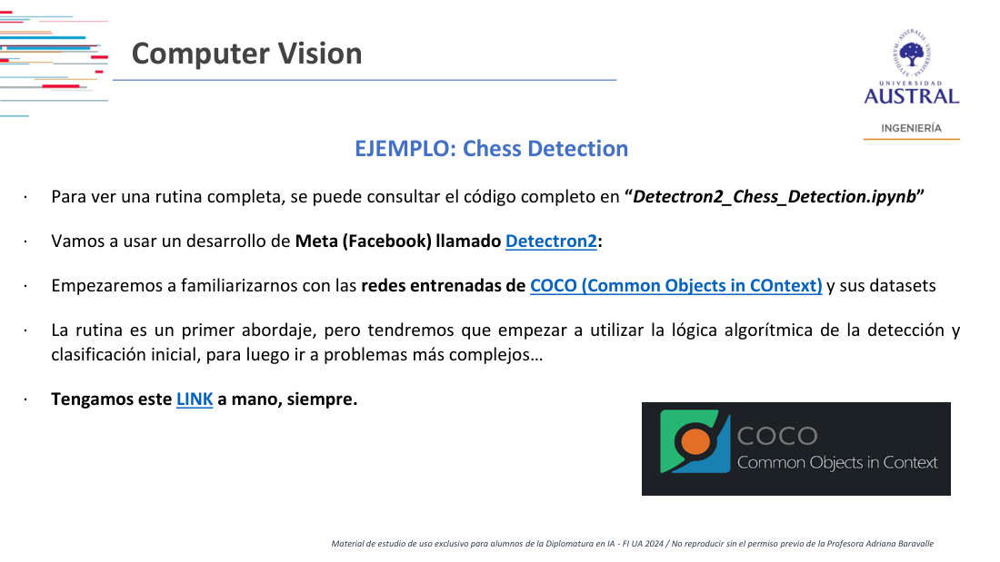
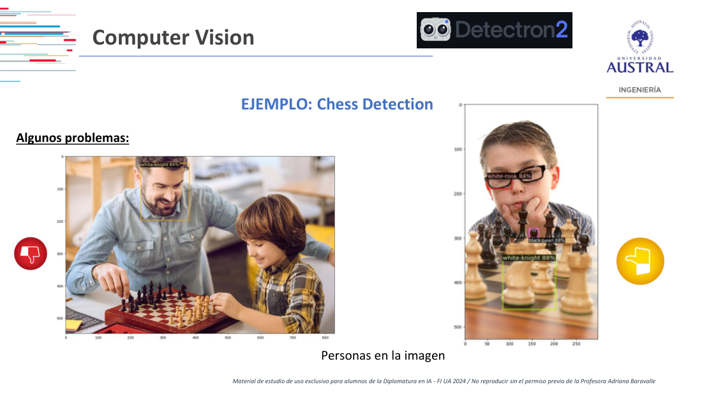
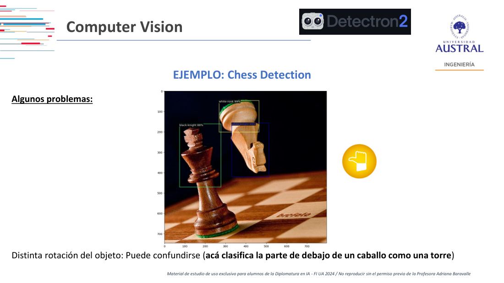
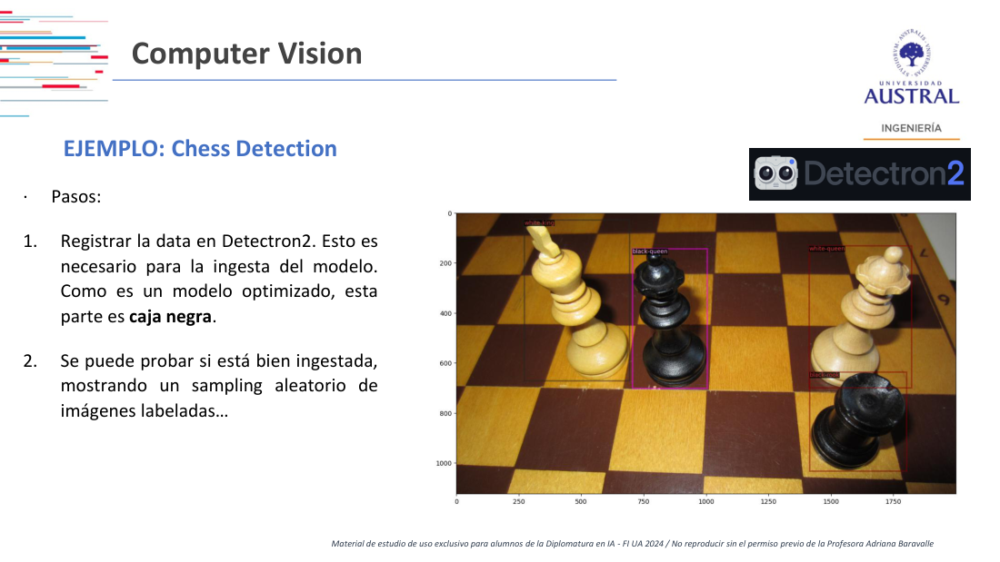
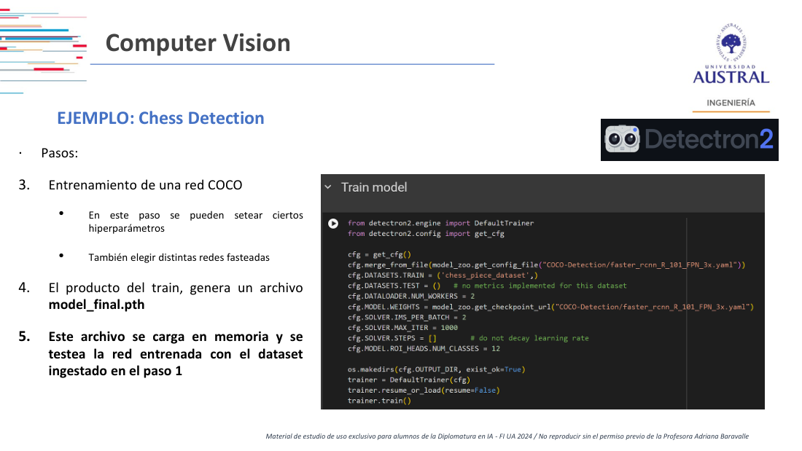

# Clase 17 · Clasificación múltiple y detección de objetos con Detectron2

> **Módulo 3 · Visión Artificial** · Martín Masci · martes 02-jun-2026
> **Fuentes:** transcripción `DIA_Clase_17.vtt` · láminas `2026_may_jun_Computer_Vision_DipAI_Clase_3.pdf` · notebook `Detectron2_Chess_Detection.ipynb` (mostrado en clase, no incluido en las fuentes)

## En pocas palabras

- La **clasificación binaria** dice si algo está o no en la imagen, pero no dónde. La **clasificación múltiple con detección** recorre la imagen, encierra cada objeto en un rectángulo (*bounding box*), le pone una etiqueta y un porcentaje de confianza.
- Para reconocer clases y subclases (perro → caniche) hay dos caminos: una sola red con todas las combinaciones como clases, o **dos etapas** (primero la clase general, después una red especializada por clase). Una red muy grande y "enlatada" rinde en un entorno cerrado, pero tiende a sobreajustar y obliga a reentrenar todo para agregar una clase.
- Ninguna arquitectura funciona sin un **dataset etiquetado a mano** (imágenes + metadata con cajas y clases). La aumentación geométrica se automatiza; el etiquetado de objetos en contexto no. Por eso existen recursos como **COCO** y redes preentrenadas sobre COCO.
- **Detectron2** (Meta) es una librería de detección, segmentación y pose. En clase se hizo *fine-tuning* de una Faster R-CNN preentrenada en COCO con un dataset de Kaggle de ~80 fotos de piezas de ajedrez (12 clases).
- Dentro del dataset el modelo acierta más del 90 %, pero con fotos externas falla: personas en la imagen, piezas solapadas o cortadas, juegos de piezas distintos, iluminación y colores. Según la experiencia del profesor, Detectron2 tolera bien la rotación, pero no los cambios de calidad, color o saturación.

## Conceptos clave

### De la clasificación binaria a la clasificación múltiple con detección

En la clasificación binaria (el ejemplo perros vs. gatos de clases anteriores) el modelo responde "hay un perro" o "no hay un perro". No dice dónde.

La clasificación múltiple con detección agrega capas de dificultad:

1. Recorrer toda la imagen y encontrar los puntos que le "llaman la atención".
2. Encerrar cada objeto en un rectángulo. La salida son cuatro números en píxeles: esquina superior izquierda y esquina inferior derecha.
3. Etiquetar el rectángulo con una clase y un porcentaje (por ejemplo, "dog 89 %").
4. Opcionalmente, agregar una segunda etiqueta: la subclase (la raza del perro, el color de la pieza).

La salida visible es la foto con los rectángulos dibujados. Detrás hay **metadata** con la clase, la caja y la confianza de cada detección.

Las láminas arrancan con un ejemplo de juguete en PyTorch: datos sintéticos multiclase con `make_blobs()` de Scikit-Learn, un `nn.Module` con `input_features`, `output_features` (= número de clases) y `hidden_units`, pérdida `nn.CrossEntropyLoss()` y SGD con tasa de aprendizaje 0,1. Advierten que si el modelo predice menos clases de las esperadas, el problema puede estar en la activación de salida (softmax). Ese tramo no se desarrolló en la grabación.

### ¿Cómo aprende clases y subclases? Una red o dos etapas

El profesor planteó el problema como pregunta abierta: si quiero "perro" y además "caniche", ¿cómo se entrena?

| Enfoque | Cómo funciona | A favor | En contra |
|---|---|---|---|
| **Una red con todas las combinaciones** | Cada par clase-subclase es una clase. Perros con 10 razas y gatos con 10 razas son 20 clases. | Más liviana si no son tantas clases. | No "entiende" primero perro y después raza; es una sola etiqueta. |
| **Una red muy profunda que lo resuelve internamente** | Se apoya en que las capas convolucionales van de patrones simples (líneas, bordes) a formas complejas. | Rinde muy bien en un entorno cerrado y controlado. | Muy sensible al entorno de entrenamiento; cerca del sobreajuste; para agregar una clase hay que desarmar y reentrenar todo. |
| **Dos etapas en secuencia** | Una primera red hace una clasificación básica (perros, roperos, sillas). Según la clase detectada, un `if` deriva a una segunda red entrenada solo con las subclases de esa clase. | Modular: se puede agregar o cambiar una parte sin tocar el resto. | Más piezas para mantener. |

Cuál rinde mejor depende del caso y de la dificultad algorítmica; no hay una respuesta única. El criterio del profesor:

- Si el sistema va a vivir en un entorno fijo (la cámara de seguridad de tu casa), una red muy densa entrenada con fotos de ese entorno, de día, de tarde, de noche, en distintas estaciones, puede funcionar muy bien.
- Si la misma red se usa con otra cámara u otras condiciones, es probable que falle, porque quedó demasiado ajustada a su entorno.
- Cuanto más "enlatado" está el modelo, más difícil es agregarle una clase nueva ("ahora quiero conejo también").

### El dataset: imágenes más metadata etiquetada a mano

Para entrenar cualquiera de estas arquitecturas hace falta una base de entrenamiento con:

- **Imágenes** (en el ejemplo de clase, JPG numerados).
- **Metadata** de cada imagen: qué objetos hay, de qué clase y dónde está cada caja. Hoy suele venir compilada en un JSON; en el dataset de ajedrez son anotaciones **XML**, generadas con la herramienta **LabelImg**.

El gran costo es el **etiquetado manual**. Hay herramientas para hacerlo, como **Label Studio**, pero no lo automatizan: si existiera un software que etiquetara solo, no haría falta entrenar la red.

Diferencia importante con la clase anterior:

- La **aumentación de datos** por transformaciones geométricas o de color (rotar, escalar, pasar a escala de grises) es **automatizable** y sirve sobre todo para clasificación binaria.
- Descubrir **objetos en contexto** y sus clases **no** es automatizable: alguien tiene que marcar las cajas.

### COCO y las redes preentrenadas

**COCO** (*Common Objects in Context*) es un conjunto de datasets con su metadata, en el que mucha gente etiquetó objetos comunes y no tan comunes en distintos contextos. Es la base sobre la que se entrenan muchas redes de detección.

Recordando la arquitectura convolucional de clases anteriores: el bloque de extracción de características se puede reemplazar por una **red preentrenada** (ResNet-50, ResNet-34, VGG), y las **capas densas finales se entrenan con el dataset propio**. La red preentrenada "ya sabe reconocer cosas", lo que ahorra tiempo de entrenamiento y GPU, pero no reconoce tu objeto en particular hasta que la ajustás con tus datos.

El profesor llama **redes "fasteadas"** (en las láminas, *FastNets*) a las redes de detección preentrenadas sobre COCO con clases ya incorporadas, como la familia Faster R-CNN. Están optimizadas para buscar cierto tipo de objetos y tratan el resto como ruido. No son perfectas, pero son lo que más se usa en la industria. Su principal dificultad, según las láminas, es que **no es sencillo ajustar los hiperparámetros**.

### Detectron2



**Detectron2** es una librería desarrollada por Meta (Facebook), con mantenimiento activo. Con su red preentrenada, casi sin código, recibe una foto y devuelve varias cosas a la vez:

- **Detección**: cajas con etiqueta y confianza.
- **Segmentación**: los objetos pintados por región.
- **Postura corporal**: el "monigote", un esqueleto de puntos clave que indica hacia dónde mira la persona y cómo están los brazos. Según el profesor, es el puente entre 2D y 3D, y se va a retomar en la parte de rostros.

Para entrenar con clases propias se usa el **Model Zoo** (*baselines*) de Detectron2. Ahí aparecen las distintas combinaciones de arquitecturas, que funcionan como hiperparámetros (de nuevo, con mucha presencia de la familia ResNet), junto con sus métricas de entrenamiento.

Instalar Detectron2 en forma local puede traer problemas con la GPU dedicada. Por eso en clase se usó Colab.

### Supervisado vs. no supervisado en clasificación multiclase

Un alumno preguntó si se podría evitar el etiquetado con un enfoque no supervisado que "descubra" solo que hay 12 tipos de pieza. El profesor dijo que nunca lo vio aplicado y que, partiendo de cero, su intuición es que siempre hace falta supervisión: la red aprende que algo es un "perro" porque alguien etiquetó 100 imágenes con esa palabra. Con una red preentrenada como Detectron2 parte del trabajo ya está hecho, pero igual hay que pasar por el dataset propio para que aprenda las clases nuevas. Quedó en investigarlo.

### ¿Hace falta una clase "no es pieza"?

No. En clasificación múltiple con detección el modelo busca solo las clases definidas; lo demás no se marca. Los riesgos son dos:

- **Falsos negativos**: hay una pieza y no la detecta, sobre todo en fotos complejas con muchos objetos.
- **Falsos positivos**: algo que se parece a una pieza se marca como pieza, igual que cuando uno confunde a un desconocido con un primo en una foto.

Tampoco el tablero es una clase en este modelo, aunque se podría agregar.

## Ejemplos y casos de la clase

**Chess detection (Kaggle).** Es el ejemplo central. Se eligió porque se parece al problema perro/raza: hay 6 tipos de pieza (rey, dama, torre, alfil, caballo, peón) y 2 colores. La pregunta de diseño es la misma: ¿12 clases, o primero la pieza y después el color? El notebook usa 12 clases. Importa notar que, así definidas, son 12 etiquetas distintas: **el modelo no "reconoce el color"**, aprende 12 objetos diferentes.

Preguntas que surgieron en la discusión:

- **Cantidad por clase**: hay 16 peones y solo 2 reyes, así que algunas clases tienen muchos más ejemplos que otras.
- **Contexto**: no es lo mismo una foto real que un tablero 2D tipo chess.com, donde todo es digital y no hay nada que descubrir.
- **Perspectiva**: desde arriba, una torre, un rey y una dama se distinguen por la corona o la cruz. De la mitad para abajo, todas las piezas son casi iguales.
- **Evolutivo**: si la detección funciona bien, se puede seguir la partida foto a foto o en video, descontar piezas comidas y sugerir jugadas. Eso ya es procesamiento algorítmico sobre los datos detectados ("data contra data"), no visión. El profesor lo ubicó en la línea de Deep Blue y AlphaGo, aunque aclaró que no cree que la IA haya nacido de la partida de Kasparov de 1997.

**Kaggle.** Plataforma de competencias y desafíos con premios, con datasets y código de las soluciones ganadoras accesibles con un registro gratuito. Sirve como fuente de datasets y de código para reproducir.

**Estación de servicio y patentes.** Anécdota de un trabajo del profesor: en ciertos momentos del día el sol le pegaba de lleno a la cámara y no se podía extraer la imagen de la patente. Muestra lo sensibles que son estos modelos a las condiciones de captura.

**Errores con fotos externas.** El profesor probó el modelo entrenado con imágenes buscadas en Internet:



- **Personas en la imagen**: en una foto no detectó las piezas y marcó la cara de un hombre como "caballo blanco 84 %". En otra marcó el ojo de un chico con anteojos como "torre blanca".
- **Cajas mal ubicadas**: a veces la clase es correcta (caballo blanco 88 %) pero el *boundary* está mal; en otro caso marcó solo la cabeza de un peón.
- **Piezas solapadas o parciales**: el dataset de entrenamiento siempre muestra piezas enteras, así que con pedazos de piezas o piezas superpuestas detecta poco.
- **Confusión de clases**: tomó como alfiles piezas que no lo eran, aunque acertó los colores. Con el modelo del profesor el error tendía mucho a "caballo".
- **Juego de piezas distinto** al del entrenamiento y **problemas de iluminación**.



- **Rotación**: con un caballo caído, tomó la base (que quedó arriba) como "torre blanca 99 %", porque la base de cualquier pieza se parece a la parte superior de una torre. En la misma imagen, el rey quedó etiquetado como "caballo negro 88 %".

Las láminas resumen las causas (personas u otros objetos, calidad de imagen distinta a la del dataset, orientación no entrenada, colores e iluminación) y proponen entrenar a veces con un **dataset preprocesado** de imágenes rotadas o con colores alterados.

## Práctica

**Notebook `Detectron2_Chess_Detection.ipynb` (Colab).** Es un código de 10 a 15 *chunks* que el profesor dejó "a mitad de camino": corre, pero no con la mejor configuración. El desafío es apropiarse del código, depurarlo y mejorarlo tocando hiperparámetros.

Pasos:

1. **Instalar Detectron2** desde su repositorio. En Colab tarda varios minutos cada vez que se reconecta el entorno.
2. **Obtener el dataset**: con la API de Kaggle (usuario y API key) o, más simple para ~80 imágenes, descargarlo y escribir la ruta directamente en el código (*hardcoding*).
3. **Registrar el dataset en Detectron2** para que el modelo lo pueda ingerir (parte de "caja negra").
4. **Verificar la ingesta** visualizando una muestra aleatoria de imágenes con sus etiquetas. Todavía no corre el modelo: muestra lo que alguien marcó a mano.



5. **Entrenar** el modelo sobre la red COCO (15 a 20 minutos).



```python
cfg.merge_from_file(model_zoo.get_config_file("COCO-Detection/faster_rcnn_R_101_FPN_3x.yaml"))
cfg.MODEL.WEIGHTS = model_zoo.get_checkpoint_url("COCO-Detection/faster_rcnn_R_101_FPN_3x.yaml")
cfg.SOLVER.IMS_PER_BATCH = 2
cfg.SOLVER.MAX_ITER = 1000
cfg.MODEL.ROI_HEADS.NUM_CLASSES = 12
```

   Qué mirar:
   - Hay **dos elecciones** de red preentrenada: la configuración de la arquitectura (`merge_from_file`) y los pesos iniciales (`MODEL.WEIGHTS`). En el notebook coinciden (Faster R-CNN R-101 FPN 3x), pero no tienen por qué coincidir. El profesor propuso probar qué pasa si no coinciden.
   - `IMS_PER_BATCH` es el tamaño de batch y `MAX_ITER` la cantidad de iteraciones (el profesor las llamó "épocas").
   - `NUM_CLASSES = 12`; con 6 se detectaría solo el tipo de pieza, sin el color.
   - La salida del entrenamiento muestra la pérdida total y la tasa de aprendizaje, pero no accuracy. El profesor mencionó que un *learning rate* cercano a "2 %" es aceptable (dato dudoso, no figura en la celda).
6. **Guardar el resultado**: el entrenamiento genera `model_final.pth` (unos 500 MB). Se entrena una vez y después se carga ese archivo cambiando la ruta de `cfg.MODEL.WEIGHTS`.
7. **Probar con imágenes del dataset** elegidas al azar, sin darle la metadata: acierta por encima del 90 %, pero es "medio tautológico" porque son imágenes que ya vio.
8. **Probar con fotos fuera de la muestra** (*out-of-the-sample*) con el predictor y ver dónde falla.

Advertencia práctica: en Colab, al desconectarse el entorno se pierden la librería, el dataset descomprimido y el `.pth`. Conviene guardar el `.pth` en Drive o trabajar en local.

El profesor también recomendó el tutorial oficial de Detectron2 en Colab ("beginners tutorial", que "no es tan beginner") y la tabla del Model Zoo.

## Para recordar

- "Esto no es magia": sin un dataset etiquetado no hay detección. El etiquetado de objetos en contexto es trabajo manual.
- La red preentrenada aporta la capacidad de reconocer cosas; tu dataset le enseña **tus** clases. Las capas densas se entrenan con tus datos.
- Primero hay que entender **para qué** se quiere el modelo: un entorno cerrado admite una red muy ajustada; un uso abierto necesita generalizar.
- Cuanto más enlatado está el modelo, más cuesta agregarle una clase.
- Un 90 % de acierto sobre imágenes del propio dataset no dice mucho. La prueba real son las fotos de afuera.
- Definir "caballo blanco" y "caballo negro" como clases distintas no hace que la red entienda el color: son dos etiquetas.
- Según el profesor, Detectron2 es robusto a la rotación, pero no a la calidad de imagen, los colores o la saturación. Esto matiza la lámina, que lista la rotación entre los problemas.
- Probar varias combinaciones de hiperparámetros y redes del Model Zoo es parte del trabajo, no un detalle.

## Preguntas de repaso

<details><summary>1. ¿Qué agrega la clasificación múltiple con detección respecto de la clasificación binaria?</summary>

La binaria solo dice si una clase está o no en la imagen. La detección localiza cada objeto con una caja (cuatro coordenadas en píxeles), le asigna una clase y un porcentaje de confianza, y puede agregar una subclase. Además de la imagen anotada, devuelve la metadata de cada detección.

</details>

<details><summary>2. Si querés reconocer perro y raza, ¿qué ventajas y riesgos tiene entrenar una única red enorme frente a dos etapas en secuencia?</summary>

La red única puede rendir muy bien en un entorno fijo, pero tiende a sobreajustarse a ese entorno, falla con otras cámaras o condiciones, y para agregar una clase hay que reentrenar todo. Las dos etapas (clase general y después una red especializada por clase) son modulares y permiten cambiar una parte sin desarmar el resto, a costa de más piezas para mantener.

</details>

<details><summary>3. ¿Por qué la aumentación de datos se automatiza pero el etiquetado para detección no?</summary>

Rotar, escalar o cambiar colores son transformaciones mecánicas sobre la imagen completa. Marcar qué objetos hay, de qué clase son y dónde está cada uno requiere conocimiento del contenido. Si existiera un software que lo hiciera solo, ya resolvería el problema y no haría falta entrenar la red.

</details>

<details><summary>4. ¿Qué aporta una red preentrenada en COCO y por qué igual necesita tu dataset?</summary>

Aporta la capacidad ya aprendida de extraer características y reconocer objetos comunes, lo que ahorra tiempo y GPU. Pero no conoce tus clases específicas (las 12 piezas de ajedrez), así que hay que ajustarla (*fine-tuning*) con tus imágenes etiquetadas.

</details>

<details><summary>5. El modelo de ajedrez acierta más del 90 % sobre imágenes del dataset y falla con fotos de Internet. ¿Cómo se explica?</summary>

Las imágenes de prueba internas ya las vio en el entrenamiento, así que la evaluación es casi tautológica. El dataset es chico (~80 fotos), usa un solo juego de piezas, ángulos parecidos, piezas enteras y sin personas. Ante otras piezas, iluminación, colores, objetos extraños o solapamientos, el modelo no generaliza.

</details>

<details><summary>6. ¿Hace falta una clase 13 "no es pieza"? ¿Qué errores pueden aparecer sin ella?</summary>

No: el detector busca solo las clases definidas y no marca el resto. Pueden aparecer falsos negativos (piezas que no detecta, sobre todo en escenas complejas) y falsos positivos (algo parecido a una pieza, como una cara o un ojo, marcado como pieza).

</details>

<details><summary>7. En el notebook, ¿qué dos elecciones de red preentrenada se hacen y qué otros hiperparámetros conviene tocar?</summary>

La configuración de la arquitectura (`merge_from_file`, Faster R-CNN R-101 FPN 3x) y los pesos iniciales (`MODEL.WEIGHTS`); coinciden en el notebook, pero podrían ser distintas. Además se pueden variar el tamaño de batch (`IMS_PER_BATCH`), las iteraciones (`MAX_ITER`), la tasa de aprendizaje y la cantidad de clases (`NUM_CLASSES`, 12 o 6).

</details>

<details><summary>8. ¿Por qué el modelo confundió la base de un caballo caído con una torre?</summary>

Porque la base de casi cualquier pieza se parece a la parte superior de una torre, y el modelo nunca vio piezas caídas ni partes aisladas: el dataset solo tiene piezas enteras y en pie. Las láminas sugieren entrenar con imágenes rotadas o alteradas, aunque el profesor opinó que con Detectron2 los colores y la calidad de imagen pesan más que la rotación.

</details>

## Conexiones

- **Clase 16**: clasificación binaria con PyTorch, no linealidad e hiperparámetros. Esta clase extiende ese esquema a varias clases (CrossEntropyLoss, softmax).
- **Clase 15**: transformaciones geométricas de la imagen. Son la base de la aumentación de datos y del problema de la rotación y la perspectiva que apareció con las piezas.
- **Módulo 2 (Deep Learning)**: redes convolucionales, capas densas, *transfer learning* con ResNet/VGG y sobreajuste.
- **Clase siguiente** (jueves): continúa la práctica con el notebook de Detectron2. Más adelante el módulo sigue con detección de rostros (donde reaparecen los puntos clave del "monigote") y con OCR.
