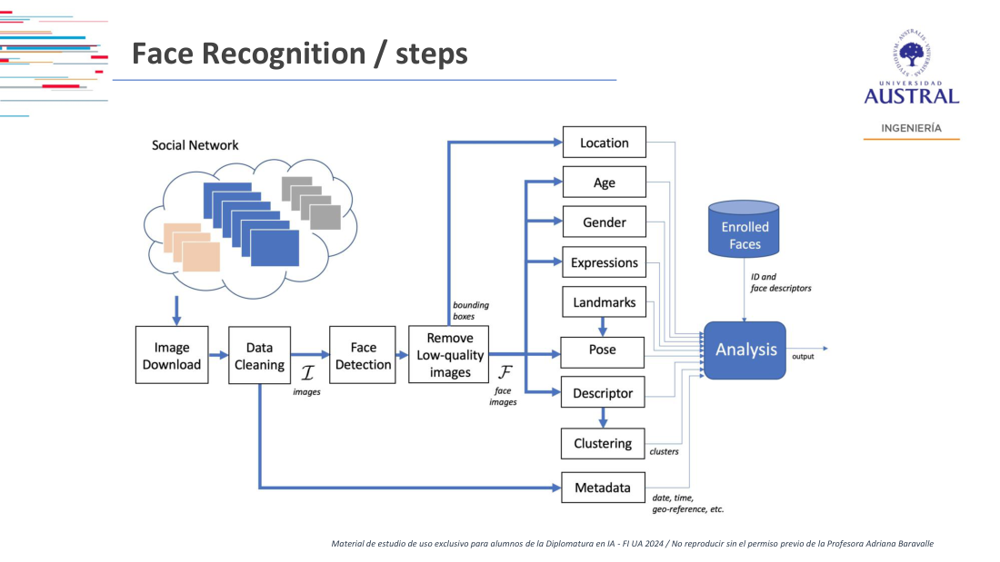
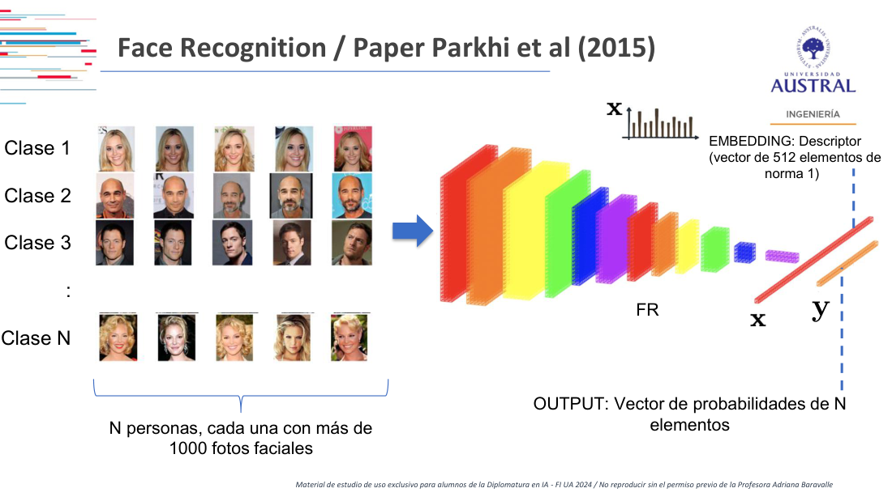
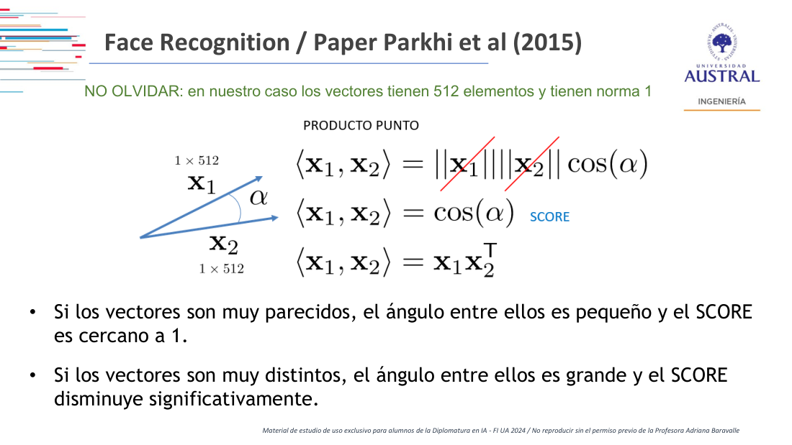
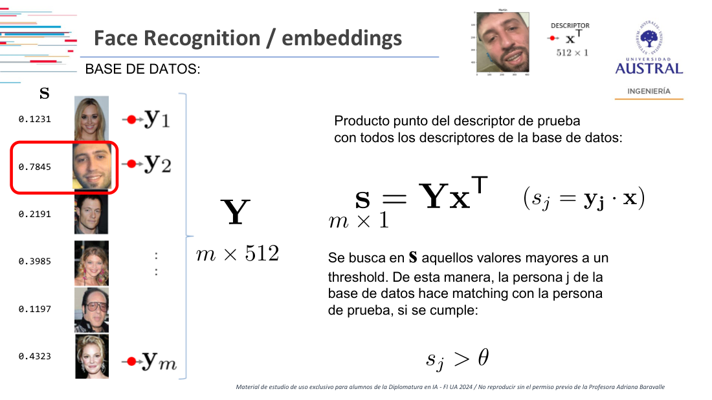
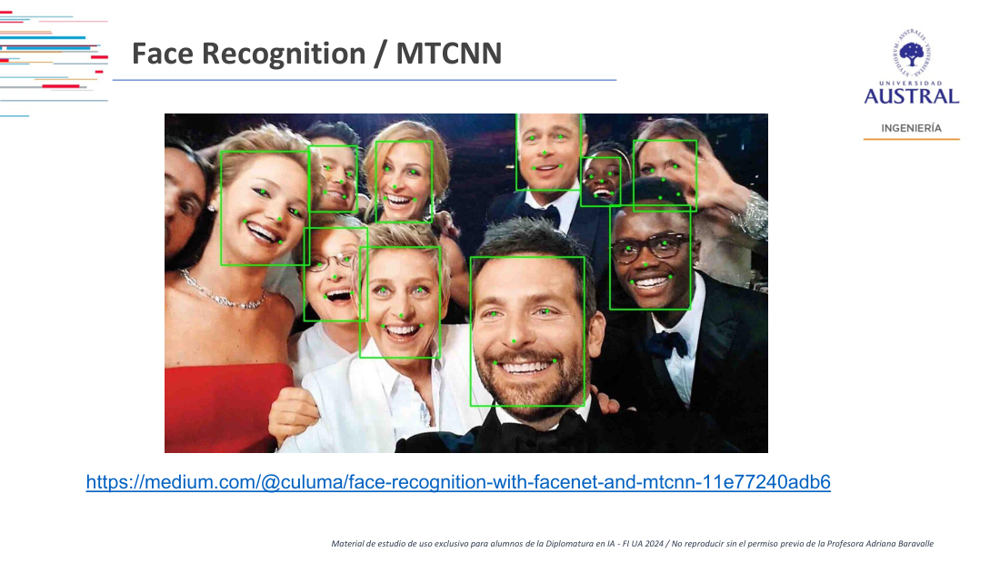
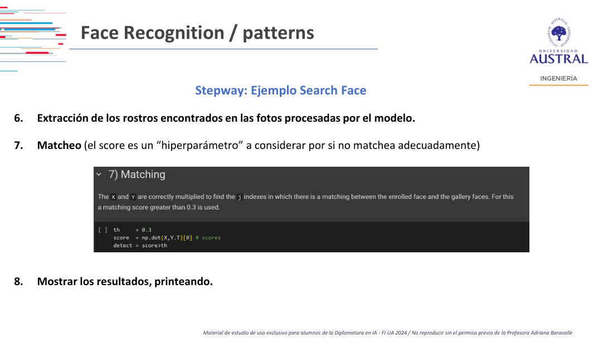

# Clase 19 · Reconocimiento facial: embeddings, similitud coseno y MTCNN

> **Módulo 3 · Visión Artificial** · Martín Masci · martes 09-jun-2026
> **Fuentes:** transcripción `DIA_Clase_19.vtt` · láminas `2026_may_jun_Computer_Vision_DipAI_Clase_5.pdf` (Reconocimiento facial) · notebooks mostrados en clase: YOLOv5 preentrenado, colab de Kaggle de verificación de caras y `MTCNN_SearchFace.ipynb` (basado en AdaFace)

## En pocas palabras

- Detectar **personas** ya es una clase más para un detector como YOLO. Lo nuevo con rostros es encadenar pasos: encontrar a la persona, recortar la cara y después **reconocer** de quién es. Comparar caras es algorítmicamente más difícil que distinguir objetos "commodities" como perros y gatos.
- El reconocimiento facial clásico (Parkhi et al., 2015) reemplaza la salida por clases por un **embedding**: un vector descriptor de norma 1 (512 elementos en ArcFace, 4096 en VGG) que resume la cara. Dos fotos de la misma persona deberían dar descriptores parecidos.
- Como los vectores tienen norma 1, el **producto punto** entre dos descriptores es el coseno del ángulo que forman: ese es el **score** de similitud. Para buscar a alguien en una base se calcula $\mathbf{s} = \mathbf{Y}\mathbf{x}^\top$ y se aceptan los que superan un **umbral** $\theta$.
- Con redes preentrenadas **no hay entrenamiento ni metadata**: casi el único "hiperparámetro" es el umbral, y elegirlo es un compromiso entre falsos positivos (parecidos que pasan) y falsos negativos (caras de perfil que no llegan).
- **MTCNN** (una CNN en cascada) es la arquitectura más usual para detectar caras y sus cinco puntos clave. Hoy este enfoque es "medio demodé" frente a la IA generativa, pero sirve para entender lo que viene (GAN, U-Net) y la discusión ética de la Clase 20.

## Conceptos clave

### Por qué los rostros son un problema distinto

Según la lámina de marco general, la detección de rostros tiene varias aristas que no aparecen en la detección de objetos por clase:

1. **Reconocer personas** en primer lugar. Esto ya se puede hacer: "persona" es una clase más de YOLO o Detectron.
2. **Reconocer rostros**: quedarse con una parte del todo (la cara) dentro del objeto persona.
3. **Clasificar o comparar** los rostros identificados, que es más difícil que con objetos commodities. Separar fotos con y sin perros es evidente para una red; decidir si dos caras son de la misma persona no lo es.

El profesor distingue además entre **reconocimiento** (quién es) y **análisis** del rostro, que tiene varias aristas:

- **Estados de ánimo**: recordó un paper de alrededor de 2019-2020 que clasificaba siete estados, de feliz a triste, pasando por neutral.
- **Pose y atención**: hacia dónde mira la persona y cuánto tiempo. Ejemplo: medir cuánto se mira una publicidad en una parada de colectivo, una idea emparentada con lo que hacen las redes sociales con el tiempo de lectura.
- **Edad, sexo, expresiones y gestos**, a partir de *landmarks*.

Una advertencia práctica: con objetos se pueden aplicar transformaciones geométricas sin problema, pero con caras una transformación fuerte deforma el rostro y confunde a la red. Por eso en general la foto se analiza tal como viene. Como mucho, se puede rotar un poco una cara torcida para enderezarla sin cambiar su aspecto.

### El pipeline de reconocimiento facial



*Figura: los pasos de un sistema de reconocimiento facial, desde la descarga de imágenes hasta el análisis contra una base de caras enroladas.*

| Paso | Qué hace | Comentario del profesor |
|---|---|---|
| Descarga de imágenes | Obtener las fotos (redes sociales, nube, scraping, on-premise) | El origen del dato "da lo mismo" para este problema |
| *Data cleaning* | Quedarse solo con fotos o videos de humanos | No hace falta sofisticarlo con un preentrenado: "no le pongan fotos de la sabana africana" |
| *Face detection* | Encontrar el recuadro (*bounding box*) de cada cara | |
| Remover imágenes de baja calidad | Filtrar recortes malos | Ajustar el recuadro casi adentro de la cara: de la pera a las cejas, casi sin orejas |
| Análisis | Location, edad, sexo, expresiones, landmarks, pose, descriptor, clustering | Edad, sexo o expresiones requieren un dataset prearmado con esas etiquetas |
| Metadata | Fecha, hora, georreferencia | Opcional: enriquece el análisis pero **la red no la necesita** |

Detalle clave sobre el recorte: **cuanto más contexto tenga el recuadro (pelo, orejas, fondo), peor funciona el modelo**. Se busca que solo haya cara.

La diferencia fundamental con la detección de objetos es que MTCNN, ArcFace y similares **no requieren metadata**. Para entrenar un detector de objetos hay que reemplazar la última capa con un dataset etiquetado propio (Clase 17). Acá eso no hace falta para usar la red.

### Del clasificador al embedding (Parkhi et al., 2015)

Una CNN tradicional pasa la imagen por capas convolucionales que reducen dimensionalidad y ganan detalle, y termina en una capa densa con los ponderadores y otra con las clases (por ejemplo, perro y gato).

El trabajo de Parkhi et al. entrena con **N personas famosas (actores y actrices), cada una con más de 1000 fotos faciales**, y descompone las últimas dos capas:

- **Embedding o descriptor** $\mathbf{x}$: un vector de norma 1 que resume todo lo que las capas anteriores extrajeron de la cara. Su largo depende de la arquitectura.
- **Output** $\mathbf{y}$: un vector de probabilidades de N elementos, uno por persona conocida.



Las redes preentrenadas que se descargan traen **todas las capas menos la última**. Eso permite pasarle una foto ("este soy yo"), obtener su embedding y después comparar cualquier foto nueva contra él, sin reentrenar.

| Arquitectura | Largo del embedding |
|---|---|
| VGG | 4096 |
| ArcFace | 512 |
| Otras intermedias | entre 512 y 4096, en general potencias de 2 |

Según el profesor, cuantos más datos tiene el embedding, más robusto es, por ejemplo, frente a caras algo giradas.

### Verificación (1:1) e identificación (1:N)

- **Uno a uno (verificación)**: "decime si esta persona es esa persona". Se parece a una clasificación binaria. Es lo que hace el desbloqueo del celular.
- **Uno a N (identificación)**: "de las N personas que conocés, ¿cuál es esta?".

Hay un tercer caso, más difícil: el **1:N contextual**, es decir, encontrar una cara determinada dentro de fotos con muchas personas y fondo. Comparar recortes de caras entre sí lo resuelven los cinco puntos; encontrar a alguien en una escena exige además detectar todas las caras primero.

### Los cinco puntos clave

¿Qué hace que dos fotos de la misma persona separadas por diez años den embeddings parecidos? En clase aparecieron los ojos, la distancia entre ellos, las cejas y el tamaño de la boca. El profesor lo ordenó en dos criterios: qué rasgos son **invariantes en el tiempo** y cuáles son **comunes a casi todos los rostros**.

De ahí salen los **cinco puntos de una cara**: los dos ojos, las dos comisuras de la boca y un punto en la nariz. Las distancias entre esos puntos difieren entre personas distintas. Para que la comparación tenga sentido, **las caras tienen que estar más o menos igual de alineadas**: no conviene comparar scores de rostros que miran hacia lados distintos.

Las redes posteriores pasan de cinco puntos a un **mallado** (*mesh*) de muchísimos puntos. Según el profesor, eso es lo que usaría el desbloqueo facial de los teléfonos (no lo afirmó como probado).

### Score: similitud coseno

Si $\mathbf{x}_1$ y $\mathbf{x}_2$ son descriptores de $1 \times 512$ con norma 1:

$$\langle \mathbf{x}_1, \mathbf{x}_2 \rangle = \|\mathbf{x}_1\|\,\|\mathbf{x}_2\| \cos(\alpha) = \cos(\alpha) = \mathbf{x}_1 \mathbf{x}_2^\top$$



- Vectores muy parecidos: ángulo chico, **score cercano a 1** (el coseno de 0 es 1, vectores paralelos).
- Vectores muy distintos: ángulo grande, el score baja mucho. Si son ortogonales, el score es 0, que es prácticamente la máxima distancia en este contexto.
- Como las normas valen 1, no hace falta dividir: el producto punto **ya es** el coseno. Es "un juego matemático muy simple" de álgebra lineal.

El profesor lo presentó también como comparar "histogramas" de los valores del embedding: fotos de la misma persona dan histogramas parecidos. (En la transcripción se dice al pasar que "cuando el producto punto es cero los vectores son paralelos". Es un lapsus: paralelos corresponde a producto 1, y ortogonales a 0, como dice la lámina.)

### Búsqueda en una base de datos y umbral

Con una base de $m$ personas enroladas, cada una con su descriptor $\mathbf{y}_j$, se apilan en una matriz $\mathbf{Y}$ de $m \times 512$. Para un descriptor de prueba $\mathbf{x}$:

$$\mathbf{s} = \mathbf{Y}\mathbf{x}^\top \quad (m \times 1), \qquad s_j = \mathbf{y}_j \cdot \mathbf{x}$$

La persona $j$ hace *matching* con la de prueba si $s_j > \theta$.



*Figura: la foto de prueba del profesor contra una base de caras. El único score alto (0.7845) corresponde a otra foto suya.*

El problema de esta versión inicial: el umbral es un corte y **puede dejar más de una clase arriba**. Ejemplo de clase: con un umbral de 0,70, una persona da 0,71 y otra 0,90, y ambas pasan. Por eso hay muchos falsos positivos (alguien muy parecido) y falsos negativos (umbral demasiado alto, no detecta a nadie).

### Qué se puede tocar (y qué no) con una red preentrenada

- **No hay entrenamiento**: no hay épocas ni pesos que ajustar. Todo fue entrenado antes.
- Se puede probar **otra arquitectura de embedding**, pero sin entrar mucho en el detalle.
- El **umbral** queda como el principal "hiperparámetro" (así lo llama la lámina, entre comillas).
- Entrenar una red propia de reconocimiento es "volver a 2015": hace falta una enorme cantidad de datos. La única ventaja es que no hace falta metadata (1000 fotos que se llaman todas "Martín", lo más recortadas posible). Para un modelo útil hablaría, por ejemplo, de 200 personas con 1000 fotos cada una a lo largo del tiempo.

### MTCNN: detección en cascada

MTCNN es la arquitectura más usual para *face detection*: una red con una **cascada interna** que encuentra el recuadro de cada cara y sus puntos clave. Según la lámina, la implementación para Keras se basa en la de David Sandberg (la del repositorio FaceNet) y en el paper de Zhang et al. (2016). El profesor dio una fecha distinta en clase, poco clara en la transcripción.



La lámina de "patterns" deja una idea de diseño general: **conviene armar algoritmos combinando pasos y usar en cada uno la red que mejor resuelve esa tarea**. Por ejemplo, con un video como entrada:

1. Extraer *frames* con cierta frecuencia.
2. Detectar clases en los frames y filtrar los humanos.
3. Detectar los rostros (recuadro).
4. Analizar el rostro para clasificarlo, por ejemplo con el nombre (reconocimiento).

Otras arquitecturas mencionadas: **ArcFace**, modelos de Hugging Face y detectores generales como Detectron, que también sirven para rostros.

Un argumento de eficiencia: no hace falta que todo el pipeline use GPU. La detección y la extracción de caras sí la necesitan, pero una vez que se tiene la información de la cara como datos, se puede **desenchufar la GPU y correr un modelo de machine learning** sobre esos datos. Así el proceso completo queda más liviano.

### Robustez: oclusiones, barbijos y gemelos

- Las redes son robustas a caras parcialmente tapadas: "se imagina" dónde están los puntos que faltan. Puede ser un problema potencial, que se retomará con explicabilidad.
- Con un embedding de cinco puntos, tapar la boca y la nariz elimina tres de los cinco: se pierde un 60 % de la información y el matching se vuelve arbitrario.
- En la pandemia, los primeros desbloqueos con barbijo se habían ajustado con la mitad superior de la cara. Según un blog que el profesor no pudo volver a encontrar, tapar la parte superior hacía fallar el reconocimiento. Las versiones posteriores reconocen con mucha menos información, lo que también mejoró el desbloqueo en la oscuridad.
- Gemelos idénticos: el profesor recordó un video de hace años sobre si el desbloqueo los distinguía. Dejó abierta la pregunta sobre la robustez actual.

## Ejemplos y casos de la clase

- **YOLOv5 preentrenado sobre una foto de Bolonia** (al inicio, cerrando el bloque de detección de objetos). Sin entrenar nada, detectó un auto, un bus lejano y un Smart, con un color de recuadro por clase y su nivel de confianza. Enseña que una red preentrenada funciona con dos o tres líneas, pero queda pendiente explicar *por qué* funciona.
- **Google Fotos**: agrupa caras (y ahora mascotas), pregunta si dos caras son la misma persona y arma la cronología de una persona desde bebé. Un alumno contó que reconoció a su sobrina de 1 a 12 años; el profesor, que lo encuentra en fotos donde aparece chiquito o de costado. Sirve para mostrar el nivel actual de estos algoritmos.
- **Fotos del profesor con diez años de diferencia**: los embeddings dan scores altos, lo que motiva la pregunta de qué rasgos son invariantes.
- **Foto de entrenamiento de boxeo con la cara torcida**: muestra el problema de la alineación entre caras.
- **Aplicaciones mencionadas por alumnos**: detección de fatiga en autos (ojos que se cierran) y autenticación con validación biométrica (por ejemplo, la API de RENAPER que pide girar la cabeza). Las dudas sobre ciberseguridad y datos biométricos quedaron para la clase de ética.
- **Colab de Kaggle de verificación de caras**: con fotos de futbolistas (Messi, Cristiano, Mbappé, Neymar) detecta caras con su recuadro y confianza, y después verifica si dos fotos son de la misma persona con similitud coseno. Acierta incluso con dos fotos de Cristiano de edades distintas, y detecta todas las caras de una foto grupal de científicos.

## Práctica

### Search Face con MTCNN + AdaFace (`MTCNN_SearchFace.ipynb`)

El objetivo: dada **una sola cara enrolada**, recorrer una galería de fotos y marcar con un recuadro a esa persona, sin definir el resto de las clases. Combina la detección de MTCNN con el reconocimiento de **AdaFace** (repositorio de 2022) usando el preentrenado **IR50**.

Pasos según las láminas:

1. Librerías. Advertencia: clonar un repositorio de Git "no es inocuo, siempre tiene consecuencias".
2. Bajar el dataset de imágenes. Se usa un preentrenado; entrenar con un dataset propio también funciona, pero es otra rutina.
3. Detección con el preentrenado (IR50) y el detector `MTCNN()`.
4. Extracción de los datos encontrados.
5. Procesamiento de las imágenes donde aparece la persona enrolada, con funciones del repositorio de AdaFace.
6. Extracción de los rostros encontrados.
7. **Matching**, con el umbral como hiperparámetro.
8. Mostrar los resultados.

El paso central es una línea de álgebra lineal:

```python
th     = 0.3
score  = np.dot(X, Y.T)[0]  # scores
detect = score > th
```



**Puntos fuertes** que muestran las láminas: si hay varias caras, detecta solo la buscada, y funciona con distintos zooms, iluminaciones y calidades.

**El error y el umbral.** En el dataset de ejemplo hubo un solo error: en una imagen aparecían dos caras con scores de 0,30 y pico y de 0,50 y pico, y el código se quedó con la equivocada. Un alumno propuso subir el umbral a 0,5. El profesor explicó que eso arregla ese caso pero falla en otros: una cara de frente puede dar 0,60, mientras que una girada 30 o 40 grados da 0,31, porque las distancias entre puntos cambian sin poder enderezar la cara. Por eso el código usa 0,30. Con fotos propias, el notebook también detectó como "parecidos" a un cuñado y al novio de una prima.

**Estado actual: el código está roto.** El profesor no logró volver a correrlo. Al depurarlo (con ayuda de Gemini y GPT) encontró que el problema no era de versiones de sintaxis, sino que el archivo de pesos `.pt` que descarga el preentrenado pesa unos 170 KB: no son los pesos entrenados. Arreglarlo implicaría reentrenar AdaFace. La parte de manipulación de imágenes con `cv2` sí corre; falla en la detección.

**Desafío para la Clase 20:** lograr que el Search Face funcione, ya sea depurando este código o armando la misma idea con otra implementación (buscando "face detection" o "face search", con alta probabilidad se llega a MTCNN). Ojo: sin GPU no conviene intentarlo.

## Para recordar

- "Convolucional sigue siendo la palabra mágica": las arquitecturas de rostros son familiares de las CNN.
- El recuadro de la cara tiene que ser lo más ajustado posible: el contexto empeora el reconocimiento.
- Con norma 1, **producto punto = coseno = score**. Buscar en una base es una multiplicación matriz-vector.
- El umbral no tiene un valor correcto universal: subirlo elimina parecidos, pero pierde caras de perfil.
- "Cuando no hay entrenamiento atrás, no es gratuito. Algo está pasando": un preentrenado esconde un entrenamiento enorme, como el de YOLO.
- Muchos repositorios de 2015-2022 quedaron sin mantenimiento. Que la arquitectura exista no garantiza que el preentrenado siga funcionando.
- Encontrar una cara y buscarle cinco puntos es "medio demodé" frente a la generativa, pero hay que entenderlo para entender lo que vino después.
- Con personas, la ingenuidad de las clases anteriores se termina: hacen falta *fairness*, sesgo y explicabilidad (Clase 20).

## Preguntas de repaso

<details><summary>1. ¿Por qué reconocer rostros es más difícil que detectar personas?</summary>

Porque "persona" es una clase más de un detector como YOLO. Reconocer un rostro exige encadenar pasos: detectar a la persona, recortar la cara y compararla contra otras caras. Distinguir individuos dentro de una misma clase es mucho más fino que separar perros de gatos.

</details>

<details><summary>2. ¿Qué cambia en la arquitectura de Parkhi et al. respecto de una CNN clasificadora, y qué ventaja da eso con un preentrenado?</summary>

Antes de la salida por clases agrega un embedding: un descriptor de norma 1 que resume la cara. Los preentrenados traen todas las capas hasta el embedding, así que se puede enrolar a una persona nueva con una foto y compararla sin reentrenar ni etiquetar un dataset.

</details>

<details><summary>3. ¿Por qué el producto punto entre dos descriptores sirve como score de similitud?</summary>

Porque $\langle \mathbf{x}_1, \mathbf{x}_2 \rangle = \|\mathbf{x}_1\|\|\mathbf{x}_2\|\cos\alpha$, y con normas iguales a 1 queda $\cos\alpha$. Vectores parecidos forman un ángulo chico y dan un score cercano a 1. Vectores distintos dan un score bajo, y 0 si son ortogonales.

</details>

<details><summary>4. ¿Cómo se identifica a una persona contra una base de m caras enroladas?</summary>

Se apilan los descriptores de la base en $\mathbf{Y}$ ($m \times 512$), se calcula $\mathbf{s} = \mathbf{Y}\mathbf{x}^\top$ con el descriptor de prueba y se declara match a cada $j$ con $s_j > \theta$.

</details>

<details><summary>5. En el Search Face, ¿por qué no alcanza con subir el umbral de 0,3 a 0,5 para eliminar el error?</summary>

Porque los scores dependen mucho de la pose. Una cara de frente puede dar 0,60, y la misma persona girada 30 o 40 grados, 0,31. Subir el umbral elimina al parecido, pero deja afuera las caras giradas. Es un compromiso entre falsos positivos y falsos negativos.

</details>

<details><summary>6. ¿Por qué conviene un recuadro muy ajustado y caras alineadas?</summary>

Porque la comparación se basa en distancias entre puntos clave (ojos, comisuras, nariz). El contexto (orejas, pelo, fondo) agrega ruido al descriptor. Si las caras miran hacia lados distintos, esas distancias cambian aunque sea la misma persona, y no se puede deformar la cara para corregirlo.

</details>

<details><summary>7. ¿Qué pasa con un reconocedor basado en cinco puntos si la persona usa barbijo?</summary>

Pierde tres de los cinco puntos (las comisuras y la nariz), es decir, un 60 % de la información. El matching se vuelve arbitrario. Los sistemas posteriores usan mallas de muchos puntos y logran reconocer con mucha menos información visible.

</details>

<details><summary>8. ¿Por qué el profesor propone sacar la GPU de una parte del pipeline?</summary>

Porque solo la detección y la extracción de caras necesitan una red pesada. Una vez que la cara quedó convertida en datos (descriptor, puntos), el análisis de patrones se puede hacer con un modelo de machine learning más liviano, y así el proceso de punta a punta queda más barato.

</details>

## Conexiones

- **Hacia atrás:** retoma las CNN y la reducción de dimensionalidad con kernels (Clase 16) y la detección de objetos con preentrenados y recuadros (Clase 17, Detectron2 y el umbral de confianza). La detección de "persona" con YOLO es el punto de partida del pipeline.
- **Hacia adelante:** la Clase 20 sigue con la discusión del desafío, los aspectos éticos (*fairness*, sesgo, datos biométricos) y la explicabilidad, que permite saber "dónde mira" la red. Después vienen Vision Transformers, U-Net y GAN (Clase 22), arquitecturas que según el profesor dejaron este enfoque "demodé".
- **TFI:** el mecanismo es el mismo que el del **retrieval semántico** del normalizador de nombres comerciales de Benefix. Cada candidato se representa con un embedding normalizado, la consulta se compara contra toda la base con un producto punto (similitud coseno) y se ordena por score. El dilema del umbral y de los "parecidos" que quedan arriba es el mismo que se mide con Hit@k y MRR: importa si el correcto queda primero, no solo si supera un corte.
