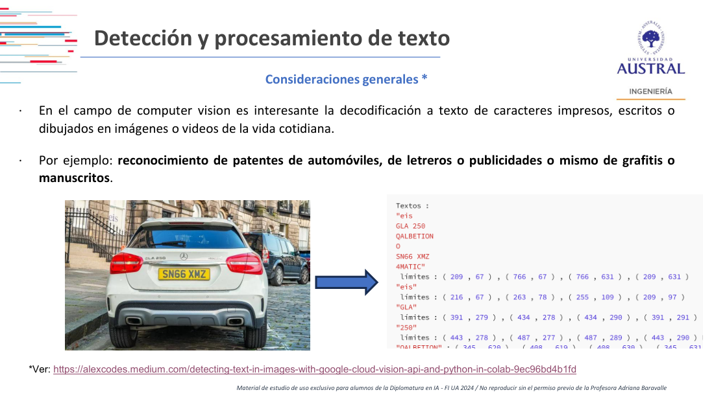
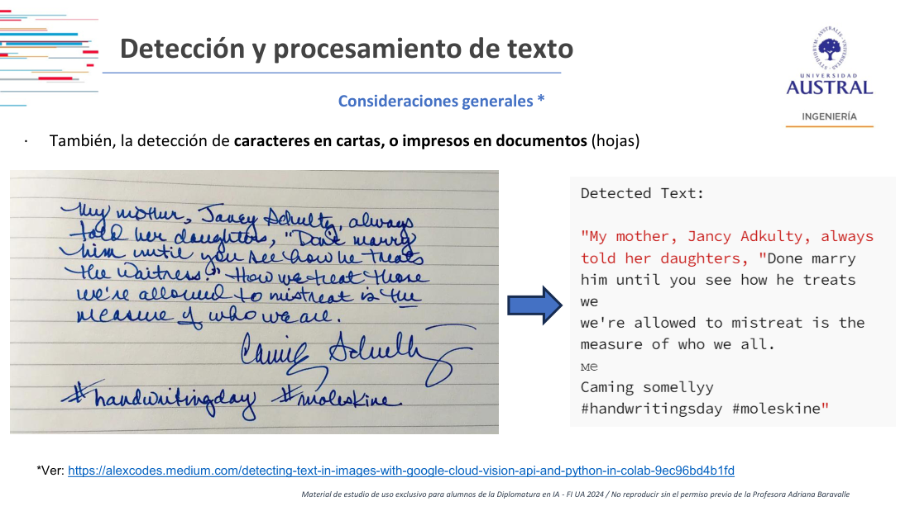
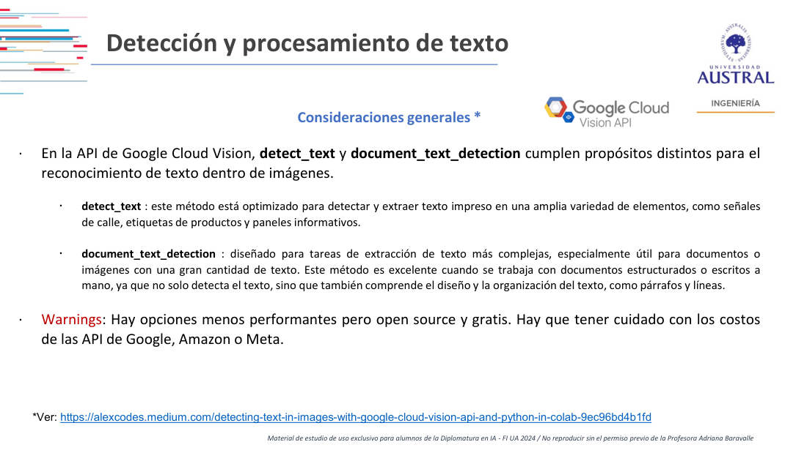
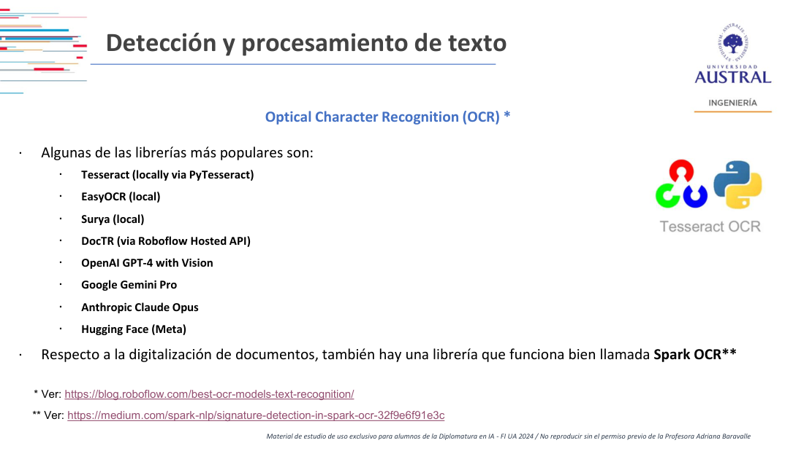
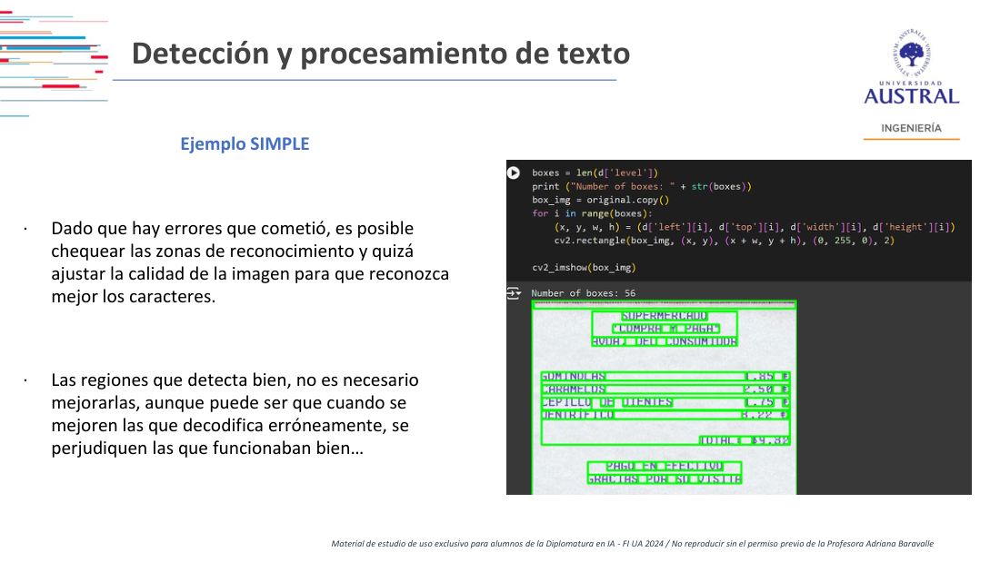

# Clase 21 · OCR: reconocimiento de texto en imágenes

> **Módulo 3 · Visión Artificial** · Martín Masci · martes 16-jun-2026
> **Fuentes:** transcripción `DIA_Clase_21.vtt` (cubre hasta el corte; el trabajo en equipos posterior no quedó grabado) · láminas `2026_may_jun_Computer_Vision_DipAI_Clase_7.pdf` · notebook `Simple_OCR_Pytesseract.ipynb` · paper complementario `Personality detection using CV.pdf`

## En pocas palabras

- **OCR** (*Optical Character Recognition*) es extraer de una imagen texto que se pueda manipular con un procesador de texto. Es parecido a la detección de objetos y a la segmentación, pero con objetos muy "preclasificados": unas pocas decenas de clases alfanuméricas por idioma.
- En OCR **el problema no es la red**: los modelos vienen preentrenados por idioma, se usan con dos o tres líneas de código y casi no tienen hiperparámetros. Donde se gana o se pierde es en el **preprocesamiento de la imagen** (lo visto al principio del módulo).
- La dificultad crece en tres escalones: **documento impreso** (hoy prácticamente resuelto), **texto en fotos de la vida real** (patentes, carteles, grafitis: más distractores) y **manuscritos** (lo más difícil; incluso las APIs pagas se comen partes de la frase).
- La salida típica de cualquier OCR es **texto + caja delimitadora (*bounding box*) + confianza** (esta última opcional). El flujo de trabajo es siempre el mismo: localizar regiones, recortarlas y recién ahí reconocer caracteres.
- En la industria, el OCR casi nunca es el fin: es un eslabón entre la imagen y otra IA que **interpreta** el texto extraído (documentos bancarios, tickets de compra).

## Conceptos clave

### Qué es OCR y de dónde viene

El objetivo general: dada una imagen, extraer el texto que contiene de forma que sea procesable. La necesidad nace de la **digitalización de documentos**: convertir libros físicos en versiones digitales manipulables.

- **Tesseract** lo desarrolla Hewlett-Packard en los años 80 para digitalizar con escáneres. Según el notebook, hoy es open source y mantenido por Google; **PyTesseract** es su envoltorio para Python.
- Entre 2005 y 2010, aproximadamente, aparecen otros competidores, porque el problema ya estaba popularizado y mucha gente había preentrenado caracteres "a mano".
- La historia conecta con los **CAPTCHA**: en sus primeras versiones mostraban recortes de escaneos que la red no lograba leer (palabras torcidas, al final de la página), y millones de humanos terminaban de "etiquetar" lo que el modelo fallaba. Hoy los CAPTCHA son generados, por el problema de los robots.

Un caso límite: si el texto ya es **seleccionable** (un Word, un PDF con texto), OCR no tiene sentido. Aplica cuando el texto está "atrapado" en píxeles: una foto, un escaneo, un documento exportado como imagen.

### Por qué la arquitectura es simple

Un carácter en una imagen chica (por ejemplo 16×16 píxeles) se puede reducir a valores de 0 a 255 o, en el extremo, a píxeles prendidos y apagados. Eso alcanza para distinguir un 1, una B o una M. Por eso:

- El mecanismo de fondo es **filtrar píxeles** recorriendo la imagen con kernels y detectar patrones previamente entrenados.
- El "modelo" se define por **el idioma y su diccionario de caracteres**. Si se fotografía un texto en chino, hace falta el alfabeto chino. Al elegir el idioma, la librería ya trae el preentrenado alfanumérico correspondiente.
- Las clases son pocas: letras, diez dígitos y algunos caracteres especiales, del orden de 40 o 50 clases según el profesor. Comparado con los zoológicos de modelos vistos en el módulo (miles de clases), una convolucional que reconozca 40 o 50 clases no es un trabajo complicado.
- Para la robustez a deformaciones se entrena como con las caras de la Clase 19: en lugar de M personas con N fotos cada una, hay M clases de caracteres con muchas versiones de cada una (más estirada, más inclinada, distintas grafías).

### Los tres escalones de dificultad

| Escenario | Ejemplos | Dificultad | Qué lo complica |
|---|---|---|---|
| Documento impreso | libro escaneado, ticket, informe, DNI | Baja (hoy cualquier celular lo hace) | papel arrugado, foco de la cámara |
| Texto en contexto (*in the wild*) | patentes, letreros, publicidades, grafitis | Media | distractores que parecen caracteres, ruido, fuentes |
| Manuscrito | cartas, recetas y órdenes médicas, exámenes | Alta | variabilidad de cada letra, falta de contexto |

**Texto en fotos.** Una imagen tiene muchos más distractores que una página. La receta es volver a la primera parte del módulo: preprocesar (pasar a blanco y negro, aplicar Canny, desenfocar, etc.) y darle a la red varias versiones de la misma región. Si en blanco y negro, en color, con Canny y desenfocada la sigla sigue dando "G", "L", "A", la confianza en esa lectura es mucho mayor.



**Manuscritos.** Es el ancho completo de lo que un OCR debería poder hacer: pasar un texto escrito a mano a texto tipeado. Incluso una API muy potente falla: en el ejemplo de la lámina lee "Done marry" donde dice "Don't marry", y se saltea la parte de la frase que le da sentido ("the waitress").



### Los problemas típicos

1. **Ruido, desenfoque y distorsión** (letras estiradas, movidas, como en un CAPTCHA). Con 20 años de historia está bastante resuelto: las redes ya son robustas a las transformaciones geométricas y fotométricas vistas en el módulo.
2. **Confusión entre formas parecidas**, que sobrevive como dificultad: 6 y G, 1 y signo de admiración, O y 0. También fuentes caligráficas o decorativas. Quien manipula una patente explota exactamente esto.
3. **Falta de contexto.** Los OCR clásicos no "entienden" lo que leen. Una persona sabe que "PERR0" es "perro", o que en un Mercedes "GLA 25O" es "GLA 250"; el OCR no lo deduce. Lo que sí cambia entre arquitecturas es si reconocen **letra por letra** o si **agrupan** las letras cercanas en un mismo bloque.

### La salida de un OCR: texto, caja y confianza

Internamente, como el trabajo es a nivel píxel, **todas** las OCR tienen una caja de reconocimiento por objeto, la muestren o no. La salida esperable es:

- los **caracteres** reconocidos (agrupados en palabras o bloques);
- el **bounding box** de cada uno (coordenadas de sus vértices);
- opcionalmente, un **nivel de confianza** por detección. Cloud Vision no lo da; las otras librerías en general sí.

Con la confianza se puede poner un **umbral** (por ejemplo, no mostrar textos con confianza menor a 0,25 o 0,30), igual que el umbral de matching en reconocimiento facial. En una página impresa casi no hace falta; en fotos sirve para que no llene la imagen de cajas sobre cualquier cosa que parezca una letra.

### El flujo: primero regiones, después caracteres

El orden del pipeline no es casual: **localizar regiones → recortarlas → predecir caracteres → guardar el resultado** (el último paso, en la transcripción, aparece como "SQL"). El OCR entra después de que la imagen ya fue preparada.

- En muchos casos conviene trabajar fuerte en la primera parte y pasarle al reconocedor **imágenes recortadas**: muchos menos píxeles, mejor rendimiento y mejor reconocimiento.
- Las librerías hacen esto internamente. Si fallan, hay que "desarmarlas": trabajar primero el preprocesamiento y darles como input las regiones ya detectadas, no la imagen entera.

### Google Cloud Vision

API de Google Cloud muy performante para OCR. Tiene dos métodos con propósitos distintos (según las láminas):

- `detect_text`: optimizado para texto impreso en señales de calle, etiquetas de productos o paneles.
- `document_text_detection`: para documentos con mucho texto, estructurados o manuscritos; además de detectar el texto entiende su organización en párrafos y líneas.



El profesor la menciona pero **no la recomienda**: es "brutalmente cara". Si se mete en un pipeline, conviene tener la tarjeta limitada. Hay opciones open source y gratuitas algo menos performantes. La misma advertencia vale para las APIs de Amazon o Meta.

### Librerías y alternativas



| Opción | Dónde corre | Comentario de clase |
|---|---|---|
| Tesseract (vía PyTesseract) | local | autocontenida, pocas dependencias; tiende a partir el texto en varios bloques |
| EasyOCR | local | toma regiones más amplias (una patente entera en una sola caja) |
| Surya | local | según el profesor, ya casi no se usa |
| DocTR | Roboflow (API hosteada) o GitHub open source | reconocimiento de texto en documentos; muy usada en foros para recetas médicas, aunque "doc" es por documento |
| Roboflow OCR | web | arma un workflow con un asistente; más caja negra, pero desplegable |
| Florence-2 | Hugging Face | funciona como una app: se elige la tarea (por ejemplo OCR con regiones) y devuelve texto, ubicación y cajas |
| TrOCR (dudoso: en la transcripción, "TR") | Hugging Face | demo de manuscrito resuelta en dos bloques de código |
| GPT-4 con visión, Gemini Pro, Claude Opus | APIs de modelos generativos | muy performantes; quedan para los módulos de generativa; cuidado con el costo en tokens |
| Spark OCR | — | mencionada en las láminas para digitalización de documentos |

**Tesseract vs. EasyOCR: la diferencia está en la caja.** En una patente, EasyOCR devuelve una sola caja con toda la patente; Tesseract puede devolver un bloque de letras y otra caja al lado. Tesseract rinde más sin tocar nada, pero esos pedacitos complican si lo que se quiere es la patente completa (por ejemplo, para almacenarla).

### Local vs. nube, CPU vs. GPU

- Tesseract y EasyOCR corren bien **en local**; se suman librerías básicas (NumPy, Matplotlib) para manejar las imágenes y dibujar las cajas.
- Con fotos muy pesadas o muchas fotos hace falta **GPU**. En el video recomendado, un lote que tardaba unos 2 minutos 40 en CPU pasa a unos 5 segundos con GPU.
- La GPU tiene que ser **NVIDIA** (todo se apoya en CUDA). Alcanza con una GPU dedicada en una notebook; no sirve la memoria compartida con la RAM. Sin NVIDIA, hay que ir a la nube (por ejemplo, Colab con T4).
- Para video o mucho detalle, estas arquitecturas ya son viejas y conviene pasar a **transformers** (tema de la Clase 22).

### Personalizar para una letra particular

Si un grupo de personas (por ejemplo, médicos) o una persona escribe con alguna particularidad, se puede entrenar a medida: recortar cada carácter de los propios textos, etiquetarlo ("esta es mi L, y acá están todas las L del último mes") y entrenar la red. Reconoce muy bien esa letra, pero **se pierden los pesos del preentrenado** de las arquitecturas existentes.

## Ejemplos y casos de la clase

- **El Mercedes GLA 250.** Cloud Vision detecta "GLA", "250", la patente, "4MATIC" (que agrupa en un solo bloque) y hasta un fragmento de cartel en el fondo ("eis"), con las coordenadas de cada caja. Con EasyOCR sin ajustes, ese fragmento del fondo no aparece, pero la patente y el modelo salen bien. Roboflow los detecta todos. Enseña que el rendimiento en fotos varía según la herramienta y que la agrupación en bloques importa.
- **El manuscrito "My mother, Jancy Adkulty…".** Cloud Vision confunde palabras y se saltea justo la parte que da sentido a la frase. Roboflow, en la prueba del profesor, recupera el fragmento faltante. Muestra que el manuscrito es el escalón más difícil.
- **Órdenes médicas** (pregunta de un alumno). La mayoría se escriben a mano. Respuesta: probar arquitecturas como DocTR o entrenar a medida con muestras propias.
- **Documentación bancaria y omnicanalidad.** En un banco público grande, la apertura de cuentas pasó de llevar fotocopias a la sucursal a trámites digitales que pueden empezar en un canal y seguir en otro. El DNI es fácil: los campos están siempre en el mismo lugar. Lo difícil son estatutos, actas y balances de empresas, cada uno con su formato. Después del OCR hace falta otra IA que interprete: en un balance "caja" y "efectivo" pueden referirse a lo mismo, y hay que reunir esos sinónimos (una "bolsa de palabras") para obtener liquidez o solvencia. Todo dentro de un marco de *compliance*, cuidando que un chatbot sobre estos datos no "delire".
- **Tickets de un shopping.** Una app de shoppings permite fotografiar el ticket de compra para sumar puntos o descuentos en el estacionamiento. La carga se hacía manualmente y se reemplazó por un flujo con IA agéntica: el sistema propone lo que leyó y el usuario confirma o corrige (sin poder cambiar cualquier cosa, para evitar fraudes). La foto en sí no importa; el dato extraído sí.
- **CCTV.** Hay empresas que venden productos cerrados sobre cámaras de seguridad, con OCR como una de sus funciones junto con el análisis de comportamiento.
- **Grafología** (pregunta de una alumna). Se planteó si se puede inferir la personalidad a partir de la escritura. El profesor no tenía la respuesta en clase; como material se subió un paper (Bhatnagar et al., 2025) que propone CNN y fusión multimodal para predecir rasgos de personalidad a partir de muestras de escritura. Imitar la letra de alguien con modelos generativos se retoma con GAN en la Clase 22.

## Práctica

**Notebook `Simple_OCR_Pytesseract.ipynb`** (Colab, autocontenido). Usa la foto de un ticket de supermercado tomada con el celular.

1. Instala el motor y el envoltorio: `pip install pytesseract` y `apt install tesseract-ocr`.
2. Lee la imagen con OpenCV y extrae el texto en una línea:

```python
original = cv2.imread(source)
text = pytesseract.image_to_string(original)
```

3. El resultado "no es totalmente incorrecto ni totalmente satisfactorio": las líneas en foco y sobre papel liso salen bien; los precios en la zona arrugada salen ilegibles.
4. Para entender qué está mirando el modelo, se piden los datos de detección y se dibujan las cajas:

```python
d = pytesseract.image_to_data(original, output_type=Output.DICT)
for i in range(len(d['level'])):
    (x, y, w, h) = (d['left'][i], d['top'][i], d['width'][i], d['height'][i])
    cv2.rectangle(box_img, (x, y), (x + w, y + h), (0, 255, 0), 2)
```



Qué mirar: el modelo busca **líneas rectas**; aunque estén inclinadas, el papel deformado lo confunde. Así se distingue si el OCR **no encuentra** el texto o si lo encuentra pero **no lo reconoce**. El paso siguiente es mejorar la imagen solo en las zonas con errores. Ojo: al mejorar las regiones que fallan pueden empeorar las que ya funcionaban.

Las láminas advierten que la instalación es muy simple, pero que queda **poco margen de mejora vía hiperparámetros**: el margen está en la imagen.

**Demos en vivo:** EasyOCR (crear un `Reader` con el idioma, pasarle la ruta de la imagen y recorrer los resultados en un ciclo `for`), un modelo de manuscrito en Hugging Face, Roboflow OCR y Florence-2 con "OCR con regiones".

**Después del corte:** trabajo en equipos para probar alguna de estas arquitecturas con fotos propias. También se dejaron un blog con las ocho librerías de OCR más usadas y un video que arma un pipeline completo sobre una competencia de Kaggle, comparando tres librerías.

## Para recordar

- "Acá el problema no es la red": en OCR se vuelve a la manipulación de imágenes.
- Si el OCR falla, primero preprocesamiento y recorte de regiones; recién después pensar en reentrenar.
- Si el texto es seleccionable, no hace falta OCR.
- Cloud Vision: performante pero muy caro. Antes de conectar una API paga a un pipeline, limitar el gasto.
- Elegir la librería también por **cómo agrupa las cajas** (una patente en una caja o en varias), no solo por el acierto.
- GPU para OCR local = NVIDIA dedicada (CUDA).
- El valor no está en guardar la imagen sino el **dato** extraído, y casi siempre hace falta otra capa que lo interprete.

## Preguntas de repaso

<details><summary>1. ¿Por qué el profesor dice que en OCR "el problema no es la red"?</summary>

Porque las clases son pocas (caracteres alfanuméricos de un idioma) y los modelos vienen preentrenados por idioma; se usan casi sin hiperparámetros. Lo que define el resultado es la calidad y el preprocesamiento de la imagen (escala de grises, bordes, desenfoque, recorte de regiones).

</details>

<details><summary>2. ¿Qué tres datos devuelve un OCR típico y para qué sirve el tercero?</summary>

El texto reconocido, la caja delimitadora de cada detección y, opcionalmente, una confianza. La confianza permite fijar un umbral para descartar detecciones dudosas, útil sobre todo en fotos con distractores.

</details>

<details><summary>3. ¿Por qué leer una patente en una foto es más difícil que leer una página escaneada?</summary>

Porque la foto tiene muchos más distractores (fondo, carteles, texturas) que pueden parecer caracteres, además de ruido, perspectiva y fuentes particulares. En la página casi todo es texto sobre un fondo uniforme.

</details>

<details><summary>4. Un OCR devuelve "GLA 25O" para un Mercedes. ¿Qué limitación muestra y cómo se podría mitigar?</summary>

La confusión entre formas parecidas (O y 0) y la falta de contexto: el OCR clásico no sabe que el modelo es "250". Se mitiga con más contexto aguas abajo: reglas de formato, validación contra un diccionario o una IA posterior que interprete el texto.

</details>

<details><summary>5. ¿Qué diferencia práctica hay entre Tesseract y EasyOCR según la clase?</summary>

La forma de agrupar: EasyOCR tiende a tomar la patente entera en una sola caja, mientras que Tesseract puede partirla en varios bloques. Tesseract rinde bien sin ajustes, pero esos fragmentos complican si se necesita el texto completo como una unidad.

</details>

<details><summary>6. En el notebook del ticket, ¿cómo se distingue si el problema es de detección o de reconocimiento?</summary>

Dibujando las cajas que devuelve `image_to_data`. Si no hay caja sobre una zona con texto, el modelo no la detectó (por ejemplo, por el papel arrugado). Si hay caja pero el texto sale ilegible, la detectó y no la pudo reconocer.

</details>

<details><summary>7. ¿Cuándo conviene entrenar un OCR a medida y qué se pierde?</summary>

Cuando hay una letra particular y repetida (un médico, un grupo de personas, símbolos poco comunes). Se recortan y etiquetan muchas muestras de cada carácter y se entrena. Se pierden los pesos del preentrenado de las arquitecturas existentes.

</details>

<details><summary>8. En el caso bancario, ¿por qué el OCR solo no alcanza?</summary>

Porque estatutos y balances no tienen formato fijo y usan términos distintos para lo mismo ("caja" y "efectivo"). Hace falta otra capa de IA que interprete el texto extraído, agrupe sinónimos y obtenga los indicadores (liquidez, solvencia), dentro de un marco de compliance.

</details>

## Conexiones

- **Clase 15 y siguientes (fundamentos del módulo):** las transformaciones y filtros (escala de grises, Canny, desenfoque) son la herramienta principal para mejorar un OCR. El profesor presenta la clase como un regreso a esa primera parte.
- **Clase 17 (detección de objetos):** un OCR es un detector con cajas delimitadoras sobre clases muy acotadas; el flujo "detectar región → recortar → clasificar" es el mismo.
- **Clase 19 (reconocimiento facial):** el umbral de confianza y la idea de muchas muestras por clase (M clases × N ejemplos) se trasladan directamente a los caracteres.
- **Clase 22:** transformers para visión, Hugging Face, y U-Net/GAN para el camino inverso (generar imágenes, incluso imitar una letra manuscrita).
- **Módulos de NLP y de IA generativa:** la capa que interpreta el texto extraído (sinónimos, agentes que validan tickets) y los modelos multimodales (GPT-4 con visión, Gemini, Claude) como OCR.
- **TFI:** los ejemplos de tickets y balances muestran un problema análogo al del TFI. El texto que sale de un OCR trae variantes y errores de carácter (O/0, 1/!) y tiene que llevarse a una forma canónica antes de usarse. En ese caso, un retrieval puramente léxico es frágil ante errores de un carácter, y el ejemplo de "caja" y "efectivo" es el tipo de equivalencia que resuelve el enfoque semántico.
