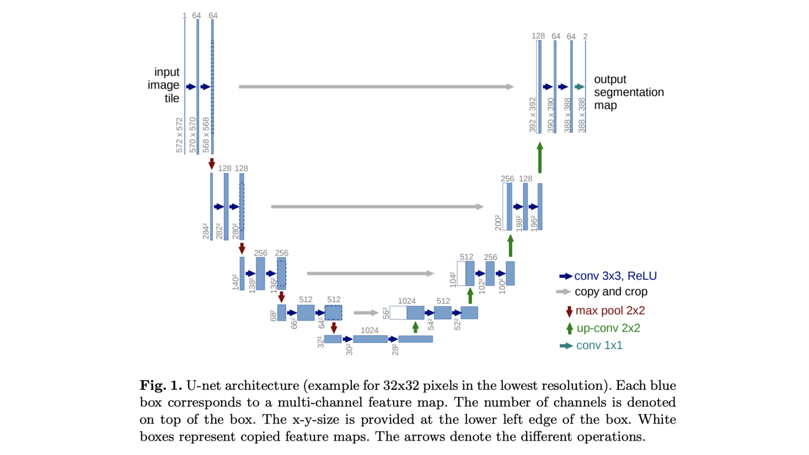
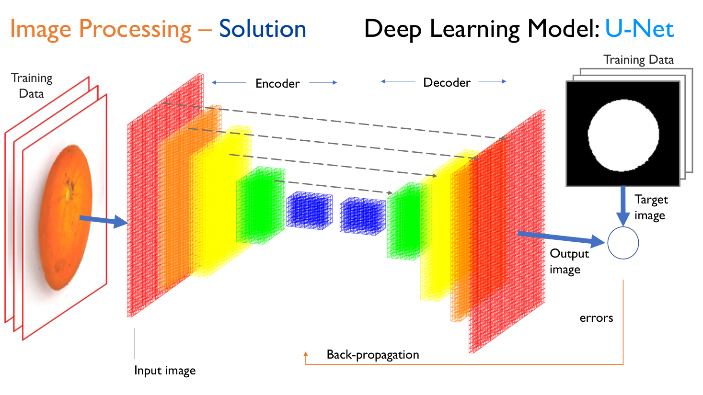
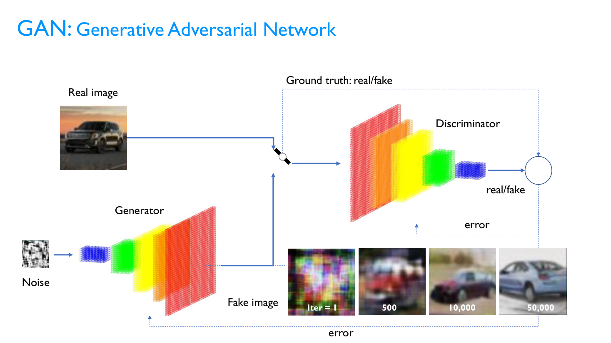
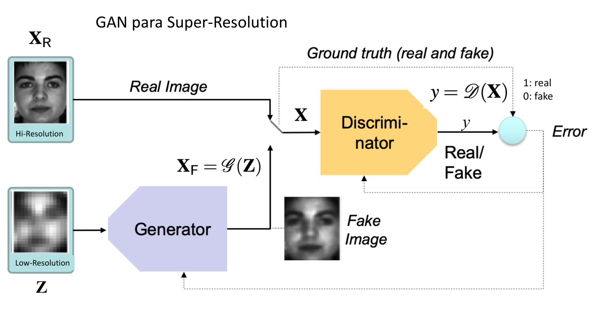
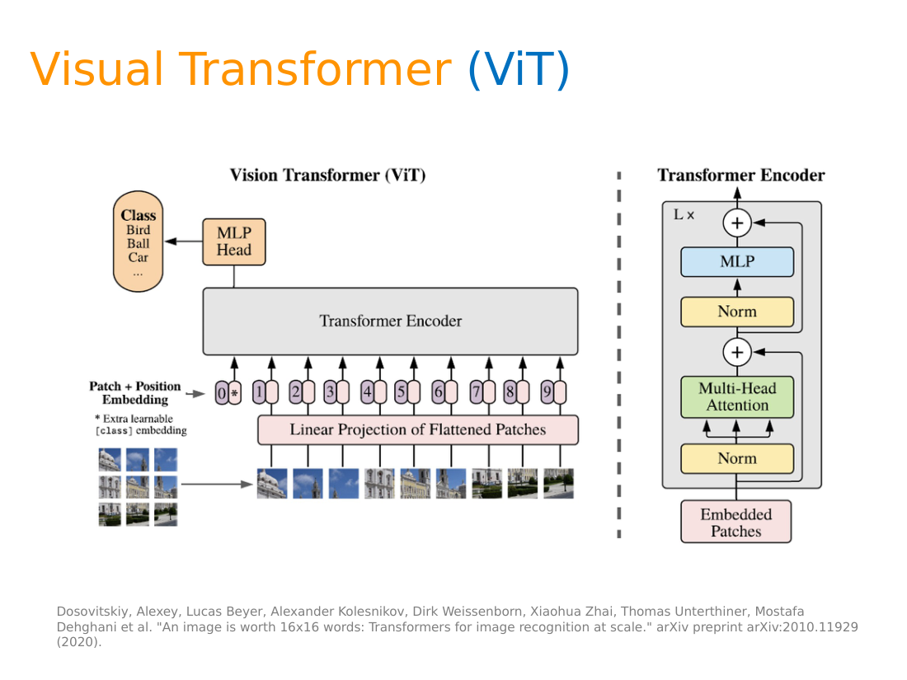
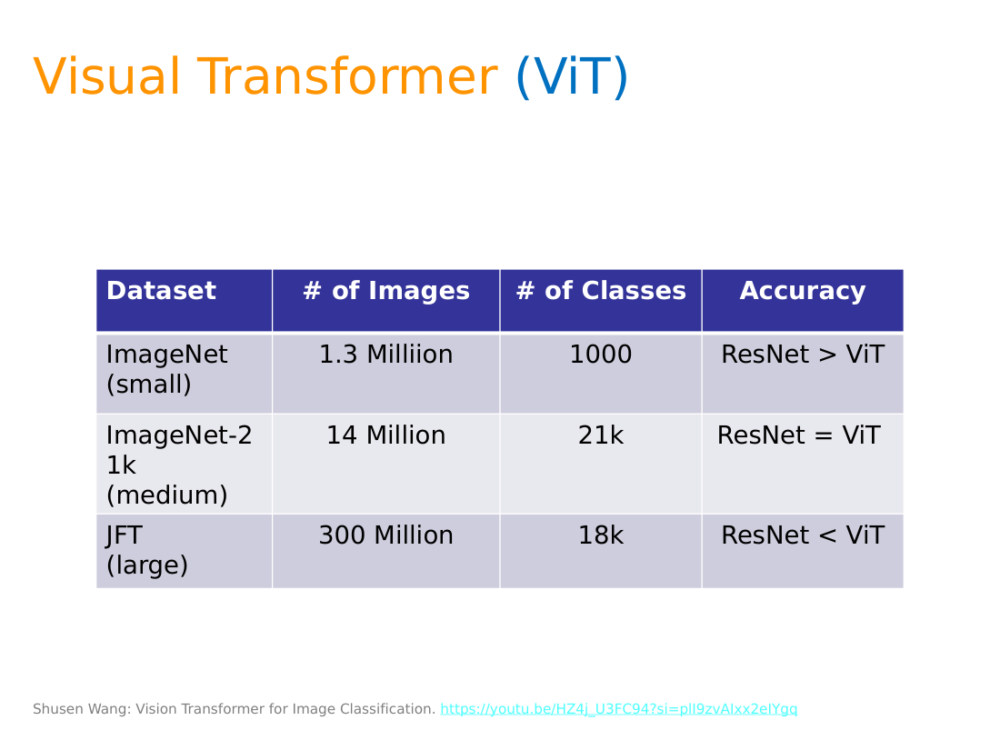

# Clase 22 · Tópicos avanzados: U-Net, GAN y Vision Transformers

> **Módulo 3 · Visión Artificial** · Martín Masci · jueves 18-jun-2026
> **Fuentes:** transcripción de la clase 22 · láminas `UNet_GAN - Teoría.pdf` y `CV03_VisualTransformers.pptx` (Domingo Mery, PUC Chile) · notebooks de Colab mostrados en clase (GAN y U-Net en PyTorch, ViT con Hugging Face)

## En pocas palabras

- Es la última clase del módulo y está dedicada a "tópicos avanzados": arquitecturas que salen un poco de las cajas vistas hasta ahora y que conectan visión artificial con segmentación fina, con IA generativa y con procesamiento de lenguaje natural.
- **U-Net** (2015) es una red encoder-decoder con forma de U: el encoder reduce la imagen como una CNN común y el decoder la reconstruye a tamaño original, pero recibiendo en cada nivel la información del nivel espejo del encoder (*skip connections*). Así no pierde el contexto que la CNN va descartando, y segmenta muy bien con pocos datos de entrenamiento, aunque cuesta más cómputo.
- Una **GAN** (red generativa adversaria) pone a competir dos redes: un **generador** que fabrica imágenes falsas a partir de ruido y un **discriminador** que intenta distinguir reales de falsas. El error del discriminador se retropropaga a ambos, y con miles de iteraciones el generador aprende a producir imágenes creíbles. Es el origen de la imagen generativa, y sirve también para detectar anomalías y para superresolución.
- Un **Vision Transformer (ViT)** trata una imagen "como una oración": la corta en parches de 16×16, aplana cada parche en un vector y los procesa con un encoder Transformer. No es una CNN. Con datasets enormes supera a ResNet, aunque con datasets chicos ResNet sigue ganando.
- Mensaje de cierre del módulo: los problemas reales se resuelven **combinando arquitecturas** de una caja de herramientas amplia, con la herramienta más simple que alcance para cada tramo del pipeline, y cuidando la explicabilidad y la seguridad de los datos.

## Conceptos clave

### Por qué aparecen estas arquitecturas

El problema de fondo, según el profesor, es siempre el mismo: entrenar una red convolucional requiere mucho dataset etiquetado. Los modelos preentrenados alivian eso, pero el *fine tuning* todavía pide bastantes datos. La pregunta que motiva estos desarrollos es: **¿se puede cambiar la arquitectura para lograr alta performance con poca data?**

Las tres arquitectas de la clase combinan piezas que ya existían (convoluciones, encoders, embeddings) de una forma nueva. Como dice el profesor, una pequeña modificación de una red da lugar a un "bichito nuevo" con nombre propio; lo que importa es entender la lógica que comparten.

### U-Net: encoder, decoder y conexiones espejo

**Problema que resuelve.** En una CNN, capa a capa el kernel recorre la imagen, la convolución + ReLU y el *max pooling* reducen la dimensión y la red se queda con lo relevante. Así gana el *qué* pero pierde el *dónde*: el contexto global se descarta y reconstruirlo hacia atrás es muy difícil. Para clasificar no importa, pero para **segmentar** (marcar exactamente qué píxeles forman el objeto, no solo una caja) sí.

**Idea.** Los autores del paper (2015, una universidad alemana, muy citado) llamaron **encoder** al tramo que reduce la dimensión y le enfrentaron, después de la última capa oculta, una red espejo, el **decoder**, que vuelve a agrandar la imagen hasta el tamaño original. Dibujada de costado, tiene forma de U.

**El truco: las conexiones espejo (*copy and crop*).** En cada nivel, el decoder no recibe solo la salida de su capa anterior: también recibe la salida del nivel correspondiente del encoder. Es decir, cada bloque del decoder combina:

1. lo que viene "de abajo" (la reconstrucción hasta ese punto), y
2. el mapa de características del encoder a esa misma escala, que aporta el contexto que se había descartado.

Ante la pregunta de si es un "espejo completo" (como un RAID 1 de discos), la respuesta fue que no: cada bloque del decoder recibe una parte de la red encoder más lo que viene de la capa anterior del propio decoder. En la figura, las flechas grises son esas copias, las rojas el *max pool* 2×2, las verdes las *up-convolutions* 2×2 y las azules las convoluciones 3×3 con ReLU.

**Entrenamiento.** Entra una imagen y sale una imagen del mismo tamaño (un mapa de segmentación). Esa salida se compara con la **imagen objetivo** del conjunto de entrenamiento (en la lámina, la máscara blanca de la naranja sobre fondo negro), y la diferencia es el error que se retropropaga.

> En clase el profesor describió la imagen objetivo como la salida de "la red tradicional" corrida sobre el conjunto de entrenamiento. Las láminas la muestran como la máscara del conjunto de entrenamiento (*training data*), que es la lectura que conviene usar.

**Costo vs. beneficio.** Un alumno preguntó si reutilizar la información descartada no hace la red más pesada. Sí: computacionalmente es más cara (se reemplazan las capas densas finales por una red espejo entera) y requiere GPU dedicada. La ganancia está en los **datos**, no en la velocidad: como no pierde información relevante, con mucho menos dataset segmenta mucho mejor. El profesor lo ilustró de forma exagerada: donde antes harían falta cientos de miles de fotos satelitales para detectar barcos, con U-Net "le metés 10 fotos y salen bien".

**Hiperparámetros.** El tamaño del kernel (3×3 en el paper), el *padding*, el *pooling* y la función de activación se pueden cambiar; cada combinación es una U-Net distinta. En los notebooks, encoder y decoder están codificados capa a capa, de modo que se puede intervenir con mucho detalle: sigue siendo una arquitectura transparente, no una caja negra.

### nnU-Net: diseño automático de la U-Net

Si cada combinación de hiperparámetros da otra U-Net, ¿cuál conviene? **nnU-Net** ("no new U-Net") automatiza ese diseño: dado un problema y un conjunto de reglas, busca la configuración más performante. Según se comentó en clase, en una competencia con **23 problemas médicos** estas redes superaron a otras alternativas de visión artificial. La lección del profesor: la búsqueda de hiperparámetros "tampoco merece la pena que la haga un humano". Aunque se popularizó en medicina, sirve para segmentar objetos en general.

### GAN: generador contra discriminador

Las redes generativas adversarias aparecen en la misma época (alrededor de 2014-2015). Hasta entonces se combinaban arquitecturas "de la misma familia" (por ejemplo, árboles en boosting); en redes profundas era menos intuitivo cómo combinarlas. La GAN combina dos redes que **compiten** entre sí.

**Cómo funciona:**

1. **Generador.** Es una red "al revés" de una CNN: en vez de ir de muchos píxeles a pocos, parte de pocos (por ejemplo, una imagen chica de ruido aleatorio) y va hacia una imagen más grande. Lo que produce se llama **imagen falsa** (*fake*).
2. **Discriminador.** Es una red convolucional que recibe una imagen, real o falsa, y responde si es real (1) o falsa (0) para la clase de interés (por ejemplo, "auto").
3. **Error.** Como nosotros sabemos si la imagen que entró era real o falsa (*ground truth*), conocemos el error del discriminador y lo retropropagamos.
4. **Lo adversario.** Ese mismo error se le pasa también al **generador**. El discriminador aprende a no dejarse engañar y el generador aprende a engañarlo mejor. Es un "loop de entendimiento": al principio es obvio qué es falso, y con las iteraciones se vuelve cada vez más difícil.

En cada iteración el generador parte de lo que produjo antes y lo mejora con el error; no vuelve a empezar desde el ruido. En la lámina: en la iteración 1 solo hay manchas de color, a las 500 ya no es una mancha, a las 10.000 se parece algo a un auto y a las 50.000 ya es un auto reconocible.

Matemáticamente, es un problema de optimización **max-min**: el discriminador maximiza su acierto y el generador lo minimiza. Cuanto más compleja es la imagen, más le cuesta converger, y la convergencia es sensible a las **condiciones iniciales**.

**Por qué se inventó: detección de anomalías.** Detectar anomalías es difícil porque no hay clases para "todo lo que puede salir mal". Un generador bien entrenado aprende a producir la versión normal de algo, pero no produce anomalías. Entonces se puede restar la imagen real menos la generada: lo que sobra es lo raro. El profesor citó (sin tener la referencia a mano) un trabajo con colonoscopías donde la resta deja en evidencia pólipos.

**Defectos.** Si en el camino se propaga un detalle mal aprendido, persiste: las primeras imágenes generadas tenían manos con cantidad equivocada de dedos u orejas extrañas, que delataban que eran falsas. Hoy eso está mucho más pulido, pero en *thispersondoesnotexist.com* todavía pueden verse cuellos u orejas raros si se mira con atención.

### Condiciones iniciales y superresolución (SRGAN)

Partir de ruido puro funciona para objetos simples. El ejemplo de las láminas es un trabajo de Domingo Mery que genera **shurikens** (estrellas ninja) en imágenes de rayos X, para detectar objetos peligrosos en equipaje, incluso con distintas inclinaciones. Para caras, en cambio, arrancar de ruido exigiría muchísimas iteraciones y aun así fallaría (por ejemplo, "le va a meter dos narices").

La solución es **arrancar de algo que ya se parezca al objetivo**. En **SRGAN** (*Super-Resolution GAN*) el generador recibe una imagen de baja resolución (muy pixelada) y produce una de alta resolución, que el discriminador compara con la real. Converge más rápido y mejor.

En la notación de la lámina: $X_F = \mathcal{G}(Z)$ es la imagen falsa generada a partir de $Z$, e $y = \mathcal{D}(X)$ es la salida del discriminador (1: real, 0: falsa).

Aplicaciones y riesgos que se mencionaron:

- Pasar de **baja a alta resolución** (LR → HR), por ejemplo para restaurar fotos antiguas o deterioradas.
- **Aumentación de datos** más rica: hasta ahora se aumentaba con transformaciones geométricas y de color; con generativa se pueden crear variantes o mejoras de la imagen.
- El riesgo ético: la red puede "inventar" una cara distinta a la real (el caso de la foto pixelada de Obama), y hoy se pueden quitar con bastante eficacia los difuminados que se usaron para censurar imágenes.
- **StyleGAN** de NVIDIA, repositorio open source con manipulaciones de caras, para explorar (requiere GPU).
- Generar **video** es bastante más difícil que entenderlo; ahí aparecen arquitecturas y combinaciones más complejas.

### Vision Transformers (ViT)

Los Transformers (*Attention is all you need*, 2017) nacieron en lenguaje natural, donde se trabaja con palabras, frases y oraciones. El **Vision Transformer** (*An image is worth 16x16 words*, 2020) lleva esa lógica a imágenes: **descompone la imagen como si fuera una oración**. Este tema conecta directamente con el módulo siguiente.

La diferencia con una CNN: la convolución hace un estudio muy local (una ventana que se va corriendo) y capa a capa gana el *qué* pero pierde el *dónde*. En el ViT toda la imagen queda representada en una secuencia de vectores, sin esa pérdida, y se trabaja con álgebra lineal.

**La descomposición en parches**, con el ejemplo de las láminas (una cara):

| Paso | Qué pasa | Dimensión |
|---|---|---|
| Imagen | cara RGB | 48×48×3 |
| Parches (*patches*) | se corta en 9 bloques de 16×16 | 9 × (16×16×3) |
| Aplanado | los 256 píxeles de cada canal se apilan en una columna | 256×1×3 |
| Concatenación de canales | rojo, verde y azul uno debajo del otro | 768×1 |
| Todos los parches | un vector por parche | 768×9 |

Después, cada vector se comprime con una **proyección lineal** (el profesor lo ilustró como un valor en escala de grises por parche) y se le suma un **embedding de posición**; además se agrega un *token* de clase aprendible. Esa secuencia entra al **encoder Transformer** (normalización, *multi-head attention*, MLP, repetido L veces) y una **cabeza MLP** final da la clase.

Así se juntan ideas de todo el módulo: **encoding** (como en U-Net) y **embeddings** (como los de reconocimiento facial). El profesor no entró en el detalle de la atención y las "cabezas" del encoder: reconoció que esa parte es más intrínseca, más de caja negra, y que se le puede "meter menos mano", aunque performa mucho mejor. Un paper de ejemplo aplica ViT a reconocimiento facial (*Face Transformer for recognition*, 2021).

**ViT vs. ResNet: depende del tamaño del dataset.**

| Dataset | Imágenes | Clases | Resultado |
|---|---|---|---|
| ImageNet (chico) | 1,3 millones | 1.000 | ResNet > ViT |
| ImageNet-21k (mediano) | 14 millones | 21.000 | ResNet = ViT |
| JFT (grande) | 300 millones | 18.000 | ResNet < ViT |

Conclusión: el ViT permite ir a una escala a la que ResNet no llega ("con 300 millones de imágenes, con ResNet la chocás"), pero **por debajo de unos 14 millones de imágenes no conviene** frente a una CNN. El profesor no recordaba por qué el dataset más grande tiene menos clases.

> Dato dudoso: ante una pregunta, el profesor dijo que la diferencia entre ResNet-50 y ResNet-100 "es un tema de batch size". En la nomenclatura habitual, el número indica la cantidad de capas (profundidad) de la red. Conviene verificarlo antes de repetirlo.

**Cambio de paradigma.** El ViT no es una CNN "con una vuelta de rosca", es otra clase de arquitectura. Por eso, para convencer, se compara performance contra performance. En el caso de lesiones de piel (ver Ejemplos), el ViT gana en *accuracy* de test frente a ResNets y VGG de distintos años.

## Ejemplos y casos de la clase

- **Segmentación médica con U-Net** (láminas). En lesiones de piel, el contorno amarillo es la predicción de la red y el verde el que marcó una persona; en algunos casos coinciden mucho y en otros la predicción "divaga" un poco, lo que no es grave porque al final interviene un humano. Lo mismo en tumores de mama en rayos X y en reconstrucción de resonancias magnéticas (*denoising*, con el paper de Han y Ye, 2018), donde la imagen requiere más tratamiento previo.
- **Autos generados por una GAN.** De ruido a un auto reconocible en unas 50.000 iteraciones. Muestra cómo el error compartido hace mejorar al generador.
- **Colonoscopías.** Restar imagen real menos imagen generada para encontrar pólipos: la GAN como detector de anomalías.
- **Shurikens en rayos X.** Objeto simple: la GAN converge aun partiendo de ruido y genera variantes con distintas inclinaciones.
- **Caras: "Esta persona no existe" y SRGAN.** Caras de personas inexistentes (útiles, por ejemplo, para presentaciones sin problemas de derechos de imagen, aunque llevan un aviso de que fueron generadas). Para caras conviene partir de una imagen pixelada.
- **ViT en lesiones de piel** (Mery et al., 2022, *50 ways to choose your model*). Se evaluaron 50 modelos de 15 arquitecturas sobre el dataset ISIC HAM10000. El mejor fue un ViT; las láminas muestran su matriz de confusión y ejemplos bien y mal clasificados.
- **El "espresso" de Hugging Face.** El ViT preentrenado clasificó una foto de una taza grande de café como *espresso*. Dos defectos: la imagen tiene muchas otras cosas (agua, azúcar, postre) y el modelo da una sola clase, y además, según el profesor, eso es claramente café de filtro y no un espresso. Muestra lo rápido y fácil que es, y también que es una caja negra donde "no hay mucho para hacer".
- **Grafología con Roboflow.** Al inicio, a partir de una consulta de una alumna, el profesor contó cómo encara un problema nuevo: buscar el marco teórico en Google Scholar (un paper que vincula redes profundas con técnicas de ML) y, en paralelo, armar un prototipo rápido en Roboflow. El workflow analizó un texto escrito por él y devolvió líneas detectadas, indicadores (por ejemplo un *proxy* de presión del trazo, poco fiable con tinta digital) y un reporte de estilo con un aviso de que no es concluyente. La lección: revisar siempre la trazabilidad y la robustez de lo que otro desarrolló, y desconfiar de leer una salida como causa-consecuencia.
- **Reconocimiento de emociones** (pregunta de un alumno). Viene después de detectar y recortar caras: sobre la cara recortada (o la secuencia de recortes de un video) se aplica un modelo de ML relativamente simple que asocia rasgos de la malla facial con emociones (la literatura suele usar siete). La clave no está en la diferencia entre foto y video, sino en lo que se hace con la cara ya recortada.

## Práctica

No hubo ejercicio para resolver; el profesor mostró notebooks de Colab para explorar por cuenta propia:

- **GAN en PyTorch (de Domingo Mery).** Genera dígitos a partir de ruido, con bloques separados para el ruido, el generador y el discriminador. Para mirar: en el paso 14.000 algunos caracteres ya se parecen a números, y hacen falta unas 67.000 iteraciones para generar un conjunto de 25 dígitos. Tarda un par de horas, así que no hace falta correrlo. La idea es ver cuánto cuesta generar algo tan simple y pensar cuánto más costaría generar caras.
- **U-Net (de Domingo Mery).** La arquitectura aparece capa a capa (encoder y decoder enfrentados), lista para modificar hiperparámetros.
- **ViT con Hugging Face.** Se instala `transformers` con PyTorch, se carga una imagen desde una URL con PIL, se usa el procesador de imágenes ViT y un modelo preentrenado, y se imprime la clase predicha. El nombre del modelo incluye `patch16`, que corresponde a los parches de 16×16. Se puede probar cambiando la URL por otra imagen (el profesor sugirió la foto del ajedrez de clases anteriores).

> Dato dudoso: el profesor interpretó el "224" del nombre del modelo preentrenado como "un tipo de optimizador". En esos nombres el número suele indicar la resolución de entrada (224×224 píxeles). Conviene verificarlo en la documentación del modelo.

## Para recordar

- "Cuando uno tiene un martillo, todos los problemas son clavos." Cuanto más amplia sea la caja de herramientas, más problemas se pueden resolver, y muchas herramientas distintas hacen en el fondo lo mismo.
- Usar la herramienta más simple que alcance en cada tramo: para limpiar datos o hacer una preclasificación, ML clásico; usar *deep learning* ahí es "matar un mosquito con un cañonazo". Datos, imágenes y píxeles deben ir cada uno por su bloque del pipeline, con entradas y salidas bien delimitadas.
- U-Net no es más rápida: es **más eficiente en datos**. Cuesta más cómputo pero necesita mucho menos dataset.
- En una GAN, las **condiciones iniciales** importan: cuanto más se parezca la entrada al objetivo, antes y mejor converge.
- El ViT gana con datasets enormes; con datasets chicos, ResNet sigue siendo mejor opción.
- Explicable vs. caja negra: Hugging Face o Roboflow resuelven rápido, pero se pierde trazabilidad. Hay quienes dicen "no lo toco porque funciona" y quienes preguntan "¿por qué funciona?"; el profesor se ubica en el segundo grupo ("yo soy de las ResNet").
- El profesor desconfía de lo último que sale si no está validado científicamente: mostrar una aplicación sin una teoría probada detrás "es mentirles".
- Imagen, sonido y video son **información sensible por definición**: no se controla adónde van una vez que se suben a un servicio. La ciberseguridad es el tema al que hay que prestarle más atención (un alumno contó que su app empezó a recibir ataques apenas escaló, incluidos intentos de agotar los tokens de un chatbot sin protecciones con problemas imposibles).
- Hacia adelante: realidad aumentada en visión artificial y computación cuántica en IA en general.

## Preguntas de repaso

1. ¿Qué información pierde una CNN al bajar capa a capa, y cómo la recupera la U-Net?

Pierde el contexto espacial global (el *dónde*): la convolución y el *pooling* reducen la dimensión y se quedan con lo relevante para reconocer el *qué*. La U-Net agrega un decoder espejo y, en cada nivel, le pasa al decoder el mapa del nivel correspondiente del encoder junto con lo que viene de la capa anterior del decoder. Así reconstruye una salida del tamaño original con el contexto que se había descartado, que es lo que necesita una segmentación píxel a píxel.

2. Si la U-Net cuesta más cómputo que una CNN de clasificación, ¿en qué sentido es "más performante"?

En el uso de los datos. Reemplaza las capas densas finales por una red espejo completa, así que necesita más cálculo y GPU, pero como aprovecha información que antes se descartaba, logra segmentaciones mucho más ajustadas con bastante menos dataset etiquetado.

3. ¿Por qué una GAN se llama "adversaria"? ¿Qué rol cumple el error del discriminador?

Porque dos redes compiten: el generador intenta producir imágenes falsas que pasen por reales y el discriminador intenta detectarlas. Como se sabe si cada imagen era real o falsa, se conoce el error del discriminador. Ese error se retropropaga a las dos redes: el discriminador aprende a no dejarse engañar y el generador aprende a engañarlo mejor.

4. ¿Cómo puede una GAN servir para detectar anomalías, si nunca vio ejemplos de las anomalías?

Justamente por eso. El generador aprende a producir la versión "normal" del objeto y no genera anomalías. Si se resta la imagen real menos la generada, lo que queda son las diferencias, es decir, lo anómalo (por ejemplo, un pólipo en una colonoscopía). Así se evita tener que definir clases para todo lo que puede salir mal.

5. ¿Por qué SRGAN parte de una imagen de baja resolución en vez de ruido puro?

Porque el entrenamiento es un problema max-min cuya convergencia depende de las condiciones iniciales. Para objetos simples, partir de ruido alcanza, pero para algo complejo como una cara harían falta muchísimas iteraciones y aun así aparecerían errores. Una imagen pixelada ya se parece al objetivo, y la red converge más rápido y mejor.

6. Describí cómo un ViT convierte una imagen de 48×48×3 en la entrada del encoder Transformer.

La corta en 9 parches de 16×16×3. Cada parche se aplana: 256 píxeles por canal, y los tres canales concatenados dan un vector de 768. Los 9 vectores forman una matriz de 768×9. Cada vector pasa por una proyección lineal, se le suma un embedding de posición y se agrega un *token* de clase. Esa secuencia, como si fuera una oración, entra al encoder Transformer, y una cabeza MLP da la clase.

7. Tenés un problema de clasificación con unas 50.000 imágenes etiquetadas. ¿ViT o ResNet? ¿Por qué?

Según la comparación de clase, con datasets chicos (incluso con 1,3 millones de imágenes de ImageNet) ResNet supera al ViT; recién se equiparan alrededor de 14 millones y el ViT gana claramente con cientos de millones. Con 50.000 imágenes, lo razonable es una CNN tipo ResNet (preentrenada y con *fine tuning*), que además es más explicable.

8. ¿Qué limitaciones mostró el ejemplo del "espresso" con el ViT de Hugging Face?

Que el modelo preentrenado devuelve una sola clase aunque la imagen tenga varios objetos (no es multiclase) y que se puede equivocar con seguridad (lo que mostraba era café de filtro). Como es una caja negra preentrenada, hay poco margen para ajustar o entender por qué falla, aunque sea muy rápido y fácil de usar.

## Conexiones

- **Clases anteriores del módulo (Clases 15 a 21):** la U-Net extiende las CNN de clasificación vistas en el módulo y lleva la detección con cajas a la segmentación semántica píxel a píxel. El ViT reutiliza la idea de **embedding** de reconocimiento facial (Clase 19). En la Clase 21 (OCR) quedó planteado que las redes que trabajan píxel a píxel no entienden contexto; los Transformers son el puente hacia redes que sí lo entienden.
- **Módulo 1 (Clase 03):** las GAN se presentan como una forma de combinar redes profundas, así como boosting y Random Forest combinan árboles.
- **Módulo siguiente (procesamiento de lenguaje natural) y bloque de IA generativa:** los Transformers nacen en lenguaje natural; el ViT es la misma lógica aplicada a imágenes. Las GAN son el origen de la imagen generativa que se va a profundizar después.
- **TFI:** la conexión es indirecta. La idea de representar una entrada como secuencia de *tokens* procesada por un encoder Transformer es la base de los embeddings que usa el retrieval semántico, pero en la clase no se trabajó con texto ni con métricas de retrieval.
