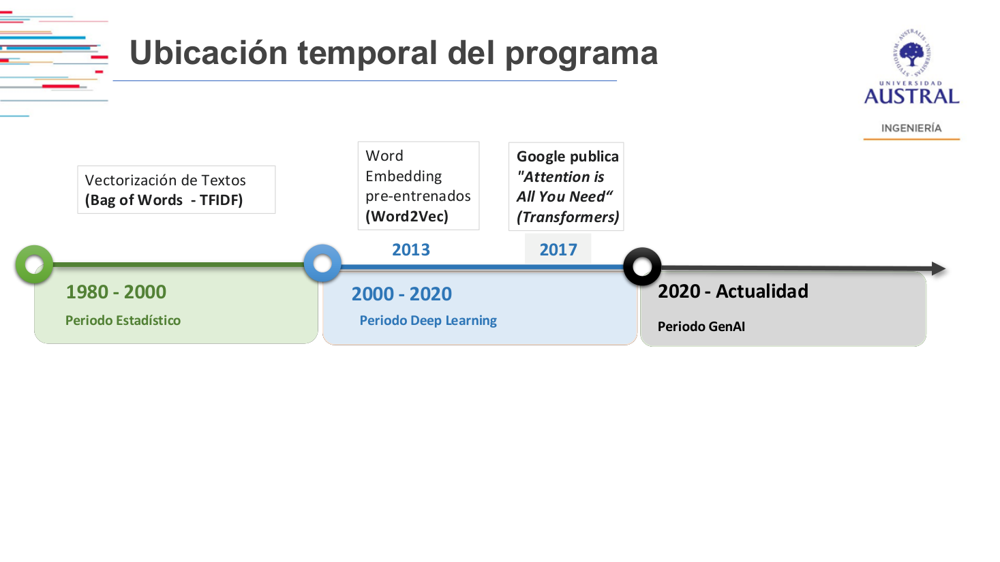
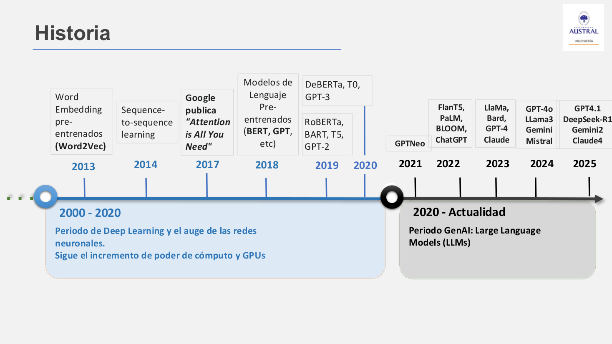
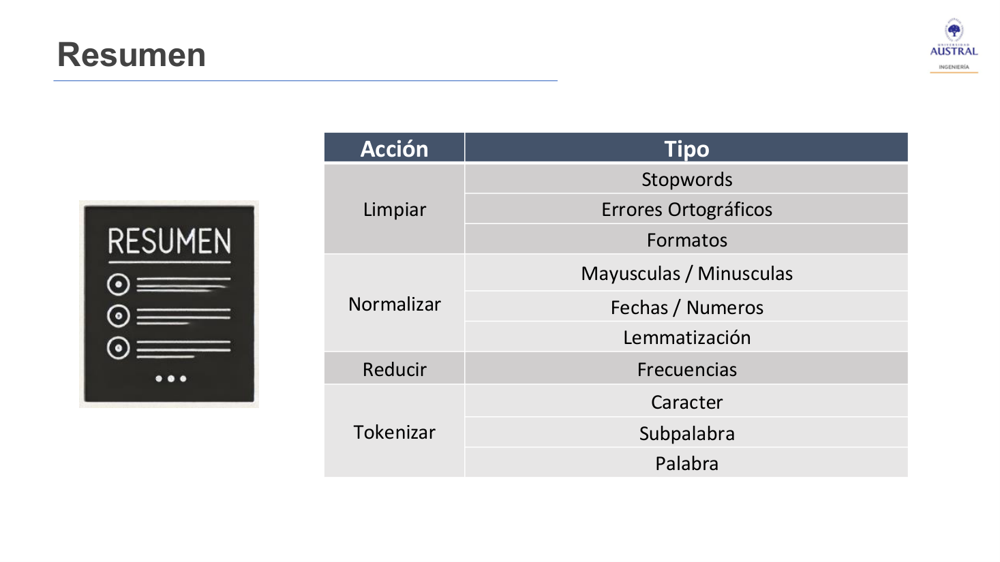
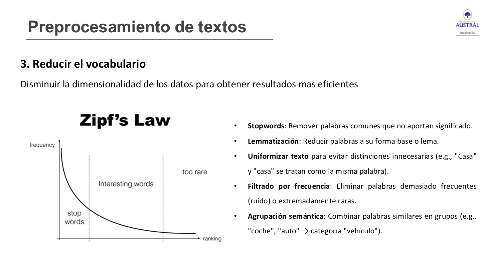
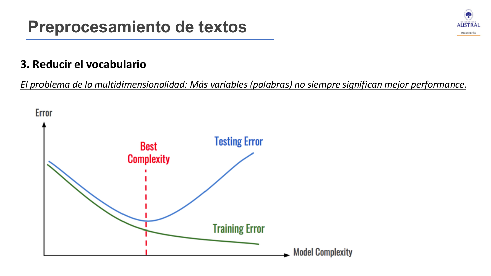
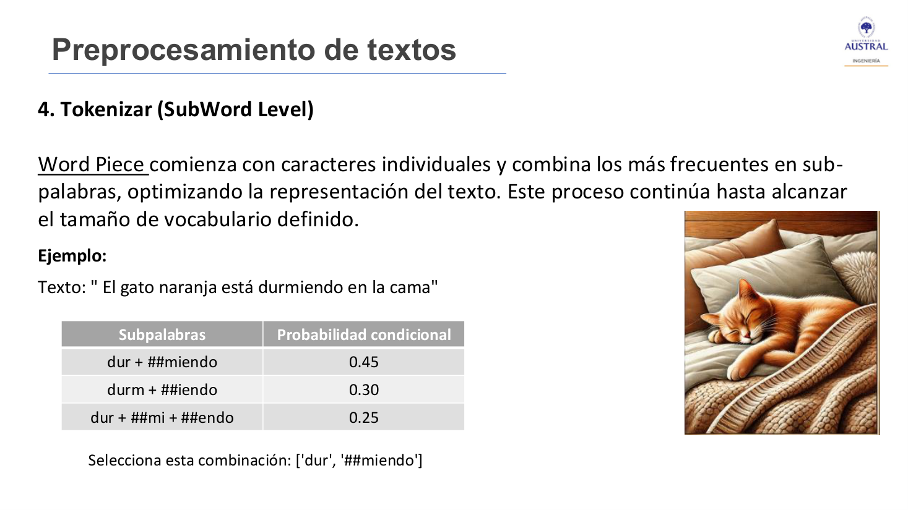

# Clase 23 · Introducción al NLP y preprocesamiento de textos

> **Módulo 4 · Procesamiento de Lenguaje Natural** · Horacio Arrigo · martes 23-jun-2026
> **Fuentes:** transcripción `DIA_Clase_23.vtt` · láminas `01_NLP_Clase_01_Presentacion.pdf` · notebooks `2025_NLP_Clase_01_Analisis_de_sentimiento_basico.ipynb` y `01_NLP_Clase_01_Teoria_Practica.ipynb` · `noticia.html` (material de apoyo)

## En pocas palabras

- El **procesamiento de lenguaje natural (NLP)** es la rama de la IA que se ocupa de la interacción entre personas y computadoras mediante el lenguaje humano: que las máquinas lo comprendan, lo interpreten y lo generen de forma útil. Hoy la IA generativa absorbió buena parte de la disciplina, pero los LLM llevan adentro todas estas técnicas, y entenderlas ayuda a usarlos mejor y a ver sus límites.
- La historia del NLP nace de una necesidad que sigue vigente: **traducir**. Va de la piedra de Rosetta al periodo lógico (reglas), al estadístico, al de deep learning (Word2Vec, LSTM y el Transformer de *Attention Is All You Need*) y al actual periodo de los LLM.
- **Preprocesar** es pasar de texto humano a una representación computable. Tiene cuatro acciones: **limpiar, normalizar, reducir y tokenizar**. Es un proceso iterativo, con idas y vueltas, no una receta lineal.
- El **token** es la unidad mínima de análisis. Hay muchas formas de tokenizar (palabra, subpalabra, carácter), y elegir una es una decisión de estrategia. Hoy el token es además la unidad con que se mide el uso y el costo de un modelo generativo.
- En el NLP clásico (Bag of Words, TF-IDF), el preprocesamiento era **crítico** para el desempeño. En el NLP moderno (Transformers) sigue siendo el primer paso, pero pesan más la curación, la segmentación y la consistencia que la limpieza lingüística intensa.

## Conceptos clave

### Qué es el NLP y para qué se usa

El lenguaje natural es la forma en que las personas se expresan, en cualquier idioma, a diferencia de un lenguaje de programación. El lenguaje fue siempre una barrera entre las personas y las máquinas, y el NLP busca acortarla. El profesor marcó un matiz: hoy se le dice "inteligencia artificial" casi solo a los chatbots, y en una app que genera video el NLP es apenas la **interfaz** entre lo que pide la persona y la máquina, no lo que genera el video.

Aplicaciones mencionadas (láminas y clase):
- Asistentes virtuales y chatbots.
- Inteligencia de mercado: CX (*customer experience*), reseñas, opiniones, reclamos.
- Traducción (el origen de la disciplina, y sigue vigente: traducción simultánea en Teams, por ejemplo).
- Predicción de escritura, reconocimiento del habla, subtitulado, transcripción.
- Clasificación de intenciones, clasificación y extracción de texto.
- Análisis de sentimiento y emociones (redes sociales, reseñas de comercios).
- Ciberseguridad: spam, phishing, fraude en correos.

### Historia: de la piedra de Rosetta a los LLM

*Figura: el curso se concentra en el periodo que va de 1980 a hoy. Vectorización de textos (BoW, TF-IDF) en el periodo estadístico; Word2Vec (2013) y el Transformer (2017) en el de deep learning; los LLM desde 2020.*

| Periodo | Rasgos | Hitos citados |
|---|---|---|
| Antecedentes | Interés por traducir entre culturas | Piedra de Rosetta (196 a. C., inscripciones en tres escrituras); Leibniz y Descartes proponen códigos que relacionen palabras entre idiomas (siglo XVII) |
| **Lógico** (1940–1980) | Enfoques basados en reglas | Turing, "Computing Machinery and Intelligence" y el test de Turing (1950); experimento de Georgetown (1954): traducción automática de unas 60 frases del ruso al inglés; Chomsky, *Syntactic Structures* (1957); **informe ALPAC** (1966), que concluyó que la traducción automática no había dado resultados y frenó la investigación |
| **Estadístico** (1980–2000) | Enfoque estadístico, primeras arquitecturas de redes, más poder de cómputo | Redes recurrentes, modelos ocultos de Markov para reconocimiento del habla, *word embeddings*, LSTM (1997) |
| **Deep learning** (2000–2020) | Auge de las redes neuronales, GPU | Word2Vec (Google, 2013); *sequence-to-sequence* (2014); **"Attention Is All You Need"** (Google, 2017), que presenta el Transformer; BERT y GPT (2018); GPT-2, RoBERTa, BART, T5 (2019) |
| **GenAI** (2020–hoy) | Modelos de lenguaje grandes (LLM) | GPT-3, ChatGPT, LLaMA, GPT-4, Claude, Gemini, DeepSeek-R1, etc. |

Dos ideas que remarcó el profesor:
- El Transformer fue el **quiebre**. Google lo aplicó primero en su traductor, que pasó de funcionar "más o menos" a dar un salto grande de calidad.
- Los LLM fueron posibles por el aumento del poder de procesamiento: las **GPU**, que antes se usaban para juegos o minería, hoy son casi una dependencia del desarrollo de IA.

*Figura: la lámina de historia reciente. Del Transformer (2017) a los modelos preentrenados (BERT, GPT) y a la ola de LLM desde 2020.*

### Preprocesamiento de textos: por qué y cuánto

Tener un texto digital no significa que la máquina lo "entienda": un procesador de texto lo muestra, le da formato o corrige la ortografía, pero no lo analiza. **Procesar** texto es que la máquina pueda extraer información de él. Para eso hay que preprocesarlo.

El papel del preprocesamiento cambió:
- En los modelos clásicos (**BoW, TF-IDF**) era crítico: gran parte del desempeño dependía de cómo se limpiaba, normalizaba y reducía el texto. Además, el cómputo era limitado y había que achicar todo lo posible.
- En los modelos modernos (**Transformers**) se priorizan la **curación** (qué textos se eligen), la **segmentación** y la **consistencia**. El preprocesamiento funciona más como un ajuste que mejora la calidad de los datos y la robustez del sistema. Igual sigue siendo el paso inicial de cualquier problema de NLP, incluso para LLM.

Las cuatro acciones:

### 1. Limpiar

Corregir errores en el contenido y eliminar información irrelevante o no deseada. Qué es "irrelevante" depende de la aplicación: si se analizan noticias de una industria, también es limpiar descartar las noticias que no interesan.

**Stopwords (palabras vacías).** Palabras comunes que no aportan significado al análisis.
- **Genéricas:** muy frecuentes en el idioma (artículos, preposiciones, contracciones).
- **De dominio:** propias del contexto. En artículos científicos, "resumen", "metodología" o "conclusión" pueden ser stopwords.
- Hay listas ya hechas en librerías de Python para varios idiomas; no hace falta armar el diccionario a mano.
- Ejemplo: en "El gato está durmiendo", con una lista estándar en español se van "el" y "está", y queda "gato durmiendo".

**Errores ortográficos.** Desviaciones de las reglas de escritura que afectan la representación de la palabra. Una palabra mal escrita casi no va a aparecer en otros textos, así que no aporta.
- **No intencionales:** desconocimiento o mal tipeo ("Quiciera saber qué hora es", "Las niñas juega en el parque").
- **Intencionales:** abreviaturas y énfasis, muy comunes en redes y mensajería ("xq hacía frío", "boniiito", "no me kiere"). También los emoticones.

**HTML y formatos.** El texto tomado de la web viene con etiquetas, atributos y estilos que solo sirven para mostrarlo en la página. Se eliminan para quedarse con el texto limpio. La lámina muestra un párrafo HTML con `` y un tweet con una URL, antes y después de limpiar.

### 2. Normalizar

Unificar las distintas formas de representar una misma palabra, para no tener que analizar cada variante por separado.

**Mayúsculas y minúsculas.** Pasar todo a minúsculas (o a mayúsculas) quita la influencia de la capitalización. Pero tiene costos:
- Puede borrar distinciones de significado: "el **E**stado nacional" vs. "estado líquido"; "**L**una, la diosa romana" vs. "la luna llena". Por eso, en **reconocimiento de entidades nombradas (NER)**, distinguir mayúsculas es crucial.
- Las mayúsculas y los signos de admiración transmiten **tono**: "¡ESTOY MOLESTO POR LO QUE SUCEDIÓ!" es más negativo que la versión en minúsculas. En análisis de sentimiento de reseñas, normalizar puede perder esa señal.

**Números y fechas.** Adoptar un formato único en todo el texto: "Ocho", "OCHO" y "8" → `8`; "24/5/82", "24 de mayo del 82" y "24 de mayo de 1982" → `24-05-1982`.

**Lematización.** Reducir las formas de una palabra a su **forma base (lema)**, que tiene significado:
- Tiempos verbales: "corriendo" → "correr".
- Plurales: "gatos" → "gato".
- Adjetivos: "mejor" → "bueno", "peores" → "malo".

El texto resultante suena rústico ("el gato estar dormir"; "el antiguo ascensor del edificio no funcionar"), pero no importa que sea legible para una persona: importa que sea procesable.

**Part of Speech (POS) tagging.** Identifica el **rol gramatical** de cada palabra en la oración (sujeto, verbo, objeto, modificadores), como el análisis sintáctico de la escuela. Como las palabras del mismo tipo siguen reglas parecidas, el POS facilita la lematización: primero se sabe qué rol cumple la palabra y después se la lleva a su lema.

**Stemming.** Reducir la palabra a una **raíz aproximada** recortando prefijos y sufijos, sin buscar la forma canónica ni mirar el contexto gramatical. "Los antiguos ascensores del edificio no funcionaban" → "los antigu ascensor del edifici no funcion". Es más tosco que lematizar, pero también reduce la cantidad de palabras distintas.

| | Lematización | Stemming |
|---|---|---|
| Resultado | Forma base con significado (lema) | Raíz recortada, puede no ser una palabra |
| Usa contexto gramatical | Sí (se apoya en el POS) | No |
| Ejemplo | "funcionaban" → "funcionar" | "funcionaban" → "funcion" |

### 3. Reducir el vocabulario

Disminuir la **dimensionalidad** de los datos (cada palabra distinta es, en la práctica, una variable más) para obtener resultados más eficientes. Técnicas de la lámina: quitar stopwords, lematizar, uniformizar ("Casa" y "casa" son la misma), **filtrar por frecuencia** y **agrupar semánticamente** ("coche", "auto" → "vehículo").

**Ley de Zipf.** Si se ordenan las palabras de un corpus por frecuencia, la frecuencia de cada una es inversamente proporcional a su posición en el ranking (en un gráfico log-log queda casi una recta). Unas pocas palabras muy frecuentes dominan el texto y la mayoría aparece muy poco.

*Figura: a la izquierda, las stopwords (frecuencia muy alta); a la derecha, las palabras demasiado raras (entre ellas, las mal escritas). Lo que aporta información está entre dos umbrales, que hay que definir en cada caso.*

Ejemplos de reducción de las láminas:
- Resumen de un paper (≈50 palabras) → "estudio investigar impacto diferente concentración nitrógeno crecer planta…" (≈30 palabras).
- Informe de incidente → "ayer tarde sistema degradación respuestas tardaban normal…".
- Reseña de auriculares (≈40 palabras) → "auriculares cancelación ruido batería sonido cómodos micrófono bluetooth precio viajar" (≈10 palabras). Para saber de qué habla la reseña, eso puede alcanzar.

**El problema de la multidimensionalidad.** Más palabras no significa mejor performance. Lo importante es capturar lo útil, no lo redundante. Si se sigue sumando complejidad, el error de entrenamiento baja pero el de test sube: es el **sobreajuste** (*overfitting*).

### 4. Tokenizar

Transformar el texto en **tokens**, las unidades mínimas de análisis que procesan los sistemas. La simplificación habitual "un token es una palabra" es práctica, pero un token puede ser una palabra, un pedazo de palabra, un carácter o varias palabras juntas. Elegir la unidad es una **estrategia**: de esa elección depende que el algoritmo funcione mejor o peor para el análisis. Incluso se puede inventar una técnica propia.

El token trascendió por dos razones: mide cuánto procesamiento se usa y es la **unidad de facturación** del consumo de modelos generativos.

**Nivel palabra** (texto: "El gato naranja está durmiendo en la cama"):

| Tokenizador | Criterio | Tokens |
|---|---|---|
| *White space* | Lo que queda entre espacios | ["El", "gato", "naranja", "está", "durmiendo", "en", "la", "cama"] |
| Por diccionario | Solo lo que está en un diccionario (acá, de sustantivos) | ["gato", "cama"] |
| Basado en reglas / spaCy | Etiquetado morfológico y gramatical; regla: SUST o SUST + ADJ | ["gato", "gato naranja", "cama"] |

La lámina también nombra el *Penn Tree Tokenizer*. El caso de spaCy muestra que un token puede tener **dos palabras** cuando juntas tienen más sentido.

**Idiomas sin espacios.** En chino, las palabras se componen de caracteres (*hanzi*), cada uno un morfema. No se pueden separar a gusto: agrupar distinto cambia el significado. "猫 正在 睡觉" es "el gato está durmiendo"; con "睡觉" partido en "睡 觉", pasa a ser algo como "el gato está durmiendo sueño". Un alumno agregó que además el orden de la oración cambia respecto del español. Es uno de los desafíos de la traducción, justamente el origen del NLP.

**Nivel subpalabra:**
- **n-gramas de caracteres:** ventana deslizante de $n$ caracteres; lo más frecuente es $n=3$ (trigramas): 'El ', 'l g', ' ga', 'gat', 'ato'…
- **n-gramas de palabras:** bigramas ("el gato", "gato naranja", "naranja está"…) o combinaciones de unigramas y bigramas. Capturan qué palabras van juntas, pero el **procesamiento crece muchísimo** al agregar gramas.
- **WordPiece:** arranca con caracteres individuales y va combinando los pares más frecuentes en subpalabras, hasta alcanzar el tamaño de vocabulario definido.
- La lámina nombra también **SentencePiece** (no se desarrolló).

*Figura: entre las segmentaciones posibles de "durmiendo", WordPiece elige la de mayor probabilidad condicional, `dur + ##miendo` (0.45). El prefijo `##` marca que la subpalabra continúa una palabra.*

El profesor conectó esto con la frase "un LLM solo predice la palabra más probable": los primeros sistemas se basaban en **probabilidades condicionales** (qué tan probable es que una palabra vaya acompañada de otra), y los LLM, entrenados con muchísimo texto, generan siguiendo esa misma lógica, a otra escala.

**Nivel carácter:** cada carácter es un token ("E", "l", "g", "a", "t", "o"…). Visto así parece poco útil, pero sirve en algunos tipos de procesamiento.

### Preprocesamiento en el NLP moderno

Lo que se sigue haciendo hoy, incluso para entrenar modelos grandes:
- **Curación y deduplicación:** quitar documentos repetidos o casi repetidos, para evitar *data leakage* y **sesgo por repetición** (repetir algo muchas veces le da más peso, aunque no lo haga más válido).
- **Normalización de formato y codificación:** unificar el *encoding*, sobre todo con idiomas que tienen caracteres propios (el ejemplo fue el portugués).
- **Filtrar ruido:** etiquetas, formato, contenido que no es texto útil.
- **Consistencia:** la misma tokenización, normalización y criterios de limpieza en todos los entornos y para todas las fuentes. Parece obvio, pero no siempre se cumple.
- **Menos limpieza lingüística intensa:** stemming y lematización se usan menos.

Beneficios del preprocesamiento (lámina de resumen):
- **Reducir dimensionalidad:** menos palabras únicas → menos dispersión (*sparsity*) → entrenamientos más rápidos.
- **Mejor semántica:** lematizar "correr", "corriendo" y "corrió" agrupa mejor el significado.
- **Menos overfitting:** al eliminar ruido, el modelo generaliza mejor.

## Ejemplos y casos de la clase

**Análisis de sentimiento con diccionarios.** El profesor mostró en Colab un analizador muy simple para ver lo difícil que es algo que una persona resuelve leyendo.
- Versión 1: dos listas (positivas: bueno, excelente, maravilloso; negativas: malo, pésimo, terrible). Se cuentan coincidencias y gana la mayor; si empatan, es neutro.
- "Este producto es muy bueno, pero el precio es terrible." dio **positivo**. El motivo: `split()` dejó el token `"terrible."` con el punto pegado, que no está en el diccionario. **Un preprocesamiento olvidado (la puntuación) cambia el resultado.** Sin el punto da neutro, y ahí aparece otra pregunta: ¿pesa más que el producto sea bueno o que el precio sea terrible?
- "muy" no se cuenta. Si se agrega a las dos listas, suma de los dos lados y no cambia nada: habría que ver a qué palabra acompaña.
- Versión 2: un solo diccionario con puntaje por palabra (bueno +1, feo −1, hermoso +2, terrible −2, horrible −3, nefasto −3…), se suma y el signo decide. "Este producto es horrible, pero el precio es bueno" da **negativo** (−3 + 1). "El precio es demasiado alto" no resta nada porque "demasiado alto" no está en el diccionario, que además solo tiene palabras sueltas.
- Casos que un diccionario no resuelve: "Amo!", "No lo quiero, lo necesito" (parece negativo y es muy positivo) y "Es maravilloso si querés tirar el dinero" (ironía). El **sarcasmo y la ironía** fueron, y en parte siguen siendo, un gran desafío para el NLP.

**Stopwords que no se eliminaron.** Un alumno preguntó por qué en el resumen reducido del paper quedó la "y" de "rendimiento agrícola y sostenibilidad ambiental". El profesor lo interpretó como un término compuesto que se decidió conservar: cuando dos términos están muy relacionados, a veces conviene mantener la relación (lo mismo que hace un token de dos palabras). Aplicar las técnicas "a ciegas" no funciona del todo bien.

**¿Qué es una palabra importante?** Ante la pregunta de si hay una función para detectar palabras importantes, la respuesta fue que no en general: depende de la aplicación. En reseñas de hotel, "habitación" es clave aunque esté entre "era" y "pero" en el ranking de frecuencia. Una palabra única tampoco es necesariamente importante: puede aparecer por una analogía (por ejemplo, "harina" en un artículo científico que usa la comparación con una receta).

## Práctica

**Notebook `2025_NLP_Clase_01_Analisis_de_sentimiento_basico.ipynb`.** Es el analizador por diccionario descrito arriba. Para jugar: probar los textos de ejemplo del final, sacar la puntuación, agregar intensificadores.

**Notebook `01_NLP_Clase_01_Teoria_Practica.ipynb`** (trabajo en grupos). Aplica la teoría con spaCy (`es_core_news_sm`), NLTK y `language_tool_python` sobre **20 reseñas ficticias de hotel**. Qué mirar:
- **EDA de texto:** 296 palabras en total y 98 únicas; promedio de 14,8 palabras por reseña. Top de frecuencias: "el" 27, "la" 18, "era" 17, "habitación" 12, "pero" 10. La "frecuencia de frecuencias" muestra la forma de Zipf: 46 palabras aparecen en un solo comentario. Gráfico de Zipf en escala lineal y log-log.
- **Qué hace spaCy al llamar `nlp(text)`:** tokenizer → POS tagger → dependency parser → lematizador. Por token se ven `text`, `lemma_`, `pos_`, `tag_` y `dep_`, y `displacy` dibuja el árbol de dependencias.
- **Stopwords:** con `token.is_stop`, una oración de 22 tokens queda en 11 (50 % de reducción).
- **Corrección ortográfica:** `language_tool_python` es lenta y da falsos positivos con términos técnicos (cambió "preprocesar" por "reprocesar"). Conviene usarla solo cuando haga falta.
- **Impacto en el vocabulario:** según el diagrama del notebook, 114 palabras originales → 110 con minúsculas → 85 sin stopwords → 61 lematizando.
- **Tokenización:** funciones a nivel palabra, carácter, ventana de caracteres, n-gramas (`bigrams`, `trigrams` de NLTK), filtrado por POS (solo sustantivos) y frases nominales (secuencias NOUN/ADJ/PROPN).
- **`preprocess_pipeline()` configurable:** flags para minúsculas, stopwords, lematización, puntuación, números y largo mínimo de token. Se comparan configuraciones mínima, estándar y agresiva. La estándar aplicada a todas las reseñas lleva el vocabulario de 114 a 63 palabras únicas (−44,7 %).
- **Guía de decisiones** (tabla del notebook):

| Tarea | Minúsculas | Stopwords | Lematización | Puntuación |
|---|---|---|---|---|
| Análisis de sentimiento | ❌ | ⚠️ depende | ✅ | ❌ (los `!?` aportan) |
| Topic modeling | ✅ | ✅ | ✅ | ✅ |
| Clasificación de texto | ✅ | ⚠️ depende | ✅ | ✅ |
| NER | ❌ | ❌ | ❌ | ❌ |
| Traducción automática | ❌ | ❌ | ❌ | ❌ |
| Búsqueda de documentos | ✅ | ✅ | ✅ | ✅ |

  Ojo: el diagrama de flujo del mismo notebook marca las minúsculas como recomendadas para sentimiento, a diferencia de la tabla. Es coherente con lo visto en clase: las mayúsculas pueden transmitir enojo, así que conviene evaluarlo caso a caso.
- **Reglas prácticas del notebook:** validar el impacto de cada paso en la tarea, empezar con un preprocesamiento mínimo, medir antes y después, no copiar configuraciones de otra tarea y preservar el texto original cuando importa (NER, generación).

El archivo `noticia.html` (una página ficticia, "Noticias Falsas Hoy", sobre el impacto de la IA en la sociedad) sirve de material para practicar la limpieza de HTML con BeautifulSoup.

## Para recordar

- El preprocesamiento es **iterativo**: se limpia, normaliza, reduce y tokeniza, y se vuelve atrás a revisar, como en cualquier desarrollo de IA.
- No hay recetas: qué es stopword, qué palabra es importante y qué umbral de frecuencia usar **dependen de la aplicación**. "No es que uno aplica un algoritmo y ya está."
- Que el texto procesado sea ilegible para una persona no importa; importa que sea procesable y que conserve la información útil.
- Un detalle olvidado (un punto pegado a una palabra) puede invertir el resultado de un análisis.
- Normalizar tiene costo: las mayúsculas distinguen entidades (NER) y transmiten tono (sentimiento).
- Más palabras no es mejor: hay que capturar lo útil, no lo redundante, o se cae en sobreajuste.
- Hoy un análisis de sentimiento se puede hacer con un LLM sin mucho costo, pero entender estas dificultades ayuda a saber qué hay adentro del modelo y dónde puede fallar.

## Preguntas de repaso

1. ¿Por qué el preprocesamiento era crítico en el NLP clásico y hoy pesa menos?

En los modelos clásicos (BoW, TF-IDF) cada palabra distinta es una dimensión, y el cómputo era limitado: gran parte del desempeño dependía de cuánto se limpiaba y reducía el vocabulario. Los Transformers manejan mucho mejor el texto crudo y hay mucho más poder de cómputo. Por eso hoy importan más la curación, la deduplicación y la consistencia que la limpieza lingüística intensa, aunque el preprocesamiento sigue siendo el primer paso.

2. ¿Qué diferencia hay entre lematizar y hacer stemming? ¿Qué papel cumple el POS tagging?

Lematizar lleva la palabra a su forma base con significado ("funcionaban" → "funcionar") y usa el contexto gramatical. El stemming recorta prefijos y sufijos hasta una raíz aproximada que puede no ser una palabra ("funcion"), sin mirar el contexto. El POS tagging identifica el rol gramatical de cada palabra, y eso permite aplicar las reglas de lematización correctas según el tipo de palabra.

3. Según la ley de Zipf, ¿qué palabras conviene conservar al reducir el vocabulario y por qué?

Las de frecuencia intermedia. Las muy frecuentes suelen ser stopwords que no aportan información, y las muy raras suelen ser errores ortográficos o apariciones ocasionales. Los umbrales no son fijos: en las reseñas de hotel, un corte por frecuencia mal puesto puede llevarse "habitación", que es clave.

4. ¿Por qué convertir todo a minúsculas no siempre es buena idea?

Porque las mayúsculas llevan información. Distinguen entidades de palabras comunes ("Luna" la diosa vs. "la luna"; "Estado" vs. "estado"), lo que es crucial en NER. Y expresan tono: un texto en mayúsculas y con signos de admiración suele indicar enojo, lo que importa en análisis de sentimiento.

5. ¿Por qué se dice que tokenizar es una decisión de estrategia? Dé ejemplos de tokens que no son una palabra.

Porque el token es la unidad mínima que va a procesar el algoritmo, y según qué unidad se elija el análisis funciona mejor o peor. Ejemplos: "gato naranja" como un solo token (regla SUST + ADJ con spaCy), trigramas de caracteres ("gat", "ato"), subpalabras de WordPiece ("dur", "##miendo") o caracteres sueltos. En chino, además, separar mal los caracteres cambia el significado.

6. ¿Qué ventaja y qué costo tienen los n-gramas de palabras?

Capturan qué palabras aparecen juntas y la relación entre ellas ("gato naranja"). El costo es que la cantidad de tokens, y con ella el procesamiento, crece muchísimo al agregar bigramas, trigramas, etc.

7. En el analizador de sentimiento por diccionario, ¿por qué "Este producto es muy bueno, pero el precio es terrible." dio positivo, y qué otros problemas quedan aun corrigiendo eso?

Porque `split()` dejó "terrible." con el punto pegado, que no coincide con "terrible" del diccionario: solo se contó "bueno". Corrigiendo la puntuación da neutro, pero quedan otros problemas: los intensificadores ("muy") no se tienen en cuenta, las expresiones de varias palabras ("demasiado alto") no están en el diccionario, no se sabe cuál de los dos aspectos pesa más, y la ironía o expresiones como "No lo quiero, lo necesito" engañan al conteo.

8. ¿Qué es el sesgo por repetición y por qué se deduplica un corpus?

Cuando un texto aparece muchas veces, el modelo le da más peso, aunque repetirlo no lo haga más válido. Quitar documentos repetidos o casi repetidos evita ese sesgo y también el *data leakage*, es decir, que la misma información termine en entrenamiento y en evaluación.

## Conexiones

- **Hacia atrás:** el problema de la multidimensionalidad y la curva de error de entrenamiento vs. test retoman el sobreajuste y la reducción de dimensión del Módulo 1 (Clases 03 a 05). Las redes neuronales, LSTM y la mención a Computer Vision remiten a los Módulos 2 y 3.
- **Hacia adelante:** el vocabulario que se construye acá es la entrada de la vectorización con Bag of Words y TF-IDF (Clase 24) y de los *word embeddings* como Word2Vec (Clase 25). El Transformer, BERT y los modelos generativos que aparecen en la historia se desarrollan en las clases siguientes del módulo (el profesor anticipó que BERT y DistilBERT se ven cerca del final, más como historia que como práctica).
- **TFI:** la normalización de nombres comerciales de Benefix depende directamente de estas decisiones. Las minúsculas, los acentos, la puntuación y las abreviaturas determinan si el retrieval léxico encuentra coincidencias, y la elección de tokens (palabra, n-gramas de caracteres, subpalabras) cambia la tolerancia a errores de tipeo. Siguiendo la regla del notebook, conviene medir el impacto de cada paso de preprocesamiento sobre Hit@k y MRR en vez de copiar una configuración. Ojo con normalizar de más: en un nombre comercial, como en NER, las mayúsculas o un número pueden ser parte de la identidad de la marca.
