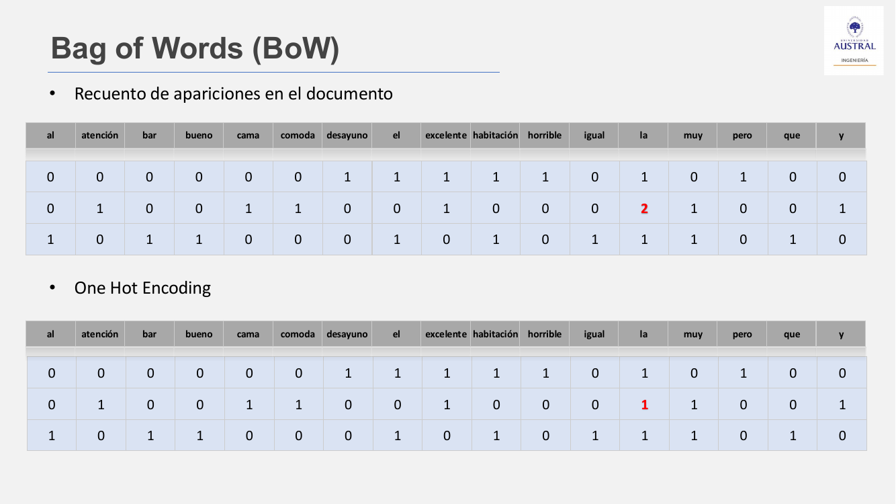
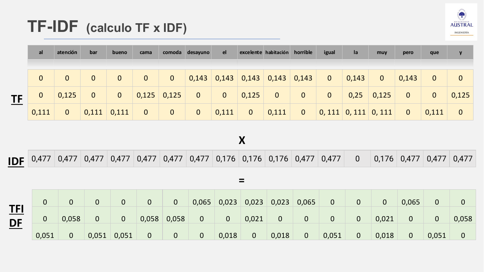
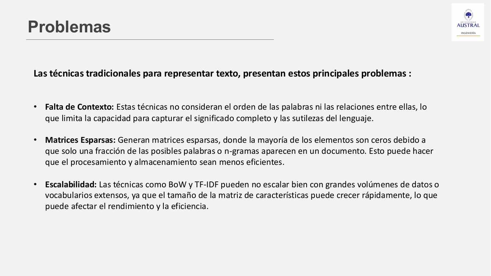
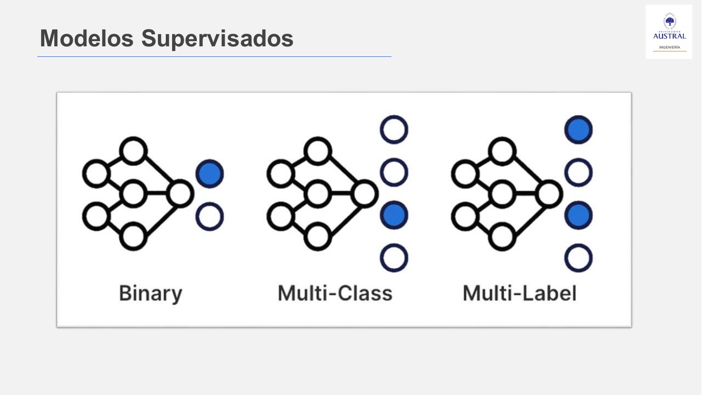
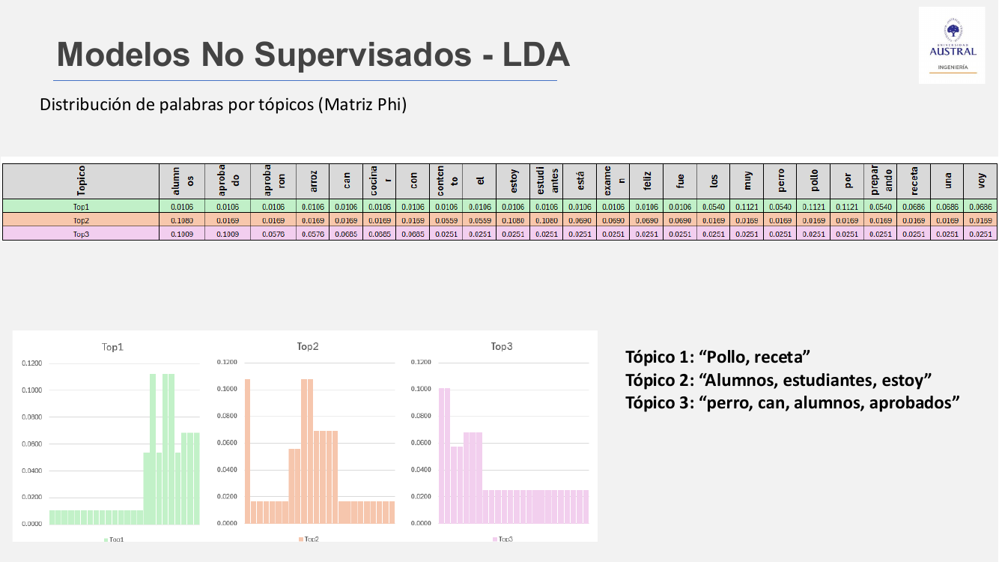
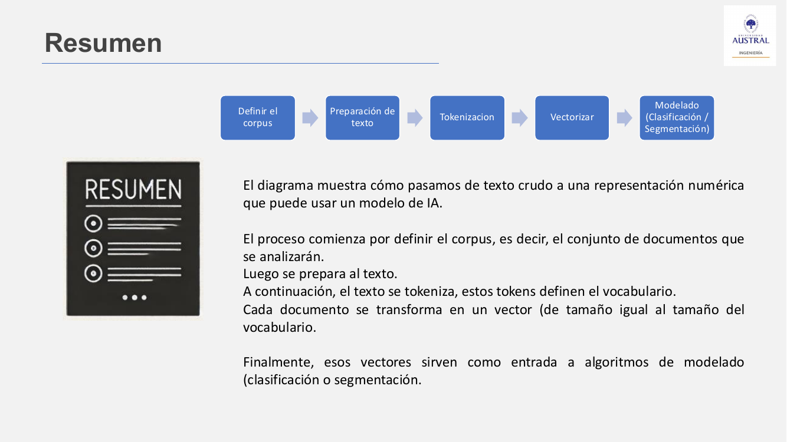

# Clase 24 · Espacios vectoriales: BoW, TF-IDF y modelado (clasificación y topic modeling)

> **Módulo 4 · Procesamiento de Lenguaje Natural** · Horacio Arrigo · jueves 25-jun-2026
> **Fuentes:** transcripción de la clase (segunda clase del curso de NLP) · láminas `01_NLP_Clase_02_Presentacion.pdf` · notebook `01_NLP_Clase_02_Teoria_Practica.ipynb` (reviews de hoteles)

## En pocas palabras

- Una computadora no puede operar con texto: hay que llevarlo a **vectores** (una matriz documento-término) para aprovechar todo el álgebra lineal y los algoritmos que ya existen. A eso se le llama construir un **espacio vectorial**.
- Las primeras técnicas son **Bag of Words** (cuenta apariciones), **One-Hot Encoding** (solo presencia o ausencia) y **TF-IDF** (pondera cada palabra según su frecuencia en el documento y su rareza en el corpus). Todavía **no son embeddings**: no capturan contexto ni significado.
- Su costo: matrices de tamaño $D \times V$ que crecen con el vocabulario, muy **dispersas** (llenas de ceros), sin **contexto** y poco **escalables**. Los n-gramas suman algo de contexto, pero agrandan aún más la matriz. El preprocesamiento de la clase anterior (stopwords, lematización) es el primer remedio.
- Con el texto vectorizado se aplican modelos **supervisados** (clasificación binaria, multiclase o multilabel, por ejemplo análisis de sentimiento) o **no supervisados** (*topic modeling*: LSA con SVD y LDA probabilístico).
- Todo se resume en un pipeline: **definir el corpus → preparar el texto → tokenizar → vectorizar → modelar**. Es iterativo, y la solución vale para *ese* corpus.

## Conceptos clave

### Por qué vectores

El texto preprocesado sigue siendo texto, y eso no es computable. La idea es convertir documentos (oraciones, reseñas, artículos o libros enteros) en una **matriz numérica**. Se eligen vectores y matrices, y no simples números, porque así se puede aplicar todo el **álgebra lineal** y la enorme cantidad de algoritmos que ya trabajan sobre matrices.

Los **embeddings** que se escuchan hoy (incluso en los LLM) también son vectores, de dimensión muy grande. Pero las técnicas de esta clase son anteriores y más simples. En la línea de tiempo de las láminas, BoW y TF-IDF pertenecen al **período estadístico**, Word2Vec (2013) al de deep learning y los Transformers (2017) al de GenAI.

### Bag of Words (BoW) y One-Hot Encoding

**BoW** trata cada documento como una "bolsa" de palabras sueltas: **ignora el orden y la gramática**. Primero se arma el **vocabulario**, que son las palabras distintas del corpus, cada una en una columna, sin repetir. Después, cada documento es una fila con la **cantidad de veces** que aparece cada palabra.

**One-Hot Encoding** es igual, pero solo marca si la palabra **aparece (1) o no (0)**, sin contar repeticiones. Ninguna de las dos es siempre mejor: depende del caso.

*Figura: con tres reseñas de hotel hay 17 palabras distintas sobre 24 en total. En la segunda reseña, "la" aparece dos veces: BoW pone 2 y One-Hot pone 1.*

**El problema de la dimensión.** Con $D$ documentos y $V$ palabras únicas, la matriz es de $D \times V$. Cada documento nuevo agrega una fila y cada palabra nueva agrega una columna. Al crecer el corpus, crece mucho $V$ y la matriz se vuelve más grande y más **dispersa** (casi todos ceros). Eso pega en tres lugares:

- **memoria**: más columnas que guardar;
- **tiempo de construcción**: más términos que contar;
- **tiempo de modelado**: muchos algoritmos se vuelven lentos en alta dimensión.

El profesor propuso un cálculo rápido: una matriz de 1.000 oraciones por 1.000 palabras, a unos 8 bytes por celda, ya ocupa unos 8 MB, y no es la única estructura que hay que tener en memoria.

¿Cómo se alivia sin otra técnica? Con lo visto en la Clase 23: **quitar stopwords**, **lematizar o stemizar** y filtrar por frecuencia. El preprocesamiento va siempre antes de vectorizar.

### TF-IDF (*Term Frequency – Inverse Document Frequency*)

Parte de BoW, pero busca medir **qué tan importante es una palabra en un documento dentro de un conjunto de documentos**. Los valores dejan de ser enteros y pasan a ser **decimales**, que reflejan esa importancia relativa.

$$\text{TF}(t,d) = \frac{\text{apariciones de } t \text{ en } d}{\text{total de términos en } d} \qquad \text{IDF}(t) = \log\frac{N}{\text{n.º de documentos que contienen } t}$$

$$\text{TF-IDF}(t,d) = \text{TF}(t,d)\times \text{IDF}(t)$$

- Una palabra que está en **todos** los documentos tiene IDF $=\log(1)=0$: no discrimina.
- Una palabra que aparece en **pocos** documentos tiene un IDF alto y, por lo tanto, más peso.

En el ejemplo de las tres reseñas (las láminas usan logaritmo en base 10):

| Término | Documentos que lo contienen | IDF |
|---|---|---|
| atención | 1 de 3 | $\log(3/1)=0{,}477$ |
| excelente | 2 de 3 | $\log(3/2)=0{,}176$ |
| la | 3 de 3 | $\log(3/3)=0$ |

*Figura: la fila TF divide cada conteo por el largo de la reseña (7, 8 y 9 palabras). Al multiplicarla por la fila IDF, "la" queda en 0 en todas las reseñas, mientras que en BoW valía 1, 2 y 1.*

**Trampa del ejemplo chico:** "al" aparece en una sola reseña y queda con un TF-IDF alto, aunque es un artículo. Con más documentos bajaría, pero lo correcto es sacarlo antes con stopwords o con la ley de Zipf. Para eso sirve el preprocesamiento: para no creer que son importantes palabras que no lo son.

| Técnica | Qué guarda | Limitación |
|---|---|---|
| Bag of Words | Cantidad de apariciones por documento | Pierde orden y contexto; matriz esparsa |
| One-Hot Encoding | Presencia o ausencia (binario) | Ni siquiera cuenta repeticiones; no capta similitud entre palabras |
| TF-IDF | Frecuencia ponderada por rareza en el corpus | Sigue siendo esparsa y sin contexto |

### Problemas de las técnicas tradicionales

1. **Falta de contexto.** No hay relación entre palabras. En el análisis de sentimiento de la Clase 23, "muy" y "bueno" se cuentan por separado, aunque trabajan juntas.
2. **Matrices esparsas**, con mayoría de ceros: almacenamiento y cómputo ineficientes.
3. **Escalabilidad.** Con vocabularios grandes la matriz crece rápido. "Con un solo libro ya se complica".

**N-gramas (primer paso hacia el contexto).** Se toman secuencias de 1, 2, 3 o $n$ palabras (unigramas, bigramas, trigramas). Por ejemplo, "República Argentina" pasa a ser un token propio. Cada n-grama es una columna más, así que la matriz se dispara. Ayudan a captar patrones de secuencia, pero todavía no capturan el **significado**.

**Reducir la esparsidad.** Primero con stopwords y lematización. De forma más profunda, con técnicas de álgebra lineal como **SVD** (*Singular Value Decomposition*) y, más adelante, con **embeddings**.

> **Pregunta de clase:** ¿esto ya son embeddings? No. Son vectorizaciones, pero no trabajan ni con contexto ni con semántica.

### Modelado: supervisado vs. no supervisado

Una vez armado el espacio vectorial, se pueden aplicar técnicas de IA:

- **Supervisado**: hay una etiqueta o *target* (spam / no spam, sentimiento positivo / neutro / negativo).
- **No supervisado**: no hay etiqueta, y se buscan patrones ocultos (segmentar clientes, detectar fraude como anomalía, descubrir de qué temas habla un conjunto de textos).

### Clasificación supervisada en NLP

| Tipo | Qué asigna | Ejemplo | Modelos comunes (láminas) |
|---|---|---|---|
| Binaria | Una de dos clases | Spam / no spam | Regresión logística, SVM, Naive Bayes |
| Multiclase | Una sola clase entre varias, mutuamente excluyentes | Análisis de sentimiento | Regresión logística multiclase (*one-vs-rest* o *softmax*), árboles de decisión |
| Multilabel | Varias etiquetas a la vez | Géneros de un libro o película | Binary Relevance (un clasificador binario por etiqueta), Label Powerset (cada combinación es una clase) |

El profesor señaló que el caso multilabel es poco común en general, pero en NLP aparece con naturalidad: libros, películas, géneros. Las noticias, en cambio, suelen pertenecer a una sola sección.

### Topic modeling (no supervisado)

Sirve para identificar **temas latentes** en un conjunto de textos sin etiquetar, agrupando palabras que suelen aparecer juntas. Los métodos tradicionales trabajan sobre BoW o TF-IDF. Un cambio de mirada importante: se pasa de "este texto **es** sobre tal tema" a "este texto **habla** sobre tal tema", porque contiene las palabras que identifican ese tema.

#### LSA (*Latent Semantic Analysis*)

LSA toma la matriz BoW o TF-IDF (transpuesta, $A$) y la descompone con SVD:

$$A = U\,S\,V^\top$$

- $S$ es diagonal y contiene los **valores singulares**, es decir, la importancia de cada dimensión.
- $U\cdot S$ representa los documentos en un nuevo **espacio semántico** de menor dimensión. Esa es la matriz de LSA.

A diferencia de BoW, la matriz resultante es **densa** (casi no tiene ceros). Es una idea análoga a **PCA**: se mira la suma acumulada de los valores singulares (o la varianza explicada) y el **método del codo** para elegir cuántas dimensiones conservar. En el ejemplo de las láminas, ambos criterios indican 3 componentes. Según el profesor, cortar ahí conserva cerca del 80 % de la explicación (dato de un ejemplo chico).

- **Ventajas:** condensa la información en menos dimensiones, capta relaciones latentes entre términos (sinónimos, polisemia) y sirve aunque algunos temas tengan muchos más documentos que otros.
- **Desventajas:** hay que fijar el número de dimensiones, y recortar implica perder información. Además **no modela probabilidades**, así que no cuantifica la incertidumbre de pertenencia a un tema.

#### LDA (*Latent Dirichlet Allocation*)

Es un modelo **probabilístico** que busca la "firma" de cada documento según su distribución de palabras. Se basa en dos ideas:

1. Cada **documento** es una **mezcla de tópicos**.
2. Cada **tópico** tiene su propia **distribución sobre todo el vocabulario**. "Harina" o "huevo" son muy probables en un libro de cocina y poco probables en una novela de suspenso.

No asigna cada documento a un solo clúster: calcula **probabilidades de pertenencia**.

**Hiperparámetros** (se fijan antes de entrenar):

| Parámetro | Significado | Sugerencia de las láminas |
|---|---|---|
| $K$ | Número de tópicos (como la cantidad de clústers en clustering) | 100 (o 50 si el corpus es chico); no todos tienen que ser interpretables |
| $\alpha$ (0 a 1) | Cuanto más alto, más tópicos representan cada texto | Más de 0,5 para facilitar la interpretación; depende del conocimiento del área |
| $\beta$ (0 a ∞) | Cuanto más alto, más palabras representan cada tópico | 200 / cantidad de palabras (Griffiths y Steyvers, 2004) |
| Iteraciones | Cantidad de pasadas de reasignación | Otro parámetro a definir |

**Cómo funciona:** recorre cada palabra de cada documento y le asigna un tópico **al azar**. Después itera sobre todo el corpus y **reasigna** el tópico de cada palabra. A lo largo de las iteraciones infiere dos matrices:

- $\theta$ (theta): probabilidad de cada **tópico en cada documento**;
- $\phi$ (phi): distribución de **palabras en cada tópico**.

No es "prueba y error" en sentido estricto, porque al ser no supervisado no hay contra qué validar.

*Figura: matriz $\phi$ para seis frases de ejemplo (perros, estudiantes y exámenes, cocina) con $K=3$. Cada tópico concentra la probabilidad en un grupo distinto de palabras.*

- **Ventajas:** es probabilístico, admite **temas superpuestos** (capta la naturaleza mixta de los documentos) y tolera tópicos no interpretables.
- **Desventajas:** hay que **predefinir $K$**, lo que puede ser arbitrario si no se conoce el corpus, y tiene un **costo computacional alto** por las muchas iteraciones.

### El pipeline completo

1. **Definir el corpus**: el conjunto de documentos de **una misma naturaleza** (reseñas con reseñas, noticias con noticias). Es el marco de la solución, y lo que se arma con un corpus no se traslada sin más a otro.
2. **Preparación del texto**: minúsculas, acentos, números, URLs, stopwords, lematización (Clase 23).
3. **Tokenización**: subpalabras, palabras o n-gramas ("antivirus" → [anti, virus]; "aprendizaje automático" como uno o dos tokens). Los tokens definen el **vocabulario**. No hay receta: es tan importante como la preparación.
4. **Vectorizar**: matriz documento-término (filas = documentos, columnas = vocabulario, valores = frecuencia o importancia).
5. **Modelado**: clasificación (spam, sentimiento) o segmentación (clustering, tópicos).

## Ejemplos y casos de la clase

- **Reseñas ficticias de hotel** ("la habitación excelente pero el desayuno horrible", etc.): hilo conductor para BoW, One-Hot y el cálculo paso a paso de TF-IDF. Muestra cómo "la" se anula con IDF y cómo "al" engaña cuando el corpus es chico.
- **Chatbot de atención al cliente**: se le acota el *scope* a los productos y el soporte de la empresa. Las soluciones de NLP se limitan a su corpus. Lo que se reutiliza es la técnica, no la aplicación.
- **Segmentación de clientes y detección de fraude**: ejemplos de no supervisado. Los clústers no se pueden "auditar" y requieren interpretación con conocimiento del negocio. El fraude se detecta como anomalía respecto de los grupos típicos.
- **NPS (Net Promoter Score)**, aporte de un alumno con el ejemplo de la peluquería: de 1 a 6 es detractor, 7 y 8 neutral, 9 y 10 promotor. La encuesta da solo el número. Para entender *por qué* se quejan los detractores, se pueden analizar sus comentarios con topic modeling, porque ese texto no tiene etiqueta.
- **Novela de suspenso vs. libro de cocina**: intuición de LDA, donde cada tema tiene su distribución de palabras.
- **Seis frases** (perro/can feliz, estudiantes que aprueban, receta de arroz con pollo): con $K=3$, LDA separa bien los tres temas. Con $K=4$, "el examen fue aprobado por los alumnos" queda repartida entre dos tópicos, igual que pasa en clustering cuando se elige mal la cantidad de grupos.

## Práctica

Notebook `01_NLP_Clase_02_Teoria_Practica.ipynb`, trabajado en grupos en Colab. Usa un dataset de **8.383 reseñas de hotel** etiquetadas con sentimiento (3.108 positivas, 2.981 negativas, 2.294 neutras).

**Vectorización con scikit-learn:**

- `CountVectorizer` (BoW) y `TfidfVectorizer` comparten parámetros. Los más importantes son `token_pattern`, `analyzer` (`word`, `char`, `char_wb`), `stop_words`, `ngram_range`, `min_df`, `max_df`, `max_features`, `vocabulary` y `binary` (este último da One-Hot).
- **Primer llamado de atención:** el conteo manual da 26.699 palabras únicas y `CountVectorizer` da 26.659. La diferencia viene de que el `token_pattern` por defecto descarta los tokens de una sola letra, como "a" o "y". El notebook grafica cómo cambia el vocabulario con `\w{1,}`, `\w{2,}`, `\w{3,}`, etc. (con `\w{3,}` se pierden "no" y "sí"). En el gráfico, el color solo indica el tamaño del vocabulario, no si algo está bien o mal.
- **Stopwords genéricas y de dominio:** "hotel", "habitación" y "desayuno" se tratan como stopwords del dominio.
- También prueba un **vocabulario predefinido** de palabras positivas y negativas.

**Tres modelos de sentimiento con Random Forest** (mismo test del 20 %):

| Modelo | Vectorización | Accuracy | F1-macro | F1 neutro |
|---|---|---|---|---|
| 01 · Caracteres (baseline intencionalmente malo) | `CountVectorizer(analyzer='char')` | 0,606 | 0,576 | 0,419 |
| 02 · Baseline | `TfidfVectorizer()` por defecto | 0,758 | 0,715 | 0,492 |
| 03 · Optimizado | `Pipeline` + `RandomizedSearchCV` (`f1_macro`, CV de 5 folds) | 0,785 | 0,754 | 0,575 |

El mejor pipeline usó BoW con `ngram_range=(1,3)`, `min_df=5`, `max_df=0.5`, `max_features=10000`, sin stopwords y sin stemmer. La clase **neutro** es la más difícil. En la matriz de confusión del modelo optimizado, de 467 neutras reales acierta 212 y clasifica 173 como negativas.

**Lo que conviene mirar:**

- **Diferencia con la Clase 23:** ya no se arma un diccionario con pesos por palabra. Se le da al clasificador el texto vectorizado y la etiqueta, y el modelo aprende qué palabras indican cada sentimiento. Con algo simple, mejora mucho al método "rústico" anterior.
- **Textos cortos y errores ortográficos:** "El hotel fue orrible" sale *positivo*, porque "orrible" no está en el vocabulario. Con más contexto ("…no volvería jamás") sale bien. El notebook agrega una regla de abstención: no clasificar si la reseña tiene menos de 5 palabras o si la probabilidad máxima es menor a 0,5. El modelo, por diseño, **siempre** da una respuesta.
- **Errores comunes:** usar `fit_transform` en test en lugar de `transform` (crea otro vocabulario y produce *data leakage*), evaluar solo con accuracy, no considerar el desbalance, y no guardar el vectorizador junto con el modelo (`joblib.dump`). El `Pipeline` evita varios de estos problemas.
- Un alumno notó que **faltaba el preprocesamiento**: no se hizo a propósito, porque el foco era la vectorización.

## Para recordar

- "Esto no es embeddings": BoW y TF-IDF vectorizan, pero no tienen contexto ni semántica.
- Las soluciones de NLP valen para **su corpus**. Se reutiliza la técnica, no la aplicación.
- Siempre conviene filtrar artículos y stopwords antes de vectorizar: reduce cómputo y evita falsas palabras "importantes".
- Más n-gramas dan más contexto, pero también más columnas. La dimensionalidad es el enemigo de estas técnicas.
- En no supervisado, **la tarea es interpretar**. El resultado no es determinístico y depende de elegir bien $K$ (tópicos o clústers).
- Es un proceso **iterativo**: tokenización y parámetros del vectorizador se ajustan y se vuelven a probar. Las features son las variables del modelo, así que deben tener la mejor calidad posible.
- Si no hay dataset propio, se busca uno parecido y público (por ejemplo, en Kaggle), porque la técnica es la misma. Si una expresión regular no se entiende, se le puede pedir la explicación a Gemini dentro de Colab.

## Preguntas de repaso

1. ¿Por qué se representa el texto como vectores y no simplemente con un número por palabra?

Porque la forma vectorial y matricial permite aplicar el álgebra lineal y la gran cantidad de algoritmos que ya operan sobre matrices: distancias, descomposiciones, modelos de ML. Un número aislado por palabra no da esa estructura.

2. En una reseña la palabra "la" aparece dos veces. ¿Qué valor tiene en BoW, en One-Hot y en TF-IDF si "la" está en todas las reseñas?

En BoW vale 2, en One-Hot vale 1 y en TF-IDF vale 0, porque su IDF es $\log(N/N)=0$: al estar en todos los documentos, no discrimina.

3. En el ejemplo de tres reseñas, "al" obtiene un TF-IDF alto. ¿Qué indica eso y cómo se evita?

Es un artefacto de un corpus chico: "al" aparece en un solo documento y el IDF lo premia como si fuera raro e informativo. Con más documentos bajaría, pero lo correcto es eliminarlo antes con stopwords o con la ley de Zipf.

4. ¿Por qué agregar bigramas mejora el contexto pero empeora la escalabilidad?

Porque capta secuencias frecuentes ("República Argentina") que BoW pierde, pero cada bigrama se agrega como una columna nueva, además de los unigramas. El vocabulario y la esparsidad crecen mucho, y aun así no se captura el significado.

5. ¿Qué diferencia hay entre clasificación multiclase y multilabel? Da un ejemplo de NLP de cada una.

En multiclase cada texto pertenece a una sola clase entre varias (sentimiento: positivo, neutro o negativo). En multilabel puede tener varias etiquetas a la vez (un libro de "IA", "aprendizaje automático" y "visión por computadora"). Para multilabel se usan Binary Relevance o Label Powerset.

6. ¿En qué se diferencian LSA y LDA?

LSA descompone la matriz BoW o TF-IDF con SVD y se queda con las dimensiones de mayores valores singulares (como PCA). Es algebraico y no da probabilidades. LDA es probabilístico: modela cada documento como mezcla de tópicos y cada tópico como distribución de palabras, e infiere $\theta$ y $\phi$ iterativamente. Así un documento puede pertenecer en distinta proporción a varios temas.

7. ¿Qué pasa en LDA si se elige mal $K$?

Con un $K$ adecuado, los tópicos son coherentes. Con más tópicos de los necesarios, algunos documentos quedan repartidos ("el examen fue aprobado por los alumnos" entre dos tópicos) y la interpretación se vuelve difusa, igual que con la cantidad de clústers en clustering.

8. ¿Por qué el modelo de la práctica clasifica "El hotel fue orrible" como positivo, y qué se hizo para mitigarlo?

"orrible" no está en el vocabulario aprendido, así que el modelo decide con las palabras restantes, que son neutras o positivas. En textos cortos cada palabra pesa mucho. Se agregó una regla de abstención: no clasificar textos de menos de 5 palabras ni predicciones con probabilidad máxima menor a 0,5.

## Conexiones

- **Hacia atrás:** retoma el preprocesamiento de la Clase 23 (limpiar, normalizar, reducir, tokenizar; stopwords; ley de Zipf; n-gramas) y mejora su análisis de sentimiento basado en diccionario con un clasificador supervisado. Random Forest, árboles, matriz de confusión, clustering y PCA vienen del Módulo 1; la analogía LSA ↔ PCA y la de $K$ en LDA ↔ cantidad de clústers se apoyan en esas clases.
- **Hacia adelante:** la falta de contexto y semántica que se señala acá es lo que resuelven los **embeddings** pre-entrenados (Word2Vec) de la Clase 25 y, más tarde, los Transformers.
- **TFI:** TF-IDF es la base del **retrieval léxico** del normalizador de nombres comerciales de Benefix. Las decisiones de esta clase (`token_pattern`, n-gramas de caracteres con `char_wb`, `min_df`/`max_df`, stopwords de dominio) cambian directamente qué candidatos recupera y, por lo tanto, Hit@k y MRR. El caso "orrible" (palabra fuera de vocabulario por un error de tipeo) muestra el límite de la coincidencia léxica exacta, que motiva sumar n-gramas de caracteres o una representación semántica en el esquema híbrido.
