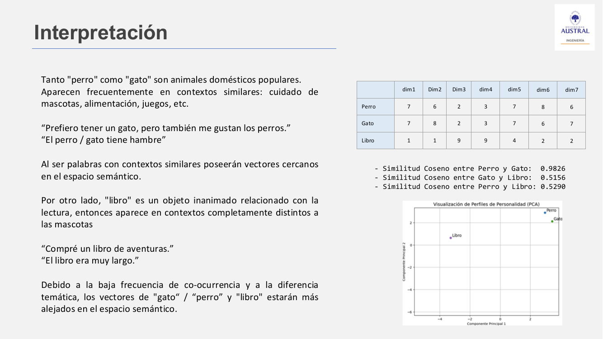
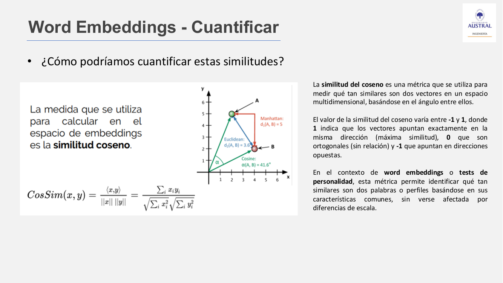
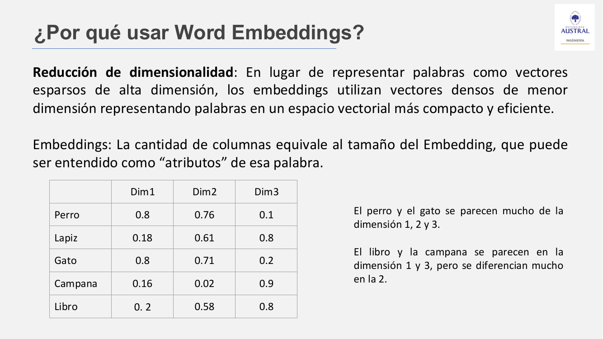
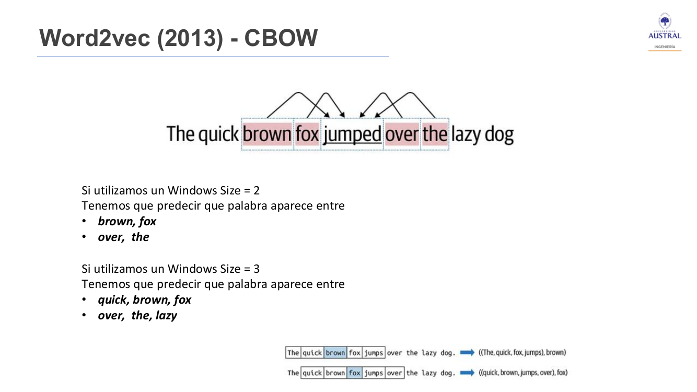
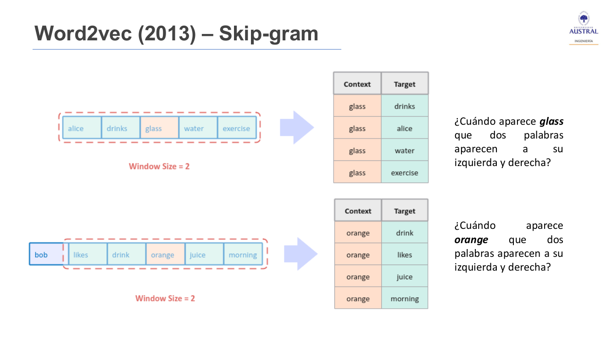
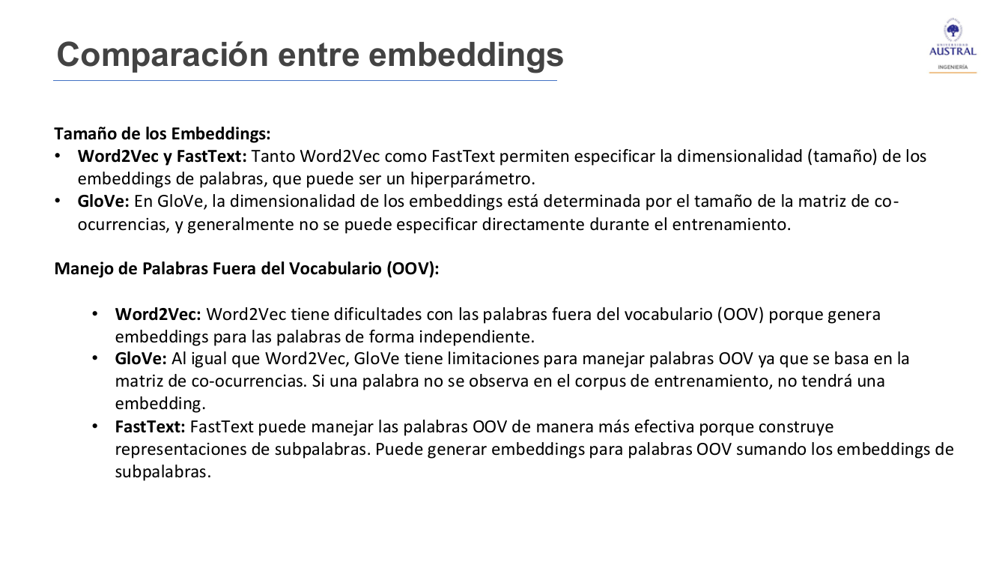

# Clase 25 · Word embeddings: Word2Vec, GloVe y FastText

> **Módulo 4 · Procesamiento de Lenguaje Natural** · Horacio Arrigo · martes 30-jun-2026
> **Fuentes:** transcripción `DIA_Clase_25.vtt` · láminas `NLP_Clase_03_Presentacion.pdf` · notebooks `01_NLP_Clase_03_Teoria_Practica.ipynb` y `02_NLP_Clase_03_TP01_Consigna.ipynb` · demo HTML `ejemplo_entrenamiento_word2vec.html` (Skip-gram en 3D)

## En pocas palabras

- Hasta ahora el texto se convertía en números contando palabras (BoW, TF-IDF). Esta clase da el paso a la **semántica**: representar cada palabra con un **vector denso** de modo que palabras de significado parecido queden cerca en un **espacio semántico**.
- El "significado" que captura un embedding es en realidad el **contexto**: dos palabras que aparecen rodeadas de palabras parecidas en un corpus grande ("perro" y "gato") terminan con vectores parecidos. El algoritmo no entiende nada; aprende de la coocurrencia.
- La cercanía se mide con la **similitud coseno** (entre -1 y 1), que compara la dirección de los vectores y no su magnitud.
- **Word2Vec** (Google, 2013) entrena una red neuronal sencilla para predecir palabras: **CBOW** predice la palabra central a partir del contexto y **Skip-gram** predice el contexto a partir de la palabra. Los pesos de la capa oculta son los embeddings. **GloVe** (Stanford, 2014) suma estadísticas globales de coocurrencia y **FastText** (Facebook, 2016) trabaja con subpalabras, lo que le permite manejar palabras fuera del vocabulario.
- Los embeddings no son gratis: requieren corpus enormes, por eso en la práctica se usan **modelos preentrenados**. Además ignoran el orden de las palabras, asignan un único vector a palabras polisémicas y heredan los sesgos del corpus. Para tareas simples, TF-IDF con un clasificador sencillo puede ganarles.

## Conceptos clave

### Espacio semántico y word embedding

Un **espacio semántico** es un espacio vectorial que captura relaciones de significado entre objetos. A diferencia de BoW, que representa las palabras por frecuencia o posición, acá la geometría refleja similitud de significado: palabras relacionadas (no necesariamente sinónimos) quedan como puntos cercanos.

Un **word embedding** es una representación vectorial **densa y continua** de una palabra. Cada palabra del **vocabulario** (el que surge de los documentos del proyecto, no el diccionario) se mapea a un vector de números reales. Esos vectores se construyen para capturar relaciones semánticas y sintácticas según cómo se usan las palabras en distintos contextos.

### El contexto define el significado

Ejemplo de la clase: "perro" y "gato" aparecen en contextos similares (mascotas, alimentación, veterinaria) y en muchas oraciones son intercambiables: "El perro/gato tiene hambre". "Libro" aparece en otros contextos ("Compré un libro de aventuras"). Por la baja coocurrencia y la diferencia temática, el vector de "libro" queda lejos de los otros dos.



Con los vectores de juguete de la lámina, la similitud coseno da 0,98 entre perro y gato, 0,52 entre gato y libro y 0,53 entre perro y libro. En la proyección con PCA, perro y gato quedan juntos y libro aparte.

El profesor insistió en que "contexto" significa **mucho texto**, todo el corpus, y no una o dos oraciones: una oración como "este es un libro de perros" no alcanza para acercar los vectores.

El ejercicio de las oraciones lo muestra bien. Se toman diez oraciones sobre un perro ("El perro duerme en la alfombra", "El perro ladra cuando alguien toca la puerta"…) y se reemplaza "perro" por otra palabra:

| Reemplazo | Qué pasa |
|---|---|
| gato | Casi todas siguen teniendo sentido; fallan "el gato ladra" y "el gato aprendió a sentarse y dar la pata". |
| elefante | Fallan muchas más ("adoptamos un elefante el mes pasado"). |
| libro | Solo sobreviven las que no exigen un ser vivo; el resto queda descartado. |

Un algoritmo aprende justamente de eso: con qué palabras aparece una palabra y con cuáles **nunca** aparece ("elefante ladra" no va a estar en el corpus).

### La analogía del test de personalidad

Para dar intuición, la clase usó un test de personalidad: cada persona puntúa de 0 a 10 una serie de atributos (empatía, liderazgo, creatividad…). Cada fila es un vector que describe a la persona, y se pueden comparar personas comparando vectores. Así como el test condensa atributos en un vector, un word embedding condensa el significado de una palabra en un vector cuyas dimensiones funcionan como "atributos". La diferencia es que en los embeddings esos valores no se ponen a mano: salen del entrenamiento sobre el corpus.

Antes de comparar conviene **normalizar**:

- **Min-max** al rango $[-1, 1]$: hace visibles coincidencias y oposiciones (las personas 1 y 3 coinciden en los ítems 4 a 6; las 4 y 5 son opuestas en el ítem 1).
- **Por la norma** del vector, $\|x\| = \sqrt{\sum_i x_i^2}$: los valores cambian, pero las relaciones se mantienen parecidas (no idénticas).

Elegir la normalización es una decisión de diseño: no hay receta única, hay que probar. En el gráfico de componentes principales, las personas 1 y 3 se parecen, la 2 y la 5 también, y la 4 no se parece a nadie.

### Similitud coseno



Es una medida algebraica, no algo propio del lenguaje, que compara dos vectores por el **ángulo** entre ellos:

$$\text{CosSim}(x, y) = \frac{\langle x, y \rangle}{\|x\|\,\|y\|} = \frac{\sum_i x_i y_i}{\sqrt{\sum_i x_i^2}\,\sqrt{\sum_i y_i^2}}$$

| Valor | Interpretación |
|---|---|
| 1 | Vectores en la misma dirección (máxima similitud) |
| 0 | Vectores ortogonales (sin relación) |
| -1 | Vectores en direcciones opuestas |

Como mide dirección y no magnitud, **no se ve afectada por diferencias de escala**. La lámina la compara con la distancia euclídea (la recta entre los puntos) y con la **Manhattan** (un recorrido en ángulos rectos).

Ejemplos de las láminas con $x = (7, 6, 2, 3)$: contra $(6, 5, 1, 2)$ da 0,9947 (parecidos en todas las dimensiones); contra $(-7, -6, -2, -2)$ da -0,9951 (opuestos). En el test de personalidad, la persona 1 tiene similitud 0,964 con la 3 y -0,366 con la 2.

**Ojo con los negativos:** para obtener valores negativos, los vectores tienen que poder tener componentes negativas, y eso depende de la normalización. Word2Vec y FastText no normalizan los embeddings por defecto, pero es común aplicar normalización L2 antes de calcular similitudes. GloVe tampoco normaliza, pero se puede hacer a mano.

### Por qué usar embeddings: reducción de dimensionalidad



En BoW (one-hot) cada palabra es un vector **esparso** con tantas columnas como palabras tiene el vocabulario. Un embedding usa vectores **densos** de pocas dimensiones, que representan las palabras en un espacio más compacto y eficiente. Esto ataca dos problemas:

- La **maldición de la dimensionalidad**: con demasiadas dimensiones, todos los datos terminan lejos entre sí.
- El costo computacional: matrices enormes que no se pueden procesar (lo que ya se había advertido en las clases anteriores).

En la práctica, cada palabra queda representada con **entre 100 y 300 dimensiones**.

### Un poco de historia

- **Yoshua Bengio** y su equipo introdujeron la idea a principios de los 2000 ("A Neural Probabilistic Language Model", 2001, y otro trabajo de 2003). Usaron una red neuronal que aprendía **representaciones distribuidas** de las palabras para combatir la maldición de la dimensionalidad: modelar el lenguaje contando todas las combinaciones posibles de palabras es inmanejable.
- El uso se generalizó en **2013** con **Word2Vec**, de un equipo de Google liderado por **Tomas Mikolov**. Es un patrón común en investigación: alguien propone la idea y años después otro encuentra cómo llevarla a la práctica.
- En la línea de tiempo del módulo, Word2Vec (2013) cae en el período de deep learning, entre la vectorización estadística (BoW, TF-IDF) y "Attention is All You Need" (2017).

### Word2Vec: CBOW y Skip-gram

Word2Vec es una red neuronal *feed forward* con una sola capa oculta, entrenada para una tarea de predicción. Usa una **ventana**: la cantidad de palabras que se toman a cada lado de la palabra objetivo. La ventana es simétrica y se va deslizando por el texto.

**CBOW (Continuous Bag of Words):** dado el contexto, predice la palabra central.



En "The quick brown fox **jumped** over the lazy dog", con ventana 2 el modelo recibe *brown, fox* y *over, the* y tiene que predecir *jumped*. Con ventana 3 recibe *quick, brown, fox* y *over, the, lazy*.

**Skip-gram:** al revés, dada la palabra central predice las de su contexto.



Con ventana 2, "glass" en "alice drinks glass water exercise" genera los pares (glass, drinks), (glass, alice), (glass, water) y (glass, exercise).

**De dónde salen los embeddings.** La predicción en sí no importa. Durante el entrenamiento la red ajusta los vectores para que palabras de contextos similares tengan vectores cercanos. Al terminar, **se descarta la capa de salida y los pesos de la capa oculta son los embeddings**. Como se ve en la demo, la entrada es un one-hot que selecciona la fila de la matriz $W_{in}$ (de tamaño $V \times d$); esa fila es el embedding de la palabra. La matriz $W_{out}$ y el softmax de salida son auxiliares.

| | CBOW | Skip-gram |
|---|---|---|
| Estrategia | Contexto → palabra | Palabra → contexto |
| Velocidad | Más rápido (promedia los vectores del contexto) | Más lento (cada palabra predice varias) |
| Datos | Funciona bien con muchos datos | Funciona mejor con datos más chicos |
| Palabras raras | Menos preciso, porque promedia contextos | Las representa mejor |
| En gensim | `sg=0` | `sg=1` |

### GloVe (2014)

Desarrollado en Stanford (Pennington, Socher y Manning). Parte de la idea de que las relaciones semánticas se capturan mejor si, además del contexto local (como Word2Vec), se usan las **estadísticas globales de coocurrencia** del corpus. Usa una ventana de unas 10 palabras a cada lado y pondera más las palabras que aparecen más cerca. Construye una **matriz de coocurrencia** (cuántas veces aparece junto cada par de palabras) y la **factoriza** para obtener los vectores densos. Combina así una mirada local y una global de cada palabra.

### FastText (2016)

Desarrollado por Facebook AI Research (hoy Meta) y presentado en "Bag of Tricks for Efficient Text Classification". En lugar de tratar cada palabra como unidad, la descompone en **n-gramas de caracteres** (subpalabras). Aprende un vector por subpalabra y luego los combina para formar el vector de la palabra. Se puede entrenar con arquitectura CBOW o Skip-gram.

- **Ventaja:** es robusto frente a errores ortográficos, palabras poco frecuentes y formas no vistas (por ejemplo, una conjugación verbal que no estaba en el corpus).
- **Costo:** mucha más carga de procesamiento.

### Comparación y palabras fuera de vocabulario (OOV)



Una palabra **OOV** (*out of vocabulary*) es una que no estaba en el corpus de entrenamiento. Pasa seguido: en el Embedding Projector, palabras en español daban cero resultados. Reentrenar todo por una o dos palabras nuevas es caro.

| | Word2Vec | GloVe | FastText |
|---|---|---|---|
| Unidad | Palabra | Palabra (coocurrencia global) | Subpalabras (n-gramas de caracteres) |
| Dimensión | Hiperparámetro | Según las láminas, no se elige directamente al entrenar (ver nota) | Hiperparámetro |
| OOV | No tiene vector | "Si una palabra no se observa en el corpus, no tendrá embedding" | Lo arma sumando los vectores de sus subpalabras |
| Orden de palabras | No | No | No |

*Nota:* la notebook aclara que los GloVe preentrenados vienen en 50, 100, 200 y 300 dimensiones, así que la afirmación de las láminas sobre la dimensión hay que tomarla con cuidado.

### Limitaciones

- **No consideran el orden.** "You are going there to teach, not play" y "You are going there to play, not teach" quedan con la misma representación si se combinan sus palabras, pero no significan lo mismo.
- **Polisemia.** Pregunta de una alumna: "banco" (de plaza, institución financiera, "yo te banco") tiene **un solo vector**. Dónde cae depende de qué contexto predomina en el corpus. Una salida es desambiguar en el preprocesamiento (escribir distinto cada sentido). Por eso el corpus tiene que ser el adecuado para la aplicación: en textos financieros, "banco de plaza" casi no aparece.
- **Sesgos.** La notebook muestra que los embeddings heredan estereotipos del corpus (por ejemplo, `doctor - man + woman` devuelve "gynecologist" y "nurse" en Word2Vec de Google News). Si se usan en buscadores o filtros de CV, el sesgo se propaga sin que se note.

### Aritmética de vectores

Word2Vec se hizo famoso por mostrar que las relaciones se pueden obtener con operaciones vectoriales: $\vec{king} - \vec{man} + \vec{woman} \approx \vec{queen}$, porque la diferencia entre hombre y mujer es parecida a la diferencia entre rey y reina. Lo mismo vale para tiempos verbales o para pares país-capital, **siempre que esa información esté en el corpus**. En la notebook, los tres modelos devuelven "queen", y `Spain - Madrid + Lima` devuelve "Peru".

### Transfer learning y modelos preentrenados

Entrenar embeddings requiere corpus muy grandes y mucho cómputo, así que lo habitual es **descargar modelos preentrenados**. Según la notebook:

- **Word2Vec:** Google News, unas 100 mil millones de palabras, vocabulario de unos 3 millones y 300 dimensiones.
- **GloVe:** Common Crawl, 840 mil millones de tokens.

Si el corpus del modelo sirve para la aplicación, se usa tal cual. Si no (por ejemplo, porque el modelo está en inglés y el texto en español), hay que buscar uno en el idioma o entrenar uno propio. **Transfer learning** acá significa usar los embeddings ya generados como insumo de otras tareas (por ejemplo, como features de un clasificador supervisado), en lugar de partir del texto crudo. La elección entre Word2Vec, GloVe y FastText depende de la tarea, de los datos disponibles y de cuánto importan las OOV.

Sobre el costo de entrenar, el profesor dijo que no hay una calculadora. Una forma práctica es entrenar con una muestra chica de documentos y extrapolar, sabiendo que la cuenta no es lineal. Estimarlo es toda una subdisciplina que combina IA, IT y arquitectura.

### De palabras a oraciones y documentos

Un embedding de palabra no captura el significado de una oración. Para clasificar o segmentar textos se necesita un **sentence embedding**:

- **Mean pooling:** se promedian los vectores de las palabras, $\text{doc\_emb} = \frac{1}{N}\sum_{i=1}^{N} \text{vec}(w_i)$. Es simple y rápido, pero pierde el orden ("El perro muerde al hombre" y "El hombre muerde al perro" dan el mismo vector), y las stopwords pesan igual que las palabras importantes.
- **Doc2Vec:** extensión de Word2Vec, presentada por Google poco después, que asigna un vector a cada documento o párrafo además de los vectores de palabras. Su variante DBOW es el equivalente de Skip-gram: predice qué palabras aparecen en el documento. Da representaciones más informativas, a cambio de más cómputo.

**Cuándo no conviene:** con datasets chicos o tareas simples, **BoW o TF-IDF con un clasificador simple** (Naive Bayes, regresión logística) puede superar a los embeddings. En spam, temas muy marcados o polaridad en textos cortos, la señal está en qué palabras aparecen, cuántas veces y cuáles son distintivas, y no en relaciones semánticas profundas.

## Ejemplos y casos de la clase

- **Embedding Projector de Google** (`projector.tensorflow.org`): visualización en 3D (con PCA) de los vectores Word2Vec de un corpus en inglés. Se busca una palabra ("dog") y aparecen sus vecinas por similitud coseno; se puede variar la cantidad de vecinos, como en kNN. Las palabras en español no estaban, un ejemplo directo de OOV. Consultado por los alumnos, el profesor aclaró que esto no es todavía RAG: acá se trabaja con palabras sueltas, y RAG se verá en IA generativa.
- **Demo HTML de Skip-gram en 3D:** un Skip-gram de juguete que se entrena en el navegador. Muestra la ventana deslizante sobre el corpus, la red ($W_{in}$, capa oculta y $W_{out}$ con softmax), la función de pérdida (cross-entropy) y cómo los puntos se reacomodan con cada época. Se pueden ajustar la ventana y el learning rate.
- **"king" con modelos entrenados desde cero:** sobre un corpus mínimo de oraciones de realeza y naturaleza, Word2Vec devuelve como vecinas de "king" palabras como "against" y "replica" (similitud de alrededor de 0,31). Un alumno revisó el corpus y encontró que esas palabras aparecían en oraciones sobre la corona y la monarquía. FastText, en cambio, devuelve "honking" y "hiking", porque comparten el n-grama "king". Moraleja: el mismo texto da resultados distintos según el preprocesamiento, la estrategia de partición en subpalabras y el modelo. Con poco texto, los resultados son pobres.
- **"Dog" relacionado con "one":** en el TP salió como vecina una palabra que no parecía tener relación. La explicación vuelve a ser el contexto de coocurrencia en el corpus de entrenamiento.
- **LLM frente a soluciones simples:** para detectar spam "no inteligente" (mayúsculas, números en lugar de letras) o para relaciones semánticas básicas, un Word2Vec o un TF-IDF alcanza. Usar un LLM se puede, pero puede ser demasiada solución en costo e implementación.

## Práctica

**Notebook de teoría y práctica** (`01_NLP_Clase_03_Teoria_Practica`), con `gensim`:

- Entrena Word2Vec y FastText desde cero con `vector_size=100`, `window=5`, `min_count=1`, `sg=0` (CBOW) y compara los resultados con PCA.
- Carga los preentrenados `word2vec-google-news-300`, `glove-wiki-gigaword-100` y `fasttext-wiki-news-subwords-300`. Usa `most_similar`, `similarity` y analogías con `positive`/`negative`.
- Compara similitudes entre los tres modelos. Por ejemplo, dog-cat da 0,76 en Word2Vec y 0,88 en GloVe, y dog-car da 0,31 y 0,42 respectivamente. "France" no está en GloVe porque ese modelo está todo en minúsculas.
- Trabaja OOV ("montaña" en un modelo en inglés), sesgos de género, y un modelo en español (vectores de 400 dimensiones entrenados con ventana ±5).
- Arma embeddings de documento por promedio (reseñas de hotel: las positivas resultan más parecidas entre sí) y los compara con TF-IDF para clasificar spam.
- Visualiza con PCA y t-SNE. El parámetro **perplexity** de t-SNE regula cuántos vecinos se consideran: con valores bajos privilegia la estructura local y con valores altos la global.

```python
word_vectors_glove.most_similar(positive=['king', 'woman'], negative=['man'], topn=1)
# -> 'queen'
```

**TP en grupos** (`02_NLP_Clase_03_TP01_Consigna`), sin GPU:

- **Parte 1, con GloVe:** las 10 palabras más cercanas a `dog`, `house` y `glass` (¿son sinónimos, palabras relacionadas o del mismo campo semántico?) y la similitud coseno de pares país-capital (France-Paris, Australia-Canberra, Brazil-Brasilia, Switzerland-Bern, Turkey-Ankara…). La consigna invita a mirar por qué los pares más lejanos quedan lejos y a comparar el país con otra ciudad conocida, para ver si el modelo captura geografía o algo más (frecuencia de aparición conjunta en el corpus).
- **Parte 2, de tarea:** repetir con Word2Vec o FastText y comparar.
- **Detalles útiles:** un helper `buscar_clave` para el problema de mayúsculas (GloVe en minúsculas, Word2Vec respeta mayúsculas) y una carga con caché en `./models/`. No conviene cargar Word2Vec y FastText a la vez por la RAM que ocupan (unos 3,6 GB y 1,2 GB).

No era obligatorio entregarlo; la solución quedó en el campus.

## Para recordar

- "Significado similar" quiere decir **contexto similar**: el algoritmo no entiende, le asigna al vector un valor según las palabras que rodean a la palabra.
- El corpus tiene que ser el adecuado para la aplicación: sin el texto correcto no hay analogías, ni vecinos útiles, ni vector para las palabras que faltan.
- Lo más nuevo no siempre es lo más adecuado: hay que buscar eficiencia económica y técnica. Presupuesto, equipos y costos de implementación pesan. "Al final del día, todo es plata."
- Entrenar es caro y usar el modelo es barato; por eso se usan modelos preentrenados, igual que hoy se usan los LLM.
- Siempre conviene verificar si una palabra está en el vocabulario antes de pedir su vector.
- Normalización, escala y signo importan antes de calcular similitudes.

## Preguntas de repaso

<details><summary>1. ¿Por qué "perro" y "gato" terminan con vectores cercanos si el modelo no sabe que son mascotas?</summary>

Porque en un corpus grande aparecen rodeadas de palabras parecidas (alimentación, veterinaria, juegos) y son intercambiables en muchas oraciones. El entrenamiento acerca los vectores de palabras con contextos similares; el "significado" es esa distribución de contextos.

</details>

<details><summary>2. ¿Qué ventaja tiene la similitud coseno frente a comparar las componentes directamente o usar la distancia euclídea?</summary>

Mide el ángulo entre los vectores, es decir, su dirección, y no se ve afectada por diferencias de escala o magnitud. Su rango (de -1 a 1) se interpreta directamente: misma dirección, ortogonales u opuestos.

</details>

<details><summary>3. ¿En qué se diferencian CBOW y Skip-gram, y cuál elegirías para un corpus chico con muchas palabras raras?</summary>

CBOW predice la palabra central a partir del contexto; es más rápido, pero promedia contextos y es menos preciso con palabras raras. Skip-gram predice el contexto a partir de la palabra; es más lento, pero funciona mejor con datos chicos y palabras raras. Para ese caso conviene Skip-gram.

</details>

<details><summary>4. Si la tarea de Word2Vec es predecir palabras, ¿de dónde salen los embeddings?</summary>

Al terminar el entrenamiento se descarta la capa de salida y se usan los pesos de la capa oculta: la fila de la matriz de entrada que corresponde a cada palabra es su vector. La predicción es solo una excusa para aprender esos pesos.

</details>

<details><summary>5. Un usuario escribe una palabra mal o una conjugación que no estaba en el corpus. ¿Qué pasa con Word2Vec, GloVe y FastText?</summary>

Word2Vec y GloVe no tienen vector para palabras OOV. FastText puede armar uno sumando los vectores de los n-gramas de caracteres que comparte con palabras conocidas, por eso es robusto a errores ortográficos y palabras poco comunes.

</details>

<details><summary>6. ¿Por qué FastText devolvió "honking" y "hiking" como vecinas de "king"?</summary>

Porque trabaja con subpalabras: esas palabras comparten n-gramas de caracteres con "king", y en un corpus chico ese parecido de forma pesa más que el contexto. Muestra que la tokenización y el modelo cambian el resultado sobre el mismo texto.

</details>

<details><summary>7. ¿Qué limitación tiene el promedio de word embeddings para representar una oración?</summary>

Ignora el orden de las palabras, así que "El perro muerde al hombre" y "El hombre muerde al perro" dan el mismo vector. Además, las stopwords pesan igual que las palabras informativas. Doc2Vec y, más adelante, los modelos contextuales atacan ese problema.

</details>

<details><summary>8. ¿Cuándo preferirías TF-IDF con un clasificador simple en lugar de embeddings?</summary>

Con datasets chicos o tareas donde la señal está en palabras concretas (spam, temas marcados, polaridad en textos cortos). Ahí importa qué palabras aparecen y cuáles son distintivas, no las relaciones semánticas profundas, y el modelo simple es más barato y puede rendir igual o mejor.

</details>

## Conexiones

- **Clase 23** (preprocesamiento y tokenización, n-gramas, línea histórica del NLP) y **Clase 24** (BoW, TF-IDF, vocabulario, clasificación de texto): esta clase reemplaza los vectores esparsos por vectores densos y retoma los n-gramas a nivel carácter en FastText.
- **Módulo 1:** PCA (Clase 04), reducción no lineal como t-SNE (Clase 05) y vecinos cercanos (Clase 02) reaparecen en el Embedding Projector y en la visualización de embeddings.
- **Clase 26 en adelante:** la falta de orden y la polisemia ("banco" con un solo vector) son las limitaciones que resuelven las redes recurrentes, los transformers y los embeddings contextuales (Clase 28, BERT).
- **TFI (Benefix):** el retrieval semántico se basa en esto: representar nombres comerciales y consultas como vectores y rankear por similitud coseno, evaluando con Hit@k y MRR. Las ideas de la clase se aplican directo: la robustez de FastText a errores ortográficos y palabras OOV, el mean pooling para nombres de varias palabras, y la advertencia de que en vocabularios cerrados un enfoque léxico tipo TF-IDF puede competir con los embeddings. Esa última es la base para combinar ambos en un retrieval híbrido.
