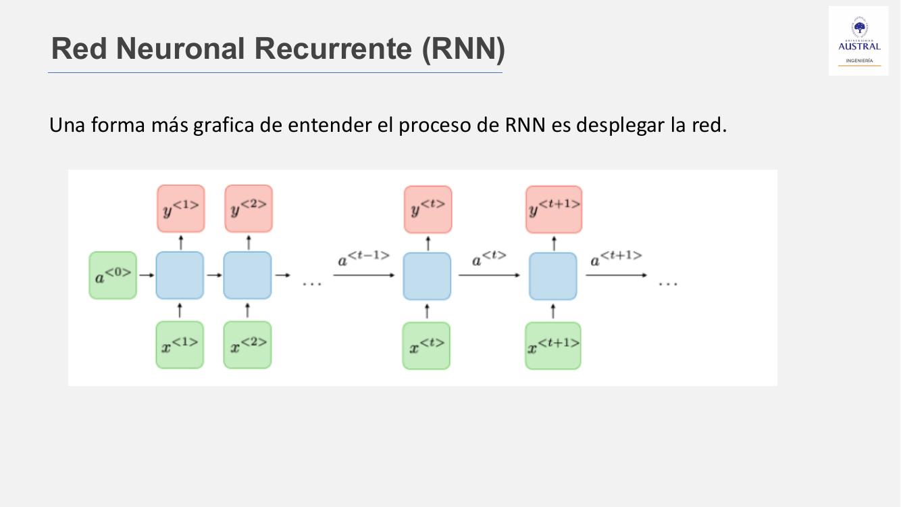
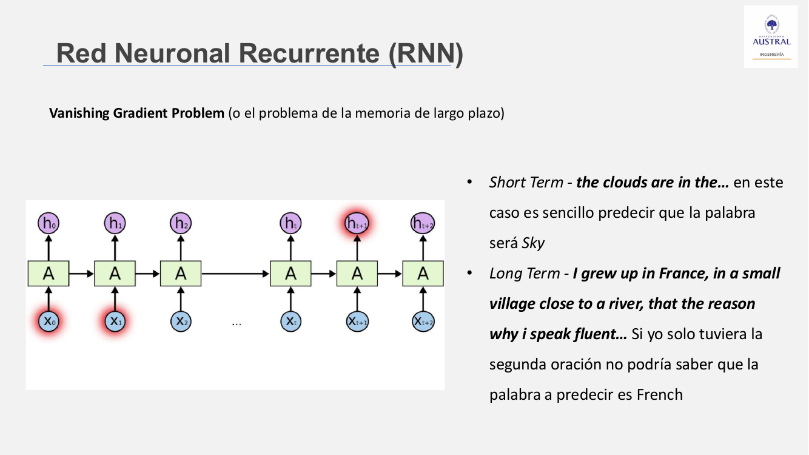
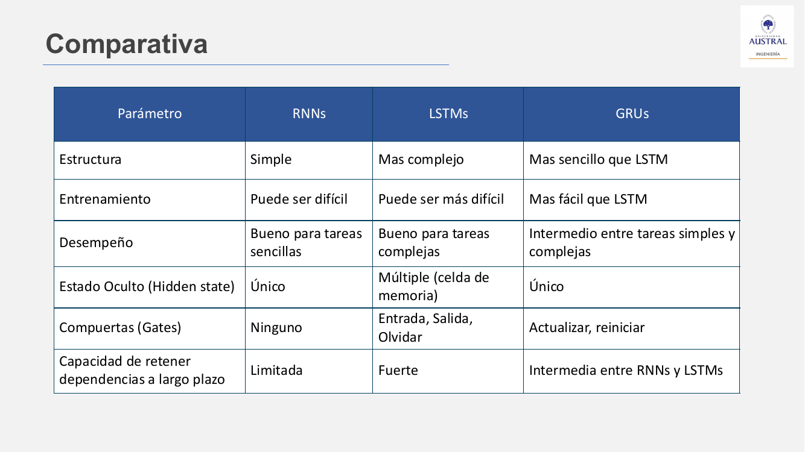
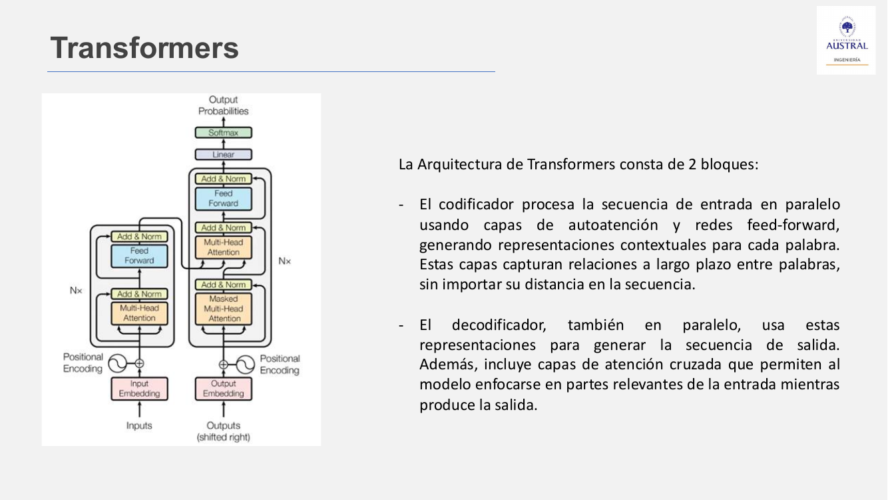
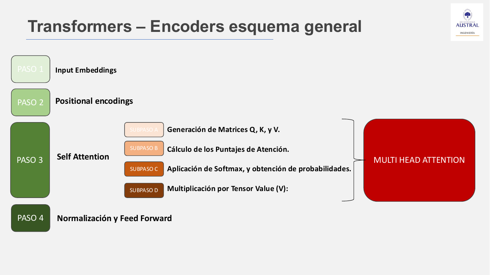
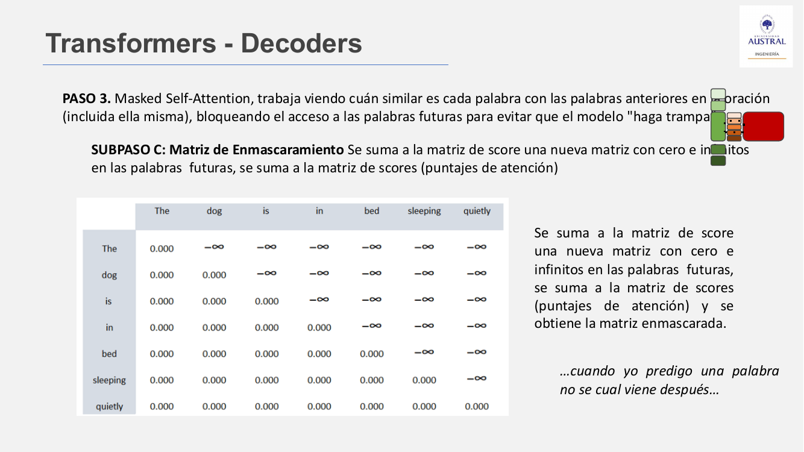

# Clase 26 · Redes recurrentes (RNN, LSTM, GRU) y Transformers

> **Módulo 4 · Procesamiento de Lenguaje Natural** · Horacio Arrigo · jueves 02-jul-2026
> **Fuentes:** transcripción `DIA_Clase_26.vtt` · láminas `01_NLP_Clase_04_Presentacion.pdf` · demo HTML `rnn_playground.html` (RNN de juguete) · demo web *Transformer Explainer* (poloclub.github.io/transformer-explainer)

## En pocas palabras

- El lenguaje es **secuencial**: se produce y se lee en el tiempo. Una red *feedforward* clásica recibe todas las entradas a la vez, no ve el orden y necesitaría tantas entradas como palabras tenga el texto. Las **redes recurrentes (RNN)** resuelven eso con una conexión hacia atrás: un **estado oculto** (la "memoria") que se actualiza palabra por palabra.
- Las RNN simples sufren el **vanishing gradient**: al entrenar, la señal de error se atenúa a medida que viaja hacia el principio de la secuencia y la red "olvida" las primeras palabras. **LSTM** (tres compuertas y una celda de memoria) y **GRU** (dos compuertas, más liviana) mejoran la memoria de largo plazo, pero siguen procesando de a una palabra.
- El **Transformer** (*Attention Is All You Need*, Google, 2017) abandona la recurrencia. Procesa todas las palabras **en paralelo** y usa **autoatención** para medir cuánto aporta cada palabra a cada otra, sin importar la distancia entre ellas. El orden se recupera sumando un **positional encoding** al embedding.
- La autoatención funciona con tres matrices aprendidas: **Q** (lo que la palabra busca), **K** (lo que ofrece) y **V** (la información que entrega). Los productos Q·K miden similitud, softmax los convierte en pesos y con esos pesos se combinan los V. **Multi-head attention** repite esto con varias "cabezas" que capturan relaciones distintas.
- El **decoder** agrega dos piezas: la **atención enmascarada** (no puede mirar palabras futuras, para no "hacer trampa") y la **atención cruzada** (Q del decoder contra K y V del encoder). A la salida, los **logits** pasan por softmax, y la **temperatura** regula cuánto se aplana esa distribución.

## Conceptos clave

### Repaso: de BoW y embeddings a redes neuronales

La clase arrancó repasando las dos representaciones vistas: **Bag of Words** ignora el orden y el contexto, y los **word embeddings** representan cada palabra como un vector que captura relaciones semánticas. Ninguna de las dos maneja bien las palabras fuera del vocabulario, salvo FastText, que tokeniza por subpalabras. Con esto se entra al período de *deep learning* de la línea temporal del módulo.

Tres piezas de redes neuronales que reaparecen en toda la clase:

- **Función de activación:** decide si una neurona "se activa", es decir, si su entrada es importante. Las dos mencionadas son la **tangente hiperbólica** (valores entre −1 y 1) y la **sigmoide** (entre 0 y 1).
- **Softmax:** convierte un vector de números reales en una distribución de probabilidad (todos los valores entre 0 y 1, suma 1). Se usa como última capa, por ejemplo una neurona de salida por clase.
- **Red feedforward:** capa de entrada, capas ocultas y salida normalizada con softmax; la información fluye en un solo sentido.

### Por qué una red feedforward no alcanza para texto

En el ida y vuelta con la clase surgieron varias dificultades de usar una red feedforward con una palabra por entrada:

- Hay que convertir el texto a números (se resuelve con embeddings).
- El costo de cómputo crece con el tamaño de los embeddings.
- **La cantidad de entradas es fija.** Para un libro haría falta una entrada por palabra, y si cambia el texto o el idioma, la red ya no sirve.
- **No captura el orden.** Este es el problema central: el lenguaje es un flujo continuo de información en el tiempo.

### Redes neuronales recurrentes (RNN)

Una RNN está diseñada para datos secuenciales. Lee las palabras **una a una** y mantiene un **estado oculto** que acumula lo visto hasta ese momento. La salida de cada celda, además de ir hacia adelante, vuelve a entrar en el paso siguiente: esa realimentación es la **recurrencia**.

*Figura: la RNN "desplegada". Cada caja azul es la misma celda en distintos instantes; el estado $a^{\langle t\rangle}$ pasa al paso siguiente. El estado inicial $a^{\langle 0\rangle}$ suele ser un vector de ceros.*

La arquitectura deja de parecerse a la copa de un árbol y se parece más a un **tren** de celdas. La analogía de la lámina: una persona que lee palabra por palabra. En cada paso (1) mira lo que ya recordaba, (2) lee la palabra nueva, (3) actualiza su memoria con ambas cosas y, a la vez, intenta adivinar la palabra siguiente.

**Ejemplo "El clima está lindo":**

| Momento | Entra | Memoria (estado oculto) | Predice |
|---|---|---|---|
| 1 | El | (vacía → "El") | clima |
| 2 | clima | "El clima" | está |
| 3 | está | "El clima está" | lindo |
| 4 | lindo | "El clima está lindo" | token de fin `<EOS>` |

La red no adivina al azar: durante el entrenamiento vio miles de ejemplos y aprendió, con la softmax de salida, las probabilidades de cada continuación.

**Usos:**

- **Modelos de lenguaje:** fueron los primeros en predecir la siguiente palabra a partir de las anteriores (autocompletar, generar texto).
- **Traducción automática** (Google Translate antes de 2017): traducir palabra por palabra no funciona, porque cada idioma ordena distinto; hay que procesar la oración completa.

**Costos:** la memoria es limitada; agregar más memoria implica más celdas y más cómputo, y como el texto entra paso a paso, el entrenamiento es lento.

### El problema del gradiente que se desvanece

Las RNN se entrenan con *backpropagation through time*: la señal de error tiene que viajar desde el final de la secuencia hacia el principio a través del estado oculto. Si la matriz de pesos recurrentes $W$ tiene valores menores que 1, **cada multiplicación atenúa el gradiente** y la red pierde la influencia de las primeras palabras. El caso opuesto es el **exploding gradient**: los valores crecen sin control y la red deja de funcionar.

*Figura: con contexto corto ("the clouds are in the… sky") alcanza con las palabras cercanas. En "I grew up in France, … that's the reason why I speak fluent…" la pista para predecir "French" está muy al principio, y una RNN simple tiende a perderla.*

### LSTM y GRU

Funcionan igual que una RNN a nivel general (una secuencia de celdas); lo que cambia es **lo que pasa dentro del estado oculto**. Agregan **compuertas**, que son funciones sigmoides combinadas con multiplicaciones, y que deciden qué información retener, qué olvidar y qué pasar adelante.

**LSTM** (*Long Short-Term Memory*) tiene una **celda de memoria** y tres puertas:

- **Entrada:** cuánto de la información nueva guardar en la celda.
- **Olvido:** cuánto de la celda olvidar en cada paso.
- **Salida:** qué parte de la celda se envía a la salida en ese momento.

A diferencia de la RNN simple, la LSTM **no tiene que actualizar la celda de memoria en cada paso**. A la celda siguiente pasan tanto la salida como el estado de la celda; durante el entrenamiento la red puede aprender que cierto estado no importa y "apagarlo".

**GRU** (*Gated Recurrent Unit*) simplifica la LSTM a dos puertas:

- **Actualización:** cuánta información anterior pasa al estado siguiente y cuánta nueva se incorpora. Combina las puertas de entrada y de olvido de la LSTM.
- **Reinicio:** cuánta información anterior olvidar al calcular el nuevo estado.

Es más rápida de entrenar y, según la lámina, menos propensa a sobreajustar con pocos datos; en muchas tareas logra resultados cercanos a la LSTM.

| | RNN | LSTM | GRU |
|---|---|---|---|
| Estructura | Simple | Más compleja | Intermedia |
| Compuertas | Ninguna | Entrada, olvido, salida | Actualización, reinicio |
| Estado oculto | Único | Múltiple (celda de memoria) | Único |
| Dependencias de largo plazo | Limitada | Fuerte | Intermedia |
| Costo de cómputo | Bajo | Alto | Intermedio |

**Vigencia:** en la década de 2010 fueron la base del NLP (modelado de lenguaje, traducción, reconocimiento de voz). Desde 2017 los Transformers las relegaron en texto, pero siguen usándose en **series temporales numéricas** (demanda energética, precios, fallas de sensores) y en **bioinformática** (secuencias de ADN). También pueden convenir donde hay poco cómputo disponible (el profesor dio el ejemplo de un cajero automático o un tótem de atención).

**Límite común:** aun con compuertas, la información pasa de una palabra a la siguiente y la relevancia de las palabras importantes se diluye. Les cuesta relacionar palabras lejanas, como en "El perro está muy enojado por el ruido que generan los vecinos y entonces **ladra**".

### Transformers: atención en lugar de recurrencia

El Transformer evalúa la relación entre **todas las palabras de la oración simultáneamente**. Puede vincular "el ruido que generan los vecinos" con "el perro" y "ladra" sin importar la distancia, y asignar más importancia a palabras clave independientemente de su posición.

- **Origen:** el paper *Attention Is All You Need* (Vaswani et al., Google, 2017). El título homenajea a "All You Need Is Love" de los Beatles y critica a quienes creían que las RNN, combinadas con atención, bastaban.
- **Ventajas:** se puede **entrenar en paralelo** (más rápido y más barato) y explota a fondo el mecanismo de atención.
- **Primer uso:** traducción automática. Se entrenó con el corpus inglés-alemán de **WMT 2014**, unos **4,5 millones de pares de oraciones** (en la primera clase del módulo se había mencionado un experimento histórico que tradujo unas 65 oraciones del ruso al inglés). Google lo aplicó a Google Translate y el salto de calidad fue notorio.

La arquitectura tiene dos bloques:

- **Encoder (codificador):** procesa la secuencia de entrada en paralelo con capas de autoatención y redes feedforward, y genera una representación contextual de cada palabra.
- **Decoder (decodificador):** usa esas representaciones para generar la salida. Agrega **atención enmascarada** y **atención cruzada** hacia el encoder.

En entrenamiento entran dos cosas: el texto de entrada (por ejemplo "Hola, amigo") y el target ("Hello, friend"). Los bloques se apilan: en el paper, **6 encoders** y **6 decoders**, donde la salida de cada uno es la entrada del siguiente. Según el profesor, lo más importante no son las redes neuronales sino los **embeddings, el positional encoding y la multi-head attention**.

### El encoder, paso a paso

**Paso 1 · Input embeddings.** La oración ("El perro está en la cama durmiendo tranquilo") se divide en tokens, y cada uno se convierte en un embedding de **512 dimensiones**. En la clase se usaron "token" y "palabra" como sinónimos. Se usan embeddings y no índices de diccionario porque la distancia entre vectores refleja similitud.

**Paso 2 · Positional encoding.** Como todo entra en paralelo, el modelo no tiene noción del orden. Se suma a cada embedding un vector de la misma dimensión (512) que codifica la **posición** del token. Son **valores fijos** (no se aprenden), así que se calculan una vez y se reutilizan.

- Se calculan con funciones seno (dimensiones pares) y coseno (dimensiones impares), evaluadas en **radianes**. La lámina avisa que en grados los resultados difieren.
- Ejemplo: en "El perro tiene hambre" y "Un gato está sentado", "El" y "Un" ocupan la posición 0 y por lo tanto tienen el **mismo** positional encoding.
- Entrada al encoder = embedding + positional encoding (suma elemento a elemento).

**Paso 3 · Self-attention.** Para cada palabra, mide cuán relevante es cada una de las demás, incluida ella misma.

- **Subpaso A, matrices Q, K y V.** Se obtienen multiplicando los embeddings por **tres matrices de pesos distintas que se aprenden en el entrenamiento**.
  - **Query (Q):** lo que la palabra "busca"; la pregunta que le hace al resto.
  - **Key (K):** lo que cada palabra "ofrece"; su tarjeta de presentación ("yo tengo esta información").
  - **Value (V):** la información que entrega si resulta relevante; es lo que se combina para la nueva representación.
- **Subpaso B, puntajes de atención.** Se multiplica el Q de cada palabra por los K de todas. El producto escalar mide similitud, como la similitud coseno de la Clase 25: vectores casi paralelos dan un valor alto y vectores perpendiculares dan cero. "Cama" y "durmiendo" deberían puntuar más alto que "cama" y "electricidad".
- **Subpaso C, softmax.** Cada fila de puntajes se convierte en probabilidades que suman 1. La matriz resultante **no es simétrica**: la atención es *dirigida*. El ejemplo del profesor: con "pizza", "empanadas" y "horno", "horno" es clave para "pizza", pero "horno" reparte su atención entre "pizza" y "empanadas".
- **Subpaso D, multiplicación por V.** La salida de cada palabra es una **combinación ponderada de los V** de todas las palabras, con más peso para las relevantes. El resultado es un vector de la misma forma que el embedding, pero "enriquecido" con el contexto.

Esquemáticamente, para toda la oración:

$$\text{puntajes} = Q K^\top \quad\rightarrow\quad \text{pesos} = \text{softmax}(\text{puntajes}) \quad\rightarrow\quad \text{salida} = \text{pesos}\cdot V$$

**Multi-head attention.** En lugar de una sola matriz de atención se calculan varias en paralelo. Cada cabeza tiene sus propias Q, K y V y aprende a mirar un aspecto distinto: dependencias cercanas ("el gato"), relaciones a larga distancia ("gato" ↔ "duerme") o sintaxis (sujeto y verbo). En el paper, las 512 dimensiones se dividen en **8 cabezas de 64**.

**Paso 4 · Normalización y feedforward.**

- **Normalización** (*Add & Norm*): lleva las activaciones a media 0 y varianza 1, para estabilizar y acelerar el entrenamiento.
- **Feedforward:** un MLP totalmente conectado que se aplica a cada token por separado. Agrega no linealidad y le permite a cada token transformar su representación después de la atención.

### El decoder: atención enmascarada y atención cruzada

El decoder repite la misma secuencia sobre el **target** ("the dog is in bed sleeping quietly"): embeddings de salida, positional encoding y autoatención. Se diferencia del encoder en dos puntos.

**Masked self-attention.** Cada palabra solo puede atender a las **anteriores** (y a sí misma). Así la salida en una posición depende solo de lo ya generado, y el modelo no "mira hacia el futuro" ni ve la respuesta que tiene que predecir (sería un *data leak*). Para lograrlo se suma a la matriz de puntajes una **matriz M** con 0 en el pasado y −∞ en el futuro. Después de la softmax, las posiciones futuras quedan con probabilidad 0.

$$\text{pesos} = \text{softmax}(Q K^\top + M)$$

**Encoder-decoder attention (cross-attention).** Es el punto donde se combinan las dos mitades. La **Q viene del decoder** y la **K y la V vienen del encoder**. Las preguntas de "qué busca / qué ofrece" se hacen ahora entre la oración de entrada y la de salida, y ahí el modelo aprende cómo se vinculan (en el ejemplo, la traducción).

Después vienen normalización y feedforward, igual que en el encoder.

### Logits, softmax y temperatura

A la salida del decoder, una capa **lineal** produce los **logits**: un puntaje crudo, no normalizado, para **cada palabra del vocabulario**. Mide qué tan cerca está esa palabra del vector que generó el decoder. La **softmax** los convierte en probabilidades, se elige la siguiente palabra y la operación se repite en cada paso de generación.

La **temperatura** es un parámetro que **divide los logits** antes de la softmax:

| Temperatura | Efecto en las probabilidades | Texto resultante |
|---|---|---|
| Cercana a 0 | La palabra más probable se despega del resto | Más determinista, más "pegado" al entrenamiento |
| Alta (ej. 3) | Se aplanan: las palabras menos probables ganan chance | Más variado ("creativo") y aleatorio |

En la demo también se puede limitar la elección a las **top-k** palabras más probables.

## Ejemplos y casos de la clase

- **"El clima está lindo":** ilustra cómo una RNN actualiza su estado oculto palabra a palabra y predice la siguiente.
- **"Las nubes están en el… cielo" vs. "Crecí en Francia… por eso hablo fluidamente… francés":** contraste entre dependencia corta y larga, para mostrar el vanishing gradient.
- **"El perro está muy enojado por el ruido que generan los vecinos y entonces ladra":** la misma oración se usó para mostrar el límite de las RNN (relaciones lejanas) y la ventaja del Transformer (todas las relaciones a la vez).
- **"El perro está en la cama durmiendo tranquilo" / "the dog is in bed sleeping quietly":** el par que recorre el encoder y el decoder paso a paso.
- **Pregunta de un alumno sobre la matriz de atención:** la palabra "en" tenía puntajes casi nulos, incluso consigo misma. La respuesta: es un conector, casi una stopword (Clase 23); no aporta información a las demás ni a sí misma.
- **Google Translate antes y después de 2017:** el salto de calidad que se notó al pasar a Transformers.
- **Hidden Markov Models** (pregunta al final): modelo de la etapa probabilística que predice la palabra siguiente a partir de las anteriores. El enfoque era correcto, pero necesitaba mucho texto y cómputo que en su época no había; hoy sirve más para predecir el estado siguiente de un sistema.

## Práctica

No hubo notebook con código; hubo dos demos para explorar en el navegador.

**1. RNN de juguete (`rnn_playground.html`).** Una RNN con una memoria de 12 números que lee "El rey y la reina gobiernan…" y predice la siguiente palabra. Qué mirar:

- La celda paso a paso: palabra nueva + memoria previa → memoria nueva → predicción. La memoria nueva pasa a ser la previa del paso siguiente.
- Antes de entrenar, las predicciones son genéricas (por ejemplo "queso" o "fruta" en lugar de "reino"). Después de entrenar por **épocas** (cada época es una pasada completa por el dataset), las continuaciones tienen sentido.
- La curva de **loss**, que baja a medida que entrena, y el **learning rate** (el tamaño del paso de aprendizaje).
- La **temperatura**: al subirla, la red continúa la frase con palabras menos probables.
- Una palabra **fuera de vocabulario** ("castillo") se ignora.
- Aviso del profesor: es una demo simplificada, no un modelo serio, así que los resultados pueden ser raros.

**2. Transformer Explainer** (poloclub.github.io/transformer-explainer). Corre **GPT-2** de verdad en el navegador; está preentrenado en inglés y no se puede reentrenar. Qué mirar:

- Los embeddings de cada token y el cálculo en vivo de Q, K y V.
- Las **12 cabezas** de atención: cambian los patrones de una a otra porque cada una captura algo distinto.
- El MLP, los logits, los logits escalados, el top-k y la softmax final.
- Cómo cambian las probabilidades al mover la temperatura.
- Con un texto en español genera algo sin sentido, porque se entrenó en inglés.
- Tiene un tour guiado en inglés que sirve para repasar.

**Hugging Face.** Se mostró como repositorio comunitario de modelos (por ejemplo Llama 3), datasets y foros. Se recomendó crear una cuenta gratuita, porque en la clase siguiente se van a descargar y usar modelos preentrenados. Se vio un *sentence transformer* (lleva oraciones a un espacio vectorial, útil para búsqueda semántica y clustering) y el *Time Series Transformer*.

## Para recordar

- "Attention is all you need": la clave del Transformer es que el valor de una palabra se entiende en el contexto **global** del texto, no solo en el local. Una arquitectura secuencial no puede dar eso, porque su contexto no puede ser infinito.
- La parte de redes neuronales es casi lo menos importante del Transformer; el peso está en el **álgebra de la atención** (Q, K, V y las múltiples cabezas).
- Según el profesor, los Transformers **no funcionan bien con series temporales numéricas**: un valor numérico aislado no "aporta significado" a otro como una palabra a otra. Para eso siguen vigentes LSTM y GRU.
- **Temperatura 0** reduce la aleatoriedad (siempre elige la palabra más probable), pero **no garantiza** que el contenido sea correcto: la palabra más probable también puede producir una alucinación. Por eso conviene pedirle al LLM que verifique o cite sus fuentes.
- En la práctica casi nunca se entrena un Transformer desde cero (requiere clusters de GPUs, tiempo y dinero): se usan **modelos preentrenados**.
- Usar LLMs vía API o en local: el tema principal es la **privacidad** de los datos de la empresa y de los clientes.
- Anécdota del profesor: le pidieron explicar cómo funciona un Transformer en una entrevista laboral. Vale la pena tener claros embedding, positional encoding y autoatención.

## Preguntas de repaso

1. ¿Por qué una red feedforward con una entrada por palabra no sirve para procesar texto?

Porque tiene una cantidad fija de entradas (un texto más largo o distinto no entra) y porque recibe todo a la vez, sin noción del orden. El lenguaje es inherentemente secuencial, y el orden y el contexto previo cambian el significado.

2. ¿Qué es el estado oculto de una RNN y cómo se usa en "El clima está lindo"?

Es la memoria de la red: un vector que resume lo leído hasta el momento. En cada paso se combina con la palabra nueva para formar el estado siguiente. Arranca en cero; después de "El" representa "El", después de "clima" representa "El clima", y con ese contexto acumulado predice "está", luego "lindo" y finalmente el token de fin.

3. ¿Por qué una RNN simple no puede completar "...por eso hablo fluidamente ___" cuando "Francia" apareció mucho antes?

Por el vanishing gradient. Al entrenar con backpropagation through time, el error se multiplica repetidamente por pesos menores que 1 al viajar hacia atrás, así que la influencia de las primeras palabras se desvanece y la red no aprende dependencias de largo plazo.

4. ¿Qué agregan LSTM y GRU, y cuándo elegirías una GRU antes que una LSTM?

Agregan compuertas (sigmoides) que regulan qué guardar, qué olvidar y qué pasar adelante. La LSTM además tiene una celda de memoria y tres puertas; la GRU tiene dos puertas y un único estado. La GRU conviene cuando importa la velocidad o hay menos datos o menos cómputo y alcanza con una retención de largo plazo intermedia.

5. Si el Transformer procesa todas las palabras en paralelo, ¿cómo sabe en qué orden estaban?

Por el positional encoding: a cada embedding se le suma un vector fijo, calculado con senos y cosenos, que depende solo de la posición. Así el mismo token en posiciones distintas tiene una entrada distinta, y tokens distintos en la misma posición reciben el mismo vector de posición.

6. Explicá el rol de Q, K y V y por qué la matriz de atención no es simétrica.

Q es lo que una palabra busca, K lo que cada palabra ofrece y V la información que entrega. El puntaje de la palabra i hacia la j es Q de i por K de j; la softmax lo vuelve peso, y la salida es la suma de los V ponderada por esos pesos. Como Q y K salen de matrices de pesos distintas, lo que i encuentra en j no es lo mismo que lo que j encuentra en i: la atención es dirigida.

7. ¿Para qué sirve la máscara del decoder y cómo se implementa?

Evita que, al predecir una posición, el modelo vea las palabras futuras del target, que es justamente lo que debe aprender a generar (sería un data leak). Se suma a los puntajes una matriz con 0 en las posiciones pasadas y −∞ en las futuras; después de la softmax, las futuras quedan con peso 0.

8. ¿Qué pasa con la distribución de la próxima palabra si subís la temperatura, y por qué bajarla a 0 no elimina las alucinaciones?

Como la temperatura divide los logits, subirla aplana la softmax: las palabras menos probables ganan chance y el texto se vuelve más variado. Bajarla a 0 hace que siempre se elija la más probable, pero "más probable" no es lo mismo que "verdadero", así que el modelo puede seguir generando contenido falso y creíble.

## Conexiones

- **Hacia atrás:** usa los embeddings y la similitud coseno de la Clase 25 (Word2Vec, FastText y palabras fuera de vocabulario) como entrada del Transformer y como intuición del producto Q·K. El repaso BoW vs. embeddings viene de la Clase 24, y la idea de stopword (la palabra "en" sin atención) de la Clase 23. Activación, softmax, backpropagation, épocas y learning rate vienen del módulo de redes neuronales.
- **Hacia adelante:** la clase siguiente (Clase 27) es práctica con modelos preentrenados de Hugging Face. El encoder se retoma en los modelos tipo BERT (Clase 28), y el decoder autorregresivo, la temperatura y el top-k en los modelos tipo GPT (Clase 29).
- **TFI:** la autoatención produce representaciones contextuales, y el *sentence transformer* que se vio en Hugging Face lleva textos a un espacio vectorial para búsqueda semántica. Esa es la base del **retrieval semántico** para normalizar nombres comerciales en Benefix: se compara el embedding de la consulta con el del catálogo, y el ranking se evalúa con Hit@k y MRR. La temperatura importa en la variante **generativa**: conviene mantenerla baja para que la salida sea estable, sabiendo que eso no garantiza que el nombre normalizado sea correcto.
