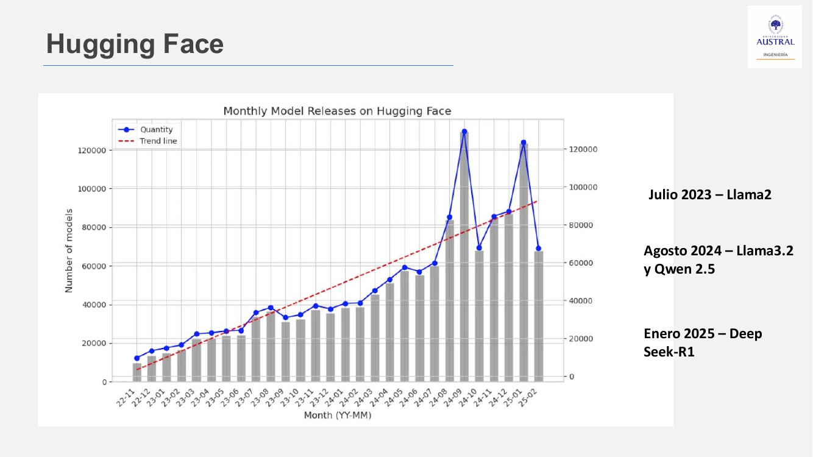
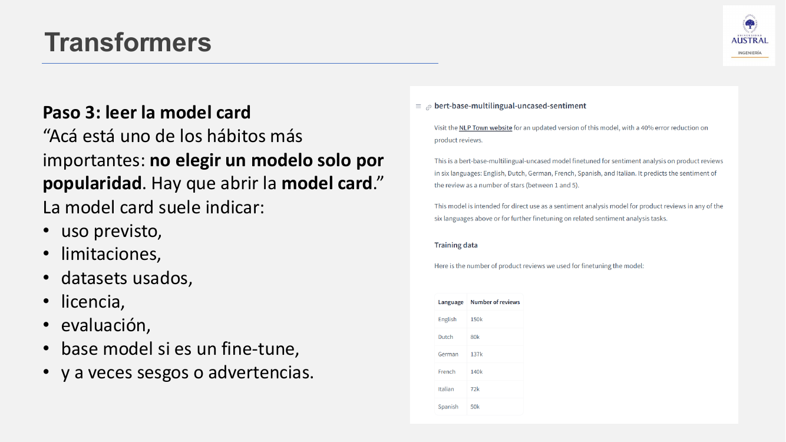
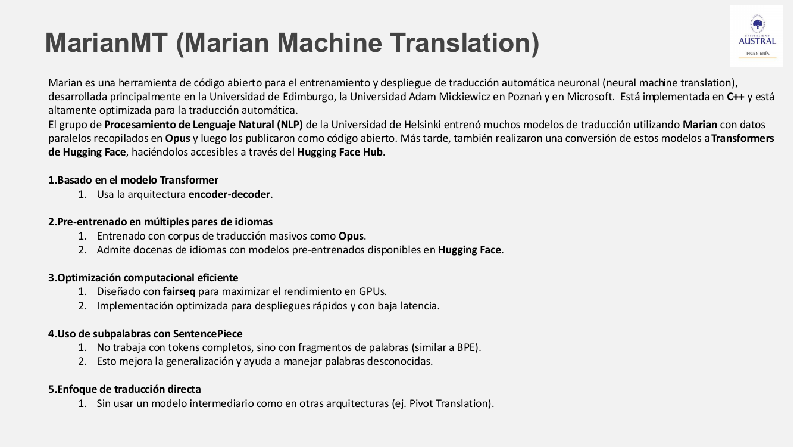
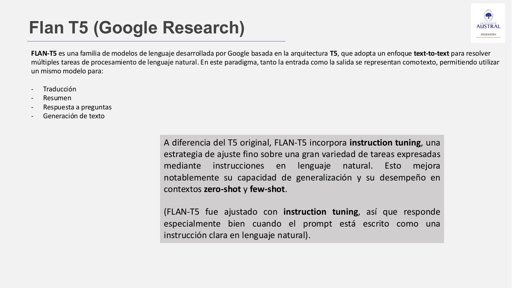

# Clase 27 · Hugging Face y traducción automática con modelos preentrenados

> **Módulo 4 · Procesamiento de Lenguaje Natural** · Horacio Arrigo · martes 07-jul-2026
> **Fuentes:** transcripción `DIA_Clase_27.vtt` · láminas `01_NLP_Clase_05_Presentacion.pdf` · notebooks `01_NLP_Clase_05_Teoria_Practica_Resuelta.ipynb` y `02_NLP_Clase_05_Actividad_Practica.ipynb`

## En pocas palabras

- **Hugging Face** es a la vez empresa, comunidad y plataforma. Su **Hub** concentra modelos, datasets y *Spaces* (demos interactivas), y hoy es el lugar con mayor disponibilidad de modelos abiertos de IA.
- Para elegir un modelo no se empieza por el nombre sino por la **tarea** (*task*): primero qué problema hay que resolver, después la librería (en la clase, Transformers sobre PyTorch) y la licencia, y por último la **model card**. No hay que elegir un modelo solo por popularidad.
- La **licencia** es un tema legal, no técnico: hay modelos libres para uso personal pero no comercial, y licencias que obligan a compartir las modificaciones. Esto importa tanto al desarrollar como al evaluar proveedores.
- La traducción automática es la aplicación natural de la arquitectura **encoder-decoder**. **MarianMT** (Helsinki-NLP) es especialista en un par de idiomas, rápido y liviano. **NLLB-200** (Meta) cubre más de 200 idiomas, incluso de pocos recursos, a cambio de más cómputo. **Flan-T5** (Google) es generalista: hace muchas tareas con el formato *text-to-text*.
- Una traducción no se evalúa con *accuracy*. Se usan **benchmarks** (BLEU, chrF sobre conjuntos de prueba estándar), evaluación humana o un LLM como juez. Y siempre hay que probar el modelo en el caso de uso propio, más allá de lo que diga la model card.

## Conceptos clave

### Hugging Face: el Hub

Según las láminas, el Hub declara más de 2 millones de modelos, más de 500 mil datasets y más de 1 millón de Spaces. El profesor lo contrasta con una librería como Scikit-Learn: no es una librería, es una de las infraestructuras centrales del ecosistema abierto de IA. Tiene servicios pagos, pero crear la cuenta y usar los modelos para la práctica es gratis.

Antes de Hugging Face, los datasets se buscaban sobre todo en **Kaggle**, en competencias o en portales de **Gobierno Abierto** (por ejemplo, el de la Ciudad de Buenos Aires o el nacional). El profesor señala que en algunos rubros, como energía o telecomunicaciones, sigue siendo difícil conseguir datasets.

Por qué importa, según las láminas:

- concentra modelos, datasets y demos a gran escala;
- estandariza la documentación de modelos mediante **model cards** (no hay otro estándar para eso);
- facilita la búsqueda por tarea, licencia, librería y metadata;
- conecta investigación, comunidad y uso práctico.



El gráfico muestra cómo creció la cantidad de modelos publicados por mes. Los hitos marcados son Llama 2 (julio 2023), Llama 3.2 y Qwen 2.5 (agosto 2024) y DeepSeek-R1 (enero 2025), entre los primeros LLM abiertos y populares.

### Cómo buscar un modelo: tres pasos

**Paso 1: arrancar por la tarea.** Hugging Face organiza los modelos por *tasks* o *pipeline types*, es decir, por el tipo de entrada y salida. Esa metadata define incluso qué widget de prueba aparece en la página del modelo. Las tareas están agrupadas en categorías (multimodal, computer vision, NLP, audio, tabular, aprendizaje por refuerzo, robótica, grafos). Las de NLP más usadas:

| Task de Hugging Face | Aplicación |
|---|---|
| `text-classification` | Análisis de sentimiento, spam, tópicos |
| `token-classification` | NER, POS tagging, chunking |
| `question-answering` | QA extractivo |
| `summarization` | Resumen automático |
| `translation` | Traducción |
| `text-generation` | Generación de texto |
| `fill-mask` | Completar palabras faltantes (como el autocompletar) |
| `feature-extraction` | Obtener embeddings (como Word2Vec, pero de otros modelos) |

La relación entre modelo y tarea **no es uno a uno**: un mismo modelo puede figurar en más de una tarea (por ejemplo, extracción de características y clasificación).

**Paso 2: filtrar por librería y modalidad.** En la clase se filtra por **Transformers**. Las láminas lo explican así: PyTorch pone la infraestructura matemática y computacional, y el Transformer es uno de los modelos que se montan sobre esa infraestructura. También se puede filtrar por idioma y por licencia.

**Paso 3: leer la model card.** Es la ficha técnica del modelo. No todos los modelos la tienen: hay muchos subidos sin documentación. Cuando existe, suele indicar:

- uso previsto y limitaciones;
- datasets usados para entrenar;
- licencia;
- evaluación (métricas sobre qué datos);
- modelo base, si es un *fine-tune*;
- a veces, sesgos o advertencias.

Además de la card, la página de cada modelo muestra los archivos y versiones (por ejemplo, el `vocab.txt` con el vocabulario), un widget para probarlo, el botón *Use this model* con el código para cargarlo (o abrirlo en Colab) y una sección de comunidad para discutir el modelo.



### Licencias

El profesor insiste en filtrar por licencia antes de adoptar un modelo:

- Hay modelos con licencia libre para **uso personal** que dejan de serlo para **uso comercial**.
- **MIT** (y, según el profesor, Apache 2.0) permiten cualquier tipo de uso.
- Otras licencias permiten usar y modificar, pero **obligan a publicar y compartir gratis las modificaciones**. Si se reentrena el modelo con información propietaria de la empresa, eso puede ser inviable por temas legales o de privacidad. (El profesor no recordó el nombre exacto de esa licencia.)
- En una empresa, una licencia restrictiva puede requerir pasar por un comité y justificar el uso; además, el modelo pasa por evaluaciones de ciberseguridad.

Lo mismo vale al **evaluar proveedores**: si un vendor usa librerías no declaradas, no pagadas o que no cumplen la normativa de la empresa, la responsabilidad legal se traslada o se comparte con quien lo contrató.

### BERT y el modelo de reseñas multilingüe

**BERT** (*Bidirectional Encoder Representations from Transformers*) es una variante de Transformer publicada por Google en 2018, un año después del Transformer original (2017). El modelo que se recorrió en clase, `bert-base-multilingual-uncased-sentiment`, es un BERT ajustado para predecir de **1 a 5 estrellas** a partir de una reseña de producto, en seis idiomas. Detalles que muestra su model card:

- ***Uncased***: se entrenó con texto en minúsculas (conecta con el preprocesamiento de la Clase 23).
- La cantidad de reseñas varía por idioma: 150 mil en inglés y 50 mil en español. Eso influye en el rendimiento.
- Se evalúa con 5.000 reseñas reservadas: la *accuracy* exacta (acertar el número de estrellas) es del 67 % en inglés y del 58 % en español. La ***accuracy off-by-one*** (acertar con un margen de una estrella) es bastante más alta.

Es un problema **supervisado de cinco clases**: texto con estrellas como etiqueta. Es el mismo planteo que el clasificador de sentimiento que el curso armó antes con Random Forest, pero con un Transformer, que funciona mucho mejor con texto.

### Modelos de traducción: MarianMT y NLLB-200

**MarianMT** (*Marian Machine Translation*) es una herramienta de código abierto para entrenar y desplegar traducción neuronal, desarrollada principalmente en la Universidad de Edimburgo, la Universidad Adam Mickiewicz de Poznań y Microsoft, e implementada en C++. El grupo de NLP de la **Universidad de Helsinki** entrenó con Marian muchos modelos sobre el corpus paralelo **OPUS** y los publicó en el Hub como modelos de Transformers (`Helsinki-NLP/opus-mt-xx-yy`). Características, según láminas y notebook:

1. Arquitectura Transformer **encoder-decoder**.
2. Preentrenado en muchos **pares de idiomas**, con un modelo por par.
3. Optimizado para inferencia rápida y baja latencia.
4. Trabaja con **subpalabras**, no con palabras completas, lo que ayuda con palabras desconocidas.
5. Traducción **directa**, sin un idioma pivote intermedio.



**NLLB** (*No Language Left Behind*) es una iniciativa de Meta AI para traducir en más de **200 idiomas**, incluidos muchos con pocos datos disponibles: lenguas de poblaciones muy pequeñas, con poca o ninguna presencia en libros o en internet. La versión **NLLB-200 Distilled 600M** es más liviana y consume menos cómputo sin perder demasiada calidad.

| Modelo | Arquitectura | Uso principal | Ventaja | Costo |
|---|---|---|---|---|
| MarianMT | Transformer encoder-decoder | Traducción entre un par de idiomas | Rápido y bajo consumo de memoria | Menos idiomas cubiertos |
| NLLB-200 | Transformer optimizado | Traducción en 200 idiomas | Más cobertura, lenguas de pocos recursos | Más recursos, inferencia más lenta |

El profesor remarca que con estos modelos el **costo computacional** empieza a pesar: ya no es descargar un Random Forest de Scikit-Learn, sino modelos que requieren infraestructura (por eso la práctica usa GPU).

El notebook suma un tercer traductor, **M2M-100 418M** (Meta AI), que traduce directamente entre cualquier par de 100 idiomas sin pivotar por inglés. En M2M-100 y NLLB, el idioma destino se indica con un token especial al inicio de la generación.

### Flan-T5: el enfoque text-to-text

**T5** (Google) plantea que toda tarea de NLP puede expresarse como "entra texto, sale texto": traducción, resumen, respuesta a preguntas, generación. El modelo es el mismo; lo que cambia es la instrucción del prompt. **Flan-T5** agrega ***instruction tuning***: un ajuste fino sobre muchas tareas expresadas como instrucciones en lenguaje natural. Eso mejora su generalización en escenarios *zero-shot* y *few-shot* (técnicas de prompting que se ven más adelante).



Advertencia del profesor: como son **anteriores a los LLM actuales**, en estos modelos la forma del prompt importa mucho. Hay que escribir una instrucción clara; si no, el modelo no funciona bien. Los LLM de hoy entienden la intención aunque se escriba sin estructura. Como ejemplo, a Flan-T5 se le puede pedir que muestre el razonamiento antes de la respuesta, algo parecido a pedirle a un LLM actual que explique su paso a paso.

### Encoder y decoder en la traducción (notebook resuelto)

El notebook usa `Helsinki-NLP/opus-mt-es-en` para mirar el interior del modelo:

- **Encoder**: recibe toda la frase de una vez y produce **embeddings contextualizados**. A diferencia de Word2Vec o GloVe, cada token depende de los demás. Su self-attention es **bidireccional** y tiene varias **cabezas**, cada una especializada en un tipo de relación. MarianMT tiene 6 capas de encoder, con salida de dimensión 512 por token.
- **Decoder**: genera de forma **autorregresiva**, token por token. Usa *self-attention* **causal** (enmascarada, una matriz triangular inferior: solo ve los tokens ya generados) y ***cross-attention*** sobre la salida del encoder. La cross-attention funciona como un **mapa de alineamiento** entre palabras fuente y destino.
- En cada paso, el decoder produce una distribución sobre el vocabulario y elige el token más probable (*greedy*) o explora alternativas con *beam search*. La **probabilidad acumulada** de la secuencia (el producto de las probabilidades de cada token) baja exponencialmente con la longitud, así que verla baja al final es normal.

### Evaluación de traducciones y benchmarks

Un **benchmark** es una métrica base contra la cual se compara el rendimiento de un modelo sobre un conjunto de prueba estándar. Así se pueden comparar dos traductores sobre el mismo texto. En la model card de `opus-mt-es-en`, el profesor mostró:

- **BLEU** (*Bilingual Evaluation Understudy*): compara automáticamente el texto generado con una o más traducciones de referencia humanas. Uno de los valores mostrados fue 30,6 (hay que mirar a qué *test set* corresponde cada valor).
- **chrF**: otra métrica reportada para varios *test sets*. El profesor dejó su significado para investigar. Según el notebook, es una métrica basada en n-gramas, como BLEU.

En traducción **no hay accuracy** carácter por carácter o palabra por palabra: importa si la traducción es correcta en gramática, sintaxis y sentido, algo más subjetivo. El notebook resume tres familias de evaluación:

| Familia | Ejemplos |
|---|---|
| Humana | Adecuación + fluidez, MQM, HTER, pruebas basadas en tareas |
| Automática con referencia | BLEU, chrF (n-gramas) → METEOR, TER → BERTScore (embeddings) → BLEURT, COMET (entrenadas, más correlación con humanos) |
| Con LLM | *LLM-as-judge*: un LLM puntúa o explica errores (buenas prácticas: rúbrica clara, `temperature = 0`) |

## Ejemplos y casos de la clase

- **Reseñas con BERT multilingüe.** En el widget de la model card: "El precio es bueno, pero la calidad no tanto" da 3 estrellas como más probables; "El producto malísimo", 1 estrella con alrededor de 90 %; "El producto es terriblemente bueno", 5 estrellas. Con la ironía "El producto me cambió la vida" el modelo no la detecta: asigna 4 o 5 estrellas, aunque con probabilidades repartidas. Enseña que un modelo de lenguaje por sí solo no capta sarcasmo ni ironía.
- **Robustez ante reformulaciones.** Una alumna notó que, al cambiar los tiempos verbales de una reseña, cambiaban las estrellas predichas. El profesor lo valida como una buena prueba: un sistema debería responder lo mismo si un cliente pregunta "¿lleva pilas?" o "¿necesita baterías?". Ese tipo de coherencia empieza a medirse en los modelos de lenguaje.
- **Del español al húngaro sin un modelo directo.** La mayoría de los grupos no encontró un modelo Helsinki-NLP directo es→hu y resolvió **encadenando dos modelos OPUS**: español→inglés y después inglés→húngaro. Otro grupo comparó dos modelos y usó un chatbot como juez. La lección: no siempre hay un modelo que resuelva exactamente lo que se necesita, y a veces hay que combinar varios.
- **Tres formas de validar la traducción** que propuso el profesor: (1) **retrotraducir** del húngaro al español y ver si vuelve el texto original; (2) comparar con Google Translate, suponiendo que es mejor; (3) pedirle a un LLM que juzgue la traducción.
- **Especialista vs. generalista (notebook).** Con la misma frase, MarianMT traduce "The dog's in bed sleeping quietly", mientras que Flan-T5-small produce "The rest is in the dark amidst the quiet". Flan-T5 también traduce "El cuarto no estaba aseado" como "The girl was not assassinated" y deja "desayuno" sin traducir. El especialista traduce mejor; el generalista hace más tareas.

## Práctica

**Entorno.** Google Colab con GPU: *Entorno de ejecución → Cambiar tipo de entorno de ejecución → T4 GPU*. Se verifica con `!nvidia-smi` o con `torch.cuda.is_available()`. La primera carga de cada modelo descarga los pesos (de cientos de MB a un par de GB), lo cual tarda unos minutos. El notebook advierte que fue escrito para `transformers==4.56.0`: en la versión 5, `pipeline(task="translation")` da `KeyError: "Unknown task translation"`.

**Actividad evaluada (en grupos).** Consigna del notebook `02_NLP_Clase_05_Actividad_Practica`:

1. Conectarse a Hugging Face y descargar un modelo de traducción *text-to-text*.
2. Traducir del español al húngaro (u otro idioma verificable) la frase *"Estamos en clase aprendiendo cómo la inteligencia artificial está revolucionando nuestro mundo: …"*, usando `pipeline`.
3. Evaluar la calidad de la traducción con la estrategia que prefieran.

Un **`pipeline`** de Transformers es una interfaz de alto nivel que encapsula cuatro pasos: cargar el modelo preentrenado, preprocesar la entrada (tokenizar), ejecutar la inferencia y posprocesar la salida.

```python
from transformers import pipeline
traductor = pipeline(task="translation", model="Helsinki-NLP/opus-mt-es-en")
traductor("El gato está en la mesa")[0]["translation_text"]

# Multilingüe: se indican los idiomas de origen y destino
nllb = pipeline(task="translation", model="facebook/nllb-200-distilled-600M")
nllb(texto_es, src_lang="spa_Latn", tgt_lang="hun_Latn")
```

La solución del notebook compara **M2M-100** (`src_lang="es", tgt_lang="hu"`) con **NLLB** y le pide a `gpt-4o-mini` (con `temperature=0`) que actúe como traductor profesional: indicar la traducción ganadora y justificar su elección por adecuación, fluidez y errores. En la corrida guardada, el juez eligió la de M2M-100.

**Qué más mirar en el notebook resuelto:**

- Dos formas de usar un modelo: `pipeline()` para uso rápido, o **tokenizer + modelo** (`MarianTokenizer`, `MarianMTModel`) cuando se quieren inspeccionar embeddings, atenciones o probabilidades.
- El patrón de **guardado local**: `from_pretrained(nombre)` la primera vez, `save_pretrained('./models/...')`, y después `from_pretrained(ruta_local)` sin depender de internet.
- La tokenización en subpalabras (`▁el`, `▁perro`, …, `</s>`) y los heatmaps de embeddings, de las cabezas de atención del encoder, del self-attention causal del decoder y de la cross-attention.
- Las traducciones con otros pares Helsinki (en→ru, en→zh, en→es) y la sección de Flan-T5-small (~77 M de parámetros) usando prefijos (`translate Spanish to English:`, `summarize:`, `question: … context: …`).
- Las reglas prácticas del notebook: un especialista suele ganarle a un generalista en su par de idiomas; más parámetros no siempre significa una mejor traducción; la mayoría de estos modelos acepta unos 512 tokens, así que los textos largos hay que segmentarlos; y nunca hay que confiar en una sola métrica.

## Para recordar

- "Buscar un modelo en Hugging Face no debería empezar por el nombre del modelo, sino por la tarea que quiero resolver."
- No elegir un modelo solo por popularidad: hay que **abrir la model card** y ver con qué datos se entrenó, en qué idiomas y con qué métricas se evaluó.
- La licencia es un tema legal: revisarla siempre, sobre todo para uso comercial o al evaluar proveedores. La diplomatura sirve tanto para construir como para **hacer las preguntas correctas** a un vendor.
- El desbalance de datos por idioma en el entrenamiento se nota en el rendimiento (en el modelo de reseñas, 67 % de accuracy en inglés contra 58 % en español).
- Los modelos pre-LLM necesitan prompts escritos como **instrucciones claras**.
- "No hay que confiarse nunca de que un modelo funciona": hay que saber cómo se entrenó, contra qué se comparó y **probarlo en la aplicación propia**. Es parte de la responsabilidad profesional.

## Preguntas de repaso

<details><summary>1. ¿Por qué conviene buscar un modelo por tarea y no por nombre?</summary>

Porque la tarea (clasificación de texto, traducción, NER, etc.) define el tipo de entrada y salida que se necesita y reduce mucho el espacio de búsqueda. Recién después tiene sentido filtrar por librería, idioma y licencia, y comparar candidatos leyendo sus model cards.

</details>

<details><summary>2. Un modelo de sentimiento reporta 67 % de accuracy en inglés y 58 % en español. ¿Qué explicación sugiere su model card y qué harías antes de usarlo en español?</summary>

Se entrenó con muchas menos reseñas en español (50 mil) que en inglés (150 mil), así que es esperable que rinda peor en español. Antes de usarlo, lo probaría con datos propios en español, idealmente con reseñas del dominio real, y miraría también la métrica off-by-one si un error de una estrella es tolerable.

</details>

<details><summary>3. ¿Qué riesgo concreto tiene usar en una empresa un modelo con una licencia que obliga a compartir las modificaciones?</summary>

Si se reentrena o modifica el modelo con información propietaria, la licencia obligaría a publicar esas modificaciones, lo que puede chocar con temas legales o de privacidad. Además, una licencia restrictiva puede requerir aprobaciones especiales, y si la usa un proveedor sin declararla, la responsabilidad se comparte con quien lo contrató.

</details>

<details><summary>4. Tenés que traducir español → húngaro y no hay un MarianMT directo para ese par. ¿Qué alternativas hay y qué compromiso tiene cada una?</summary>

Encadenar dos modelos especialistas (es→en y en→hu): son livianos, pero los errores del primer paso se arrastran al segundo. O usar un modelo multilingüe como M2M-100 o NLLB-200, que traduce directo pero es más pesado y lento. La elección se valida evaluando las traducciones.

</details>

<details><summary>5. ¿Por qué en traducción no se usa accuracy y qué se usa en su lugar?</summary>

Porque una frase puede traducirse bien de muchas maneras: comparar carácter por carácter o palabra por palabra no mide si la traducción es correcta en gramática y sentido. Se usan benchmarks con traducciones de referencia (BLEU, chrF), evaluación humana o un LLM como juez, y se combinan para no depender de una sola métrica.

</details>

<details><summary>6. ¿Qué diferencia hay entre la self-attention del decoder y la cross-attention?</summary>

La self-attention del decoder es causal: cada token generado solo mira los tokens ya generados de la traducción. La cross-attention mira la salida del encoder, es decir, la frase fuente completa, para decidir qué traducir a continuación. Por eso se puede leer como un mapa de alineamiento entre idiomas.

</details>

<details><summary>7. Si MarianMT traduce mejor que Flan-T5, ¿por qué usar Flan-T5?</summary>

Porque es generalista: con el mismo modelo y cambiando solo la instrucción hace traducción, resumen, QA o paráfrasis. Si en producción solo se necesita traducir, conviene un especialista. Si se necesita flexibilidad entre tareas, conviene el generalista, con la precaución de escribir prompts como instrucciones claras.

</details>

<details><summary>8. El modelo de reseñas le da 4 o 5 estrellas a "El producto me cambió la vida" dicho con ironía. ¿Qué te dice esto sobre cómo fue entrenado?</summary>

Que aprendió asociaciones supervisadas entre texto y estrellas, y una frase literalmente positiva se parece a las reseñas positivas del entrenamiento. Un modelo de lenguaje por sí solo no detecta la intención irónica. Los LLM posteriores mejoraron en eso con capas adicionales de ajuste.

</details>

## Conexiones

- **Hacia atrás:** la arquitectura encoder-decoder, la self-attention y las cabezas de atención que aquí se inspeccionan en un modelo real se vieron en la Clase 26. Los embeddings contextualizados contrastan con los estáticos de la Clase 25 (Word2Vec, GloVe, FastText). El *uncased* y la tokenización en subpalabras retoman el preprocesamiento de la Clase 23. El clasificador de sentimiento con Random Forest que se menciona es el ejemplo de reseñas trabajado en las primeras clases del módulo.
- **Hacia adelante:** BERT, presentado aquí a través de la model card, se retoma con los modelos tipo encoder en la Clase 28. Zero-shot, few-shot y LLM-as-judge anticipan el módulo de prompting y LLM.
- **TFI:** hay tres conexiones reales. (1) La metodología para elegir un modelo en el Hub (tarea `feature-extraction` o sentence embeddings, licencia apta para uso comercial, model card con idiomas de entrenamiento) aplica a la elección del encoder para el **retrieval semántico** de nombres comerciales en Benefix; conviene verificar cuánto español tuvo el entrenamiento. (2) La idea de benchmark (comparar modelos sobre un conjunto de prueba fijo con una métrica estándar) es lo que hacen **Hit@k** y **MRR** al comparar los retrievers léxico, semántico e híbrido con RRF. (3) Para la variante **generativa**, el LLM-as-judge con rúbrica y `temperature = 0`, y la advertencia de no confiar en una sola métrica, sirven para revisar normalizaciones dudosas.
