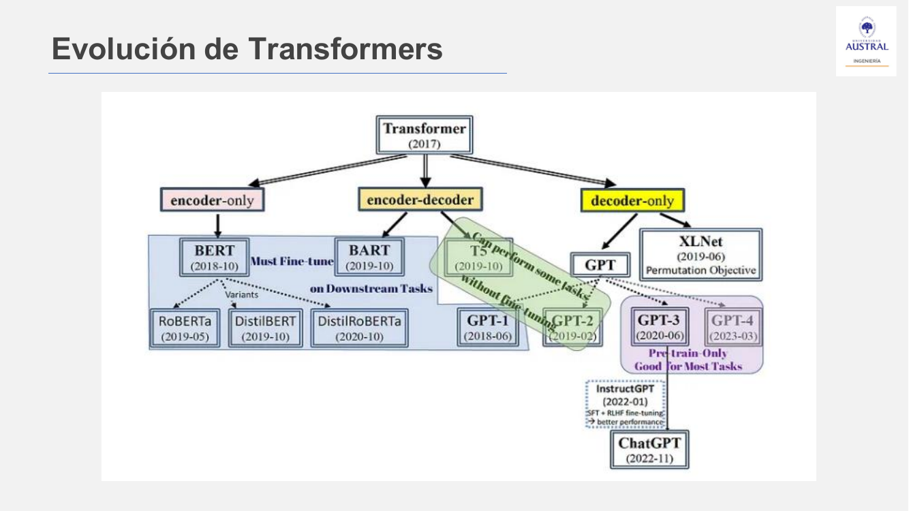
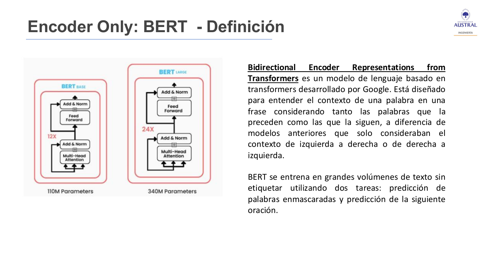
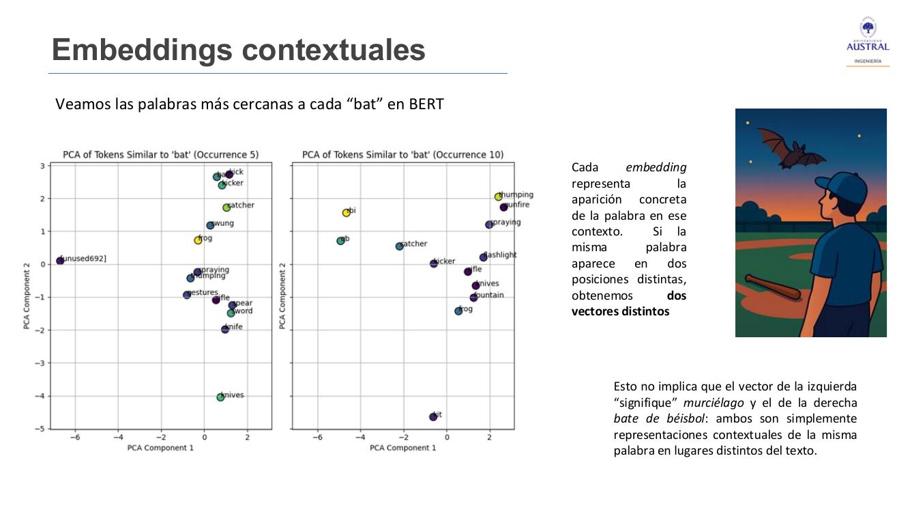
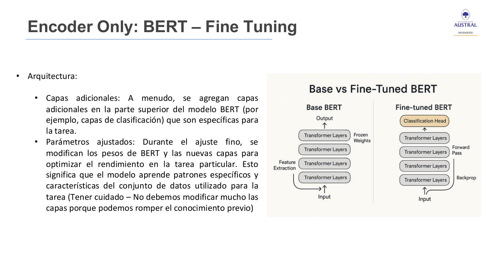
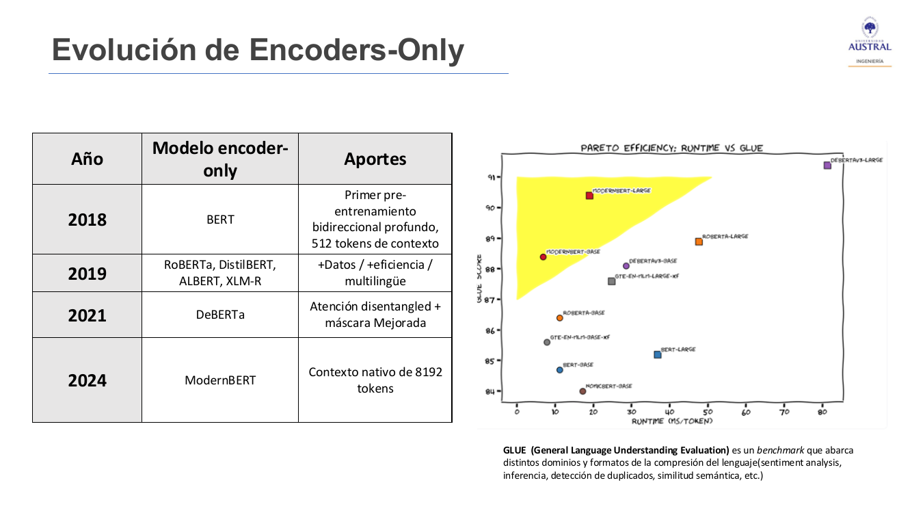
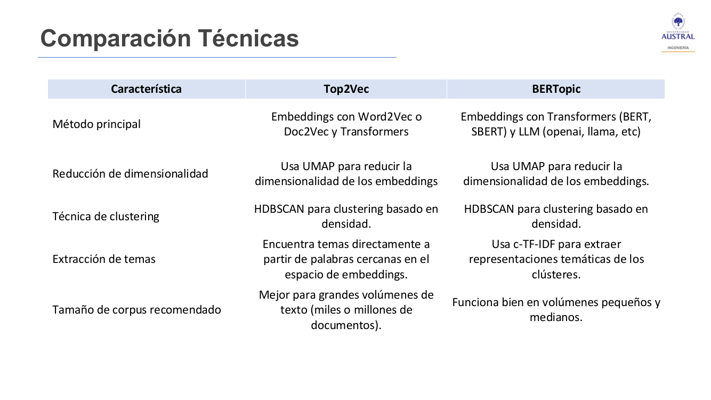

# Clase 28 · Encoders tipo BERT: embeddings contextuales, fine-tuning y topic modeling

> **Módulo 4 · Procesamiento de Lenguaje Natural** · Horacio Arrigo · martes 14-jul-2026
> **Fuentes:** transcripción `DIA_Clase_28.vtt` · láminas `2026_NLP_Clase_06.pdf` · notebooks `01_NLP_Clase_06_Teoria_Practica.ipynb`, `02_NLP_Clase_06_Actividad_Practica.ipynb`, `02_NLP_Clase_06_TP02_NER_Consigna.ipynb` y su versión resuelta

## En pocas palabras

- A partir del Transformer de 2017 surgen tres familias: **encoder-only** (BERT y variantes: entienden y codifican texto, sirven para clasificar, NER, sentimiento y embeddings), **decoder-only** (GPT: generan texto) y **encoder-decoder** (T5: traducción y resumen). Esta clase se dedica a la primera.
- **BERT** (*Bidirectional Encoder Representations from Transformers*, Google, 2018) lee el contexto de cada palabra hacia los dos lados. Se preentrena sin etiquetas, con dos tareas: adivinar palabras enmascaradas y predecir la oración siguiente. Es un modelo **generalista**: "sabe hablar el idioma" pero no conoce ninguna jerga.
- Su gran aporte son los **embeddings contextuales**: la misma palabra ("bat", "banco") recibe un vector distinto según la oración. Word2Vec, GloVe y FastText dan un único vector fijo por palabra. A partir de ahí se arman **embeddings de oración** (mean pooling, token `[CLS]`, Sentence-BERT) y **embeddings multilingües** (mBERT).
- Para usar un modelo preentrenado en una tarea concreta se hace **fine-tuning**: se parte de los pesos preentrenados, se agrega una "cabeza" específica (por ejemplo, de clasificación) y se entrena con datos propios. Es como una especialización después de la carrera de grado.
- Los encoders también sirven para **segmentar textos sin etiquetas**. **Top2Vec** y **BERTopic** encadenan embeddings, reducción de dimensión (UMAP) y clustering por densidad (HDBSCAN). Se diferencian en cómo nombran cada tópico: Top2Vec usa las palabras más cercanas al centroide y BERTopic usa c-TF-IDF.

## Conceptos clave

### Repaso: el Transformer y sus tres ramas

El Transformer (Clase 26) evalúa la relación entre **todas las palabras de la oración a la vez**. En "El perro está muy enojado por el ruido que generan los vecinos y entonces ladra", el modelo relaciona "ruido", "vecinos" y "ladra" sin importar la distancia. El **encoder** procesa la entrada en paralelo con autoatención y redes feed-forward, y genera una representación contextual de cada palabra. El **decoder** usa esas representaciones para generar la salida, con atención cruzada hacia la entrada.

| Familia | Qué hace | Tareas típicas | Ejemplo |
|---|---|---|---|
| Encoder-only | Entiende y **codifica** la entrada; la salida no es texto nuevo sino una codificación | Clasificación, NER, sentimiento, tópicos, embeddings | BERT, RoBERTa, DistilBERT |
| Decoder-only | **Genera** texto a partir de texto | Generación, chat | GPT (GPT-1 en 2018, ChatGPT masivo a fines de 2022) |
| Encoder-decoder | Codifica la entrada y genera una salida a partir de ella | Traducción (su origen), resumen | T5 |

Estos modelos casi nunca se entrenan desde cero: requieren muchísimos datos y cómputo. Se usan **preentrenados**.

### BERT

- **Bidireccional:** entiende cada palabra mirando las que la preceden y las que la siguen. Las LSTM (el "tren con vagones" de la Clase 26) aprendían el contexto en una sola dirección.
- **Tamaños:** BERT base tiene 12 capas y unos 110 millones de parámetros; BERT large, 24 capas y 340 millones.
- **Preentrenamiento autosupervisado:** se usa texto sin etiquetar. Una tarea enmascara palabras y el modelo debe inferirlas (*masked language modeling*). La otra es predecir la oración siguiente (*next sentence prediction*, NSP).
- **Generalista:** no está especializado en ninguna tarea; se ajusta después.

| Ventajas | Desventajas |
|---|---|
| **Transferencia de aprendizaje:** se ajusta a tareas específicas aprovechando lo aprendido de grandes corpus | **Costo computacional alto:** poco adecuado para dispositivos de baja potencia o tiempo real (el profesor lo descartó, por ejemplo, para un tótem de atención al cliente) |
| **Palabras fuera de vocabulario (OOV):** las parte en subpalabras (WordPiece) | **Interpretabilidad limitada:** sus embeddings son vectores de alta dimensión, difíciles de explicar |
| **Polisemia:** captura el contexto completo de la oración | |

El profesor señaló que con la llegada de los LLM esta familia "cayó un poco en desuso", pero sigue siendo útil cuando un LLM resulta demasiado costoso para la tarea.

### Embeddings estáticos vs. contextuales

El problema de los embeddings de la Clase 25 (Word2Vec, Doc2Vec, GloVe, FastText) es que **no son contextuales**: cada palabra tiene un único vector, sin importar en qué oración aparece. "Banco" (institución o asiento) o "bank" (banco u orilla del río) quedan con el mismo vector. Los modelos estáticos sí miran una ventana de contexto **para aprender**, pero una vez construido el embedding queda fijo.

Ejemplo de la lámina: *"He watched the bat fly over the baseball bat"* (vio al murciélago volar sobre el bate de béisbol).

- **Estático:** 9 tokens, 7 distintos ("the" y "bat" se repiten), 7 embeddings. En GloVe, los vecinos de "bat" son casi todos de béisbol (pitch, swinging…), no del animal.
- **Contextual (BERT):** se agregan los tokens especiales `[CLS]` al inicio y `[SEP]` al final, y **cada aparición** de una palabra recibe su propio vector. Los dos "bat" tienen embeddings distintos.

**Advertencia de la lámina:** que los dos vectores sean distintos **no significa** que uno "signifique" murciélago y el otro bate. Son representaciones diferentes porque el modelo detecta contextos de uso diferentes; no captura el significado en sí.

Propiedades de los embeddings contextuales: **adaptabilidad al contexto** (cambian según las palabras que rodean al término) y **captura de polisemia** (útil para desambiguar; en la lámina, "cold" como temperatura, como resfrío o como persona distante).

### Sentence embeddings: un vector por oración

Buscan capturar el significado de una oración entera en un solo vector, para comparar oraciones entre sí. Se vieron tres estrategias:

| Estrategia | Cómo funciona | Observación |
|---|---|---|
| **Mean / average pooling** | Se obtiene el embedding de cada palabra y se promedian (o se suman) dimensión a dimensión. La variante *max pooling* toma el máximo de cada dimensión | Ignora en buena medida el orden y la estructura de las palabras |
| **Token `[CLS]` de BERT** | Al pasar por las capas de BERT, el token `[CLS]` acumula información de toda la secuencia y se usa como resumen global | Sale directo del modelo, sin operación extra |
| **Sentence-BERT (SBERT)** | Red **siamesa**: dos Transformers idénticos, con pesos compartidos, procesan dos oraciones; luego una capa de pooling, entrenamiento con pérdida softmax (a menudo con datos de inferencia de lenguaje natural, NLI) y una red feed-forward que predice la similitud | Pensado para búsqueda semántica y comparación de oraciones |

Ante la pregunta de un alumno sobre cómo se aplica en la práctica: se delimita la oración (por ejemplo, de mayúscula a punto), se convierte cada palabra en vector y se aplica la operación de pooling. Como los embeddings tienen cientos de dimensiones (Word2Vec usaba entre 100 y 300), es muy difícil que dos oraciones con palabras distintas terminen con el mismo vector.

En el gráfico comparativo, las tres estrategias ubican los embeddings en zonas bastante distintas, pero cada una tiene **consistencia interna**: oraciones relacionadas quedan agrupadas.

### Embeddings multilingües

**mBERT** (*Multilingual BERT*) es BERT entrenado con textos de más de 100 idiomas:

- Usa **el mismo modelo** para todos los idiomas y **comparte un vocabulario de subpalabras** entre lenguas.
- Genera embeddings contextuales.
- Permite **transferencia entre idiomas** aunque no fue entrenado para traducir. Lo que aprende de patrones en inglés puede ayudar en tareas similares en español.

Aplicaciones de las láminas: clasificación multilingüe (sentimiento en reseñas en español, inglés o portugués), **búsqueda semántica cross-lingual** (buscar en español y recuperar documentos en inglés), **transferencia zero-shot** (entrenar en un idioma y aplicar en otro con pocos o ningún ejemplo etiquetado) y clustering de documentos en distintos idiomas. La ventaja principal es que **reducen la dependencia de traducciones explícitas**. El ejemplo del profesor: una librería con libros en varios idiomas que se pueden asignar a categorías ya conocidas a través de sus embeddings.

### Fine-tuning y transferencia de aprendizaje

Un modelo preentrenado que no se puede adaptar sirve para poco, y entrenar uno propio desde cero suele ser inviable por costo. Las dos salidas son **transfer learning** y **fine-tuning** (ajuste fino).

- Se parte de **BERT base o large** con sus pesos preentrenados: el modelo ya "entiende" el idioma.
- Se **agregan capas** en la parte superior (por ejemplo, una cabeza de clasificación) específicas para la tarea: sentimiento, respuesta a preguntas, NER, sentimiento de llamadas a un call center, reseñas de productos.
- Se entrena con un dataset etiquetado de la tarea. Según el caso, las capas del Transformer se **congelan** (*frozen weights*) y solo se entrena la cabeza nueva, o se reentrenan también las últimas capas. Si el modelo es muy cerrado, solo queda agregar la capa especialista.
- **Cuidado** (lámina): no conviene modificar demasiado las capas preentrenadas, porque se puede **romper el conocimiento previo**.

El profesor lo comparó con lo que hoy se hace con un LLM al pedirle "escribime como si fueras médico": la idea de especializar un modelo general viene de acá.

### Evolución de la familia BERT

| Modelo | Año | Qué aporta |
|---|---|---|
| **BERT** | 2018 | Primer preentrenamiento bidireccional profundo; 512 tokens de contexto |
| **RoBERTa** | 2019 | Misma arquitectura, 10 veces más datos y más cómputo. **Elimina NSP** (empeora algunas tareas y mejora otras), usa batches de hasta 8.000 secuencias y secuencias más largas, y aplica **enmascaramiento dinámico** (máscaras nuevas en cada época en lugar de un patrón fijo) |
| **DistilBERT** | 2019 | **Knowledge distillation** (maestro-alumno: un modelo chico aprende a imitar a uno grande). 40 % menos parámetros, 60 % más rápido en inferencia, conserva el 97 % del rendimiento de BERT. 6 capas en lugar de 12 |
| **DeBERTa** | 2021 | Microsoft. **Atención disentangled** (cada token tiene un vector de contenido y otro de posición) y *Enhanced Mask Decoder* |
| **ModernBERT** | 2024 | Lleva avances de los LLM al mundo encoder-only: contexto nativo de 8.192 tokens, *rotary positional embeddings* (RoPE), Flash-Attention 2 y bloques internos actualizados |

En la tabla de la lámina, 2019 también incluye ALBERT y XLM-R (multilingüe).

**Benchmarks.** Para comparar modelos se usan conjuntos de evaluación estándar. **GLUE** (*General Language Understanding Evaluation*) cubre sentimiento, inferencia, detección de duplicados y similitud semántica. El gráfico cruza score GLUE con tiempo de ejecución (ms por token): DeBERTa-v3-large tiene el mejor score pero es mucho más lento; ModernBERT large y base quedan en la zona eficiente. Se busca **la mejor respuesta en el menor tiempo**. Un modelo más chico solo es una mejora si rinde igual o mejor en la misma tarea.

### Encoders aplicados a segmentación (topic modeling)

Como los encoders producen una salida codificada, sirven para clustering y para encontrar tópicos **sin generar texto**. Frente a los métodos basados en conteo (BoW, LDA de la Clase 24) aportan comprensión contextual, captura de relaciones semánticas, foco en palabras relevantes, mejor manejo de la polisemia y tópicos más coherentes e interpretables. En síntesis: representaciones densas y ricas, dependencias contextuales y mejor separación de clusters.

Las dos técnicas vistas comparten un pipeline en dos etapas:

**1. Generación de clusters**
- **Embeddings:** estáticos (Doc2Vec) o contextuales (BERT a nivel token; Sentence Transformers a nivel oración). BERTopic admite además Longformer (atención deslizante), T5 y embeddings por API (OpenAI, Llama).
- **Reducción de dimensión:** se proyectan los vectores a un espacio manejable conservando la estructura de densidad. Se usa sobre todo **UMAP**, que según la lámina preserva mejor que t-SNE tanto la estructura local como la global (t-SNE agrupa bien lo cercano, pero distorsiona lo global y es lento en conjuntos grandes). También se mencionan PCA y SVD truncada.
- **Clustering:** típicamente **HDBSCAN**. **DBSCAN** usa un radio fijo ε: si es muy chico salen muchos clusters pequeños o mucho ruido, y si es muy grande se fusionan clusters distintos. HDBSCAN es la versión jerárquica: no necesita un ε fijo y admite clusters de distinta densidad. Cada punto calcula su *core distance* (distancia al k-ésimo vecino), y entre dos puntos se usa la *mutual reachability distance*. BERTopic también admite K-means (hay que fijar K de antemano) y clustering jerárquico.

**2. Interpretación de clusters**: es lo que distingue a las dos técnicas (siguiente sección).

Mensaje del profesor sobre el clustering: hay que elegir la técnica que capture la forma real de los datos. K-means, por ejemplo, falla con distribuciones no globulares. Eso no se sabe de antemano: muchas veces es prueba y error.

### Top2Vec vs. BERTopic

- **Top2Vec:** agrupa los documentos densos (descarta outliers), calcula el **centroide** de cada grupo en el espacio original de embeddings (el *topic vector*) y toma como palabras clave del tema las **n palabras cuyos embeddings están más cerca del centroide**. Palabras, documentos y tópicos conviven en el mismo espacio.
- **BERTopic:** genera embeddings **solo de documentos**. Para interpretar, trata todos los documentos de un cluster como **un único documento**, lo **tokeniza** (n-gramas, sin stopwords) y pondera los términos con **c-TF-IDF** (*class-based* TF-IDF). Los n términos con mayor puntaje son las palabras del tópico. La tokenización se usa para **interpretar** los tópicos, no para construirlos.

En común tienen que detectan **automáticamente la cantidad de tópicos** y usan UMAP y HDBSCAN. Lo que el profesor pidió llevarse: **cómo extraen los temas** (cercanía al centroide vs. c-TF-IDF) y **qué tamaño de corpus conviene** (Top2Vec, miles o millones de documentos; BERTopic, volúmenes pequeños y medianos).

**Top2Vec: puntos clave y limitaciones.** No requiere quitar stopwords, stemizar ni lematizar. Representa los tópicos con centroides y no con TF-IDF ni distribuciones de probabilidad (como LDA). Permite búsqueda semántica y reducción jerárquica de tópicos. En contra: es costoso en memoria y cómputo, necesita bastantes datos de inicio, rinde mal si los documentos son muy parecidos entre sí, se complica en dominios de vocabulario muy especializado, depende de la calidad de los embeddings y a veces produce menos tópicos de los esperados.

TF-IDF (Clase 24) vuelve a aparecer en BERTopic: "no estaba tan mal ver todo eso que al principio parecía obsoleto". La lámina presenta a c-TF-IDF junto con BM25 como extensiones de TF-IDF con normalización por longitud y parámetros de saturación.

## Ejemplos y casos de la clase

- **Meme de Google Translate** (juego de palabras en francés con *mûre* "mora", *mur* "pared" y *murmure* "murmura", traducido como "A ripe blackberry murmurs to the wall"): con el que el profesor suele abrir el curso, para mostrar cómo un texto simple esconde complejidad de interpretación y de fonética al traducir.
- **"He watched the bat fly over the baseball bat"**: el caso central para contrastar embeddings estáticos (un vector para "bat", sesgado al béisbol en GloVe) y contextuales (un vector por aparición).
- **"Banco" / "bank"**: el ejemplo de polisemia que los alumnos recordaron de la Clase 25.
- **Analogía del idioma y la jerga**: BERT sabe hablar español pero no conoce la jerga médica o de ingeniería; el fine-tuning es aprender esa jerga, como una especialización después del grado.
- **Benchmarks y marketing**: las noticias comparan modelos por exámenes (ingreso a Medicina, doctorados), pero las empresas venden comparando contra benchmarks como GLUE.
- **Presentación del TP de NER (grupo de Agustín y otros):** con `mrm8488/bert-spanish-cased-finetuned-ner`, CONICET, NeurIPS y Vaca Muerta salieron partidos en subpalabras o mal tipados, y el modelo no tiene etiqueta de fecha. Con `Babelscape/wikineural-multilingual-ner`, uno de los más descargados del Hub, las entidades salieron limpias y bien clasificadas casi en su totalidad. El grupo de Ezequiel probó un modelo popular entrenado solo en inglés y obtuvo peores resultados sobre el texto en español: **popular no significa adecuado**.

## Práctica

**1. `01_NLP_Clase_06_Teoria_Practica.ipynb` (guiada, requiere GPU en Colab)**
- **Tokenización comparada** de "Las instalaciones son modernas y el personal muy amable. Sin duda volvería" con tres tokenizadores WordPiece. `bert-base-uncased` (inglés, 30.522 tokens de vocabulario) la parte en muchas subpalabras (`ins ##tal ##acion ##es`). `bert-base-multilingual-uncased` (105.879 tokens) la parte menos. `dccuchile/bert-base-spanish-wwm-uncased` (31.002 tokens) deja casi todas las palabras enteras. Un modelo del idioma representa mejor el texto.
- **Embeddings contextuales** de los dos "bat" con `BertModel` (`last_hidden_state`) y visualización con PCA.
- **Multilingüe** con `paraphrase-multilingual-MiniLM-L12-v2`: seis conceptos (perro, gato, casa, agua, libro, comer) en cinco idiomas se agrupan por concepto y no por idioma (alineación cross-lingüe). La notebook aclara que mBERT "crudo" tiende a agrupar más por idioma; los Sentence-BERT multilingües se entrenan por destilación para forzar esa alineación.
- **Sentence embeddings**: compara CLS pooling, mean pooling y Sentence-BERT (`all-mpnet-base-v2`) sobre oraciones con palabras ambiguas (bank, bat, plant, spring), con t-SNE.
- **Fine-tuning para sentimiento** de reseñas de hoteles (positivo / neutro / negativo, el mismo dataset y la misma partición de la Clase 24). `max_length` se elige con el percentil 95 de la longitud en tokens (186). Se usa `BertForSequenceClassification` con `num_labels=3`, `Trainer` de Hugging Face, AdamW con lr = 1e-5 y 3 épocas, y métricas accuracy y F1 macro. El aviso de pesos `classifier.weight` y `classifier.bias` sin inicializar es esperable: la cabeza de clasificación es nueva y hay que entrenarla. Sobre 50 reseñas no vistas: **accuracy 0,88**. La clase más difícil es *neutro* (recall 0,69).
- **Trade-off del fine-tuning** (cierre de la notebook): conviene si la ganancia supera el costo en tiempo, GPU y complejidad. Si el modelo base ya da más de 80-85 % o la mejora es de menos de 3-5 puntos, puede no compensar. Hay alternativas intermedias (embeddings fijos con un clasificador liviano, few-shot con LLM). La recomendación es probar primero con un subconjunto y 1-2 épocas.

**2. `02_NLP_Clase_06_Actividad_Practica.ipynb` (guiada, sin GPU)**: modelos preentrenados **sin** ajustar sobre las mismas 50 reseñas.
- `agentlans/multilingual-e5-small-aligned-sentiment` devuelve **un único score continuo** (aprox. −2 a +2): está configurado como regresión (se ve en su `config.json`). No sirve directo, porque habría que buscar umbrales de corte.
- `pysentimiento/robertuito-sentiment-analysis` (RoBERTa entrenado en español, sobre todo tweets, 3 clases): **accuracy 0,78**, con muy bajo recall en *neutro*. Muestra que un modelo preentrenado da resultados razonables pero, sin ajuste al dominio, por debajo del fine-tuneado (0,88).

**3. TP02 NER (en grupos, sin entrenar):** buscar en el Hub un modelo de NER (tarea *Token Classification*, filtrar por español **y** multilingüe, ordenar por descargas, leer la model card) y correrlo con `pipeline('ner', model=..., aggregation_strategy='simple')` sobre cinco oraciones (Messi en Rosario e Inter Miami; UBA y CONICET en 2024; NeurIPS y María Gómez; YPF, Vaca Muerta y Neuquén; OpenAI, Microsoft y San Francisco). La versión resuelta compara cuatro modelos:

| Modelo | Idioma | Cobertura aprox. | Problemas |
|---|---|---|---|
| `Babelscape/wikineural-multilingual-ner` | Multilingüe | 0,93 | NeurIPS como MISC, Vaca Muerta como ORG |
| `Davlan/xlm-roberta-base-ner-hrl` | Multilingüe | 0,93 | NeurIPS como LOC; único que tipa bien Vaca Muerta (LOC) |
| `mrm8488/bert-spanish-cased-finetuned-ner` | Español | 0,93 | Corta spans en subpalabras (`CON` + `##ICET`, `Neu` + `##quén`) |
| `dslim/bert-base-NER` | Inglés | 0,87 | Pierde CONICET; etiqueta "El" e "in" como ORG; parte Vaca Muerta |

Ningún modelo detecta "2024": su esquema es PER / ORG / LOC / MISC, sin `DATE`. Conclusión del TP: **NER no es "pasar un modelo"**. El resultado depende del idioma, de si el modelo es *cased* o *uncased*, del dominio, del esquema de etiquetas y del corpus de entrenamiento. Para textos médicos, legales o científicos hace falta fine-tuning con datos del dominio o combinar modelo y reglas. La consigna pide una presentación grupal de 10 minutos en la última clase.

*Detalles a tener en cuenta en las notebooks:* el texto de "Observaciones sobre la performance" dice que la exactitud es "perfecta", pero la salida guardada da 0,88. En la actividad 2, el `classification_report` pasa `target_names` en un orden distinto al alfabético que usa sklearn, así que las filas por clase quedan con el nombre cambiado (la accuracy global no se afecta). El profesor avisó además que la celda "Preparemos la clase de entrenamiento" tiraba un error no intencional, que varios grupos resolvieron con ayuda de Gemini.

## Para recordar

- Encoder = **entender y codificar**; decoder = **generar**. Si la tarea no requiere producir texto (clasificar, extraer entidades, agrupar, buscar), un encoder puede alcanzar y es mucho más barato que un LLM.
- Un embedding, aunque se haya aprendido mirando el contexto, **queda fijo** una vez entrenado. Si aparece un significado que no estaba en el corpus, no hay garantía de cómo se va a representar. Es lo mismo que pasa con cualquier modelo de IA.
- Dos vectores distintos para "bat" no equivalen a "dos significados": son dos contextos de uso distintos.
- Fine-tuning: partir de los pesos preentrenados, agregar la cabeza de la tarea y **no tocar demasiado** las capas de base, para no romper lo aprendido.
- Al comparar modelos, mirar **score y costo** (tiempo por token, parámetros). Un modelo más chico solo es mejor si rinde igual en la misma tarea y el mismo benchmark.
- En clustering no hay técnica universal: hay que elegir la que respete la forma de los datos, y muchas veces es prueba y error.
- Que un modelo sea popular en el Hub no garantiza que sirva: el idioma y el dominio de entrenamiento mandan.

## Preguntas de repaso

1. ¿Por qué BERT puede resolver la polisemia y Word2Vec no?

Word2Vec asigna un único vector por palabra del vocabulario, fijo después del entrenamiento: "banco" tiene el mismo embedding en "me senté en el banco" y en "deposité dinero en el banco". BERT calcula el vector de cada **aparición** con autoatención bidireccional sobre toda la oración, así que la misma palabra recibe vectores distintos en contextos distintos.

2. ¿Qué tareas de preentrenamiento usa BERT y por qué se dice que no necesita etiquetas?

Predicción de palabras enmascaradas y predicción de la oración siguiente. La "etiqueta" sale del propio texto (la palabra tapada, si la oración B sigue a la A), así que se puede entrenar sobre grandes volúmenes de texto sin anotar. RoBERTa mostró después que se puede quitar NSP y usar enmascaramiento dinámico.

3. Tenés que obtener un vector por reseña para compararlas por similitud. ¿Qué opciones viste y en qué difieren?

Mean (o max) pooling de los embeddings de las palabras: simple, pero ignora el orden. Token `[CLS]` de BERT: el resumen que BERT acumula de toda la secuencia. Sentence-BERT: una red siamesa entrenada específicamente para que oraciones similares queden cerca, pensada para búsqueda semántica. Las tres ubican los vectores en lugares distintos, pero cada una es internamente consistente.

4. ¿Qué se entrena y qué se congela en un fine-tuning de BERT para clasificación?

Se agrega una cabeza de clasificación nueva (por eso aparece el aviso de pesos `classifier` sin inicializar) que siempre se entrena. Las capas Transformer pueden quedar congeladas o ajustarse levemente, a veces solo las últimas. Si se modifican demasiado, se puede perder el conocimiento general del preentrenamiento.

5. En la práctica, el modelo preentrenado de sentimiento dio 0,78 de accuracy y el BERT fine-tuneado 0,88. ¿Siempre vale la pena hacer fine-tuning?

No necesariamente. El fine-tuning cuesta GPU, tiempo y complejidad (hiperparámetros, sobreajuste). Según la notebook, si el modelo base ya es aceptable o la mejora es marginal (pocos puntos), puede convenir invertir en los datos o usar alternativas intermedias. Lo recomendable es probar primero con un subconjunto y pocas épocas, y medir.

6. ¿Qué hace DistilBERT para ser más liviano y cómo se sabe que "no perdió" calidad?

Usa knowledge distillation: un modelo alumno más chico (6 capas en lugar de 12) aprende a imitar al maestro (BERT). Tiene 40 % menos parámetros y es 60 % más rápido, y se verifica en benchmarks de NLP, donde conserva el 97 % del rendimiento de BERT. Sin esa comparación en las mismas tareas no se puede afirmar que sea una mejora.

7. ¿En qué se parecen y en qué se diferencian Top2Vec y BERTopic?

Ambos generan embeddings, reducen dimensión con UMAP, agrupan con HDBSCAN y detectan solos la cantidad de tópicos. Top2Vec describe cada tópico con las palabras más cercanas al centroide del cluster en el espacio de embeddings. BERTopic une los documentos de cada cluster en uno solo y elige las palabras con c-TF-IDF. Top2Vec se recomienda para corpus muy grandes; BERTopic funciona bien con corpus chicos y medianos.

8. ¿Por qué ningún modelo del TP de NER detectó "2024", y qué harías para textos legales?

Porque su esquema de etiquetas es PER / ORG / LOC / MISC y no incluye fechas: el modelo no puede predecir una clase que no vio en el entrenamiento. Para textos legales (o médicos) haría falta un modelo entrenado con las entidades de ese dominio (fine-tuning con datos anotados) o combinar el modelo con reglas, por ejemplo expresiones regulares para fechas y artículos de ley.

## Conexiones

- **Hacia atrás:** la arquitectura encoder, la autoatención y el positional encoding vienen de la Clase 26. Los embeddings estáticos (Word2Vec, GloVe, FastText), la similitud coseno y el problema de la polisemia, de la Clase 25. TF-IDF, LDA y el dataset de reseñas de hoteles, de la Clase 24 (el fine-tuning usa su misma partición para comparar sobre el mismo test). La tokenización WordPiece y las stopwords, de la Clase 23. El uso de modelos del Hub de Hugging Face, la idea de benchmark y el ejercicio de traducción, de la Clase 27. El transfer learning con CNN de la Clase 12 es la misma idea aplicada a imágenes. PCA, t-SNE, UMAP y k-medias, de las Clases 04 y 05.
- **Hacia adelante:** la rama decoder-only (GPT) se desarrolla en la Clase 29.
- **TFI (Benefix):** los sentence embeddings (mean pooling, `[CLS]`, Sentence-BERT) son la base del **retrieval semántico** para normalizar nombres comerciales: se embebe la consulta y el catálogo, y se rankea por similitud coseno. Un modelo multilingüe o en español evita los problemas de tokenización que mostró `bert-base-uncased` con texto en español. c-TF-IDF y BM25, presentados aquí como variantes de TF-IDF, conectan con la rama de **retrieval léxico**, que se combina con la semántica en el híbrido con RRF. Por último, la lección de los benchmarks aplica directo: comparar variantes con las mismas métricas (Hit@k, MRR) sobre el mismo conjunto de prueba.
