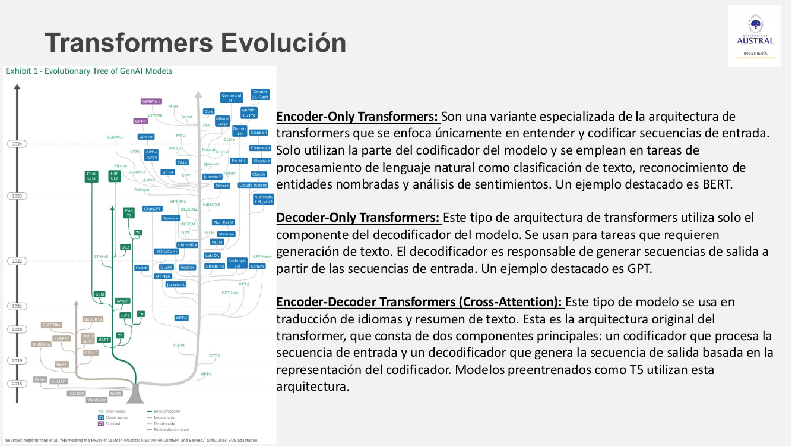
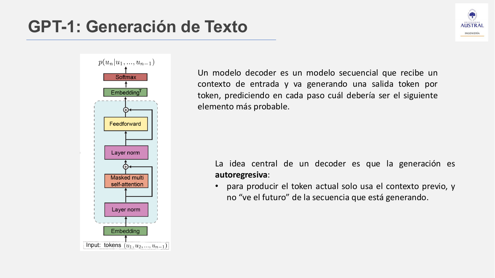
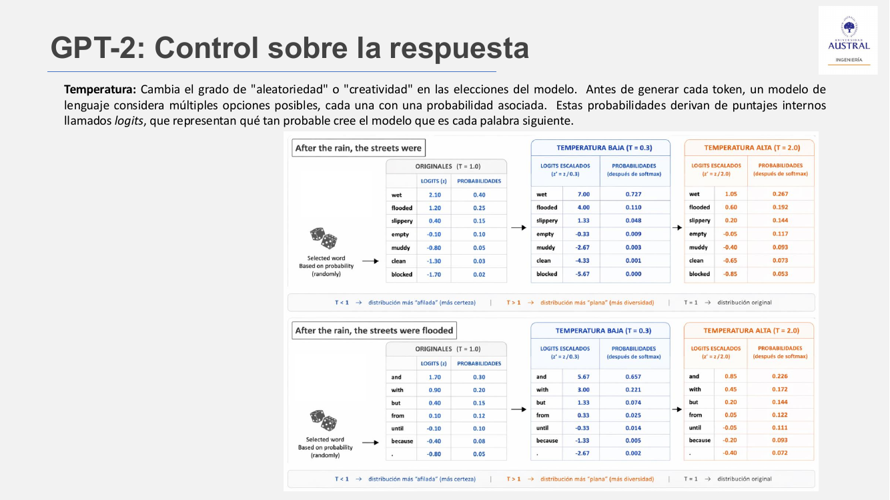
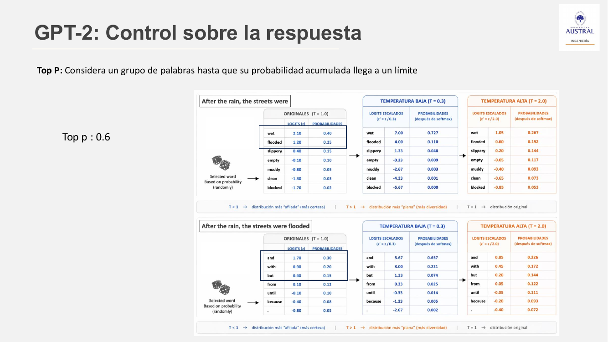
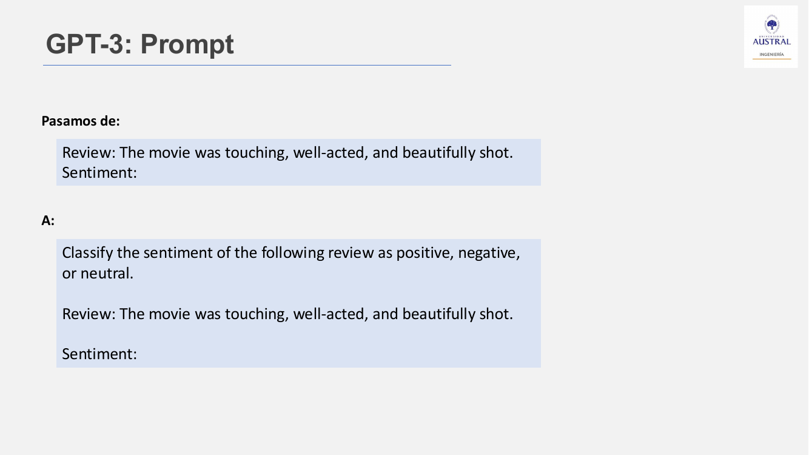
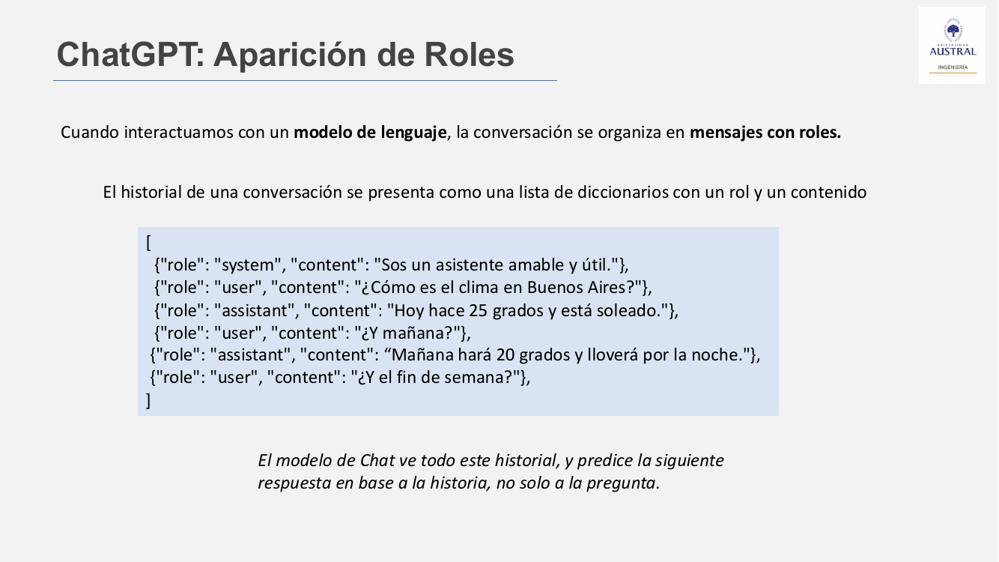

# Clase 29 · Transformers decoder-only: de GPT a ChatGPT y LLMs locales

> **Módulo 4 · Procesamiento de Lenguaje Natural** · Horacio Arrigo · jueves 16-jul-2026
> **Fuentes:** transcripción `DIA_Clase_29.vtt` · láminas `2026_NLP_Clase_07.pdf` · notebook `01_NLP_Clase_07_Teoria_Practica_Resuelta.ipynb` · demos HTML `Ejemplo_generacionTransformers.html` (decoder de juguete) y `Ejemplo_generacionTransformers_js_gpt2.html` (DistilGPT-2 real en el navegador) · demo web *Transformer Explainer*

## En pocas palabras

- Un modelo **decoder-only** (la familia GPT) recibe texto y devuelve texto. Genera **token por token** y de forma **autorregresiva**: cada token nuevo se predice solo con lo ya generado, porque no hay "futuro" para mirar. Los encoders (BERT, Clase 28) reciben texto y devuelven algo que no es texto, como un puntaje, una clase o un embedding.
- En cada paso el modelo produce una **distribución de probabilidad** sobre el vocabulario, y esa distribución refleja el corpus de entrenamiento. Por eso a un LLM se lo llamó "loro estocástico". Tres parámetros controlan cómo se elige el próximo token: **temperatura** (aplana o afila la distribución), **top-k** (se queda con las k más probables) y **top-p** (se queda con las que acumulan una masa p).
- La evolución GPT-1 → GPT-2 → GPT-3 → ChatGPT va de *generar texto*, a *controlar el muestreo y condicionar con contexto*, a *especificar la tarea con un prompt sin fine-tuning* (**in-context learning**), y por último a *conversar con roles* (`system`, `user`, `assistant`).
- El modelo **no tiene memoria** entre mensajes. En cada turno se le reenvía toda la conversación, y por eso se cobran también los tokens de entrada. En conversaciones largas el modelo "se marea".
- Con **Ollama** o **LM Studio** se puede correr un LLM chico de forma local y usarlo desde Python con la librería `openai`, que funciona como estándar de hecho: cada backend es solo un `(base_url, api_key, model)`.

## Conceptos clave

### Tres arquitecturas derivadas del Transformer



| Variante | Entrada → salida | Tareas típicas | Ejemplo |
|---|---|---|---|
| Encoder-only | texto → representación (score, clase, embedding) | clasificación, NER, sentimiento, tópicos | BERT |
| Decoder-only | texto → texto | generación, chat, instrucciones | GPT |
| Encoder-decoder (atención cruzada) | texto → texto, condicionado al encoder | traducción, resumen | T5 (y la arquitectura original) |

Las líneas de desarrollo salieron casi juntas: el Transformer es de 2017, y BERT y GPT-1 son de 2018.

### El decoder autorregresivo (GPT-1)

GPT viene de *Generative Pre-trained Transformer*. OpenAI lo presentó en 2018.



- **Arquitectura** (lámina): embedding de los tokens → layer norm → *masked multi self-attention* → layer norm → feed-forward (con conexiones residuales) → embedding transpuesto → **softmax**. La salida es $p(u_n \mid u_1, \dots, u_{n-1})$.
- **Unidireccional**: BERT mira hacia adelante y hacia atrás (la B es de *bidirectional*). GPT solo mira el contexto previo. La **máscara causal** dentro de la autoatención garantiza que en el paso $t$ el modelo atienda solo a los tokens anteriores a $t$ (Clase 26).
- **Entrenamiento no supervisado**: el objetivo es predecir el siguiente token (*next-token prediction*) sobre grandes volúmenes de texto sin etiquetar. BERT, en cambio, se entrena con *masked LM*.
- **Objetivo**: dado un contexto, asignar probabilidades a los tokens que pueden continuarlo. Ejemplo de la lámina: *"After the rain, the streets were ___"*. Cada vez que se elige un token, la distribución del siguiente cambia.

**De dónde salen esas probabilidades.** Salen del corpus con el que se entrenó el modelo. El profesor remarcó que esto, que parece obvio, tiene implicancias: mirar las probabilidades es mirar indirectamente el texto de entrenamiento, y eso abre la puerta a ingeniería inversa o a ataques al modelo.

**¿Loro estocástico?** Hubo un debate sobre si los LLM "piensan" o solo repiten. En cierto sentido son un modelo probabilístico que elige el token siguiente. Hay quienes sostienen que hacen algo más, y el profesor no entró en esa discusión filosófica.

### Muestreo controlado (GPT-2): temperatura, top-k y top-p

Si el modelo eligiera siempre el token más probable, la salida sería **determinista** (decodificación *greedy*, "codiciosa"). Los tres parámetros dan configurabilidad a la salida.

**Temperatura.** Las probabilidades salen de puntajes internos llamados **logits** ($z$). La temperatura $T$ los reescala antes del softmax:

$$p_i = \frac{\exp(z_i / T)}{\sum_j \exp(z_j / T)}$$

- $T < 1$: la distribución se **afila**. La palabra más probable gana todavía más peso y las demás pierden. Con $T \to 0$ se llega a *greedy* (argmax).
- $T = 1$: queda la distribución original.
- $T > 1$: la distribución se **aplana**, las opciones menos probables ganan chance y el modelo resulta más "creativo", pero también alucina más.



Con los números de la lámina para *"After the rain, the streets were"*: *wet* tiene 0,40 en el original, 0,727 con $T=0{,}3$ y 0,267 con $T=2{,}0$.

**Top-k.** Se queda con un número **fijo** de candidatos, los $k$ más probables, renormaliza y recién ahí muestrea. Con $k=3$ solo compiten las tres primeras palabras, sin importar cuánta probabilidad sumen.

**Top-p (*nucleus sampling*).** Se queda con el **conjunto más chico** de palabras cuya probabilidad acumulada alcanza el umbral $p$. El tamaño del conjunto es **dinámico**.



Con $p = 0{,}6$, en el primer paso alcanzan *wet* (0,40) y *flooded* (0,25). Después de elegir *flooded*, para el paso siguiente hacen falta tres (*and* 0,30 + *with* 0,20 + *but* 0,15). Con el mismo parámetro la lista cambió de tamaño. Con top-k habría quedado fija.

| Parámetro | Qué recorta | Tamaño de la lista | Efecto |
|---|---|---|---|
| Temperatura | nada, reescala | todo el vocabulario | aleatoriedad global |
| Top-k | la cola, por **cantidad** | fijo ($k$) | descarta lo improbable |
| Top-p | la cola, por **masa acumulada** | variable | se adapta a la seguridad del modelo |

Según la notebook, cuando el modelo está seguro, top-p deja pocos candidatos, y cuando duda, deja muchos. En la demo de juguete, top-k y top-p son excluyentes: al mover uno se desactiva el otro.

### Contexto condicionante (GPT-2): generar y clasificar son lo mismo

Con GPT-2 se vio que un modelo autorregresivo grande puede resolver **distintas tareas** si se lo condiciona con el texto adecuado. Ese texto todavía no se pensaba como "prompt", sino como una continuación que induce la respuesta:

```
Review: The movie was touching, well-acted, and beautifully shot.
Sentiment:
```

Si el modelo sabe asignar probabilidades a las continuaciones, puede estimar la **probabilidad condicional** $p(y \mid x)$, es decir, la probabilidad de la etiqueta dado el texto. **Generar y clasificar son dos formas de usar la misma capacidad**: representar contexto y asignar probabilidades al siguiente token. Un ejemplo de clasificación: "La película fue hermosa" → Positivo, "Muy fea la película" → Negativo.

### El prompt explícito (GPT-3) e *in-context learning*

El paper de GPT-3, *Language Models are Few-Shot Learners*, presenta el **prompt** como paradigma explícito. GPT-3 se aplica a todas las tareas **sin fine-tuning**, y la tarea y los ejemplos se especifican "puramente vía interacción de texto con el modelo". A esto se le llama ***in-context learning***: el texto de entrada funciona como especificación de la tarea.



- La palabra *prompt* no es nueva: viene de la línea de comandos de una terminal.
- **El cambio de paradigma**: para agregar una cuarta categoría de sentimiento, antes había que reentrenar o agregar una capa de clasificación (fine-tuning, Clase 28). Ahora alcanza con **cambiar el prompt**. Un modelo generalista, gracias a su tamaño, responde casi cualquier cosa si se lo guía bien, siempre dentro de lo que cubre su corpus.
- **Instrucciones precisas**: "Escribí un poema sobre la luna" da un poema cualquiera. "...en verso medido octosílabo" da lo que se quería. La instrucción tiene que ser explícita y no dejar nada librado a lo implícito.
- **Prompt engineering** (lámina): es la disciplina de diseñar, estructurar y optimizar prompts para que el modelo dé respuestas precisas, relevantes, útiles y coherentes. Busca que el modelo entienda el contexto y la intención, que respete el formato, el tono y el nivel de detalle, y que se reduzcan las ambigüedades, los errores y los sesgos.
- Muchas técnicas (por ejemplo, *chain of thought*) **se descubrieron por prueba y error**. Los modelos son cajas negras, y existen puestos dedicados a probarlos para entender hasta dónde llegan.

### Conversación con roles (ChatGPT y Chat Completions API)

ChatGPT agrega la **interacción conversacional**: repreguntas, reconocimiento de errores y sostener el contexto. La **Chat Completions API** lo formaliza: la entrada pasa a ser una **lista de mensajes**, cada uno con un rol.



| Rol | Qué es | Ejemplo |
|---|---|---|
| `system` | define comportamiento, tono, propósito y reglas. Es una instrucción inicial que el usuario final no ve | "Sos un tutor de física paciente y claro." |
| `user` | mensajes del humano: preguntas, instrucciones, comentarios | "¿Podés explicarme la segunda ley de Newton?" |
| `assistant` | respuestas del modelo, que quedan en el historial | "Claro, la segunda ley de Newton dice que..." |

- Los **system prompts** de producto suelen ser largos y tienen *placeholders*. El ejemplo de la lámina es un agente de soporte con `{organization_name}`, `{context}` y `{chat_history}`, y reglas como "si no sabés, no inventes" o "no seas sobreconfiado y no alucines".
- **¿Quién escribe el system prompt?** Si uno desarrolla la aplicación, lo escribe uno. En una empresa con gobernanza de IA, lo definen ese equipo y sus **guardrails**.
- **Seguridad.** Uno de los primeros ataques fue pedirle al modelo "dame tu system prompt", y si no había una regla en contra, lo devolvía. Los guardrails se pueden esquivar reformulando el pedido. El ejemplo del profesor: el modelo se niega a dar sitios de software pirata, pero responde si se le pregunta "qué sitios debo evitar". Escribir un system prompt que cubra todo es difícil, y de ahí sale una rama nueva de ciberseguridad.
- Las aplicaciones (Copilot, por ejemplo) agregan capacidades **por encima** del modelo, como saber quién es el usuario y ajustar la respuesta a su rol. El profesor usó una analogía: el modelo es Windows y lo demás son aplicaciones instaladas.

### El modelo no recuerda: se reenvía todo

La lámina dice que "el modelo de chat ve todo el historial". El profesor pidió tomarlo **con pinzas**:

- El modelo no guarda memoria entre mensajes. En cada request se le **reenvía toda la conversación**, igual que para predecir un token necesita toda la secuencia previa.
- El **token** es la unidad de información y también la **unidad de facturación**. Por eso se cobran los tokens de entrada además de los de salida: se reprocesa todo cada vez.
- Cuando la conversación es muy larga, se pierde parte del contexto. El modelo "se marea", contesta cosas que no corresponden o alucina, y a veces conviene abrir un chat nuevo. Hoy hay técnicas para resumir la conversación y hacerlo más eficiente (se verán en el curso siguiente).
- Un alumno contó que Gemini, sin cuenta, recordaba conversaciones de días anteriores. La explicación probable que dio el profesor es la identificación por IP, cookies o caché del navegador, que es algo de la aplicación y no del modelo.

### Correr LLMs locales: Ollama y LM Studio

Hoy hay modelos abiertos y chicos (Llama, Mistral, Gemma, Qwen y muchos más en Hugging Face) que se pueden correr en una computadora personal.

| Herramienta | Qué es | Interfaz | API local compatible con OpenAI |
|---|---|---|---|
| **Ollama** | runtime de código abierto para LLMs cuantizados (formato GGUF) | chat simple; los modelos se instalan por línea de comandos (`ollama pull gemma3:1b`) | `http://localhost:11434/v1` |
| **LM Studio** | aplicación de escritorio gratuita | gráfica: se buscan, descargan y configuran los modelos (top-k, top-p...) desde la app | `http://localhost:1234/v1` (hay que activar el Local Server) |

- **Ventajas**: privacidad (los datos no salen de la máquina), uso sin internet y sin costo por token. Sirve para pruebas de concepto, maquetas o uso personal, por ejemplo modelos de código como Granite (IBM) para no pagar una suscripción.
- **Límites**: el cuello de botella es la memoria. Un alumno aclaró que lo que importa es la **VRAM** de la GPU, no la RAM. La inferencia es más lenta, y no reemplaza a un LLM pago a escala corporativa. Un modelo demasiado grande puede dejar la máquina inutilizable, como le pasó a un alumno que descargó por error una versión grande de Gemma.
- **Local vs. nube**: en clase se discutió el costo de montar hardware propio frente a pagar una nube corporativa. La conclusión fue que "depende". Si la privacidad de los datos pesa más que el costo, una empresa puede asumir la infraestructura propia. Las ofertas cloud con garantías de privacidad (se mencionó Amazon Bedrock) cuestan más, y lo que prometen es no usar los datos para reentrenar.
- Un LLM es **solo un modelo de lenguaje**. Acceso a internet, datos actualizados o búsqueda en documentos propios se construyen por fuera, como una aplicación. Esto se verá en el curso siguiente.

**Cuantización.** Los pesos de la red son números de punto flotante, y con miles de millones de parámetros ocupan muchísima memoria. Cuantizar es **reducir la precisión** con que se representa cada peso (por ejemplo, a 8 bits). El modelo queda más liviano, pero pierde calidad.

### Endpoint y API

- **Endpoint de ML** (lámina): una URL que da acceso a un modelo entrenado para hacer predicciones o inferencias. Es la interfaz por la que las aplicaciones envían datos (*request*) y reciben resultados (*response*).
- **API**: conjunto de reglas y protocolos para que distintos programas se comuniquen. La **analogía del restaurante**: la API es el mozo. Trae la carta (lo que se puede pedir y lo que se recibe), lleva el pedido a la cocina y vuelve con el plato. Solo se puede pedir lo que está en el menú.
- La librería de Python `openai` (`from openai import OpenAI`) quedó como **estándar de hecho**. Ollama y LM Studio exponen una API compatible, así que el mismo código sirve contra el modelo local o contra OpenAI.

## Ejemplos y casos de la clase

- **"After the rain, the streets were..."**: el ejemplo de las láminas para temperatura, top-k y top-p. Muestra que la distribución cambia en cada paso y que top-p da listas de tamaño variable.
- **Transformer Explainer**: con $T = 0{,}2$, el token siguiente *"and"* tenía 83 % y la coma 11,4 %. Subiendo la temperatura con top 10, las probabilidades se emparejaban, y una palabra como *"customize"* llegaba a cerca del 10 %. La opción **greedy** ($T=0$, sin azar) elige siempre la más probable, sin importar la temperatura configurada. Si se la desactiva, el modelo sortea entre los candidatos que quedaron.
- **Demo de decoder de juguete** (HTML): es una simulación sin modelo entrenado. Las atenciones se aproximan por similitud de patrones. Reproduce el bucle *atención causal → distribución → temperature/top-k/top-p → muestreo → repetir*, y permite forzar tokens, fijar una `seed` y comparar 10 corridas con $T=0$ (idénticas), $T=0{,}3$ (coherentes, poco variadas) y $T=2$ (caóticas).
- **Demo con DistilGPT-2 real** (Transformers.js, unos 85 MB, corre en el navegador): muestra la distribución real (softmax de los logits) sobre **subpalabras BPE** de un vocabulario de 50.257 piezas. En clase, "The classroom is very interesting" generó una continuación razonable en inglés. Un prompt en español produjo texto sin sentido, porque el modelo se entrenó con un corpus en inglés.
- **El poema de la luna**: el mismo pedido, con y sin "verso medido octosílabo", muestra el valor de una instrucción precisa.
- **El clima en Buenos Aires**: es el historial multiturno de la lámina. "¿Y mañana?" solo se entiende porque se reenvían los turnos anteriores.

## Práctica

Notebook **`01_NLP_Clase_07_Teoria_Practica_Resuelta.ipynb`** (*Transformers Decoder-Only: de GPT a ChatGPT*). Se corre **en la computadora propia, no en Colab**, porque Ollama y LM Studio no se pueden instalar ahí. Hace falta Python, un editor y las librerías. Gran parte de la clase se dedicó a instalar LM Studio u Ollama y descargar un modelo chico (`gemma3:1b`; si hay recursos, `gemma3:4b`, `llama3.1:8b` o `qwen2.5:7b`). El número después de los dos puntos indica los miles de millones de parámetros.

Qué hace y qué mirar:

1. **Registro de backends**: arma un cliente `OpenAI` por backend (Ollama, LM Studio, OpenAI con `gpt-4o-mini` si hay API key). El backend activo se cambia con `usar("...")`, y `comparar()` corre el mismo prompt contra todos.
   ```python
   client = OpenAI(base_url="http://localhost:1234/v1", api_key="lm-studio")  # key dummy
   ```
   El `model` tiene que coincidir exactamente con el id que devuelve `GET /v1/models`.
2. **Reasoning vs. instruct**: los modelos *reasoning* (gpt-oss, o3, deepseek-r1...) gastan tokens en un razonamiento interno antes de responder. Con un `max_tokens` chico devuelven `content=""`, y el helper `generar()` sube el presupuesto automáticamente.
3. **Streaming** (`stream=True`): permite ver la generación token a token. **`logprobs`** muestra la confianza y las 5 alternativas de cada paso. Los tokens con baja confianza son donde los parámetros de muestreo cambian la salida.
4. **Barridos de muestreo**: pide 10 veces un título de novela con $T \in \{0; 0{,}7; 1{,}3\}$, con `top_p` $\in \{0{,}1; 0{,}5; 0{,}9\}$ y con `top_k` $\in \{1, 5, 40\}$. `top_k` se pasa vía `extra_body`, porque la API estándar de OpenAI no lo expone. Con $T=0$ o $k=1$ las salidas son idénticas.
5. **GPT-2 style vs. GPT-3 style**: few-shot por continuación (`Review: ... Sentiment: ...`) frente a la instrucción explícita "Clasificá el sentimiento... Respondé SOLO con una palabra".
6. **Roles**: la misma pregunta ("¿Por qué el cielo es azul?") con dos system prompts (tutor de física y poeta melancólico), el historial multiturno y un system prompt de soporte con placeholders.
7. **Patrones de prompt engineering**: pedido vago vs. específico, asignar un rol, *few-shot* (fechas a ISO) y **salida JSON** con el schema en el prompt, `temperature=0` y `json.loads` dentro de un try/except.

## Para recordar

- Encoder: texto → algo que no es texto. Decoder: texto → texto.
- Las probabilidades del próximo token reflejan el corpus de entrenamiento. El modelo responde dentro de lo que vio.
- Temperatura alta da más creatividad y más alucinación. Para salidas que alimentan un pipeline conviene `temperature=0`.
- Top-k es una lista fija; top-p es una lista que se adapta.
- Con GPT-3 el fine-tuning deja de ser necesario para muchas tareas: el modelo "se especializa en el momento" con el prompt.
- "El modelo ve todo el historial" hay que tomarlo con pinzas: en realidad se le reenvía todo, eso cuesta tokens y tiene un límite.
- Escribir un system prompt seguro es difícil, porque siempre aparece una forma de vulnerar las reglas.
- Un modelo local no reemplaza a un LLM pago a escala, pero sirve para experimentar, para prototipos y cuando la privacidad es prioritaria.
- Para elegir un modelo abierto, se puede pedirle a un asistente: "tengo estos recursos y quiero hacer esto, ¿qué modelo me recomendás?".

## Preguntas de repaso

<details><summary>1. ¿Por qué un decoder solo puede usar el contexto previo y un encoder como BERT puede ser bidireccional?</summary>

Porque el decoder genera: cuando produce el token $t$, los tokens siguientes todavía no existen. La máscara causal impide que atienda al futuro. El encoder recibe el texto completo para codificarlo (por ejemplo, para clasificarlo), así que puede mirar en ambas direcciones.

</details>

<details><summary>2. Con logits fijos, ¿qué pasa con la probabilidad de la palabra más probable al bajar la temperatura de 1 a 0,3? ¿Y al subirla a 2?</summary>

Al dividir los logits por $T<1$ las diferencias se agrandan y la más probable concentra más masa (*wet*: de 0,40 a 0,727). Con $T>1$ las diferencias se achican y la distribución se aplana (*wet* baja a 0,267), así que las opciones raras ganan chance.

</details>

<details><summary>3. Con top-k = 3 y top-p = 0,6, ¿en qué difieren las listas de candidatos a lo largo de la generación?</summary>

Top-k deja siempre 3 candidatos, sin importar cuánta probabilidad sumen. Top-p deja tantos como hagan falta para acumular 0,6: en el ejemplo, 2 en el primer paso (0,40 + 0,25) y 3 en el segundo (0,30 + 0,20 + 0,15). Top-p se adapta a qué tan seguro está el modelo.

</details>

<details><summary>4. ¿Por qué se dice que con GPT-2 "generar y clasificar" son la misma capacidad?</summary>

Porque clasificar es estimar $p(\text{etiqueta} \mid \text{texto})$, y eso es asignar probabilidad al siguiente token después de un contexto como "Review: ... Sentiment:". El modelo que sabe continuar texto ya sabe clasificar si el contexto está bien armado.

</details>

<details><summary>5. ¿Qué cambia con GPT-3 respecto del fine-tuning visto con BERT?</summary>

Con BERT, para una tarea nueva había que agregar una capa y reentrenar con datos etiquetados. Con GPT-3, la tarea y los ejemplos se especifican en el prompt (*in-context learning*) y el modelo no se modifica. Agregar una categoría es cuestión de cambiar el texto de la instrucción.

</details>

<details><summary>6. Si el modelo no tiene memoria, ¿cómo responde "¿Y mañana?" en una conversación? ¿Qué consecuencias tiene?</summary>

La aplicación le reenvía toda la lista de mensajes (system, user y assistant previos) en cada request, y el modelo predice el siguiente `assistant` en base a todo eso. Consecuencias: se pagan los tokens de entrada de toda la conversación en cada turno, y cuando la conversación excede lo que el modelo puede procesar bien, pierde contexto y se "marea".

</details>

<details><summary>7. ¿Por qué el mismo código Python sirve para Ollama, LM Studio y OpenAI?</summary>

Porque los tres exponen una API compatible con la de OpenAI. Cada backend se reduce a `base_url`, `api_key` y `model`, y la librería `openai` arma los mismos requests. Solo cambian detalles, como que `top_k` no es estándar y se pasa vía `extra_body`.

</details>

<details><summary>8. ¿Qué se gana y qué se pierde al usar un modelo cuantizado?</summary>

Se gana memoria y velocidad, porque los pesos se guardan con menos bits y el modelo entra en una máquina modesta (la limitante es la VRAM). Se pierde precisión numérica de la red, y por lo tanto calidad en las respuestas.

</details>

## Conexiones

- **Clase 26**: arquitectura Transformer, autoatención y atención enmascarada. El decoder de esta clase es la mitad derecha de esa arquitectura, sin atención cruzada.
- **Clase 28**: familia BERT (encoder-only, bidireccional) y fine-tuning con capa de clasificación. Esta clase es su contraparte generativa, y con GPT-3 el prompt reemplaza al fine-tuning para muchas tareas.
- **Clase 27**: Hugging Face como repositorio de modelos abiertos, de donde salen los modelos que después se corren con Ollama o LM Studio.
- **Clase 23**: tokenización en subpalabras. La demo de DistilGPT-2 muestra que la distribución es sobre piezas BPE, no sobre palabras.
- **Clase 30**: la clase siguiente es práctica y continúa con el uso de modelos locales vía API. La última clase del módulo tratará la puesta en producción de modelos. Prompting, RAG y manejo de memoria se profundizan en el curso siguiente de IA generativa.
- **TFI**: la variante **generativa** de normalización de nombres comerciales de Benefix puede montarse con este esquema: Chat Completions con un system prompt que define la tarea, ejemplos *few-shot*, salida JSON con `temperature=0` y un modelo local u OpenAI intercambiables por `base_url`. Así se puede comparar contra el retrieval léxico, semántico e híbrido con las mismas métricas Hit@k y MRR.
