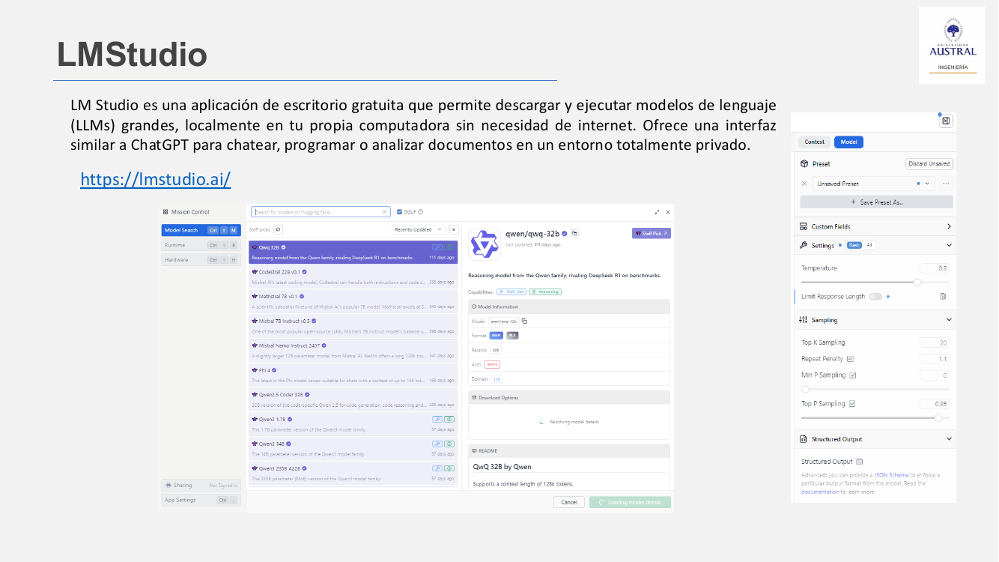
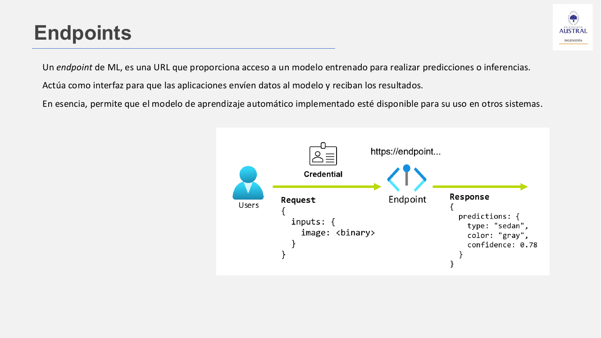

# Clase 30 · Práctica: bake-off de modelos de sentimiento y tareas NLP con LLM + Pydantic

> **Módulo 4 · Procesamiento de Lenguaje Natural** · Horacio Arrigo · martes 21-jul-2026
> **Fuentes:** transcripción `DIA_Clase_30.vtt` (corta: la clase fue casi toda de trabajo en grupos) · láminas `2026_NLP_Clase_08.pdf` (repaso de herramientas, endpoints y API) · notebooks `01_NLP_Clase_08_Teoria_Practica_Resuelta.ipynb` y `02_NLP_Clase_08_Comparacion_Modelos_Sentimiento.ipynb` · skill `llm-structured-tasks/SKILL.md`

## En pocas palabras

- La clase fue **práctica**. El profesor hizo un repaso corto de la Clase 29: dos herramientas para correr LLMs en local (**Ollama** y **LM Studio**) y cómo consumirlos desde código a través de un **endpoint** y una **API**, con la biblioteca de Python `openai`. El resto del tiempo fue para terminar la práctica de la Clase 29 y hacer la nueva.
- La práctica nueva es un ***bake-off*** (comparación cara a cara) de modelos de análisis de sentimiento sobre el dataset de **reviews de hoteles en español**: clásicos de sklearn, embeddings densos, transformers preentrenados y LLMs con prompting, todos evaluados sobre las mismas 300 reviews.
- El resultado de la corrida de los docentes: **ninguna familia gana por goleada**. El BERT fine-tuneado de la Clase 28 queda primero, y un TF-IDF + regresión logística empata o supera a los LLMs generales, con una latencia miles de veces menor. La clase `neutro` es la difícil para todos.
- El notebook teórico de la clase muestra que **un decoder + un schema Pydantic + buen prompting** resuelve casi todo el stack NLP clásico: clasificar (de tres formas), NER, extracción de relaciones, resumen, evaluación con *LLM-as-a-judge* y generación de datos sintéticos.
- La idea de fondo: el LLM no siempre da mejor. Su ventaja no es ganar la métrica, sino **no necesitar datos etiquetados para arrancar**. La herramienta se elige según el régimen de datos y las restricciones de producción (latencia, costo, privacidad).

## Conceptos clave

### Repaso: LLMs en local con Ollama y LM Studio

Las dos herramientas permiten descargar y ejecutar modelos de lenguaje en la propia computadora, sin depender de la nube.

| Herramienta | Qué es | Comentario en clase |
|---|---|---|
| **Ollama** | Herramienta de código abierto para descargar, instalar y ejecutar LLMs localmente. Funciona sin conexión y sin costo adicional, y los datos no salen de la máquina. | Un poco más complicada de instalar y usar. |
| **LM Studio** | Aplicación de escritorio gratuita con una interfaz parecida a ChatGPT. Sirve para chatear, programar o analizar documentos en un entorno privado. | La que eligió la mayoría de los alumnos. |



*Figura: en el panel derecho de LM Studio aparecen los parámetros de muestreo de la Clase 29 (temperatura, top-k, top-p) y una opción de **Structured Output** con JSON Schema, que es justamente lo que el notebook de esta clase hace desde código.*

### Endpoint y API

- Un **endpoint** de ML es una **URL** que da acceso a un modelo entrenado para hacer predicciones o inferencias. Es la interfaz por la que una aplicación envía datos al modelo y recibe los resultados. Así, el modelo queda disponible para otros sistemas.
- Una **API** (*Application Programming Interface*) es un conjunto de reglas, protocolos y herramientas que permite que distintos programas se comuniquen entre sí. Actúa como intermediaria.



En la práctica, Ollama y LM Studio levantan un servidor local que imita la API de OpenAI. Por eso la misma biblioteca `openai` de Python sirve para todos los backends: solo cambian la URL base y la clave.

| Backend | URL base por defecto (según el notebook) |
|---|---|
| Ollama | `http://localhost:11434/v1` |
| LM Studio | `http://localhost:1234/v1` |
| OpenAI / Groq | URL del proveedor, con `OPENAI_API_KEY` |

Los notebooks leen esa configuración de un archivo `.env` (`OPENAI_BASE_URL`, `OPENAI_API_KEY`, nombre del modelo). Así se puede **cambiar de backend sin tocar el código**.

### Tres formas de clasificar con un decoder

El notebook teórico compara tres técnicas sobre el **mismo** modelo y el mismo mini-dataset de 9 reseñas de películas (3 por clase).

| # | Técnica | Idea | Salida | Robustez del parseo |
|---|---|---|---|---|
| 1 | **Prompting** zero-shot / few-shot | Se pide la clase en texto y se parsea el string. | `str` | Baja: hay que limpiar puntuación, frases enteras, inglés… |
| 2 | **Log-probs** (*token scoring*) | Se lee la probabilidad que el modelo le asigna a cada clase en el **primer token** de la respuesta. | clase + $P(c)$ | Alta: no hay texto que parsear. |
| 3 | **Structured output + Pydantic** | Se fuerza un JSON con un schema estricto y se valida. | objeto tipado | Alta: el schema rechaza clases inventadas. |

**1. Prompting.** Es lo más directo. Con `temperature=0` y un *system prompt* claro, el modelo suele cooperar. Pero al subir la temperatura la salida puede venir como `"Neutro."`, `"La clase es neutro"` o `"neutral"`, y cada formato nuevo exige otra regla en el parser (el notebook lo llama "carrera armamentista"). El **few-shot** estabiliza el formato porque el modelo imita los ejemplos.

**2. Log-probs.** Un decoder produce en cada paso una distribución sobre todo el vocabulario. Se pide **un solo token** (`max_tokens=1`) con `logprobs=True` y `top_logprobs=N`. Para cada clase se toma el mejor logprob entre los tokens que son **prefijo** de la clase (`pos`, `neg`, `neu`), y se normaliza con softmax:

$$P(c) = \frac{e^{\,\ell_c}}{\sum_{c'} e^{\,\ell_{c'}}}$$

donde $\ell_c$ es el logprob asignado a la clase $c$.

- **Ventajas:** no hay parseo, da una probabilidad por clase (útil para umbrales y para mandar casos dudosos a revisión humana) y es rápido.
- **Limitaciones:** las clases deben empezar con tokens distinguibles (`cancelar` y `cancelación` confunden al método), y no todos los backends exponen `top_logprobs` (Ollama depende de la versión).
- En la corrida del notebook fue el método con peor accuracy (66,7 %): clasificó como `negativo` las tres reseñas neutras. Con solo 9 ejemplos no conviene sacar conclusiones generales, pero muestra que el truco del primer token puede fallar.

**3. Pydantic.** Se define el schema como una clase:

```python
class Clasificacion(BaseModel):
    clase: Literal["positivo", "negativo", "neutro"]
    confianza: float = Field(..., ge=0.0, le=1.0)
    razon: str
```

Su JSON Schema se inserta en el *system prompt*, se llama al modelo con `response_format={"type": "json_object"}` y se valida con `model_validate_json`. Con `Literal[...]` es **imposible** aceptar una clase inventada (Pydantic tira `ValidationError`). Además, la misma llamada devuelve confianza y justificación. Es la forma más cercana a producción, aunque en la corrida fue la más lenta (unos 2 s por reseña contra menos de 1 s del prompting).

**Regla de bolsillo del notebook:**

| Contexto | Mejor opción |
|---|---|
| Exploración rápida, prototipo, clases nuevas | Prompting |
| Hace falta un umbral de confianza o un ranking | Log-probs |
| Producción: la salida entra a otra función tipada | Pydantic |
| Muchos datos etiquetados, y latencia y costo importan | Fine-tuning (fuera del alcance) |

El **fine-tuning** de un decoder chico con LoRA/PEFT queda mencionado como cuarto camino. Necesita GPU y cientos o miles de ejemplos etiquetados, y compite con el fine-tuning de BERT de la Clase 28. La decisión típica en la industria: tarea cerrada con datos, fine-tune de un encoder; tarea abierta o que cambia seguido, prompting con un decoder.

### Otras tareas NLP con el mismo patrón

El patrón **schema Pydantic → prompt con el schema → llamada en modo JSON → validación** se reutiliza tal cual en otras tareas. Solo cambian el schema y la instrucción.

| Tarea | Schema | Contraste con lo clásico |
|---|---|---|
| **NER** | `Entidad(texto, tipo: Literal["PERSONA","ORG","LUGAR","FECHA","OTRO"])` | spaCy (`es_core_news_sm`) |
| **Extracción de relaciones** | `Tripleta(sujeto, relacion, objeto)` | Antes requería NER + *parsing* de dependencias + clasificadores |
| **Resumen abstractivo** | `Resumen(titulo, puntos_clave, resumen)` | Resumen extractivo con TF-IDF |
| **LLM-as-a-judge** | `Juicio(correcto, score 1–5, justificacion)` | Evaluación humana |

Un detalle técnico: el modo JSON necesita un **objeto** en el nivel superior, no una lista. Por eso las listas van envueltas (`ResultadoNER(entidades: List[Entidad])`).

- **NER, LLM vs. spaCy.** spaCy es unas mil veces más rápido, gratis y local, pero tiene etiquetas fijas y en dominios nuevos hay que entrenarlo. El LLM acepta cualquier etiqueta definida en el `Literal` y funciona zero-shot. En el ejemplo del notebook, spaCy etiquetó *Inter Miami* y *Paris Saint-Germain* como personas, y el LLM los reconoció como organizaciones. Regla práctica: para mucho volumen y entidades clásicas, spaCy; para esquemas a medida (productos, drogas, tickets), el LLM.
- **Relaciones.** NER da los **nodos** y la extracción de relaciones da las **aristas** de un grafo de conocimiento. Conviene pedir la relación en `snake_case` y normalizar sinónimos después (`nacio_en` = `lugar_nacimiento`).
- **Resumen extractivo vs. abstractivo.** El extractivo elige oraciones del original (por ejemplo, las de mayor suma de TF-IDF): no inventa nada y sirve cuando hay que citar (legal, médico). El abstractivo reformula con frases nuevas: queda más fluido y trae estructura (título, viñetas), pero puede alucinar.
- **LLM-as-a-judge.** El modelo evalúa salidas de otro modelo sin ver el gold, y después se mide su acuerdo con las etiquetas humanas. Sus sesgos típicos son el **optimismo** (aprueba de más), el **sesgo de longitud** (prefiere respuestas largas), la **autopreferencia** (sobrepuntúa a su propia familia de modelos) y el **sesgo de posición** (en A/B prefiere la primera). Buenas prácticas: calibrar contra humanos en 50 a 100 ejemplos, usar un juez distinto (idealmente más fuerte), aleatorizar el orden en comparaciones A/B y pedir una rúbrica explícita con razón obligatoria.

### Generación de datos sintéticos

Aquí el decoder se usa para **fabricar** datos en lugar de leerlos. Sirve cuando el dataset es chico o desbalanceado, cuando los datos reales son sensibles, para prototipar antes de pagar etiquetado humano, o para **destilación** (generar datos con un LLM grande y entrenar con ellos un modelo chico y barato).

Lo difícil no es generar sino lograr **diversidad**. Si se piden todas las reseñas en un solo llamado, tienden a parecerse entre sí y el sesgo pasa al clasificador que se entrene con ellas. Hay tres trucos:

1. **Lotes chicos y muchas llamadas** con temperatura alta: las llamadas independientes exploran zonas distintas.
2. **Semillas explícitas en el prompt** (producto, estilo del autor, tono), que llevan al modelo a regiones que no exploraría solo.
3. **Balance impuesto por el loop**, no por el modelo: se piden $N$ por cada combinación producto × sentimiento, y después se sobrescriben los campos categóricos por si el LLM se desvía.

En el notebook: 5 productos × 3 sentimientos × 2 reseñas = 30 reseñas balanceadas, con 5 estilos rotando.

## Ejemplos y casos de la clase

### El bake-off sobre reviews de hoteles

- **Dataset:** el de la Clase 24, con 8.383 reviews de hoteles en español en 3 clases (3.108 positivas, 2.981 negativas y 2.294 neutras).
- **Evaluación:** se reproduce el split de la Clase 24 (`test_size=0.2, random_state=42`) y se toman **300 reviews estratificadas** (100 por clase) del test. Así ningún modelo entrenado vio esos ejemplos.
- **Métricas:** accuracy, **F1 macro** (la principal, porque hay 3 clases razonablemente balanceadas), precisión y recall por clase, matriz de confusión y latencia media por inferencia.

| Bloque | Modelos |
|---|---|
| A | Random Forest de la Clase 24 sobre conteo por caracteres, conteo por palabras y TF-IDF tuneado |
| B | TF-IDF (palabras + bigramas) + regresión logística / LinearSVC / Naive Bayes multinomial |
| C | *Sentence-transformers* multilingüe (vectores de 384 dimensiones) + regresión logística |
| D | D.1 `robertuito-sentiment-analysis` sin entrenar (entrenado en tweets) · D.2 BERT español fine-tuneado en la Clase 28 |
| E | LLMs: zero-shot, few-shot y Pydantic con cada backend configurado · E.4 prompt experto + razonamiento (solo OpenAI) |

Resultados de la corrida que viene en el notebook (pueden variar en cada máquina y según los backends):

| Modelo | Accuracy | F1 macro | Latencia aprox. |
|---|---|---|---|
| D.2 BERT fine-tuneado (Clase 28) | 84,0 % | 84,2 % | ~3 ms |
| B.1 / B.2 TF-IDF + LogReg / LinearSVC | 78,7 % | 78,5 % | ~0,1 ms |
| A.3 RF + TF-IDF tuneado | 77,7 % | 76,4 % | ~0,1 ms |
| E.4 experto + razonamiento (OpenAI) | 76,0 % | 75,2 % | ~1.270 ms |
| C.1 sentence-transformers + LogReg | 74,7 % | 74,5 % | — |
| E.2 few-shot · LM Studio `gpt-oss-20b` | 73,7 % | 69,6 % | — |
| D.1 robertuito (sin entrenar) | 67,0 % | 61,2 % | ~3,5 ms |
| E.1 zero-shot · Ollama `gemma3:1b` | 66,3 % | 55,1 % | ~550 ms |
| A.1 RF por caracteres | 55,3 % | 54,4 % | ~0,1 ms |

Las conclusiones del notebook:

1. **Ningún modelo gana por goleada.** Los clásicos entrenados en el dominio igualan o superan a los LLM generales, y son miles de veces más chicos y rápidos. El tamaño del modelo no compra, por sí solo, mejor F1.
2. **`neutro` es el cuello de botella** para todos: reseñas ambivalentes, tibias o con críticas moderadas.
3. **Parte del "error" del LLM es desacuerdo con el gold.** Este corpus usa un `neutro` laxo: reserva `negativo` para el rechazo fuerte. Reseñas como "no lo recomiendo" están etiquetadas como neutras, y el LLM las marca negativas con un criterio razonable. La métrica premia coincidir con la etiqueta, no tener razón.
4. **El prompt mueve la métrica calibrando al dataset, no entendiendo mejor.** E.4 recupera `neutro` solo cuando el prompt explicita la convención de anotación del corpus. Como el borde neutro/negativo es borroso, endurecer una clase pasa el error a la otra (efecto subibaja). El *prompt engineering* tiene techo y no arregla un gold ruidoso.
5. **Costo y latencia difieren en órdenes de magnitud.** Un clásico predice en microsegundos, local y gratis. Un LLM implica una llamada de red y, si es un servicio pago, costo por token (más aún con razonamiento).

### Colab no ve el modelo local

Varios grupos tropezaron con esto: **Colab corre en la nube de Google** y el LLM corre en la computadora del alumno, así que el notebook no lo alcanza. Un alumno armó un túnel de conexión y lo hizo funcionar, pero el profesor aclaró que la idea era más simple: correr el notebook de Python **en la propia máquina** (o en la de alguien del equipo) y experimentar con un LLM chico en local.

## Práctica

- **Pendiente de la Clase 29:** contrastar Ollama y LM Studio (o una API online, si se tenía) consumiéndolos desde código. Quien no la terminó debía empezar por ahí.
- **`02_NLP_Clase_08_Comparacion_Modelos_Sentimiento.ipynb`** (el bake-off). Es largo y tiene partes para completar. Se podía usar otro dataset afín al trabajo de cada grupo (el profesor mencionó grupos que piensan trabajar con llamadas a un *call center*). Cosas a tener en cuenta:
  - El bloque A necesita los modelos `.joblib` de la Clase 24. El profesor los subió al chat como `models.zip`, y también estaban en el campus.
  - Las dependencias opcionales (`sentence-transformers`, `transformers`, `pysentimiento`) se importan dentro de cada bloque: si falta alguna, ese bloque se saltea y el resto sigue.
  - Los bloques B y C guardan sus pesos en `models/`, así que las corridas siguientes son casi instantáneas.
  - Antes de lanzar cientos de llamadas, el notebook hace una **prueba de humo** (*smoke test*): una sola request por backend para detectar fallas en segundos. Sugiere bajar temporalmente el set de evaluación a 30 reviews para validar el cableado.
  - Con OpenAI hay costo: el notebook estima unos pocos dólares para las ~1.200 llamadas de E.1 a E.4.
  - Preguntas guía del notebook: qué familia ganó y por cuánto; cuántos órdenes de magnitud separan la latencia de un clásico de la de un LLM; si `neutro` fue difícil para todos y cuánto de ese error es del gold; si `robertuito` (entrenado en tweets) se equivoca distinto; y qué modelo se pondría en producción para un sistema de tickets.
- **`01_NLP_Clase_08_Teoria_Practica_Resuelta.ipynb`:** el material teórico-práctico resuelto de esta clase (tres formas de clasificar, NER, relaciones, resumen, *LLM-as-a-judge* y datos sintéticos). No se explicó en voz alta, pero es la base de los métodos del bloque E del bake-off.
- **Skill `llm-structured-tasks`** (en `clase08-practica/.claude/skills/llm-structured-tasks/SKILL.md`). Es un *skill* de Claude Code que empaqueta el patrón de la clase para reutilizarlo: si se abre Claude Code en la carpeta de la práctica y se pide, por ejemplo, "clasificar tweets en positivo/negativo/neutro con confianza", Claude arma el código con este patrón. Contiene:
  - el flujo en 5 pasos: **schema → prompt → llamada → parseo robusto → evaluación** (accuracy/F1 para clasificación, coincidencia exacta para extracción, acuerdo con humanos para el juez);
  - los patrones para las cinco tareas (clasificación, NER + relaciones, resumen, juez, datos sintéticos);
  - una tabla de temperatura por tarea: 0 para clasificar, extraer y juzgar; 0,2 a 0,5 para resumir; 0,8 a 1 para datos sintéticos;
  - *troubleshooting*: reintentar con el error de Pydantic en el prompt, reparar JSON malformado, reintentos ante límites de tasa, y estrategias para más de 20 clases (jerarquía, few-shot por clase, preselección por embeddings);
  - cuándo **no** conviene usarlo: mucho volumen, tarea cerrada y dataset disponible (mejor entrenar un clasificador propio); con datos sensibles, solo con un LLM local.

  El notebook aclara que el skill no reemplaza entender lo que se hace: acelera la implementación cuando ya se sabe qué se necesita.

Fragmento central, reutilizado en todas las tareas:

```python
resp = client.chat.completions.create(
    model=MODEL,
    messages=[{"role": "system", "content": system},   # incluye el JSON Schema
              {"role": "user", "content": prompt}],
    temperature=0.0,
    response_format={"type": "json_object"},
)
raw = resp.choices[0].message.content
json_str = re.search(r"\{.*\}", raw, re.DOTALL).group(0)  # por si agregó texto
obj = Schema.model_validate_json(json_str)                # valida o tira ValidationError
```

## Para recordar

- Lo que más le interesaba al profesor de esta práctica era que cada uno **corriera un LLM en local** y viera cómo se usa desde código.
- `temperature=0` estabiliza la salida, pero un parser de strings igual es frágil. Si la salida va a otro sistema, conviene un schema validado.
- `Literal[...]` en el schema impide que el modelo invente clases.
- Un LLM grande no es automáticamente el mejor clasificador. **Con datos etiquetados en el dominio, un modelo chico entrenado sobre ellos aprende la convención exacta de la tarea**, incluidas sus rarezas de anotación.
- El LLM brilla donde el clásico no puede: poco o ningún dato etiquetado, arranque en frío, tareas nuevas, necesidad de flexibilidad o de explicar la decisión.
- Antes de comparar modelos, hay que fijar **el mismo split y el mismo set de evaluación** para todos y verificar que ninguno lo haya visto en el entrenamiento.
- En datos sintéticos, la diversidad hay que **forzarla** (semillas, lotes chicos, balance desde el loop); no se la puede delegar al modelo.
- Un juez LLM tiene sesgos. Hay que calibrarlo contra humanos antes de confiar en él.

## Preguntas de repaso

<details><summary>1. ¿Por qué la misma biblioteca <code>openai</code> sirve para usar Ollama, LM Studio, Groq u OpenAI?</summary>

Porque todos exponen un **endpoint** compatible con la API de OpenAI. Solo cambian la URL base y la clave, que se leen del `.env`, así que se puede cambiar de backend sin reescribir el código.

</details>

<details><summary>2. ¿Qué ventaja tiene leer los log-probs del primer token en vez de parsear el texto, y cuándo falla?</summary>

No hay texto que parsear, se pide un solo token (es rápido) y se obtiene una probabilidad por clase, útil para umbrales o para derivar casos dudosos a revisión. Falla si dos clases empiezan con el mismo token (`cancelar` / `cancelación`) o si el backend no expone `top_logprobs`.

</details>

<details><summary>3. ¿Qué agrega Pydantic frente a pedirle al modelo "respondé solo con la clase"?</summary>

Un contrato verificable: con `Literal` la clase solo puede ser una de las permitidas (si no, hay `ValidationError`), los campos tienen tipos y rangos (`confianza` entre 0 y 1), y en la misma llamada se obtienen confianza y razón. El resultado entra directo a código tipado, a costa de algo más de latencia.

</details>

<details><summary>4. En el bake-off, un TF-IDF + regresión logística empata o le gana a LLMs mucho más grandes. ¿Cómo se explica?</summary>

El clásico se entrenó con miles de reviews etiquetadas del mismo dominio y aprendió la convención de anotación del corpus, incluido su `neutro` laxo. El LLM llega con un criterio "de fábrica" que puede ser razonable pero no coincide con el gold, y la métrica mide coincidencia con el gold. Además, el clásico es miles de veces más rápido y barato.

</details>

<details><summary>5. ¿Por qué mejorar el prompt (E.4) no significa que el modelo "entienda mejor" el sentimiento?</summary>

Porque recupera `neutro` solo cuando se le explicita la convención del dataset: se ajusta a la idiosincrasia del gold. Como el borde neutro/negativo es borroso, endurecer una clase traslada el error a la otra (subibaja). El prompt tiene techo y no arregla etiquetas ruidosas.

</details>

<details><summary>6. ¿Qué hay que controlar para que la comparación entre familias de modelos sea justa?</summary>

Usar el mismo set de evaluación para todos, tomarlo del test del split original (`random_state=42`) para que ningún modelo entrenado lo haya visto, que sea estratificado (100 por clase) y reportar F1 macro además de accuracy, junto con la latencia y el costo.

</details>

<details><summary>7. ¿Por qué pedir 30 reseñas sintéticas en un solo llamado da peores datos que 30 llamados chicos con semillas?</summary>

Una sola llamada produce salidas internamente parecidas (mismos productos, mismo estilo, posible desbalance). Los llamados independientes con temperatura alta, semillas explícitas (producto, estilo) y balance impuesto por el loop exploran más el espacio, y así el sesgo no pasa al clasificador que se entrene con esos datos.

</details>

<details><summary>8. Si hubiera que poner en producción un clasificador para un sistema de tickets con mucho volumen y datos etiquetados, ¿qué se elegiría según la clase?</summary>

Un clásico entrenado o un transformer fine-tuneado (como el BERT de la Clase 28): mejor F1 en el bake-off, latencia de milisegundos o menos, costo casi nulo y corre local. El LLM con buen prompt queda para cuando hay pocos datos, la tarea cambia seguido o hace falta explicar la decisión.

</details>

## Conexiones

- **Hacia atrás:** repasa Ollama, LM Studio y el uso de LLMs vía API de la Clase 29, donde también se vieron los parámetros de muestreo (temperatura, top-k, top-p), los roles y la clasificación por prompting. El bake-off reutiliza el dataset y los Random Forest de la Clase 24 (BoW y TF-IDF), el BERT fine-tuneado y el *sentence-transformer* multilingüe ya cacheado en la Clase 28. El resumen extractivo con TF-IDF retoma la Clase 24. El NER con spaCy viene de la Clase 23.
- **Hacia adelante:** según el profesor, la Clase 31 es la última del módulo y trata temas generales de alto nivel: qué significa poner un modelo en producción, formas de servirlo, qué infraestructura necesita y cómo escala. Los *endpoints* de esta clase son la puerta de entrada a ese tema. Después sigue el curso de IA generativa.
- **TFI:** la lección del bake-off se aplica directamente a la normalización de nombres comerciales en Benefix. La variante **generativa** puede ser más flexible, pero no está garantizado que supere al retrieval léxico o semántico ajustado al catálogo. Hay que compararlas sobre el mismo set de consultas, con las mismas métricas (Hit@k, MRR), y mirar también latencia y costo. Si se usa un LLM para normalizar, conviene una **salida estructurada** con Pydantic (por ejemplo, restringida a nombres canónicos del catálogo, con confianza) en vez de texto libre. Un juez LLM para evaluar resultados tendría que calibrarse antes contra etiquetas humanas.
