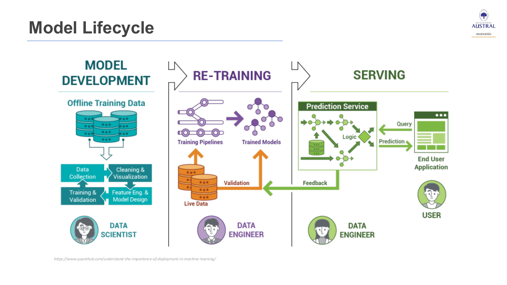
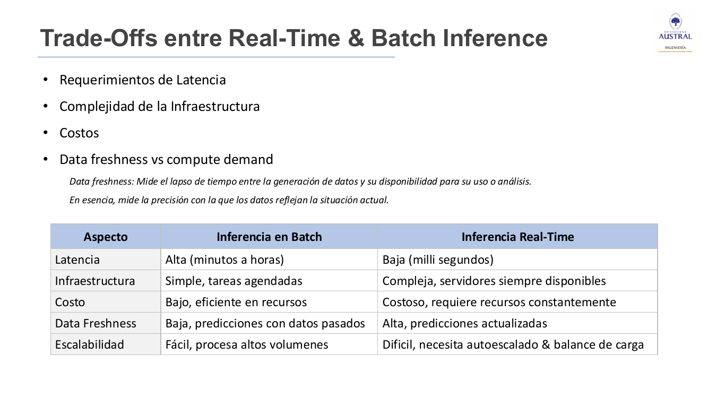
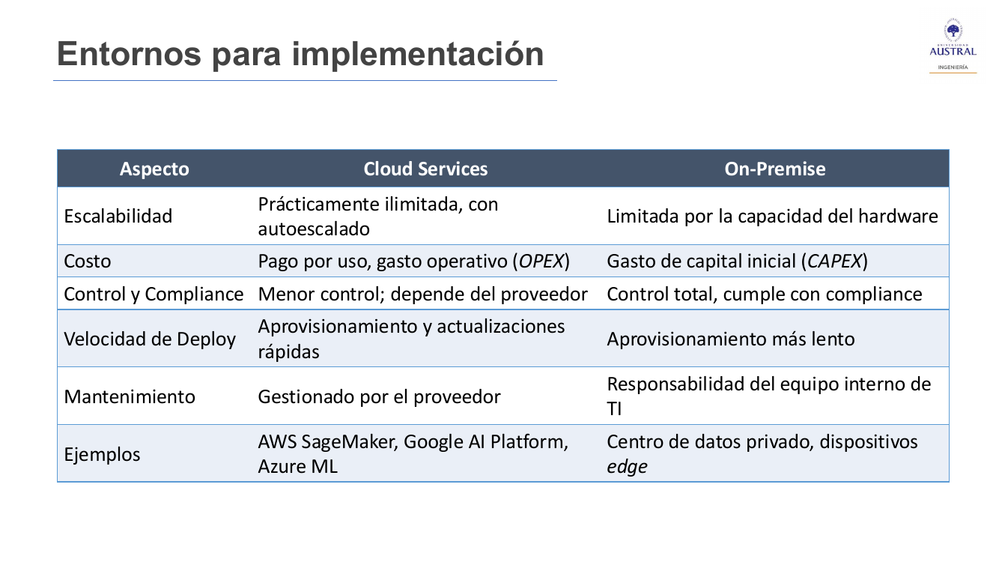
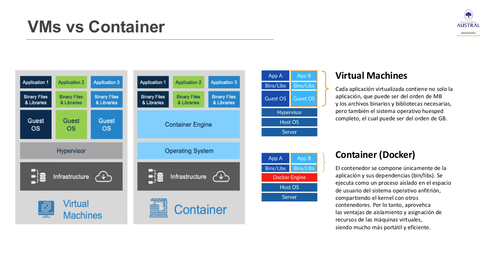
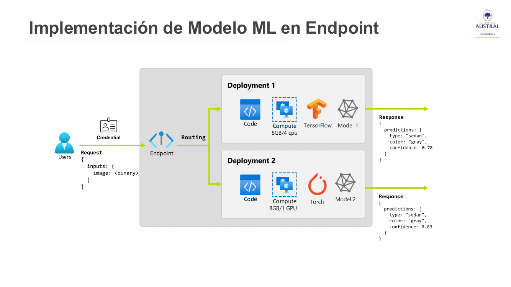
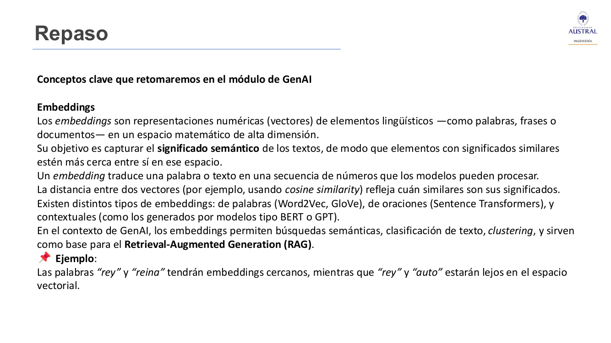

# Clase 31 · Modelos en producción: ciclo de vida, inferencia, containers, endpoints y APIs (y repaso del módulo)

> **Módulo 4 · Procesamiento de Lenguaje Natural** · Horacio Arrigo · jueves 23-jul-2026
> **Fuentes:** transcripción `DIA_Clase_31.vtt` · láminas `2026_NLP_Clase_09.pdf` (clase 9 de NLP: "Modelos en producción" y anexo de repaso) · Docker Hub y documentación de la API de Mercado Libre, mostrados en vivo

## En pocas palabras

- **Poner un modelo en producción** (*deploy*, "deployar") es integrarlo en sistemas vivos para que haga predicciones o inferencias accesibles a usuarios o aplicaciones. El primer paso es **persistirlo** (por ejemplo, con `pickle`), pero un archivo no es un servicio: el *model deployment* es lo que lo convierte en un servicio vivo, accesible, escalable y mantenible.
- El **ciclo de vida del modelo** tiene tres etapas que se retroalimentan: **desarrollo** (datos offline, *feature engineering*, entrenamiento), **reentrenamiento** (pipelines con datos vivos) y **serving** (el modelo responde consultas de una aplicación). Como los datos reales cambian (*data drift*, *concept drift*), un modelo sin monitoreo ni reentrenamiento termina fallando.
- Hay dos tipos de inferencia: **batch** (se acumulan datos y se procesan en un momento programado) y **tiempo real** (cada pedido se responde al instante). El tiempo real da datos frescos, pero exige infraestructura encendida 24 horas, más compleja y más cara.
- El modelo se aloja **on-premise** (infraestructura propia, control total, a veces obligatoria por regulación) o en la **nube** (pago por uso, autoescalado). Lo habitual es empaquetarlo en un **container** (Docker), más liviano que una máquina virtual porque comparte el sistema operativo del host, y montarlo sobre infraestructura que escala.
- El modelo se consume a través de un **endpoint** (una URL protegida que recibe *requests* y devuelve respuestas) con una **API**, que funciona como contrato: define qué se puede pedir, en qué formato y qué se recibe. "APIficar" un modelo es definir ese contrato.

## Conceptos clave

### Qué es poner un modelo en producción

El profesor arrancó preguntando qué significa "poner en producción". La definición de la lámina: **integrar modelos de ML en sistemas "vivos" con el fin de realizar predicciones o inferencias y dejarlas accesibles a usuarios o aplicaciones**. En la jerga se dice *deploy* o "deployar" (al profesor la palabra le parece "atroz", pero quedó).

Las tres etapas básicas son las mismas que en el desarrollo de software: **desarrollo**, **testing y calidad**, y **producción**. Lo que agrega ML es que antes hay que tener el modelo como algo concreto que se pueda llevar a otro lado.

El profesor comentó que este tema es la base de roles que hoy aparecen en los avisos como "ingeniero" o "arquitecto de IA": en el fondo son arquitectos de plataformas, de software o de infraestructura que saben montar un modelo para que se use a escala.

### Persistir un modelo: el archivo `pickle`

Después de entrenar, el modelo vive en una variable dentro de la notebook. Para reutilizarlo hay que **persistirlo**: guardarlo en disco. La forma más sencilla en Python es `pickle`, con `pickle.dump` ("volcar") del objeto entrenado a un archivo `.pkl`. (En clase el profesor dijo primero "Parquet" y se corrigió: Parquet es un formato para datasets; el modelo se guarda como pickle. Otras librerías, como TensorFlow, tienen sus propios formatos, pero siempre es un archivo.)

```python
import pickle
pickle.dump(model, open("modelo.pkl", "wb"))   # guardar
model = pickle.load(open("modelo.pkl", "rb"))  # cargar y usar para inferir
```

- **Ventaja:** es nativo de Python, no hace falta instalar nada. Permite entrenar una vez, guardar y reutilizar sin reentrenar; es ideal para desarrollo local y prototipado.
- **Cuidado:** pickle no siempre es compatible hacia atrás entre versiones. Conviene revisar y **documentar las versiones** con las que se guardó el modelo.
- Quien usa el modelo ya no necesita la notebook ni el código de entrenamiento: alcanza con un código que cargue el archivo y llame a la inferencia. El modelo queda "cerrado": se puede usar para predecir, no para seguir entrenándolo. (El profesor dijo que se entrena con `train` y se infiere con `fit`; en scikit-learn en realidad se entrena con `fit` y se predice con `predict`.)

El archivo resultante es un **artefacto**: así se llama a lo que queda como producto de una etapa. Más adelante aparecen otros artefactos (el endpoint, por ejemplo).

Pero un archivo, por sí solo, no da servicio. Si el equipo de ventas necesita predicciones en tiempo real, si una app móvil quiere consumir el modelo o si hay que correr millones de predicciones en paralelo, el modelo tiene que "vivir" en algún lado. Eso es el **model deployment**: el conjunto de prácticas y herramientas que permiten que un modelo pase de un archivo estático a un servicio vivo, accesible, escalable y mantenible.

### El ciclo de vida del modelo (*model lifecycle*)



**1. Desarrollo del modelo (*model development*).** Entrenamiento **offline**, con datos estáticos. Incluye recolección de datos de distintas fuentes, limpieza y visualización (outliers, análisis exploratorio), *feature engineering* y diseño del modelo, y entrenamiento y validación. Es iterativo: si el modelo no rinde, se vuelve atrás a agregar variables, datos o cambiar el preprocesamiento. Lo hace típicamente un *data scientist*.

- El *feature engineering* puede usar **datos externos** a la organización (clima, noticias, datos económicos). Las variables se crean pensando en cómo mejorar el modelo, no "porque sí".
- Un buen desarrollo incluye **registro de experimentos** (*experiment tracking*), **versionado** de modelos y **pipelines** reutilizables para el reentrenamiento.
- Si en esta etapa no queda claro qué necesita el modelo, el deployment se rompe porque los datos "en vivo" no llegan con el mismo formato que los de entrenamiento. Frase de la lámina: *"El deployment no es magia: es simplemente llevar a producción lo que ya construimos en model development"*. Si esa base es sólida, el deployment es más fácil y seguro; si no, el modelo queda frágil y tarde o temprano falla.

**2. Reentrenamiento (*re-training*).** Ya con **datos vivos**, que llegan de la operación (el ejemplo fue Uber: a medida que la gente usa la app, se guardan datos que sirven para reentrenar).

- **Training pipeline:** el flujo automatizado que define por qué etapas pasan los datos hasta quedar listos para el modelo, con validaciones de calidad (que no lleguen nulos ni valores inconsistentes). Lo que en desarrollo se hizo a mano queda plasmado ahí.
- **Trained model:** se actualiza el artefacto del modelo.
- **Validation:** pruebas con datos vivos para confirmar que el modelo sigue siendo útil.
- La imagen asigna esta etapa al *data engineer*. El profesor matizó: los pipelines de datos sí, pero el reentrenamiento hoy lo hace más bien un **MLOps** (*machine learning operations engineer*), un rol que la imagen, algo vieja, no muestra.

**3. Serving / deployment.** El modelo se vuelve un **servicio de predicción** (por ejemplo, una API REST), integrado con reglas de negocio (*logic*). La **aplicación del usuario final** le envía consultas (*query*) y recibe predicciones. El usuario nunca "ve" el modelo: no es una web ni una tienda online, es un servicio que corre detrás.

**Por qué es un ciclo.** Los datos que genera la operación vuelven como **feedback** al reentrenamiento, y se **monitorea** si el modelo sigue respondiendo bien. Si no, se reentrena con datos más nuevos o incluso se vuelve al desarrollo, por ejemplo si cambió la distribución de los usuarios.

### Data drift y concept drift

Los datos reales no son estáticos: cambian las tendencias de los usuarios, las condiciones de mercado, los patrones de fraude. Eso produce:

| Fenómeno | Qué cambia |
|---|---|
| **Data drift** | La distribución de los datos de entrada |
| **Concept drift** | La relación entre las variables y el *target* |

Ejemplo de la clase: un modelo de predicción de ventas difícilmente prevea un Black Friday o una Cyber Week si no fue entrenado con ese tipo de eventos esporádicos y cortos.

La analogía de la lámina: un modelo desplegado sin reentrenamiento es como un auto al que nunca se le hace mantenimiento. Puede andar al principio, pero tarde o temprano se rompe. El reentrenamiento es el puente entre el laboratorio y la realidad cambiante de producción. Por eso, antes de escalar, se hacen **pilotos**.

### Tipos de inferencia: batch vs tiempo real

- **Batch (por lotes):** se acumulan datos y se procesan juntos en un momento programado, como en laboratorio. Ejemplo de la clase: una vez por mes se juntan todas las reseñas nuevas de un hotel y se mandan al modelo para clasificarlas en buenas o malas. El modelo solo tiene que estar disponible cuando se lo usa, y las fallas se manejan con menos urgencia.
- **Tiempo real (*real time*):** cada *request* se infiere en el momento, lo más rápido posible. Ejemplo: clasificar cada reseña apenas entra, u ofrecer un descuento de una marca mientras alguien compara aspiradoras en una tienda online. El modelo tiene que estar disponible las 24 horas, y eso exige infraestructura que lo aguante (a veces con sistemas redundantes por si se cae el principal), con su consumo y su soporte.

| Tiempo real | Batch |
|---|---|
| Detección de fraude | Predicción de ventas (planificar stock) |
| Sistemas de recomendación | Análisis del comportamiento del cliente |
| Vehículos autónomos | Clasificación de imágenes (grandes conjuntos) |
| Precios dinámicos | Generación de informes periódicos |
| Operaciones financieras (trading) | |

Más allá del caso de uso, para decidir hay que mirar factores que al final se traducen en **costo**: latencia, volumen de datos, costo de la inferencia (pensable como costo de tokens en un LLM), complejidad del modelo y recursos de cómputo.



**Data freshness** es el lapso entre que se genera un dato y que está disponible para usarlo: mide cuánto reflejan los datos la situación actual. En batch es baja (se espera a acumular); en tiempo real, alta. La lámina agrega que un **enfoque híbrido** puede ser óptimo para algunas aplicaciones.

### Dónde se aloja el modelo: on-premise vs cloud

- **On-premise:** data center, servidores o arquitectura propios (también pueden ser alquilados), y la organización se hace cargo de configurar, mantener y monitorear todo. Requiere gente, sistemas, licencias e inversión. Puede ser con servidores físicos o con máquinas virtuales sobre ellos.
- **Cloud** (Google, Amazon, Azure, etc.): infraestructura elástica bajo demanda, pago por uso; la organización se concentra más en el modelo y menos en la infraestructura.
- **Híbrido** (aporte de un alumno): parte on-premise y parte en la nube. Hace falta gente que sepa qué conviene dejar en cada lado.



Puntos que remarcó el profesor:

- **Regulación:** muchas empresas están obligadas a tener infraestructura propia porque, por ejemplo, los datos de clientes deben residir en servidores en Argentina. Si la nube contratada no tiene data center en el país, los datos quedan en el exterior. Dónde residen los datos define qué ley aplica.
- **La nube no es necesariamente más barata:** tiene otros costos asociados. A favor, no se paga por un servidor "juntando tierra"; en on-premise se paga el costo hundido, se use o no.
- **Autoescalado:** la gran ventaja de la nube. En picos de demanda (Cyber Week, Black Friday, un recital que dispara los pedidos de Uber) la infraestructura se agranda sola; si no puede, la app se cae, se pierden ventas y además se daña la reputación.

Dentro de la nube hay tres familias de servicios:

| Servicio | Ejemplos (lámina) | Qué ofrece |
|---|---|---|
| **Máquinas virtuales** | EC2 (AWS), Compute Engine (GCP) | Lo más parecido a un servidor tradicional, con escalabilidad y redundancia |
| **Serverless** | AWS Lambda, Google Cloud Run | Se sube el código o el container y el proveedor lo ejecuta bajo demanda; ideal para cargas variables, con límites de tiempo y recursos |
| **Servicios de ML** | SageMaker, Vertex AI, Azure ML | Entorno integral (pipelines, endpoints, versiones, métricas), a costa de más *lock-in* con el proveedor |

### Escalado vertical y horizontal

- **Vertical:** se agranda la capacidad del mismo servidor. Sirve cuando hay que atender a la misma cantidad de clientes con más procesamiento (por ejemplo, video o imágenes).
- **Horizontal:** se agregan más servidores de la misma capacidad. Sirve para atender a más clientes con la misma demanda cada uno.

La analogía del profesor: en el vertical se pone más gente en una ventanilla; en el horizontal se abren más ventanillas.

### Containers vs máquinas virtuales



- Una **máquina virtual** es una computadora simulada por software dentro de otra. Cada una necesita **su propio sistema operativo** (que puede ocupar GB y además requerir una licencia paga), más las librerías y la aplicación. Comparten el hardware físico: si el servidor tiene cuatro procesadores, no se pueden dar cuatro a cada VM. Surgieron para separar aplicaciones o dominios que no podían convivir.
- Un **container** (Docker es la versión más conocida; Kubernetes es un orquestador) contiene solo la aplicación y sus dependencias. Sobre un único sistema operativo corre un **motor de containers** que gestiona las aplicaciones como servicios aislados, que no se interfieren entre sí. La imagen del profesor: como los containers del puerto, el contenido de uno no se mezcla con el de otro.

Según la lámina, Docker aporta **portabilidad** (la imagen funciona igual en la máquina local, en pruebas o en producción), **aislamiento**, **eficiencia** (comparten el kernel del host, ocupan menos y arrancan rápido) y **reproducibilidad** (el entorno queda definido en un *Dockerfile*).

Un alumno agregó una ventaja operativa: con un orquestador se puede fijar un mínimo de instancias de un servicio; si una se cae, se levanta otra automáticamente, y si se supera un umbral de carga, se levantan más. Las VM no desaparecen: incluso puede haber containers corriendo dentro de una VM.

**Por qué el modelo va en un container.** Un modelo en producción corre como servicio, y un container es justamente un servicio. Las nubes ya tienen gestores de containers (Kubernetes, Kubeflow) sobre infraestructura autoescalable. En una VM no se puede escalar, y habría que comprar una "grande por las dudas", que es lo mismo que tener un servidor físico ocioso.

**Buenas prácticas** al usar Docker para modelos de ML: minimizar el tamaño de la imagen (solo las librerías necesarias), manejar bien las variables de entorno y la configuración, incluir el modelo y el código en la imagen, y tener en cuenta la seguridad.

### Endpoints

Un **endpoint de ML** es una **URL que da acceso a un modelo entrenado** para hacer predicciones. Funciona como interfaz: las aplicaciones le envían datos y reciben resultados. Se accede como a una página web, pero sin navegador.



- El "usuario" del endpoint suele ser **la aplicación**, no la persona. Se **autentica** con credenciales, porque los endpoints están protegidos.
- Envía un **request** con un formato definido y recibe una **response** también con formato definido, a través de la red.
- Por dentro, el endpoint es un container (o una VM) con el modelo corriendo y una API.
- **Un endpoint puede tener varios modelos.** Qué modelo responde puede depender de un parámetro del pedido (ejemplo de clase: un modelo para precios de autos y otro para camionetas o motos). La lámina agrega que así se pueden mantener versiones en paralelo y enrutar tráfico entre el modelo viejo y el nuevo para hacer A/B testing.

Consideraciones clave: **latencia y transferencia** (no es lo mismo pedir el precio de un vehículo que una lista enorme), **seguridad** (autenticación, autorización, cifrado), **control de versiones** y **monitoreo y registro** (que esté activo cuando debe y registrar métricas de funcionamiento).

### APIs y "APIficar" un modelo

Una **API** (*Application Programming Interface*, interfaz de programación de aplicaciones) es un conjunto de reglas y protocolos que permite que programas distintos se comuniquen. Define qué solicitudes se pueden hacer, con qué formato de datos y con qué convenciones, sin que quien la usa tenga que conocer el código interno.

**La analogía del restaurante:** uno no va a la cocina a pedir. El **mozo** es la API, que hace de interfaz con la cocina, y el **menú** son las posibilidades de la API: no se puede pedir cualquier cosa (un pato a la naranja que no está en la carta). Lo mismo con un modelo: para pedir el precio de un auto hay que mandar lo que la API especifica (modelo, tipo, año, kilometraje; el color tal vez no) y se recibe una respuesta con formato fijo.

- **La API se mantiene aunque el modelo cambie:** se puede reentrenar el modelo para que responda mejor, pero la interfaz y el formato de respuesta siguen iguales. Si la API cambia, tiene que estar **versionada y documentada**, porque los sistemas que la consumen deben adaptarse (compatibilidad hacia atrás).
- Es una forma **segura, estructurada y estandarizada** de compartir información: quien consulta no accede directamente a los datos ni puede manipularlos (aporte de un alumno). Funciona como un contrato.
- **APIficar** un modelo es exponerlo vía API. Beneficios: **desacoplamiento** (usarlo sin saber cómo funciona por dentro), **integración** con otros desarrollos y **facilidad de uso**. Seguridad: autenticación, encriptado y límites de consumo.
- Las APIs no son exclusivas de ML: el ejemplo de la lámina es una app del clima que consulta la API de un servicio meteorológico. No siempre son gratuitas, porque mantenerlas online tiene un costo.
- Un alumno mencionó **Swagger**: una URL con la documentación actualizada de la API donde se pueden cargar parámetros a mano, ejecutar y ver el JSON que devuelve, sin necesidad de Postman.

## Ejemplos y casos de la clase

- **Modelo de churn (fuga de clientes) en un proveedor de Internet.** El modelo solo devuelve una **probabilidad** de que cada cliente se vaya el mes siguiente; las acciones (encuestas, descuentos, promociones) son comerciales y no las controla el equipo de datos. Lo que mostró la discusión:
  - Para evaluar se usa **A/B testing**: al grupo A se lo contacta y el grupo B, con las mismas características, queda como **control**. Pero al contactar al grupo A se está testeando también la **oferta comercial**, no solo el modelo: si a un cliente enojado se le ofrece un 1 % de descuento, la campaña falla aunque el modelo haya acertado. El modelo casi nunca actúa directo sobre el cliente; siempre hay algo en el medio.
  - Ninguna empresa quiere "dejar ir" clientes para medir: por eso se hace un **piloto corto con grupos reducidos**. Si funciona, se escala, limitado por el costo de las campañas (un WhatsApp es barato; una llamada de call center, cara) y por el valor de cada cliente.
  - Las **encuestas** tienen tasas de respuesta muy bajas (el profesor habló de un 3 % a 5 %) y las contesta más la gente enojada, que además se descarga sobre cualquier servicio. Rinde más usar los datos que ya se tienen: calidad de señal, consumo, llamadas al call center.
  - Un alumno propuso entrenar luego un modelo que **recomiende la acción** más efectiva; el profesor coincidió, pero aclaró que primero hay que haber hecho acciones para tener con qué entrenarlo.
- **Netflix y los perfiles.** Las recomendaciones tienen que inferirse en el momento (de nada sirve recomendar diez horas después), aunque mezclan perfilado offline y tiempo real. Según contó el profesor, los perfiles por cuenta surgieron porque en un mismo hogar se mezclaban los gustos de distintas personas y eso dificultaba recomendar.
- **Uber** recorrió toda la clase: datos que vuelven para reentrenar, asignar el conductor más adecuado en tiempo real, y picos de demanda que exigen autoescalado.
- **Docker Hub** (hub.docker.com), mostrado en vivo: un repositorio de imágenes con aplicaciones ya instaladas (Python en distintas versiones, Postgres, Grafana, Ubuntu, Prometheus, Apache). Sirve para no llenar la máquina de instalaciones que chocan entre versiones y para encender y apagar cada aplicación cuando se la necesita. Cualquiera puede publicar su propia imagen. Docker no corre de forma nativa en Windows: Windows levanta una máquina virtual de Linux para correrlo.
- **API de Mercado Libre** (developers.mercadolibre.com.ar): ejemplo de documentación pública de una API.

## Para recordar

- "El deployment no es magia": si el desarrollo tiene datos limpios, features bien diseñadas y pipelines reproducibles, llevarlo a producción es más fácil y seguro.
- Un modelo en producción no es una web: es un servicio que corre detrás de una aplicación y que el usuario no percibe.
- Lo que funcionó en laboratorio con datos estáticos no va a funcionar igual en producción: hay que monitorear, hacer pilotos y reentrenar.
- Antes de pedir tiempo real, preguntarse si hace falta: casi todo lo que el tiempo real agrega (latencia baja, disponibilidad 24 horas, redundancia) se paga.
- Documentar las versiones con que se guardó el modelo (pickle no siempre es compatible hacia atrás) y versionar la API.
- En una campaña basada en un modelo se evalúan juntos el modelo y la acción comercial; hay que explicárselo al área comercial.

### Repaso del módulo (anexo de la clase)

El cierre fue un repaso de lo que se retoma en el módulo de IA generativa:

- **Embeddings:** vectores que representan palabras, frases o documentos en un espacio de alta dimensión, de modo que significados parecidos queden cerca (medido, por ejemplo, con similitud coseno: "rey" cerca de "reina", lejos de "auto"). Son la base de la búsqueda semántica, la clasificación, el clustering y de los **RAG**: armar una respuesta implica decidir qué partes del texto usar, y ahí los embeddings son centrales.
- **Tokens:** la unidad mínima que procesa un modelo y también la **unidad de facturación**. Para simplificar se los iguala a palabras, pero no son lo mismo. La lámina da como referencia aproximada 1 palabra en inglés ≈ 1,3 tokens, y algo más en español.
- **Evolución de los embeddings** (dimensiones según las láminas):

| Etapa | Modelos | Dimensión |
|---|---|---|
| Estáticos | Word2Vec (2013), GloVe (2014), FastText (2016, n-gramas de caracteres, maneja OOV) | 100 a 300 |
| Contextuales | ELMo (2018, LSTM bidireccional) | 1024 |
| | BERT (2018) | 768 (base), 1024 (large) |
| LLM | GPT-2 (2019) | 768 a 1600 |
| | GPT-3 (2020) | hasta 12288 |
| | LLaMA-65B (2023) | 4096 |
| Multimodales (2023-2024) | texto + imágenes (y audio, video) | 512 a 1024 por modalidad, tendencia a 2048 o más |

- **Evolución de los tokenizers:** por espacios y símbolos → por palabras y subpalabras (Word2Vec, **BPE**, n-gramas de FastText) → subpalabras avanzadas (**WordPiece** en BERT) → multilingües y multimodales (**SentencePiece** en T5 y mBERT; CLIP y DALL-E) → tokenización adaptativa a un dominio. Para probar: *The Tokenizer Playground* (huggingface.co/spaces/Xenova/the-tokenizer-playground).



## Preguntas de repaso

<details><summary>1. ¿Por qué guardar el modelo en un archivo pickle no alcanza para "ponerlo en producción"?</summary>

Porque un archivo no da servicio: no recibe pedidos ni responde. Persistirlo permite reutilizarlo sin reentrenar, pero para que una app o un equipo lo consuma a demanda tiene que vivir como servicio (en un container, con un endpoint y una API), escalar y ser mantenible. Eso es el *model deployment*.

</details>

<details><summary>2. ¿Por qué el ciclo de vida del modelo es un ciclo y no una secuencia que termina en el deployment?</summary>

Porque los datos de producción cambian (data drift, concept drift). Los datos de la operación vuelven como feedback, se monitorea el desempeño y, si cae, se reentrena con datos nuevos o se vuelve al desarrollo. Un modelo sin ese mantenimiento termina fallando.

</details>

<details><summary>3. Un modelo de ventas funciona bien todo el año y falla en Black Friday. ¿Qué está pasando y qué se puede hacer?</summary>

El modelo no vio ese tipo de evento esporádico en entrenamiento, así que los datos de entrada se salen de lo que conoce (data drift) y puede cambiar la relación entre variables y ventas (concept drift). Hay que monitorear, incorporar esos eventos o variables que los representen y reentrenar.

</details>

<details><summary>4. ¿Cuándo conviene inferencia batch y cuándo tiempo real? Dé un ejemplo de cada una.</summary>

Tiempo real cuando el valor de la predicción depende de darla en el momento (fraude, recomendaciones, precios dinámicos); tiene baja latencia y datos frescos, pero exige infraestructura siempre encendida, más compleja y cara. Batch cuando se puede esperar (predicción de ventas para stock, reportes, clasificar las reseñas del mes); es más simple, barata y fácil de escalar.

</details>

<details><summary>5. ¿Por qué una empresa podría estar obligada a tener infraestructura on-premise aunque la nube escale mejor?</summary>

Por regulación: si los datos de clientes deben residir en el país y el proveedor de nube no tiene data center allí, no puede usarla para esos datos. On-premise da control total y cumplimiento, a cambio de inversión inicial (CAPEX), mantenimiento propio y escalado limitado por el hardware.

</details>

<details><summary>6. ¿Qué hace más eficiente a un container que a una máquina virtual, y por qué se prefiere para montar un modelo?</summary>

Cada VM carga su sistema operativo completo (GB, a veces con licencia paga); los containers comparten el sistema operativo del host y solo llevan la app y sus dependencias, así que ocupan menos y arrancan rápido. Para un modelo se prefiere porque es un servicio aislado y portable que los orquestadores pueden replicar y autoescalar; con una VM habría que sobredimensionar "por las dudas".

</details>

<details><summary>7. En la analogía del restaurante, ¿qué representan el mozo y el menú? ¿Por qué conviene que la API no cambie al reentrenar el modelo?</summary>

El mozo es la API (el intermediario con la cocina, que es el modelo) y el menú es lo que la API permite pedir y lo que devuelve. Si el modelo se reentrena pero la API se mantiene, las aplicaciones que lo consumen siguen funcionando sin cambios; si la API cambia, hay que versionarla y documentarla para que se adapten.

</details>

<details><summary>8. En el piloto del modelo de churn, ¿por qué una campaña que no retiene clientes no prueba que el modelo esté mal?</summary>

Porque al contactar al grupo A se evalúan juntos el modelo y la acción comercial: si la oferta es mala, el cliente se va igual aunque el modelo lo haya identificado bien. Para separar los efectos hace falta un grupo de control con las mismas características, sin contactar, que muestre si los clientes señalados realmente se iban.

</details>

## Conexiones

- **Clase 30:** se usó la librería de OpenAI para hablar con modelos a través de una API y se vieron endpoints locales (LM Studio, Ollama). Esta clase explica qué hay detrás: el modelo corriendo como servicio, el endpoint y la API como contrato. El profesor recordó que en las clases 7 y 8 de NLP (Clases 29 y 30) ya se habían usado APIs al enviar prompts y *system prompts*.
- **Clases 23 a 29** son las que repasa el anexo: tokenización y BPE/WordPiece (Clase 23), n-gramas y vectorización (Clase 24), Word2Vec, GloVe y FastText (Clase 25), Transformers (Clase 26), Hugging Face (Clase 27), BERT y embeddings contextuales (Clase 28), GPT y modelos decoder (Clase 29).
- **Módulo de IA generativa** (siguiente): RAG, embeddings multimodales y la evolución de los tokenizers se retoman ahí.
- **Clase 03:** el ejemplo de `pickle.dump` usa un Random Forest, el ensamble visto en esa clase.
- **TFI:** los embeddings que repasa el anexo son la base del retrieval semántico de nombres comerciales en Benefix (cercanía por similitud coseno), y el RAG que se anuncia para el módulo siguiente se relaciona con la variante generativa. Si la normalización se pusiera en producción, entraría la decisión de esta clase entre batch (normalizar el catálogo de una vez) y tiempo real (normalizar cada consulta al vuelo).
