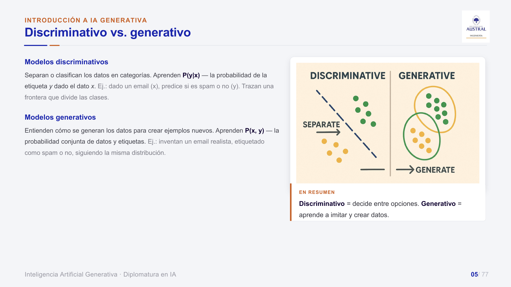
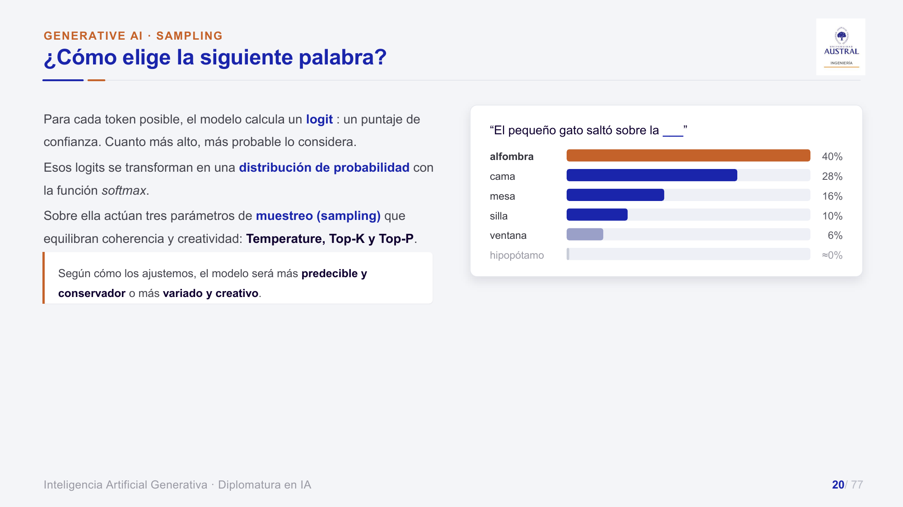
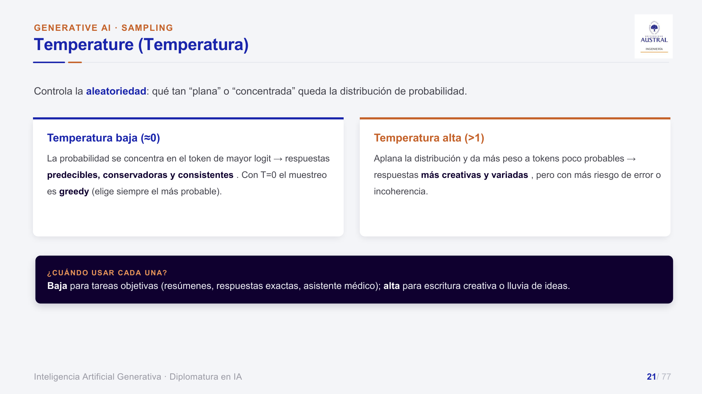
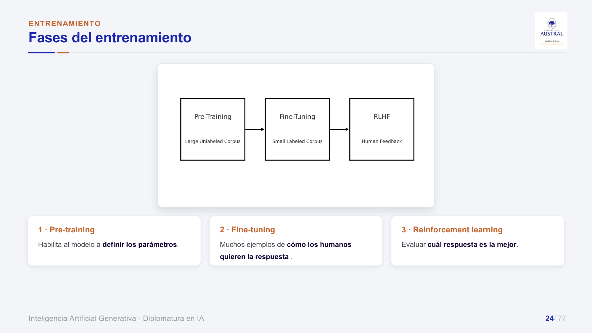
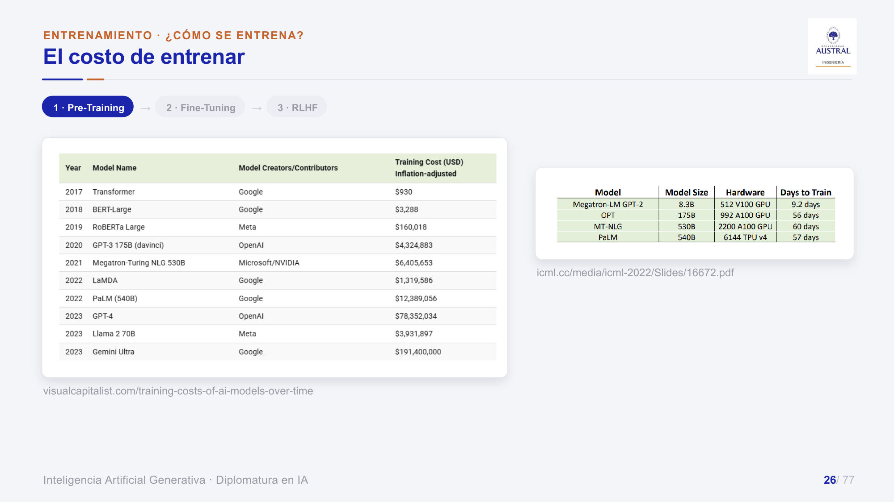
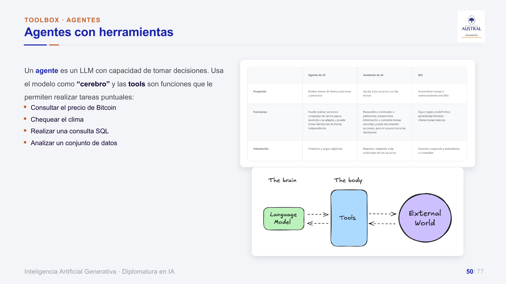
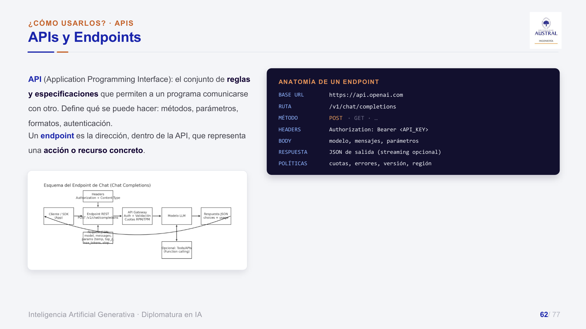

# Clase 32 · Introducción a la IA generativa: cómo funcionan y cómo se usan los LLM

> **Módulo 5 · IA Generativa** · Juan Pablo Sokil · martes 04-ago-2026
> **Fuentes:** transcripción `DIA_Clase_32.vtt` · láminas `2026_GENAI_Clase_01_Austral.pdf` · notebook `2026_GENAI_Clase_01.ipynb` · programa del módulo `2026_GENAI_Programa_Austral.pdf` (solo para ubicar la clase)

## En pocas palabras

- Un modelo **discriminativo** decide entre opciones: aprende $P(y\mid x)$ y traza una frontera. Un modelo **generativo** aprende cómo se generan los datos, es decir $P(x, y)$, y puede crear ejemplos nuevos. Los LLM son generativos y se basan en la parte **decoder** del Transformer.
- Un LLM genera texto **token por token**. Para cada token posible calcula un *logit*, la *softmax* lo convierte en probabilidades y después se **muestrea**. Tres parámetros ajustan ese muestreo: **temperatura**, **top-K** y **top-P**. Con ellos se elige entre respuestas predecibles y respuestas creativas, que tienen más riesgo de alucinar.
- El entrenamiento tiene tres fases: **pre-training** sobre un corpus masivo (carísimo y en manos de pocas empresas), **fine-tuning** con pocos datos etiquetados (hoy accesible con una GPU) y **RLHF**, donde personas ordenan respuestas para que el modelo priorice las mejores.
- Con las **tools**, los modelos pasaron de responder pasivamente a actuar: el LLM es el "cerebro" y las herramientas son las "manos". Las tres grandes plataformas (ChatGPT, Gemini, Claude) migraron del chat a **asistentes agénticos**.
- Hay dos maneras de usar un LLM: por **API** en la nube (se paga y se usa) u **on-premise/local**, que da privacidad y control pero exige hardware y gente que sepa operarlo. Por API, hay que mirar el **precio por token** y los **rate limits**.

## Conceptos clave

### Dónde se ubica la IA generativa

El profesor parte de la definición de Gartner: la IA es un programa que puede **sentir, razonar, actuar y adaptarse**. Se apoya en el machine learning y, dentro de él, en el deep learning, que son las redes neuronales que "le dan vida". El procesamiento del lenguaje natural (PLN) y la visión por computador se cruzan con ML y DL. En la intersección entre deep learning y PLN aparecen los **LLM** (GPT, Gemini, Claude, Llama). Más o menos desde 2024 también son multimodales, y algunos se llaman **VLM** (*Visual Language Models*).

Definición de trabajo: la **IA generativa** es la capacidad de las máquinas de generar contenido nuevo y original (texto, imágenes, video, audio, música) que se parece a lo que crean los humanos. Se parece porque **se entrenó con datos que generamos nosotros**.

### Discriminativo vs. generativo



| | Discriminativo | Generativo |
|---|---|---|
| Qué aprende | $P(y\mid x)$: la etiqueta dado el dato | $P(x, y)$: la distribución conjunta |
| Qué hace | Separa o clasifica | Imita y crea datos nuevos |
| Ejemplo de texto | Análisis de sentimiento (positivo/negativo) | A partir de un prompt, escribe una historia |
| Ejemplo de imagen | ¿Gato o perro? | Genera la imagen de un gato |

Los generativos existían antes de 2022, pero eran de nicho y daban malos resultados. Con ChatGPT pasaron a ser la norma. Esta división se suma a la clásica entre supervisados y no supervisados.

### El Transformer y la familia decoder

El paper *Attention Is All You Need* (Google, 2017) propuso una arquitectura para **traducción** (encoder-decoder) que entrena en paralelo y aprovecha el **mecanismo de atención**. Según la clase, trae dos ideas:

- **Atención** (*attention mask*): no todas las palabras pesan lo mismo. La red aprende cuáles influyen más sobre las otras.
- **Positional encoding**: la posición de la palabra en la oración también cambia su importancia.

Antes, las redes recurrentes procesaban palabra por palabra con el mismo peso para todas y "perdían el núcleo" de la oración. Por eso un traductor podía traducir bien cada palabra y armar mal la frase.

De esa arquitectura salieron dos familias:

| Familia | Ejemplos | Dirección | Para qué |
|---|---|---|---|
| Encoder | BERT, RoBERTa, ALBERT | Bidireccional | Entender texto: clasificar, tópicos, entidades. Siguen funcionando muy bien |
| Decoder | GPT y sucesores | Unidireccional | **Generar** texto prediciendo el siguiente token |

Los decoder tardaron en despegar (las primeras versiones de GPT son de 2018-2019). Desde 2022 crecieron hasta ocupar casi todo el mapa, con cada vez más empresas (OpenAI, Anthropic, Google, Meta, Alibaba con Qwen, Kimi, etc.).

### Predicción del siguiente token y muestreo

Un GPT se entrena de forma no supervisada (auto-supervisada) sobre grandes volúmenes de texto para predecir **qué token sigue**. Ejemplo de la clase: "Después de la lluvia, las calles estaban…". Si las opciones son *wet* 40 %, *flooded* 25 % y *slippery* 15 %, un modelo que siempre elige la más probable responde *wet*. Con muestreo aleatorio puede salir *flooded*. Cada token elegido condiciona al siguiente, y el modelo sigue así hasta que decide que la respuesta terminó.



El mecanismo:

1. Para cada token del vocabulario, el modelo calcula un **logit**, que es un puntaje de confianza.
2. La **softmax** convierte los logits en una distribución de probabilidad.
3. Sobre esa distribución actúan los parámetros de muestreo.

En la notebook, la temperatura se aplica dividiendo los logits antes de la softmax:

$$p_i = \mathrm{softmax}\left(\frac{z_i}{T}\right)$$

Con $T = 0$ se toma directamente el argmax (*greedy*).

### Temperatura, top-K y top-P



| Parámetro | Qué controla | Valor bajo | Valor alto |
|---|---|---|---|
| **Temperatura** | Qué tan plana o concentrada queda la distribución | $T \approx 0$: siempre el token más probable, respuestas consistentes | $T > 1$: aplana las probabilidades, más variedad y más riesgo de "mandar fruta" |
| **Top-K** | Cuántos tokens entran al sorteo (una **cantidad fija**) | $K = 1$: equivale a greedy | Muchos candidatos |
| **Top-P** (*nucleus*) | El conjunto más chico cuya probabilidad **acumulada** llega a $P$ (umbral dinámico) | Pocos candidatos | Casi todo el vocabulario |

Ejemplo de top-P de la clase: con $P = 0{,}6$ y probabilidades 40 % y 28 %, la suma 40 + 28 = 68 % ya pasa el umbral, así que el sorteo es solo entre esas dos palabras. La temperatura reescala las probabilidades, y top-K y top-P recortan la cola improbable, como el "hipopótamo" del ejemplo del gato.

Combinaciones que recomendó el profesor:

| Objetivo | Temperatura | Top-K |
|---|---|---|
| Respuesta estable y concreta (resúmenes, asistente médico) | Baja | Bajo |
| Escritura creativa, lluvia de ideas | Alta | Alto |
| "Creativo, pero no tanto" (ej. chatbot de atención al cliente que no suene a máquina pero no diga cualquier cosa) | Alta | Bajo |

Una temperatura baja da respuestas *consistentes*, no necesariamente *correctas*.

### Tokens: el modelo no lee palabras

Antes de llegar al modelo, el prompt se convierte en **tokens**, que forman el vocabulario propio de cada modelo. Muchas veces coinciden con nuestras palabras, y por eso "nos engaña" y parece que habla nuestro idioma. Ejemplo de la clase: en un tokenizador de GPT (el profesor creía que era GPT-4), "!" es un token y "!!!!" es **otro** token distinto. Para el modelo son dos cosas diferentes, probablemente asociadas a usos distintos: exclamación normal frente a enojo o sorpresa.

Flujo completo: prompt → tokens → el modelo predice tokens uno tras otro (con la curaduría y el alineamiento ya incorporados) → respuesta.

### Fases del entrenamiento



**1. Pre-training.** El objetivo es una representación general del lenguaje: gramática, sintaxis, semántica, conocimiento del mundo. Se entrena sobre un corpus masivo **no etiquetado** (Wikipedia, Reddit, libros, foros, código). La técnica es predecir la siguiente palabra. La lámina también menciona la palabra **enmascarada**: ante una pregunta de un alumno, el profesor aclaró que esa técnica es más propia de los encoder (BERT) que de GPT. El resultado es un **modelo fundacional**: "un genio que sabe todo pero al que no le enseñaron a hacer nada".

El costo es altísimo en cómputo, dinero y personas capacitadas. Tener las máquinas no alcanza si no hay gente que sepa entrenar.



Según las estimaciones de las láminas (fuente visualcapitalist.com; el profesor pidió "tomarlas con pinzas"), el costo pasa de unos US$ 930 para el Transformer original a unos US$ 4,3 millones para GPT-3, unos US$ 78 millones para GPT-4 y unos US$ 191 millones para Gemini Ultra. PaLM (540B parámetros) se entrenó con 6.144 TPU v4 durante 57 días. Por eso el pre-training lo hacen pocos jugadores: Google, Meta, OpenAI, Microsoft, Alibaba.

**Curaduría de datos.** Al principio la idea era "más datos, mejores resultados". La mejora se estabilizó y el foco pasó a la **calidad**. Según las láminas, la curaduría incluye seleccionar fuentes, filtrar y limpiar (deduplicar, quitar contenido tóxico o sensible) y balancear para evitar sesgos. El profesor lo relacionó con que el tamaño de los modelos dejó de crecer sin parar y se estabilizó en rangos más o menos estándar.

**2. Fine-tuning.** Adapta el modelo fundacional a una tarea o dominio con un corpus **chico y etiquetado**. El profesor lo explicó así, simplificando: se aprovecha el conocimiento de las capas anteriores y se reemplaza o agrega la capa final. Según la lámina, se sigue entrenando el mismo modelo con esos datos y un ritmo de aprendizaje más suave. Es mucho más barato. Hace dos o tres años era cosa de grandes jugadores y hoy alcanza con una GPU y algunos días.

- **SFT** (*Supervised Fine-Tuning*): pares **prompt → respuesta deseada** etiquetados por humanos para que el modelo siga instrucciones. Es lo que está detrás de los chats de pregunta y respuesta.
- Hay modelos especializados por dominio: BioGPT (literatura biomédica), BloombergGPT (finanzas), Med-PaLM (preguntas médicas), MedAlpaca.

**3. RLHF** (*Reinforcement Learning from Human Feedback*). Se generan varias respuestas, por ejemplo con distinta temperatura o reformulando la pregunta, y personas indican cuál prefieren o las ordenan. Según la lámina tiene dos pasos: (1) con esas preferencias se entrena un **reward model**; (2) ese modelo se usa para afinar el LLM original de modo que maximice las respuestas preferidas. Un alumno preguntó si el modelo se ajusta a sí mismo. La respuesta fue que no: son humanos cuyo juicio se reintroduce en el modelo, posiblemente mediante otro modelo acoplado que reajusta los pesos.

### Tipos de LLM

| Tipo | Qué es |
|---|---|
| Foundation model | Entrenado con lenguaje general; punto de partida de los demás |
| De instrucciones | Fine-tuning con instrucciones + RLHF: obedece pedidos directos |
| Especializado en dominio | Fine-tuneado sobre un área (finanzas, medicina) |
| De chat | Diálogo multiturno con roles *system*, *user*, *assistant* |
| Con herramientas (*function calling*) | Puede invocar funciones externas, APIs o un buscador |

Un modelo **pre-entrenado** solo sabe patrones de texto y responde de forma literal y poco controlada. Uno **fine-tuneado** entiende pedidos, da salidas más seguras y útiles, y rechaza contenido inapropiado.

### Tools y agentes



Los primeros chats inventaban respuestas, o decían que no sabían, ante preguntas como el clima de hoy o qué pasó ayer: su conocimiento termina en la fecha de corte. Las **tools** son funciones, generalmente de Python, que el modelo puede invocar cuando le falta información o necesita actuar: un buscador web, el precio de Bitcoin, el clima, una **consulta SQL** generada a partir de la pregunta, el análisis de un dataset. La analogía es que el LLM es el **cerebro** y las tools son el **cuerpo**, o las manos, que interactúan con el mundo externo. Ese paso de **pasivo a activo** es la base de los agentes.

Dos aclaraciones que salieron de preguntas:

- Lo que el modelo trae con una tool **no se incorpora a sus pesos**. El modelo aprende a *usar* la herramienta, no a guardar el resultado.
- Se puede acotar la tool a fuentes confiables. Por ejemplo, para un agente médico, buscar solo en dos o tres sitios de referencia y no en todo Google.

Un alumno (Sebastián) agregó contexto sobre **MCP** y **skills**. El profesor lo resumió en cuatro conceptos que se mezclan cada vez más:

| Concepto | Qué es (versión simplificada de la clase) |
|---|---|
| Tool | Una herramienta o función concreta |
| MCP | Algo así como un repositorio o conector de herramientas externas |
| Prompt | La instrucción |
| Skill | Un prompt generalizado y guardado en un archivo, que se reutiliza ("usá esta skill") |

### La IA generativa como "toolbox"

La idea es abrir la caja, elegir la herramienta adecuada para la tarea, usarla y devolverla.

- **Chat conversacional:** ChatGPT (OpenAI), Gemini (Google), Claude (Anthropic). Son muy parecidos: uno saca algo y los otros lo siguen. El gran cambio de 2025-2026 fue pasar de **chat a asistente integrado, multimodal y agéntico**, que busca información, razona en varios pasos y dispara procesos en Slack, Gmail o Teams.
- **Imagen:** generación de muy buena calidad y edición integrada en herramientas como Photoshop.
- **Video:** el "test del spaghetti" (videos de Will Smith comiendo fideos) muestra la evolución año a año. Es una prueba exigente porque combina rostro, boca, manos y movimiento fino.
- **Programación asistida:** Claude Code, OpenAI Codex, GitHub Copilot, Antigravity (Google), OpenCode. No es "un chat que te da código" sino un agente que lee el proyecto, edita archivos y ejecuta comandos. Antes se copiaba el código de ChatGPT al editor y se iba probando.
- **Frameworks de agentes:** LangGraph, Google ADK, CrewAI, el constructor visual de OpenAI, y herramientas no-code o low-code como n8n, Zapier o Botmaker. Programar el agente da más flexibilidad. Según el profesor, con asistentes de programación que pueden escribir un agente en LangGraph, el no-code pierde parte de su ventaja.
- **OpenClaw:** framework open source para agentes autónomos que corren en el hardware propio (self-hosted, se le puede conectar cualquier LLM, la memoria queda en archivos Markdown locales). La diferencia con LangGraph es que **LangGraph es un framework para construir agentes desde cero**, mientras que **OpenClaw ya es un agente funcionando** al que se le agregan tareas.

### Cómo usarlos: API vs. on-premise

| | API en la nube | On-premise / local |
|---|---|---|
| Uso | Se paga y se llama a un endpoint | Instalar, servir y mantener el modelo |
| Costo | Pago recurrente por token | Hardware (GPUs) y personal capacitado |
| Datos | Viajan al proveedor (hay que confiar en su promesa) | Nunca salen de la infraestructura |
| Performance | Los modelos más potentes | Difícil igualar a los modelos pagos de punta |
| Actualizaciones | Frecuentes y automáticas | Manuales |

A medida que los modelos se vuelven más eficientes, las **grandes empresas** se inclinan hacia lo local por privacidad. Una pyme no puede montar un servidor de cientos de miles de dólares. El profesor marcó una contradicción frecuente: hay mucho miedo de mandar datos a una API, pero esos mismos datos ya están en Google Drive o en Microsoft.

Formas concretas de acceso:

- **Chats web** (ChatGPT y otros): se elige el modelo y se conversa, sin código.
- **Playgrounds de nube:** AWS Bedrock (sin modelo propio; ofrece Claude y modelos abiertos) y GCP Vertex AI (Gemini). Permiten ajustar temperatura, top-P y top-K antes de integrar por API.
- **Hugging Face:** repositorio de casi tres millones de modelos, basados sobre todo en Transformers. Exige escribir código para cargarlos.
- **LM Studio:** interfaz tipo ChatGPT para descargar y correr modelos locales. Muestra el tamaño de cada modelo y si va a andar en la máquina, y expone un **endpoint local** que imita la API de OpenAI.
- **Ollama:** lo mismo pero por línea de comandos.

### APIs, endpoints, precios y límites



Una **API** es el conjunto de reglas para que un programa se comunique con otro. Un **endpoint** es la dirección, dentro de la API, de una acción concreta: chat, imágenes, embeddings, audio. En OpenAI, el endpoint de chat histórico es `/v1/chat/completions` y el más nuevo se llama *responses* (el profesor cree que van a convivir un tiempo). En Anthropic es `messages.create`, con el *system* separado de los mensajes y `max_tokens` obligatorio. En Gemini es `generate_content`. Todos reciben modelo, mensajes por roles y parámetros de muestreo.

- **Precios:** se cobra por millón de tokens, con precio distinto para entrada y salida. Una automatización puede ser técnicamente linda y aun así no rendir económicamente.
- **Rate limits:** RPM/RPD (requests por minuto o día), TPM/TPD (tokens), IPM (imágenes por minuto). En OpenAI hay **tiers** que suben con el gasto acumulado. Ante un error **429**, conviene reintentar con *backoff* exponencial o tener un modelo alternativo de respaldo. Los proveedores tampoco tienen capacidad infinita: el lanzamiento de Sora llegó a tirar el servicio.

### Límites de los modelos

Según las láminas: **alucinaciones** (información falsa dicha con seguridad), **fecha de corte** del conocimiento, **ventana de contexto** limitada y **sesgos** heredados de los datos. A eso el profesor sumó un riesgo: cuando el modelo busca en Internet, cada vez encuentra más contenido generado por IA, y eso puede formar un bucle de fuentes no verificadas.

## Ejemplos y casos de la clase

- **El traductor de Google que "de golpe" tradujo bien:** el profesor recordó el salto de calidad sin saber entonces que se debía al cambio de redes recurrentes a Transformers (alrededor de 2018).
- **Fine-tuning de Gemma en su trabajo:** tres o cuatro días de entrenamiento con una GPU para responder sobre temas específicos de la empresa. Es mucho tiempo, pero "no son dos meses": el fine-tuning ya está al alcance de muchos.
- **Trabajos de RLHF:** hace un par de años hubo un boom de trabajos freelance para calificar respuestas de modelos, sobre todo con expertos en medicina, biología y química.
- **Agente de SQL:** con modelos gratuitos no lograron buenos resultados y tuvieron que pasar a OpenAI. La diferencia de performance entre modelos abiertos y pagos sigue siendo real en tareas complejas.
- **Skill de lesión de muñeca** (aporte de un alumno): una skill guardada con su lesión adapta automáticamente las rutinas de entrenamiento que le propone el modelo, sin tener que repetirlo en cada chat.
- **Contenido generado por IA en redes:** influencers virtuales y un estudio citado por Infobae según el cual alrededor del 20 % de los videos recomendados a usuarios nuevos de YouTube son generados por IA (dato dudoso: la empresa del estudio no se entendió bien en la transcripción).
- **Informes de adopción:** AI Index Report 2026 de Stanford (casi 400 páginas) y la encuesta de pymes argentinas de NADIA. Según la lámina, la adopción laboral en Argentina es algo menor, aunque no mucho, que la internacional, y a nivel global se duplicó en dos años.

## Práctica

Notebook `2026_GENAI_Clase_01.ipynb` ("Primeros pasos con modelos generativos: On-Prem o API"):

1. **Conexión local:** `requests.post` contra el endpoint que exponen LM Studio (puerto 1234) u Ollama (`localhost:11434/v1/chat/completions`), con el mismo formato de mensajes que OpenAI. **Hay que correrla en la propia máquina, no en Colab**: desde la nube, `localhost` no apunta a la computadora del alumno.
2. **Roles de la conversación** (*system*, *user*, *assistant*). Para que el modelo "recuerde", hay que reenviar el historial, incluido el último turno del assistant. Se retoma en la clase siguiente.
3. **Simulación de sampling** con el ejemplo "El pequeño gato saltó sobre la ___" (alfombra, cama, mesa, silla, ventana, hipopótamo): funciones `aplicar_temperatura`, `aplicar_top_k` y `aplicar_top_p` sobre logits fijos, con gráficos. Conviene mover los valores y observar, por ejemplo, que con `k=1` o con `T=0` la primera opción queda con probabilidad 1.
4. **Efecto de la temperatura vía API:** sinopsis generadas para distintos públicos variando `temperature` y `max_tokens`.
5. **Otros endpoints de OpenAI** (requieren API key propia): generación de imágenes, text-to-speech, speech-to-text y text-to-video con Sora (este último falló en la demo).
6. **Cuestionario** de 9 preguntas con respuestas (temperatura para creatividad, chatbot médico, top-k vs. top-p, instrucciones contradictorias entre *system* y *user*, etc.).

El ejemplo de imágenes es el más ilustrativo:

```python
system_style = "Tu eres el pintor Pablo Picasso, dibuja con su estilo"
# -> Error 400: moderation block (rechazado por seguridad del sistema)
# Reformulado como "un pintor cubista español llamado Pablo" -> genera la imagen
```

El filtro de moderación bloquea imitar a un autor con nombre propio, pero cambiar dos palabras alcanza para saltearlo. La IA es "superpotente, pero mega inocente", y eso anticipa el tema de guardrails.

## Para recordar

- Temperatura baja = respuestas **consistentes**, no necesariamente **correctas**. Temperatura alta = más creatividad y más alucinación.
- Top-K corta por **cantidad** de tokens; top-P, por **probabilidad acumulada**. Combinados con la temperatura permiten un "volá, pero no tanto".
- El pre-training está reservado a pocas empresas. El fine-tuning ya lo puede hacer casi cualquiera con una GPU.
- "Más datos" dejó de ser la receta: hoy importa la **calidad** (curaduría).
- El modelo no lee palabras sino tokens, y un mismo signo repetido puede ser otro token.
- Lo que el modelo trae con una tool no queda en sus pesos.
- API = pagar y usar. On-premise = privacidad y control a cambio de hardware, mantenimiento y menor performance.
- Antes de automatizar algo con un LLM, hacer la cuenta del costo por token y revisar los rate limits.
- Los guardrails de los modelos se pueden burlar reformulando el prompt.

## Preguntas de repaso

<details><summary>1. ¿Qué diferencia de fondo hay entre un modelo discriminativo y uno generativo, en términos de probabilidad?</summary>

El discriminativo aprende $P(y\mid x)$: dado el dato, qué etiqueta le corresponde. Por eso traza una frontera entre clases. El generativo aprende $P(x, y)$, la distribución conjunta de datos y etiquetas, y eso le permite producir ejemplos nuevos que siguen la misma distribución.

</details>

<details><summary>2. ¿Por qué con temperatura 0 el modelo responde siempre lo mismo, y por qué subirla aumenta el riesgo de alucinación?</summary>

Con $T = 0$ el muestreo es greedy: siempre se elige el token de mayor logit, así que la secuencia es determinista. Al subir $T$ la distribución se aplana: tokens poco probables ganan peso y pueden salir elegidos, lo que da respuestas más variadas pero también más incoherentes o falsas.

</details>

<details><summary>3. Con probabilidades 40 %, 28 %, 16 %, 10 % y 6 %, ¿entre qué tokens se sortea con top-K = 3? ¿Y con top-P = 0,6?</summary>

Con top-K = 3, entre los tres primeros (40 %, 28 % y 16 %). Con top-P = 0,6 se acumula hasta llegar al umbral: 40 % no alcanza y 40 + 28 = 68 % sí, así que el sorteo es entre los dos primeros. Top-K fija una cantidad. Top-P se adapta en cada paso según cuán concentrada esté la distribución.

</details>

<details><summary>4. Para un chatbot de atención al cliente que no suene robótico pero no diga cualquier cosa, ¿qué configuración propuso el profesor y por qué?</summary>

Temperatura alta con top-K bajo. La temperatura alta da variedad en la forma de responder. El top-K bajo limita el sorteo a unos pocos tokens plausibles y recorta la cola donde están las respuestas absurdas.

</details>

<details><summary>5. ¿Qué aporta cada fase del entrenamiento y por qué el pre-training queda en manos de pocas empresas?</summary>

El pre-training, sobre un corpus masivo sin etiquetar, da el conocimiento general del lenguaje y produce el modelo fundacional. El fine-tuning (SFT con pares prompt-respuesta) le enseña a seguir instrucciones o a especializarse en un dominio. El RLHF, con humanos que ordenan respuestas y un reward model, lo alinea con las respuestas preferidas. El pre-training exige miles de GPU/TPU durante semanas (PaLM: 6.144 TPU durante 57 días) y costos de millones de dólares, además de personal capacitado.

</details>

<details><summary>6. Si un agente busca en la web lo que pasó ayer, ¿el modelo "aprende" ese dato? ¿Qué cambia respecto de un chat sin tools?</summary>

No: el resultado de la tool se usa en esa respuesta pero no modifica los pesos. Lo que el modelo aprendió es a usar la herramienta. La diferencia con un chat sin tools es que deja de ser pasivo (responder solo con lo que sabe hasta su fecha de corte) y pasa a ser activo: detecta que le falta información y va a buscarla.

</details>

<details><summary>7. Una empresa grande con datos sensibles y una pyme sin equipo técnico quieren usar un LLM. ¿Qué camino le conviene a cada una?</summary>

La empresa grande puede justificar on-premise: los datos no salen de su infraestructura, pero necesita GPUs, gente que instale y mantenga el modelo, y debe aceptar una performance menor que la de los modelos de punta. La pyme probablemente vaya por API: paga por token y solo tiene que aprender a llamar al endpoint, a cambio de confiar en la política de datos del proveedor y respetar los rate limits.

</details>

<details><summary>8. ¿Qué muestra el ejemplo de Picasso sobre la curaduría y los guardrails?</summary>

Que entre el modelo y la respuesta hay un filtro de moderación (error 400, *moderation block*) que bloquea imitar a un autor con nombre propio. También muestra que ese filtro es frágil: describir al "pintor cubista español llamado Pablo" alcanza para obtener la imagen. Los guardrails hay que diseñarlos y probarlos contra reformulaciones.

</details>

## Conexiones

- **Hacia atrás:** retoma el Transformer, la atención y BERT vistos en la Clase 11 y en la Clase 26 (RNN/LSTM y Transformers), y la introducción a la IA generativa como caja de herramientas de la Clase 13. Softmax y redes neuronales vienen del módulo de deep learning. LM Studio y Ollama se habían instalado en el módulo de NLP.
- **Hacia adelante:** es la primera clase del Módulo 5. La siguiente (Clase 33) desarrolla las tres formas de adaptar un LLM que aquí solo se nombraron: prompt engineering (incluidos los roles *system*/*user*/*assistant* de la notebook), RAG y fine-tuning (PEFT/LoRA). Según el programa, más adelante el módulo trata la evolución de los LLM, los agentes y tools (LangGraph, multi-agente, MCP y skills), la multimodalidad (imagen, audio y video, que aquí se mostraron vía API) y el monitoreo y los guardrails (rate limits, modelos de respaldo, prompt injection como el caso Picasso).
- **TFI:** los **endpoints de embeddings** (texto → vector que captura significado), presentados como base de la búsqueda semántica y de RAG, son la pieza del retrieval semántico del normalizador de nombres comerciales de Benefix. En el retrieval generativo, la recomendación de temperatura baja para tareas objetivas aplica directamente, porque se busca una normalización estable y repetible. La elección entre API y modelo local, y el costo por token, también entran en la decisión de diseño.
