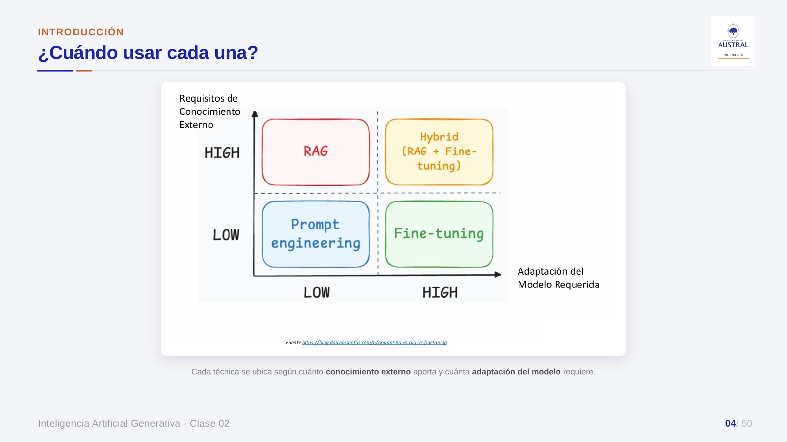
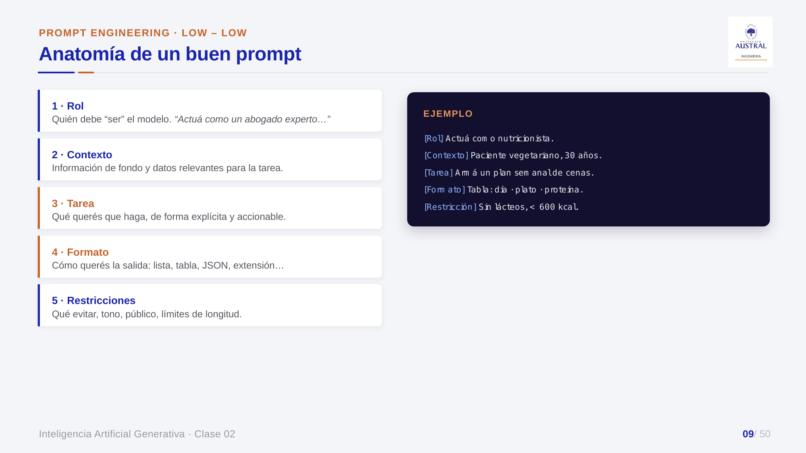
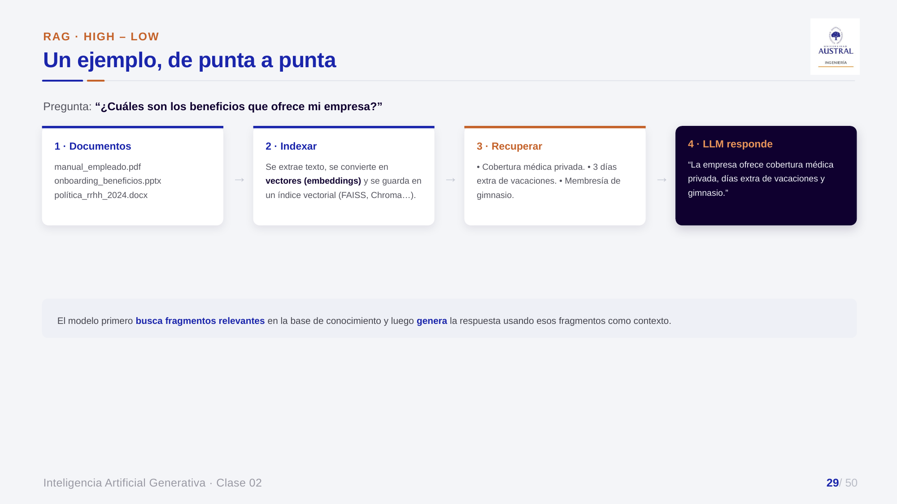
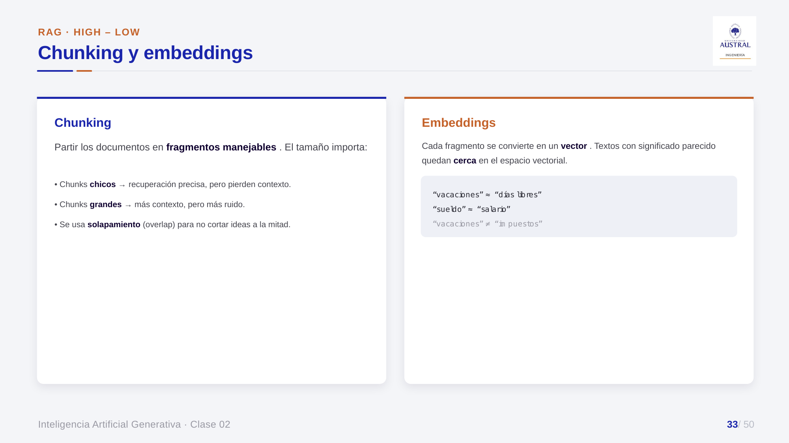
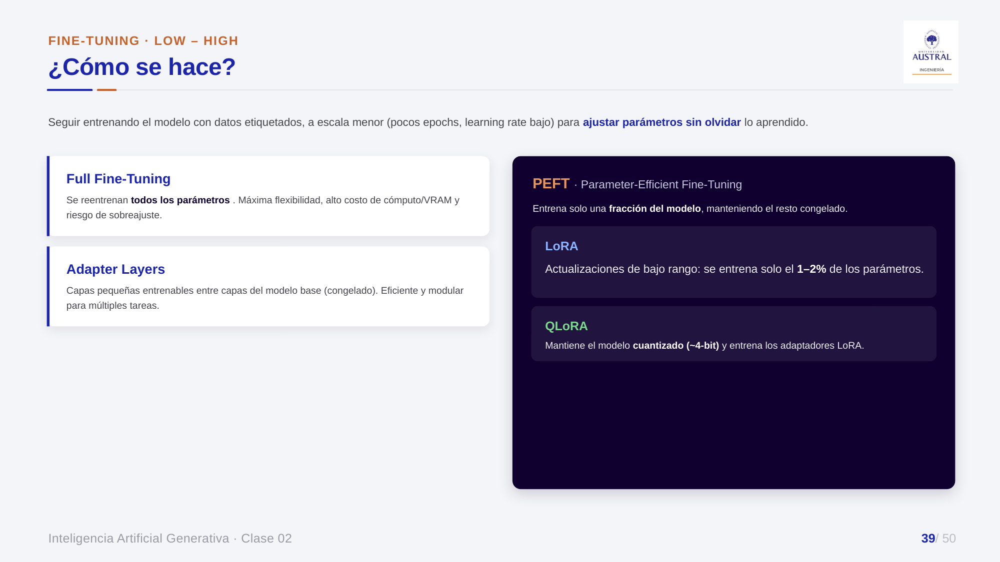
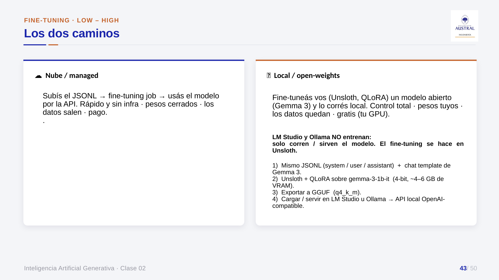
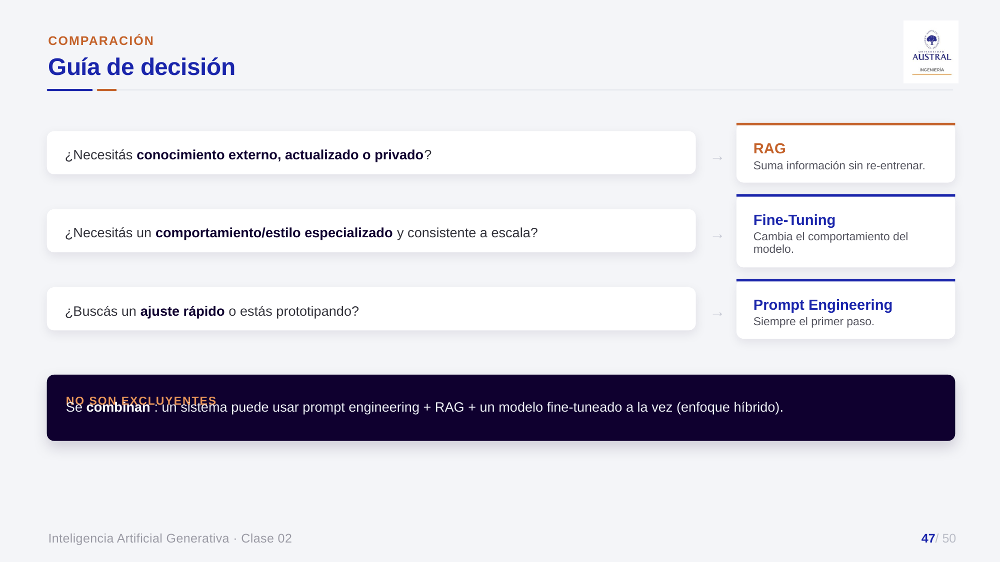

# Clase 33 · Prompt engineering, RAG y fine-tuning: tres formas de ajustar un LLM

> **Módulo 5 · IA Generativa** · Juan Pablo Sokil · jueves 06-ago-2026
> **Fuentes:** transcripción `DIA_Clase_33.vtt` · láminas `2026_GENAI_Clase_02_Austral.pptx` · notebook `2026_GENAI_clase_02.ipynb` · dataset `politicas_faq_sft.jsonl` · demos en vivo (mini app de prompts, Qdrant y un flujo RAG en n8n)

## En pocas palabras

- Entrenar un LLM desde cero queda para un puñado de empresas. Al resto le quedan tres formas de **adaptar un modelo preentrenado**: **prompt engineering** (cambiar las instrucciones), **RAG** (darle información externa en el momento de la pregunta) y **fine-tuning** (reentrenar y modificar los pesos). Se ubican en un cuadrante según cuánto conocimiento externo aportan y cuánto tocan el modelo.
- El **prompt** sigue existiendo aunque hoy lo escriban los agentes (*skills*, `CLAUDE.md`): un buen prompt es claro, conciso, completo y correcto, y tiene rol, contexto, tarea, formato y restricciones. Las técnicas van de *zero-shot* a *few-shot*, *chain of thought* y *ReAct*. De *chain of thought* salen los modelos de razonamiento y de *ReAct*, los agentes.
- **RAG** tiene dos etapas: **indexado** (preparar los documentos, partirlos en *chunks*, convertirlos en embeddings y guardarlos en una base vectorial) y **recuperación y generación** (convertir la pregunta en embedding, traer los *k* fragmentos más similares por similitud coseno y que el LLM responda con ellos). Lo más difícil es preparar bien los datos.
- **Fine-tuning** cambia los pesos para fijar un estilo, un formato o una jerga. Es caro y técnico. Lo que lo volvió accesible son las técnicas **PEFT** (LoRA, QLoRA) y la **cuantización**. Hay dos caminos: la nube (subir un JSONL a OpenAI) o local con pesos abiertos (Unsloth + Gemma 3).
- Regla de decisión: **prompt engineering siempre primero**; **RAG** cuando falta información propia o actualizada; **fine-tuning** solo cuando hace falta un comportamiento muy especializado, consistente y a escala. Las tres técnicas se pueden combinar.

## Conceptos clave

### Las tres formas de ajustar un LLM

La cuarta opción, entrenar un modelo de lenguaje desde cero, es inviable para casi todos: exige demasiados datos y demasiado cómputo. Las tres alternativas se ordenan en dos ejes: **requisitos de conocimiento externo** y **adaptación del modelo requerida**.



| Técnica | ¿Modifica el modelo? | ¿Requiere datos extra? | Nivel técnico / costo | Cuadrante |
|---|---|---|---|---|
| Prompt engineering | No | No | Bajo | conocimiento bajo · adaptación baja |
| RAG | No | Sí (documentos propios) | Medio: base de datos, actualización, interfaz de chat | conocimiento alto · adaptación baja |
| Fine-tuning | Sí (ajusta los pesos) | Sí (ejemplos de entrada y salida) | Alto: cómputo y conocimiento técnico | conocimiento bajo · adaptación alta |
| Híbrido (RAG + fine-tuning) | Sí | Sí | El más difícil | conocimiento alto · adaptación alta |

Sobre el cuadrante híbrido, el profesor dijo que nunca lo usó: se puede hacer, pero es difícil se lo mire por donde se lo mire.

### Prompt engineering: qué es y si sigue vigente

Según las láminas, es la disciplina de diseñar, estructurar y optimizar prompts para que el LLM produzca respuestas precisas, relevantes, útiles y coherentes. En palabras del profesor, es aprender a "hablar el idioma" del modelo: saber qué decirle para que entienda y qué evitar para que no se confunda. El objetivo es que el modelo comprenda la intención, respete el formato y el tono esperados, y cometa menos ambigüedades y errores.

Un alumno planteó en clase que con herramientas agénticas como Claude Code ya no hace falta escribir prompts largos. La respuesta fue **"sí y no"**. Ya no nos sentamos horas a escribir el prompt, pero los *skills* y archivos como `CLAUDE.md` **son prompts**, solo que los redacta la máquina. Ahora el foco está en comunicarle bien la idea al agente. El prompt sigue siendo la receta de pasos que recibe el modelo.

**Las 4 C de un buen prompt:**

- **Claro:** sin ambigüedad.
- **Conciso:** sin palabras que no aportan.
- **Completo:** con contexto, formato, tono y restricciones.
- **Correcto:** con información precisa. Si se le pasan datos falsos como hechos, la respuesta también va a estar mal.

Ejemplo de las láminas: "Escribe un artículo sobre energía" es una instrucción vaga. "Actuá como un divulgador científico y redactá un artículo de 150 palabras que explique qué es la energía solar [...] Usá un lenguaje claro y accesible" es precisa, porque fija el rol, la longitud, el contenido y el tono.

### Anatomía de un buen prompt



1. **Rol:** desde dónde se posiciona el modelo ("sos un especialista en corregir exámenes de matemática").
2. **Contexto:** la información de fondo que va a recibir (por ejemplo, el artículo del diario).
3. **Tarea:** qué tiene que hacer, de forma explícita ("identificá las faltas de ortografía").
4. **Formato:** cómo se quiere la salida (lista con viñetas, tabla, JSON, extensión).
5. **Restricciones:** lo menos conocido. Son cosas a tener en cuenta, por ejemplo que una palabra inventada es una convención interna del diario y no debe marcarse como error.

Nada de esto es "descubrir la pólvora". El valor está en tener una estructura para no olvidarse de nada cuando se trabaja apurado.

### Técnicas de prompting

| Técnica | Qué hace | A favor | En contra |
|---|---|---|---|
| **Zero-shot** | Instrucción directa, sin ejemplos | Rápida y corta | No controla el resultado: el modelo adivina el formato |
| **Few-shot** | Agrega algunos ejemplos de entrada → salida antes de la consulta | Transfiere *nuestro* criterio y formato | Más tokens en cada llamada |
| **Many-shot** | Cientos o miles de ejemplos | Más rendimiento | Todavía más tokens y costo |
| **Chain of thought (CoT)** | Pide razonar paso a paso antes de responder | Mejora en lógica, aritmética y planificación | Respuestas más largas |
| **Self-consistency** | Genera varias cadenas de razonamiento (temperatura > 0) y se queda con la respuesta mayoritaria | Más robusto | Más cómputo |
| **ReAct** (*reason + act*) | Alterna pensar, actuar (usar una herramienta), observar y volver a pensar | Es la base de los agentes | — |
| **Tree of thought** | Explora varias ramas de razonamiento, las evalúa y poda las peores | Útil en contextos puntuales | El profesor no la usó nunca |
| **Role prompting** | Asigna un rol o una identidad ("actuá como un chef profesional") | Muy simple y da buenos resultados | — |

- **Few-shot e *in-context learning*.** El few-shot viene del ML tradicional, donde se buscaba que un modelo generalizara a partir de pocos datos. En los LLM **no se entrena nada**: el modelo imita el patrón de los ejemplos dentro del contexto. Sirve cuando hay que embeber un criterio propio. Por ejemplo, si interesa polarizar el análisis de sentimiento, se puede mandar a "neutro" todo lo que no sea expresamente positivo, aunque el modelo por su cuenta clasificaría "servicio aceptable" como positivo. Las láminas muestran que el rendimiento sube con la cantidad de ejemplos. En many-shot, por ejemplo, se evaluó GPT-4o y Gemini 1.5 Pro en 10 datasets de clasificación de imágenes, y unos 2.000 ejemplos rindieron mucho mejor que menos de 100. La contracara es que se gastan más tokens. Hay que buscar el equilibrio.
- **De CoT a los modelos de razonamiento.** Un alumno preguntó si los modelos ya no piensan así por defecto. La respuesta fue que sí, y que justamente por eso CoT es importante: es el corazón de los *reasoning models*, que se entrenan para descomponer la tarea, frenar, reflexionar y volver atrás. Cuando en ChatGPT o Gemini se baja el nivel de razonamiento a *none*, se corta esa cadena. Igual conviene **reforzar** la instrucción en el prompt ("andá paso a paso"). El profesor mencionó un paper según el cual repetir dos veces la instrucción mejora la precisión. No dio la referencia exacta: tomalo como anécdota.
- **ReAct** es "el ABC de los agentes": recibir un pedido, razonar, actuar, evaluar el resultado y repetir hasta resolver o declarar que no se puede. Se retoma en las clases de agentes.

### Proceso iterativo, errores comunes y "cada modelo, su idioma"

- **Promptear es iterativo:** probar, mirar la salida y corregir. El primer prompt casi nunca es el mejor. Con los agentes de programación la parte de probar la hace la máquina, pero el ida y vuelta sigue existiendo.
- **Errores comunes (láminas):** ambigüedad, sobrecarga de instrucciones (conviene dividir en pasos o en prompts encadenados), falta de contexto y **asumir datos actuales**. El profesor marcó una diferencia de arquitectura: una cosa es que el modelo *tenga* el conocimiento y otra que *no lo tenga pero pueda ir a buscarlo* con una herramienta. Para el usuario da lo mismo, pero no es el mismo sistema.
- **Optimizadores de prompts:** hay herramientas que reescriben un prompt para un modelo concreto, agregando estructura, checklists y criterios de validación. La lámina cita el *prompt optimization* del cookbook de OpenAI, con un ejemplo de validación de motivos de consulta médica.
- **Cada modelo tiene su propio lenguaje.** Aunque sean de la misma empresa, dos versiones (GPT-4.1 y GPT-5 en las láminas) son modelos distintos, entrenados con otros datos y con otros tokens, y el mismo objetivo se formula distinto para cada una. Por eso, en las empresas con LLM en producción **cambiar de modelo es un problema**: a veces conviene quedarse con uno viejo y controlado antes que migrar a uno nuevo que "en teoría" es mejor.

### RAG: qué es y por qué no "subir todos los PDF"

**RAG** (*Retrieval-Augmented Generation*) permite que el modelo se apoye en información externa o propia: primero **busca** en un conjunto de documentos y después **genera** la respuesta usando esa información como contexto. Sin RAG, si se le pregunta "¿cuál es la política de vacaciones de la empresa?", el modelo puede pedir más datos, contestar algo genérico o **inventar**. Los datos propios de una empresa (políticas de RRHH, tickets internos) son datos cerrados que el modelo no vio.

¿Por qué no pasarle todos los documentos en el contexto? Con un problema chico se puede, y es más fácil. Pero con decenas o cientos de documentos es redundante e ineficiente en tiempo y en costo, porque la respuesta suele estar en dos o tres. El paso intermedio de elegir cuáles abrir es lo que hace rendir al RAG a escala. El profesor agregó que herramientas como ChatGPT o Claude Code hoy abren y escanean todos los archivos en lugar de usar RAG. Pueden hacerlo porque se pagan con tarifa plana y no por token.



La analogía de clase es la biblioteca: el modelo no lee los 100 documentos. Hojea los títulos (eso serían los embeddings), elige los tres que tienen que ver, los lee en detalle y responde con lo que ya sabe más esa información extra.

### Etapa 1 · Indexado de datos

Se hace **una vez** y después se mantiene: hay que agregar documentos nuevos y sacar los que dejaron de estar vigentes.

1. **Preparación de los datos.** Es **la principal dificultad del RAG**. En las empresas la información está dispersa, sin digitalizar, en la cabeza de las personas o en formatos muy distintos: carátulas, índices de varias páginas, logos. Hay que recolectar, limpiar, homologar y sacar duplicados. Es un *revival* de la limpieza de NLP, aunque hoy se le delega buena parte a un LLM, definiéndole bien qué significa "limpiar". El ejemplo: si un documento de una página arranca con siete carillas de índice, el embedding "se ensucia" con el índice y deja de representar el contenido que importa. Las buenas prácticas indican leer los datos y revisar que no tengan contradicciones, y que un humano valide.
2. **Chunking (fragmentación).** Un PDF de 50 hojas habla de muchos temas, y un solo embedding de todo eso no dice nada. Hay que partirlo en bloques temáticos coherentes. Se profundiza en la clase siguiente.
3. **Embeddings.** Cada fragmento se vectoriza con un modelo de embeddings, la versión moderna de los embeddings vistos en NLP, y se guarda en una **base de datos vectorial**.



**Tamaño del chunk: un compromiso.**

- **Chunks chicos:** recuperación precisa, pero pierden contexto. En el extremo, un chunk por palabra sirve para buscar palabras y es un desastre para todo lo demás.
- **Chunks grandes:** más contexto, pero más ruido. Pasa lo mismo que con un promedio: todo queda resumido en un vector y se pierde la variedad interna.
- **Solapamiento (*overlap*):** por ejemplo, chunks de 500 palabras que repiten 100 palabras del anterior, para dar continuidad y no cortar ideas a la mitad. Conviene en textos largos.
- No hay un número mágico: el tamaño se elige por prueba y error.

**Embeddings:** los textos de significado parecido quedan cerca en el espacio vectorial ("vacaciones" ≈ "días libres", "sueldo" ≈ "salario", "vacaciones" ≠ "impuestos"). Por eso "¿cuántas vacaciones tengo?" y "¿cuántos días libres me corresponden?" recuperan los mismos documentos.

**Base vectorial.** Conceptualmente es una tabla con dos columnas: el **texto** y su **vector**, más metadatos opcionales. Al buscar, se comparan vectores y se devuelve el texto de la columna de al lado. El archivo de origen ya no hace falta, salvo que se quiera devolver un link para citarlo. Ejemplos de las láminas:

| Base | Característica |
|---|---|
| FAISS | Librería de Meta, local y muy rápida |
| Chroma | Open source, simple para prototipos |
| pgvector | Extensión de PostgreSQL: hoy las bases SQL también guardan vectores |
| Pinecone | Servicio gestionado en la nube |
| Weaviate | Open source, con filtrado híbrido |
| Qdrant | La que mostró el profesor en vivo: en memoria y fácil para casos chicos |

**Dos advertencias sobre los embeddings:**

- **Consistencia del modelo de embeddings.** Hay que usar el **mismo** modelo para indexar y para consultar: vectores de modelos distintos "son de otro idioma". Si se cambia de modelo de embeddings, hay que **reindexar todo**.
- **Privacidad.** Aunque la base vectorial esté en un servidor propio, si los embeddings se generaron con la API de OpenAI, el texto se mandó afuera. Como alternativa abierta, el profesor mencionó Qwen Embedding y EmbeddingGemma, que según él funcionan mejor que los de OpenAI, aunque no mejor que los de Gemini.

**Mantenimiento.** Los documentos no suelen cambiar seguido, así que alcanza con un proceso periódico. El ejemplo: todos los domingos a la noche se revisa una carpeta, se indexan los archivos nuevos y se borran los que ya no están.

### Etapa 2 · Recuperación y generación

1. **Recuperación.** La pregunta se convierte en embedding con el mismo modelo y se busca en la base los fragmentos **semánticamente** más parecidos, no por palabras clave. Cada fragmento recibe un puntaje de **similitud coseno** respecto de la consulta. Se traen los **top-k** (3, 5 o 10, según se configure).

$$\text{sim}(q, d) = \frac{q \cdot d}{\lVert q \rVert \, \lVert d \rVert}$$

Según la lámina, la similitud vale 1 si los vectores son idénticos en dirección y 0 si no tienen relación.

2. **Generación con contexto.** Los fragmentos recuperados se inyectan en el prompt junto con la pregunta original, y el LLM responde con esa información y no solo con lo que "recuerda". Así las respuestas son más precisas, actualizadas y específicas.

**Embeddings no siempre ganan.** Para buscar un código exacto, como el formulario "REH130", una búsqueda léxica del estilo de TF-IDF o *bag of words* puede funcionar igual o mejor que los embeddings. Por eso a veces conviene combinarlas. Igual, según el profesor, en el 90 % de los casos los embeddings son la técnica adecuada.

**Metadatos.** Sirven para filtrar. El ejemplo de clase: marcar en la metadata qué documentos son sensibles (balances) y, según el mail de quien pregunta en el chatbot de Teams, excluirlos del contexto. El notebook agrega una buena práctica: **filtrar primero por metadatos** (año, empresa, tipo de documento) y recién después aplicar similitud, para evitar *near-misses* como traer marzo de 2024 cuando se pidió marzo de 2023.

### Buenas prácticas y límites del RAG

| Buenas prácticas | Límites |
|---|---|
| Ajustar el tamaño del chunk y el solapamiento a los documentos, experimentando | Si el dato no está indexado, para el modelo no existe |
| **Citar las fuentes** recuperadas en la respuesta: respalda la respuesta y sirve para depurar | Un mal *retrieval* degrada la respuesta: basura entra, basura sale |
| **Evaluar la calidad del *retrieval***: ¿trae lo relevante? | No cambia el estilo ni las capacidades del modelo: eso es fine-tuning |

RAG **suma conocimiento**. Para cambiar el **comportamiento**, hace falta fine-tuning.

### Fine-tuning: qué es y para qué sirve

Es tomar un modelo preentrenado y seguir entrenándolo con un dataset específico, a escala menor (pocas *epochs*, *learning rate* bajo), para especializarlo sin que olvide lo aprendido. En castellano se le dice "ajuste fino". Es más fácil y barato que entrenar desde cero, pero no es fácil ni barato en términos absolutos.

Para qué sirve, según las láminas y la clase:

- **Dominio:** textos médicos o legales. Son los dos rubros que más se movieron en los últimos años.
- **Formato de salida:** que siempre devuelva un JSON con ciertos campos, o un formato inventado. El ejemplo del profesor: responder siempre con "--París--".
- **Idiomas o jerga** que el modelo base no maneja bien.

**Las dificultades:** hacen falta muchas GPU conectadas entre sí, y para un LLM la escala es mucho mayor que para un BERT. Hay que saber elegir hiperparámetros: cuántas iteraciones hacen falta para no sobreajustar ni quedarse corto, qué método de actualización de pesos usar. Y está el tamaño del modelo: "7B" son 7 mil millones de parámetros, cada uno guardado en coma flotante.

Sobre si conviene alquilar o comprar GPU, se discutió en clase. Alquilar en la nube es más barato para un proyecto puntual, pero no garantiza disponibilidad: el profesor contó que pasó días sin GPU libres en Amazon. Comprar da independencia. Por eso las empresas grandes tienden a equiparse.

### PEFT, LoRA, QLoRA y cuantización



- **Full fine-tuning:** reentrena **todos** los parámetros. Da la máxima flexibilidad, pero tiene un costo alto de cómputo y VRAM y riesgo de sobreajuste.
- **Adapter layers:** agregan capas chicas entrenables entre las capas del modelo base, que queda congelado. Son modulares para varias tareas.
- **PEFT (*Parameter-Efficient Fine-Tuning*):** identifica y entrena solo **una parte** de la red, y deja el resto congelado.
  - **LoRA (*Low-Rank Adaptation*):** los pesos originales quedan fijos y las modificaciones van en matrices aparte, de **menor rango**, que después se combinan con el modelo. Según la lámina, se entrena solo el 1 a 2 % de los parámetros.
  - **QLoRA:** mantiene el modelo base **cuantizado** (alrededor de 4 bits) y entrena adaptadores LoRA encima.
- **Cuantización:** los LLM se entrenan en float32. Cuantizar es bajar la precisión numérica de pesos y activaciones a float16, int8 o int4, y en el extremo quedarse solo con enteros. Se pierde algo de precisión a cambio de mucha velocidad y memoria, y para el uso humano la diferencia es casi imperceptible. El profesor lo explicó como "recortar decimales". La formulación exacta de la lámina es en bits.

### Datos y los dos caminos del fine-tuning

**Preparación de los datos (láminas):** el dato típico son pares *prompt → respuesta deseada* en **JSONL**, una conversación `system / user / assistant` por línea. Pesa más la calidad que la cantidad. Hay que buscar balance y diversidad de casos, y separar un set de validación para detectar sobreajuste.

```json
{"messages": [{"role":"system","content":"Sos un tutor."},
              {"role":"user","content":"¿Qué es un vector?"},
              {"role":"assistant","content":"Un vector es…"}]}
```



| | Nube / managed (OpenAI) | Local / open-weights (Unsloth + Gemma 3) |
|---|---|---|
| Flujo | Subir el JSONL → *fine-tuning job* → usar el modelo por API | QLoRA sobre `gemma-3-1b-it` (4 bits, unos 4 a 6 GB de VRAM) → exportar a GGUF (`q4_k_m`) → servir con LM Studio u Ollama |
| Pesos | Cerrados | Propios |
| Datos | Salen a la nube | Quedan en la máquina |
| Costo | Se paga entrenamiento e inferencia | El hardware propio (o Colab) |
| Setup | Mínimo | GPU NVIDIA y CUDA, Linux o WSL2 |

Ojo: **LM Studio y Ollama no entrenan**. Solo corren o sirven el modelo. El entrenamiento se hace en Unsloth. Además, hay que usar el **mismo chat template** al entrenar y al servir.

**Cuándo conviene:** cuando se necesita un estilo o tono muy consistente, un formato de salida siempre igual, un dominio o jerga específicos, o una tarea repetitiva a gran escala. **Cuándo evitarlo:** cuando el conocimiento cambia seguido (mejor RAG), cuando se está prototipando (primero prompts), cuando hay pocos datos de calidad o cuando no se puede pagar el cómputo y el mantenimiento.

### Cómo elegir



| Enfoque | Cuándo | Ejemplo de las láminas |
|---|---|---|
| Prompt engineering | Siempre como primer paso; prototipos; tareas casi logradas con el modelo base | "Hablá como Shakespeare" |
| RAG | Información actualizada o privada, sin tocar el modelo; asistentes, preguntas y respuestas, soporte | Asistente legal con legislación y jurisprudencia actualizadas |
| Fine-tuning | Comportamiento muy especializado, consistente y a escala | Traductor de ingeniería aeroespacial entrenado con miles de documentos bilingües |

Las técnicas **no son excluyentes**: un sistema puede usar prompts, RAG y un modelo fine-tuneado a la vez. El profesor cerró con que el prompt engineering "a mano" pierde terreno frente a los *skills*, pero **el RAG todavía requiere trabajo nuestro**: los asistentes no lo hacen solos y, para algo productivo y a escala, sigue siendo la respuesta.

## Ejemplos y casos de la clase

- **Mini app de system prompts (demo en vivo).** A la pregunta "¿cuál es la capital de Francia?" el modelo responde distinto según el system prompt. Como agente de viajes formal responde "París". Como "mentiroso serial" responde "Marsella". También se le pidió contestar en chino o en exactamente tres bullets, y armó tres bullets aunque no hacían falta. Muestra cuánto cambia la salida con un cambio mínimo en el prompt.
- **"No inventes", ¿sirve?** Ante la pregunta de un alumno, el profesor opinó que "nunca inventes" a secas no aporta mucho. Sí puede ayudar "si no estás seguro, decime que no sabés", pero no es infalible y cómo actúa por dentro es una caja negra. En sistemas productivos se valida con **agentes supervisores** o **jueces LLM**: hacer la misma pregunta varias veces y desconfiar si las respuestas no coinciden.
- **Chatbot de RRHH en Teams.** El ejemplo conductor de RAG: un manual de empleado en PDF, un onboarding de beneficios en PowerPoint y una política de RRHH en Word. Ante "entré hace dos días, ¿qué beneficios tengo?", el sistema recupera los fragmentos de beneficios y responde.
- **Qdrant por dentro.** El profesor mostró una colección con vectores de 1536 dimensiones. Cada punto tiene `content` (el texto del chunk), metadata del PDF y el vector. También mostró la vista de grafo de "documentos más similares", que con pocos documentos no dice mucho.
- **Flujo RAG en n8n.** Tiene dos partes. La de indexación lee una carpeta con 25 PDF de políticas **absurdas a propósito** (pausas de dos horas, semana de tres días de 12 horas), para que sea evidente que la respuesta sale de los documentos y no del modelo. La de chat usa un agente con memoria, GPT-4.1 mini y el *vector store*. Ante la pregunta por la política de vacaciones contestó "60 días hábiles" y citó la fuente. Ante la pregunta por la "invasión extraterrestre" contestó que no encontró información. Después se indexó ese documento, pero en vivo el flujo siguió sin encontrarlo. Esa es la consigna del ejercicio propuesto: preguntar algo que no está, indexarlo y volver a preguntar.
- **Fine-tuning en el trabajo del profesor.** Hoy usan un modelo pago tope de gama (mencionó "GPT 5.4"; el nombre puede estar mal reconocido) y están probando fine-tunear un modelo open source más chico para esa tarea puntual. El motivo principal es el costo diario acumulado y, en segundo lugar, la sensibilidad de los datos. Todavía no saben si va a alcanzar.

## Práctica

Notebook `2026_GENAI_clase_02.ipynb`, con la API de OpenAI (`gpt-4.1-mini`, `text-embedding-3-small`):

- **System prompt con cuatro roles.** La misma pregunta ("explicá la fotosíntesis para un público general") con roles de profesor universitario, docente de primaria, asistente técnico y escritor poético cambia el tono y la profundidad.
- **Zero-shot vs few-shot con un formato inventado** de tickets: `CATEGORÍA | sentimiento | PRIORIDAD`. En zero-shot el modelo arma un ticket largo con su propio formato. En few-shot, con tres ejemplos, devuelve una sola línea con el formato pedido. Para mirar con atención: en la salida guardada devolvió `RECLAMO | negativo | ALTA`, y "RECLAMO" **no** está entre las categorías válidas (ENVIO, PAGO, DEVOLUCION, CONSULTA). Además, esas categorías aparecen solo en un comentario del código, no en el prompt. Copia la forma, pero no puede respetar una regla que nunca se le dio.
- **Chain of thought con el acertijo del bate y la pelota** ($1.10 en total; el bate cuesta $1 más). En la salida guardada, **ambas versiones respondieron bien** ($0.05). El modelo actual no cayó en la respuesta intuitiva incluso sin CoT, lo que concuerda con lo dicho en clase sobre los modelos de razonamiento.
- **RAG desde cero, sin frameworks.** Diez políticas de RRHH, chunking por caracteres (`max_chars=480`), embeddings en una matriz en memoria (n × 1536), `search()` por similitud coseno y `answer_with_rag()`, con un system prompt que pide citar `[doc#chunk]` y decir cuándo no hay evidencia. Hay una visualización con PCA en 3D. Ojo: la búsqueda real usa las 1536 dimensiones, y la proyección puede distorsionar las distancias.
- **Experimentos con el RAG:**
  - *Guardrail:* la pregunta "¿política sobre viajes a la Luna?" recibe "no hay información suficiente", aunque el *retriever* **siempre trae k** documentos (similitudes de alrededor de 0,35 a 0,45).
  - *Barrido de k:* una pregunta que necesita dos políticas (vacaciones y becas de posgrado) queda **incompleta con k=1** y se responde bien con k=3.
  - Matriz de similitud coseno entre documentos.
  - En RAG factual conviene una temperatura cercana a 0.
- **Fine-tuning en la nube.** Usa el dataset `politicas_faq_sft.jsonl`: 24 ejemplos sobre 12 políticas ficticias (salud, odontología, vacaciones, *home office*, etc.), con un system prompt de "manual interno". Se cuentan los tokens con `tiktoken` (unos 3.400; costo estimado de US$0,015 con 3 epochs) y se lanza un job sobre `gpt-4.1-nano`. Para mirar: ante "¿cuántos son mis viáticos de alimentación?", el modelo fine-tuneado respondió que no encontraba la información, **aunque el dataset menciona viáticos de comida**. Ilustra que el fine-tuning fija estilo y formato, pero no es la vía confiable para inyectar conocimiento: para eso está RAG.
- **Fine-tuning local (referencia, se corre aparte).** Unsloth con `gemma-3-1b-it` en 4 bits, LoRA con `r=16` y `SFTTrainer` durante 60 pasos. Se entrena el 1,29 % de los parámetros (13 M de 1.013 M), en línea con el "1 a 2 %" de la lámina. Después se exporta a GGUF `q4_k_m` para LM Studio u Ollama.

## Para recordar

- "El prompt como tal sigue existiendo": los *skills* son prompts que escribe la máquina, y lo que cambió es a quién le explicamos la idea.
- Más ejemplos (few o many-shot) dan más control, pero más tokens. Siempre hay que buscar el balance.
- Cada modelo tiene su "idioma". Migrar de modelo en producción puede romper lo que funcionaba.
- En RAG, lo difícil no es la técnica sino **preparar los datos**. Basura entra, basura sale.
- No hay un tamaño de chunk mágico: se ajusta con prueba y error y mirando los resultados. Conviene que un humano valide.
- Hay que usar el mismo modelo de embeddings para indexar y para consultar. Si se cambia de modelo, se reindexa todo.
- Si un documento no está indexado, para el RAG no existe.
- Hay que citar las fuentes en la respuesta: respalda al usuario y ayuda a depurar.
- Fine-tuning: "sepan que existe". Para la gran mayoría de las tareas alcanza con prompts y RAG.

## Preguntas de repaso

<details><summary>1. ¿Por qué prompt engineering y RAG quedan del lado de "baja adaptación del modelo" y fine-tuning no?</summary>

Porque los dos primeros no tocan los pesos: uno cambia las instrucciones y el otro agrega contexto en el momento de la pregunta. El fine-tuning reentrena y modifica los pesos. RAG se distingue del prompt engineering porque exige mucho conocimiento externo, ya que hay que conocer y curar los documentos.

</details>

<details><summary>2. Si los modelos actuales ya razonan paso a paso, ¿tiene sentido pedir chain of thought en el prompt?</summary>

Sí, como refuerzo. CoT es el origen de los modelos de razonamiento, que lo hacen por defecto si el razonamiento está activado. Pero repetir la instrucción ("andá paso a paso") ayuda a que el modelo no se pierda, y si se baja el nivel de razonamiento a *none* esa cadena se corta.

</details>

<details><summary>3. ¿Qué ganás y qué perdés al pasar de zero-shot a few-shot? ¿Alcanza con few-shot para que el modelo respete una regla?</summary>

Ganás control sobre el formato y transferís tu criterio mediante *in-context learning*, sin entrenar. Perdés tokens en cada llamada. Y no alcanza: el modelo imita la forma de los ejemplos, pero si la regla (por ejemplo, la lista de categorías válidas) no está escrita en el prompt, puede inventar valores fuera de ella, como el "RECLAMO" del notebook.

</details>

<details><summary>4. ¿Por qué no conviene un chunk de una palabra ni uno de 20 páginas?</summary>

Con una palabra, el embedding sirve para buscar esa palabra exacta y pierde todo el contexto. Con 20 páginas, el vector "promedia" muchos temas y deja de representar alguno con claridad: se gana contexto, pero entra ruido. El solapamiento ayuda a no cortar ideas a la mitad.

</details>

<details><summary>5. Indexaste con un modelo de embeddings y ahora salió uno mejor. ¿Podés usarlo solo para las consultas?</summary>

No. Los vectores de modelos distintos no son comparables ("son de otro idioma"). Para cambiar de modelo hay que reindexar toda la base con el nuevo.

</details>

<details><summary>6. En el notebook, ante una pregunta fuera del corpus el retriever igual devuelve tres documentos. ¿Qué evita que el modelo invente?</summary>

El *retriever* siempre trae k documentos, aunque tengan poca similitud. Lo que evita la alucinación es la instrucción del system prompt: usar solo el contexto y decir cuándo no hay evidencia suficiente. Otra opción es poner un umbral de similitud.

</details>

<details><summary>7. ¿Por qué un formulario como "REH130" puede recuperarse mejor con TF-IDF que con embeddings?</summary>

Porque es un código exacto sin carga semántica: lo importante es que coincidan los caracteres, no el significado. La búsqueda léxica premia esa coincidencia exacta, mientras que los embeddings pueden traer documentos "parecidos" en sentido pero con otro código.

</details>

<details><summary>8. El modelo fine-tuneado del notebook no supo responder sobre viáticos aunque el dato estaba en el dataset. ¿Qué enseña?</summary>

Que el fine-tuning sirve para fijar estilo, formato y comportamiento, no para garantizar que el modelo recuerde datos puntuales. Para conocimiento factual, y sobre todo si cambia seguido, conviene RAG.

</details>

## Conexiones

- **Hacia atrás:** los embeddings, el TF-IDF y *bag of words* y la limpieza de texto vienen del módulo de NLP, donde también se vio conceptualmente el fine-tuning de BERT. El sobreajuste y la separación entre entrenamiento y validación del fine-tuning son los mismos de las clases de fundamentos de ML. La clase anterior de este módulo (Clase 32) fue la introducción a los LLM.
- **Hacia adelante:** según el profesor, las dos clases de la semana siguiente profundizan RAG (estrategias de chunking, técnicas basadas en grafos, implementación con herramientas e indexación incremental en n8n) y después vienen los agentes, con el loop ReAct como punto de partida. El notebook menciona que el endpoint local de LM Studio se reutiliza en el RAG de la "clase 04" del curso de IA Generativa (numeración interna del módulo).
- **TFI:** la parte de recuperación de un RAG es exactamente el problema del TFI de normalización de nombres comerciales en Benefix. Comparar retrieval **semántico** (embeddings y similitud coseno, top-k) con retrieval **léxico** (TF-IDF) se conecta con el ejemplo del "REH130": un nombre comercial con códigos, siglas o presentaciones puede favorecer la coincidencia léxica, y eso motiva el **híbrido**. Dos cosas de esta clase aplican directo: usar el mismo modelo de embeddings para indexar y para consultar, y que el *retriever* siempre devuelve k candidatos aunque no haya ninguno bueno, algo a tener en cuenta al medir **Hit@k** y **MRR**. El enfoque generativo (que un LLM proponga la normalización a partir de los candidatos recuperados) es la etapa de "generación con contexto".
