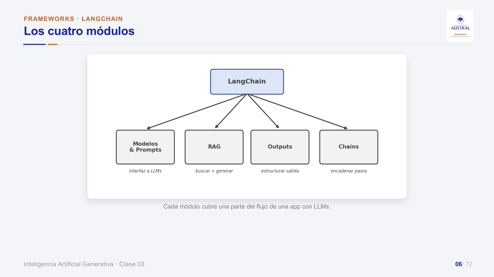
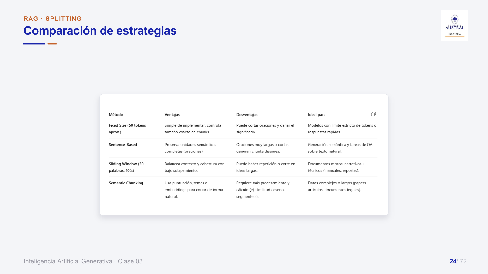
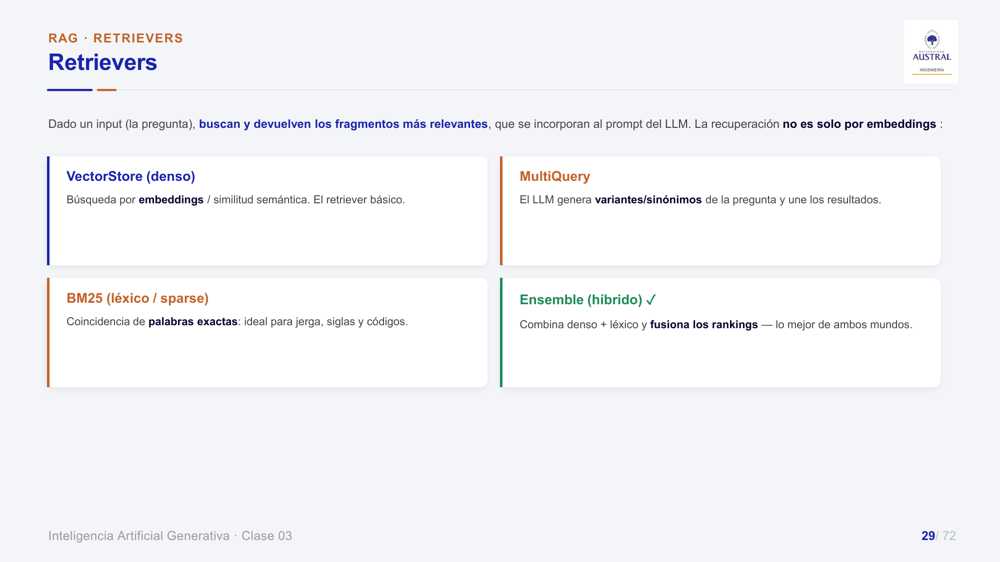

# Clase 34 · Frameworks: LangChain y RAG básico

> **Módulo 5 · IA Generativa** · Juan Pablo Sokil · martes 11-ago-2026
> **Fuentes:** transcripción `DIA_Clase_34.vtt` · láminas `2026_GENAI_Clase_03_Austral.pdf` · consigna `2026_GENAI_Clase_03_TP_RAG.pdf` · app web "Explorador RAG · Clase 03" (el notebook `2026_GENAI_Clase_03_Practica_RAG.ipynb` se mostró en clase pero no está entre las fuentes)

## En pocas palabras

- Subir todos los documentos como contexto en cada pregunta funciona con problemas chicos, pero desperdicia tokens y tiempo, y no escala cuando crecen los documentos o los usuarios. **RAG** está pensado justamente para eso: indexar una vez y recuperar en cada pregunta solo lo relevante.
- **LangChain** es un framework abierto y modular que ofrece una interfaz estándar para modelos, prompts, cargadores de documentos, embeddings, bases vectoriales y retrievers. Su gran ventaja es que permite cambiar de proveedor o de herramienta modificando una línea o un parámetro, y que el framework mantiene esas integraciones.
- Las láminas ordenan LangChain en **cuatro módulos**: modelos y prompts, RAG, outputs y chains. Un RAG básico recorre todos: cargar documentos, partirlos en chunks, vectorizarlos, guardarlos en un vector store, recuperar los top-k más parecidos a la pregunta y generar la respuesta con un formato de salida definido.
- El **chunking** es uno de los puntos críticos y no tiene fórmula mágica: según la estrategia (tamaño fijo, por oraciones, ventana deslizante, recursivo, semántico con un LLM) el mismo texto da chunks muy distintos. Como convención informal, se suele recomendar que un chunk no pase los ~500 tokens.
- En la práctica grupal (corpus de políticas de RRHH ficticias) se vio que el top-k, el tamaño del chunk y sobre todo la **instrucción del sistema** cambian mucho la respuesta, y que los embeddings modernos encuentran la información aun con sinónimos o preguntas rebuscadas: hay que forzarlos bastante para que fallen.

## Conceptos clave

### Por qué RAG y no "todo al contexto"

Repaso de la clase anterior: hay tres formas de lograr que un modelo responda lo que necesitamos.

| Técnica | Qué toca | Cuándo |
|---|---|---|
| Prompt engineering | Las instrucciones | La más accesible; resuelve gran parte de los problemas |
| RAG | La información que recibe el modelo | Cuando hay datos propios que el modelo no conoce (políticas internas, balances, protocolos) |
| Fine-tuning | Los pesos de la red | Casos muy específicos; con los modelos actuales se necesita cada vez menos |

Con pocos documentos se puede subir todo como contexto y funciona. El problema es que en cada pregunta el modelo recorre toda la base: cuesta más tokens (el precio suele ser la principal limitante) y más tiempo, y se vuelve inviable al escalar. En un RAG bien hecho los documentos se procesan **una sola vez** (se cargan, se limpian y se convierten en embeddings), y en cada consulta solo viajan al modelo los fragmentos relevantes.

### LangChain como framework

Desarrollar una app con LLM desde cero implica parametrizar prompts, integrar fuentes externas, mantener el contexto conversacional y manejar herramientas auxiliares. Los frameworks abstraen esa complejidad en módulos encadenables. LangChain ofrece:

- conexión a muchos proveedores de modelos, pagos y abiertos (OpenAI, Anthropic, Gemini/Vertex, Ollama, LM Studio, Groq, Hugging Face, Azure, Nvidia, etc.);
- plantillas de prompts (zero-shot, few-shot, chat, cadena de pensamiento);
- *document loaders*, embeddings, bases vectoriales y retrievers;
- memoria conversacional, y módulos para monitorear, calcular costos y depurar.

Lo más importante, según el profesor, es que **estandariza**: el mismo bloque de código sirve para distintos modelos o herramientas, cambiando solo un parámetro. Si se trabajara cada herramienta por separado, haría falta código específico para cada una, más difícil de mantener ante cualquier cambio de versión.



### Módulo 1: modelos y prompts

**El modelo.** Es el núcleo de cualquier app. LangChain da una interfaz unificada: se instancia el modelo definiendo nombre, temperatura, tokens máximos y reintentos, y si se necesita algo todavía más genérico, `init_chat_model` permite cambiar de proveedor con un parámetro (`model_provider`).

Para qué sirve poder cambiar de proveedor: además de comparar, como **buena práctica de producto** conviene tener un respaldo. Si un proveedor se cae o funciona mal, la app puede seguir dando servicio con otro.

**Prompt templates.** Plantillas reutilizables con *placeholders* (variables entre llaves) para los datos dinámicos. Ejemplo de las láminas:

```
"Eres un experto en atención al cliente. Responde la consulta: {pregunta}"
```

Todo el texto fijo es constante; `{pregunta}` cambia en cada consulta. Así se generaliza un prompt para todas las preguntas y se mantiene la consistencia de estilo y formato.

### Módulo 2: las etapas de un RAG

El RAG tiene dos grandes etapas, que ya se habían presentado en la Clase 33:

1. **Indexación** (se hace una vez): cargar los documentos, prepararlos y limpiarlos, partirlos en chunks, generar los embeddings y guardarlos en una base vectorial.
2. **Recuperación y generación** (en cada consulta): la pregunta se vectoriza, se buscan los chunks más parecidos, se agregan al prompt y el LLM genera la respuesta, con el formato de salida que corresponda.

#### Document loaders

Conectores que extraen datos de distintas fuentes (PDF, Word, TXT, CSV, HTML, JSON, Excel, PowerPoint, bases SQL y NoSQL, logs, páginas web) y los convierten en objetos `Document` (texto + metadatos). Cambiar de formato es, en general, cambiar el tipo de loader en un par de líneas.

Sobre PDF vs. Markdown (pregunta de un alumno): Markdown es más eficiente porque sus marcas indican qué es título, tabla o imagen. Pero la conversión no siempre sale bien; por ejemplo, si el PDF es en realidad una foto escaneada. La opinión del profesor fue que, si se tiene Markdown, mejor, pero que no siempre vale la pena convertir los PDF. Como en un RAG los documentos se procesan una sola vez, el costo extra de tokens del PDF pesa mucho menos que si se lo subiera como contexto en cada pregunta. Ese procesamiento puede incluir limpieza como la vista en NLP (caracteres invisibles, saltos de línea).

Los loaders también admiten audio y video. Con un modelo de embeddings multimodal (el profesor mencionó el más nuevo de Gemini), una misma base vectorial podría guardar texto, imágenes, audio y video. Ejemplo: un chatbot de onboarding que, ante "¿cómo pido un monitor?", devuelve el PDF del procedimiento y también un video con el paso a paso.

#### Splitting (chunking)

Antes de vectorizar, los documentos se parten en fragmentos. Hay dos motivos: los LLM tienen un límite de tokens (aunque cada vez más alto) y dividir en secciones lógicas mejora la relevancia de la búsqueda. El objetivo es que cada chunk sea **internamente consistente**, que hable de un tema y no de varios.

Ejemplo de clase: un texto con tres párrafos sin relación (la inhibición de la acetilcolinesterasa, un relato sobre una estación de tren bajo la lluvia y una descripción del sistema solar).

- **Tamaño fijo** (por ejemplo, 50 tokens): un chunk termina a mitad de la segunda oración ("…no imaginaba que") y el siguiente empieza truncado. Queda un chunk que mezcla dos temas, y eso es ruido.
- **Por oraciones**: cada chunk es una oración completa y mantiene una unidad semántica.
- **Ventana deslizante (con overlap)**: cada chunk repite el final del anterior (en la lámina, 30 tokens por ventana con 10 % de solapamiento), así no se pierde contexto en el borde.
- **Recursivo**: se pide un tamaño aproximado (por ejemplo, 500 caracteres) y una lista de separadores (punto, coma, punto y coma, salto de párrafo). El splitter corta cerca de esos signos, así que los chunks tienen tamaño variable pero sentido completo.
- **Semántico / basado en LLM**: se le pasa el texto a un modelo y se le pide dividirlo en bloques temáticamente coherentes. Por ejemplo, "estas tres oraciones son de un tema, estas dos de otro", y así propone cuatro chunks para un texto y ocho para otro. Suele funcionar mejor, pero agrega una etapa previa con más cómputo.

En este ejemplo de juguete, cortar en cada punto y aparte sería perfecto. Los textos reales están más mezclados, y una regla tan simple puede no alcanzar.



La lámina con un caso mínimo resume la idea: con tamaño fijo y sin overlap se cortan palabras ("La j / ornada"); con overlap, los chunks comparten borde; el recursivo respeta las oraciones.

#### Embeddings y vector store

Por cada chunk se genera un **embedding**: un vector que codifica su significado. Es la misma idea de los embeddings vistos en NLP, pero más modernos y a nivel de oración o párrafo, no de palabra. En el espacio vectorial, la distancia refleja el parecido ("I feel sad" queda cerca de "I feel happy" y lejos de "I travel around the world"). La consulta se proyecta en ese mismo espacio y se recuperan los vectores más cercanos (por similitud coseno).

Proveedores de embeddings, según las láminas:

| Tipo | Ejemplos | Características |
|---|---|---|
| APIs propietarias | OpenAI, Vertex, Cohere, Bedrock (AWS) | Fáciles de usar, pago por uso, sin infraestructura propia |
| Open source | SentenceTransformers, Llama, modelos de Hugging Face | Corren localmente, sin costo por uso, control total de los datos |

Bases vectoriales, de menor a mayor infraestructura:

| Tipo | Ejemplos | Uso |
|---|---|---|
| Locales sin infraestructura | FAISS, Chroma | Prototipos, notebooks; corren en memoria o en un archivo local |
| Persistentes embebidas | Chroma persistente | Una sola máquina, MVPs |
| SQL con soporte vectorial | PostgreSQL + pgvector (Supabase) | Lo relacional conocido + búsqueda semántica |
| NoSQL / distribuidas | Elasticsearch, Qdrant, Weaviate, Pinecone | Producción, grandes volúmenes, en la nube |

El profesor explicó la diferencia entre SQL clásico (tablas: columnas como variables, filas como casos) y NoSQL (los datos se guardan como bloques de texto con las variables adentro), que rinde mejor con millones de registros. Para pruebas de concepto se usan las opciones livianas, y recién cuando algo funciona se migra a una base más robusta.

#### Retrievers

Son los componentes que, dada la pregunta, devuelven los fragmentos más relevantes para el prompt. En esta clase solo se trabajó el **básico**: búsqueda densa por embeddings con un **top-k** que define cuántos chunks se recuperan. Las láminas ya presentan otros (BM25 léxico, MultiQuery y Ensemble híbrido), que quedaron para la clase siguiente.



### Módulo 3: outputs

Los *output parsers* hacen de puente entre el texto libre del LLM y los datos estructurados que necesita la aplicación. Se ubican después del LLM y además instruyen al modelo para que responda en el formato correcto.

Por qué importa: en un chat, el texto plano alcanza. Pero si la respuesta además se guarda en una base de datos (por ejemplo, con campos ID, fecha y respuesta, para analizar después qué pregunta la gente), un formato distinto hace que no se guarde o que el proceso se rompa. En una app, un output mal formado puede dejar la pantalla en blanco o mostrarle un error al usuario.

Tipos de parser según las láminas: texto plano (`StrOutputParser`), JSON/Pydantic validado contra un esquema, *structured output* (usa el *function calling* del modelo), lista/CSV, fecha/enum, DataFrame, XML/YAML, y parsers que reintentan o corrigen si la salida no valida. El ejemplo de las láminas define con Pydantic una clase `Diagnostico` (enfermedad, probabilidad, derivar) y usa `llm.with_structured_output(Diagnostico)` para recibir un objeto ya tipado.

### Módulo 4: chains

Una *chain* es una secuencia de pasos conectados donde la salida de un componente es la entrada del siguiente (prompt → LLM → parser → resultado). El RAG básico es una cadena secuencial: pregunta → embedding → búsqueda → contexto al LLM → respuesta. Pero los pasos también pueden correr en paralelo; por ejemplo, la búsqueda léxica y la semántica de un esquema híbrido.

Patrones de las láminas: **secuencial**, **paralela** (`RunnableParallel`), **router** (un paso elige la rama según el input, como "soporte" o "ventas") y **RAG chain** (retriever → prompt → model → parser). En LangChain se componen con el operador `|` (LCEL): `chain = prompt | model | parser`, que trae de regalo `invoke`, `stream` y `batch`.

## Ejemplos y casos de la clase

- **Call center encadenado**: entra el audio de una llamada, un modelo de transcripción lo pasa a texto, un LLM identifica el motivo y el sentimiento, y según eso la cadena sigue por caminos distintos. Por ejemplo, si el cliente está enojado por un aumento, otro LLM busca una promoción para ofrecerle. Muestra que las chains no se limitan a RAG. La lámina equivalente es un asistente de voz: voz → texto → LLM → herramienta o base de conocimiento → texto a voz.
- **Comparar ~30 modelos de embeddings**: en un proyecto del profesor se etiquetaron documentos con "ante esta pregunta, tiene que recuperar estos tres", y se probaron casi 30 modelos de embeddings para elegir el que mejor recuperaba. Con LangChain bastó iterar sobre una lista de modelos con poco código.
- **Explorador de chunking en vivo** (chunkers.vercel.app): con un fragmento de una noticia de fútbol, la estrategia por párrafos dio 3 chunks, la de oraciones 16 y la recursiva 3. La de Markdown dio un solo chunk, porque el texto copiado de la web no tenía marcas Markdown. Enseña cuánto cambia el resultado según la estrategia.
- **Claude Code vs. un RAG propio** (pregunta de alumnos): Claude Code, Codex o los proyectos de ChatGPT ya son agentes que hacen este trabajo por dentro, pero están pensados para uso personal y atados a una suscripción. Para un producto que use toda una empresa (por ejemplo, un chat interno) hay que construir algo independiente de esas herramientas, en general consumiendo una API que cobra por uso. La idea de la clase es entender qué pasa por detrás.
- **Privacidad en pymes** (pregunta de un alumno): para el profesor no tiene sentido que una pyme mediana corra modelos locales solo por miedo a que el proveedor lea sus manuales. Las empresas ya suben su documentación a Microsoft o Google Drive, y un empleado puede subir un PDF a su cuenta personal igual.

## Práctica

**TP RAG** sobre un corpus de políticas de RRHH **ficticias y a propósito absurdas**, para que quede claro que la respuesta sale del RAG y no del conocimiento previo del modelo. Por ejemplo, cinco días de licencia paga por enfermedad de la mascota o el reembolso de café premium. Se puede hacer con una **app web** (Explorador RAG, con FAISS por detrás) o con el notebook en Colab o Jupyter; ambos hacen lo mismo. En la app se elige el tamaño del chunk (que se aplica al cargar el corpus, así que hay que vaciar la sesión y recargar), el top-k (que se aplica en cada pregunta) y la instrucción del sistema, que arranca vacía. Además, muestra qué chunks se inyectaron con su *similarity score* y cómo se arma el prompt: instrucciones + chunks + pregunta.

| Consigna | Qué se varía | Pregunta de prueba |
|---|---|---|
| 1. Top-k | 1, 2 y 3 chunks | ¿Qué políticas sobre mascotas existen? |
| 2. Tamaño del chunk | 300 vs. 1200 con top-k = 1 | ¿Qué dice la política de vacaciones extensas? |
| 3. Respuesta ausente | Instrucción honesta vs. "respondé siempre con un número" | ¿Cuál es el sueldo de un gerente? |
| 4. Buscar por significado | Sinónimos y términos rebuscados, top-k = 3 | ¿La empresa me devuelve la plata que gasto en café? |
| 5. Documento nuevo | Subir un archivo propio | Preguntar por su contenido; ver si lo cita |

Lo que salió en la puesta en común:

- **Formato**: con top-k = 3, un grupo veía respuestas con asteriscos y el nombre del PDF entre paréntesis, y con menos chunks no. No es un efecto del top-k en sí, sino de no haber especificado el output. Al agregar en el sistema "sin bullets ni numeración, fuentes al final", la respuesta salió en texto corrido (más prolija, aunque menos linda).
- **Variabilidad**: al repetir la misma pregunta cambiaban algunas palabras. Es por el LLM y la **temperatura**, que la app no fija a propósito. Con temperatura 0 la respuesta sería prácticamente siempre la misma. El profesor dijo que el valor por defecto es "0,3 o 0,5", sin certeza (dato dudoso).
- **Instrucción del sistema**: un grupo escribió "respondé con un número" y el modelo empezó a contestar solo un número (un "0" para el sueldo del gerente). Hubo que reformular a "incluí números en la respuesta". La instrucción del sistema es el lineamiento más fuerte y casi siempre prima sobre lo que se pide en el chat.
- **Límites de la búsqueda semántica**: preguntando por infusiones, bebidas calientes o lácteos, el retriever siempre encontraba la política del café. Recién con "¿me reintegran los americanos?" falló: el modelo respondió que no había información sobre el reintegro a empleados americanos. Hubo que ir a un extremo muy tosco para que los embeddings fallen.
- Con chunk size 300, el corpus de la app quedó en 57 chunks. En el notebook, según la estrategia de splitting, el mismo material daba entre 68 y 157 chunks.

## Para recordar

- "No hay una fórmula mágica" para el chunking: depende del texto. Como convención, en lo posible chunks de no más de ~500 tokens, uno de esos "números mágicos" que todos aceptan sin saber bien por qué.
- Si en un producto el formato de salida no se respeta, la app se puede romper. El output no es un detalle cuando hay un sistema esperando la respuesta.
- Tener un proveedor de respaldo es una buena práctica: si el modelo principal se cae, la app sigue funcionando.
- La instrucción del sistema manda. Una palabra mal elegida ("respondé con" en vez de "incluí") cambia el comportamiento por completo.
- Si la respuesta tiene que ser estable, hay que fijar la temperatura en 0.
- Para un chat expuesto al público hay que preocuparse por las respuestas ambiguas y por el *prompt injection* (reformular la pregunta hasta que el modelo diga lo que no debe). Los *guardrails* quedan para el final del módulo.
- Primero se prueba con herramientas livianas (FAISS, Chroma en memoria) y, cuando funciona, se migra a una base robusta.

## Preguntas de repaso

<details><summary>1. ¿Por qué un RAG es más eficiente que subir todos los documentos como contexto en cada pregunta?</summary>

Porque los documentos se procesan una sola vez (carga, limpieza, chunking, embeddings) y en cada consulta solo viajan al modelo los fragmentos relevantes. Subir todo cada vez gasta muchos más tokens y tiempo, y deja de ser viable cuando crecen los documentos o los usuarios.

</details>

<details><summary>2. ¿Cuál es la principal ventaja de usar LangChain frente a programar contra cada proveedor por separado?</summary>

La estandarización: el mismo código sirve para distintos modelos, embeddings o bases vectoriales cambiando un parámetro, y el framework mantiene las integraciones cuando los proveedores cambian. Eso facilita comparar alternativas (como los ~30 modelos de embeddings) y tener un proveedor de respaldo.

</details>

<details><summary>3. En el texto con tres párrafos sin relación, ¿por qué el chunking de tamaño fijo genera ruido y qué estrategias lo evitan?</summary>

Porque corta sin mirar el contenido: un chunk termina a mitad de una oración y mezcla dos temas, así que su embedding no representa bien a ninguno. Lo evitan el corte por oraciones, el recursivo (que corta cerca de signos de puntuación), el overlap (que conserva el borde) o el semántico con un LLM.

</details>

<details><summary>4. ¿Qué gana y qué cuesta el chunking semántico basado en un LLM?</summary>

Gana chunks temáticamente coherentes, con una cantidad adaptada a cada texto. Cuesta una etapa previa extra: hay que pasar el texto por un modelo para identificar los temas, con más procesamiento y costo.

</details>

<details><summary>5. ¿Por qué el output parser es crítico en una aplicación productiva y no tanto en un chat?</summary>

En un chat, una persona entiende el texto aunque el formato varíe. Si la respuesta va a una base de datos u otro sistema, tiene que respetar una estructura exacta (por ejemplo, ID, fecha y respuesta). Si no la respeta, el dato no se guarda o el proceso falla y se muestra un error.

</details>

<details><summary>6. En la consigna 1, las respuestas con top-k = 3 venían con asteriscos y citas entre paréntesis. ¿Cuál era la causa y cómo se resolvió?</summary>

No se le había indicado al modelo un formato de salida, así que formateaba a su criterio. Se resolvió especificando en la instrucción del sistema el formato deseado (sin bullets ni numeración, fuentes al final).

</details>

<details><summary>7. ¿Qué muestra el experimento de la política del café sobre la búsqueda por embeddings?</summary>

Que los embeddings modernos capturan el significado: encuentran la política aunque se pregunte con sinónimos (infusiones, bebidas calientes). Solo fallan en casos extremos y ambiguos, como "americanos", que el sistema interpretó como personas y no como un tipo de café.

</details>

<details><summary>8. ¿Por qué Claude Code o ChatGPT no reemplazan a un RAG propio para un chatbot corporativo?</summary>

Porque son herramientas personales, atadas a una cuenta y a una suscripción, y no están pensadas para dar un servicio continuo a muchas personas. Para un producto hay que construir algo independiente de esas herramientas, que consuma una API pagando por uso.

</details>

## Conexiones

- **Clase 33**: presentó prompt engineering, RAG y fine-tuning, y las dos etapas del RAG (indexación y recuperación). Esta clase baja el RAG a componentes concretos con LangChain.
- **Clase 35**: continúa con lo que en esta quedó solo en las láminas: retrievers BM25, MultiQuery y Ensemble, búsqueda híbrida con RRF, reranking con cross-encoder, filtrado por metadata, HyDE, RAG-Fusion, Contextual Retrieval y GraphRAG. El cierre del RAG y la entrada a agentes quedaron anunciados para el jueves.
- **Módulo de NLP**: los embeddings de palabras y la limpieza de texto son la base de los embeddings de oraciones y del preprocesamiento de documentos.
- **TFI**: el retriever básico por embeddings que se usó acá es la variante **semántica** del retrieval del TFI (normalización de nombres comerciales en Benefix). El ejercicio de los ~30 modelos de embeddings, con un set etiquetado de "qué documentos debe recuperar cada pregunta", es el mismo esquema de evaluación que miden Hit@k y MRR. El caso "americanos" ilustra por qué conviene combinar lo semántico con lo léxico (búsqueda híbrida con RRF, Clase 35).
