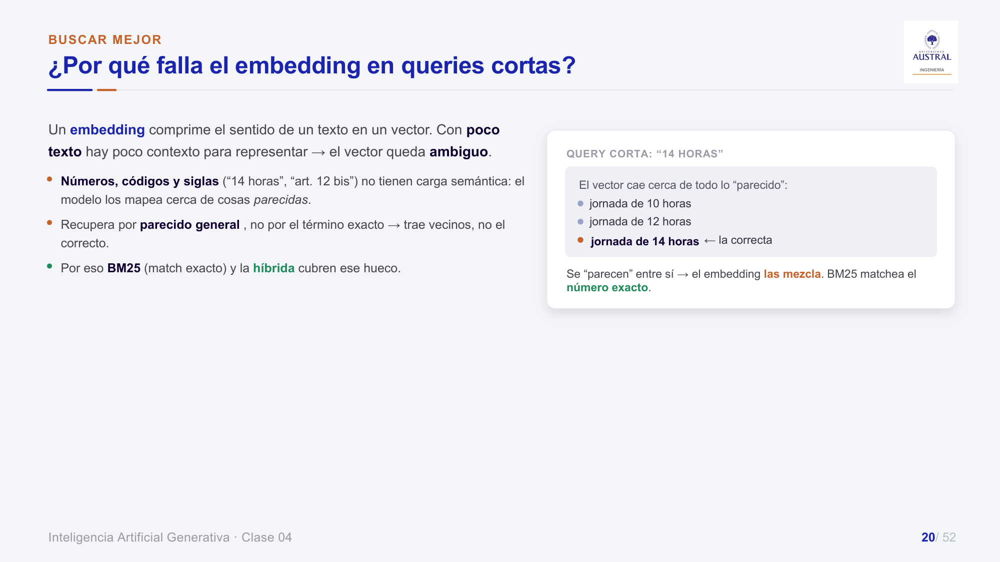
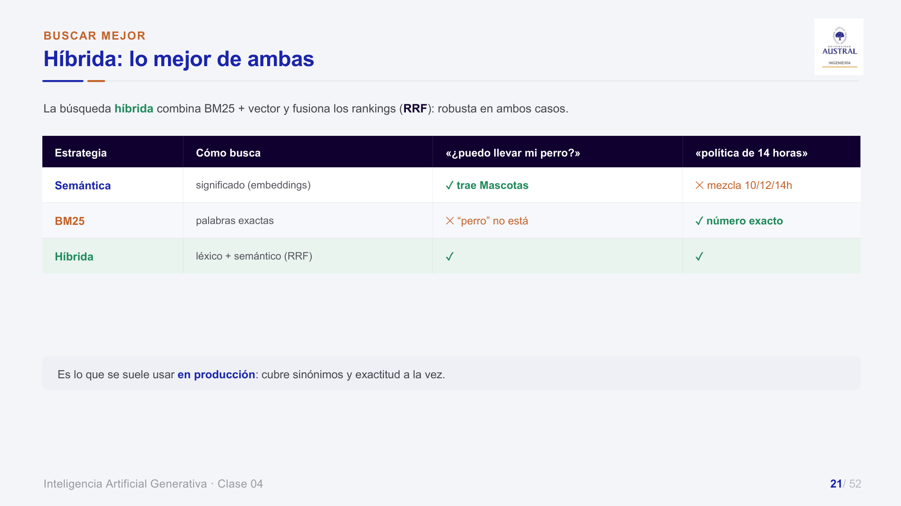
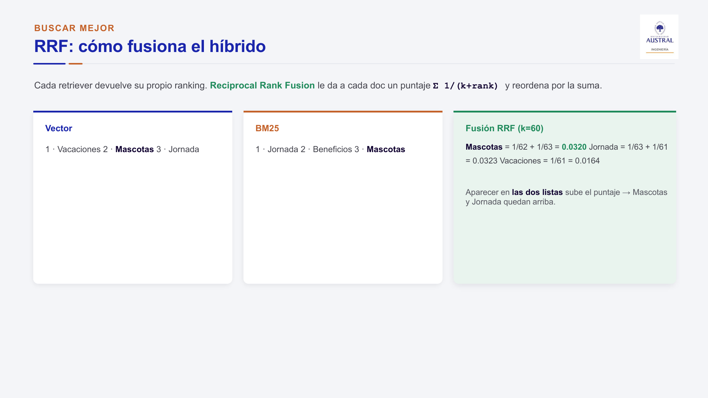
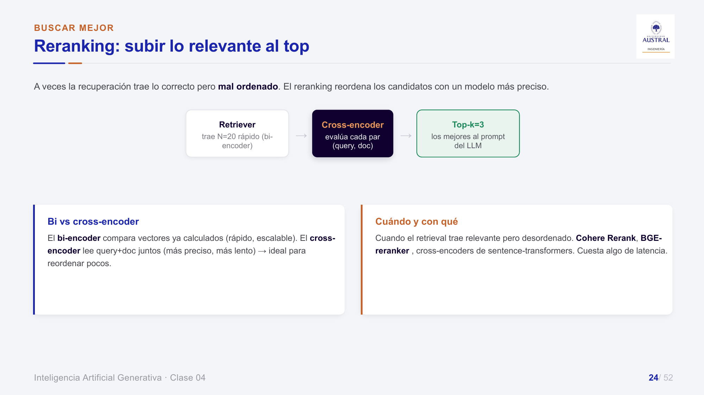
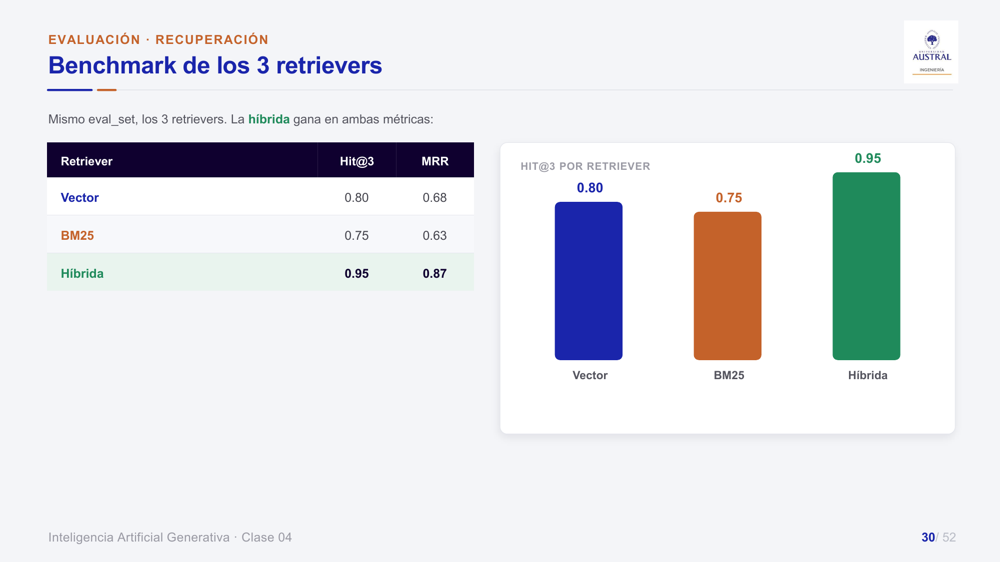
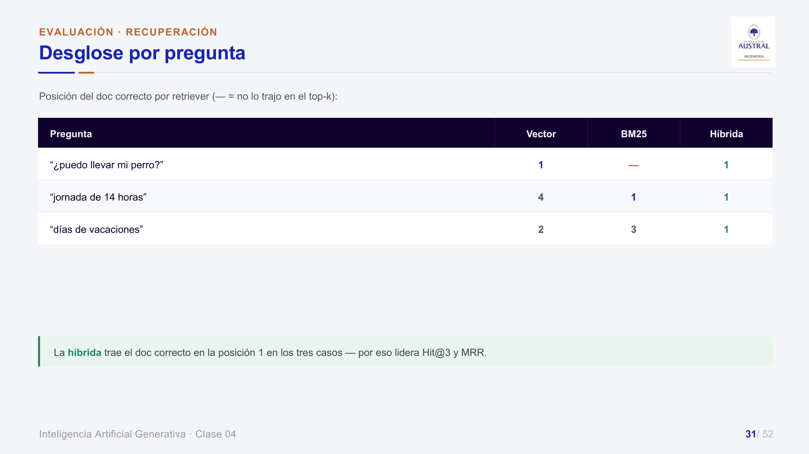

# Clase 35 · RAG avanzado, evaluación de retrievers e introducción a agentes

> **Módulo 5 · IA Generativa** · Juan Pablo Sokil · jueves 13-ago-2026
> **Fuentes:** transcripción `DIA_Clase_35.vtt` · láminas `2026_GENAI_Clase_04_Austral.pdf` ("RAG en la práctica y producción") · sección "RAG avanzado" de `2026_GENAI_Clase_03_Austral.pdf` (carpeta Clase 34, mostrada en esta clase) · primeras láminas de `2026_GENAI_Clase_06_Austral.pdf` ("Introducción a Agentes", carpeta Clase 36)

## En pocas palabras

- Un asistente de programación (Claude Code, Codex, Antigravity) alcanza para un uso personal con pocos documentos. Si hay muchos datos, muchos usuarios a la vez o hace falta medir la calidad, conviene un RAG propio servido por API: se puede paralelizar, cumple los términos de uso y se puede evaluar con métricas.
- La búsqueda por embeddings funciona bien en la gran mayoría de los casos, pero falla con **términos exactos** (códigos, números, siglas). La **búsqueda híbrida** corre en paralelo un buscador léxico (BM25) y uno semántico, y fusiona los dos rankings con **RRF**. Es barata y suele ser lo que se usa en producción.
- Hay otras mejoras sobre el RAG básico: filtrado por metadata, reranking, HyDE, Contextual Retrieval y GraphRAG. Cada una resuelve un problema puntual y agrega costo o complejidad. Solo se justifican si ese problema aparece.
- Un RAG se evalúa por dos lados. La **recuperación** se mide contra un `eval_set` etiquetado con **Hit Rate@k** (¿el documento correcto está en el top-k?) y **MRR** (¿en qué posición aparece?). La **respuesta** se evalúa con un LLM como juez (RAGAS). Las configuraciones se comparan cambiando una sola cosa por vez.
- Primer contacto con **agentes**: un agente es un LLM que, además de responder, **ejecuta**. Tiene modelo, herramientas, memoria y planificación. Si el proceso siempre es el mismo, alcanza con un flujo fijo. Conviene un agente cuando el camino depende de cada caso.

## Conceptos clave

### RAG propio vs. asistentes de programación

Las láminas de este tema no están en el material. Para cerrar una discusión que venía de clases anteriores, el profesor planteó la pregunta: ¿para qué armar un RAG si se le pueden pasar carpetas a Claude Code y las analiza bien?

| Criterio | Asistente de programación (Claude Code, Codex…) | RAG como servicio (API) |
|---|---|---|
| Volumen | Bien con pocos documentos. Con muchos tarda y puede quedarse sin tokens | Escala a muchos documentos (el ejemplo fue un RAG sobre 200.000 sentencias judiciales) |
| Cómo busca | Lee y busca palabras clave, parecido a BM25 | Embeddings y búsqueda vectorial, más la estrategia que se elija |
| Concurrencia | Atiende los pedidos de a uno, en una sesión. El décimo pedido espera a los otros nueve | Por API se pueden atender en paralelo hasta miles de llamadas |
| Términos de uso | Según el profesor, desde abril de 2026 Anthropic prohíbe usar Claude Code como backend de una app productiva | Se usa la API con tarifa variable, que es el uso previsto |
| Medición | No hay trazabilidad ni métricas cuantificables | Se puede medir con Hit Rate, MRR, RAGAS |

El criterio que dio: si el problema es propio y chico, la programación asistida lo resuelve con menos trabajo. Si es algo que va a usar más gente, que tiene mucha información o que hay que defender ante otro equipo con números, conviene un RAG propio. Las métricas "le dan validez al sistema" y sirven como argumento.

**Mapa de herramientas** que se repasó:
- **LangChain**: framework multiproveedor. Encapsula los SDK de cada empresa (OpenAI, Anthropic, Gemini, AWS, Azure) detrás de un código estándar. Para cambiar de proveedor se tocan uno o dos parámetros. Si se usa el SDK de un solo proveedor, migrar obliga a reescribir.
- **SDK de cada proveedor** (*Software Development Kit*): conviene si se sabe que se va a trabajar con un único proveedor.
- **LangGraph**: producto paralelo de LangChain especializado en agentes. Es menos genérico, pero está pensado para eso.
- **Asistentes de programación**: están pensados para **generar el código** de cualquiera de los anteriores, que después se despliega en una infraestructura propia. No están pensados para ser el backend.

Por dentro, Claude Code o Codex son **sistemas multiagente**. El usuario habla con un **orquestador**, que reparte el trabajo entre subagentes especializados (uno revisa código, otro "raspa" páginas web, etc.). El tema se retoma en el submódulo de agentes. El profesor aclaró que esta comparación vale para agosto de 2026 y puede quedar obsoleta en pocos meses.

### Búsqueda léxica (BM25) vs. semántica

- **Semántica (embeddings + similitud coseno)**: busca por significado. Capta sinónimos y paráfrasis. Por ejemplo, "¿puedo llevar mi perro?" encuentra "Permisos por Mascotas".
- **BM25 (léxica)**: busca palabras exactas, sin embeddings. Por dentro convierte el corpus en una representación tipo *Bag-of-Words* (cada palabra una columna, cada documento una fila; se vio en el módulo de NLP) y busca qué documentos contienen las palabras de la consulta. Si se busca "perro", no devuelve "canino".

Parece una técnica "de la prehistoria", pero gana cuando lo que importa es el **término exacto**: el formulario RF-103, el caso A-702/7, un "art. 12 bis".

*Un embedding comprime el sentido de un texto en un vector. Con poco texto queda ambiguo. Números, códigos y siglas no tienen carga semántica: "jornada de 14 horas" cae cerca de 10 h y 12 h, porque "se parecen". El embedding trae vecinos, no el correcto.*

### Búsqueda híbrida y RRF

Ante una consulta se lanzan **dos procesos en paralelo**, BM25 y búsqueda vectorial. Cada uno devuelve su ranking, y **RRF (*Reciprocal Rank Fusion*)** los fusiona. Por ejemplo, con top-3 se toman 3 candidatos de cada lado, se juntan y se eligen los 3 mejores para pasarle al LLM.

RRF usa **posiciones, no puntajes**. Así esquiva el problema de que los scores de BM25 y los de coseno están en escalas distintas:

$$\text{score}_{RRF}(d) = \sum_{i} \frac{1}{k + \text{rank}_i(d)}, \qquad k = 60$$

*En el ejemplo de la lámina, Mascotas (2.º en vector, 3.º en BM25) suma 1/62 + 1/63 = 0,0320 y Jornada (3.º y 1.º) suma 0,0323. Vacaciones aparece solo en una lista (1.ª en vector) y suma 1/61 = 0,0164. Aparecer en las dos listas es lo que sube el puntaje.*

En el notebook del deck, los tres retrievers comparten interfaz. El `EnsembleRetriever` de LangChain combina el denso y el léxico con `weights=[0.5, 0.5]` y fusiona con RRF.

Cuándo conviene: según el profesor, entre el 90 y el 95 % de las veces el embedding solo funciona bien. La híbrida rescata los "casitos testigo" de términos exactos, por ejemplo en *information retrieval*, papers científicos o documentación legal. Es de las técnicas más usadas porque es poco costosa.

### Filtrado por metadata

Cada chunk guarda metadatos (fuente, fecha, área, permisos), y el retriever **filtra antes de rankear** por similitud.
- Ejemplo de clase: en vez de borrar las políticas viejas, cada año se reindexan las vigentes con `año = 2026` en la metadata y se filtra por ese valor. Es "más desprolijo", pero evita el mantenimiento.
- Ejemplo de la lámina: "¿cuántos días de vacaciones?" sin filtro mezcla chunks de 2019, 2021 y 2024. Con `filter={"año": 2024, "área": "RRHH"}` recupera solo la política vigente.
- Tiene dos beneficios: **tiempo**, porque busca sobre un subconjunto, y **calidad**, porque con menos candidatos hay menos posibilidades de confundirse. Además habilita **control de acceso**: cada usuario recupera solo lo que puede ver.

### Reranking

Es una segunda etapa después de la recuperación. Sirve cuando el retriever trae lo correcto pero **mal ordenado**.

- El **bi-encoder** compara vectores ya calculados: es rápido y escalable, y trae, por ejemplo, N = 20 candidatos.
- El **cross-encoder** lee la consulta y el documento juntos. Es más preciso y más lento, así que sirve para reordenar pocos y quedarse con el top-k que va al prompt.
- Herramientas que menciona la lámina: Cohere Rerank, BGE-reranker, cross-encoders de sentence-transformers.
- El profesor lo ubicó como técnica para **problemas complejos**: "no te lo resuelve, pero te acomoda los resultados para que resolverlo sea más fácil". Su costo es más latencia.

### HyDE (*Hypothetical Document Embeddings*)

Un LLM genera una **respuesta hipotética** a la pregunta, y se busca con el embedding de esa respuesta en lugar del de la pregunta. Un documento hipotético se parece más a los documentos reales que una pregunta corta. Sirve para preguntas cortas o ambiguas, y cuesta una llamada extra al LLM. El profesor lo calificó de "rebuscado", pero dijo que en ciertos contextos marca la diferencia.

### Contextual Retrieval (Anthropic)

A cada chunk se le **antepone un breve contexto** generado por un LLM que lo ubica dentro del documento, y después se embebe el chunk enriquecido.
- Ejemplo: el chunk "Esto redujo el costo a la mitad" no dice nada por sí solo. Con el agregado "[En la sección de entrenamiento del Transformer]", una pregunta sobre el costo de entrenamiento del Transformer sí lo recupera.
- Rompe con la búsqueda del "tamaño óptimo de chunk": usa chunks muy chicos y les suma contexto.
- Pregunta en clase: ¿genera más chunks? No. Se generan los chunks y a cada uno se le agrega el contexto entre corchetes, para que el modelo sepa que es información agregada. Ese contexto puede variar por sección.
- Costo: suma tokens a todos los chunks, así que es más caro. El profesor la usó en un caso real con textos muy largos.

### GraphRAG

En lugar de chunks lineales, el conocimiento se modela como un **grafo**: un LLM extrae triples (sujeto, relación, objeto) y, ante una pregunta, se recupera el subgrafo relevante.
- Ejemplo médico: fiebre, tos y dificultad para respirar tienen, cada uno, muchísimas causas posibles. Combinados, apuntan a pocas. El grafo permite cruzar esas relaciones.
- Sirve para preguntas **relacionales o multi-hop**, por ejemplo "¿qué permite la paralelización en el Transformer?", que se responde recorriendo Transformer → usa → self-attention → permite → paralelización.
- Herramientas que menciona la lámina: Neo4j + Cypher, Microsoft GraphRAG, LightRAG (más liviano, con indexación incremental).
- Tiene un nivel de complejidad que solo se justifica en problemas muy complejos o con fuentes muy distintas que hay que vincular.

### Cómo se evalúa un RAG

Son **dos preguntas distintas** y se miden por separado. Si la recuperación falla, ninguna redacción salva la respuesta.

| Lado | Pregunta | Cómo se mide |
|---|---|---|
| Recuperación | ¿Trajo el documento correcto? | Contra un `eval_set` etiquetado (pregunta → documento correcto): Hit Rate@k, MRR |
| Respuesta | ¿Es correcta y está fundada? | LLM como juez (RAGAS) |

**De dónde vienen las métricas.** Los modelos de embeddings se validan contra datasets de preguntas con su respuesta conocida. Como no hay una única respuesta "exacta", se usan umbrales: ¿la mejor respuesta salió primera? ¿Está entre las 5 primeras? ¿Entre las 10?

**Hit Rate@k.** Es un sí/no por pregunta: ¿el documento correcto está en el top-k? La métrica es el promedio. Con k más alto es más fácil "acertar", pero se trae más ruido.

**MRR (*Mean Reciprocal Rank*).** Mide en qué posición aparece el documento correcto. Para cada pregunta se calcula 1/posición del primer documento correcto, y se promedia:

$$\text{MRR} = \frac{1}{|Q|}\sum_{q \in Q} \frac{1}{\text{rank}_q}$$

Ejemplo de la lámina: posiciones 1, 3 y 2 → (1,00 + 0,33 + 0,50)/3 = **0,61**. En palabras del profesor, las dos métricas "apuntan a lo mismo desde ópticas distintas": Hit Rate dice *si está*, MRR dice *qué tan arriba*.

| Retriever | Hit@3 | MRR |
|---|---:|---:|
| Vector | 0,80 | 0,68 |
| BM25 | 0,75 | 0,63 |
| **Híbrida** | **0,95** | **0,87** |

*El desglose explica el resultado agregado. Cada retriever puro falla en un tipo de pregunta: BM25 no trae "perro" y el vector deja "14 horas" en la posición 4. La híbrida pone el documento correcto primero en los tres casos.*

**RAGAS / LLM como juez.** Otro LLM evalúa la respuesta a partir de (pregunta, respuesta, contexto, referencia). Idealmente es **de otro proveedor** que el que generó la respuesta. Las cuatro métricas de la lámina son:
- *Faithfulness*: ¿la respuesta se apoya en el contexto? Detecta alucinaciones.
- *Answer Relevancy*: ¿responde lo que se preguntó?
- *Context Precision*: ¿lo recuperado es relevante, con poco ruido?
- *Context Recall*: ¿trajo todo lo necesario?

Lo ideal sería que la validación la hiciera una persona, pero con grandes volúmenes no es posible. El juez agrega certeza a cambio de más costo y más latencia. Se retoma en sistemas multiagente.

**Decidir con números.** Se cambia **una cosa por vez** y se mide. La lámina compara una Config A (chunking simple, sin reranking), con un score global RAGAS de 0,68, contra una Config B (chunk + overlap + reranking), con 0,92 (▲ +0,24). Lo mismo vale para el chunking: "no se adivina: se mide con Hit Rate/MRR sobre el `eval_set` y se ajusta". Punto de partida sugerido en la lámina: 500–800 tokens de chunk y 10–15 % de overlap.

### Elegir modelo de embeddings: los rankings

En Hugging Face hay rankings (*benchmarks*) de modelos de embeddings, separados por tarea (retrieval, reranking, cross-lingual), por idioma y por dominio (por ejemplo, legal). Lo que se observó en clase, a la fecha de la clase:
- En el ranking multilenguaje, el embedding de Google estaba en el puesto 5 y los de OpenAI mucho más abajo (el profesor mencionó el puesto 42).
- Un modelo chico y abierto (EmbeddingGemma, de unos 300 millones de parámetros) superaba a los de OpenAI. Arriba del ranking aparecían modelos abiertos: Qwen, Nemotron de NVIDIA y uno de Microsoft.
- El orden **cambia según la tarea**: el mejor en promedio no es necesariamente el mejor en reranking o en recuperación entre idiomas.

Criterio: los rankings orientan, pero hay que probar sobre los datos propios. Si solo se puede pagar una API, para embeddings Gemini rinde mejor que OpenAI. Igual, si toda la arquitectura ya está en un proveedor, el cambio puede no valer la pena.

### Introducción a agentes

**De LLM a agente.** Un LLM solo responde con lo que sabe. Un agente **ejecuta**: si no sabe la respuesta, sale a buscarla. Pasa de ser un ente pasivo a uno activo. La analogía de clase: el LLM es un supercerebro, y el agente es ese cerebro "con manos". Por ejemplo, hace dos años un LLM no podía dar el precio del dólar de hoy; hoy lo consulta.

**Evolución de los chatbots:**

| Nivel | Entiende | Actúa |
|---|---|---|
| Reglas | Palabras clave, menú ("apretá 1, 2 o 3") | Opciones fijas. "Nunca tienen la opción que queremos" |
| NLU (*Natural Language Understanding*) | Intención (*intent*) y entidades a partir de texto libre | Flujos prediseñados. Por detrás sigue siendo la botonera, "una cortina" |
| Agente con LLM | Objetivo y contexto completo | Arma su propio flujo y ejecuta (llama a una API para dar de baja un servicio, por ejemplo) |

**Agente de IA vs. IA agéntica.** En el primer caso el usuario interactúa con un agente que resuelve. En la IA agéntica, ese agente a su vez interactúa con otros agentes, sin intervención humana. Ejemplo: el usuario pide la baja; el agente consulta a un agente de promociones ("a este no le doy promo porque se atrasa en los pagos") y después al agente que ejecuta la baja. Es la base de los sistemas multiagente.

**¿Cuándo conviene un agente?** Si el pipeline es fijo y siempre pasa lo mismo, alcanza con automatizar los pasos (un script de Python, n8n). Conviene un agente cuando, según el caso, pueden pasar cosas distintas.

**Anatomía del agente:**
- **Modelo (LLM)**: el cerebro.
- **Herramientas (*tools*)**: las manos. Puede ser casi cualquier cosa: una request a una API (dólar, clima), una consulta a la base de datos de la empresa, una función de Python.
- **Memoria**: permite una charla y no preguntas sueltas. Después de "¿clima en Buenos Aires?", la pregunta "¿y el de Venecia?" se entiende como otra consulta de clima y reutiliza la misma API.
- **Planificación / orquestación**: decide qué pasos dar y cuándo usar una tool. Ejemplo: el clima de hace 20 años lo puede responder con lo que sabe. Si se le pide el dato día por día, re-planifica y sale a buscar una fuente.

## Ejemplos y casos de la clase

- **Repaso del TP1 de RAG** (explorador con 25 políticas cortas de RR. HH.). Se podía jugar con el tamaño de chunk, la cantidad de chunks recuperados y el prompt de sistema. Mostró que la información partida en varios chunks queda incompleta si se trae uno solo. También que el prompt de sistema "siempre prima" y que el modelo entiende paráfrasis ("latte", "infusión"), pero falla con usos coloquiales como "americano" en vez de "café americano".
- **Demo de tres retrievers en paralelo** (vector, BM25, híbrida) sobre las mismas políticas:
  - "¿Se trabaja de madrugada?" con k = 1: solo el semántico lo encuentra, porque el documento dice "horario nocturno de 22:00 a 06:00" y no "madrugada". BM25 falla, y la híbrida también, porque con un solo chunk priorizó el de BM25. Con k = 3, los tres lo recuperan.
  - Formulario "RH-207" con k = 1: el semántico trae el chunk del RH-204 (se "parece") y el LLM responde que no está. BM25 lo encuentra por el código exacto. Escrito sin guion también lo encontró, contra lo que esperaba el profesor.
- **RAG legal** (hipotético): 200.000 sentencias para armar una defensa. Sirvió para justificar el RAG propio por volumen, y la búsqueda híbrida para encontrar un número de causa exacto.
- **Políticas indexadas por año**: el filtrado por metadata como alternativa al mantenimiento de la base.
- **Grafo de diagnósticos médicos sobre SNOMED** (nomenclador de diagnósticos, síntomas y procedimientos). Al navegar nodos como "hemorragia" se ven sus vínculos (por ejemplo, con un tipo de endoscopía o con sepsis). Ilustra cómo un grafo combina síntomas que por separado "pueden significar mil cosas".
- **Facturas en una casilla de mail** (pregunta de un alumno). Si siempre llegan facturas y hay que extraer proveedor y monto, alcanza con un flujo y una llamada a un LLM con un prompt preciso. Si llegan facturas *y* remitos, si hay que vincularlos o si hay que derivar según el monto, empieza a convenir un agente que decida el camino. El profesor reconoció que el límite es sutil y depende del diseño.

## Práctica

No hubo notebook en vivo. El trabajo práctico de RAG de la clase anterior queda abierto para explorar y no es obligatorio entregarlo. La solución se sube la clase siguiente.

**Material de las láminas que no se vio en clase** (para estudiar por cuenta propia):
- **RAG con n8n**. Son dos workflows: *Indexar*, que se corre una vez (URL → chunking 1000/100 → `text-embedding-3-small` → vector store en memoria con `memoryKey = rag_demo`), y *Chat* (pregunta → retriever → Retrieval QA chain con `gpt-4.1-mini`). Hay una versión avanzada con AI Agent, memoria de 6 turnos y citas de la fuente. La regla de la lámina: se prototipa en n8n y, si el caso crece, se pasa a código.
- **De prototipo a producción (`rag-demo`)**: React + FastAPI (endpoint `POST /ask` que devuelve respuesta y fuentes) + Qdrant con volumen persistente, todo levantado con `docker compose up`. También incluye streaming y citas en la UI, cómo actualizar el conocimiento (agregar documentos → re-ingesta → re-index, sin reentrenar), un checklist de producción (índice persistente, deduplicación, reintentos, secretos en `.env`, monitoreo), costos y latencia, y seguridad (datos sensibles, control de acceso por metadata, *prompt injection*: "tratá el contexto como datos, no instrucciones").

## Para recordar

- La pregunta no es "¿RAG o Claude Code?", sino cuántos datos hay, cuántos usuarios y si hace falta medir.
- "Hay determinados escenarios en los que esas cosas superrústicas funcionan mejor": BM25 no es obsoleto cuando se buscan términos exactos.
- RRF fusiona **posiciones**, no puntajes, así que no hace falta normalizar escalas.
- Las técnicas avanzadas (reranking, HyDE, Contextual Retrieval, GraphRAG) existen y se usan, pero "no te vayas a la NASA" para un problema que se resuelve con algo sencillo.
- Hit Rate dice si lo encontró, MRR dice si lo puso arriba. Conviene reportar las dos y mirar el desglose por pregunta.
- Se cambia una sola cosa por vez y se mide sobre el `eval_set`. "No se adivina".
- Los rankings de embeddings orientan, pero la prueba final es sobre los datos propios.
- Si el flujo se puede dibujar antes de ejecutarlo y siempre es igual, no hace falta un agente.

## Preguntas de repaso

1. ¿En qué situación conviene armar un RAG propio en vez de pasarle los documentos a un asistente como Claude Code?

Cuando hay mucho volumen de documentos, cuando lo van a usar muchas personas a la vez (por API se paraleliza; el asistente atiende de a un pedido por sesión), cuando hay que respetar los términos de uso en un producto corporativo, o cuando hace falta medir la calidad con métricas como Hit Rate o MRR. Para un uso personal y chico, el asistente alcanza.

2. ¿Por qué una búsqueda por embeddings puede fallar con "jornada de 14 horas" o "formulario RH-207"?

Porque los números y códigos casi no tienen carga semántica, y en una query corta hay poco contexto. El vector cae cerca de todo lo "parecido" (10 h, 12 h, RH-204) y trae vecinos en lugar del documento exacto. BM25, que busca la coincidencia literal, cubre ese hueco.

3. En el ejemplo de RRF, ¿por qué Vacaciones, que sale primera en el ranking vectorial, termina por debajo de Mascotas?

Porque RRF suma 1/(k + rank) por cada lista en la que aparece el documento. Vacaciones aparece solo en una lista (1/61 ≈ 0,0164). Mascotas aparece en las dos (1/62 + 1/63 ≈ 0,0320). Aparecer en ambos rankings pesa más que ser primero en uno solo.

4. Dos retrievers tienen el mismo Hit@3. ¿Qué agrega mirar el MRR?

Hit@3 solo dice si el correcto está entre los tres primeros. MRR dice en qué posición está: un retriever que lo pone primero tiene MRR 1, y uno que lo pone tercero, 0,33. Si después se usa un solo resultado, o si el orden importa para el prompt, el MRR distingue al mejor.

5. ¿Qué problema resuelve el reranking y por qué no se usa el cross-encoder directamente sobre todo el corpus?

Resuelve el caso en que el retriever trae lo relevante pero mal ordenado. El cross-encoder lee la consulta y el documento juntos, así que es más preciso pero lento. Aplicarlo a todo el corpus sería muy caro. Por eso primero un bi-encoder trae rápido unos N candidatos y el cross-encoder solo reordena esos pocos.

6. ¿En qué se diferencian HyDE y Contextual Retrieval en el momento en que actúan?

HyDE actúa en la consulta: el LLM genera una respuesta hipotética y se busca con su embedding. Contextual Retrieval actúa en la indexación: a cada chunk se le antepone un contexto antes de embeberlo. Las dos cuestan llamadas o tokens extra.

7. ¿Por qué un RAG necesita dos evaluaciones separadas (recuperación y respuesta)?

Porque fallan por razones distintas. Si el retriever no trae el documento correcto, ninguna redacción del LLM lo salva; eso se mide con Hit Rate y MRR contra un `eval_set`. Aunque traiga el documento correcto, la respuesta puede alucinar o no responder lo preguntado; eso lo evalúa un LLM juez (RAGAS) con faithfulness, relevancia, precisión y recall de contexto.

8. Llegan por mail facturas de varios proveedores. ¿Flujo fijo o agente?

Si siempre llegan facturas del mismo tipo y hay que extraer los mismos campos, alcanza con un flujo fijo más una llamada a un LLM con un prompt preciso: es más barato, predecible y fácil de testear. Si llegan también remitos, si hay que vincularlos o si el camino depende del contenido (montos, formatos nuevos), conviene un agente que decida qué hacer en cada caso.

## Conexiones

- **Clase 34**: trabajo práctico de RAG (explorador con chunking, top-k y prompt de sistema). Las láminas de "RAG avanzado" de ese deck se presentaron recién en esta clase.
- **Clase 33 y anteriores del módulo**: embeddings y pipeline básico de RAG, sobre los que se apoyan todas estas mejoras. El *Bag-of-Words* detrás de BM25 viene del módulo de NLP.
- **Clase 36**: arranca el submódulo de agentes con el mismo deck "Introducción a Agentes" (tools, loop ReAct). Siguen **Clase 37** (LangGraph) y, según el programa, sistemas multiagente, Deep Agents y MCP. El LLM como juez se retoma en multiagentes.
- **TFI (normalización de nombres comerciales en Benefix)**: esta clase es su base metodológica.
  - El problema del TFI es un problema de retrieval. La consulta es el nombre sucio del comercio, el "documento correcto" es el nombre canónico, y el `eval_set` son los pares (nombre_raw → canónico).
  - Se usan las mismas métricas: **Hit Rate@k** y **MRR**. MRR pesa más, porque en producción se muestra un solo candidato.
  - La lámina "¿por qué falla el embedding en queries cortas?" describe el caso del TFI. Un nombre comercial es corto y propio, y tiene poca carga semántica, así que la búsqueda vectorial pura tiende a traer "vecinos" (otra farmacia en lugar de la correcta). Eso justifica comparar retrieval léxico, semántico e **híbrido con RRF** (k = 60, fusión por posiciones, sin normalizar scores entre métodos).
  - El benchmark y el desglose por pregunta son el formato de reporte a replicar. Las perillas se barren una por vez: top-k, pesos del ensemble, normalización previa del texto y modelo de embeddings.
  - Lo que la clase no cubre y el TFI tiene que resolver por su cuenta: en RAG siempre existe un documento correcto, pero un comercio nuevo puede no tener canónico. Hace falta un umbral para responder "ninguno".
  - El filtrado por metadata (por banco o rubro antes de rankear) es aplicable al TFI. El reranking queda como trabajo futuro. RAGAS no aplica, porque el TFI no genera texto: compara contra un ground truth exacto.
  - La variante de retrieval **generativo** del TFI no se trató en esta clase.
