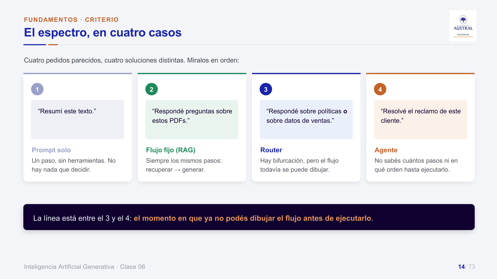
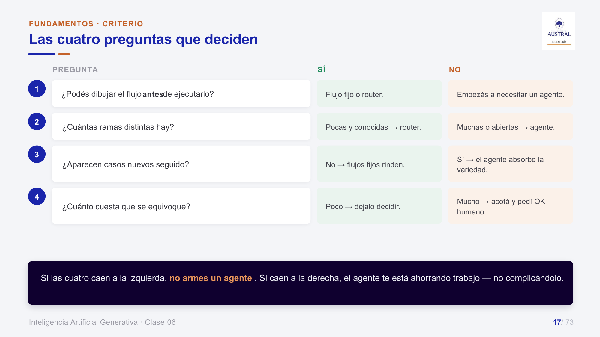
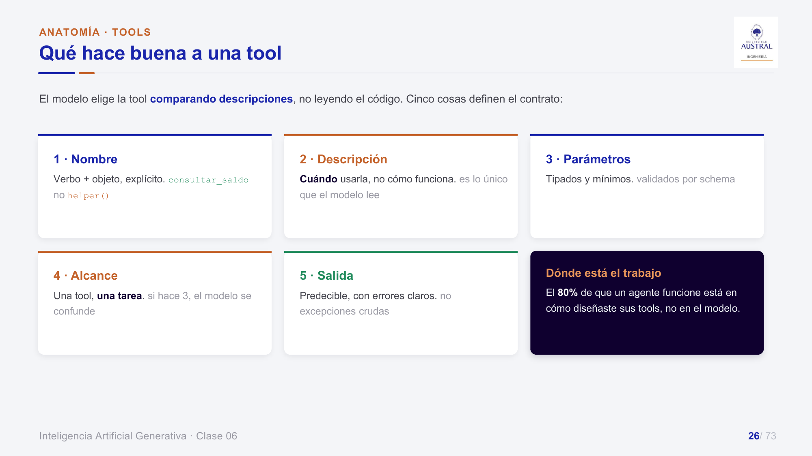
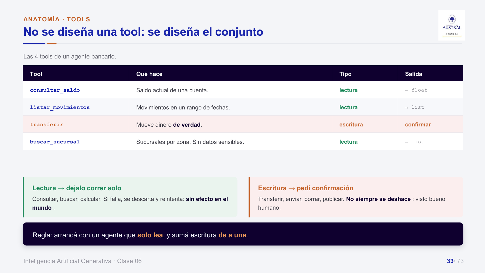
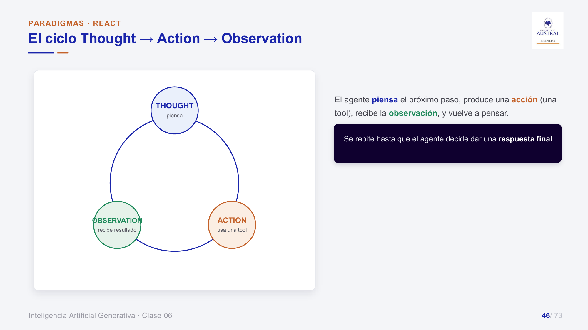
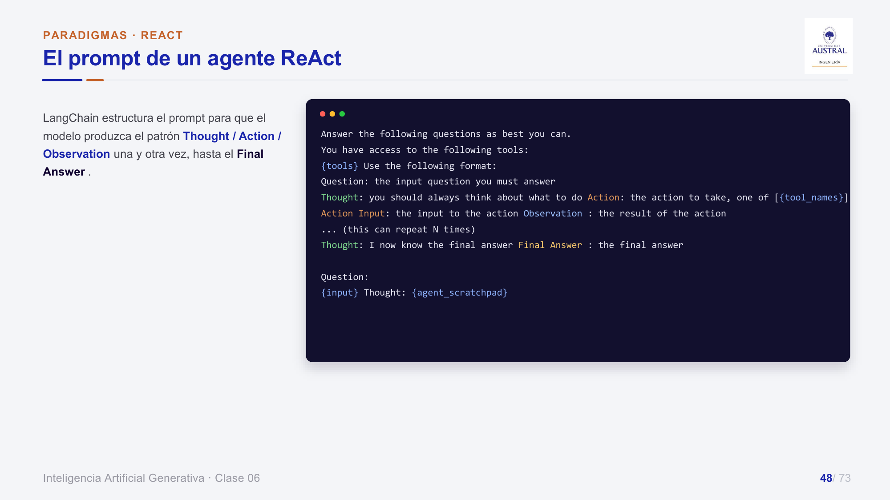

# Clase 36 · Introducción a agentes: tools, memoria, planificación y ReAct

> **Módulo 5 · IA Generativa** · Juan Pablo Sokil · martes 18-ago-2026
> **Fuentes:** transcripción `DIA_Clase_36.vtt` · láminas `2026_GENAI_Clase_06_Austral.pdf` · trabajo práctico `trabajo-practico-react.pdf` (app "laboratorio ReAct") · notebook `2026_GENAI_Clase_06.ipynb` (mostrado solo al final, parte del SQL Agent)

## En pocas palabras

- Un **LLM solo** responde de una pasada con lo que aprendió. Un **agente** usa ese LLM como cerebro para decidir y actuar: percibe la tarea, planifica pasos, usa herramientas (APIs, bases de datos, búsqueda) e itera hasta cumplir el objetivo.
- Conviene un agente cuando **no se puede dibujar el flujo antes de ejecutarlo**: muchas ramas, casos nuevos seguido o necesidad de datos que no tenemos. Si la tarea es siempre igual, alcanza un pipeline fijo, que es más barato, predecible y fácil de testear. La línea es difusa; ante la duda, el profesor propone empezar por el agente y "degradarlo" a pipeline si no hacía falta.
- Un agente tiene cuatro piezas: **modelo** (cerebro), **tools** (manos), **memoria** (corto y largo plazo) y **planificación/orquestación**. Las tools son lo más artesanal: el modelo las elige **leyendo su nombre y su descripción**, no el código. Por eso conviene que cada tool haga una sola tarea y diga cuándo usarla y cuándo no.
- **ReAct** (*Reason + Act*) intercala razonar, usar una tool y observar el resultado (**Thought → Action → Observation**) en un bucle, hasta que el modelo decide dar la respuesta final. Vive en dos lugares: en el **prompt**, que fija el patrón, y en el **código**, que hace el loop. Es el paradigma más viejo y sencillo, pero se sigue usando porque sirve.
- En el TP con la app se ve que el resultado depende mucho de **qué tools** se le dan, **cuántas iteraciones** se permiten y **cómo está escrito el prompt**. También importa el tamaño del modelo: hay un balance entre costo y calidad.

## Conceptos clave

### De chatbots a agentes

El profesor repasó la evolución que había empezado la clase anterior:

| Nivel | Qué entiende | Cómo actúa | Límite |
|---|---|---|---|
| Chatbot de reglas | palabras clave, menú ("escribí 1, 2 o 3") | opciones fijas, árbol de decisión / if-else | si el usuario escribe algo no previsto, no sabe qué hacer |
| Chatbot con **NLU** | **intención** (de qué tema se habla) + **entidades** (documentos, nombres, marcas) | flujos prediseñados | más natural, pero por detrás sigue siendo un sistema de reglas |
| **AI Agent** | objetivo + contexto | diseña su propio flujo y ejecuta acciones | más costo y menos control |
| IA agéntica | agentes que interactúan con otros agentes, sin nuestra participación | (se retoma en las próximas clases) | |

Los chatbots de reglas funcionan bien para problemas bien cerrados, o para problemas complejos que se pueden partir en piezas chicas: "es uno más uno es dos". El salto clave del agente es pasar del **flujo prediseñado** al **flujo que arma el propio agente**. El caso de las láminas: con reglas, "quiero dar de baja mi tarjeta" no se entiende si no se escribe "2"; con NLU se reconoce la intención *CancelarTarjeta*; un agente puede resolver "dá de baja mi tarjeta, pero primero transferí mi saldo": consulta el saldo, transfiere y cancela.

Definición de las láminas: un **AI Agent** es un programa capaz de realizar tareas de forma autónoma en nombre de un usuario, diseñando su propio flujo de trabajo y usando las herramientas disponibles. En una frase: *un LLM que además de pensar, puede decidir y actuar*.

### ¿Cuándo conviene un agente y cuándo un pipeline fijo?

Una pregunta de la clase anterior llevó al profesor a profundizar este punto con un espectro de cuatro casos:



1. **"Resumí este texto"**: alcanza un prompt. Entra un input y sale un output, sin decisiones ("es un pasamano").
2. **"Respondé preguntas sobre estos PDFs"**: un **RAG** clásico es un flujo fijo. Siempre se vectoriza la pregunta, se recuperan los chunks más parecidos, se suman como contexto y se genera la respuesta.
3. **"Respondé sobre políticas o sobre datos de ventas"**: es un **router**. Hay una bifurcación que el modelo decide a partir de entender el pedido, no con una regla fija. Es zona gris: podría resolverse sin agente, pero para el profesor ya conviene empezar a pensar en uno.
4. **"Resolvé el reclamo de este cliente"**: es un **agente**. El reclamo puede ser de cualquier tipo ("no me llegó la factura", "no funciona el servicio", "me parece caro") y no se sabe de antemano cuántos pasos ni en qué orden.

La línea está entre el 3 y el 4: **el momento en que ya no podés dibujar el flujo antes de ejecutarlo**.

Las láminas resumen el criterio en cuatro preguntas:



| Pregunta | Sí | No |
|---|---|---|
| ¿Podés dibujar el flujo antes de ejecutarlo? | flujo fijo o router | empezás a necesitar un agente |
| ¿Cuántas ramas distintas hay? | pocas y conocidas → router | muchas o abiertas → agente |
| ¿Aparecen casos nuevos seguido? | no → los flujos fijos rinden | sí → el agente absorbe la variedad |
| ¿Cuánto cuesta que se equivoque? | poco → dejalo decidir | mucho → acotá y pedí OK humano |

La cuarta pregunta es importante. Un pipeline rígido da siempre "dos más dos es cuatro". Un agente acierta casi siempre, pero puede alucinar o equivocarse. Si el resultado es sensible, puede convenir **achicar el problema** y resolverlo con un pipeline: el resultado será menos rico, pero más previsible.

Las láminas agregan dos ideas que completan el criterio:
- **El mismo problema, dos soluciones**: procesar facturas de 6 proveedores con formatos distintos se puede resolver con seis flujos fijos o con un agente con 3 tools. Los flujos fijos ganan en predecibilidad, costo por caso y facilidad de testeo. El agente gana cuando aparecen proveedores nuevos seguido, porque cada flujo nuevo implica desarrollo.
- **Se puede mover la línea a propósito**: si se acota el alcance lo suficiente, cualquier tarea se vuelve un flujo fijo, aunque el precio es tener muchas piezas que mantener. En la práctica se empieza chico y fijo, y se agranda solo donde la variedad lo justifica.

Un alumno sumó otro criterio: si la respuesta necesita **información en tiempo real que no está en nuestro sistema** (por ejemplo, la cotización del dólar en un momento de mucha volatilidad), se necesita un agente que vaya a buscarla. Si en cambio el dato está en una tabla propia bien actualizada, la consulta es siempre la misma y alcanza un flujo fijo.

### Anatomía: modelo, tools, memoria y planificación

Las distintas arquitecturas que circulan usan nombres diferentes, pero coinciden en lo mismo: un **modelo** que es el cerebro, **herramientas** que accionan y un mecanismo que coordina todo (**orquestación** o **planificación**). Algunas láminas lo cuentan como tres componentes (modelo, tools, orquestación con memoria) y otras como cuatro.

El esquema general: llega una **tarea** ("hacé tal cosa"); el agente **planifica** los pasos; en cada paso usa las **tools** que haga falta; y la **memoria** permite encadenar preguntas en una conversación. La analogía del profesor es construir una estantería: primero el serrucho para cortar la madera, después los clavos y por último colgarla. El planning define los pasos, y en cada paso se elige la herramienta.

#### El modelo: el cerebro

El LLM es la "central lingüística" del agente. Procesa la entrada, comprende qué hay que hacer, deriva tareas a los demás componentes, recibe sus resultados y genera la respuesta. Es el que gestiona el proceso, pero sin los otros componentes solo puede responder con lo que ya sabe.

#### Las tools: las manos

Las tools extienden las capacidades del agente más allá del razonamiento interno del modelo y le permiten leer y escribir en el mundo digital. Pueden ser:

- **APIs** de servicios externos (los ejemplos de siempre: el precio del dólar o la temperatura).
- **Funciones** de código. El ejemplo clásico es la **calculadora**: los LLM fallaban en cuentas simples, así que se les da una tool que extrae los números del texto y aplica la operación. Así, ante "sumame siete más cinco", el modelo usa la tool en vez de calcular "de memoria".
- **Bases de datos**: código (por ejemplo SQL) que consulta una base a partir de una pregunta.
- **Acciones en apps**: Google Calendar, Teams, Slack, un CRM.

Las láminas las agrupan en cuatro familias: **acceso a datos**, **comunicación** (Gmail, Outlook, Teams, Discord, WhatsApp), **analítica** y **automatización** (n8n, Zapier y Make, que son herramientas amigables para automatizar flujos y de las cuales Zapier es paga; Airflow es distinta y apunta a pipelines de datos).

Con la difusión de los agentes aparecieron tools ya armadas para casi todo. Eso derivó en los **MCP (Model Context Protocol)**: conjuntos de herramientas que diseñan principalmente las empresas para que uses su producto directamente, sin escribir tu propia tool. Se verán más adelante. En la práctica, casi nunca se diseña una tool desde cero porque alguien ya la hizo y probablemente mejor, pero entender cómo se diseña sirve para usarlas bien.

#### Cómo se define una tool

En LangChain, una tool es una función de Python con el **decorador `@tool`**. El modelo no lee el código: elige la tool **comparando descripciones**. Cinco cosas definen ese "contrato":



1. **Nombre**: verbo + objeto, explícito. `consultar_saldo`, no `funcion_017` ni `helper()`. Le da al modelo un primer indicio de para qué sirve.
2. **Descripción** (el docstring): debe decir **cuándo usarla** y para qué **no** sirve. Es lo único que el modelo lee.
3. **Parámetros**: tipados y mínimos. Los formatos (por ejemplo, fechas `AAAA-MM-DD`) y los valores por defecto forman parte del contrato; un default evita que el modelo lo invente.
4. **Alcance**: **una tool, una tarea**.
5. **Salida**: predecible y con errores legibles (por ejemplo, `"Error: cuenta inexistente."`) en lugar de excepciones crudas, para que el modelo pueda corregir.

El profesor dijo que por ahora alcanza con quedarse con nombre y descripción, y que lo demás es más técnico. Las láminas afirman que "el 80 % de que un agente funcione está en cómo diseñaste sus tools, no en el modelo".

Una descripción mala frente a una buena:

```python
"""Busca datos."""   # ¿qué datos? ¿cuándo la uso? imposible elegir entre varias parecidas

"""Devuelve el saldo actual de una cuenta bancaria por su número.
Usá esta tool cuando el usuario pregunte por saldo o dinero disponible.
No sirve para movimientos ni transferencias."""
```

La buena dice qué devuelve, cuándo usarla y para qué no sirve. Según las láminas, el "para qué NO sirve" es lo que más se olvida y es justo lo que evita que el modelo la llame mal.

**Una tool, una tarea**: no conviene una tool `base_de_datos` que haga todo, sino una para buscar, otra para guardar y otra para generar vistas. Si una tool hace tres cosas, su descripción se vuelve ambigua y el modelo se confunde. Las láminas proponen una prueba: si al describirla aparece una "y", o no se puede decir en una frase cuándo usarla sin decir "depende", son varias tools. El profesor matizó que en la realidad hay que buscar un balance, porque tampoco tiene sentido terminar con mil tools.

**Se diseña el conjunto, no una tool suelta**. Las tools se piensan juntas para que no se pisen y queden bien delimitadas, algo que los MCP ya traen resuelto. Las láminas lo ilustran con un agente bancario:



Las tools de **lectura** (consultar, buscar, calcular) pueden correr solas: si fallan, se descarta y se reintenta sin efecto en el mundo. Las de **escritura** (transferir, enviar, borrar, publicar) no siempre se pueden deshacer y requieren el visto bueno de una persona. La regla es arrancar con un agente que solo lea y sumar escritura de a una. Para una acción sensible como `transferir`, las láminas muestran que el control no queda en manos del modelo: se exige un token de aprobación emitido por la aplicación, se validan permisos y políticas en el código y se usa una clave de idempotencia para no duplicar la operación.

**Cómo llama el modelo a una tool** (láminas): el LLM **no ejecuta** la tool. Pide llamarla con un JSON (`{"tool": "consultar_saldo", "args": {"cuenta": "A-123"}}`), el orquestador la ejecuta y el resultado vuelve al modelo como **observación**. Con eso el modelo sigue razonando o responde.

#### Salida estructurada

Un alumno preguntó cómo asegurar que la salida tenga siempre el mismo formato, por ejemplo para no romper una automatización. Hay dos caminos:
- Fijar el formato en el `return` de la tool (por ejemplo, devolver un JSON con los campos esperados o una fecha en formato ISO).
- Usar **structured output**, que hoy ofrecen todos los modelos pagos y la mayoría de los abiertos. Se define el esquema de salida, el framework lo suma al prompt y fuerza al modelo a respetarlo.

Según el profesor, esto era un gran problema que mejoró mucho con los modelos nuevos: con el esquema, ejemplos e instrucciones funciona "muy bien, no perfecto".

#### Memoria

"Sin memoria sería como hablar con alguien que olvida todo al instante."

- **Corto plazo**: sigue la conversación en curso; en ChatGPT o Gemini vive dentro de cada chat. Si se abre un chat nuevo, no recuerda lo anterior. Suele vivir en la ventana de contexto.
- **Largo plazo**: trasciende las sesiones y guarda información general (quién sos, tus intereses, en qué proyectos trabajás, preferencias como "respondeme siempre con *Hola, señor*"). Suele apoyarse en un vector store.

Las láminas mencionan además la memoria *working*, *episódica* y *semántica*. El profesor las presentó como variantes que se pueden encuadrar dentro de corto y largo plazo.

#### Planificación (orquestación)

Es la pieza que "hace la magia": convierte un objetivo en una secuencia de pasos ejecutables. **Descompone** el objetivo en subtareas, las **ordena** con sus dependencias, **elige las tools** para cada paso y **supervisa y replanifica** si algo falla o llegan datos nuevos.

Técnicas mencionadas:
- **Plan-and-Execute**: primero planifica todo y después ejecuta por etapas. Es la misma idea que el modo "planificá y después ejecutá" de los asistentes de programación como Claude Code.
- **ReAct**: intercala razonamiento y acción paso a paso.
- **Búsqueda / HTN**: árbol de posibilidades o planificación jerárquica.
- **Verificación y reintentos**: *critics* o *checkers* que revisan y corrigen pasos fallidos.
- **Reflection**: el agente reflexiona sobre sus errores y aprende (ver abajo).

### Paradigmas: Tool Agent, ReAct y Reflection

- **Tool Agent** ("LLM con manos"): un LLM que llama herramientas según su descripción. Es la base de todo, aunque como estrategia aislada ya quedó algo obsoleta por ser muy básica.
- **ReAct Agent**: un Tool Agent que intercala razonamiento y acción de forma iterativa.
- **Reflection Agent**: se autoevalúa y reintenta. Se mencionó al pasar; las láminas lo desarrollan, pero en clase no se vio en detalle.

### ReAct = Reason + Act

Viene del paper *ReAct: Synergizing Reasoning and Acting in Language Models*. El profesor lo ubicó hace unos tres años y lo presentó como el que habilita todos los agentes más complejos que vinieron después. Combina dos enfoques que por separado se quedan cortos:

| Enfoque | Qué hace | Por qué falla solo |
|---|---|---|
| Solo razonar (**Chain of Thought**) | descompone el problema y razona en cadena | todo ocurre "dentro" del modelo: no consulta el entorno ni datos actualizados |
| Solo actuar (Tool Agent básico) | ante tal escenario usa tal tool | sin razonamiento explícito: es miope, no planifica ni justifica |
| **ReAct** | razona, usa una tool, observa, vuelve a razonar | |



El ciclo se repite hasta que el modelo decide **parar** y responder, o hasta que se alcanza un **máximo de iteraciones**. Ese tope es una salvaguarda: si no se resuelve en, por ejemplo, 10 llamadas, quizás el problema es demasiado complejo y no conviene que el agente quede "pensando eternamente".

#### ¿Dónde vive ReAct?

- **En el prompt**: el prompt original es muy sencillo. Hoy parece una bobada, pero en su momento fue un cambio de paradigma. Lista las tools disponibles (`{tools}` es un *placeholder* que se completa con las tools definidas en otro lado) y fija el formato `Question / Thought / Action / Action Input / Observation ... / Final Answer`. Esas palabras funcionan como marcas que guían al modelo a pensar, actuar y volver a pensar.
- **En el código**: el **loop** que llama al modelo con el historial y las tools, detecta si la salida es una respuesta final o una llamada a tool, ejecuta la tool, agrega la observación y vuelve a llamar al modelo.



En LangGraph, el mismo ciclo se dibuja como un grafo: el nodo `agent` decide; mientras necesite herramientas va al nodo `tools` y vuelve, y cuando termina sale por `__end__`.

El profesor destacó que, aunque hoy existen arquitecturas mucho más complejas (como las de Claude Code o Codex), ReAct **se sigue usando porque es sencillo y sirve**.

## Ejemplos y casos de la clase

- **¿Quién es el presidente de Francia en 2025 y cuántos años tiene?** Un modelo sin tools de hace dos años probablemente fallaba. La pregunta exige dos pasos **en orden**: primero averiguar quién es el presidente (Thought → `Search` → Observation: Emmanuel Macron, nacido el 21-dic-1977) y recién después calcular la edad (47 años). No se puede averiguar la edad sin saber primero de quién se trata.
- **"Agendá una reunión con Ana la semana que viene, pero solo si tengo un hueco a la tarde."** El agente consulta la agenda de la tarde con una tool (`buscar_huecos`), observa que hay un hueco, verifica que se cumple la condición y crea el evento con otra tool (`crear_evento`). El profesor sugirió un paso más: mandarle un mail a Ana avisándole. Son dos tools encadenadas con una decisión en el medio, y por eso es un agente y no un pipeline fijo.
- **Tools bancarias** (`hora_actual`, `consultar_saldo`, `buscar_movimientos`): muestran cómo crece la complejidad, de una tool sin parámetros a una con cuenta, rango de fechas y un límite opcional de 50 resultados. Lo que se mantiene es la lógica de nombre claro y descripción precisa.
- **Facturas de 6 proveedores** (láminas): el mismo problema resuelto con seis flujos fijos o con un agente. Ninguna opción está mal: depende de si los formatos son estables o si aparecen proveedores nuevos seguido.
- **GraphRAG médico** (retomado de una clase anterior): cuando el grafo de síntomas y diagnósticos no encontraba nada, se buscaba información adicional en un **conjunto acotado de sitios web médicos confiables** (sociedades médicas, papers). Es un ejemplo de búsqueda web usada con cuidado y como complemento.
- **Caída de APIs en vivo**: durante el TP, a algunos grupos se les cayó la API del plazo fijo. El profesor lo tomó como lección: los servicios de terceros fallan, y una salvaguarda común es tener un condicional que permita usar **dos proveedores de modelo distintos**, para que si uno se cae funcione el otro.

## Práctica

### TP "Cómo razona un agente" (app laboratorio ReAct)

Se hace en grupos y no es obligatorio; quien quiera puede subirlo para recibir devolución. La pregunta es fija: *"Tengo $1.000.000 para 1 mes: ¿me conviene plazo fijo o pasar a dólar blue?"*. La resuelve un solo agente con tools, y lo que cambia es la configuración: qué tools se habilitan (`consultar_dolar`, `plazo_fijo`, `calcular`, `buscar`), cuántas iteraciones se permiten, el prompt del agente y el formato de salida. La app muestra la línea de tiempo del ciclo (acción → observación) y el costo de cada corrida.

| Consigna | Qué se prueba | Qué mirar |
|---|---|---|
| 1. Sin tools | resolver sin ninguna tool | el modelo responde que necesita datos reales de hoy y no puede inventarlos |
| 2. Ciclo ReAct | `consultar_dolar` + `plazo_fijo` + `calcular`, 10 iteraciones | si el orden de las tools lo decide el agente; si usó `calcular` o estimó la cuenta |
| 3. Iteraciones | 1 y después 2 | si se corta o completa |
| 4. Búsqueda web | solo `buscar`, primero sin lista de sitios y después con sitios de confianza | de dónde salen los datos y cuán confiables son, frente a las tools de datos |
| 5. Prompt | editar el prompt genérico (por ejemplo, "usá `calcular` para las cuentas" o cerrar con `VEREDICTO: <plazo fijo / dólar> — <motivo>`) | cuánto pesa el prompt; si el formato fijo sirve para comparar corridas |
| 6. Costo vs. completitud | comparar el costo según las iteraciones | cuál es la configuración "justa" y si iterar de más solo encarece |

Lo que surgió en la puesta en común:
- Un grupo vio que con menos iteraciones el agente dejaba de usar `calcular`. El profesor no tenía la respuesta en el momento y quedó en averiguarlo. Probó agregar al prompt una instrucción explícita para usar `calcular`, y con eso el agente usó la tool. Conclusión: el modelo **decide** qué tools usar, y un cambio chico en el prompt puede cambiar bastante el resultado.
- El modelo de la app es un modelo chico a propósito, para ahorrar costos (en la transcripción figura como "GPT 5.4 Nano"; el nombre exacto es dudoso). Con un modelo más potente probablemente usaría mejor las tools. Hay tres palancas para mejorar: más modelo (más caro), más iteraciones o un mejor prompt (por ejemplo, con *few-shot*). En sistemas multiagente se podrá asignar un modelo chico a las tareas simples y uno grande a las complejas.
- **Búsqueda web**: es muy potente, pero el dato puede venir de cualquier fuente. Como buena práctica conviene **limitar los sitios confiables** cuando la tarea lo permite.

El profesor dejó el TP abierto hasta la clase siguiente, donde dará un repaso de lo que se debería haber encontrado.

### Notebook `2026_GENAI_Clase_06.ipynb` (LangChain 1.x)

Queda como material para quien quiera ver el código. En clase solo se mostró rápido la Parte 2, que se retoma la clase siguiente.

- **Parte 1 · Tools y agentes ReAct.** Muestra qué ve el LLM de una tool (nombre, descripción tomada del docstring y argumentos tomados de los *type hints*) y que con `llm.bind_tools([...])` el modelo solo **decide** llamarla y devuelve la intención en `tool_calls`. El loop lo automatiza `create_agent`, que en 1.x reemplaza a `create_react_agent` + `AgentExecutor`. Incluye tres calculadoras de robustez creciente (simple, con `math` y con conversión de palabras a números, para "dos + 2") y un agente multi-tool que encadena `precio_producto` → calculadora ("¿cuánto cuestan 3 teclados mecánicos?"). Ilustra los tres motivos para darle tools a un LLM: cálculo preciso, información en tiempo real y datos privados.
- **Parte 2 · Un agente sobre tus datos (SQL Agent).** Usa un Excel de juguete con tres hojas (productos, clientes y ventas, esta última relaciona las otras dos) que se carga con **DuckDB**. DuckDB permite consultar Excel o tablas con SQL desde Python, algo más intuitivo que Pandas para quien ya sabe SQL. Se arma un agente con `SQLDatabaseToolkit` + `create_agent`. Un **toolkit** es un conjunto de tools ya empaquetadas por el framework, en este caso `sql_db_list_tables`, `sql_db_schema`, `sql_db_query_checker` y `sql_db_query`. El system prompt indica listar tablas, mirar el esquema, escribir la query y ejecutarla, sin hacer nunca DML. La traza muestra el ciclo ReAct: listar tablas → ver esquema → escribir query → chequearla → ejecutarla → si hay error, volver a empezar; si no, responder en lenguaje natural.

```python
toolkit = SQLDatabaseToolkit(db=sql_db, llm=llm)
agent = create_agent(llm, toolkit.get_tools(), system_prompt=SQL_SYSTEM_PROMPT)
```

El profesor aclaró que esto es el "modo 2025 / principios de 2026" y que lo mismo es lo que hoy hacen por detrás Claude Code o Codex cuando se les da un archivo. La clase siguiente se verá cómo hacerlo con **skills**, "la forma 2026".

## Para recordar

- "Si no podés dibujar el flujo antes de ejecutarlo, necesitás un agente." Ante la duda, en este curso se va por el agente y después, si no hacía falta, se degrada a pipeline.
- La pregunta "¿cuánto cuesta que se equivoque?" puede inclinar la balanza hacia un pipeline: menos rico, pero previsible.
- El modelo elige tools **por su nombre y descripción**. Una descripción debe decir qué hace, cuándo usarla y cuándo **no**.
- Una tool, una tarea, pero con equilibrio: tampoco tiene sentido tener mil tools. Además, el conjunto de tools se diseña como un todo.
- Lectura: se deja correr al agente solo. Escritura: con confirmación humana. Conviene arrancar con un agente que solo lea.
- El modelo no ejecuta la tool: pide la llamada y el orquestador la ejecuta.
- Siempre conviene poner un **límite de iteraciones** para que el agente no se cicle.
- "Los modelos cada vez son más potentes y perdonan más, pero si hacemos las cosas bien desde el principio, achicamos la tasa de error."
- ReAct es lo más viejo, y aun así se sigue usando porque es sencillo y sirve.
- Las APIs de terceros se caen: conviene tener un plan B, como un segundo proveedor de modelo.

## Preguntas de repaso

<details><summary>1. ¿Por qué un RAG clásico se considera un flujo fijo y no un agente?</summary>

Porque siempre ejecuta los mismos pasos en el mismo orden: vectorizar la pregunta, recuperar los chunks más parecidos, sumarlos como contexto y generar. El modelo no decide qué camino tomar ni qué herramienta usar, así que el flujo se puede dibujar completo antes de ejecutarlo.

</details>

<details><summary>2. ¿Qué diferencia a un router de un agente, si los dos toman decisiones?</summary>

El router tiene una bifurcación entre pocas ramas conocidas (por ejemplo, políticas o ventas), y el flujo completo todavía se puede dibujar. En un agente no se sabe cuántos pasos ni en qué orden se van a dar hasta ejecutarlo, porque los casos son abiertos (por ejemplo, reclamos de clientes).

</details>

<details><summary>3. Tenés que automatizar transferencias bancarias. ¿Qué dicen las cuatro preguntas y qué recaudos tomarías?</summary>

El costo de equivocarse es alto, así que hay que acotar el problema y pedir confirmación humana. `transferir` es una tool de escritura: debe exigir una aprobación externa al modelo (un token emitido por la aplicación), validar permisos y políticas en el código y usar idempotencia. Conviene arrancar con tools de solo lectura y sumar la escritura de a una.

</details>

<details><summary>4. ¿Por qué la descripción de una tool importa más que su código para el agente?</summary>

Porque el modelo no lee el código: decide qué tool usar comparando nombres y descripciones. Una descripción vaga ("Busca datos") hace imposible elegir entre tools parecidas. Una buena dice qué devuelve, cuándo usarla y para qué no sirve.

</details>

<details><summary>5. ¿Qué problema tiene una tool que "procesa datos" con un parámetro `modo` que cambia lo que hace?</summary>

Su descripción tiene que cubrir varias tareas y se vuelve ambigua, así que el modelo no sabe cuándo aplicarla. Además, los parámetros de una tarea no sirven para las otras, y si algo falla no se ve qué parte falló. Es mejor separarla en varias tools de una tarea cada una.

</details>

<details><summary>6. ¿Qué aporta ReAct frente a Chain of Thought solo y frente a un Tool Agent que solo actúa?</summary>

Chain of Thought razona, pero todo dentro del modelo: no consulta datos actualizados ni herramientas. Un agente que solo actúa usa tools sin planificar ni justificar. ReAct intercala las dos cosas: piensa, usa una tool, observa el resultado y vuelve a pensar. Así resuelve problemas donde un paso depende del resultado del anterior, como averiguar quién es el presidente y después su edad.

</details>

<details><summary>7. En el TP, ¿por qué el agente a veces no usaba `calcular` y cómo se puede forzar?</summary>

Porque es el modelo el que decide qué tools usar, y puede preferir hacer la cuenta "de memoria", sobre todo si es un modelo chico o tiene pocas iteraciones. Se puede forzar haciendo explícito en el prompt que use `calcular` para las cuentas, mejorando las descripciones o el prompt (por ejemplo, con *few-shot*) o usando un modelo más potente, que cuesta más.

</details>

<details><summary>8. ¿Para qué sirve fijar un máximo de iteraciones y qué se pierde si es muy bajo o muy alto?</summary>

Es una salvaguarda para que el agente no quede ciclando indefinidamente ni gaste de más. Si es muy bajo, el agente se corta antes de completar los pasos y la respuesta queda incompleta. Si es muy alto, no suele aportar nada y solo encarece. Hay una configuración "justa" para cada problema.

</details>

## Conexiones

- **Clase anterior (Clase 35):** mini introducción a agentes, la evolución de chatbots a agentes y la diapositiva "¿cuándo conviene un agente?" que esta clase profundiza. El caso de GraphRAG médico se mostró "el otro día" (no queda claro si fue en la Clase 35 o antes).
- **Clases de RAG del módulo:** el RAG aparece acá como ejemplo de flujo fijo. Las soluciones del TP de RAG (implementado con LangChain) quedaron publicadas en el campus.
- **Primera clase del módulo:** *Chain of Thought* y *few-shot prompting* como técnicas de prompting, que ReAct retoma y combina con acción.
- **Módulo 4 (NLP):** la extracción de entidades, base de los chatbots con NLU.
- **Próximas clases (Clase 37 en adelante):** continuación del SQL Agent, agentes con *skills*, límites de los agentes (loops, costo, errores de tools), MCP, herramientas de automatización como n8n y sistemas multiagente. La parte de n8n y Reflection de las láminas no se dio en esta clase.
- **TFI:** según las cuatro preguntas, la normalización de nombres comerciales de Benefix (recuperar candidatos léxicos, semánticos o híbridos con RRF y, eventualmente, generar) es un flujo que se puede dibujar de antemano: está más cerca del caso 2 (flujo fijo, tipo RAG) que de un agente, y se evalúa directamente con Hit@k y MRR. Si en algún momento se expusiera el retriever como tool de un agente, valen las reglas de esta clase: nombre explícito, descripción con cuándo usarla y cuándo no, salida estructurada y predecible.
