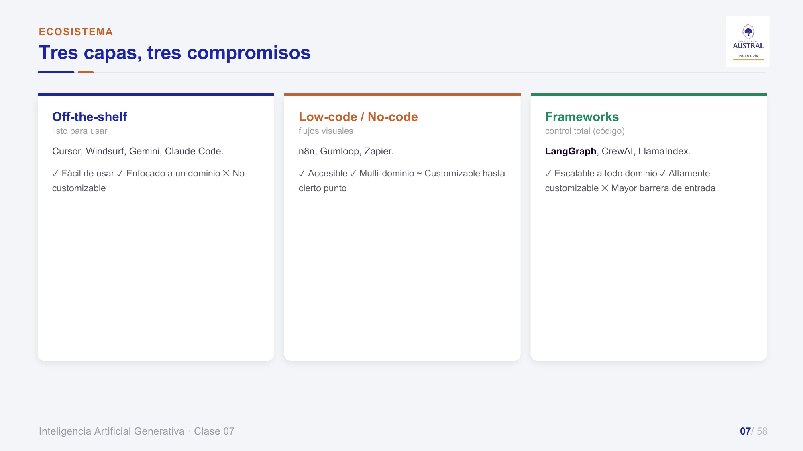
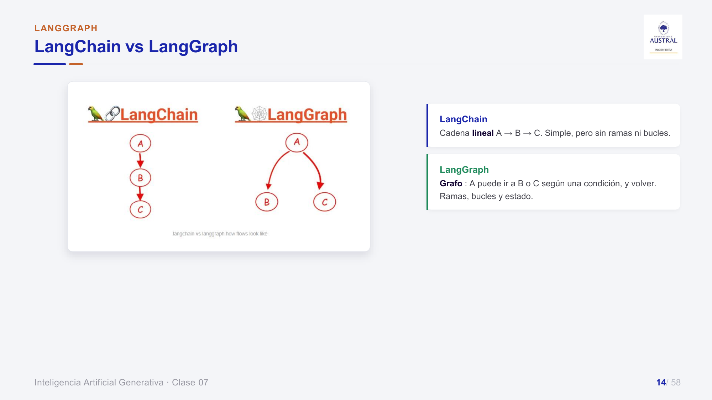
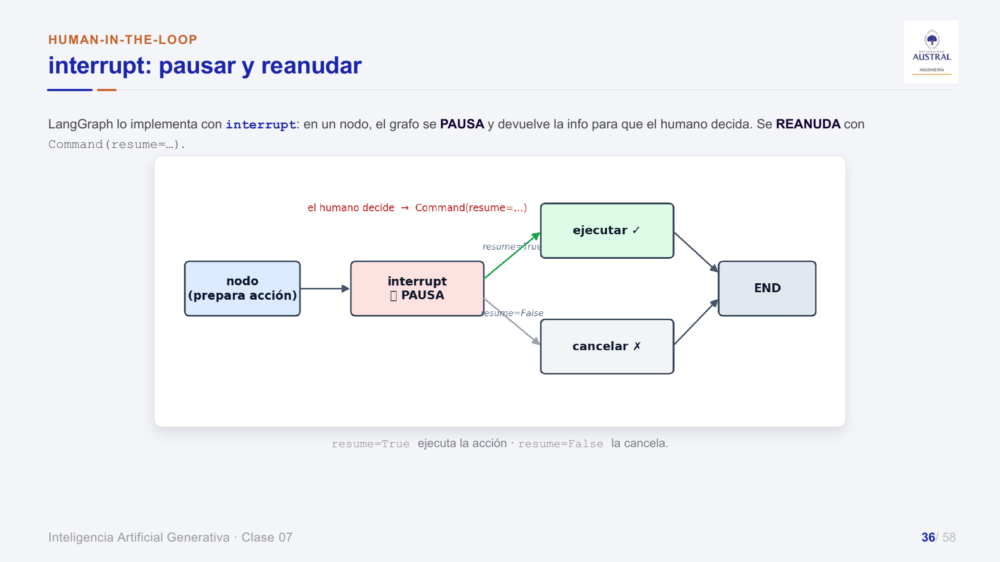
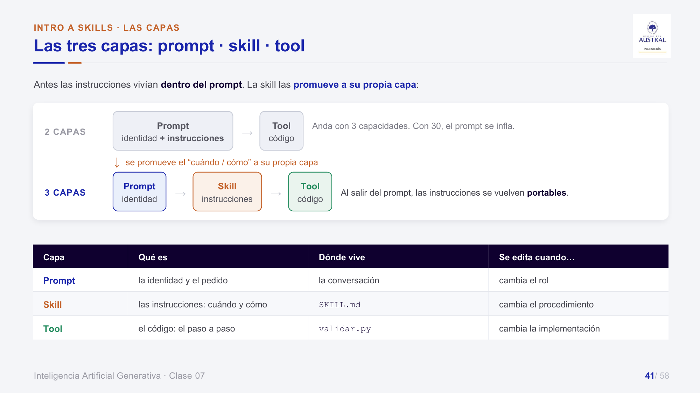
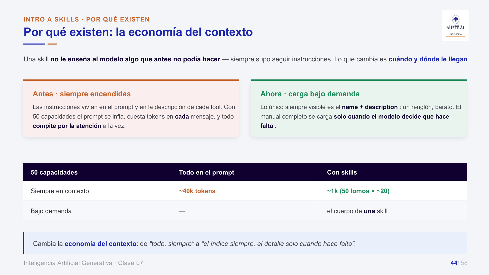
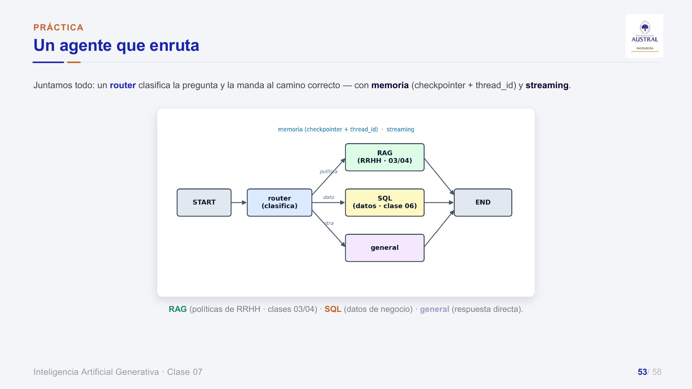

# Clase 37 · Frameworks de agentes, LangGraph y Skills

> **Módulo 5 · IA Generativa** · Juan Pablo Sokil · jueves 20-ago-2026
> **Fuentes:** transcripción `DIA_Clase_37.vtt` · láminas `2026_GENAI_Clase_07.pdf` · notebook `2026_GENAI_Clase_07.ipynb` · demo de skills de Claude Code (`.claude/README.md` y `skills/*/SKILL.md`)

## En pocas palabras

- Para construir agentes hay un espectro de herramientas: **off-the-shelf** (Cursor, Claude Code, Codex: listas para usar), **low-code/no-code** (n8n, Zapier: cajitas que se arrastran) y **frameworks** (LangGraph, CrewAI, LlamaIndex: código, control total). El compromiso es simpleza contra posibilidades, y los asistentes de programación bajaron mucho la barrera de entrada de los frameworks.
- **LangGraph** "abre la caja negra" de `create_agent`: el agente se modela como un **grafo de estado** donde uno define el **State** (lo que viaja), los **nodos** (funciones que hacen algo) y las **aristas** (transiciones, que pueden ser condicionales y formar bucles). A cambio de más trabajo, se gana control del flujo, memoria, streaming, pausas para aprobación humana y robustez ante fallas.
- El ejemplo integrador es un **agente que enruta**: un nodo router clasifica la pregunta y la manda al camino RAG (políticas de RRHH), SQL (datos de negocio) o general (respuesta directa del LLM). LangGraph funciona como el pegamento que orquesta piezas que ya se conocían.
- Una **skill** no le enseña al modelo nada que no pudiera hacer: saca las **instrucciones** del system prompt y las pone en su propia capa (un `SKILL.md`). Así el prompt queda con la identidad, la skill con el procedimiento y la tool con el código.
- La ganancia está en la **economía del contexto**: el agente ve siempre solo el `name` + `description` de cada skill y carga el cuerpo completo únicamente cuando aplica. Por eso la `description` es la pieza crítica: si es vaga, la skill no se usa y no hay ningún error que lo avise.

## Conceptos clave

### Cierre de la clase anterior: el laboratorio ReAct y el agente SQL

La clase arrancó retomando el trabajo práctico del agente **ReAct** (*reason + act*: pensar, actuar, observar el resultado y decidir si hace falta otro paso). Lo que había que observar:

- **Sin tools** el agente no puede contestar preguntas sobre datos nuevos (como el precio del dólar de hoy), porque esa información no está en su conocimiento.
- **Más iteraciones** permiten análisis más complejos. En el ejercicio había un tope: si no alcanzaba, avisaba que no pudo resolverlo; en un caso real probablemente daría una respuesta incompleta.
- **Búsqueda web**: útil, pero riesgosa sin curaduría de fuentes. Sugerencia del profesor: definir qué sitios son confiables y limitar la búsqueda a esos.
- **Formato de salida**: conviene fijarlo siempre. Facilita comparar respuestas y, sobre todo, evita que un proceso posterior del pipeline se rompa porque el modelo devolvió los datos "en el formato que se le ocurrió".
- **Costo**: un grupo notó que sacando las tools propias y dejando que buscara en la web el costo subía mucho. La explicación: la herramienta de búsqueda web integrada de OpenAI no cobra por tokens de entrada sino un monto fijo por búsqueda (más los tokens de salida). El panel de uso de OpenAI discrimina ese concepto aparte ("Web Searches"), y conviene separar proyectos para saber cuánto se gasta en cada cosa. Se mencionó también una alternativa con cupo gratuito inicial para búsquedas web (el nombre quedó mal transcrito; probablemente Tavily).
- **Multitool**: el ReAct original usa una tool por iteración. Los modelos actuales pueden lanzar **varias tools en paralelo** en una misma iteración cuando no dependen entre sí (en el ejemplo: plazo fijo, dólar e inflación a la vez) y recién en la siguiente iteración hacen el cálculo.

Después se mostró el **toolkit de base de datos de LangChain** (un *toolkit* es un conjunto de tools ya armadas para un tema). Sobre un Excel de tres solapas (ventas, productos, clientes), cada solapa es una tabla, y el agente se crea con `create_agent(llm, tools del toolkit, system prompt)`. Las tools reproducen lo que haría una persona frente a una base desconocida:

| Tool | Qué hace |
|---|---|
| Listar tablas | Devuelve los nombres de todas las tablas (no recibe input). |
| Esquema | Para las tablas relevantes, nombres de columnas y tipo de dato (texto/varchar, entero, float). |
| Query checker | Revisa que la query SQL sea sintácticamente correcta antes de ejecutarla. |
| Ejecutar query | Corre la consulta y devuelve el resultado. |

Para "¿cuál es el precio unitario promedio de las ventas?" el agente listó tablas, descartó clientes, miró el esquema de ventas y productos, y generó `SELECT AVG(unit_price) FROM ventas`: cuatro llamadas a tools. Una pregunta más compleja (monto total por categoría, ordenado) también terminó en cuatro llamadas, con una query más larga. El profesor notó que en ese caso el agente **no usó el query checker**, algo a tener en cuenta.

Advertencias: con bases reales (nombres de tablas y columnas poco descriptivos) la cosa se complica, y además de devolver bien el dato, la consulta tiene que ser **performante** para no colgar la base de la empresa. Para casos más complejos se usan subagentes (uno que construye la query, otro que la optimiza, otro que la ejecuta y analiza), tema de una clase próxima.

Por último, una ventaja de LangChain: cambiar de proveedor de modelo es cambiar una o dos líneas (`ChatOpenAI` por `ChatGoogleGenerativeAI`), en lugar de reescribir 15 o 20 líneas de integración.

### Qué es un agente (repaso) y cuándo hace falta

Un agente es un LLM con tools que **toma decisiones dinámicas** sobre cómo resolver una tarea, en vez de seguir una secuencia fija: pasa de responder a accionar. Si el proceso es siempre igual, quizás alcanza con una llamada a un modelo; el agente rinde cuando hay que hacer cosas distintas frente a escenarios distintos.

### El ecosistema: tres capas, tres compromisos



| Capa | Ejemplos | A favor | En contra |
|---|---|---|---|
| Off-the-shelf | Cursor, Windsurf, Gemini, Claude Code, Codex | Fácil de usar, enfocado a un dominio | No customizable |
| Low-code / no-code | n8n, Gumloop, Zapier, Make | Accesible, multidominio | Customizable hasta cierto punto: hay que encontrar la cajita que haga lo que querés |
| Frameworks | LangGraph, CrewAI, LlamaIndex, ADK de Google | Escalable, altamente customizable | Mayor barrera de entrada |

Según las láminas, cada framework tiene su fuerte: **LangGraph**, el control fino del flujo (grafo de estados); **CrewAI**, coordinar varios agentes con roles; **LlamaIndex**, pipelines de datos y RAG. El nodo *AI Agent* de n8n es el equivalente no-code de `create_agent`.

El profesor observó que, hasta fines de 2025, frameworks como LangGraph pedían un nivel técnico medio-alto: los chatbots no conocían bien estas librerías nuevas y había que depurar "a la vieja escuela". Con asistentes de programación agéntica (Claude Code, Codex, Antigravity), que iteran, prueban y depuran solos, esa barrera casi desapareció, y mucha gente que usaba low-code puede pasar a código.

### De `create_agent` a LangGraph

`create_agent` es una caja negra: se le pasa modelo, prompt y tools, y el loop ReAct queda automatizado. Es rápido, pero no se ve ni se controla el flujo. En LangGraph uno define cada pieza y puede decir, por ejemplo, "ante tal respuesta, andá por esta rama", o encadenar un loop con otros (sacar datos de la base, validarlos y con ese resultado armar una presentación o un audio). Ese tipo de flujo es el que más se parece a los procesos reales.

Hay un atajo intermedio: `create_react_agent` (prebuilt de LangGraph) arma el loop ReAct listo para usar. Se empieza con el prebuilt y se baja al grafo manual cuando hace falta control fino.



| Necesitás… | LangChain | LangGraph |
|---|---|---|
| Flujo | Lineal, fijo (A→B→C) | Ramas, bucles, condiciones |
| Estado | Simple, de paso | State explícito y persistente |
| Control humano | Limitado | `interrupt` / resume nativo |
| Cuándo | Prototipo, pipeline simple | Agente con estado, en producción |

No son rivales: LangGraph es parte del ecosistema LangChain.

### El grafo: State, Nodes, Edges, Loops

Un **grafo** es un conjunto de nodos (objetos) y aristas (relaciones entre ellos). En LangGraph:

- **State**: la información compartida que viaja por el grafo (la pregunta, resultados intermedios, la conversación). Cada nodo lo lee y lo actualiza. Es la decisión de diseño más importante.
- **Nodes**: funciones de Python que reciben el state y devuelven una actualización. Pueden llamar a un LLM, a una tool, a una base o transformar datos. El `ToolNode` prebuilt ejecuta los *tool calls* que emite el LLM y devuelve un `ToolMessage`.
- **Edges**: transiciones. Una arista **simple** conecta A→B siempre; una **condicional** mira el state y decide el próximo nodo. Eso le da ramas al agente.
- **Loops**: aristas que vuelven a un nodo anterior. Así se implementa el ciclo ReAct dentro del grafo. Todo bucle necesita una **condición de terminación** o un *recursion limit* para no quedar girando.

Los mensajes del state están tipados por rol (`SystemMessage`, `HumanMessage`, `AIMessage`, `ToolMessage`). Un **reducer** define cómo se combina lo que devuelve un nodo con el state anterior: por defecto **reemplaza** (útil para `query` o `resultado`); con `add_messages` (o `add`) **acumula**, que es lo que mantiene el historial.

Otras piezas de las láminas:

- **Subgrafos**: un grafo completo usado como nodo dentro de otro. Encapsula una parte (por ejemplo "el flujo de RAG"), se testea sola y se reutiliza. Al profesor le interesó que lo intermedio queda aislado: del subgrafo importa cómo entra y cómo sale. Lo vinculó con la idea posterior de subagentes.
- **`Command`**: permite que un nodo actualice el state y decida el próximo nodo en un solo paso, sin arista condicional aparte.

### Memoria: checkpointer, thread_id y Store

- **Corto plazo**: el hilo de la conversación actual. El **checkpointer** guarda el state después de cada paso, y el **`thread_id`** identifica cada conversación (usuarios o sesiones distintos no se mezclan; una conversación se puede retomar).
- **Largo plazo**: lo que persiste entre sesiones, en un **Store**. El ejemplo del profesor: un agente que recomienda dónde comer debería recordar qué te gusta, dónde vivís y a qué lugares fuiste y no te gustaron.
- Como el state se guarda paso a paso, hay **time travel**: inspeccionar el historial, volver a un checkpoint y re-ejecutar desde ahí (para depurar o probar otro camino).
- Para que la conversación no crezca sin límite, cada cierta cantidad de mensajes se resume el historial.

### Streaming

Mostrar la respuesta a medida que se genera. Técnicamente es menor, pero para la experiencia de usuario es enorme: una respuesta que tarda 40 segundos y no muestra nada hace que la persona se vaya; si empieza a aparecer texto al segundo dos, la experiencia cambia. En LangChain en su forma más simple la respuesta llega toda junta al final. LangGraph tiene tres modos de `stream_mode`:

| Modo | Qué emite | Para qué |
|---|---|---|
| `values` | El state completo después de cada paso | Ver cómo evoluciona todo |
| `updates` | Solo lo que cambió en cada nodo | Logs y depuración |
| `messages` | Los tokens del LLM a medida que salen | El efecto "máquina de escribir" del chat |

### Human-in-the-loop

Los agentes pueden equivocarse como nosotros (hay casos de agentes que borraron bases de datos), con la diferencia de que al agente no se le puede pedir cuentas. Ante acciones **sensibles o difíciles de revertir** (borrar o modificar datos, mandar un mail a un cliente, ejecutar un pago, dar datos no públicos) conviene que una persona apruebe. Supervisar todo en producción no es realista (¿para qué el agente entonces?), pero en las primeras etapas de desarrollo es buena práctica meter control humano lo más posible.



LangGraph lo implementa con **`interrupt`**: el grafo se pausa en un nodo y devuelve la información para que el humano decida; se reanuda con `Command(resume=...)`. Tres patrones: **aprobar/rechazar** (¿envío este mail?), **editar el estado** (corregir la query o el texto antes de seguir) y **revisar una tool** (validar la query SQL antes de correrla).

### Buenas prácticas y robustez

| Buenas prácticas | Errores comunes |
|---|---|
| Diseñar el state primero: es el contrato del grafo | Bucle sin condición de terminación |
| Nodos chicos, una responsabilidad cada uno | State gigante que mezcla todo |
| `interrupt` en las acciones sensibles | Olvidar el reducer y pisar el historial de mensajes |

El profesor aclaró que son prácticas casi obvias, pero que la realidad las complica: a mitad del diseño te piden agregar algo y hay que "emparchar".

Para fallas (API caída, *rate limit*, tool con error): **reintentos** con espera creciente (*backoff*), **fallback** a otro modelo o camino, *recursion limit* y **reanudar** desde el último checkpoint bueno (incluso si se apagó la máquina).

### Skills: de dos capas a tres



Antes el system prompt cargaba dos cosas: la **identidad** ("sos un experto en SQL") y las **instrucciones** de cómo resolver cada tipo de pedido. Las tools eran el código para actuar. Una skill **promueve las instrucciones a su propia capa**:

| Capa | Qué es | Dónde vive | Se edita cuando… |
|---|---|---|---|
| Prompt | La identidad | La conversación / `system_prompt` | Cambia el rol |
| Skill | Las instrucciones: cuándo y cómo | `SKILL.md` | Cambia el procedimiento |
| Tool | El código: el paso a paso | Un script o función | Cambia la implementación |

El profesor insistió en que **no es nada nuevo**: una skill es, en el fondo, un archivo de texto con un prompt, escrito en Markdown. Lo nuevo es la organización. El system prompt se aliviana y solo dice que hay skills en tal carpeta: frente a un problema, revisá si alguna sirve; si sirve, usala; si no, resolvelo vos.

**¿Por qué aparecieron ahora?** Porque los agentes empezaron a poder leer y crear archivos en la máquina del usuario. Antes vivían en el chat y lo único que veían era el texto del prompt. Cuando pueden abrir archivos, en lugar de mandar todo en el prompt se les puede decir "fijate en esta carpeta si algo te sirve". Según las láminas, Anthropic publicó *Agent Skills* como estándar abierto en diciembre de 2025.

### La economía del contexto



Con todo en el prompt, cada mensaje (incluso un "hola" o "contame un chiste") arrastra todas las instrucciones: más tokens, más costo, y todo compite por la atención del modelo. Con skills, lo único siempre visible es una línea por skill. La analogía de las láminas: pasar de **todos los manuales abiertos sobre la mesa** a una **estantería con lomos etiquetados**; el modelo lee los lomos y abre un solo libro. Con una o dos skills casi no se nota; con decenas, la diferencia crece.

| 50 capacidades | Todo en el prompt | Con skills |
|---|---|---|
| Siempre en contexto | ~40k tokens | ~1k (50 lomos × ~20) |
| Bajo demanda | — | El cuerpo de una skill |

Un alumno lo resumió bien: lo que se descubrió resolviendo un problema se guarda como skill y no hay que volver a descubrirlo (ni pagar esos tokens) la próxima vez.

### Anatomía de un SKILL.md

El archivo tiene dos partes que no se cargan en el mismo momento:

- **Frontmatter** (entre `---`): `name` y `description`. Es el índice y está siempre cargado.
- **Cuerpo**: el manual (cuándo, cómo, casos borde, ejemplos). Se lee solo al invocar la skill.

La carpeta puede traer además `references/` y `scripts/`, que se cargan si hacen falta. En Claude Code van en `.claude/skills/<nombre>/SKILL.md` (de proyecto, se comparten con el equipo) o en `~/.claude/skills` (personales, en todos los proyectos). Una skill puede tener **varias tools**: la relación no es 1:1.

**La `description` es el criterio de elección**, igual que el docstring de una tool en la Clase 36. Una buena description dice **qué trae, cuándo usarla y para qué NO** sirve:

- Mal: `Maneja datos financieros.` Si hay tres parecidas, el modelo elige a ciegas.
- Bien: `Cotizaciones del dólar y tasas de plazo fijo. Usar cuando pregunten qué conviene hacer con pesos. No sirve para inflación.`

Si el modelo elige mal la skill, el problema casi nunca está en el cuerpo: está en la description.

| Mecanismo (Claude Code) | Cuándo se carga | Costo de contexto |
|---|---|---|
| `CLAUDE.md` | En toda conversación | Siempre |
| `/comandos` | Solo si lo invocás a mano | Bajo pedido |
| Skills | Automáticamente, al reconocer la situación | Solo cuando aplica |

Si ya sabés qué skill usar, conviene invocarla explícitamente (en Claude Code con `/`). El profesor agregó que el agente también tiene memoria (en Claude Code, el archivo `CLAUDE.md`, que funciona como bitácora), así que puede recordar qué skill usar para cierto tipo de pedido sin revisar todas cada vez. Sobre cómo decide Claude Code exactamente qué skills revisar, aclaró que no es código abierto y que iba a averiguar más.

**Seguridad**: una skill trae instrucciones y código. Ya hay marketplaces con muchísimas skills publicadas, así que hay que instalar solo de fuentes confiables y leer el contenido antes, como con cualquier dependencia.

Regla para detectar skills (de las láminas): si te encontrás explicando lo mismo una y otra vez, eso es una skill que todavía no creaste. Extraer el texto de un PDF es una tool; saber clasificar bien es la skill.

## Ejemplos y casos de la clase

- **Agente que enruta (RAG / SQL / general).** Integra lo visto en el módulo: el RAG de políticas de RRHH (Clases 34 y 35), el agente SQL de la Clase 36 y el LLM directo. "¿Cuántos días de vacaciones tengo?" va por RAG ("60 días hábiles", un dato absurdo a propósito para que se note que sale de los documentos inventados); "¿cuál es el precio unitario promedio de las ventas?" va por SQL (≈176); "contame un chiste corto" va por general.



- **Chat app.** El profesor juntó el código de varias clases en una carpeta y le pidió a Claude Code que armara una app de chat: backend en Python con FastAPI (que trae documentación Swagger en `/docs`), frontend y los datos (Excel pasado a `.db` y los documentos de políticas), todo en un Docker Compose. La demo falló porque había cerrado Docker. Lo destacó como ejemplo de que los asistentes de programación ya no generan solo un script, sino que conectan un sistema completo.
- **Skills en el trabajo del profesor.** Su equipo usa una skill que fija convenciones de arquitectura (usar FastAPI, nombres de variables en minúscula, formato de outputs) para que los proyectos se integren sin "agujeros".
- **Casos de alumnos.** Uno arma skills con el contexto de negocio de una base (qué tablas y campos usar, qué métricas se confunden, qué fechas tomar) para que los científicos de datos vayan directo al análisis. Otro creó una skill "muñeca lesionada" que su asistente de entrenamiento lee para reemplazar los ejercicios que le afectan la muñeca, sin tener que recordárselo en cada prompt.
- **Skill de informe ejecutivo vs. técnico.** La misma información se puede pedir con dos skills de formato distintas (una para dirección, de una página y sin jerga; otra técnica y más larga).

## Práctica

**Notebook `2026_GENAI_Clase_07.ipynb`** (LangGraph 1.x, `gpt-4o-mini`):

1. **Grafo mínimo**: un `TypedDict` con `pregunta`/`respuesta`, un nodo que llama al LLM y `START → responder → END`.
2. **Agente que enruta**: el RAG (PDFs de RRHH, FAISS, `k=3`) y el agente SQL de la Clase 36 (Excel cargado en DuckDB, `SQLDatabaseToolkit`, con la instrucción de no hacer DML) se convierten en nodos. El state lleva `question`, `route`, `answer` y `messages` (con reducer `add`). El router pide al LLM una sola palabra (`rag`, `sql` o `general`) y cae en `general` si responde otra cosa.

```python
builder.add_edge(START, "router")
builder.add_conditional_edges("router", route_by_type,
                              {"rag": "rag", "sql": "sql", "general": "general"})
graph = builder.compile(checkpointer=InMemorySaver())
```

3. **Memoria**: con el mismo `thread_id` los mensajes se acumulan entre invocaciones; un thread nuevo arranca vacío.
4. **Streaming** con `stream_mode="updates"`: se ve qué nodo corrió y qué cambió.
5. **Human-in-the-loop**: un grafo `preparar → aprobacion_humana → ejecutar` se pausa ante "borrar la tabla ventas" y, con `Command(resume=False)`, termina cancelado.
6. **Skills a mano**: `listar_skills()` lee solo el frontmatter, `cargar_skill()` el archivo completo, y un nodo `elegir_skill` ve solo las descriptions e inyecta el procedimiento elegido en el system prompt del agente. Con 4 skills, el catálogo cuesta 217 tokens contra 1.683 si todo fuera en el prompt. La consulta de RRHH carga `politica-rrhh` y cita el PDF; el pedido de informe sale con las 5 secciones; el chiste no carga nada (+0 caracteres): eso es *progressive disclosure*.
7. **Experimento de la description**: las mismas 7 consultas, con descriptions buenas aciertan 7/7 y con descriptions vagas ("Genera documentos.", "Maneja información de la empresa.") aciertan 5/7. No hay error ni aviso: simplemente responde peor.

**Demo de skills en Claude Code** (carpeta `.claude/`, se carga sola al abrir Claude Code parado en esa carpeta). Problema: "tengo $1.000.000 para un mes, ¿me conviene plazo fijo o dólar blue?", el mismo del laboratorio ReAct de la Clase 36.

| Skill | Tools | Qué muestra |
|---|---|---|
| `comparar-inversion` | `tasas.py`, `dolar.py`, `calcular.py` | Una skill con varias tools: el `SKILL.md` dice qué correr, en qué orden y cómo leer la salida |
| `chequeo-de-fuentes` | — | Puro procedimiento: audita de dónde salió cada número y le asigna confianza alta, media o baja |
| `informe-ejecutivo` | — | Que las skills se componen: la misma respuesta con otra salida (5 secciones fijas) |

- Las tools son **scripts de línea de comandos** (solo librería estándar, APIs públicas sin clave) que Claude corre con Bash. `calcular.py` no consulta nada: es cálculo puro, código confiable para lo que el modelo no debería hacer "a ojo".
- El procedimiento de `comparar-inversion` advierte sobre el error clásico: **la TNA es anual**. Hay que pasarla tal cual al script y no usarla como mensual. El eje de la respuesta es el **punto de equilibrio** (cuánto tiene que subir el dólar para empatar al plazo fijo), y la salida cierra con una línea `VEREDICTO:`. Las reglas: cada número sale de un script, siempre con fuente y fecha, y sin prometer rendimientos del dólar.
- Orden sugerido: "¿qué hace este proyecto?" (no se carga ninguna skill); la pregunta de inversión (carga `comparar-inversion`); "chequeá las fuentes" y "pasámelo como informe ejecutivo" (cargan las otras dos).
- En clase, Claude Code detectó y usó `comparar-inversion`, trajo tasas y dólar blue, calculó con `calcular.py` y dio veredicto plazo fijo, con la salvedad de que la mejor tasa era de una financiera y que el plazo fijo inmoviliza los pesos 30 días. El profesor lo tiene configurado para pedir confirmación antes de cada acción.

El README compara la misma solución como agente común con `@tool` y como skills. El agente común gana en **determinismo** (el framework valida el schema de los argumentos; la selección de skills es probabilística y nadie verifica el `SKILL.md`) y en **control del alcance** (solo existen las tools que listaste; en Claude Code el alcance lo acota `settings.json`). Regla práctica: pocas capacidades y flujo fijo, agente común; muchas capacidades o procedimientos compartidos entre proyectos, skills.

## Para recordar

- "Simpleza versus posibilidades": low-code son cajitas prearmadas; con código podés hacer lo que se te ocurra.
- LangGraph = abrir la caja del agente y controlar su flujo como un grafo con estado.
- Diseñá el state primero; si arrancás por el otro lado, no terminás nunca.
- Todo bucle necesita condición de parada; todo reducer olvidado pisa el historial.
- Las acciones destructivas llevan `interrupt`. "El agente propone, la persona dispone."
- Siempre definí un formato de salida si el resultado lo consume otro proceso.
- Una skill es "el viejo y querido prompt", organizado de forma más eficiente: el índice siempre, el detalle solo cuando hace falta.
- Si el modelo elige mal la skill, revisá la description antes que el cuerpo.
- Una skill trae instrucciones y código: leela antes de instalarla.

## Preguntas de repaso

<details><summary>1. ¿Qué gana y qué pierde uno al pasar de <code>create_agent</code> a un grafo LangGraph armado a mano?</summary>

Gana control explícito del flujo: ramas condicionales, bucles, varios loops encadenados, memoria persistente por `thread_id`, streaming, pausas para aprobación humana, reintentos y fallback. Pierde simplicidad: hay que definir el state, los nodos y las aristas. Si el caso es un loop ReAct estándar, alcanza con `create_agent` o `create_react_agent`.

</details>

<details><summary>2. En el router, ¿qué pasaría si el campo <code>messages</code> del state no tuviera reducer?</summary>

Por defecto el valor nuevo reemplaza al anterior, así que cada nodo pisaría la lista y se perdería el historial. Con el reducer `add` (o `add_messages`) los mensajes se acumulan, que es lo que permite que el checkpointer "recuerde" la conversación de un thread.

</details>

<details><summary>3. ¿Qué diferencia hay entre el checkpointer y el Store?</summary>

El checkpointer guarda el state de una conversación (memoria de corto plazo) identificada por `thread_id`, paso a paso, lo que además permite reanudar y hacer time travel. El Store guarda hechos que persisten entre conversaciones (memoria de largo plazo), como preferencias o perfil del usuario.

</details>

<details><summary>4. ¿Por qué el streaming importa aunque no cambie el tiempo total de respuesta?</summary>

Porque cambia la experiencia: si la respuesta tarda 40 segundos pero empieza a aparecer al segundo dos, el usuario ya está leyendo; si no aparece nada, abandona. El modo `messages` emite los tokens a medida que se generan y `updates` sirve además para mostrar el progreso por nodo.

</details>

<details><summary>5. Si una skill es "solo un prompt", ¿cuál es la ventaja real frente a escribir todo en el system prompt?</summary>

La economía del contexto. En el system prompt, todas las instrucciones viajan en cada mensaje, cuestan tokens y compiten por la atención. Con skills, siempre viaja solo el `name` + `description` de cada una, y el cuerpo se carga únicamente cuando aplica. Además, las instrucciones quedan aisladas por skill, se editan sin tocar el agente y son portables (se copia la carpeta).

</details>

<details><summary>6. En el experimento del notebook, ¿por qué las descriptions vagas fallan sin dar ningún error?</summary>

Porque la selección de la skill es una decisión probabilística del modelo basada solo en las descriptions. Si la description no dice qué trae ni cuándo usarla, el modelo responde "ninguna" o elige otra, y el agente contesta igual, solo que peor. Ningún compilador ni validador verifica un `SKILL.md`.

</details>

<details><summary>7. ¿Por qué <code>comparar-inversion</code> usa un script para la cuenta en vez de dejar que el modelo la haga?</summary>

Porque la cuenta tiene que ser exacta y hay errores típicos, como usar la TNA anual como si fuera mensual. El cálculo es código confiable (una tool que no consulta nada), y la skill se encarga de decir cuándo correrlo y cómo interpretar el resultado. La skill es el procedimiento; la tool es la capacidad de ejecutar.

</details>

<details><summary>8. ¿Cuándo conviene un agente común con tools y cuándo skills?</summary>

Con pocas capacidades y un flujo fijo conviene el agente común: es más simple, el framework valida los argumentos y el alcance está acotado a las tools listadas. Con muchas capacidades, o procedimientos que se quieren compartir entre proyectos y personas, convienen las skills.

</details>

## Conexiones

- **Clase 36**: loop ReAct, `create_agent`, diseño de tools (nombre y descripción precisos) y el laboratorio de plazo fijo vs. dólar. Esta clase cierra ese trabajo práctico, reusa el agente SQL como nodo del grafo y traslada la lección del docstring a la `description` de la skill.
- **Clases 34 y 35**: el RAG sobre políticas de RRHH que aquí se vuelve el camino `rag` del router.
- **Próximas clases**: multiagentes (supervisor, subagentes, el agente SQL con subagentes que mencionó el profesor), agentes que actúan sobre la máquina del usuario, y skills en más profundidad junto con su relación con MCP (según las láminas, la "Clase 09" del módulo). Por la encuesta, la clase siguiente podría ser una práctica guiada de n8n; el profesor pidió crear una cuenta de prueba antes.
- **TFI**: el nodo RAG del router (retriever + LLM que responde solo con los fragmentos recuperados) es el mismo patrón de recuperar y generar del enfoque generativo de la normalización de nombres comerciales. LangGraph es una forma de orquestar esas etapas como nodos de un grafo.
