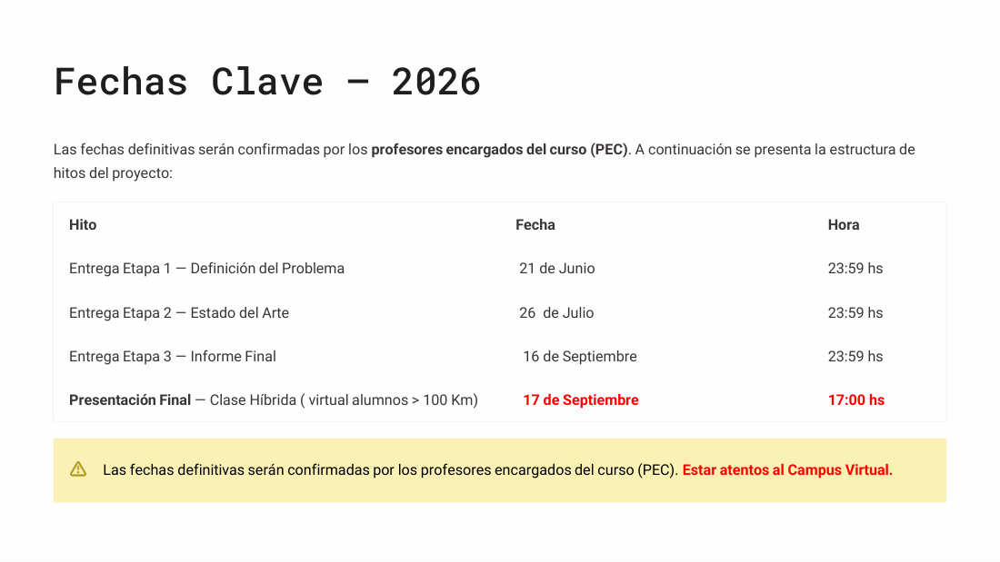
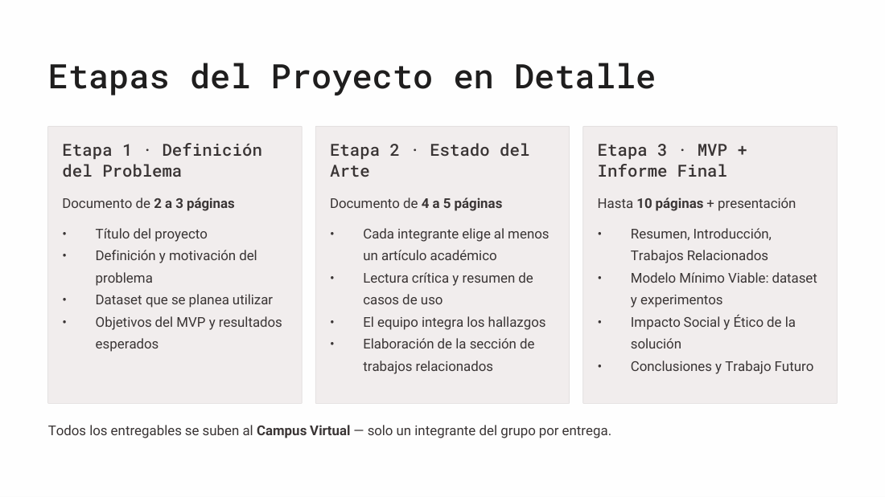
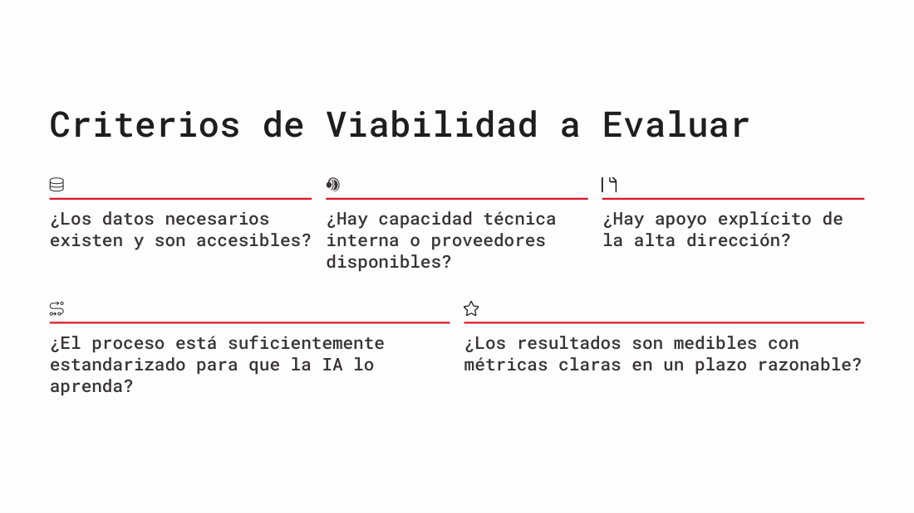
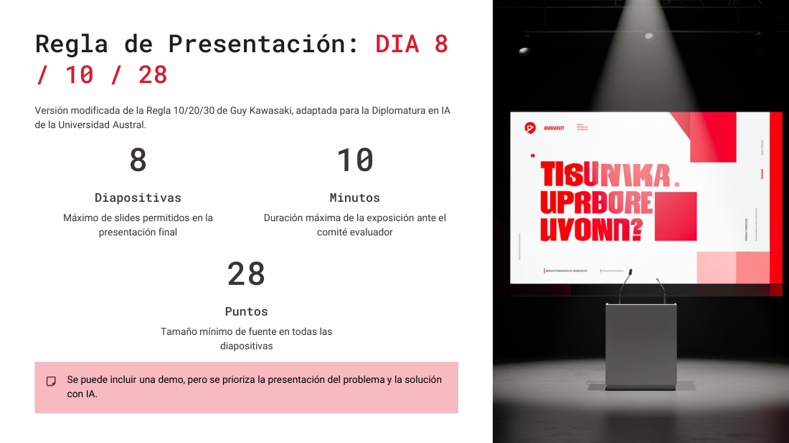
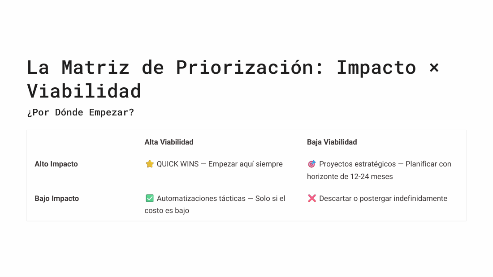
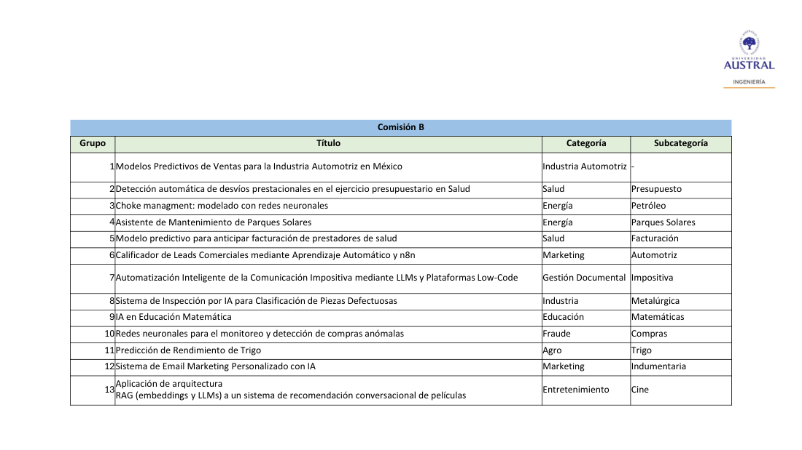

# Clase 14 · Trabajo Final Integrador: consignas, etapas y fechas

> **Trabajo Final Integrador · presentación de consignas** · Claudio Righetti y Diego Castro · jueves 21-may-2026 (clase híbrida)
> **Fuentes:** transcripción de la clase · láminas `Trabajo Final Integrador 2026 B.pdf` · documento de consignas `consignas_trabajo_final_2026.docx` (con los links a las planillas de programación y de temas de interés)

## En pocas palabras

- El **Trabajo Final Integrador (TFI)** consiste en proponer y resolver un problema real con un **modelo o agente de IA**. Se hace en equipos de idealmente **4 integrantes** y en **tres etapas**: definición del problema, estado del arte e implementación de un **MVP** (Modelo o Producto Mínimo Viable) con informe final y presentación oral.
- **Fechas:** Etapa 1 el **21 de junio**, Etapa 2 el **26 de julio**, informe final el **16 de septiembre** (todas a las 23:59 hs) y **presentación final el 17 de septiembre** a las 17:00 hs, en clase híbrida. Las confirman los profesores encargados del curso (PEC).
- La Etapa 1 es la más importante: hay que definir bien el problema y, sobre todo, **asegurarse de tener el dataset**. El dato es lo que más se subestima y lo que más hace caer proyectos.
- Para elegir el proyecto conviene usar la **matriz impacto × viabilidad** y empezar por un *quick win*: alto impacto y alta viabilidad. Hay que acotar el alcance del MVP para llegar en fecha y dejar el resto como trabajo futuro.
- La presentación final sigue la **regla DIA 8/10/28**: 8 diapositivas, 10 minutos como máximo (se controla estrictamente) y fuente de 28 puntos como mínimo. El informe final incluye una sección obligatoria de **impacto social y ético**.

## Resumen para consultar rápido

### Fechas clave

| Hito | Fecha | Hora | Entregable |
|---|---|---|---|
| Etapa 1 · Definición del problema | **21 de junio** | 23:59 hs | Propuesta de 2 a 3 páginas |
| Etapa 2 · Estado del arte | **26 de julio** | 23:59 hs | Documento de 4 a 5 páginas |
| Etapa 3 · Informe final | **16 de septiembre** | 23:59 hs | Informe (PDF) de hasta 10 páginas + presentación de hasta 8 diapositivas |
| Presentación final | **17 de septiembre** | 17:00 hs | Exposición oral en clase híbrida |

- Se usa 23:59 para que no haya ambigüedad sobre si "las 0 hs" incluyen o no ese día.
- La presentación es **presencial**. Según la lámina, la opción virtual queda para quienes viven a más de 100 km. Los profesores pidieron hacer "el máximo esfuerzo" para ir en persona.
- **Todos los entregables se suben al Campus Virtual, y los sube un solo integrante por grupo.** Se puede agregar un comentario del tipo "trabajo del grupo 4, integrado por…".

### Qué se pide en cada etapa

| | Etapa 1 · Definición del problema | Etapa 2 · Estado del arte | Etapa 3 · MVP + informe final |
|---|---|---|---|
| **Extensión** | 2 a 3 páginas | 4 a 5 páginas | Informe de hasta 10 páginas + presentación de hasta 8 diapositivas |
| **Contenido** | Título · definición y motivación del problema · dataset que se planea usar · objetivos del MVP y resultados esperados | Cada integrante elige **al menos un artículo**, lo lee críticamente y resume al menos un caso de uso relacionado · el equipo integra los hallazgos · se arma la sección de trabajos relacionados | Secciones obligatorias: Título · Resumen (*abstract*) · Introducción · Trabajos relacionados (lo de la Etapa 2) · MVP propuesto (dataset, experimentos y resultados) · Impacto social y ético · Conclusiones · Trabajo futuro |
| **Qué pasa después** | Se envía al PEC (Claudio y Diego), que evalúan relevancia y alcance y dan una devolución. Con el "OK" se arranca el desarrollo | Es la base de la sección "Trabajos relacionados" del informe final | Presentación oral ante el comité evaluador |

### Criterios con los que se evalúa (según lo que se dijo en clase y en las láminas)

No se presentó una rúbrica con puntajes. Lo que sí quedó explícito es qué miran los profesores en cada momento:

- **En la propuesta (Etapa 1):** la **relevancia** del problema y que el **alcance** permita terminar en tiempo y forma. También, que el dataset exista y esté disponible, y que los objetivos sean medibles.
- **Criterios de viabilidad** (lámina) que conviene responder antes de elegir el proyecto:
  1. ¿Los datos necesarios existen y son accesibles?
  2. ¿Hay capacidad técnica interna o proveedores disponibles?
  3. ¿Hay apoyo explícito de la alta dirección? En el TFI, la "cúpula" son los propios profesores.
  4. ¿El proceso está lo suficientemente estandarizado como para que la IA lo aprenda?
  5. ¿Los resultados se pueden medir con métricas claras en un plazo razonable?
- **En el estado del arte (Etapa 2):** que la lectura sea **crítica y hecha a conciencia**, no un resumen generado por un LLM para cumplir.
- **En el informe final:** que estén todas las secciones obligatorias, y en especial el análisis de **impacto social y ético**.
- **En la presentación:** que se respete la regla **8/10/28** (el tiempo se controla estrictamente) y que se priorice contar **el problema y cómo se resolvió con IA** por sobre la demo.
- **Comité evaluador:** Claudio Righetti (director de la Diplomatura), Diego Castro (coordinador académico) y otros profesores de la Diplomatura.

## Conceptos clave

### Equipos de trabajo

- **Tamaño ideal: 4 integrantes.** Se aceptan grupos con uno más o uno menos si se justifica la diferencia. Hacerlo de forma individual es una excepción (según Claudio, hubo dos o tres casos en más de 200 alumnos, por ejemplo por datos confidenciales) y hay que hablarlo con Diego.
- **Criterio de formación:** que en cada equipo haya **al menos una persona con experiencia en programación**, aunque haga tiempo que no programe. Según la experiencia de cohortes anteriores, eso marca la diferencia.
- **Cómo se arman:** los profesores proponen los grupos para que sean lo más interdisciplinarios posible. También se puede proponer un grupo propio, por afinidad, cercanía geográfica o datos confidenciales. Para eso hay que completar las dos planillas cuyos links están en el Word de consignas, dentro de la sección "Clase 14 TP" del campus: **experiencia en programación** y **temas de interés**. Cada planilla tiene una solapa por comisión.
- **Por qué en grupo:** los proyectos de IA reales se hacen en mesas interdisciplinarias, donde se cruzan expertos del negocio y perfiles técnicos. Según Claudio, los proyectos de IA que se encaran en soledad dentro de una empresa fracasan.

### Etapa 1: definición del problema

Es la que "arranca ahora" y la más importante para todo lo que sigue. Diego la describió como un ejercicio "más para pensar, reflexionar e investigar" que para escribir mucho. El foco está en tres cosas: **el objetivo, la motivación y el dataset**.

- **El dataset no se subestima.** El ejemplo de Diego: "quiero usar los datos del hospital". ¿Los tenés? "Tengo que pedirlos". Te pueden hacer firmar un NDA o no dártelos, y si eso falla, se cae el proyecto. La propuesta debería poder decir "este es el dataset y lo tengo" o "ya hablé y lo voy a conseguir". Gran parte del tiempo de esta etapa tiene que ir a buscar los datos.
- **Objetivos del MVP:** qué se quiere resolver, qué se espera del producto y qué resultados se esperan.
- **Cómo se va a medir el éxito.** Hay que definir primero qué datos se usan, después qué problema se resuelve y, por último, cómo se distingue si se lo está resolviendo o no: ¿*precision*, *recall*, otra métrica?
- Se puede elegir una técnica que todavía no se vio (por ejemplo, visión artificial). Se arranca con la idea y las técnicas se incorporan a medida que avanzan los módulos.

### El MVP (Modelo / Producto Mínimo Viable)

Es una muestra acotada de lo que se querría hacer en grande. Es lo que se pide en una empresa en fase exploratoria: nadie aprueba un proyecto de dos años y dos millones de dólares solo con una idea, pero sí un MVP de dos o tres meses que demuestre el potencial.

- Hay que **definir un punto de corte** que permita llegar al 17 de septiembre. Lo que quede afuera pasa a **trabajo futuro**.
- Se puede mirar a largo plazo: varios MVP se convirtieron después en productos comerciales o en tesis de maestría.

### Etapa 2: revisión del estado del arte

¿Alguien ya hizo algo parecido? ¿Alguien sentó las bases de lo que quiero hacer? La idea es **construir sobre lo que construyeron otros** y comprobar si lo planeado ya se hizo.

- Cada integrante elige **al menos un artículo académico** o documento de fuentes con cierto prestigio, lo lee críticamente y lo resume **con sus palabras**. Después el equipo integra una visión común.
- **No delegarlo en un LLM.** Subir el *paper* a ChatGPT y pedir un resumen es fácil, pero lo valioso es entender con qué dificultades se encontraron otros y cómo las resolvieron, porque eso ahorra tiempo.

### Etapa 3: MVP, informe final y presentación

El informe final se construye **en parte con lo hecho en las Etapas 1 y 2** (resumen, introducción, trabajos relacionados) y suma la descripción del dataset, los experimentos y los resultados.

**Impacto social y ético.** Para los profesores, es una parte fundamental de cualquier proyecto con IA. El ejemplo de Diego, en salud: si el modelo anticipa la detección de una enfermedad, ¿cómo se le comunica al paciente? ¿Qué umbral de decisión se define para decir "sí" o "no"? ¿Cómo se midió? Si el proyecto no tiene impacto, se lo dice; si lo tiene, tiene que estar analizado.

### Regla de presentación DIA 8/10/28

Es una versión modificada de la regla 10/20/30 de Guy Kawasaki.

| Número | Qué fija |
|---|---|
| **8** | Diapositivas como máximo |
| **10** | Minutos como máximo de exposición ante el comité |
| **28** | Puntos como tamaño mínimo de fuente en todas las diapositivas |

- La presentación puede estar en PowerPoint o PDF y pueden exponer uno o varios integrantes.
- Se puede hacer una **demo** si aporta valor, pero no es obligatoria. Lo prioritario es contar el problema, los datos, las técnicas y cómo se resolvió.
- **Por qué 10 minutos:** el tiempo de quienes toman decisiones es cada vez más acotado, y en los niveles más altos a veces hay solo cinco. En una conferencia científica, una exposición dura unos 15 minutos. Comprimir el informe en un *pitch* de 10 minutos lleva mucho más que 10 minutos de preparación.

### Matriz de priorización: impacto × viabilidad

|  | Alta viabilidad | Baja viabilidad |
|---|---|---|
| **Alto impacto** | **Quick wins:** empezar siempre por acá | Proyectos estratégicos: planificar con un horizonte de 12 a 24 meses |
| **Bajo impacto** | Automatizaciones tácticas: solo si el costo es bajo | Descartar o postergar indefinidamente |

**Por qué empezar por los *quick wins*** (lámina): dan **resultados tangibles**, porque demuestran el valor de la IA con evidencia real en el contexto de la organización; generan **credibilidad interna** ante la alta dirección para conseguir recursos para proyectos más grandes, y producen **aprendizaje organizacional** sobre qué funciona y qué no en ese contexto. El error más frecuente es ir directo a los proyectos ambiciosos. Cuando fracasan, se instala la idea de que "la IA no funciona" y la organización retrocede en su curva de adopción.

### Datos: calidad, cantidad y curación

- **Basura entra, basura sale.** Si los datos son de mala calidad o están sesgados, lo que salga del modelo también lo va a estar. "La IA es tan buena como los datos con los que la entrenás".
- **Cuidado con los datasets sintéticos** de Kaggle o Hugging Face. Si un modelo da 100 % de *precision* y de *recall*, hay que desconfiar: puede haber *data leakage*, un error en el *pipeline* de entrenamiento o datos demasiado fáciles, como los generados al azar con patrones falsos.
- **Curación de datos** (lámina): recolección (de varias fuentes), limpieza (sacar duplicados y errores), organización (estructurar para el análisis) y enriquecimiento (agregar contexto y metadatos).
- **Enriquecer con contexto.** Con la serie del dólar sola es muy difícil predecirlo. Si se agregan elecciones, préstamos del FMI o noticias, el modelo puede asociar las fluctuaciones con eventos. A veces un modelo que no mejora no está "mal hecho": le faltan datos.
- **¿Cuántos datos hacen falta?** Depende. En telecomunicaciones sobran gigas, mientras que en imágenes médicas a veces hay unas mil. Con pocos datos, conviene usar **modelos preentrenados** y **aumentación** (rotar, recortar, agregar ruido o brillo para generar variabilidad). Con muchos datos aparece otro problema: si la máquina local alcanza o hay que ir a la nube. No se exige la nube; GCP ofrece crédito gratuito, pero es más complejo. Conviene buscar algo que se pueda procesar localmente.

### La herramienta justa y el "arte" de la IA

- **No toda herramienta sirve para todo.** La IA generativa es como una navaja multiuso: corta, pero si se necesita una tijera, conviene usar una tijera. El ejemplo de la clase fue una empresa que quiso detectar con IA generativa la emoción de los clientes al cargar combustible. No escaló, y probablemente la herramienta adecuada eran los modelos clásicos de visión artificial. Además, la generativa se paga ("¿quién paga la fiesta?").
- **IA = Matemáticas + Estadística + Software + Arte.** El arte está en que no hay una receta única: cada problema tiene su vuelta de tuerca, y los equipos interdisciplinarios aportan ese conocimiento experto.
- **Pensar el problema:** la cita atribuida a Einstein dice que, con una hora para resolver un problema, dedicaría 55 minutos a pensar el problema y 5 a las soluciones. Claudio contó que, en una experiencia con la escuela de negocios, a los alumnos les costó muchísimo **definir** un problema donde aplicar IA.

## Ejemplos y casos de la clase

Trabajos de cohortes anteriores, mostrados como "musa inspiradora" y como cota superior de lo que se puede lograr, no para copiarlos.

**Cohorte 2024** (dos comisiones, sin curso de nivelación):
- **VeterinarIA:** un asistente basado en un manual de farmacología veterinaria (Manual Plumb) para guiar la administración segura de medicamentos. Se destacó por su buen *storytelling*.
- **Predicción de la hormona PTH en pacientes de hemodiálisis:** medirla es caro y se hace cada seis meses; el modelo busca anticipar el valor para apoyar la decisión del nefrólogo.
- **Detección de lenguaje de señas** por video, surgida de la necesidad de un padre con un hijo sordo.
- **Pronóstico de la inflación salvadoreña** con un modelo CNN-LSTM.
- **Chatbot jurídico de defensa del consumidor** con RAG.
- **Asistente con *reinforcement learning* (PPO)** sobre un simulador de entrenamiento nuclear.
- Otros: anomalías de impresión en envases flexibles, interacción de las personas con carteles publicitarios (visión), clasificación de documentación crediticia (combinando visión y NLP), precio del m² en Rosario (el caso "sencillito", con lo del primer módulo) y anomalías de ventas de consumo masivo.

**Cohorte 2025** (tres comisiones, con nivelación; las tablas por comisión tienen categoría y subcategoría):
- **Comisión A:** recolección de residuos en Ezeiza; cáncer de piel con visión; auditoría de call centers de salud; fraude en seguros automotores; *Taste Recognition* (control de calidad de productos a partir de una foto); copiloto para evaluar créditos; priorización de vulnerabilidades web; contenido personalizado para e-commerce; inspección de aisladores de media tensión con pocas imágenes y datos sintéticos; detección de accidentes en vía pública; **análisis deportivo con YOLO** (el favorito de Diego: lo mencionó el propio creador de YOLO), y visualización de *workflows* de ML.
- **Comisión B:** ventas automotrices en México (series de tiempo), desvíos prestacionales en salud, *choke management* en Vaca Muerta, mantenimiento de parques solares, facturación de prestadores de salud, calificador de *leads* con n8n, comunicación impositiva con LLMs, piezas defectuosas con visión, IA en educación matemática (multimodal), compras anómalas, rendimiento de trigo, *email marketing* personalizado y un recomendador conversacional de películas con RAG integrado a WhatsApp.

- **Comisión C:** clasificación de maní con visión; fenotipos de enfermedad renal crónica con *clustering* no supervisado; consulta conversacional de datos empresariales; estacionamiento colaborativo (*Park Now*); lectura de facturas para el IVA; zonas agrícolas no cultivadas con imágenes satelitales y CNN (inspirado en un *paper* de Ucrania); retención proactiva de talento; tendencias del mercado financiero; orientación universitaria con RAG; automatización de facturas (un grupo de Paraguay que después lo implementó en su empresa), y fraude con tarjetas de crédito (el caso con datos sintéticos).

**Lecciones que dejaron algunos casos:**
- **Maní:** el grupo quería distinguir 20 clases y los profesores le pidieron reducirlas a cinco o seis para el MVP y dejar el resto como trabajo futuro. También aplicó "arte": subir el contraste del fondo blanco mejoró la detección.
- **Aisladores con pocas imágenes:** el grupo tenía imágenes de unos 58 equipos. Son pocas, "pero a veces es lo que tenés". Igual llegó a un proyecto publicable, generando datos sintéticamente.
- **Fraude con tarjetas:** el dataset sintético de Kaggle daba métricas perfectas que no significaban nada.
- **Dólar vs. inflación de El Salvador:** predecir el dólar en Argentina tiene muchas más variables que relevar. Hay series "más terrenales" que no por eso son sencillas.

## Para recordar

- "Dediquen gran parte del tiempo de la Etapa 1 a conseguir los datos". Sin datos accesibles, el proyecto se cae.
- Hay que definir **cómo se va a medir el éxito** desde el principio, no al final.
- Es mejor un MVP chico que llegue a fecha que una idea brillante que no termina: hay que recortar y dejar el resto como trabajo futuro.
- La lectura del estado del arte se hace a conciencia: con lo que otros chocaron es justamente lo que les ahorra tiempo.
- Hay que **desconfiar de las métricas perfectas** y revisar si hay *data leakage*, datos sintéticos o errores en el *pipeline*.
- Se usa la herramienta justa: no todo problema necesita IA generativa.
- 8 diapositivas, 10 minutos, fuente de 28. Y armar el *pitch* lleva mucho más que 10 minutos.
- Un solo integrante sube cada entrega al campus.
- Se puede consultar a Diego, a Claudio o al profesor del módulo que más sabe del tema del proyecto.

## Preguntas de repaso

1. ¿Por qué los profesores insisten en resolver el dataset ya en la Etapa 1?

Porque es lo que más se subestima y lo que más hace caer proyectos. Si los datos dependen de un tercero (un hospital o una empresa), pueden tardar, exigir un NDA o directamente no llegar. La propuesta tiene que poder afirmar que el dataset está disponible o que su obtención ya está encaminada.

2. Un grupo quiere clasificar 20 tipos de defectos con visión artificial en tres meses. ¿Qué le recomendarían los profesores y por qué?

Acotar el MVP a unas pocas clases (en el caso del maní, cinco o seis) y dejar el resto como trabajo futuro. El MVP tiene que llegar a la fecha de entrega y demostrar el potencial; con eso se justifica después ampliar el alcance.

3. En la matriz impacto × viabilidad, ¿dónde conviene ubicar el TFI y qué riesgo tiene saltear ese cuadrante?

En el de alto impacto y alta viabilidad (*quick wins*), porque da resultados tangibles, credibilidad y aprendizaje rápido. Ir directo a un proyecto ambicioso y poco viable suele fracasar e instala la idea de que "la IA no funciona".

4. ¿Qué distingue una buena Etapa 2 de un resumen hecho para cumplir?

La lectura crítica: entender qué problema abordó cada trabajo, con qué dificultades se encontró y cómo las resolvió, y relacionarlo con el propio MVP. Un resumen automático de un LLM no aporta ese aprendizaje ni el ahorro de tiempo que da conocer los errores de otros.

5. Tu modelo da 100 % de precision y 100 % de recall. ¿Qué revisás?

Si hay *data leakage* o algún error en el *pipeline* de entrenamiento, y si el dataset es sintético o demasiado fácil, con patrones artificiales. Métricas perfectas son una señal para desconfiar, no para festejar.

6. ¿Qué preguntas debería responder la sección de impacto social y ético en un proyecto de salud?

Por ejemplo: qué umbral de decisión se usa para decir que un paciente "tiene" o "no tiene" algo y cómo se lo midió, cómo se le comunica el resultado y qué consecuencias tienen los errores. Si no hay impacto, se lo dice explícitamente.

7. ¿Qué hacer si el proyecto tiene muy pocos datos (por ejemplo, unas decenas de imágenes)?

Usar modelos preentrenados y técnicas de aumentación de datos (rotar, recortar, agregar ruido o cambiar el brillo) para generar variabilidad. También se puede generar datos sintéticos a partir de los reales, como hizo el grupo de los aisladores.

8. ¿Por qué la regla 8/10/28 y no una presentación libre?

Porque entrena a comunicar una idea completa (problema, datos, técnicas y solución) en el poco tiempo que dan quienes deciden. Obliga a sintetizar y a priorizar el problema y la solución por sobre la demo, y la fuente grande obliga a poner poco texto por diapositiva.

## Conexiones

- **Hacia atrás:** el aviso sobre métricas perfectas y *data leakage* retoma la evaluación con datos que el modelo no vio (Clase 03) y las métricas *precision* y *recall* del módulo de fundamentos. La curación y el enriquecimiento de datos conectan con la imputación y la ingeniería de atributos (Clase 06).
- **Hacia adelante:** muchos de los ejemplos usan técnicas que vienen después: visión artificial (YOLO, CNN, aumentación de datos), que empieza con el módulo siguiente; NLP; RAG y agentes del módulo de IA generativa; y automatización con n8n. Los profesores recomendaron consultar al docente del módulo que corresponda al tema del proyecto.
- **TFI:** esta clase define el marco del trabajo. Aplicado al normalizador de nombres comerciales de Benefix, la Etapa 1 pide asegurar el dataset de nombres y sus normalizaciones de referencia, y fijar desde el principio la métrica de éxito (Hit@k y MRR). La Etapa 2 corresponde a revisar trabajos sobre retrieval léxico, semántico e híbrido (RRF) y sobre enfoques generativos. La Etapa 3 corresponde a comparar esos enfoques como MVP, sin olvidar la sección de impacto ético.
